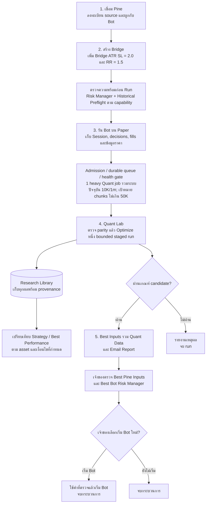

# Robot trade — Project Context

Codex N1 local progress, 2026-10-19 (Bangkok): root accepted two further data-only components after independent tests and architecture review. The configuration parser verifies bounded, canonical bytes against a trusted expected hash and returns immutable data; its 19 author checks and 12 independent checks passed. The in-memory evidence sink retains one immutable historical snapshot and checks final receipt correspondence without promoting UNKNOWN; its 18 author checks and 12 independent checks passed. Neither component executes source payloads or establishes runtime identity, lineage authority or a GO. The previously accepted contract, source mapping, adapter, generator, framing and capture components remain local evidence. Next is the outer observation schema and validation, followed by separately reviewed orchestration and emission integration. The transport exception, fresh health/admission, complete source and receipt fit, native timing, Clock qualification and production gates remain open. No new host step or GO occurred. See [the N1 local record](docs/evidence/DP1P_N1_LOCAL_2026-10-19.json).

Codex B2 completion, 2026-10-19 (Bangkok): Codex is the sole root after the whole-project handoff. Five fresh real-turn synthetic runs passed before the owner's new continuous-work and continuous-GO instruction was applied to W-A06-K01. Admission A06 was CLEAR and [the KILL window](docs/evidence/DP1P_B2_WINDOW_KILL_2026-10-19.json) passed: TERM_IGNORED, timeout exit 137 after 7.01 seconds, no observer signal, and the probe absent afterwards. NORMAL, TERM and KILL have now all passed B2. This window's GO is consumed; Clock and settlement qualification, RD7 and approved limits, and production S3 remain gated. Nothing was deployed, migrated or restarted; REA remains paused and PM-1 S1 is unchanged.

Claude to Codex handoff, 2026-10-19 (Bangkok): the owner asked Claude to hand the whole project and the latest work to Codex, so Claude stopped with no agent running and no GO open. Read [the handoff](docs/CLAUDE_TO_CODEX_HANDOFF_2026-10-19.md) and its private companion first. The NORMAL and TERM supervision windows both passed; the KILL window is prepared and checked but has not run and needs a fresh owner GO under the new root, after its own real-turn dry runs on a quiet computer.

Claude B2 window TERM, 2026-10-19 (Bangkok): under the owner GO W-A05-T01, admission A05 was CLEAR and the inert TERM probe ran once. At the 2-second limit timeout sent TERM, the probe recorded that it handled it, and timeout exited with code 124 and no signal; the observer itself sent no signal. The post-window review classed it BEHAVIOUR_PASS, recorded in [the TERM window record](docs/evidence/DP1P_B2_WINDOW_TERM_2026-10-19.json). The GO is consumed. The KILL window needs its own preparation and a fresh owner GO. This is one bounded probe, not service health or production readiness.

Claude B2 window NORMAL, 2026-10-19 (Bangkok): under the owner GO W-A04-N01, root ran the first supervision window. Admission A04 was CLEAR, root released the NORMAL job, and the inert NORMAL probe ran once under the coreutils 9.4 env and timeout profile: it reported READY under the timeout process, finished, and the timeout process exited with code 0 and no signal, with no TERM or KILL requested. The post-window review classed it BEHAVIOUR_PASS, recorded in [the NORMAL window record](docs/evidence/DP1P_B2_WINDOW_NORMAL_2026-10-19.json). Before the window, the five real-turn dry runs passed on corrected tools after preparation on the real records found and fixed one size-limit defect. The GO is consumed. The TERM window needs its own preparation and a fresh owner GO. This is one bounded probe, not service health or production readiness.

Claude resumed as root, 2026-10-19 (Bangkok): the owner returned sole command to Claude after Codex could not start the dry runs, because another project's tests were loading this computer. While the machine was busy, Claude prepared the NORMAL window locally: the prior review for C01 passed on the real records, admission A04 and the NORMAL stage-one job were prepared without any SSH, and the real window contract was built and checked. This preparation found one real defect: a root tool still used an old file name in its size limits, so it refused the real C01 receipt, which is larger than any test receipt. The one-line fix (W4B R3) and the matching dry-run harness update (W6B R3) passed independent tests. The real-turn dry runs restart on the corrected tools when the computer is quiet. No host step, admission or GO occurred.

Claude to Codex handoff, 2026-10-18 (Bangkok): the owner asked Claude to hand the whole project and the latest work to Codex, so Claude stopped with no agent running and no GO open. Read [the handoff](docs/CLAUDE_TO_CODEX_HANDOFF_2026-10-18.md) and its private companion first. In this tenure Claude ran one owner-approved release window with two read-only host steps (admission A03 CLEAR, metadata read C01 observed) and built and accepted the B1 supervision tools locally, recorded in [the B1 build record](docs/evidence/DP1P_SUPERVISOR_B1_BUILD_LOCAL_2026-10-18.json). The next step is to finish the real-turn dry runs under the new root, with five consecutive passes including TERM and KILL, then prepare the NORMAL window, which needs a fresh owner GO. Nothing was deployed, migrated or restarted.

Claude B1 build stop checkpoint 3, 2026-10-18 (Bangkok): root accepted the dry-run harness W6B locally after one correction round. The first version overstated the adapter time, and its controls missed the review check for a non-zero runner exit; both are fixed. On a quiet computer the stage-two adapter now takes about 2 to 2.5 seconds against its 10-second budget, and the runner reaches its contact point in about 1 to 1.5 seconds against 4 seconds. The real-turn dry runs began: the first run, with the single operations worker and live root decisions, passed with the GO 18.7 seconds old, well inside the 75-second cap. Four more consecutive passing runs are needed before preparing the NORMAL window. One known limit is kept: a local runner refusal before any contact would be classed UNKNOWN rather than not executed, which stops B2 for an owner decision but cannot produce a false pass. No host step, admission or GO occurred.

Claude B1 build stop checkpoint 2, 2026-10-18 (Bangkok): the dry-run harness W6B was built and its own runs passed for every result class, but its independent check was stopped when the owner asked to stop, so W6B is not yet accepted. The runs showed that two local time budgets, 4 seconds for the runner before contact and 10 seconds for the stage-two adapter, are tight when this computer is busy; one busy run stopped safely before contact. Dry runs and real windows will therefore run with nothing else active on this computer. No host step, admission or GO occurred.

Claude B1 build checkpoint 3, 2026-10-18 (Bangkok): root accepted three more B1 tools locally. The stage-two adapter AD-P3B now checks the pure finalizer's full import list against its pinned proof before loading it. The post-window review W5B now requires the case in the window contract to match the GO, the job configuration and the receipt, and it treats truncated output as UNKNOWN. The root commands W4B include a new prior-review tool, which writes the review that lets the next window start. W4B needed one correction round: the first version would have refused the real C01 window record and did not check that root had accepted the previous window. It now reads a separate root acceptance record and checks the order of earlier job IDs. Each tool passed an independent test and an Opus audit, and AD-P3B and W4B also had a Fable second opinion. The adapter's 10-second time budget is tight on this computer, so the dry runs will measure it before any window. The dry-run harness W6B is being built next. No host step, admission or GO occurred.

Claude B1 build checkpoint 2, 2026-10-18 (Bangkok): root accepted behaviour package P3B locally after a third correction round. The prior review now binds how the previous window ended, and the runner checks that the observed case matches the job. Root also accepted the stage-one materializer M3B, the window library W2B (pending one job-id binding), the operations-session deny-list update W3B and the pure finalizer F3B, each after independent tests and, where the logic carries risk, an Opus audit. The post-window review W5B passed review but needs one tightening round, and the stage-two adapter AD-P3B was being built when the owner asked to stop. Both partial outputs are treated as untrusted and will be rebuilt. No host step, admission or GO occurred.

Claude B1 build stop checkpoint, 2026-10-18 (Bangkok): root accepted the behaviour assembly locally. The assembled observer source is about 60 KB, under the 64 KiB cap, and behaves the same as the unassembled runtime in fake-world comparisons. Package P3B needed one correction round to pin the probe source hash and the prior route's SSH binary hash in the lineage. Its independent test found no defect, and its Opus audit found no blocking issue but asked for the prior-window outcome to be bound in the prior review. The stage-one materializer M3B and the operations-session deny-list update W3B were built and reviewed. One M3B test run hung and was stopped, so M3B still needs its independent test. Nothing new is accepted beyond the assembly. No host step or GO occurred; the overnight GO authority ended with the owner's stop message.

Claude B1 supervision build checkpoint, 2026-10-18 (Bangkok): after the first metadata read, the next Roadmap step is the native supervision check B1. Root adopted a [B1 source review and design](docs/evidence/DP1P_SUPERVISOR_B1_LOCAL_2026-10-18.json). For the coreutils 9.4 env and timeout binaries seen at C01, a plain exit should give 0, a handled TERM 124 and an ignored TERM 137 in foreground mode. The design uses one behaviour package for three inert probe cases, NORMAL, TERM and KILL, and an observer that may send one SIGTERM but never SIGKILL. The owner accepted all ten design decisions as recommended: three separate windows in that order, each with its own GO, and an UNKNOWN result stops B2. Root accepted the three fixed probe sources and the remote behaviour runtime locally after independent tests and Opus audits. The runtime needed two correction rounds so that unexpected output gives UNKNOWN rather than NONPASS. All work was local with synthetic inputs, and real signal delivery and timeout exit codes can be shown only on the target in B2. No host step, admission or GO occurred. Fable is paused by the owner.

Claude release-window run, 2026-10-17 (Bangkok): the owner installed PowerShell 7.6.5, root accepted the remaining window tools after independent tests and audits, and five real-turn dry runs passed. Under a fresh bounded owner GO, the single operations worker ran the [release window](docs/evidence/DP1P_RELEASE_WINDOW_A03_C01_2026-10-17.json) once. Admission A03 was CLEAR from one read-only SSH session. Root compared the result with the frozen criteria, finalized metadata job C01 locally and wrote the metadata GO 12.1 seconds after admission. The metadata runner then made one read-only SSH read and returned OBSERVED_METADATA, with post-run pins valid and the diagnostic verified at capture. This is the first real metadata read in this chain. It is not a service health, supervision or production qualification. The GO is consumed, and any further host step needs a new owner GO.

Claude release-window checkpoint, 2026-10-17 (Bangkok): the metadata step must start its SSH contact within 120 seconds of a fresh admission, so root adopted a [release-window design](docs/evidence/DP1P_RELEASE_WINDOW_TOOLS_LOCAL_2026-10-17.json) from an Opus draft, an independent Fable draft and an Opus judge. Root accepted two local candidates: a pure window library and a pre-armed operations session that starts each launcher once, only after a verified root ticket. Each passed one correction round with independent tests and audits. With the owner's approval, admission A03 was prepared on real local inputs by exact substitution from A02, with no SSH connection and no GO. Root commands for the window, a post-window review tool and a dry-run harness are in a correction round. Synthetic dry runs finished the chain with the metadata GO 14 to 18 seconds after admission; these are not real timings. No host step or GO occurred. Next: the owner installs PowerShell 7.6.5, root runs real-turn dry runs, then a fresh bounded owner GO for one admission and one metadata SSH.

Claude private stage-one checkpoint, 2026-10-17 (Bangkok): with the owner’s approval, the single operations worker ran stage-one materializer M2 once on the real local inputs. It [prepared job DP1P-D1-METADATA-NATIVE-20261017-C01](docs/evidence/DP1P_METADATA_STAGE1_PRIVATE_C01_2026-10-17.json) with admission still missing and no GO. The installed SSH binary passed the pinned shared two-link profile through the accepted reader; this is a local point check, not image-at-spawn attestation. A first attempt stopped before the materializer started because of a wrapper path error and created nothing. No SSH connection, network access, key read, host step or GO occurred. The next step is a fresh read-only admission on the target host. It needs a protected PowerShell 7 installation while the owner is at the PC, current authorized health evidence and a new bounded owner GO. Claude weekly usage is 44 percent remaining; REA and PM-1 S1 are unchanged.

Claude P2 chain checkpoint, 2026-10-17 (Bangkok): root accepted the rebuilt [P2 chain](docs/evidence/DP1P_METADATA_P2_CHAIN_LOCAL_2026-10-17.json) locally. It consists of package P2, stage-one materializer M2, pure finalizer P2 r2 and stage-two adapter P2, and each step pins only the previous accepted hash. P1 and its chain stay immutable. An earlier finalizer revision was rejected because it still imported modules from P1. All inputs were synthetic, the installed SSH binary was not read, and no host step, admission or GO occurred. The next step is the actual private stage-one preparation. It reads the installed SSH binary and other local trust files, and is followed by a fresh admission and GO through the single operations worker. That step needs the owner’s decision, together with a protected PowerShell 7 installation. Claude weekly usage is 44 percent remaining; REA and PM-1 S1 are unchanged.

Claude takeover checkpoint, 2026-10-17 (Bangkok): Claude took sole command after the Codex stop at 4bddbd5 and continued local DP1-P work under the owner’s continuous-work instruction. Root accepted four local pieces. The [PowerShell SSH handle helper](docs/evidence/DP1P_SSH_PS_HELPER_F1_LOCAL_2026-10-17.json) passed 136 of 149 real Windows inert-fixture cases with none failing; the rest were one skip and record-only observations. The [runner and launcher SSH wiring](docs/evidence/DP1P_SSH_WIRING_S1_LOCAL_2026-10-17.json) retains and compares SSH snapshots, with recorded limits. A static package P2 replaces only those two members of P1, and a stage-one materializer M2 is anchored to P2. The pure finalizer and adapter rebuild for P2 is in progress. All of this is local evidence on inert fixtures: the installed SSH binary was not read, and no host step, deployment, migration or GO occurred. A later native launch needs a stable, protected PowerShell 7 installation, which requires the owner’s approval. Claude weekly usage is 45 percent remaining; REA and PM-1 S1 are unchanged.

Codex-to-Claude stop checkpoint, 2026-10-17: the owner requested a stop and [whole-project handoff](docs/CODEX_TO_CLAUDE_HANDOFF_2026-10-17.md). Codex dispatch and implementation are stopped; all children returned, with no owned job or open GO. SSH-READER-R2 is accepted locally. SSH-PS-HELPER-C1 is partial and unaccepted: original C# compilation passed, but no native API fixture or independent review ran. Its source and evidence are frozen privately. Read the private handoff first, then reverify Git, ownership, runtime and Claude usage before authorized takeover/resume. HEAD remains 4bddbd5; the latest evidence and handoff are uncommitted and unpushed. Codex weekly remaining is 14%, short-window unknown; REA and PM-1 S1 remain unchanged. [Stop record](docs/evidence/DP1P_CODEX_TO_CLAUDE_STOP_2026-10-17.json).

SSH reader checkpoint, 2026-10-17: root accepted [SSH-READER-R2 locally](docs/evidence/DP1P_SSH_READER_R2_LOCAL_2026-10-17.json) after 16 independent injected cases, one control and ten actual Windows inert cases. The comparator now rejects missing or accessor-backed identity facts. The fixed shared-image profile checks exact hash, size, two links and separator-only spelling; filesystem identity changes and incomplete reads refuse. Windows shared-profile fixtures transform only the fixed hash and size, so they do not qualify the installed SSH image. Next is the authenticated PowerShell handle helper, then four consumer integrations and a rebuilt package/source-pin chain before retrying private preparation. No new host step or GO occurred. Usage is 15% weekly remaining, short-window unknown, floor 3%; REA and PM-1 S1 remain unchanged.

Metadata stage-two checkpoint, 2026-10-17: root accepted [ADAPTER-C1 locally](docs/evidence/DP1P_METADATA_STAGE2_ADAPTER_C1_LOCAL_2026-10-17.json) after 34 independent VM cases, one control and one actual Windows synthetic case. The Windows call completed in 1,659 ms. Six exclusive files, final layout, original clocks and source/trust rechecks passed; late failures retain evidence and never grant GO. [PURE-C1](docs/evidence/DP1P_METADATA_STAGE2_PURE_C1_LOCAL_2026-10-17.json) remains accepted. Actual private preparation [stopped before draft creation](docs/evidence/DP1P_METADATA_PRIVATE_PROFILE_STOP_2026-10-17.json): the authenticated SSH binary has two hard links and a noncanonical lexical path spelling, outside the strict reader profile. Its hash still matches. Review of a narrow supported profile across the pinned chain is next; no materializer invocation or new GO occurred. Usage is 19% weekly remaining, short-window unknown, floor 3%; REA and PM-1 S1 remain unchanged.

Metadata stage-one checkpoint, 2026-10-17: root accepted [MATERIALIZER-R4 locally](docs/evidence/DP1P_METADATA_STAGE1_MATERIALIZER_R4_LOCAL_2026-10-17.json). Independent verification passed 34 VM cases with two separate controls and one real Windows filesystem case. The stdout completion defect is corrected. Ten immutable files and an empty controller directory are prepared without admission or GO; a retained stage-one record alone is never sufficient after a late failure. Next is reviewed stage-two release finalization before fresh admission and actual private preparation. Usage is 24% weekly remaining, short-window unknown, floor 3%. No new host execution, Git write or production change occurred; REA and PM-1 S1 remain unchanged.

Metadata preparation checkpoint, 2026-10-17: the stage-one materializer is under implementation and is not accepted. Its bounded file reader passed six author checks, in addition to eight foundation checks. Authenticated helper wiring is defined; complete publication and independent verification remain pending. The accepted Windows filesystem and package evidence is unchanged. Usage is 26% weekly remaining, short-window unknown, with the owner-authorized 3% floor. Work continues one bounded local slice at a time; no new host execution or GO is open. REA remains paused.

Metadata Windows filesystem checkpoint, 2026-10-17: root accepted [WIN-FS-P1 locally](docs/evidence/DP1P_METADATA_WINDOWS_FS_P1_LOCAL_2026-10-17.json) after three fresh runs with actual Windows files and injected transport. Conditional COMPLETE passed post-pin checks; malformed raw data and postcontact launcher drift retained evidence and returned STOP. Native fallback spawn stayed zero. Remote witnesses and clocks remain synthetic. Next is a reviewed stage-one materializer for immutable release inputs before fresh admission. Usage is 28% weekly remaining, short-window unknown, floor 3%. No new host execution, Git write or production change occurred; REA and PM-1 S1 remain unchanged.

Metadata package checkpoint, 2026-10-17: root accepted [PACKAGE-P1 locally](docs/evidence/DP1P_METADATA_PACKAGE_P1_LOCAL_2026-10-17.json). All 41 files match accepted sources; 39 modules contain 61 relative import declarations, representing 60 distinct module requests, with no dynamic imports or cycles. Five full preflight checks and five actual-helper runner checks passed on the final package. Conditional COMPLETE still uses a trusted witness seam. Actual Windows filesystem composition, private release materialization and fresh admission/GO remain pending. Usage is 29% weekly remaining, short-window unknown, floor 3%; work continues one small slice at a time. No new host execution, Git write or production change occurred; REA and PM-1 S1 remain unchanged.

Metadata controller checkpoint, 2026-10-17: root accepted [CONTROLLER-C1 locally](docs/evidence/DP1P_METADATA_CONTROLLER_C1_LOCAL_2026-10-17.json) after 15 independent fake lifecycle cases plus one control, 12 actual writer/drain checks including one control, and three bounded native local cases. Binary exit 7 was captured accurately, dual overflow remained nonpass, and the original 50-second timeout closed the captured local process while preserving UNKNOWN remote settlement. No owned test process remains. The native cases used synthetic preflight; final package integration and fresh admission/GO remain pending. Usage is 30% weekly remaining, short-window unknown, floor 3%; subsequent slices run one at a time. No new host execution, Git write or production change occurred; REA and PM-1 S1 remain unchanged.

Metadata runner checkpoint, 2026-10-17: root accepted [RUNNER-R3 locally](docs/evidence/DP1P_METADATA_RUNNER_R3_LOCAL_2026-10-17.json) after 25 independent lifecycle/raw/path checks and 10 CLI/request/clock checks, with one reverse control included in each group. The tests use the actual lineage, assembly and envelope helpers; COMPLETE still uses an explicit trusted witness seam. Safe raw prefixes and diagnostic candidates survive tested failures. The controller candidate is under independent review; final package closure and native execution remain pending. Usage is 32% weekly remaining, short-window unknown, floor 3%. No new host execution, Git write or production change occurred; REA and PM-1 S1 remain unchanged.

Metadata launcher checkpoint, 2026-10-17: root accepted [R4 preflight locally](docs/evidence/DP1P_METADATA_LAUNCHER_PREFLIGHT_R4_LOCAL_2026-10-17.json) after 19 independent checks and two included reverse controls. The fixed 41-file closure, 11 roles, strict review types and conservative no-link file profile are checked before JavaScript evaluation. The executable entry still refuses; controller integration, final package verification and a fresh bounded GO remain pending. No new host execution or production change occurred. Usage is 34% weekly remaining, short-window unknown, floor 3%; REA and PM-1 S1 remain unchanged.

Metadata transport checkpoint, 2026-10-17: root accepted [TRANSPORT-X locally](docs/evidence/DP1P_METADATA_TRANSPORT_X_LOCAL_2026-10-17.json) after whole-module extraction parity and 23 independent synthetic checks, including one changed-count control. The fixed package design has 41 entries, 37 frozen copies and 53 resolved relative imports. Runner and generic launcher implementation remain pending. Transport termination requests still do not prove actual close or drains; no new host execution or GO is accepted. Usage is 40% weekly remaining, short-window unknown, floor 3%. REA and PM-1 S1 remain unchanged.

Metadata release lineage checkpoint, 2026-10-17: root accepted [L2 locally](docs/evidence/DP1P_METADATA_RELEASE_LINEAGE_L2_LOCAL_2026-10-17.json) after 46 independent chain checks and 45 focused extraction/grammar/input checks, with one control in each set. The actual accepted helpers preserve separate bootstrap and admission bindings; route and selected Node facts agree under the external PINS anchor. Freshness, native events and execution authority remain unestablished. Next are the fixed package map, authenticated runner and generic launcher; a launcher that embeds its own containing PINS hash would create a hash cycle and is excluded. Usage is 42% weekly remaining, short-window unknown, stop floor 3%. No new host execution, Git write or production change; REA and PM-1 S1 remain unchanged.

Metadata admission lineage checkpoint, 2026-10-17: root accepted [L2-A locally](docs/evidence/DP1P_METADATA_ADMISSION_LINEAGE_L2_A_LOCAL_2026-10-17.json) after 81 independent checks, including one anchor control, and a local historical A02 compatibility check. Independent AST evidence confirms the extracted validator and producer field inventories. Output counts and hashes are authenticated producer claims; absent remote bytes were not rehashed. Historical compatibility grants neither freshness nor GO. Full L2 release composition is next, followed by the authenticated runner. Usage is 45% weekly remaining, short-window unknown, stop floor 3%. No new host execution, Git write or production change; REA and PM-1 S1 remain unchanged.

Metadata bootstrap lineage checkpoint, 2026-10-17: root accepted [L1 r2 locally](docs/evidence/DP1P_METADATA_BOOTSTRAP_LINEAGE_L1_R2_LOCAL_2026-10-17.json) after 90 independent checks, including one type-guard control, and a local compatibility check on the authenticated historical bootstrap archive. The correction rejects an object substituted for the selected limitations array. Original external anchors were not bypassed. The private result proves bounded historical relationships; freshness and execution authority remain false. Next is admission lineage, then the L2 release chain and authenticated runner. Usage is 46% weekly remaining, short-window unknown, stop floor 3%. No new host execution, Git write or production change; REA and PM-1 S1 remain unchanged.

Metadata envelope checkpoint, 2026-10-17: root accepted [ENVELOPE-E1 locally](docs/evidence/DP1P_METADATA_ENVELOPE_E1_LOCAL_2026-10-17.json) after 64 independent checks, including one status-guard control. Diagnostic parsing retains valid nonpass candidates while acceptance requires COMPLETE, zero exit and the exact empty-stderr conditions. UNKNOWN remains nonpass. The raw record does not independently prove OS close, stream drains or producer authenticity. Next is authenticated bootstrap lineage, followed by fresh admission/release lineage and runner integration. Usage is 48% weekly remaining, short-window unknown, stop floor 3%. No new host execution, Git write or production change; REA and PM-1 S1 remain unchanged.

Metadata source assembly checkpoint, 2026-10-17: root accepted [ASSEMBLY-A2 locally](docs/evidence/DP1P_METADATA_ASSEMBLY_A2_LOCAL_2026-10-17.json). Independent AST comparison preserves all eleven selected module bodies and their import/export wiring. A plan check/use gap is corrected with one private snapshot. Independent verification passed nine static checks with three controls, one default-graph comparison, then 18 cap/range/subset checks and six event/clock comparisons. The baseline fixture emits 47,637 source bytes; exact 65,536-byte source succeeds and 65,537 is refused. This is fixed-source assembly evidence, not native target qualification; the offline inspector is not a generic initializer safety filter. Next are the pure metadata envelope and authenticated runner. Usage is 50% weekly remaining, short-window unknown, stop floor 3%. No new host execution, Git write or production change; REA and PM-1 S1 remain unchanged.

Metadata emission checkpoint, 2026-10-17: root accepted [EMIT-R2 locally](docs/evidence/DP1P_METADATA_EMISSION_R2_LOCAL_2026-10-17.json). One LF-terminated record uses the original clock boundary and retains nonzero exit until callback and required drain complete. A synthetic prewrite-drain gap is corrected; observed stream faults now suppress incomplete diagnostics as well. Independent verification passed 24 event regressions, one default-graph refusal case, 19 completion checks and 11 source checks; three controls are included in those counts. These are VM and synthetic event results, not native stdout or target qualification. Next is pinned source assembly, then metadata envelope/runner verification. Usage is 53% weekly remaining, short-window unknown, stop floor 3%. No new host execution, Git write or production change; REA and PM-1 S1 remain unchanged.

Metadata native-binding checkpoint, 2026-10-17: root accepted [NATIVE-M1 r2 locally](docs/evidence/DP1P_METADATA_NATIVE_BINDING_R2_LOCAL_2026-10-17.json). The internal session retains one original W1 boundary and partial candidates; the native API fixes all capabilities. A rejected nested-clock bridge had changed deadline classification and is preserved as failed evidence. Independent verification reran 74 O1 checks and 11 termination scenarios, then added 15 session/source, four actual-graph VM, 12 memory-sink and eight binding-completion checks. Counts and controls remain separated in the evidence. Capture storage is IN_MEMORY_ONLY; no native target success or durable publication is claimed. Next are stdout emission with original-clock completion, pinned source assembly and metadata envelope/runner verification. Usage is 57% weekly remaining, short-window unknown, stop floor 3%. No new host execution, Git write or production change; REA and PM-1 S1 remain unchanged.

Metadata observer checkpoint, 2026-10-17: root accepted [O1 r3 local composition](docs/evidence/DP1P_METADATA_OBSERVER_O1_R3_LOCAL_2026-10-17.json) after 74 independent checks, including seven dependency checks and one finalization control. Canonical-path false success and hidden health-data loss are corrected. The final original clock read follows detached-copy and JSON-roundtrip validation. A synthetic 32,768-byte raw specimen produced a 50,232-byte private candidate within the 65,536-byte cap; this is not a bound for every layout. The subsequent [TERM/KILL composition checks](docs/evidence/DP1P_METADATA_TERMINATION_LOCAL_2026-10-17.json) passed 11 synthetic scenarios, including four UNKNOWN close/drain combinations; 22 forged-success mutations are included within those scenarios. Native binding, source assembly and runner verification remain prerequisites before another host GO. Usage is 59% weekly remaining, short-window unknown, stop floor 3%. No new host execution, Git write or production change occurred; REA and PM-1 S1 remain unchanged.

Metadata witness checkpoint, 2026-10-17: root accepted the [W1 shared boundary and witness helpers](docs/evidence/DP1P_METADATA_WITNESS_W1_LOCAL_2026-10-17.json) after 59 independent checks, including three extraction checks and two controls. The original health parser and guarded call remain byte-identical; file streaming changes only fatal-state access. Tests cover identity drift, complete-size checks, cleanup and one asynchronous composition with the accepted capture. These are local fake-IO results, not native host qualification. Root also accepted the [config/version foundation](docs/evidence/DP1P_METADATA_FOUNDATION_O1_LOCAL_2026-10-17.json) after 61 independent checks, including five helper-copy checks and one parser control. Full observer composition is in progress in a separate local candidate and is not accepted. Usage is now 63% weekly remaining, short-window unknown, stop floor 3%; no new GO, host execution, Git write or production change. REA and PM-1 S1 remain unchanged.

Absolute metadata capture checkpoint, 2026-10-17: root accepted the [r3 local capture unit](docs/evidence/DP1P_ABSOLUTE_METADATA_R3_LOCAL_2026-10-17.json) after 43 independent regression scenarios, two additional combined-fault scenarios and three source checks. Two meaningful controls are included within the 43, not added to them. Earlier late-completion and post-persistence false successes are corrected; the successor also preserves truthful first-failure receipts after a direct KILL request. All evidence is synthetic, with no new host execution. The next local slice extracts the shared original clock boundary and bounded health/file witnesses before metadata observer composition. Native supervisor qualification remains UNKNOWN; REA remains paused. Weekly usage is 65% remaining, short-window unknown, owner stop floor 3%. No commit, push, fresh CI run or production change occurred; PM-1 S1 is unchanged.

Native Clock continuation, 2026-10-17 (Bangkok): the owner authorizes continuous Roadmap work and bounded GOs down to 3% remaining usage. Root accepted the [r2 receipt verifier](docs/evidence/DP1P_NATIVE_RECEIPT_R2_LOCAL_2026-10-17.json), [local owned-child supervision](docs/evidence/DP1P_NATIVE_SUPERVISION_R2_LOCAL_2026-10-17.json) and [fresh Windows native self-probe](docs/evidence/DP1P_NATIVE_SELFPROBE_R2_LOCAL_2026-10-17.json). The target bootstrap now also has accepted [observer](docs/evidence/DP1P_BOOTSTRAP_OBSERVER_R3_LOCAL_2026-10-17.json) and [source/runner](docs/evidence/DP1P_BOOTSTRAP_RUNNER_R5_LOCAL_2026-10-17.json) evidence: 71 independent envelope cases, 77 synthetic runner scenarios and exact emitted-source AST checks. Earlier stdin-error and backward-clock false successes were corrected; historical failures remain preserved. The [local launcher](docs/evidence/DP1P_ADMISSION_LAUNCH_LOCAL_2026-10-17.json) passed raw-drain and inert controller tests. Its first real attempt [stopped before controller launch](docs/evidence/DP1P_NATIVE_ADMISSION_A01_STOP_2026-10-17.json); source-extracted diagnosis found PowerShell timestamp conversion, and the [one-line parser correction](docs/evidence/DP1P_LAUNCH_DATEKIND_LOCAL_2026-10-17.json) passed 26 independent checks. Fresh [A02 process admission](docs/evidence/DP1P_NATIVE_ADMISSION_A02_CLEAR_2026-10-17.json) then returned root-reviewed CLEAR. Root subsequently accepted the [bounded target bootstrap observation](docs/evidence/DP1P_NATIVE_BOOTSTRAP_A01_OBSERVED_2026-10-17.json): Node v24.21.0, uv 1.52.1, Linux x64; healthy PRE/POST point samples; matching two-pass hashes for the three named binaries; actual controller close, exit zero and empty stderr. These are observed file bytes and bounded samples, not loaded-image attestation or continuing host health. The bootstrap wrapper remains UNQUALIFIED_EXISTING_TRANSPORT; supervisor qualification is UNKNOWN, service health is NOT_ASSESSED and no target native clock probe ran. Next is a bounded absolute ENV/TIMEOUT qualification contract and independent local verification before another host GO. No GO remains open; operations reports no owned job left. Weekly usage was 69% remaining, with the short-window counter unknown. Git remains at 4bddbd5 with local documentation/evidence changes; no commit, push, fresh CI run or production change occurred. REA remains paused; PM-1 S1 is unchanged.

Local Clock chain checkpoint, 2026-10-17 (Bangkok): COLLECT-C1 and seven subsequent bounded slices are complete within their recorded local scopes. The next native producer/capture and target-evidence prerequisites remain open. Weekly usage is 87% remaining, above the owner's 3% floor; the short-window counter is unknown. All children and owned test jobs are stopped. No host action, commit, push or fresh CI run occurred; REA stays paused. [Checkpoint and exact evidence](docs/evidence/DP1P_CLOCK_LOCAL_CHECKPOINT_2026-10-17.json).

Clock continuation resumed, 2026-10-17 (Bangkok): refreshed weekly usage allowed serial local work; the short-window counter remains unknown. Root accepted [COLLECT-C1](docs/evidence/DP1P_COLLECT_C1_LOCAL_2026-10-17.json) after the prior 18 independent direct cases and 15 remaining window/S3 cases, including exact outer-fatal precedence and fail-closed payload checks. Health/SQL completion now checks the original boundary before publication or sqlSoft handling. One publication mutation control confirms the health post-check. Native settlement and deployment remain unqualified. Root also accepted [PRESTOP-C1](docs/evidence/DP1P_PRESTOP_C1_LOCAL_2026-10-17.json) after 28 independent cases and one meaningful publication control. Query completion is checked before decoding; earlier effects remain reported while stop/start are suppressed after a fault. Deadline equality still requires the original restart reserve. Author fixture defects were repaired in a separate copy; candidate source remained unchanged. Root accepted [EPOCH-A1](docs/evidence/DP1P_EPOCH_A1_LOCAL_2026-10-17.json) after 50 independent gate/lineage/S3 cases and one future-check control. The S3 pin gate rejects future or malformed scalar timestamps while retaining the existing inclusive age cap. Remote startedAt and controller finished remain distinct; clock agreement and receipt provenance are still unqualified. Root accepted [EPOCH-H1](docs/evidence/DP1P_EPOCH_H1_LOCAL_2026-10-17.json) after 84 independent cases and two whole-result refusal controls. Three S3 phases reject malformed or future heartbeat facts while preserving completion-fatal precedence and truthful partial effects. Valid facts retain the original cap/slack; writer identity and DB/application clock calibration remain unknown. Root accepted [PROC-E1](docs/evidence/DP1P_PROC_E1_LOCAL_2026-10-17.json) after 54 independent helper/S3 cases and two syntax/range controls. The S3 process-start helper rejects nondecimal tokens and unsafe derived arithmetic with unchanged read order. Its retained 100Hz assumption remains unqualified; exact arithmetic is not clock or process identity evidence. Root accepted the [inert selected-source assembly](docs/evidence/DP1P_S3_CLOSURE1_STATIC_2026-10-17.json): four exact modules, independently checked conservative AST references, and explicitly unresolved producer/private-capability bindings. This is not complete runtime closure or executable wiring. S3 payload cap remains unassessed; file size and the unrelated D4 cap do not establish it. Root accepted the [synthetic full-module caller](docs/evidence/DP1P_S3_INJECT1_LOCAL_2026-10-17.json) after seven independent cases and one caller-bypass control. Actual selected modules preserve inner success while outer faults reject with the original identity. Fixed fixture capabilities and finite samples do not qualify a real clock, native settlement or deployment. Root accepted the [actual serializer witness](docs/evidence/DP1P_SERIALIZE_W1_LOCAL_2026-10-17.json): two inert specimens measure 90,024 and 90,051 UTF-8 bytes, with all 85 function slices and repeated-process identities verified. Eight text controls cover identity, shape and syntax. Emitted payload was parsed only and still calls S3 without duration. Native producer/capture selection, target evidence and applicable input-cap policy remain prerequisites before delivery wiring; no deployment qualification follows from these local results. REA remains paused; no host operation or Git write occurred.

Clock continuation checkpoint, 2026-10-17 (Bangkok): work stopped at the owner's 3% usage floor. CLK3-B4 remains the latest accepted local source. The subsequent COLLECT-C1 candidate passed 14 author cases and 18 independent direct cases with one meaningful publication control, but is not accepted: successor S3 composition and focused window variants remain unrun. The remaining-gates inventory and exact completion contract are prepared. Resume with those independent checks after fresh Git, runtime and usage verification. No active jobs, host change, commit or push; REA remains paused. [Checkpoint evidence](docs/evidence/DP1P_CLOCK_STOP_CHECKPOINT_2026-10-17.json).

DP1-P local resume, 2026-10-16: Root accepted [SQL-C1](docs/evidence/DP1P_SQL_C1_LOCAL_2026-10-16.json) after 190 independent assertions, [HTTP-L1 r2](docs/evidence/DP1P_HTTP_L1_R2_LOCAL_2026-10-16.json) after 329, [HTTP-C1](docs/evidence/DP1P_HTTP_C1_LOCAL_2026-10-16.json) after 196, and [CLK-L1 r3](docs/evidence/DP1P_CLOCK_L1_R3_LOCAL_2026-10-16.json) after 176. Their scopes, controls and overlapping counts are recorded separately. Earlier asynchronous publication, target-coherence and hidden-schema failures remain preserved. These are trusted local fixture models, not actual driver settlement or clock-provenance proofs.

A subsequent root probe found that TF3 accepted known hidden data fields but dropped them during spread copying. The [narrow copy successor](docs/evidence/DP1P_TF3_COPY_R3_LOCAL_2026-10-16.json) passed 57 independent tests with 528 overlapping assertions and three historical-spread controls. Root then accepted the [assembled local source graph](docs/evidence/DP1P_LOCAL_CLOSURE_2026-10-16.json): seven selected modules, actual packaged entry, 196 matrix assertions, 22 focused hidden-identity assertions and two separate controls. No source fallback or substitution was used in that baseline; only explicit control runs used mutants. This new closure selects the corrected readiness source. Historical directories and evidence remain unchanged and retain the recorded hidden-field limitation. The wrapper control proves a port-channel violation while outer TF3 still blocks aggregate facts.

Root accepted the process-only Clock consumer after 283 independent tests with 2,042 overlapping assertions, plus 287 packaged-graph integration assertions. A separate parent-post fault confirms that an inner success cannot trigger diagnosis when the outer boundary rejects; exact fatal identity is preserved. Diagnostic provenance remains UNKNOWN, even on conditional SAME. [Clock consumer evidence](docs/evidence/DP1P_CLOCK_CONSUMER_C1_LOCAL_2026-10-16.json). Root also accepted [heartbeat consumer r2](docs/evidence/DP1P_CLOCK_HEARTBEAT_E1_R2_LOCAL_2026-10-16.json) after 316 independent tests with 3,225 overlapping assertions, three consumer controls and 287 packaged-graph assertions. The preserved r1 Symbol-endpoint failure is fixed by numeric guards. FRESH applies only at the supplied DB sample; target, clock, writer and cap qualifications remain UNKNOWN. The [finite monotonic adapter](docs/evidence/DP1P_CLOCK_MONOTONIC_M1_LOCAL_2026-10-16.json) also passed 176 independent tests with 937 assertions and seven focused packaged-graph cases. It preserves one original budget and first fatal identity; parent-post domain, backward and expired faults suppress both diagnostics. This adapter consumes supplied fixture records and does not read a real clock. The [host stop-report successor](docs/evidence/DP1P_HOST_STOP_REPORT_SR1_LOCAL_2026-10-16.json) passed 17 independent extracted-source cases and three source controls. Its S3 catch and payload failure envelope retain partial evidence, suppress automatic unwind and avoid new host timestamps after that catch boundary. Inner helper cleanup and SIGTERM behavior remain open; this is not an earliest-fault guarantee or host qualification. The [S3 duration successor](docs/evidence/DP1P_HOST_CLOCK_CLK1_LOCAL_2026-10-16.json) passed 39 independent cases and two source controls. Two budget gates and success elapsed now use the original injected boundary; five cached fatal guards precede effects. Its unchanged one-argument payload fails closed before helpers, so it is not deployable. The [S3 readiness duration successor r3](docs/evidence/DP1P_HOST_CLOCK_CLK2_R3_LOCAL_2026-10-16.json) passed 63 independent core cases, four semantic controls and eight actual extracted S3 composition cases. It preserves the original deadline, captures duration caps, resets only process stability, and checks both fulfilled and rejected helper settlement before continuing. Earlier bind, final-read and rejection-precedence defects remain preserved. Legacy rollback/post helpers and lib are unchanged; the payload still fails closed without injection. The [API read helper and clock window](docs/evidence/DP1P_HOST_CLOCK_CLK3A_LOCAL_2026-10-16.json) passed 93 independent cases, two semantic controls and a shared-budget regression baseline. It retains performed read counters and sticky window faults; all existing host functions remain unchanged. A third control survived because the next pre-check still blocked. The [directory walker successor](docs/evidence/DP1P_HOST_CLOCK_CLK3B1_LOCAL_2026-10-16.json) passed 45 independent cases and three semantic controls using the accepted read helper. It closes acquired handles once, preserves fatal precedence and records close uncertainty. Existing error paths do not measure cleanup duration. The [API observation successor](docs/evidence/DP1P_HOST_CLOCK_CLK3B2_LOCAL_2026-10-16.json) passed 136 independent cases and three semantic controls. It preserves short-circuit ordering, separate environ limits and private-result compatibility while checking IO completion and final publication. The [API identity assembly](docs/evidence/DP1P_HOST_CLOCK_CLK3B3_LOCAL_2026-10-16.json) passed 67 independent cases and three semantic controls. It finalizes detached scalar reports before terminal rethrow, preserves cleanup uncertainty and retains ordinary mismatch behavior. The [API routing and S3 composition](docs/evidence/DP1P_HOST_CLOCK_CLK3B4_LOCAL_2026-10-16.json) passed 41 direct cases with three semantic controls and nine composition cases. API exceptions suppress later collection health/SQL; ordinary identity false reaches the existing collection suffix but actual gateFresh blocks effects. S3 retains partial API reports and uses the accepted API/readiness chain with the original boundary. The unchanged payload remains fail-closed and not deployable. The remaining clock-domain and producer inventory is complete; its next local completion contract and partial verification are recorded in the current checkpoint. Epoch, process and heartbeat association, actual settlement and runtime wiring remain separate gates. Actual HTTP/SQL settlement, target provenance, clock mapping, RD7 measurements, approved limits, payload qualification and production wiring remain open. REA remains paused under the latest owner instruction; no retry or installation is part of this continuation. No REA installation, host operation, production change or new GO occurred in this resume. PM-1 S1 is unchanged.

DP1-P local continuation, 2026-10-16 (Bangkok): the staging checkpoint is committed and pushed as 4bddbd5; CI completed with seven successful checks and Quant skipped. Root accepted the complete-text runner, RD6 static consistency validator, TF1 r2 boundary, TF3 r2 scoped calls, TF2 r3 placement model and their synthetic composition. Independent r3 verification passed 230 TF2 cases, 40 composition cases and 22 targeted checks. Composition review exposed a recovery-entry TERM budget refusal incorrectly classified as INTERNAL; the narrow r3 correction now reports STOP_REPORT/TIME_RESERVE and preserves fatal precedence during terminal close. Original failure evidence remains intact. The historical 62 mutation controls retain their qualified classifications; they were not all rerun or claimed as behavioral kills. Root also accepted SQL-L1 r2 after 202 independent checks across 14 groups. It requires explicit resource and phase evidence before each driver action and detaches validated facts from mutable raw rows; the two r1 defects remain preserved in historical evidence. Four behavioral controls were confirmed; a redundant fatal-check control was not counted as a kill. A static review of the installed pg client found that query timeout, end and cancellation do not independently prove server settlement. Root accepted the local pg event probe after seven synthetic scenarios, 19 independent trace assertions and two behavioral controls. These counts overlap; injected protocol and close events do not prove server termination. Next are pure SQL/TF3 composition and the HTTP settlement contract. [pg event evidence](docs/evidence/DP1P_PG_EVENT_LOCAL_2026-10-16.json). [SQL-L1 r2](docs/evidence/DP1P_SQL_L1_R2_LOCAL_2026-10-16.json), [pg source review](docs/evidence/DP1P_PG_CAPABILITY_STATIC_2026-10-16.json). Actual RD6 provenance, RD7 measurements, approved limits, host clock mapping, real SQL/HTTP lifecycle, native transport, payload qualification and production wiring remain open. Model recovery routes do not authorize production rollback, which remains a separately approved job. No new host GO or production action occurred. The native observer remains paused, and PM-1 S1 is unchanged. [Runner](docs/evidence/DP1P_RUNNER_LOCAL_2026-10-16.json), [RD6 validator](docs/evidence/DP1P_RD6_VALIDATOR_LOCAL_2026-10-16.json), [TF1 r2](docs/evidence/DP1P_TF1_BOUNDARY_LOCAL_2026-10-16.json), [TF3 r2](docs/evidence/DP1P_TF3_SCOPED_LOCAL_2026-10-16.json), [TF2 r3](docs/evidence/DP1P_TF2_R3_LOCAL_2026-10-16.json), [Composition](docs/evidence/DP1P_TF23_COMPOSITION_LOCAL_2026-10-16.json).

Staging 24-hour observation accepted, 2026-10-16 (Bangkok): Codex resumed as sole root after checking Git, local runtime and usage. The owner authorized one read-only observation. Job dp1s-post-24h returned POST_PASS at 16:47:35 Bangkok. The sample began 127,781,220 ms after the accepted switch receipt. The worker process was unchanged, restart count was zero, watched units were unchanged, health was HTTP 200, and queued, processing and Live counts were zero. Root accepted G-DP1-24H after the receipt review and 205 independent assertions, including two negative GO controls. This is one dated sample, not continuous-health proof; zero O3-rule fills provides no positive-fill acceptance, and service identity remains UNKNOWN. No production deployment, rollback or follow-on host action occurred, and no GO remains open. Next are local DP1-P wiring prerequisites; RD7 measurements require a separate owner GO, and the native observer line remains paused. PM-1 S1 is unchanged pending a new scorecard. The owner also changed the usage floor and reserve to 3% in AGENTS.md. [Observation](docs/evidence/DP1S_C02_POST24H_2026-10-16.json). [Root acceptance](docs/evidence/DP1S_C02_POST24H_ROOT_ACCEPTANCE_2026-10-16.json).

Claude-to-Codex handoff prepared, 2026-10-16 (Bangkok): the owner asked Claude to hand the whole project and the latest work to Codex. Claude has stopped dispatching, and no agent, workflow, GO or host step is open. The [whole-project handoff](docs/CLAUDE_TO_CODEX_HANDOFF_2026-10-16.md) records the Git state at ecceac3, the local-only DP1-P acceptances and PM-1 scorecard S1, the paused native observer line, the owner decisions of 2026-10-15 and the staging 24-hour observation, which is prepared and eligible but has not run because no owner GO was given. Incoming Codex must reverify Git, ownership, runtime and its own usage before it takes sole command; this handoff opens no GO or implementation packet.

DP1-P local acceptances and PM-1 scorecard S1, 2026-10-15 (Bangkok): Root is now Claude (Opus 5.5), the sole root since the 7e6ccd1 takeover. Root accepted the revised C3 packaging (C1L composer, E2 encoding) and the runtime seam as LOCAL candidates only: the grammar-max payload is 47,904 bytes of the 49,152-byte cap, leaving 1,248 bytes of headroom, 224 over the 1,024-byte floor. Neither is wired, and no host step or GO was used. Root also accepted the CREDIT2 placement adapter and trace model as a LOCAL MODEL only; its totals are derived, not approved. The owner decided on 2026-10-15 to stop and report after a fatal fault, to allow recovery only through a separate rollback job that needs its own owner GO each time, and to stay reachable for the whole S3 window. Limits and credits wait for measurement on the target host and owner approval. Before wiring, bindings and certificate provenance, host-class measurements (which need an operations GO) and the host.mjs wall-clock fixes remain open. The owner paused the native observer line, because it cannot prove WATCH identity and would need two host steps; WATCH identity stays UNKNOWN. Two Fable 5.1 dispatches fell back mid-run to a non-team model, so Opus 5.5 substituted in later reviews. [Packaging evidence](docs/evidence/DP1P_C3R_PACKAGING_LOCAL_2026-10-15.json). [Runtime seam evidence](docs/evidence/DP1P_C3R2_RUNTIME_SEAM_LOCAL_2026-10-15.json). [Placement model evidence](docs/evidence/DP1P_CR2_PLACEMENT_MODEL_LOCAL_2026-10-15.json). [Paused observer review](docs/evidence/DP1P_NATIVE_OBSERVER_REVIEW_PAUSED_2026-10-15.json). Gates are unchanged: the staging 24-hour observation is not before 2026-10-15T22:17:53.400Z and needs a fresh owner GO and root acceptance; nothing is deployed to production; DP1-P candidate 70ea7f9 is not deployed. Next are the staging 24-hour observation (with that GO, not before the time above), then the DP1-P wiring prerequisites (RD6/RD7 measurements under a GO).

PM-1 scorecard S1 completed, 2026-10-15 (Bangkok): the successor scorecard rescores all 54 rows of the unchanged inventory PM1-I1, and root accepted it. Engineering bounds are project **50.17–74.12%** (baseline 46.12–70.40%; F03-04 gains V, now 1/1/1/0, and F06-03 local 1/1/1/1) and prototype **52.00–82.42%**, unchanged. These are bounds, not a single score, and UNKNOWN credits remain in both views. S1 is the latest PM-1 result. The [S1 scorecard](docs/progress/PM1_SCORECARD_S1_2026-10-15.md) ([data](docs/progress/PM1_SCORECARD_S1_2026-10-15.json)) replaces the baseline as the latest result; the [baseline](docs/progress/PM1_BASELINE_2026-10-15.md) stays unchanged as the prior result.

Codex-to-Claude handoff prepared, 2026-10-15 (Bangkok): implementation and dispatch remain stopped after all returned work was reviewed. The [whole-project handoff](docs/CODEX_TO_CLAUDE_HANDOFF_2026-10-15.md) records current code, staging versus production state, local-only acceptances, open owner gates and the private artifact read order. Incoming Claude must reverify Git, ownership, runtime and its own usage before sole-root takeover; this handoff opens no GO or new implementation packet.

Owner-requested checkpoint and stop, 2026-10-15 (Bangkok): Root reviewed all three returned worktree packets. The injected typed observer and native capture normalizer have local acceptance; the normalizer passed 16 copied and 9 independent tests, including three independent mutations. This is Windows fixture evidence, not installed Linux/busctl or production integration proof. The exact C3 packaging witness remains blocked at 50,767 bytes against the unchanged 49,152-byte cap; four feasibility tests and independent measurement confirm that draft only. CREDIT2 placement remains a static model: fixed reserve arithmetic requires 22 credits in the stated model, but no quota is approved, and fatal drift/UNKNOWN cannot authorize guarded cleanup. Revised packaging and cleanup authority are deferred. All worker turns completed, no new work or GO is open, and PM1-I1 remains unchanged. Two automatic return attempts failed; Root obtained their artifacts directly, with delivery reliability unresolved. [Reviewed evidence and resume gates](docs/evidence/DP1P_WORKTREE_CLOSE_CHECKPOINT_2026-10-15.json).

DP1-P property observation completed, 2026-10-15 (Bangkok): the separately approved D4-P1 observation succeeded, but adding --all still left EnvironmentFiles absent for both bound watch services. Their full identity remains UNKNOWN. Package observations remain metadata-only; sampled worker/API directory agreement does not establish loaded code. The first discovery attempt stopped locally on stale GO before any SSH; a fresh admission and separate E02 GO then completed without changing freshness limits. Root has now accepted the corrected local recovery ledger after independent verification; production guard placement and budgets remain unapproved. The injected directory/process bridge is also accepted locally; actual bounded-reader and runner integration remain unverified. The narrow typed-empty parser is accepted locally and always leaves role identity UNKNOWN. The payload assessment found strict size constraints; next are independent typed-observer verification and a bounded dedicated-template candidate. [Parser evidence](docs/evidence/DP1P_TYPED_EMPTY_PARSER_LOCAL_2026-10-15.json). [Bridge evidence](docs/evidence/DP1P_DIRECTORY_BRIDGE_LOCAL_2026-10-15.json). [Ledger evidence](docs/evidence/DP1P_RECOVERY_LEDGER_LOCAL_2026-10-15.json). No deployment or service change occurred. [Evidence](docs/evidence/DP1P_PROPERTY_OBSERVATION_2026-10-15.json).

DP1-P worktree review checkpoint, 2026-10-15 (Bangkok): Root accepted the local property-output flag candidate after 171 copied tests, seven independent controls and one detected semantic mutation. Root also accepted the standalone payload composer after 13 copied tests, twelve independent controls and three detected mutations. Independent review blocks general recovery-ledger integration: two controls show normal-budget refusal prevents use of remaining recovery reserves. Root requires a contract revision before a new candidate. The property-test report's teardown claim was corrected: inert synthetic fixtures remain retained. Operational observation, observer integration and production quotas remain separate gates. The standalone directory helper is accepted only within its recorded local scope. [Helper evidence](docs/evidence/DP1P_DIRECTORY_GUARD_LOCAL_2026-10-15.json). [Local results, limits and next slices](docs/evidence/DP1P_PARALLEL_DESIGN_REVIEW_2026-10-15.json).

DP1-P identity diagnostics accepted with remaining gaps, 2026-10-15 (Bangkok): both bound watch services report loaded/active but omit EnvironmentFiles, so full identity stays UNKNOWN. Metadata-only observation measured package files at 980 and 25392 bytes; contents and hashes remain unobserved. The shared symlink again matched sampled worker/API process directories. A stale admission prevented the first discovery GO; a separately approved fresh admission preceded the successful observation. Next is review of property-output behavior and explicit baseline-byte hypotheses, alongside directory-helper and recovery-budget verification. No deployment or service change occurred. [Evidence](docs/evidence/DP1P_PRODUCTION_IDENTITY_DIAGNOSTICS_2026-10-15.json).

DP1-P layout discovery accepted with open identity gaps, 2026-10-15 (Bangkok): the configured directory is a symlink resolving to the sampled worker/API process directory. Environment-file metadata was observed without reading contents. Both package files exceeded the reviewed historical-source byte caps, so no package hashes were obtained. Two bound watch services lacked required properties and remain UNKNOWN; two other slots remain unbound. Next is bounded property diagnostics and metadata-only package observation, followed by review of the alias identity contract. No cap increase, deployment or service change occurred. [Evidence](docs/evidence/DP1P_PRODUCTION_LAYOUT_DISCOVERY_2026-10-15.json).

DP1-P first production discovery accepted, 2026-10-15 (Bangkok): a fresh process-signature admission observed 46 processes with no listed busy signature or unknown result. A separate read-only observation found both bound worker/API roles active with process identities observed. Configured working directories differ from process cwd, so current literal identity gates need further evidence before PC can apply. The earlier silent SSH failure remains recorded; the minimal Windows PROGRAMDATA correction passed independent review and fresh execution. Next is D2 preparation for directory aliases, the observed dependency, and explicit environment/package metadata. Watch coverage, installed dependencies, effective PORT, staging 24-hour and owner-policy gates remain open. No deployment or service change occurred. [Evidence](docs/evidence/DP1P_PRODUCTION_DISCOVERY_2026-10-15.json).

DP1-P exact artifact passed Linux qualification, 2026-10-15 (Bangkok): Ubuntu x64 with Node 24.21.0 validated the original archive hashes, 182 source files, 145 dependency files and 15 packages. Both CJS/ESM dependency probes, twelve closure syntax checks and 23 negative controls passed; post-run inventories and cleanup matched. All ten checks on carrier commit 6fe7a9e passed. Root accepts only this exact inert artifact on the recorded runner. Current production identity/configuration/installed dependencies, staging 24-hour observation and owner policies remain separate gates. No application entrypoint, database connection or deployment occurred. [Evidence](docs/evidence/DP1P_LINUX_EXACT_ARTIFACT_2026-10-15.json).

DP1-P Linux carrier accepted for execution, 2026-10-15 (Bangkok): independent review passed 23 local controls and 15 additional checks on the exact 13-file publication set. The runner reconstructs the original source archive from existing Git commit 70ea7f9 and requires its exact hash; no source archive is published. The dependency payload preserves accepted bytes. Ubuntu Node 24 execution is next and remains unproven until its receipt confirms both module probes, twelve syntax checks, all inventories and cleanup. LO1 exact CI is closed separately. Production candidate, staging 24-hour and owner-policy gates are unchanged; no deployment occurred. [Evidence](docs/evidence/DP1P_LINUX_CARRIER_LOCAL_2026-10-15.json).

LO1 exact-commit CI passed, 2026-10-15 (Bangkok): all nine checks on pushed commit 3a55976 completed successfully, including PostgreSQL, Node on Ubuntu/Windows, Quant on Ubuntu/Windows and the container build. The earlier Windows fixture failure and independently verified test-only correction remain recorded separately; the original CI failure cause remains unknown. Root closes the legacy optimize containment integration gate using exact CI, independent 20-case PostgreSQL evidence and 95 integrated pure tests. Next is DP1-P Linux qualification of the existing inert dependency artifact for candidate 70ea7f9. No production candidate change or deployment occurred; staging 24-hour and owner-policy gates remain open. [Evidence](docs/evidence/LO1_EXACT_CI_2026-10-15.json).

LO1 CI fixture follow-up, 2026-10-15 (Bangkok): commit 6d8cf5d passed eight of nine checks, including PostgreSQL and Ubuntu Node. Windows failed one existing Python parity fixture after about ten seconds with a null process status. A controlled slow startup reproduces that symptom, but the actual CI cause remains unknown. The reviewed test-only correction raises the subprocess bound to 60 seconds and adds safe launch, exit and JSON diagnostics; all 17 vectors and parity assertions remain unchanged. Independent execution and five negative controls passed with clean teardown. Fresh exact-commit CI is required before closing LO1 or publishing the prepared DP1-P Linux carrier. No deployment occurred. [Evidence](docs/evidence/LO1_CI_FIXTURE_CORRECTION_2026-10-15.json).

LO1 containment accepted locally, 2026-10-15 (Bangkok): legacy optimize now has a fixed ten-second monotonic upstream deadline, complete stream settlement and truthful unknown or unrecorded outcomes without retry advice. Independent PostgreSQL verification passed 19 cases plus one actual pre-attempt disconnect/rollback case; integrated pure tests passed 95/95. Source review, pinned inputs and cleanup passed. The transaction boundary and 20-second database idle limit are unchanged. The optimize response cap now counts one MiB of UTF-8 bytes, so non-ASCII responses may be rejected earlier. Actual network lost-COMMIT acknowledgement remains untested. Exact-commit CI is pending; after it passes, the next eligible local slice is Linux qualification of the frozen DP1-P dependency artifact for candidate 70ea7f9. Staging 24-hour, production and owner-policy gates remain open. No deployment occurred. [Evidence](docs/evidence/LO1_LOCAL_2026-10-15.json).

PO1 exact-commit CI passed, 2026-10-15 (Bangkok): all nine checks on pushed commit 9b63d77 completed successfully, including PostgreSQL, Node on Ubuntu/Windows, Quant on Ubuntu/Windows and the container build. Root closes the fixture integration gate using this result and the independent six-case proof. Next is local legacy optimize containment: a fixed ten-second upstream deadline, complete stream settlement and truthful post-attempt error outcomes. The transaction boundary, database limits and operational gates remain unchanged; no deployment occurred. [Evidence](docs/evidence/PO1_FIXTURE_EXACT_CI_2026-10-15.json).

PO1 fixture correction accepted locally, 2026-10-15 (Bangkok): all six original failing cases passed independently with zero failures or skips in 36.828 seconds. The complete fixture contains 843 committed source files and 2012 pinned dependency files; all pins match before and after. The earlier setup failure was traced to 24 missing quant_lab engine inputs. Five receiver corrections across four test files preserve every assertion, query recorder and fault injection. UTF8 inventories and cleanup passed with no generated databases, roles, owned processes or listeners left. Only test fixtures are integrated; final exact-commit CI remains pending. No deployment occurred. After CI passes, the next eligible local slice is the reviewed legacy optimize deadline and outcome-containment contract; staging 24-hour, production and owner-policy gates remain separate. [Evidence](docs/evidence/PO1_FIXTURE_CORRECTION_2026-10-15.json).

PM-1 baseline completed, 2026-10-15 (Bangkok): all 40 project and 14 prototype deliverables are scored against frozen inventory PM1-I1. Engineering bounds are project **46.12–70.40%** and prototype **52.00–82.42%**. Rows containing unresolved evidence carry 72.57% and 75.83% of their respective weights; these figures are not unfinished-work percentages. No single score or comparison delta to historical 70/85 or 60/75 estimates is justified. Product and operational gates are unchanged. [Baseline and evidence](docs/progress/PM1_BASELINE_2026-10-15.md).

PO1 runtime lease enforcement integrated locally, 2026-10-15 (Bangkok): pushed commit `3d01b03` validates origin on each runtime checkout, refuses discarded runtime-lock adoption and latches terminal database failures before callers can dispatch more work. Independent PostgreSQL verification passed 24/24; durable lifecycle tests passed 13/13, including the integrated root replay. Two semantic mutation families detect the repaired defects. Earlier failed runs remain preserved. Cleanup and all 383 candidate pins passed. This is checkout-only protection; privileged in-lease changes and raw-pool bypass remain outside its boundary. Exact-commit CI subsequently failed: eight checks passed, but PostgreSQL reported 743 passes, six failures and six skips. Actual-class probes traced the six failures to private-brand incompatibility in database recording/fault-injection wrappers. A five-replacement fixture correction remains unintegrated: its independent PostgreSQL run failed before the selected test bodies with PF2_ENGINE_HASH_MISMATCH in the incomplete or mismatched copied fixture. Prepare the exact fixture closure and verify those six original cases next. Integration closure remains held until that correction is verified and exact-commit CI passes. No deployment occurred; staging 24-hour observation cannot begin before 2026-10-15T22:17:53.400Z and still requires successful observation. [Evidence](docs/evidence/PO1_LOCAL_INTEGRATION_2026-10-15.json).

DP1-P actual dependency artifact accepted locally, 2026-10-15 (Bangkok): an independent parser verified 145 dependency files in 15 packages and all 327 manifest entries; 182 source files match final commit `70ea7f9`. Extracted CJS/ESM imports and twelve closure syntax checks passed. Package and lock bytes are unchanged, all scripts were disabled during installation, and final inventory is exact. The initial audit prefix-lookup failure and its narrowly corrected replay remain separate evidence. This accepts an inert Windows-built archive only; Linux execution, production installed-dependency identity, staging 24-hour observation and policy gates remain open. While operational gates wait, the next bounded local follow-up is per-pool replication-role enforcement, following its retained design and completed integration prerequisite. [Evidence](docs/evidence/DP1P_REAL_DEPENDENCIES_LOCAL_2026-10-15.json).

DP1-P reserve and signal applicability accepted, 2026-10-15 (Bangkok): all 14 unchanged reserve checks passed on current r3 source; removing the actual first-effect reserve guard caused the intended semantic failure. Independent source comparison supports narrowly carrying the four historical Ubuntu signal scenarios: twelve helpers and PRELUDE are unchanged, and the two rollback API additions are unobserved by those fixed seams. This is qualified historical evidence, not a fresh DP1-P Linux run or actual systemd/timing proof. Next is an actual dependency archive and inert bundle bound to the final application lockfile. Fresh operational identity, staging 24-hour and production/policy gates remain open. [Evidence](docs/evidence/DP1P_LINUX_CARRY_RESERVES_2026-10-15.json).

DP1-P historical-schema SQL accepted, 2026-10-15 (Bangkok): all eight frozen queries passed against the complete old schema in isolated PostgreSQL 16.15. Eleven fill controls, a zero-match control and three valid-SQL semantic mutations passed. The actual historical marker `paper-exit-cost-o3-v1` was explicitly excluded from the v2 count; the earlier generic-marker result remains preserved separately. Queries ran in a read-only snapshot and cleanup left no generated database, owned process or listener. The TEXT substring predicate also counts malformed text containing the v2 marker, so this is not JSON or accounting validation. Applicable Linux/reserve evidence is next; dependency, staging 24-hour and production/policy gates remain open. [Evidence](docs/evidence/DP1P_OLD_SCHEMA_SQL_2026-10-15.json).

DP1-P combined synthetic evidence accepted, 2026-10-15 (Bangkok): the full local run completed in 710.990 seconds with 136 passes, one inherited PORT fixture failure and no skips. Independent corrected tests passed 5/5, isolating missing PORT and forbidden SITE override; removing the actual SITE guard produced a false pass and was detected. Root accepts these separate scopes together on unchanged runtime bytes. The original full run remains failed, and no single 137/137 green run is claimed. Cleanup found no owned processes, listeners or junctions. Actual old-schema SQL verification is next; Linux, dependency, staging 24-hour and production/policy gates remain open. [Evidence](docs/evidence/DP1P_SYNTHETIC_COMBINED_2026-10-15.json).

DP1-P preparation checkpoint, 2026-10-15 (Bangkok): independent review closed the second-observation API identity defect. The final source passes 14 API controls and five semantic mutations, including unchanged-identity acceptance, changed start/configuration refusal and API-down rollback. This accepts bounded source review only; full synthetic proof, old-schema SQL and applicable Linux checks remain open. The separately reviewed application candidate is committed and pushed as `70ea7f9`; all 182 working files match the retained comparison, including 41 preserved Quant files. Committed-byte normalization is recorded explicitly. All nine exact-commit CI checks passed at 23:46:36 UTC on October 14. [CI evidence](docs/evidence/DP1P_APPLICATION_EXACT_CI_2026-10-15.json). Staging 24-hour and production/policy gates remain open. [Evidence](docs/evidence/DP1P_S2_LOCAL_AND_APPLICATION_COMMIT_2026-10-15.json).

Integration CI update, 2026-10-15 (Bangkok): exact pushed `837a953` passed all nine checks. CX1–CX3, TH2 and FCL2 integration now has its required CI evidence. Next is independent DP1-P S2 review; production deployment and staging observation remain gated. [Evidence](docs/evidence/INT_R7_FCL_EXACT_CI_2026-10-15.json).

Local integration update, 2026-10-15 (Bangkok): CX1–CX3, TH2 and FCL2 are committed through `48bd05a`. Root accepted the passing full INT-R7 application checks together with separately scoped fixture correction evidence; the original cleanup failure is not relabeled. Exact final-commit CI remains required. Per-pool origin enforcement and independent DP1-P S2 review remain open. [Evidence](docs/evidence/INT_R7_FCL_LOCAL_INTEGRATION_2026-10-15.json).

Integration checkpoint, 2026-10-15 (Bangkok): INT-R7 passed both test suites but failed the independent generated-database cleanup gate. One swallowed fence-test DROP timeout caused the residue; final owned-cluster removal succeeded and all source pins remain unchanged. CX1–CX3 integration is held for a bounded test-only correction and focused verification. DP1-P S2 is prepared locally, with independent review still pending. [Evidence](docs/evidence/INT_R7_UTF8_CLEANUP_GATE_2026-10-15.json).

Local preparation update, 2026-10-15 (Bangkok): DP1-P S1-r2 is accepted only for namespace separation, tagged-fill reporting and SCP directory binding after independent focused review. Separate S2 API identity enforcement is in progress; production readiness remains open. INT-R7 has passed PostgreSQL verification with 740 passes, six skips and no failures; unit verification, cleanup and final source checks still gate CX1–CX3 integration. [Evidence](docs/evidence/DP1P_S1_LOCAL_2026-10-15.json).

Staging follow-up, 2026-10-15: the ten-minute read-only check passed with the same worker, unchanged watched services and no new faults. The 24-hour observation remains open until at least October 16, 05:17:53.400 Bangkok; production remains unchanged. [Evidence](docs/evidence/DP1S_C02_POST10M_2026-10-15.json).

Staging worker update, 2026-10-15: the trading worker now runs pinned candidate `4d86822`. Exact file verification, readiness and the immediate post-check passed. Ten-minute and 24-hour observations remain open; no new O3-rule fill was observed. Production is unchanged. [Evidence](docs/evidence/DP1S_C02_STAGING_SWITCH_2026-10-15.json). This supersedes the earlier no-deployment summary below.

Read-only host checkpoint, 2026-10-15: staging and production ledger checks completed with HTTP 200 health and no detected accounting findings or stall signature. Production still has 352 O3-exposed lots; no fix was deployed. Local integration and staging-tool verification remain open. [Evidence](docs/evidence/PAPER_LEDGER_RO2_READ_ONLY_2026-10-15.json) and current [Roadmap](docs/ROADMAP.md) supersede older host-status summaries below.

Progress reporting, 2026-10-15: future project/prototype percentages use [PM-1](docs/PROGRESS_MEASUREMENT.md). The first scored baseline is pending. Earlier headline estimates below are historical and uncalibrated; acceptance and deployment gates remain separate.

Database guard hardening extended, local candidate accepted, 2026-10-13 (Bangkok): the I/O release guard and the bot-parent check now have the same separate temporary-table hardening as the research mode guards, in migrations that are committed and pushed to the branch codex/app3a-market-wait-checkpoint (not main) but not deployed. Independent probes showed that the original I/O release guard could release a running job with an unresolved I/O launch when a runtime-role temporary table or view hid the launch records; the hardened guard refused every tested variant. The I/O schema installer now accepts exactly the original or exactly the hardened release-guard definition and still refuses any other change, and the migrations refuse to overwrite a tampered definition. Existing I/O, recovery and profile suites pass with and without the hardening, and the measured overhead was about 0.01 ms per update. The owner still decides whether to apply these and the result freeze in one staging window and whether to remove the temporary-table privilege from the application database. A follow-up made six shared test fixtures install the guards and the result freeze; with them, the whole database suite passed 617 of 621 tests with none failing and four skipped when run serially, and no legitimate path tripped a guard. A later follow-up made 17 more database test suites and one more shared fixture install them as well; with this wider coverage every database test file, run as its own process, passed (681 of 687 tests with none failing and six skipped, including the new Paper tests described below), and still no product path tripped a guard; one test fixture that writes frozen rows directly now pauses the freeze for that insert only. One test that failed only on long runs, because it mixed the real clock with the suite's fixed clock, was fixed. Running the whole suite as one process, as CI does, failed on this machine and in CI: about 37 suites prepared their test databases at the same moment, the database server reached its connection limit and one setup passed the 15 second statement limit, which failed every test of the run; this was first misread as an environment limit. A second CI cause was that six new guard suites log in as test roles created without a password, which CI's password-checked server refuses. CI's log then showed the server running out of connections, because a single-process run keeps every file's database pools open until the end. The database suite now runs each test file in its own process, one at a time, and those roles log in with the connection's password; on a clean local copy with password checks, run exactly as CI now runs it, the whole suite passed (687 tests, 681 pass, 0 fail, 6 skipped; CI confirmed on 4d86822, see below). The freeze migration now also checks the existing database state first and refuses anything unexpected, and every guard tool has a read-only inspection mode for the staging pre-check. A local tool to inspect, remove or restore the temporary-table privilege is ready but not applied; a static scan and two HTTP suites run with the privilege revoked found no application path that needs it; a revoke reaches new sessions only, so services must restart after it. The tool now also checks every login role and refuses to change the privilege while other sessions are connected, or when it cannot see them, unless an explicit unsafe override is given. A final serial run of the whole database suite with every local candidate found one intermittent test failure; it came from an older race in which a research cancel can get a retryable 409 answer while the worker heartbeat updates the same job, not from the new guards, and the test now retries that answer. The database steps of the planned staging window, including rollback, re-apply and a restart, were rehearsed twice on a throwaway local database: the first run found three draft defects, the revised draft fixed them and the second run matched it; the host steps and the service startup checks were not rehearsed, and this is not a staging rehearsal. A third local rehearsal showed that a full restore of a backup into an empty database keeps the guards and the freeze, while a data-only restore loses rows or, with triggers disabled, silently weakens the freeze, so only a full restore is safe. After the hardening the foundation migration of any tree from before the hardening refuses, so the window must deploy the hardened tree with it and confirm the deployed tree first ([rehearsal](docs/evidence/DB_GUARD_WINDOW_LOCAL_REHEARSAL_2026-10-13.json)). A local audit also found, and a local probe confirmed, a Paper accounting race: a capital withdrawal made while a bot is in setup can be checked against cash from before a fill that commits at the same moment, so Paper cash can end negative; the fix changes accounting, so it needed a design review, and it is now fixed in code but not deployed (see below; the provisional rules still need an owner decision) ([finding](docs/evidence/PAPER_FUNDING_RACE_F4_LOCAL_2026-10-13.json)). A second local probe confirmed a Paper ledger defect on the legacy signal path: an exit of a position sized by the legacy rules can fail on a decimal-scale limit, and because the worker retries it forever, Paper execution then stalls for every owner; the Pine Bridge path showed no failure, whether staging uses the legacy path is unknown, and this was not fixed at that point ([finding](docs/evidence/PAPER_EXIT_SCALE_O3_LOCAL_2026-10-13.json)). An owner-approved read-only check of the VPS found no damage from either defect yet (no stuck signals, fresh worker heartbeats, no negative Paper cash), but production Paper holds 352 open lots whose exit would hit the decimal-scale failure under the analysed code, so the next such exit could stall Paper execution there; staging holds none. Local fixes for the decimal-scale failure and the worker stall are now written and were verified on this machine; they are committed and pushed to that branch but not deployed. An exit now rounds the removed cost once and a full close removes the whole remaining cost; the worker now rejects a signal with an execution-fault reason after three failed attempts in one worker process (the counters are in memory, so several worker processes would allow three attempts each) while other owners' Paper signals keep running, never counts connection or environment faults, and holds signals instead of rejecting them, with an audit record for the owners present when the hold starts, when the same fault hits two or more owners within a minute; a held signal older than the maximum signal age (60 seconds by default) is still rejected as stale once the fault clears, so the hold avoids a wave of fault rejections but does not save the trade instruction. Independent review and testing passed; the retry and hold rules are provisional until the owner decides them, and the funding race was still open at that point ([fix record](docs/evidence/PAPER_EXIT_SCALE_O3_LOCAL_2026-10-13.json)). All open owner decisions from this continuation are collected in one [decision list](docs/OWNER_DECISIONS_2026-10-13.md). The three test-harness causes (PGX1-PGX3) were fixed in 1de80b6, 82dde57 and 4d86822, which change tests and test scripts only; on 4d86822 all nine CI checks passed (postgres job 563 s; test on Windows and Ubuntu; quant on Windows and Ubuntu; container; gate; two scope checks), read from the GitHub check-runs API on 2026-10-14 at 09:28 UTC. CI green shows the test suites pass on CI, not that anything works on a host. Nothing is deployed: no staging or production change, no migration applied and no host change made (the only host contact was the owner-approved read-only VPS check described above); each host step needs its own owner GO. Four more commits were pushed without force to that branch (not main) on 2026-10-14 after independent review and owner authorization: 8aefbf4 (the execution worker treats seven more network error codes as transient, and a network error during Pine Bridge preparation is a transient fault, not a rejection), 6ef8045 (G1: a FIFO exit larger than the open lots prices the uncovered part at the average cost of the unlotted rest), e0626aa (CR1B: the request dispatcher retries an API transaction at most twice on serialization or deadlock conflicts, within a 2 second budget, never for /api/auth, the legacy Quant proxy paths, after headers were sent, after the client left or after an outbound call) and 7d6edb9 (F4 slice S3: migrate() ensures the Paper ledger fence table public.paper_ledger_fence with a strict shape check, plus an offline inspect and rollback script; no application code uses the table yet). All nine CI checks passed on 6ef8045 and on 7d6edb9 (GitHub check-runs API, read 2026-10-14 at about 11:52 and 13:37 UTC); this shows the suites pass on CI, not that anything works on a host. Local integrated full runs on this machine: on the tree of 6ef8045 the database suite ran 695 tests, 689 pass, 0 fail, 6 skipped, and the unit suite 1403 tests, 1398 pass, 0 fail, 5 skipped; on the tree of 7d6edb9 the first database run gave 715 tests, 708 pass, 1 fail, 6 skipped, because one existing multi-worker test filled 17 of 20 signals under heavy host load; this was not reproduced in 8 isolated runs or in 4 runs under extra load, on the new tree or its base, neither change touches that path, and it is treated as a timing flake in that test (follow-up open); the second run gave 715 tests, 709 pass, 0 fail, 6 skipped, and the unit suite 1425 tests, 1420 pass, 0 fail, 5 skipped. Three more commits were pushed without force to that branch (not main) on 2026-10-14: 40e3b6b (F4 slice S4: every Paper capital decision takes the Paper ledger fence inside its transaction, namely funding after validation and the user-row lock, every fill and status update that continues to write, and the first run that stores a capital snapshot, which now reads Paper accounts after the fence; the fence writer refuses to run outside a transaction; the API and the worker now refuse to start when the fence table is missing), 08b4cb8 (S5b: scripts/check-paper-ledger.mjs, a read-only detection script that runs in one REPEATABLE READ READ ONLY transaction with per-check savepoints and timeouts and prints counts and opaque ids only) and 10ad82e (test-only: the phase2 OS workers drain the queue instead of a fixed tick count, the research prepare suite drops its own 409 retry, and the canary script and three suites stop passing an ignored argument). All nine CI checks passed on 40e3b6b and on 10ad82e (GitHub check-runs API, read about 15:42 and 17:17 UTC); this shows the suites pass on CI, not that anything works on a host. Local integrated full runs: on the tree of 40e3b6b the database suite ran 725 tests, 719 pass, 0 fail, 6 skipped, and the unit suite 1433 tests, 1428 pass, 0 fail, 5 skipped; on that tree plus S5b and TH1 the database suite ran 729 tests, 723 pass, 0 fail, 6 skipped, and the unit suite again 1433/1428/0/5. The earlier non-reproduced phase2 failure did not recur, and TH1 removes its likely cause (a fixed tick budget under SKIP LOCKED contention). S4 had an Opus accounting and fencing audit (accept), a Fable second opinion (accept) and a Tester check (pass with notes: the original F4 race probes and the O3 probes now pass, and a backlog run at a 50 ms worker interval had 1 of 50 funding requests answer 409 with no negative cash); S5b had an Opus audit (accepted after a fix round) and two Tester runs. The funding race (F4) is therefore fixed in code and committed, not deployed; with O3, W1, G1 and the fence committed, the Paper ledger correctness release (FD1-r2) is code-complete on this branch except the host steps. Deploy impact: from 40e3b6b on, the API and the worker exit at startup on a database without the fence table, so any staging or production deploy of this branch must first run scripts/migrate-postgres.mjs offline (and scripts/paper-ledger-fence.mjs --inspect) under its own owner GO. The staging worker switch tooling (DP1-S) is still local, in a further fix round after its second review, and would target a commit before 40e3b6b or follow such a migrate window. Running the detection script on staging is a later owner-GO step. The fence decisions D1, D2, D3 (every funding call is fenced; load-bearing), D4, D5 and D12, the W1 rules and the G1 order stay provisional until the owner decides; repair policy D6 is unchanged (no SQL repair). Engineering estimates remain 60% for the project and 75% for the prototype. [Evidence](docs/evidence/DB_GUARD_HARDENING_GH2_LOCAL_2026-10-13.json).

Historical Quant research guard hardening, local candidate accepted, 2026-10-13 (Bangkok): the two existing research mode guards now resist temporary-table shadowing in a separate migration that is committed and pushed to the branch codex/app3a-market-wait-checkpoint (not main) but not deployed. They keep identical logic, qualify every table and pin the search path; rollback restores the exact original definitions. Independent probes showed that the original guards could be bypassed by a runtime-role temporary table and that the hardened guards refuse every tested shadow. The same review confirmed two more exposed guards outside research: the I/O release guard can be bypassed to release a job with an unresolved launch, and the bot-parent check can accept an invalid child. Hardening those two, or revoking the temporary-table privilege from the runtime role, is next and the privilege change needs an owner decision. This is defense in depth against an attacker who can already run SQL as the application. Engineering estimates remain 60% for the project and 75% for the prototype. [Evidence](docs/evidence/QR_GUARD_HARDENING_LOCAL_2026-10-13.json).

QR-1b result freeze, local candidate accepted, 2026-10-13 (Bangkok): stored research results can no longer be edited after a run ends in a candidate that is committed and pushed to that branch but not deployed. Database triggers refuse updates of finished runs, any run deletion, and new steps, links or chunks for finished runs; the only allowed change clears a cancelled run's worker unit fields. The Research Library reports database protection only when every guard is installed. An independent second-model review found that unqualified table names could be shadowed by temporary tables; the candidate qualifies every name and pins the search path, and an independent tester's 28 attack probes all failed. The freeze tests and the edited suites pass, and the non-database test suite passes 1,385 tests. In a whole database-suite run, six failures came from two files that this change does not touch, although no baseline run without the candidate was made. The owner still needs to decide four questions, the first of which approves the design and its delete rule, and staging needs a restore rehearsal and its own GO. Older mode-guard functions had the same temporary-table weakness; a separate hardening candidate now covers them (see the database guard hardening paragraph above) and is committed and pushed to that branch but not deployed. Engineering estimates remain 60% for the project and 75% for the prototype. [Evidence](docs/evidence/QR1B_FREEZE_LOCAL_2026-10-13.json).

EM2 amendment draft prepared, 2026-10-13 (Bangkok): a private draft of the next measurement amendment now exists for owner review. It is marked as a draft, is not a GO and grants no authority. An independent second-model review found one stale input pin, a submission-key rule that must follow the stricter submit template, a missing description of the release, binding and dispatch certificates, and an omitted optional research stop during API downtime; root confirmed these against the code and the revision applied all 14 review findings. The code requires collision and readiness review evidence before m0, so those reviews come first. A fixture check found that if the research stop leaves the measurement job queued, the close path records MARKED_JOB_STATE and the close step can pass, but no measurement record exists, so that epoch cannot pass the final JF acceptance; the decision record is correct and a code comment is stale. Thirty-seven values still need m0 or fresh host reads, and 19 open questions await decision. Real execution remains locked; owner-present measurement, immediate submission approval and final Preflight remain gated. Engineering estimates remain 60% for the project and 75% for the prototype. [Evidence](docs/evidence/R7B_EM2_AMENDMENT_DRAFT_2026-10-13.json).

Historical EM2 lessons audit, 2026-10-13 (Bangkok): a read-only architecture audit found that the EM2 core candidate carries all four EM-1 lessons: the API storage-limit and dataset-root settings with an m0 enabled-configuration check, receipt parsing that keeps host-listed effects, an API stop that tolerates a failed unit, and new names with a refusal when the policy file already exists. Remaining risks are recorded: the worker stop path still throws on a failed unit; abnormal host output shapes are recorded locally with unknown effects, although the raw output keeps them and the lock holds; and before any release the EM2 files must be installed byte for byte at the namespace that the allowlist check requires, because that location still holds older tool bytes. No core change was made, because one would require re-acceptance of the pinned core and controller evidence. The audit is source-level and proves nothing on the host. Real execution remains locked; owner-present measurement, immediate submission approval and final Preflight remain gated. Engineering estimates remain 60% for the project and 75% for the prototype. [Evidence](docs/evidence/R7B_EM2_EM1_LESSONS_AUDIT_2026-10-13.json).

Historical EM2 held-lock report revision accepted, 2026-10-13 (Bangkok): version 12 of the read-only report closes the three gaps found by the controller tests. It now binds evidence after a genuine raw-retention failure and reports the raw record as not retained. It flags a lock retained after a recorded release, and it flags any claim whose outcome is unknown because no native receipt exists. The acceptance rule for a native receipt without a raw record is narrow: the receipt must match its journal hash and state the core raw-retention failure exactly; 22 independent adversarial variants were all rejected. Across 30 retained cases, consistency did not change, no result became stable, nothing was written and no authority was granted. A contradictory state with a raw file but no raw journal record still reports incomplete, with an extra not-retained flag. Version 11 stays frozen. With this, the local controller and report checks from the handoff are complete; remaining EM2 work is owner-gated measurement preparation. An owner-facing [readiness summary](docs/EM2_MEASUREMENT_READINESS_2026-10-13.md) lists the remaining gates, who acts on each and a proposed order; it grants no authority. Real execution remains locked; owner-present measurement, immediate submission approval and final Preflight remain gated. Engineering estimates remain 60% for the project and 75% for the prototype. [Evidence](docs/evidence/R7B_EM2_HELD_REPORT_V12_LOCAL_2026-10-13.json).

Historical EM2 local controller process-kill handling accepted, 2026-10-13 (Bangkok): a separate parent process terminated a running controller at each of its 13 named boundaries and inside the fake transport, 17 rows across XS and M4A. When the kill came before the lock existed, the controller stayed FREE and one later run released normally with one claim. In the other 16 rows, the lock remained, inspection reported HELD, and every second run was refused before claim with CONTROLLER_EPOCH_HELD, without new claims, transports or files. The read-only held-lock report stayed stable and granted no authority. An independent replay matched all 17 rows, but its final child-liveness check failed. That check tests process numbers only; every child had a recorded exit and no orphan process was found, so root treats it as a harness probe defect rather than a pass. The report still has three conservative gaps: it cannot bind evidence after a raw-retention failure, does not flag a lock retained after a recorded release, and does not state that an outcome is unknown after a claim. A narrow report revision is next. Process termination does not prove power-loss durability. Real execution remains locked; owner-present measurement, immediate submission approval and final Preflight remain gated. Engineering estimates remain 60% for the project and 75% for the prototype. [Evidence](docs/evidence/R7B_EM2_CONTROLLER_PROCESS_KILL_LOCAL_2026-10-13.json).

Historical EM2 local controller unknown-outcome handling accepted, 2026-10-13 (Bangkok): nine cases ran through the persistent controller for M4A, M4B and XS with three faults: a transport failure with unknown outcome, an unconfirmed completion and a raw-retention write failure. Every case made one claim and one fake transport, ended HELD with a HOLD terminal record, kept its lock and refused a second run before claim with CONTROLLER_EPOCH_HELD. The read-only held-lock report gave stable results and granted no authority. The author wrote expectations before the run; an independent reviewer derived its own expectations, verified the artifacts and replayed all nine cases with the same result. One low-severity, fail-closed gap remains: the held-lock report cannot bind evidence after a raw-retention failure, because it does not yet accept a native receipt without a raw record. An actual process-kill matrix is next. Real execution remains locked; owner-present measurement, immediate submission approval and final Preflight remain gated. Engineering estimates remain 60% for the project and 75% for the prototype. [Evidence](docs/evidence/R7B_EM2_CONTROLLER_UNKNOWN_OUTCOME_LOCAL_2026-10-13.json).

Historical EM2 local controller recovery matrix accepted, 2026-10-13 (Bangkok): Claude resumed as root after verifying the Codex handoff; all 30 inventoried checkout files and eight private anchors matched. A fresh instrumented run through the persistent controller passed all 12 recovery cases: M4A, M4B and XS, each with valid, missing, malformed and correctly pinned expired operational allowlists, with XS/malformed and XS/expired first. Each case made exactly one claim and one fake transport, kept durable event order and hashes, released its lock and reopened FREE. All 336 Windows filesystem-proof calls returned within 889 ms; the 5,000 ms timeout is unchanged. An independent replay passed the same 12 cases, and 12 replay attempts were refused before claim with CONTROLLER_JOB_ALREADY_CLAIMED. The earlier XS/malformed refusal remains preserved with its cause unknown. Source analysis places it at the pre-lock admission snapshot proof, but these runs neither explain nor fix it. Unknown-transport and raw-retention cases through the controller are next. Real execution remains locked; owner-present measurement, immediate submission approval and final Preflight remain gated. The owner set a 2% usage floor for this Claude continuation, followed by the API-credit continuation. Engineering estimates remain 60% for the project and 75% for the prototype. [Evidence](docs/evidence/R7B_EM2_CONTROLLER_RECOVERY_LOCAL_2026-10-13.json).

Historical owner-requested stop and Claude handoff, 2026-10-13 (Bangkok): J3 and J4 remain accepted, as do the scoped EM2 local controller and read-only held-lock report. The latest persistent-controller recovery matrix has ten passes, one XS/malformed refusal before claim or transport, and one XS/expired case not run; it is not accepted. A subsequent single read-only snapshot passed, but the original Windows filesystem-proof failure remains unexplained. All assigned agents and test sessions are stopped. No new host action, commit, push or deployment occurred. Incoming Claude must recheck the checkout and its own usage before continuing; measurement and final Preflight gates remain open. [Handoff](docs/CODEX_TO_CLAUDE_HANDOFF_2026-10-13.md).

Historical EM2 local held-lock report accepted, 2026-10-13 (Bangkok): the read-only report distinguishes missing, retained-but-unbound and bound recorded evidence without releasing locks or issuing authority. Independent final-version checks passed for 13 retained fixtures, three changing-read cases, two embedded JSON resource cases, five FULL/archive-limit checks and eight history/identity/truncation checks; 13 additional assertion groups checked the retained files. Reviewed defects in inventory, duplicate history, receipt identity and bounded JSON parsing were corrected. FULL held-lock testing used a disclosed synthetic reconstruction, and two matching reads prove observed stability only. Real execution remains locked. The next local task is recovery verification through the persistent controller; owner-present measurement, immediate submission approval and final Preflight remain gated. Engineering estimates remain 60% for the project and 75% for the prototype. [Evidence](docs/evidence/R7B_EM2_HELD_REPORT_LOCAL_2026-10-13.json).

Historical EM2 local FULL controller accepted, 2026-10-13 (Bangkok): FULL now verifies its archived STAGE parent, pins, source identities and evidence before admission. An independent run reproduced the actual synthetic STAGE-to-FULL chain through the controller with two claims, two fake transports and the same epoch journal; eight script checks and six independent archive checks passed. Separate assertions verified durable record order and result hashes. Twelve injected persistence-failure boundaries retained the lock and refused replay. Actual Windows junction refusal and changed-owner-token retention also passed. A reviewed exception permits the fixed native validation library to load after its constant code hash check; selection and execution still require index and native admission. Real execution remains locked. Next are read-only reconciliation preparation and remaining controller recovery checks; owner-present measurement, immediate submission approval and final Preflight remain gated. Engineering estimates remain 60% for the project and 75% for the prototype. [Evidence](docs/evidence/R7B_EM2_CONTROLLER_FULL_LOCAL_2026-10-13.json).

Historical EM2 local STAGE controller accepted, 2026-10-13 (Bangkok): admission now checks durable history while holding its own epoch lock, preventing a delayed controller with fresh test state from reusing an earlier claim. The final version passed 10 baseline checks, five hardening checks, three race cases and one FULL refusal when independently replayed. Five independent filesystem checks passed, including an actual Windows hardlink refusal. Physical unlock follows durable aggregate and terminal records. This accepts STAGE with trusted fake callbacks only; FULL parent lineage, broader persistence faults and held-lock reconciliation remain pending. The next local task is archived STAGE parent closure for FULL. Real execution remains locked, and owner presence, immediate submission approval and final Preflight remain gated. Engineering estimates remain 60% for the project and 75% for the prototype. [Evidence](docs/evidence/R7B_EM2_CONTROLLER_STAGE_LOCAL_2026-10-13.json).

Historical EM2 local recovery checks accepted, 2026-10-13 (Bangkok): the final synthetic matrix passed 19 checks, covering 15 transport cases and four refusals before claim or transport. M2A emits its follow-on hint only after confirmed success. M4A, M4B and XS retain their close path when the operational allowlist is missing, malformed or correctly pinned but expired; XS still requires its exact sentence. Nine independent checks on the prior fixture and three additional expiry checks support the result; the final 19 checks replayed independently. Earlier fixture failures and the invalid-pin expiry coverage gap remain recorded. Native code is unchanged, and no host payload function ran. The next local task is independent review of the persistent controller and its final filesystem tests. Real measurement, owner presence, immediate submission approval and final Preflight remain gated. Engineering estimates remain 60% for the project and 75% for the prototype. [Evidence](docs/evidence/R7B_EM2_RECOVERY_LOCAL_2026-10-13.json).

Historical EM2 native chain acceptance, 2026-10-13 (Bangkok): actual local M0 execution retained its raw output and PLAN, native hbOf/fullOf derived FULL from those exact bytes, and native M1 admission completed with synthetic host responses. The two-stage chain used two claims, two fake transports and two retained raw records. All 119 source records were verified before imports; seven named checks, five negative cases and two M1 suppression cases passed. Independent review reproduced the six retained artifacts exactly and passed 14 additional grouped checks, including nonempty observed effects and correct M1 hint suppression. The original fixture failure remains preserved. This accepts local orchestration and provenance equality only; all host facts and authority remain synthetic, and the real adapter stays locked. The next local work is recovery-mode verification and a persistent controller. Owner-present measurement, immediate submission approval, parity and final Preflight remain gated. Engineering estimates remain 60% for the project and 75% for the prototype. [Evidence](docs/evidence/R7B_EM2_NATIVE_CHAIN_2026-10-13.json).

Historical EM2 local core acceptance, 2026-10-13 (Bangkok): the admission core now retains its lock after unknown or unconfirmed transport and reports local nonpass while preserving observed host receipts and effects. Raw retention failure remains a separate nonpass condition. The 37 core, 13 native positive/retention and 12 completion checks passed; independent review passed 11 original regressions and 12 additional checks. Exact source reconstruction confirms that native host functions and budgets are unchanged. The real adapter remains locked. A7 is accepted only as retained local evidence: 40 independent checks confirm the adapted script and inputs, and the reported result digest matches the reference. Full result/frame bodies were not retained, and the source inventory completed after execution; neither byte-for-byte result revalidation nor fresh source revision certification is claimed. Parity and source-settings gates remain open. Next are the complete synthetic STAGE-to-FULL admission chain and persistent local controller. Engineering estimates remain 60% for the project and 75% for the prototype. [Evidence](docs/evidence/R7B_EM2_CORE_AND_A7_2026-10-13.json).

Historical EM2 native preview acceptance, 2026-10-13 (Bangkok): synthetic STAGE passed 47 author checks and 134 independent grouped checks, including 36 comparisons with the original builder. Synthetic FULL passed 34 author checks, 267 independent grouped checks and three additional edge checks using the actual pinned product validation and derivation. Both previews produce pins in memory only; no operational pins were installed. Independent review found that the separate release-admission core can release its local lock after an unknown transport outcome; that defect must be corrected before core acceptance. A single local A7 reproduction matches the historical result but remains under evidence review. The next step is core correction and a complete synthetic STAGE-to-FULL admission proof. J1–J4 remain accepted within their scopes. Measurement, owner presence, immediate submission approval and final Preflight gates remain open. Engineering estimates remain 60% for the project and 75% for the prototype. [Evidence](docs/evidence/R7B_EM2_NATIVE_PREVIEWS_2026-10-13.json).

Historical EM2 local preparation acceptance, 2026-10-13 (Bangkok): the static readiness inventory passed 17 checks and 256 independent grouped checks across 110 records and 83 declared product files. The deterministic proposal compiler passed 75 author checks and 112 independent checks, including actual budgets for ten modes and Windows junction refusal. It derives planning windows from the pinned code rather than the stale PLAN figures; these are code envelopes, not measured downtime. Planned EM2/V2 names may remain, subject to fresh collision and nonconsumption proof. Native STAGE preview and a release-admission core are now being prepared with synthetic inputs and fake IO. The executor remains locked; no new host action, measurement, enrollment or Preflight is authorized by these local results. J1–J4 and source reconciliation remain accepted within their scopes. Engineering estimates remain 60% for the project and 75% for the prototype. [Evidence](docs/evidence/R7B_EM2_LOCAL_PREPARATION_2026-10-13.json).

Historical J1–J4 source reconciliation acceptance, 2026-10-13 (Bangkok): the four individually accepted jobs cover 20 unique cases with the same measurement tool and product bytes. The RC11-to-RC15 package delta changes four harness files; 431 payload files and the permission policy are unchanged. Root accepts source-based carry for J1/J2, with no mandatory rerun from this delta. This is not a single-package run of all 20 cases. The isolated harness prerequisite is complete; the measurement executor and non-dry helper remain locked. The next action is a locally verified fresh-epoch helper and effect contract, followed by the remaining owner-present measurement gates. R7, capacity and final Preflight remain open; engineering estimates stay 60% for the project and 75% for the prototype. [Evidence](docs/evidence/R7B_HARNESS_RECONCILIATION_2026-10-13.json).

Historical J4-R1 host acceptance, 2026-10-13 (Bangkok): unchanged RC15 passed H-13 for SUCCEEDED, cancellation from QUEUED and cancellation after launch. All three paths retained M2B_PASS, IDLE_AMENDED_MARKED, zero verification effects, correct replay/marked/ledger/launch facts and donor counts. Root and independent review verified the complete artifact and direct case hashes without normalization, plus the 109-file seal. Actual resolution used one thread with no refusal. The chain completed with 17 contacts, one start, no retry or stop row; all 13 outer proofs, recovery, lock release and strict postflight passed. Unit tasks peaked at 23/32 and role backends at 4/9; the separate job-task peak remains unknown. Both failed local full-path attempts remain preserved. Synthetic host facts and vacuous consumer lapse revalidation remain disclosed. J1 through J4 are now individually accepted within their recorded package scopes; full R7 and operating capacity are not accepted. Next is local coverage/source reconciliation and preparation of a fresh measurement epoch contract. Measurement activation, enrollment submission and final Preflight retain their specific owner gates. Whole-project/prototype engineering estimates remain 60%/75%. [Evidence](docs/evidence/R7B_J4R1_2026-10-13.json).

Historical J4-R1 local acceptance (superseded by the host result above), 2026-10-13 (Bangkok): root accepted and froze one bounded H-13 trial on unchanged RC15 after 29 preparation checks, 22 health checks, 32 runner checks and 26 independent checks. J4 changes only the packet job kind/case list and fresh roots; caps and permissions remain unchanged. Eleven simulated H13 checks and five unit-witness helper checks passed. Two local full no-exemption attempts failed with UNCLASSIFIED_STOP and remain preserved; their exact inner cause is unknown. The memory donor bypasses the real donor accounting preparation, so these failures do not establish a real PostgreSQL defect. After independent architecture review, root defers the actual full three-shape proof to the bounded host trial. Acceptance still requires the complete artifact, direct hashes, all three M2B_PASS/IDLE_AMENDED_MARKED results, clean resolution, outer proofs, recovery and strict postflight. No H15 hash normalization applies. A fresh root GO under existing owner authority is next; J4 is not yet host accepted. [Local evidence](docs/evidence/R7B_J4R1_LOCAL_2026-10-13.json).

Historical J3-R4 host acceptance, 2026-10-13 (Bangkok): RC15 passed H-12b, H-14 and H-15 against isolated real PostgreSQL. Root and independent review verified the full retained artifact, all three case hashes and the 109-file seal. Actual cumulative threads were two with no resolution refusal. H15 retained 14 real-mode drift refusals and 24 pool checks with zero open clients. The chain completed with 17 contacts, one start, no retry and no stop row; all 13 outer checks, recovery, lock release and strict postflight passed. The earlier local preload entry failures remain historical failures; the required actual host observation is now present. Synthetic host facts, the startup seam and operational-authority limitations remain explicit. Unit tasks peaked at 24/32 and role backends at 4/9; the separate job-task peak remains unknown. This closes J3 only. J4 preparation is now active under the owner instruction allowing reviewed root GOs; wider R7, capacity and research admission remain gated. Whole-project/prototype engineering estimates remain 60%/75%. [Evidence](docs/evidence/R7B_J3R4_2026-10-13.json).

Historical J3-R4 local acceptance (superseded by the host result above), 2026-10-13 (Bangkok): RC15 replaces the four sequential configuration Workers with one isolated Worker, shared imports, exact environment resets and fresh constructor instances. Strict result and exit checks precede cleanup. Product, accepted tool, adapters, permissions and all caps remain unchanged. The 42 author checks, 38 independent source checks, reproducible 435-file package, 20 synthetic capture checks and six independent capture checks passed. Preparation and 31 runner checks passed; independent preparation review passed 11 negatives. Three local preload entry attempts failed and remain preserved. Exact preload proof is explicitly deferred to the one bounded host trial after architecture review; host acceptance requires exactly two cumulative threads, clean resolution, the full undegraded artifact with case hashes, all detailed retention criteria, outer proofs and strict postflight. Synthetic capture tests prove protocol compatibility only. Root accepted and froze the local packet; a fresh root GO under existing owner authority is next. J3 is not yet accepted on the host, and J4 waits. Estimates remain 60% for the whole project and 75% for the prototype. [Local evidence](docs/evidence/R7B_J3R4_LOCAL_2026-10-13.json).

Historical J3-R3 on the VPS, 2026-10-13 (Bangkok): RC14 ran once. H-12b, H-14 and H-15 all reported PASS, so the H15 baseline now completes on the isolated PostgreSQL. The attempt still failed with RESOLUTION_REFUSED: the retained resolution record reports five threads, while the pinned driver accepts at most two. Detailed source diagnosis is next; no limit or confinement check has been relaxed. Full suite evidence is absent and all three case-evidence hashes are null, so the mandatory evidence criterion is not met. The 17-contact chain completed with one start, no retry, no stop row and no exceeded limit. All 13 outer proof checks passed, recovery completed and the lock was released. Failure-path point-in-time health remained PAPER_ONLY with all five flags OFF, queued0 and research inactive; this is not strict postflight acceptance. Unit tasks peaked at 24/32 and role backends at 4/9; job task peak remains unknown. The attestation reports four ancestors, 502 answers and no unanswered, overflow or post-check differences. Raw evidence is sealed and retained. Root continues diagnosis and a reviewed new GO under the existing owner instruction; J4 waits for J3 acceptance. Whole-project/prototype estimates remain 60%/75%. [Evidence](docs/evidence/R7B_J3R3_2026-10-13.json).

Historical J3-R3 local acceptance (superseded by the host result above), 2026-10-13 (Bangkok): RC14 corrects the H15 fixture so only the selected m1 reader receives the effect-pre gate, with NONE expectation and the clock guard. The original fixture reproduced PRE / ALLOWLIST_SCOPE_READER; the corrected full m1Main reached its first createExclusive fence with zero completed effects. The 29 author checks and 15 independent checks passed, with disclosed M0 preparation, accounting snapshot, readiness and memory-SQL seams. This does not prove real SQL or the exact inner cause of J3-R2. The 435-file package builds reproducibly and differs from RC13 only in h15-cases. Preparation and 31 runner checks passed. Independent review reconstructed the sources and generated inputs; seven negatives passed, and root separately completed the recovery-tamper check after an independent test setup error. Root accepted and froze the local package and effect packet. A fresh root GO under the existing owner instruction is next, with fresh health and all resource, recovery and retained-evidence gates unchanged. J3 remains incomplete until the host attempt passes; J4 waits for that acceptance. Whole-project/prototype estimates remain 60%/75%. [Local evidence](docs/evidence/R7B_J3R3_LOCAL_2026-10-13.json).

J3-R2 on the VPS, 2026-10-13 (Bangkok): RC13 ran once under the owner-authorized root GO. H-12b and H-14 passed; H-15 failed with the now-retained diagnostic code H15_M1_BASELINE. J3 remains incomplete. The exact phase, inner code and blocker details were not retained. Reaching this assertion implies the preceding M0, FULL-binding and host-comparison assertions completed in the pinned case control flow; those intermediate observations were not exported as successful evidence. The17-contact chain ended with one start, no retry, no stop row and no exceeded limit. All13 outer proof checks passed, recovery completed and the lock was released. Point-in-time failure-path health showed PAPER_ONLY, all five research flagsOFF, queued0 and research inactive; this is not strict postflight acceptance. Unit tasks peaked24/32 and role backends4/9; job task peak remains unknown. The resolution attestation held with4 ancestors,502 answers and zero unanswered/overflow/post-check differences. Raw evidence is sealed and retained. Root continues local diagnosis and a separately reviewed fix/new GO under the existing owner instruction. J4 waits for J3 acceptance; estimates remain60%/75%. [Evidence](docs/evidence/R7B_J3R2_2026-10-13.json).

Historical J3-R2 preparation (superseded by the host result above), 2026-10-13: the owner authorizes root to fix J3 and issue a fresh reviewed GO for each attempt until it passes, then do the same for J4 and continue under Roadmap gates. Separate owner confirmation for each J3/J4 attempt is superseded; package review, independent verification, fresh health, resource limits, recovery and immutable evidence remain required. RC12 diagnostic serialization is locally accepted after independent source/package review and 37 independent serialization checks. A separate nine-check reproduction proves that the H15 synthetic host lacks the unit-status witness required by the real idle path; the exact assertion from the prior VPS failure remains unknown. RC13 now includes the reviewed bounded donor-unit witness fix:15 author and14 independent helper checks passed, plus two independent retained-hash checks. The435-file package is reproducible; only suite diagnostics and two H15 fixture files differ from RC11. Root accepted and froze RC13 locally. J3-R2 command preparation and its GO packet are under review; no new host attempt or GO has run. The usage reserve for this continuation is 2% remaining; current short-window usage is unavailable. Overall/prototype estimates remain approximately 60%/75%.

J3-R1 on the VPS, 2026-10-13 (Bangkok): the one approved attempt completed with 17 host contacts, one start and no retry or stop row. H-12b and H-14 passed against the isolated real PostgreSQL; H-15 failed with ERR_ASSERTION, so J3 failed and its GO is consumed. The retained failure evidence does not name the assertion or contain the H-15 detail needed for acceptance. All 13 outer proof checks passed and the job lock was released. The final health observation showed PAPER_ONLY, all five research flags OFF, queued0 and research inactive; it is a failure-path point-in-time record, not strict postflight acceptance. Unit tasks peaked at24/32 and role connections at4/9; job task peak remains unexported. The parent-folder attestation held with four ancestors,502 attested answers, zero unanswered/overflow and no post-check difference. All retained artifacts stay. Next is local-only diagnosis from the sealed evidence; another host attempt needs a new reviewed packet and owner GO. J4 remains closed. Whole-project/prototype estimates remain60%/75%. [Evidence](docs/evidence/R7B_J3R1_2026-10-13.json).

J3 local diagnosis, 2026-10-13: the exact H-15 host assertion remains unknown. Source review and a pure reproduction confirmed that colon-bearing assertion messages lose their diagnostic label. A proposed finite mapping now preserves 31 known labels through the existing frame, driver, receipt and sanitizer contracts, with FAIL unchanged. The first proposal lost 21 labels in the driver's code filter; the revised mapping passed 45 author checks and 31 independent pipelines plus six independent precedence/refusal checks. Root accepted this diagnostic design for bounded local integration only. RC11 and the sealed host evidence are unchanged; no new package or host GO exists. The real M0/m1 idle check is a hypothesis to investigate, not a confirmed cause. [Diagnostic evidence](docs/evidence/R7B_J3_DIAGNOSTIC_LOCAL_2026-10-13.json).

Historical J3-R1 local acceptance, 2026-10-13 (superseded by the host result above): root accepted and froze preparation for H-12b, H-14 and H-15 on unchanged RC11 after independent review. The gate passed 26 author checks; operations passed 320, and the runner completed a fresh 136/136 full suite. Independent review reconstructed the derived sources, reproduced ten generated outputs, passed 42 negative checks and six copied runner smoke checks. All three actual case bodies passed with simulated SQL; four real constructor Workers ran under the direct Windows test entry. These checks do not prove production suite-entry, real PostgreSQL/Linux or host capacity. The additional retained-evidence criterion was corrected after review and passed eight reconciliation checks. Earlier fixture failures remain archived. The GO packet and runbook are frozen with no unresolved local blocker. No J3 host contact occurred; execution requires its own owner GO for one attempt without retry. J2 remains a scoped host PASS with its GO consumed; J4 remains closed. Whole-project and prototype estimates remain approximately 60% and 75%. [Local evidence](docs/evidence/R7B_J3R1_LOCAL_2026-10-13.json).

J2-R1 on the VPS, 2026-10-13 (Bangkok): under the owner GO, one attempt on unchanged RC11 passed all five cases, H-4, H-5, H-7b, H-7c and H-7d, against the job’s own real PostgreSQL. The complete chain passed with 17 host contacts, one start, no retry, no stop row and no limit exceeded. The bundle and strict postflight were accepted; product health remained PAPER_ONLY with all five research flags OFF. Unit tasks peaked at 23/32 and role backends at 4/9; the job cgroup task peak remains unexported. H-4 observed guarded RUNNING-to-QUEUED transition and equal job, launch and ledger JSON round trips. The outer proof passed all 13 checks and released the lock. Resolution audit recorded four ancestors, 396 attested answers, zero unanswered or overflow, and no post-check difference. All retained artifacts stay. This closes J2 only: J3 and J4 remain closed and each needs its own owner GO; no full R7, new epoch, enrollment, product change or deployment is implied. [Evidence](docs/evidence/R7B_J2R1_2026-10-13.json). The [current diagram](docs/ROADMAP.md#target-system-diagram) marks the scoped J2 pass green. Broad delivery estimates remain approximately 60% for the whole project and 75% for the prototype, not formal gate scores.

Historical J2-R1 local acceptance checkpoint, 2026-10-12 (superseded by the host result above): Codex completed the local derivation, independent verification and architecture review on unchanged RC11. All 30 derived source files reconstruct, ten generated outputs match independently derived bytes, and injected J2 cases pass in packet order. The import-before-pin finding was fixed and independently rechecked. Runner verification recorded 135 full-run passes plus one focused pass after a missing historical fixture was supplied; this is not a clean 136/136 full run. Root accepted and froze the gate, operations preparation, runner and independent evidence. The GO packet and runbook are now reviewed and frozen, awaiting the owner GO. No unresolved local blocker remains. Real J2 PostgreSQL/Linux behavior and host capacity remain unproved; current disk space and job task peak are unknown. One J2-R1 owner GO remains required; one attempt, no retry, with J3/J4 closed. No host contact, new measurement epoch, enrollment, deployment or product change occurred. [Local evidence](docs/evidence/R7B_J2R1_LOCAL_2026-10-12.json). The [current project diagram](docs/ROADMAP.md#target-system-diagram) uses green, yellow and grey status boxes. Indicative estimates remain 60% for the whole project and 75% for the prototype; open acceptance gates remain visible.

Historical handoff checkpoint, 2026-10-12 (superseded by the current J2-R1 status above): at the owner's request Claude planned J2 and handed the whole project to Codex. J2 runs five cases (H-4, H-5, H-7b, H-7c, H-7d) on the unchanged RC11 package that J1 passed on. The plan found one blocker to fix locally first: the preflight gate used for J1 accepts only J1, so J2 needs its own reviewed gate. The owner also accepted two disclosed risks: the job's task peak is unknown, and a failing stateful case reports only its code. Retained host artefacts stay. No J2 file exists yet and no host contact occurred. Next: Codex rechecks the checkout and builds the J2 gate; the J2-R1 attempt needs its own owner GO. [Handoff](docs/CLAUDE_TO_CODEX_HANDOFF_2026-10-12.md).

J1-R9 on the VPS, 2026-10-12: under the owner GO, one attempt with package candidate 11 ran from 13:18 to 13:25 UTC with 17 host contacts and no retry, and passed. All eleven cases passed on the job's own PostgreSQL, including startup-schema, which failed in J1-R8; RC11's handling of the oid values worked on the host. The parent-folder attestation from RC10 held again. Unit tasks peaked at 22 of 32 and role connections at 3 of 9; the suite took about 22.5 s. The controller's outer proof passed every check and released the job lock, the bundle and the strict postflight were accepted, and product health stayed PAPER_ONLY with the research flags off. This is one J1 pass, not the full PostgreSQL gate: J2 to J4 have not run and each needs its own GO. [Evidence](docs/evidence/R7B_J1R9_2026-10-12.json).

J1-R8 diagnosis, RC11 and J1-R9 local preparation, 2026-10-12: the J1-R8 startup-schema failure came from the measurement tool, not the product. The tool's readiness core reads the product's schema queries through a JSON envelope, PostgreSQL writes oid values there as strings, and the product's check compares two of them with numbers, so it refused; the core then dropped the reason. A local stub reproduced it; it is consistent with a reading of the PostgreSQL 16 source and was not observed on the host. Package candidate 11 (`2964b5e3`, 435 files, reproducible) changes only the tool's readiness core and the harness. The core turns six listed oid columns back into numbers and accepts only strict decimal strings, the checks after the product's own check carry their own codes, and the harness now records a code-less reason. The adapters and the product are unchanged. J1-R9 keeps the J1-R8 rows, limits and acceptance. Nothing ran on Linux or PostgreSQL and no host contact occurred. The owner GO for one J1-R9 attempt is pending. [Evidence](docs/evidence/R7B_J1R9_RC11_LOCAL_2026-10-12.json).

J1-R8 on the VPS, 2026-10-12: under the owner GO, one attempt with package candidate 10 ran from 10:08 to 10:15 UTC with 17 host contacts and no retry. RC10 worked on Linux: the driver attested the parent folders of the job scratch, the suite answered the product's parent-folder check from that record 484 times without adding any permission, and nothing changed before the end. Ten of the eleven cases passed on the job's own PostgreSQL. Only startup-schema failed, with a generic code: the product's startup check reports its reason only in the error message, which the harness does not record, so the exact check is still open. Unit tasks peaked at 22 of 32 and role connections at 2 of 9. The controller's outer proof passed every check and released the job lock. Product health stayed PAPER_ONLY with the research flags off; only the fallback timer's start time advanced, which the rule allows. Next: find the failing startup check, then a fix and a new GO. [Evidence](docs/evidence/R7B_J1R8_2026-10-12.json).

J1-R7 diagnosis, RC10 and J1-R8 local preparation, 2026-10-12: the nine J1-R7 case failures have one cause. The product checks every parent folder of its dataset store for symlinks, and the suite may read only the package and the job scratch, so reading the scratch's parent is denied. Package candidate 10 (`c53b337c`, 435 files, reproducible) changes only the driver and the suite preload. Before the suite starts, the driver checks those parent folders with the product's own rule and records them in a read-only file. The suite answers that one check only for exactly those folders, adding no permission, and the driver checks them again at the end. Permission denials are now recorded as enums without machine paths. The first audit caught an ordering bug between the two sides that would have failed on the host; round 2 fixed it with a test across the boundary. J1-R8 keeps the J1-R7 rows and limits; a PASS now also needs the new audit record intact. Nothing ran on Linux or PostgreSQL and no host contact occurred. The owner GO for one J1-R8 attempt is pending. [Evidence](docs/evidence/R7B_J1R8_RC10_LOCAL_2026-10-12.json).

J1-R7 on the VPS, 2026-10-12: under the owner GO, one attempt with package candidate 9 ran from 07:10 to 07:17 UTC with 17 host contacts and no retry. RC9 fixed the J1-R6 defect: the suite passed its strict entry and ran all 11 cases against the job's own PostgreSQL on Linux for the first time. Two cases passed (H-6 and H-8); nine failed with ERR_ACCESS_DENIED from the Node permission model, which limits the suite to reading the package and job scratch and writing only the scratch tmp directory. The recorded evidence names the code but not the denied resource, so the exact cause is still open. Tasks peaked at 22 of 32 and role connections at 2 of 9. The controller's outer proof passed every check, released the job lock, and the bundle was fetched. Product health stayed PAPER_ONLY with the research flags off; only the fallback timer's start time advanced, which the rule allows. Next: find the denied access, then a fix and a new GO. [Evidence](docs/evidence/R7B_J1R7_2026-10-12.json).

RC9 and J1-R7 local preparation, 2026-10-12: package candidate 9 (`f0840703`, 435 files, reproducible) changes only the Linux host adapter. The small /bin/sh wrapper that moves each job child into its cgroup now removes PWD before it starts the real program, so the suite sees exactly the environment the driver built; the suite entry still accepts only its exact set of names. J1-R7 keeps the J1-R6 rows, limits, health budget and root gate, with only new names and pins. Author, independent and mutation tests, two Opus audits, a Fable second opinion and a Fable check of the GO packet left no open high or medium finding. The 11 suite cases have still never run against real PostgreSQL, and tasks and connections near their limits stay disclosed. Nothing ran on Linux or PostgreSQL and no host contact occurred. The owner GO for one J1-R7 attempt is pending. [Evidence](docs/evidence/R7B_J1R7_RC9_LOCAL_2026-10-12.json).

J1-R6 on the VPS, 2026-10-12: under the owner GO, one attempt with package candidate 8 ran from 05:29 to 05:38 UTC with 17 host contacts and no retry. RC8 fixed the J1-R5 defect: PostgreSQL started and became ready, the readiness and lockdown checks passed, and the suite started, all on Linux for the first time. The controller's outer proof passed every check, including System V, released the job lock, and the bundle was fetched. The job still failed: the suite refused at its entry because its environment held one extra name, PWD. Every job child starts through a small /bin/sh wrapper that moves it into the job cgroup, and the host's shell exports PWD; the suite entry accepts only an exact set of names. None of the 11 cases ran. Product health stayed PAPER_ONLY with the research flags off; only the fallback timer's start time advanced, which the rule allows. Next: an RC9 fix in the wrapper, then a new GO. [Evidence](docs/evidence/R7B_J1R6_2026-10-12.json).

RC8 and J1-R6 local preparation, 2026-10-12: package candidate 8 (`e2fce0b7`, 435 files, reproducible) changes only the driver and the two host adapters. The postmaster.pid parser now accepts the space-padded status lines PostgreSQL 16 writes, the shared memory identity is saved as soon as it parses (and after a failed start the driver tries once more before stopping), a segment that vanishes between two ipcs calls no longer fails the stop proof, and postgres -C values come from stdout only. A read-only sweep of every parser on the job path found no other job-failing format. J1-R6 keeps the J1-R5 rows, limits, health budget and root gate, with only new names and pins. Two fix rounds with author, independent and mutation tests, three Opus audits and two Fable second opinions left no open high or medium finding. Nothing ran on Linux or PostgreSQL and no host contact occurred. The owner GO for one J1-R6 attempt is pending. [Evidence](docs/evidence/R7B_J1R6_RC8_LOCAL_2026-10-12.json).

J1-R5 read-only diagnostic, 2026-10-12: under its own owner GO, two read-only host contacts fetched the J1-R5 job's sanitized bundle and listed System V shared memory; nothing on the host was changed. The job failed with HOST_PARSE: initdb succeeded and PostgreSQL 16.15 started and reported ready, but the driver's postmaster.pid parser rejected the status line, because PostgreSQL pads it with spaces ("ready   ") and the parser expected the bare word. The driver then shut the server down cleanly and completed its own stop proof. Because the shared memory identity is saved only after that parse, the controller could not prove the segment was gone; the listing found no job segment left. The applied IO limits equal the plan, which confirms the RC7 IO fix on the host. This corrects the J1-R5 note: the server did start, and the failure came right after it. Next: an RC8 fix round with real PostgreSQL 16 formats, then a new GO. [Evidence](docs/evidence/R7B_J1R5_DIAG_2026-10-12.json).

J1-R5 on the VPS, 2026-10-12: under the owner GO, one attempt with package candidate 7 ran from 00:31 to 00:38 UTC with 16 host contacts and no retry. Every preparation step passed on Linux, including the new RC7 preflight checks, and the job started once. RC7 fixed the J1-R4 defect: the IO limit read-back now matched and the outer proof's IO check passed. The job still failed. The controller's outer proof could not prove that no PostgreSQL System V shared memory segment remained (SYSV_IDENTITY_UNKNOWN), so the receipt did not pass, the job lock stayed held and no bundle was fetched. From the code, initdb and the configuration checks most likely passed and the failure most likely came at the PostgreSQL server start; the case results and the exact cause are unknown. Product health stayed PAPER_ONLY with the research flags off, and the protected units and product tool hashes were unchanged. The attempt is a failure; the next step is an owner decision between a read-only diagnostic of this job and a local fix round. [Evidence](docs/evidence/R7B_J1R5_2026-10-12.json).

RC7 and J1-R5 local preparation, 2026-10-11: two Opus debuggers traced the J1-R4 failure. The RC6 code formats the IO bandwidth limits for systemd as "20M" and "40M" (the host command line was not captured), systemd reads those suffixes in base 1000, and the kernel applied 20,000,000 and 40,000,000 bytes per second instead of the planned 20,971,520 and 41,943,040. The driver's own stop proof also rejected a kernel 6.8 `cpu.stat` key; that second cause is likely but not confirmed on the host. Package candidate 7 (`fdeebe23`, 435 files, reproducible) changes only the controller, the driver and the Linux host adapter: IO limits go out as plain bytes, the cgroup parsers accept real kernel output, the controller checks the IO properties before launch and 16 PostgreSQL runtime files at preflight, and cgroup and SQL monitor read timeouts count toward the existing failure limit. J1-R5 keeps the J1-R4 rows, limits, health budget and root gate, with only new names and pins. Two fix rounds with author, independent and mutation tests, three Opus audits and four Fable second opinions left no open high or medium finding. Correction to the J1-R4 record: 20,000,000 and 40,000,000 were the applied values, recorded in the receipt, not the plan. Nothing ran on Linux or PostgreSQL and no host contact occurred. The owner GO for one J1-R5 attempt is pending. [Evidence](docs/evidence/R7B_J1R5_RC7_LOCAL_2026-10-11.json).

J1-R4 on the VPS, 2026-10-11: under the owner GO, one attempt ran from 18:14 to 18:26 UTC with 17 host contacts and no retry. Every preparation step passed on Linux: the boot check, a fresh job base, five uploads, extraction, strict package verification (435 files, owner and mode checked), the explicit preflight with exactly the two allowed warnings, and prestart health. The job then stopped before PostgreSQL started, so none of the 11 cases ran: the driver's read-back of the job's IO limits did not match the plan (LIMIT_READBACK_MISMATCH), and its own stop proof hit a parse error on real host output. The controller's outer proof passed every check, the lock was released, host tool hashes matched before and after, and product health stayed PAPER_ONLY with the research flags off. The fallback timer fired once between the two health observations; an informational root-gate comparison showed the RC6 rule tolerating exactly that field, while the postflight itself was recorded as failure-path health only. The attempt is a failure and its GO is consumed; J2 to J4 stay closed. The receipt recorded the IO read-back as 20,000,000 and 40,000,000 bytes per second; local diagnosis afterwards traced the IO defect to the code and the stop-proof parse error to a likely cause. The new job base, inputs and package root stay on the host, and the controller removed the job runtime. The next step is a local fix (RC7) and a new GO. [Evidence](docs/evidence/R7B_J1R4_2026-10-11.json).

RC6 and J1-R4 local preparation, 2026-10-11: Claude took over from Codex and found that the five-minute staging fallback timer would very likely fail J1-R3's strict protected-service check for a benign reason, so the owner chose a narrow rule. Package candidate 6 (`3cc3d5c1`, 435 files, reproducible) changes only the controller and the receipt: the fallback stage unit's start time may advance when the unit is inactive before and after, with the same restart count and no pending job; every other field stays strict, and the receipt now carries a hash instead of the unit name. A new J1-R4 root gate applies the same rule between the prestart and postflight health observations. J1-R4 uses a fresh job base, adds a read-only boot check before any write, keeps every J1-R3 job, health and recovery limit, and runs through a reviewed runner that executes only rows root has admitted. Author and independent checks passed, mutation runs left only the survivors listed in the evidence (judged equivalent, pre-existing or not yet examined), and six Opus audits left no open high or medium finding. Nothing ran on Linux or PostgreSQL and no host contact occurred. The owner then granted one J1-R4 attempt (see the run paragraph above); J1-R3 was superseded and never ran. [Evidence](docs/evidence/R7B_J1R4_RC6_LOCAL_2026-10-11.json).

The owner requested transfer to Claude on 2026-10-11. Codex is stopped at the frozen J1-R3 local proposal; no new host GO is granted. Read the [current handoff](docs/CODEX_TO_CLAUDE_HANDOFF_2026-10-11.md) before resuming.

J1-R3 is accepted as a local retained-RC5 proposal: 45 author, 31 independent and 21 root checks passed. It rechecks the five retained inputs, preserves strict package/job/health gates and establishes a fresh execution baseline after preparation. The exact two known warnings are conditional on fresh PG endpoint proof; the internal-start warning observation gap is disclosed. No host action or harness job ran during this preparation. A new owner GO is required for one attempt. [J1-R3 local evidence](docs/evidence/R7B_J1R3_LOCAL_2026-10-11.json).

The newly approved J1-R2 A2 attempt reached successful RC5 Linux verification and controller preflight on 2026-10-11. The PostgreSQL root fix worked, but root admission stopped on PG_CLUSTERS_UNKNOWN, a known CAP3 inventory warning omitted from the approved packet allowlist. No harness job started. Postflight bounded health passed; strict cross-phase identity failed because the inactive fallback service last-start timestamp changed. The other 79 unit fields and PG/device/tool observations matched. All new artifacts are retained; no retry or cleanup ran. This GO is consumed. The retained-artifact proposal is now locally reviewed as J1-R3; no further host action is authorized. [A2 run evidence](docs/evidence/R7B_J1R2_A2_2026-10-11.json).

The approved J1-R2 attempt stopped at its first SSH connection on 2026-10-11, 08:39:27-08:39:42 UTC: connection timeout after 15,074 ms, exit 255, no stdout and no health result. Root rejected the health gate. No bootstrap, upload, extraction, preflight, harness job or cleanup command was issued. Remote probe completion and current health remain unknown. No retry or further host lookup ran; this attempt GO is consumed. Frozen RC5/J1-R2 preparation is unchanged. [J1-R2 run evidence](docs/evidence/R7B_J1R2_2026-10-11.json).

The approved unit diagnostic completed at 08:16:30-08:16:32 UTC on 2026-10-11 (1823 ms, exit 0, no stderr). Root accepted current bounded health: all 80 protected-unit fields were stable within the capture, five admission flags were OFF, both PostgreSQL endpoints were ready, and five tool hashes matched before/after. Independent comparison with CAP3 found 79 of 80 fields unchanged; only the inactive fallback service last-start timestamp changed. The documented five-minute timer is a possible explanation, not proof of the historical J1 digest mismatch. That cause remains unknown. The diagnostic GO is consumed; no job or cleanup ran. [Diagnostic run](docs/evidence/R7B_J1_UNIT_DIAGNOSTIC_2026-10-11.json).

The PostgreSQL binding propagation fix passed 10 author checks, four independent checks and 128 regression checks (2,444 assertions). Root built RC5 locally with reproducible bytes; only adapter/control.mjs differs among 435 payload files. RC5 has now been uploaded and passed Linux strict verification and controller preflight during A2; no harness job ran. Independent package review verified all 435 payload files, the single control.mjs change, 13 unchanged adapters and 27 unchanged harness code files. J1-R2 is now locally reviewed: 58 worker checks, 24 independent checks and 22 root health checks passed. Its one-attempt proposal uses new paths, fresh structured health observations and unchanged strict gates. Its subsequent approved attempt stopped at SSH connection timeout, as recorded above; no harness job ran. [J1-R2 preparation](docs/evidence/R7B_J1R2_LOCAL_2026-10-11.json). [RC5 evidence](docs/evidence/R7B_LPG_PACKAGE_RC5_LOCAL_2026-10-11.json). [Binding fix](docs/evidence/R7B_J1_PG_ROOT_FIX_LOCAL_2026-10-11.json).

The approved J1 attempt stopped before starting a job on 2026-10-11. Five files uploaded with matching hashes and Linux strict package verification passed, but controller preflight refused FACT_MISSING: pg (ENOENT). No harness case, transient job unit or PostgreSQL harness cluster ran. Postflight API/PG and binary hashes passed, but the protected-unit digest differed from preupload; the changed unit and cause remain unknown. The created package and inputs are retained. No retry or cleanup ran; the J1 GO is consumed. [J1 run evidence](docs/evidence/R7B_J1_2026-10-11.json). The reviewed local follow-up is recorded above; further host actions remain gated.

J1 preparation is locally reviewed and frozen on 2026-10-11. Operations checks passed 29 plus 19 independent root checks; health checks passed 49 plus 25 independent checks. The packet proposes one 11-case isolated PostgreSQL job, five exclusive uploads, three bounded health observations and ownership-verified recovery with the original RC4 controller. It preserves mechanism B, the harness-only socket guard and product binary hashes before/after. That separate owner GO was subsequently consumed by the stopped attempt above. Linux behavior and non-atomic filesystem races remain unproved. [J1 local evidence](docs/evidence/R7B_J1_LOCAL_2026-10-11.json).

HCAP4 completed at 07:25:04-07:25:06 UTC on 2026-10-11 (1712 ms transport, exit 0, no stderr). Root accepted the bounded health observation: API PAPER_ONLY, five admission flags OFF, ten stable protected unit identities, both PG readiness connections and three matching PG snapshots, five binary hashes matching before/after, pinned device match and job base absent. The database admission ledger and whole-host idleness were not proved. Success device-format diagnostics were omitted; the actual HCAP3 refusal cause remains unknown. No retry or J1 execution occurred. [HCAP4 evidence](docs/evidence/R7B_HCAP4_2026-10-11.json). The J1 proposal was subsequently attempted and stopped as recorded above.

HCAP3 ran once at 07:05:47-07:05:48 UTC on 2026-10-11 (1313 ms, exit 2, no stderr). Both PostgreSQL readiness connections and stable PG snapshots were observed, then DEVICE_DRIFT stopped the probe before after-checks. The complete health gate remains open. No retry or J1 run occurred. Actual device output was not retained, so the cause remains unknown. [Run evidence](docs/evidence/R7B_HCAP3_2026-10-11.json).

HCAP4 is locally reviewed and frozen: it parses the same findmnt read into two exact pinned fields, accepts column alignment and retains safe device-match diagnostics. Root checks passed 43 and independent checks passed 29. No host read scope was added. Its one owner GO has since been consumed by the completed observation above; J1 remains gated. [Local evidence](docs/evidence/R7B_HCAP4_LOCAL_2026-10-11.json).

HCAP2 completed its one approved observation at 06:51:41 UTC on 2026-10-11 and refused PG_ARGUMENT_UNSUPPORTED at PG_ENDPOINT, PostgreSQL index 0 (exit 2, no stderr, 1359 ms). The observed shape has -D and -c, no explicit -p/-k, and one terminal NUL. The parser intentionally refuses -c; padding does not explain this attempt. API PAPER_ONLY, five flags OFF and five before-hashes were observed, but no PostgreSQL readiness connection or after-check ran. These partial facts do not close the health gate. No retry or J1 execution occurred. [HCAP2 evidence](docs/evidence/R7B_HCAP2_2026-10-11.json). The subsequent HCAP3 attempt is recorded above.

HCAP1 stopped under its owner GO on 2026-10-11 at 06:36:01 UTC with PG_ARGUMENT_UNSUPPORTED (one attempt, exit 2, no stderr or timeout). No retry, configuration change or service action occurred. Its output does not establish health, admission or PostgreSQL readiness. A trailing-NUL parser refusal was reproduced locally, but the actual host argument shape is unknown. HCAP2 is prepared in a new frozen namespace with safe failure diagnostics; the subsequent HCAP2 attempt is recorded above. J1 remains gated. [Evidence](docs/evidence/R7B_HCAP1_2026-10-11.json).

HCAP2 is now frozen and accepted as a local proposal: 51 author checks, 14 root parser checks and 15 root diagnostic checks passed. It handles terminal NUL padding and retains redacted failure context without adding host reads. The actual HCAP1 cause remains unknown. Its owner GO has since been consumed by the refused attempt recorded above; J1 is not authorized. [Local evidence](docs/evidence/R7B_HCAP2_LOCAL_2026-10-11.json).

CAP3 completed under its owner GO on 2026-10-11 at 06:14:28-06:14:31 UTC: one lookup and one read-only capture succeeded. Local evaluation returned goFinal=true and bindingReady=true with no refusals; all five binary hashes match CAP2 and the five changed directories now reject group/other write. This accepts capability only. API health, admission flags and current PostgreSQL endpoints/health still need a scoped read; package and cluster inventories remain unknown. J1 has not run and requires its own GO. [Evidence](docs/evidence/R7B_LPG_CAP3_2026-10-11.json).

Historical HCAP1 local preparation covered a separate read-only observation of API health and five admission flags, protected services, PostgreSQL endpoints/readiness and current pins. Its 32 injected local checks and independent focused review passed; the subsequent live attempt refused as recorded above. The local J1 packet covers 11 cases but is not an execution approval. A 90-second local transport limit does not guarantee remote termination. [Local evidence](docs/evidence/R7B_HCAP1_LOCAL_2026-10-11.json).

RC4 accepted locally and frozen, 2026-10-11: the reviewed product-ExecStart-first Node collector is integrated. Only one of 435 payload files changed from RC3; the 436-file package builds reproducibly. Host checks passed 140/140 and CAP checks 64/64. CAP3 has since completed under a separate owner GO; its current findings are recorded above. Linux/PostgreSQL execution and current health/admission remain unverified; J1-J4 retain separate GOs. [RC4 evidence](docs/evidence/R7B_LPG_PACKAGE_RC4_LOCAL_2026-10-11.json).

PERM2 completed under the owner GO on 2026-10-11 at 05:33:11-05:33:13 UTC: exactly five directories changed from 0775 to 0755, with their identities and owner permissions preserved. All five binary hashes matched before and after; there were no errors, unknown outcomes, retries, rollback or service actions. Root verified the actual observations. The collector is integrated and RC4 is sealed locally; CAP3 has since completed under its separate owner GO. J1 remains gated. [Evidence](docs/evidence/R7B_PERM2_2026-10-11.json).

Historical PERM1 read under the owner GO on 2026-10-11 at 05:18:09 UTC: all five named directories had mode 0775 and the service user as owner and group. Group write was enabled; other write was not. The single metadata read changed nothing on the host. PERM2 was locally reviewed (40 author checks and 14 root independent checks) and has since completed under a separate owner GO to remove only group write (0775 to 0755); ACL contents and other group members remain unknown. J1 remains NO-GO. [Evidence](docs/evidence/R7B_PERM1_2026-10-11.json).

CAP2 completed under the owner GO on 2026-10-11 at 03:57:52-03:57:54 UTC: one read-only lookup and one capture succeeded, without retries or host changes. Local evaluation is NO-GO: the Node capability probe returned HOST_IO, and the existing tool policy rejected writable ancestor directories. The capture GO is consumed; no J1 or repeat capture is authorized. Diagnosis confirms five writable ancestor directories; policy remains unchanged. A separate Node collector candidate passed 28 focused, 41 capability regression and 9 root independent checks and is now integrated into RC4. PERM1 and PERM2 have since completed; fresh CAP3 observations are still required. API health and admission flags remain unverified. [Evidence](docs/evidence/R7B_LPG_CAP2_2026-10-11.json).

RC3 accepted locally and frozen, 2026-10-11: disk mechanism B, the harness-only socket guard and existing product Node/PostgreSQL tools with pre/post-job hash checks are implemented and independently reviewed. The 436-file package built twice with identical bytes; driver 102/102, controller 128/128, host 140/140 and binding 71/71 passed. Linux/PostgreSQL execution and Linux file-mode checks remain unrun. CAP2 has since completed; its NO-GO findings now block J1. Each J1-J4 job retains its separate GO. A1R02 auxiliary truncation recovery and the ack convenience command remain deferred. See [final evidence](docs/evidence/R7B_LPG_PACKAGE_RC3_LOCAL_2026-10-11.json) and [whole-project handoff](docs/CODEX_TO_CLAUDE_HANDOFF_2026-10-11.md).

Owner decisions, 2026-10-11: use B with a harness-only socket guard and the existing product Node/PostgreSQL binaries with hashes checked before and after every job. RC3 implements these choices locally. They do not authorize CAP2 or J1-J4 host execution.

Historical CAP1 observation, 2026-10-11: under the owner GO, one read-only capture ran on the VPS with no host writes. The host has Ubuntu 24.04, systemd 255, cgroup v2 with the cpu, io, memory and pids controllers delegated, 2 CPUs, 7.8 GiB memory and 88 GiB free disk, and the Paper units were in their expected states. It also confirmed that systemd prints an empty Job= line with and without --all, which matches the measurement tool v3 fix. J1 is blocked for now: unprivileged user namespaces are off, so the tmpfs disk cap and the path hiding are not available and only the owner's fallback disk mechanism remains; the Node binary and the PostgreSQL 16 runtime are owned by the service user; and the capture exposed a host-layer defect (bigint file metadata) that would have failed every real job. [Evidence](docs/evidence/R7B_LPG_CAP_2026-10-11.json).

Sealed Linux package, candidate 2, 2026-10-10: the isolated PostgreSQL harness now has a sealed package and execution adapter, built and tested locally. The deterministic 434-file package (`78e9e5a8`) holds the product export, measurement tool v3, harness v8.1 (`80379cac`) and 13 adapter modules: package verifier, confinement preload, suite entry, on-host driver, Linux host layer, receipt and sanitizer, and controller. An integration contract made the harness runner the single owner of the job lifecycle. Two Opus audits found no path to a false PASS; the first found one high and seven medium defects, and all are fixed except two items for the fallback disk mechanism, which the controller refuses until a later wave. The independent tester reproduced every suite and killed all 21 safety mutations. Nothing ran on Linux or PostgreSQL, and no host action occurred. [Evidence](docs/evidence/R7B_LPG_PACKAGE_RC2_LOCAL_2026-10-10.json).

Accounting review and harness v7, 2026-10-10: the accounting cases H-1, H-4 and H-5 had their first architecture review. An Opus audit found no path to a false PASS, a missed or double-counted active charge, a hidden foreign job, or the W7 CRASHED record being treated as settled. It asked for fixes: production-shaped baseline reads, a lower connection peak (5 of 9), H-5 tied to a passing H-4, real lapse checks, an independent job-hash check, a W7 record drift case and unmasked runtime error codes. The coder applied them all in harness v7 (`41f76f04`), and the independent tester passed 49. The first real run must record a few facts the audit could only reason about. No PostgreSQL ran. All three execution locks remain, and no host action, epoch or enrollment occurred. [Evidence](docs/evidence/R7B_LINUX_PG_V7_ACCOUNTING_LOCAL_2026-10-10.json).

Root helpers on tool v3, 2026-10-10: the R7B root helpers now read measurement tool v3. Root installed the v3 `host.mjs` in the live tool namespace after checking it held exactly the previous bytes; no helper code changed. An independent tester re-ran the helper evidence: root 57, AB/PB 14, static 16, isolation 9, syntax 11 and the startup chain 22 all match the earlier records. The AB, PB and hB goldens are unchanged; only the tool hash and the m1 payload size differ, as expected. No host action occurred. [Evidence](docs/evidence/R7B_HELPERS_TOOL_V3_LOCAL_2026-10-10.json).

Measurement tool v3 and harness v6, 2026-10-10: the stop-proof defect is fixed locally. Tool v3 (`89cdc7c9`) changes only two lines in `host.mjs`: an API or research stop now counts as proven only when systemd reports an empty `Job` value. A missing `Job` line or a queued job still fails closed. Every copied Codex suite gives the same counts on the old and new tool. A focused regression passed 20, and the independent tester confirmed the three stop sites now end STOPPED. An Opus audit accepted the change and found no change in any payload cap or guard verdict. Harness v6 (`148a43ec`) now pins tool v3. All 19 legacy cases pass in local injected simulation, including H-7b, H-7d and the EM-1 failed-unit shape. A copy with the old predicate still trips the defect detector. The independent tester passed 40. No PostgreSQL ran, and the real `Job` line on the VPS has not been read. Before any epoch, the root helpers must be moved to tool v3 and their evidence re-run. The three original execution locks remain, and no host action, epoch or enrollment occurred. [Tool evidence](docs/evidence/R7B_MEASURE_TOOL_V3_LOCAL_2026-10-10.json), [harness evidence](docs/evidence/R7B_LINUX_PG_V6_TOOL_V3_LOCAL_2026-10-10.json).

Linux PostgreSQL harness v5 checkpoint, 2026-10-10: H-7b, H-7c, H-7d and H-15 are now defined, so all 19 legacy cases exist. Root accepted local injected simulations only, which run the accepted measurement tool's mains whole: the stateful checks passed 36, H-15 passed 26, suite regression 21 and the independent tester 36. The work found a HIGH defect in the accepted measurement tool `3447f121`. Its API stop proof requires the systemd `Job` property to read `0`, but real `systemctl show -p Job` prints an empty value when there is no job. Every API stop in m1, m4 and xm would therefore report STOP_FAILED after the API had already stopped, the same class of outage as EM-1. An independent Opus audit confirmed this from the systemd source; it has not been observed on the VPS. With the real shape, H-7b and H-7d fail honestly on this defect, and H-7c and H-15 pass. H-15 also proves the EM-1 root cause is closed locally: the tool refuses an enroll layer without the storage settings before any effect, and the `eb532ff` storage readers accept the tool's API environment but fail with `QUANT_STORAGE_LIMITS_REQUIRED` without it. No PostgreSQL ran. Source `a9becea2` is frozen. A fourth execution lock, `TOOL_DEFECT_STOPAPI_JOB_EMPTY_OPEN`, now applies; no host action, epoch or enrollment occurred. [Evidence](docs/evidence/R7B_LINUX_PG_V5_STATEFUL_H15_LOCAL_2026-10-10.json).

Linux PostgreSQL harness v4 producer checkpoint, 2026-10-10: Claude resumed as root after verifying the Codex handoff and committed it in `a2605d4`. H-12b and H-13 are now defined, bringing legacy definitions to 15 of 19. H-12b checks the enrollment guard while the job is QUEUED and RUNNING, and the m2b KEY_FOREIGN stop for a foreign bot or owner. H-13 checks replay after SUCCEEDED, after CANCELLED from QUEUED and after CANCELLED following launch, each followed by a whole m2b pass. Root accepted local injected simulations only: producer checks passed 40, suite regression 21 and the independent tester 140. An Opus audit found no path from a simulation switch to a real-mode pass; its seven fixes were applied and re-verified. No PostgreSQL ran, so guard triggers, constraints, the real runtime and the idle result remain unproven. Source `9527d9c4` is frozen. Four cases remain NOT_BUILT: H-7b, H-7c, H-7d and H-15. All three execution locks remain; no host action, epoch or enrollment occurred. [Evidence](docs/evidence/R7B_LINUX_PG_V4_PRODUCER_LOCAL_2026-10-10.json).

Owner-requested handoff to Claude, 2026-10-10: the [whole-project and latest-work handoff](docs/CODEX_TO_CLAUDE_HANDOFF_2026-10-10.md) is the current transfer checkpoint; read its private companion first. Codex stopped implementation, all children completed, and no host action or new epoch occurred. The next bounded implementation slice is H-12b/H-13 after incoming-root revalidation. Local v3 acceptance does not establish real PostgreSQL or runtime readiness.

Linux PostgreSQL harness v3 checkpoint, 2026-10-10: H-7/H-9 close definitions and H-14 SQL checks are implemented, bringing legacy definitions to 13 of 19. Independent local checks passed 32 and suite regression passed 20. Root accepted the simulated close flow and H-14 query-response scope only; real PostgreSQL, native producer setup and accounting donor paths remain unverified. Six cases remain NOT_BUILT: H-12b/H-13, H-7b/H-7c/H-7d and H-15. Partial producer helpers are excluded from suite dispatch. Source `5fe8e2b3` is frozen. Producer setup now binds its database and temporary directory before allocation, preserves primitive errors and rejects invalid numeric SQL facts. Next: complete those six cases, then the sealed package and real Linux adapter. All three execution locks remain; no host or new epoch action occurred. [Evidence](docs/evidence/R7B_LINUX_PG_V3_PORTS_LOCAL_2026-10-10.json).

Linux PostgreSQL harness v2 checkpoint, 2026-10-10: six additional legacy cases are implemented. Root accepted H-6/H-8/H-11 only for local service and timer simulations; H-1/H-4/H-5 remain accounting candidates without whole-case execution. Fifteen independent functional checks and 20 suite regression checks passed. Ten of 19 legacy cases now have implementations, with nine still `NOT_BUILT`; implementation is not PostgreSQL acceptance. Source `06607aa8` is frozen. The loader now binds auxiliary files to the trusted identity, and default product imports pass through inventory checks. No real PostgreSQL, Linux adapter or VPS run occurred. Next: finish the nine missing ports, complete accounting verification and prepare the sealed package and real adapter before concrete host approval packets. All three execution locks remain. [Evidence](docs/evidence/R7B_LINUX_PG_V2_PORTS_LOCAL_2026-10-10.json).

Linux PostgreSQL harness preparation, 2026-10-10: source `86187429` is accepted only for the injected runner, input inventory and partial suite. Independent checks passed 59 cases, with 30 focused audit checks confirming corrections to identity pins, dependency graph consistency, deadlines, exception handling, owner foreign keys, startup settlement and admin identity before fixture creation. Four legacy cases and startup schema preparation are implemented; fifteen legacy cases remain `NOT_BUILT`. Real SQL, the default product loader, Linux resource enforcement and process recovery remain unverified. No host state changed. [Evidence](docs/evidence/R7B_LINUX_PG_FOUNDATION_LOCAL_2026-10-10.json).

Local startup readiness accepted, 2026-10-10: m0 validates baseline policy and readiness; FULL binds those facts; m1 rechecks them and validates the actual prospective PB before effects. Independent checks passed 81 core/receipt/pipeline cases and 48 access cases, with no remaining blocking audit finding. Receipts preserve the raw-hB guard by emitting a hash of hB; a valid PB encoding whose file hash equals hB is refused before effects because the existing receipt contract cannot represent it safely. This is a tool-profile restriction. Historical gates, real PostgreSQL, actual manager-build review and dynamic startup remain separate operational checks. No host state has been reverified. [Evidence](docs/evidence/R7B_STARTUP_READINESS_LOCAL_2026-10-10.json).

Local R7B tool correction, 2026-10-10: root accepted the bounded measurement-v2 corrections after 162 independent fixture checks and architecture review. They cover receipt effects, failed/inactive API stop proofs, storage-configuration drift, transaction cleanup and helper isolation; helper rehearsal passed 57 checks and AB/PB validation passed 14. The earlier R7 activation already supplied the API storage-limits and dataset-root settings; their omission was a measurement-tool regression. Execution remains locked. Staging has not been accessed or reverified, and EM-1 authority remains closed. Exact startup readiness and a separately reviewed isolated VPS PostgreSQL harness are still required. [Evidence](docs/evidence/R7B_MEASURE_V2_LOCAL_2026-10-10.json).

Inactive release, 2026-10-09: root accepted the inactive staging release of `eb532ff` at 13:08:44 UTC and closed the amendment window. Owner GO at 09:40 UTC to window close at 13:08 UTC took about 3.5 hours with three fix rounds. Every step passed (x2 to x4, r5, r6) and every idle gate returned IDLE_AMENDED (only the one W7 C2 CRASHED operation). Staging runs `eb532ff` with all five flags 0 and the research worker STOPPED; rollback target `325d335` needs a new idle authority and a new owner GO. No enrollment, bootstrap, Preflight, holdout or new research work; the CRASHED record is untouched; Spot/Paper-only unchanged. Next: owner decides the next R7 gate (the Roadmap does not define a step after the inactive release). [Evidence](docs/evidence/R7B_INACTIVE_RELEASE_2026-10-09.json).

Latest status (second read), 2026-10-08: a second read-only staging read passed (B1_PASS, no blockers) and proved the CRASHED operation is the W7 window 2 C2 diagnostic (all four comparisons true). Built locally, not deployed: release candidate `eb532ff`, its inactive-release package, gate amendment proposal v3.3 (not yet approved by the owner) and an inactive-release executor, all awaiting owner GO at the 2026-10-09 16:30 Bangkok session. No reset, reopen, release, enrollment, Preflight or holdout action; the O1 exact SETTLED requirement is unchanged; staging is unchanged apart from the two read-only reads. [Evidence](docs/evidence/R7_OPERATION_BIND_2026-10-08.json)

Latest status, 2026-10-08: a root-authorized read-only IO ledger read on staging passed (O1_PASS, no blockers). It found 3 operations: 2 SETTLED and 1 CRASHED (strict non-SETTLED count 1), not the original O1 job. Matching W7 C2 is a hypothesis only, not identity proof. No reset, reopen, gate amendment, release, enrollment or Preflight action; Preflight stays OFF and staging is unchanged. Next: a narrow gate amendment proposal for the inactive-release baseline is being drafted for owner review; O1's exact SETTLED requirement is unchanged. [Evidence](docs/evidence/R7_OPERATION_READ_2026-10-08.json).

Handoff, 2026-10-10 about 07:30 UTC: the owner handed root from Claude to Codex. Read the [whole-project handoff](docs/CLAUDE_TO_CODEX_HANDOFF_2026-10-10.md) and its private handoff first. Staging runs `eb532ff` with all five flags 0 and the research worker stopped. The first R7B measurement epoch did not complete: the API failed to start with enrollment on, an owner-approved manual recovery restored staging, and the window is closed ([evidence](docs/evidence/R7B_MEASURE_EM1_2026-10-10.json)).

Handoff, 2026-10-08: the owner stopped Codex and requested transfer to Claude. Read the [whole-project handoff](docs/CODEX_TO_CLAUDE_HANDOFF_2026-10-08.md) and its private handoff first. All Codex children are completed/frozen. Latest read at 15:52 UTC observed healthy Paper API and no queued/running jobs or leases, but one non-SETTLED ledger operation blocked the idle gate. Its status and proof remain unknown; no deployment or ledger reset occurred. Claude must re-verify and diagnose it before amending any gate.

Native child diagnostics, 2026-10-08: `79c22b2` is committed and pushed on the combined release branch, with independent local review and full CI passing. It retains bounded, sanitized child metadata through terminal cleanup while preserving the parent error and proof. The inactive-release package passed independent reconstruction and 31 negative checks; fresh baseline and executor review remain pending. It is not deployed. [Evidence](docs/evidence/R7_CHILD_DIAGNOSTICS_2026-10-08.json).

Parent diagnostic correction, 2026-10-08: `bb0327c` is committed and pushed on the combined release branch. Author checks passed 11/11 and independent checks 15/15. It preserves two parent enrollment refusal codes without changing admission or accounting; CI passed and staging is unchanged. Exact-input pipeline reproduction also passed independently. Offline bootstrap proposal checks also passed author and independent review (9/9 plus six independent adversarial refusals); the tool cannot authorize execution. Preferred next route: separately approved staging measurement on existing genuine records, with Preflight OFF, distinct final policy/enrollment and reviewed child diagnostics; no execution packet is ready yet. [Evidence](docs/evidence/R7_PARENT_LOG_CORRECTION_2026-10-08.json).

Diagnostic preparation, 2026-10-08: `f1daede` CI passed. Synthetic 515-bar pipeline execution and a bounded error observer (14/14 independent checks) pass locally; staging cause remains unknown. One reviewed read-only export completed at 12:47 UTC: 515 original bars and the original payload hash were verified; runtime remained healthy and idle. Exact-input local reproduction now passes in both author and independent runs, producing the same result hash with 15 processed bars. Parent authority/ticket diagnostic coverage is accepted at `bb0327c`; proposal-only bootstrap validation is also locally accepted; Linux readiness and the historical cause remain unproven. No deployment or enrollment retry has run. See the [diagnostic update](docs/R7_OBSERVABILITY_RELEASE_PLAN_2026-10-08.md#diagnostic-preparation-update).

Local correction, 2026-10-08: `f1daede` is committed and pushed on the combined release branch; independent focused checks passed 13/13. It preserves a safe terminal error code and is not deployed. Release preparation found that the old capacity envelope covers only one enrollment on `325d335`; a separately approved engineering authority is required for bootstrap measurement, and a new measured envelope is required for final enrollment under another release. An inactive code release with admission closed is a separate effect and still needs its own reviewed owner approval. See the [release preparation plan](docs/R7_OBSERVABILITY_RELEASE_PLAN_2026-10-08.md).

Codex continuation, 2026-10-08: one owner-submitted R7 enrollment finished CANCELLED on attempt one without a valid enrollment receipt. Direct read-only evidence confirms STOP_PROVEN and measured final I/O settlement (0 read bytes, 28,672 write bytes), with the lease and slot released. The cancellation cause remains UNKNOWN. Local reproduction found that cancellation can precede diagnostic persistence; the injected test error is not evidence of the staging cause. Preflight remains OFF, and no a2, retry or rollback has run. W7 and D6 remain accepted. See [R7 stop evidence](docs/evidence/R7_ENROLLMENT_STOP_2026-10-08.json).

Handoff, 2026-10-08 about 10:20 UTC: the owner handed root from Claude to Codex ([handoff](docs/CLAUDE_TO_CODEX_HANDOFF_2026-10-08.md)). Staging runs the combined release 325d335; D6 passed on staging (1100/1100 samples, prepare plus BEGIN p99 about 117 ms, acceptance inequality holds, no engine change); R7 is in progress: the new capacity policy (evaluator 3fb2d465) is installed and enrollment is on in the API and research worker, preflight is off. Next is O1, the owner's one enrollment POST from the signed-in staging tab (Codex will drive it with computer use and the owner's per-submit permission), then root checks w1/v1, preflight activation a2, the permanent holdout boundary O2, the preflight O3 and q1. The UI Preflight runner panel (0ff67ba) is committed but not released.

Staging combined release, 2026-10-08: root accepted the combined API + research worker release of `325d335` (`codex-worker/combined-r7`: CX-A Python readiness early, CX-B, evaluator binding A + D `432b328`, docs) at about 04:00 UTC under the owner GO of about 03:38 UTC ([S07 release record](docs/evidence/COMBINED_S07_STAGING_RELEASE_2026-10-08.json)). Prechecks r0 (20:22 UTC on 2026-10-07) and r1 (20:24 UTC) passed read-only. The first x1 GO at 03:39:06 was refused locally by the tool (older than 60 s at executor start; no host connection, not consumed) and was reissued at 03:42:47. Steps x1 to x4 and x3w passed: one transfer of 4 files (38,642,076 bytes, about 4 s), API tree exact at 833 files (651 source, 182 dependencies), research-worker tree exact at 362 files copied by hash, 80 engine files equal between the trees, and both units switched in one step: API ready 03:48:19 (about 13 s down), research worker ready 03:48:30 (about 25 s down), no rollback. The CX-A cold start measured on staging at 120 / 75 / 403 ms (limit 1500 ms). Checks r5 (about 2 min) and r6 (about 654 s after ready, same processes, cgroup events 0) passed: 31/31 served files, 3/3 auth guards, health 200 PAPER_ONLY, flags unchanged, queue idle, dataset unchanged. Engine identities now on staging: legacy 98817114, foundation 4304a00f, ingestion 2999dbac, PF-2 engine fcc1303e, PF-2 evaluator 3fb2d465. The trading worker (`f2bd332`) was not touched. Residuals: webhooks during the about 13 s API gap were not served; `TRUST_LOOPBACK_PROXY` stays unset; rollback to `db9fb98` / `5e398e7` (x7) stays available only until D6 or the first flag change. Not done: D6 staging measurement, new capacity policy install, R7 durable enrollment, PF-2 activation, any holdout access or campaign; the UI preflight runner panel `0ff67ba` is committed (CI 9/9) but not released (planned s08 after R7). Next: D6 on staging (owner GO, 50 min quiet window), then R7 GO-1 and PF-2 activation.

Staging UI/API release, 2026-10-07: root accepted the API-only release `db9fb98` at 13:37:46 UTC under the owner GO of about 13:20 UTC ([S06 release record](docs/evidence/UI_API_S06_STAGING_RELEASE_2026-10-07.json)). Prechecks r0 and r1 and steps x1 to x4 passed: one transfer of 3 files (38,514,197 bytes), 823 files extracted exactly (641 source, 182 dependencies), and the API ready at 13:25:19 UTC about 12 s after the stop, with no rollback. The immediate check r5 and the delayed check r6 (about 670 s after ready, same API process) passed: 31/31 served files with new cache tokens, 3/3 auth guards including `/api/overview`, health 200 PAPER_ONLY, API admission flags off and the research queue idle. Engine identities are unchanged from `5e398e7`; the research worker (`5e398e7`) and the trading worker (`f2bd332`) were not restarted, with no migration and no TradingView action. Residuals: a webhook arriving during the about 12 s gap would not have been served, and `TRUST_LOOPBACK_PROXY` is unset on staging, so all clients share one application rate bucket (acceptable at single-owner volume; unchanged). Rollback to `5e398e7` stays available until the combined release. Next: the combined CX-A + CX-B + evaluator binding A + D release (`codex-worker/combined-r7`, `31aa9ef`), then D6, the new capacity policy and R7.

Latest status, 2026-10-07: Claude is sole root. W7 is complete. Window 1 passed earlier the same day ([W7 window 1](docs/evidence/W7_WINDOW1_2026-10-07.json)), and window 2 passed on staging on 2026-10-07 under owner GO (about 05:51 UTC; C2 re-confirmed about 07:30 UTC after a classification-only tool change). Steps: r2 and r2-2 R2_PASS, d0 D0_PASS (dry run, nothing written), C1 C1_PASS_MEASURED (one unmarked diagnostic job, compute about 1 s, terminal MEASURED_FINAL_SETTLED, ledger equals charge equals frozen, final status CANCELLED by design), q1 Q1_PASS, C2 C2_PASS (worker stopped 1020 ms after STOPPING inside the terminal drain; clean stop, no kill line; terminal UNKNOWN_FINAL_CHARGED charged the full provisional allowance; worker back in about 11 s), q2 Q2_PASS. C2 PASS proves the stop-during-drain recovery path, not that compute ended normally. Tool history: after C1 root found its own C2 rule (60 s run) could never pass for a ~1 s diagnostic, held C2 and replaced it with a normal-terminal signature check (classification only, no host-effect change). Hold state: PROFILE V2 layer on the research worker, release 5e398e7, enrollment, preflight and API admission off, worker idle, API and trading worker untouched, health 200 PAPER_ONLY, no job queued; provisional I/O bounds are W7-only and not reused for D6, R7 or PF-2. Not done: D6 staging measurement, R7 durable enrollment, PF-2 activation, any holdout access or campaign. Branch work since window 1 (integrated, CI green, not released; staging still serves 5e398e7): 2bce8fd, c5a7f4a, c057340, 61083d9 (test flake fixes), 227f1a8 (D6 measurement harness, local; a staging run needs its own owner GO), db9fb98 (new cache tokens for six UI scripts plus a test pinning tokens to asset digests). Held branches (reviewed, CI green, not integrated, rotate engine hashes, for the release before R7): codex-worker/py-ready-early (cold start measured locally 8-11 s before vs 0.2 s after; staging measurement pending) and codex-worker/pf2-backlog. Next: staging release of the UI/API batch from db9fb98 (API-only; engine hashes unchanged; read-only host check, release tool, owner GO), then integrate held branches, then D6 on staging, then R7. Evidence: [W7 window 2](docs/evidence/W7_WINDOW2_2026-10-07.json).

Historical handoff, 2026-10-06 about 15:22 UTC (22:22 Bangkok): at the owner request Claude handed the whole project and the latest work to Codex and stopped as root; Codex is the sole root. Read the private handoff first, then the [Claude to Codex handoff](docs/CLAUDE_TO_CODEX_HANDOFF_2026-10-06.md). It is not a live-state certificate; re-verify Git, usage and runtime first. Earlier entries below stay as history.

Historical handoff, 2026-10-05: the owner transfers the whole project and latest work from Codex to Claude. Codex stops dispatching after this checkpoint. Read the private handoff first, then [Codex to Claude handoff](docs/CODEX_TO_CLAUDE_HANDOFF_2026-10-05.md); Claude re-verifies Git, runtime, file ownership and its own usage before taking command. Earlier root and runtime statements retain their recorded historical scope.

First BACKFILL, 2026-10-06 15:20 UTC: with the owner present, one API restart opened the research flags temporarily; the owner enqueued once through the UI for the bot SPT Prototype Paper 2026-10-03, and the job succeeded at 15:06:04 UTC with 515 raw BTCUSDT 1m bars (opens 11:18 to 19:52 UTC on 2026-09-25, ending at holdout boundary E). Immediate and delayed checks passed with no drift, and pre-existing research storage was unchanged. A second restart at 15:17 UTC closed the flags, and the API environment again equals its pre-admission baseline. Two tool fixes ran during the session while the flags stayed open by owner choice. The dataset is raw only; W7, D6, R7 and PF-2 remain open. See the [first BACKFILL evidence](docs/evidence/B3_FIRST_BACKFILL_2026-10-06.json).

B3 worker switch, 2026-10-06 12:45 UTC: after owner approval, the staging research worker now runs the API release `5e398e7`, so both use the same research engine. It restarted once at 10:17:53 UTC, became ready in 12.3 seconds with unchanged limits, passed the immediate check, and passed the delayed check at 11:45:58 UTC after a reviewed tool fix for a host process that touches each new file's ctime once. The API and trading services were untouched. The API-settings tool's read-only baseline passed at 12:40 UTC after a reviewed exception for a research flag in the API env file that an earlier drop-in shadows to 0; all API flags remain off and the API was not restarted. Next is the owner-present BACKFILL admission session. See the [worker switch evidence](docs/evidence/B3_WORKER_SWITCH_2026-10-06.json).

B3 grants, 2026-10-05 20:35 UTC: a source-derived privilege matrix for the BACKFILL path (76 rows, with an independent second opinion) was compared with live read-only privilege facts on staging. The API and the research worker use the same database role, and that role holds every required privilege for both paths; no table uses row-level security and no guard function runs as definer. The shared role also holds broad excess privileges from earlier blanket grants; these are recorded, and a least-privilege split is a separate owner decision. Root accepted the grants as a sufficient candidate only; an end-to-end enqueue proof waits for an admitted run. The API environment still lacks the storage-limits and dataset-root settings its research path needs, so BACKFILL admission will need an owner-approved API configuration change. No grant was changed. See [B3 grants evidence](docs/evidence/B3_GRANTS_2026-10-05.json).

B3 storage acceptance, 2026-10-05 18:30 UTC: one reviewed read-only observation at 18:14 UTC confirmed that every directory on the dataset storage chain blocks group and other writes, the storage marker is private and bound to its store, root and database, the former shared ancestor has no ACL, and the database identity, worker role and idle state match. The owner then confirmed that every process running as the project Linux user on staging is trusted, including processes in separate user namespaces whose identity was not individually established. Root accepted storage trust under that domain only. Capacity against the dataset budget, grants for the API enqueue path, native/executable closure, BACKFILL admission, W7, D6, R7 and PF-2 remain open. See [B3 storage acceptance evidence](docs/evidence/B3_STORAGE_ACCEPTANCE_2026-10-05.json).

B3 worker limits, 2026-10-05 17:20 UTC: after owner approval and a reviewed tool chain, one run applied finite limits to the staging research worker only: CPU 50%, memory 512 MiB, swap 0 and 32 tasks, with I/O unchanged. The worker was reloaded and restarted once, and became ready 12.3 seconds after start; an immediate check at 56 seconds and a delayed check at 646 seconds both passed with the same process, no restarts, about 54 MB of memory, 11 tasks, no out-of-memory or task-limit events, and 18 CPU throttling events (about 1 second) all during startup. Health stayed PAPER_ONLY with an empty queue, and other services and existing configuration files were unchanged. Root accepted "applied, idle survival only"; capacity, BACKFILL feasibility and admission, Node heap behavior under the memory limit, storage acceptance, grants, native/executable closure, principal closure (still UNKNOWN), PROFILE/PREFLIGHT under these limits, W7, D6, R7 and PF-2 are not accepted, and rollback needs a separate owner approval. See [B3 worker limits evidence](docs/evidence/B3_WORKER_LIMITS_2026-10-05.json).

Prerequisite update, 2026-10-05 13:43 UTC: one reviewed read-only principal observation passed 11 of 12 closure gates; the other-principal task check stays UNKNOWN because 13 processes run in non-initial user namespaces, so that closure is not claimed. After owner approval and a fresh root GO, one reviewed run removed group write (0775 to 0755, non-recursive) on exactly three staging directories: two configuration ancestors of the research worker unit drop-in directory and one ancestor of the research dataset root. Identity, mounts and runtime guards were unchanged and health stayed PAPER_ONLY with an empty queue; root accepted group-write closure for those three directories only. Finite worker limits, storage acceptance, grants, native/executable closure, BACKFILL admission, PF-2, W7, D6, R7 and authenticated acceptance stay open, and rollback needs a separate owner step. No deployment, restart, flag change or research job ran. See [B3 principal and group-write evidence](docs/evidence/B3_PRINCIPAL_GROUP_WRITE_2026-10-05.json) and [B3 observations](docs/evidence/B3_PREREQUISITE_OBSERVATIONS_2026-10-05.json).

Current checkpoint, 2026-10-05: API-only staging `5e398e7` passed activation, the immediate check and the delayed check at 08:40:29.836 UTC, 698.965 seconds after activation. Root accepted the staging API release at 08:41:52 UTC. Authenticated behavioral acceptance, full S4 and full Step 2 remain separate. S7 is accepted only for local mechanical replay; S6, successful authenticated Create Bot at three-of-three capacity and PF-2 B3/W7/D6/R7 remain open. No qualified candidate exists, and four API admission flags stay off. See the [release checkpoint](docs/STEP2_S4_CONTINUATION_2026-10-05.md#api-only-staging-release-checkpoint).

Historical continuation, 2026-10-05 before the API activation:  the owner resumed prototype work. [S4 continuation](docs/STEP2_S4_CONTINUATION_2026-10-05.md) records the local deployment/research selection guard, verification and fresh staging inventory. API remains on `2919f9b`; PF-2 and research admission remain off. S7 is locally accepted within its mechanical replay scope. S4 runtime, S6, B3/W7/D6/R7, successful authenticated bot creation and qualified candidate acceptance remain open. The earlier handoff below remains the intake record.

Historical handoff, 2026-10-05 about 04:00 UTC (11:00 Bangkok): at the owner request Claude handed the whole project and the latest work to Codex and stopped as root; Codex is the sole root. Read the [Claude to Codex handoff](docs/CLAUDE_TO_CODEX_HANDOFF_2026-10-05.md) (Git baseline `f4ce608`, staging API on `2919f9b`, six-step state, open owner decisions) after the private handoff notes. It is not a live-state certificate; re-verify Git, usage and runtime first. Earlier entries below stay as history.

Historical handoff, 2026-10-03 (superseded by the current checkpoint below): checkpoint 22:25 Bangkok (15:25 UTC): read the [Codex to Claude handoff](docs/CODEX_TO_CLAUDE_HANDOFF_2026-10-03.md), beginning with its private-handoff instructions. All jobs launched by the outgoing root are closed. The local watcher passed independent checks, but its wait timed out without a child; the read-only command stopped before SSH and produced no fresh facts. Runtime is not freshly verified. The last full database observation is 14:19 UTC; later UI shows nine signals without proving a same-entry EXIT. Create Bot and Quant History remain local and undeployed. The incoming root must reverify Git, usage, ownership and authorized runtime before dispatch. Earlier dated entries below retain their historical scope.

Current checkpoint, 2026-10-04 about 21:27 UTC: Step 2 (ten-input round trip) progress, local only; Step 2 is not accepted. The criterion in the staging prototype plan matrix: the user selects 8 eligible source inputs plus the Bridge ATR multiplier and RR, and all ten round-trip through the UI, generated Pine and stored snapshot without silent truncation, each with a real supported effect and a declared optimizer domain. Earlier evidence was eleven artifact comparisons confirming the ten values; round trip and effects were open. Commit `40253be` (CI 9/9) adds test/step2-ten-input-roundtrip.test.js on the tracked SPT proxy source (a different, public Pine file, not the owner-private supported bytes): two different 8-subsets of the CATALOG plus ATR 60 and RR 1.5 survive validateSelection, assemble and JSON readback (10 bindings, slots 1..10 unique, domains and effective values unchanged, original bytes unchanged); the ATR and RR literals parsed back out of the generated Pine equal the selection, also for fractional 62.5 and 1.75; lockInputs accepts both subsets; a ninth slot (INVALID_SLOT_COUNT), a duplicate slot (DUPLICATE_BINDING) and an eligible non-CATALOG input (UNSUPPORTED_CUSTOM_BINDING) are rejected. quant_lab/tests/test_catalog_parity.py pins the Node research CATALOG (names, bounds, int flags) and the supported source hash to the Python custom evaluator. An independent tester killed 16 of 17 mutants; the survivor led to the added duplicate-slot case. Commit `56bbedc` (quant CI green on Windows and Ubuntu; Node jobs skipped because no Node file changed) adds quant_lab/tests/test_custom_effects.py, 103 tests: on deterministic synthetic data, moving any one of the ten CATALOG inputs, the Bridge ATR multiplier or RR changes the custom evaluator signals or the Paper decisions, at domain ends, on an interior pair where both runs fire, and for the five per-side gates on BUY-only and EXIT-only fixtures. An Opus review and recheck killed 28 of 28 mutants (16 whole-dimension, 12 side-only). Scope is model reachability only; it makes no real BTCUSDT 1m effect, TradingView parity or profitability claim. Findings for the owner: confirmLookback (slot 10 in owner lock 9db0f772) changes signals only on gap bars and gave identical vectors in the earlier TradingView axis parity, so the literal "real supported effect" criterion is not met for slot 10 on real data; slAtrBuffer and minRiskATR act only through their difference (one effective dimension); setupExpiry has a weak, fixture-sensitive effect; the emaSlow CATALOG minimum 1 is unreachable because fast must be below slow. Slot-10 options, an owner decision with no change made: replace confirmLookback with minRiskATR or slAtrBuffer under a new lock plus a TradingView axis parity, or record a documented exception. S2 is closed: commit `277b07b` (CI 9/9, including the PostgreSQL job) proves that the UI sends all eight slots with ATR and RR in one generate request and that the stored deployment snapshot keeps the eight bindings, their domains and values, and the bridge values. Still open for Step 2: selection coherence between deployment and research lock (S4, root design), the slot-10 decision (S6, owner) and the RR and multiplier empirical effect on collected data (S7). S5 closed on 2026-10-05 about 03:35 to 03:50 UTC (read-only, through the authenticated API): the QL-P2 bot has one deployment, b45d9f9d (READY), on the supported SPT source (hash prefix 0be2c64c); the Pine Bridge overview reports 20 eligible and reviewed numeric inputs and 8 selected slots read from the stored snapshot; the generate job that created it lists 10 bindings (slot 1 ATR multiplier, slot 2 RR, slots 3 to 10 emaFast, emaSlow, atrLen, stFactor, zoneAtrMult, setupExpiry, cooldown, confirmLookback) whose input ids, bounds and baselines equal the owner input lock 9db0f772 ([evidence](docs/evidence/QL_3A_APPROVED_INPUT_LOCK_2026-09-27.json)) exactly; 50 inputs stay fixed and the original source bytes are unchanged. Step 2 remains not accepted (S4, S6 and S7 open; the slot-10 decision is the owner's). No lock, optimizer, Pine, Risk Manager or deployment change was made.

Current checkpoint, 2026-10-05 about 02:06 Bangkok (19:06 UTC on 2026-10-04): chart v3 indicators release `2919f9b` is live on staging with the API running on it (API only); hosted CI passed all nine checks on `2919f9b` after a test-only line-ending fix to `0f110ff`. The Overview chart now has toggleable EMA 50 and 200, an ATR stop line (a visual guide only, not a bot stop-loss), and RSI and MACD panes, with settings saved per viewer; indicators never reach a bot, the Risk Manager, Preflight or any order. An independent audit accepted the release tool (ACCEPT_NARROW, 164 controls, 0 failures), and ACTIVATE_PASS at 18:55:29 UTC restarted only the API (conservative downtime about 2.1 seconds), followed by POSTCHECK_PASS at 18:56 and at 19:06 UTC (634 seconds after activation). Activity counts rose naturally to 65, 65, 65, 5 and 5 before the restart; the old QL-3A allocation of 0.01181 BTC stays OPEN. With the owner signed in, the defaults, toggles, bounded settings and Reset worked on BTCUSDT 1d; the 1h chart uses labelled Binance public REST data because stored coverage is shorter than the larger warm-up window. Phone layout and the Thai view were checked locally on 2026-10-04 (not a staging phone test); the TradingView 1m value comparison matched on 2026-10-05 and the daily one was not run. The authenticated Create Bot journey and the MD-1 gate remain open. See the [chart v3 release checkpoint](docs/STAGING_P2_CHECKPOINT_2026-10-03.md#chart-v3-indicators-release-2919f9b-upload-extraction-and-activation) and its [evidence](docs/evidence/P2_CHART_INDICATORS_RELEASE_2919F9B_2026-10-04.json).

Current checkpoint, 2026-10-04 23:05 Bangkok (16:05 UTC): chart v2 release `f22f3d0` is live on staging with the API running on it (API only); hosted CI passed all nine checks on `f22f3d0`, including the PostgreSQL job. The Overview chart now takes any allow-listed Binance Spot symbol and 14 intervals from 1m to 1w (default 1d), serves stored BTCUSDT bars when they are fresh and complete and otherwise a keyless server-side proxy (on by default under the authorization of the owner; `MARKET_PUBLIC_PROXY=0` disables it; no API key, no trading path), and draws per-lot entry, stop-loss and take-profit lines labelled with the bot name. The release adapter took three iterations: independent audits rejected versions 1 and 2 (version 2 on one high finding) and accepted version 3 as ACCEPT_NARROW (110 controls, 0 failures). Each live step used one pre-armed operations session, a root read-only refresh approval, root review and a separate phase approval. PRECHECK_PASS at about 15:38:40 UTC found only natural activity growth, from 39 events, pending and signals, 2 entries and 2 allocations to 60, 60, 60, 4 and 4, with the old OPEN allocation of 0.01181 BTC preserved. After INCOMING_PASS and one scp of three files (about 16 seconds, no retry), EXTRACT_PASS placed 784 files, and ACTIVATE_PASS at 15:41:21.9 UTC restarted only the API onto `f22f3d0` with conservative downtime of 2.898 seconds; trading, research, database and protected services stayed unchanged. The immediate check (about 15:41:47 UTC) and the delayed check (15:51:41 UTC; refresh created about 616 seconds after activation) returned POSTCHECK_PASS with activity unchanged at 60, 60, 60, 4 and 4. No retry, recover step or rollback was needed, all approvals are closed, and the rollback target would be `02af486` only. With the owner signed in, the served `interactive-chart.js` and `market-chart.css` are byte-identical to Git `f22f3d0` and load no unpkg script; the staging API reached Binance public REST (1,331 symbols), and the All Bots scope drew take-profit, entry (LONG 0.01181) and stop-loss lines labelled QL-3A for the old OPEN allocation. Verified at about 16:05 UTC, read-only through the authenticated API: the natural same-entry EXIT for the 0.01179 BTC allocation of the QL-P2 bot is proved. Paper BUY signal 66 was FILLED for 0.01179 BTC at 84,697.31 (2026-10-03 12:02 UTC), and EXIT signal 85, a reduce-only SELL from the Pine Bridge EXIT event with reason NATIVE and the same entry reference, was FILLED for the full 0.01179 BTC at 84,776.51 (quote 999.515 USDT, 2026-10-03 19:45 UTC); the bot now has no open position or lot. The gross result is about +0.93 USDT and the estimated net after the 10 bps per side Paper fee model is about -1.06 USDT (an estimate, because the analytics API is unavailable while managed Quant execution is enabled). Still open: the old QL-3A alert stays stopped until the old 0.01181 BTC OPEN allocation resolves, the authenticated Create Bot journey is unchecked, and webhook delivery during the roughly 2.9-second restart window was not separately verified. PF-2 stays off, the D6, R7, B3, W7 and MD-1 gates are unchanged and capacity is not approved. This entry supersedes the statements below that the market-data chart is not live and that the EXIT is unproved. See the [chart v2 release checkpoint](docs/STAGING_P2_CHECKPOINT_2026-10-03.md#chart-v2-release-f22f3d0-upload-extraction-and-activation) and [evidence](docs/evidence/P2_CHART_RELEASE_F22F3D0_2026-10-04.json).

Current checkpoint, 2026-10-04 16:20 Bangkok (09:20 UTC): Quant History release `02af486` is live on staging with the API running on it (API only). Root prepared one local adapter over the frozen UI release tool; author controls passed 38 with 0 failures, and an independent three-lens audit passed 81 with 0 failures (109 mutants: 105 killed, 4 equivalent) with verdict ACCEPT_NARROW. Each live step used one pre-armed operations session, a root read-only refresh approval, root review and a separate phase approval. The precheck at about 09:02:50 UTC (PRECHECK_PASS) found only natural activity growth, from 15 events, pending and signals, one entry and one allocation to 39, 39, 39, 2 and 2, with the old OPEN allocation of 0.01181 BTC preserved. After INCOMING_PASS and one scp of three files (about 16 seconds, no retry), EXTRACT_PASS placed 768 files, and ACTIVATE_PASS at 09:06:25 UTC restarted only the API onto `02af486` with conservative downtime of 2.841 seconds; trading, research, database and protected services stayed unchanged. The immediate check (about 09:07 UTC) and the delayed check (09:17:09 UTC, 641 seconds after activation) returned POSTCHECK_PASS with activity unchanged at 39, 39, 39, 2 and 2. A first delayed-check job timed out at 09:16:18 UTC before any approval or host contact because its refresh window closed 8 seconds before the ten-minute floor; this timing slip had no effect and a fresh job passed. Through local forwarding without authentication, the served `quant-lab.js` (31,738 bytes) is byte-identical to Git `02af486`, but the served page still loads the old chart script, so the new market-data chart (local commit `e44dfba` with test fix `5516a7f`, pushed with all nine CI checks passing on `5516a7f`, not deployed) is not live. All approvals are closed; no retry or rollback was needed, and the rollback target would be `256251b` only. Owner decision: real Binance Global data may be used only for OHLCV charts and Preflight, through keyless public endpoints, with no trading, Paper only and Live locked. Still open: the authenticated History view (the owner must sign in), the natural same-entry EXIT for the new 0.01179 BTC OPEN allocation, and the old QL-3A alert, which stays stopped until the old 0.01181 BTC OPEN allocation resolves. Webhook delivery during the roughly 2.8-second restart window was not separately verified. PF-2 stays off and capacity is not approved. See the [Quant History release checkpoint](docs/STAGING_P2_CHECKPOINT_2026-10-03.md#quant-history-release-02af486-upload-extraction-and-activation) and [evidence](docs/evidence/P2_HISTORY_RELEASE_02AF486_2026-10-04.json).

Current checkpoint, 2026-10-04 02:07 Bangkok (19:07 UTC): Create Bot UI release `256251b` is live on staging with the API running on it. Earlier in the segment, a read-only observation at 17:04 UTC matched all 23 stable fields (only natural activity grew) and one exact permission approval changed the UI release parent directory from `0775` to `0755`. Root then prepared two local adapters over the frozen release tool (publication; activation, checks and rollback), each with author controls and an independent ACCEPT_NARROW. At about 18:13 UTC publication returned PUBLISH_PREPARED_PASS (767 files by an atomic no-replace rename, no service change). At 18:56:31 UTC activation returned ACTIVATE_PASS: an API-only restart with conservative downtime of about 2.5 seconds, while trading, research, database and protected services stayed unchanged. The immediate check (about 18:57 UTC) and the delayed check (about 19:07 UTC, about 629 seconds after activation) both returned POSTCHECK_PASS with no activity change; activity was 15 events, pending and signals, one entry and one allocation. Through the existing local forwarding, the served `bots.js` and `index.html` are byte-identical to Git release `256251b`. All approvals are closed; no retry or rollback was needed. Still open: the authenticated Create Bot browser journey (the owner must sign in); Quant History `02af486`, which was not in `256251b` and went live as a separate release (see the newer checkpoint above); the natural same-entry EXIT for the new 0.01179 BTC OPEN allocation; and the old QL-3A alert, which stays stopped until the old 0.01181 BTC OPEN allocation resolves. Webhook delivery during the roughly 2.5-second restart window was not separately verified. See the [UI release checkpoint](docs/STAGING_P2_CHECKPOINT_2026-10-03.md#ui-release-256251b-publication-and-activation) and [evidence](docs/evidence/P2_UI_RELEASE_256251B_2026-10-03.json).

Current checkpoint, 2026-10-03 20:56 Bangkok (13:56 UTC): one read-only collection reports eight events and signals, one entry and one allocation. Root comparison confirms unchanged service identities, configuration, cache, research evidence, READY membership, policy, run and funding against the earlier full observation. Four activity-table hashes changed. These are current facts, not a deployment or capacity approval, and do not close the natural same-entry EXIT gate. The next bounded local change lets the parent permission tool consume the actual facts envelope without relabeling it or weakening its guards. No permission or service changed. See [current runtime facts](docs/evidence/P2_CURRENT_RUNTIME_FACTS_2026-10-03.json).

Current checkpoint, 2026-10-03 20:22 Bangkok (13:22 UTC): a bounded read-only ledger observation confirms natural BUY 66 filled `0.01179 BTC` and remains mapped to one OPEN allocation. Rejected TP EXIT 69 uses a different entry hash, absent from the six persisted BUY/EXIT events' BUY references. Its origin and the cash cause of later BUY rejections remain unproved. The old OPEN allocation is preserved and Paper health is normal. Current-import binding passed, but whole snapshot membership, capacity and release baseline remain unapproved. The next local packet prepares read-only current facts without zeroing activity; natural same-entry EXIT and deployment gates stay open. See [natural BUY evidence](docs/evidence/P2_NATURAL_PAPER_BUY_2026-10-03.json).

Current checkpoint, 2026-10-03 20:00 Bangkok (13:00 UTC): the new bot's staging UI reports six received signals, one filled Paper BUY at 12:02 UTC and five rejections, including `BELOW_QUANTITY_STEP` and `TARGET_NOT_OPEN`. The visible fill references deployment `b45d9f9d`; ledger correlation and a same-entry targeted EXIT remain unverified. The read-only runtime check stopped at `NATURAL_ACTIVITY_REQUIRES_REBASELINE` at 12:56 UTC and produced no accepted current state or capacity certificate. UI deployment remains on hold. The parent permission correction passed seventeen independent local controls but has not run on the host. No permissions, service or Risk Manager settings changed in this checkpoint. See [P2 checkpoint](docs/STAGING_P2_CHECKPOINT_2026-10-03.md).

Current checkpoint, 2026-10-03 18:48 Bangkok (11:48 UTC): the owner corrected the webhook and created the new alert. Computer Use verified `QL-P2 SPT ATR60 PAPER staging 1m b45d9f9d` Active on BTCUSDT 1m, with the old ATR60 alert still stopped. This verifies alert setup, not webhook delivery or a natural Paper BUY/targeted EXIT. A local Quant History correction supports both stored configuration shapes, uses inert text rendering and passed seven independent controls; it is not deployed and is absent from the immutable Create Bot package. The adapter passed twenty-five independent mock controls; actual Linux inventory and resource enforcement remain unproved. Parent-facts corrections and the mock supervisor await independent review. See [P2 checkpoint](docs/STAGING_P2_CHECKPOINT_2026-10-03.md).

Current checkpoint, 2026-10-03 18:12 Bangkok (11:12 UTC): the newly reviewed publication tool passed fourteen independent local controls. The 10:59 UTC read-only check preserved READY/evidence, protected processes and all nine research digests. Publication stopped at `RENAME_PARENT`; scoped reconciliation at 11:05 UTC found the existing parent mode is `0775`, while the tool assumed `0755`. The partial remains and the target and override are absent; Paper API and process identities are healthy and unchanged. A bounded group/ACL facts packet precedes any exact-parent correction; no permission change, retry or activation is authorized by this failed receipt. Create Bot remains undeployed. The Linux reader passed independent mock controls and a separate exact-integer correction, but adapter, supervision and actual Linux inventory remain unproved. Owner webhook correction and the natural Paper pair remain pending. See [P2 checkpoint](docs/STAGING_P2_CHECKPOINT_2026-10-03.md).

Current checkpoint, 2026-10-03 17:25 Bangkok (10:25 UTC): reviewed readbacks and the old-release precheck passed, followed by a successful transfer of the three UI package files. Extraction stopped during the bounded `quant_jobs` digest. The 10:22 UTC read-only reconciliation confirmed healthy Paper API, unchanged service identities, exact uploaded payload hashes and a retained partial directory; the target release and new API override are absent. It does not certify the full partial tree or current SQL invariants. A local Debugger packet prepares a narrowly bounded digest budget and an explicitly authorized partial-verification/publish phase. Create Bot is not deployed. The worker inventory validator passed its corrected local audit; the Linux reader remains local preparation without host authority. Owner webhook correction and the natural Paper pair remain pending. See [P2 checkpoint](docs/STAGING_P2_CHECKPOINT_2026-10-03.md).

Current checkpoint, 2026-10-03 16:30 Bangkok (09:30 UTC): worker-validator corrections passed independent local checks; this grants no Linux import, cache or host authority. The UI operator's local findings passed review, but two separately authorized read-only attempts stopped before complete live acceptance. The relative API entrypoint mismatch is corrected; the second error's cause remains unknown. No service or database state changed in either attempt. A local Debugger packet precedes a new readback; Create Bot remains undeployed and current health/capacity is unproved by those attempts. See [P2 checkpoint](docs/STAGING_P2_CHECKPOINT_2026-10-03.md).

Current checkpoint, 2026-10-03 15:40 Bangkok (08:40 UTC): Create Bot `256251b` is pushed with both CI workflows passing. Its package passed independent static checks; the API-only operator still needs reviewed local corrections before deployment. The 08:31 UTC read-only staging check passed with preserved runtime and READY state, idle research and zero new-bot activity. No capacity or native closure certification follows from that receipt. Local worker-validator corrections run separately. Owner webhook correction and the natural Paper pair remain pending. See [P2 checkpoint](docs/STAGING_P2_CHECKPOINT_2026-10-03.md).

Current update, 2026-10-03 14:43 Bangkok (07:43 UTC): the visible Create Bot control is prepared locally with authenticated quota checks, duplicate submission protection and explicit errors. Eight focused tests and twelve independent cases passed; desktop and mobile layout checks passed. It is not deployed. Worker alignment tooling remains a local preparation and audit task; no new research job, admission change or host action occurred. The READY deployment and owner webhook correction gate remain as recorded below. See [P2 checkpoint](docs/STAGING_P2_CHECKPOINT_2026-10-03.md).

Current update, 2026-10-03 14:16 Bangkok (07:16 UTC): normal UI activation made the new deployment b45d9f9d READY. A read-only check at 07:10:54 UTC confirms the current READY binding, exact snapshot, one immutable evidence row and recorded 58-input review hash. Runtime health and protected services passed; admission and PF-2 remain closed. The unsent TradingView alert has a nested internal URL; owner correction is pending. New events, signals and allocations remain zero; the old OPEN allocation is unchanged. Partial desktop/mobile Risk and Research Library checks passed, including disabled historical capability, locked proposal save and withheld metrics across incompatible contexts. This does not accept the full journey or natural pair. See [P2 checkpoint](docs/STAGING_P2_CHECKPOINT_2026-10-03.md).

Current update, 2026-10-03 13:47 Bangkok (06:47 UTC): staging API/trading run f2bd332; immediate and delayed release checks passed. The normal application created the third SPT Paper bot and generated deployment b45d9f9d. Its separate TradingView script compiled, and all 58 source inputs plus both Bridge inputs were saved and reopened for review. Independent artifact/input and evidence reviews passed. One immutable readiness record was inserted at 06:44 UTC through the unchanged maintenance-gated operator script. All three lock-holding services restarted and immediate postchecks passed; the conservative API downtime bound is 3.792 seconds. The deployment remains DRAFT. Activation, the owner-entered webhook, the new alert and a natural BUY/targeted EXIT remain pending. Generic 74/74 fixtures are not exact SPT/model parity evidence. Research admission remains closed, and the old OPEN allocation and stopped alert are preserved. See [P2 checkpoint](docs/STAGING_P2_CHECKPOINT_2026-10-03.md).

Handoff update, 2026-10-03 04:15 UTC: at the owner's request Claude handed the project to Codex ([handoff](docs/CLAUDE_TO_CODEX_HANDOFF_2026-10-03.md)). The 24-hour Window-2 database check passed. Three more verified-unused items (408.7 MB) moved to the holding folder, with nothing deleted. Step 4 is blocked: the READY SPT Paper bot still holds an OPEN long from 2026-09-27 that only an EXIT for that exact entry can close. The owner must choose a manual close action or a new SPT Paper bot before its TradingView alert restarts. The two code commits from 2026-10-02 remain undeployed.

Owner-request update, 2026-10-02 20:55 UTC: two commits are pushed and passed CI 9/9, but are not deployed. `34e8652` adds an optional per-plan AI quota and replaces the AI dollar estimate with neutral quota wording. It also redesigns the news block: a hidden per-bot switch that is on for new profiles; BUY is rejected only while a supplied news window is active; EXIT is never blocked; missing news data no longer rejects. A disabled-by-default feed port is included. `f21deff` adds an Activate-for-Paper control with a read-only deployment list and removes the USD figure from the journey page. The staging release needs a revised switch tool because the Python risk evaluator changed. About 1 GB of verified-unused leftovers moved to a labelled holding folder, with nothing deleted. A newly generated Bridge still needs recorded execution evidence before activation.

Step 5 run update, 2026-10-02 17:46 UTC: the declared bounded optimizer run completed on staging with `NO_VALID_CANDIDATE` after 21 evaluations in about 3.4 minutes. No candidate passed train/validation, so the holdout stayed unopened and nothing is recommended or applied. This was the owner-approved single repeat of the same declared request. The first submission at 15:23 UTC failed with `QUANT_IO_GATE_FAILED`: each research child compiled its Python imports under a 50% CPU quota and missed the 3-second readiness deadline. The research worker now uses a read-only bytecode cache, which brings import time to about 1 second; activation and the delayed check passed. API admission is closed again and cleanup was proven. Releases are unchanged: API/trading `c3fa9e5`, research worker `3309d07`.

Worker update, 2026-10-02 13:45 UTC: the staging research worker now selects the verified isolated Python wrapper. Its release remains `3309d07`; the API and trading worker remain `c3fa9e5`. Immediate and delayed checks passed, including unchanged other processes, effective environment, prepared files, I/O limits, closed admission and idle research state. The delayed check finished at 13:44:56 UTC with the same worker process, one startup and no recorded errors since activation. No optimizer job was submitted. Next is API admission open/close preparation and an authenticated submission route. The owner's current continuation reserve is 4% remaining.

Python preparation update, 2026-10-02 12:02 UTC: the isolated staging copy passed recovery verification, including 668 module origins, 100 native mappings, unchanged source/target inventories and no new bytecode. Final health passed at 12:01 UTC. The research worker has not selected this interpreter and admission remains closed. Next is a separately reviewed worker configuration change, then admission and one bounded run. See the [Step 5 checkpoint](docs/STAGING_STEP5_CHECKPOINT_2026-10-02.md) and [Codex to Claude handoff](docs/CODEX_TO_CLAUDE_HANDOFF_2026-10-02.md).

Continuation update, 2026-10-02 10:25 UTC: the research-job UI is deployed on staging release `c3fa9e5` for the API and trading worker. CI, immediate deployment checks and the ten-minute check passed, including served assets, Paper health, authentication guards and read-only database checks. The research worker remains on `3309d07`; admission is closed and no new optimizer job has been submitted. The declared 6,600-bar dataset and ten-dimension lock passed earlier read-only checks. Next are isolated Python preparation and one bounded optimizer run after admission gates pass. See the [Step 5 checkpoint](docs/STAGING_STEP5_CHECKPOINT_2026-10-02.md).

The owner now prioritizes a visible staging prototype, followed by the complete
six-step Bridge/Preflight/Paper/Quant/Library workflow. The
[P0/P1 plan](docs/STAGING_PROTOTYPE_PLAN_2026-10-01.md) distinguishes an early
preview from functional acceptance; the [Claude handoff](docs/CODEX_TO_CLAUDE_PROTOTYPE_HANDOFF_2026-10-01.md)
preserves runtime gates and ownership. The plan itself retains Spot/Paper-only and
10K/1m limits.

Handoff update, 2026-10-02 08:30 UTC: at the owner's request Claude stopped all work at a checkpoint and handed off to Codex; no code change is pending. Staging runs `f36181c` (API and trading) and `3309d07` (research worker, admission closed). See the [Claude to Codex handoff](docs/CLAUDE_TO_CODEX_HANDOFF_2026-10-02.md).

Staging release update, 2026-10-02 07:34 UTC: the staging API and trading worker run release `f36181c`, adding the read-only Research Library (Step 6) on the Quant page with provenance, read-time integrity checks and a context-matched comparison; no run can be labelled qualified yet. The research worker stays on `3309d07`; the database and production are unchanged.

Staging release update, 2026-10-02 05:02 UTC: the staging API and trading worker run release `b2f0bae`, adding the PF-4 Risk proposals panel (read-only preview, confirmed save) on the Risk manager page. The research worker stays on `3309d07`; the database, market stream, fallback timer and production are unchanged.

B2 update, 2026-10-02 03:47 UTC: Window 2 is complete. The staging database runs in FOUNDATION mode with bootstrap grants v4, and the research worker runs release `3309d07` in foundation idle mode with admission closed. Staging Analytics and legacy backtest/optimize answer 409 as accepted. PF-4 Risk proposals are committed in `68a6268` but not deployed.

B2 update, 2026-10-01 23:04 UTC: the staging PostgreSQL cluster now runs from a
persistent directory under its own enabled service. The database was down about
9 seconds and the API at most 3 minutes 29 seconds; identity and row counts
matched. After a reboot the database starts automatically, while the five
staging writers still need a manual start.

Staging release update, 2026-10-01 22:35 UTC: the staging API and trading worker
run release `3309d07`, adding the PF-3 readiness panel on the Risk manager page
and the guided Bridge wizard. The database, research worker, market stream,
fallback timer and production are unchanged.

P1 update, 2026-10-01 19:50 UTC: Step 1 has real-provider evidence (one visible
analysis failure and a successful retry, then two complete Bridge drafts, about
USD 0.03 in total); the TradingView compile is pending with the owner. PF-3
readiness reporting is committed and locally accepted (`0aabe14`, CI 9/9) but not
deployed; it ships with the guided Bridge wizard in one staging release. PF-3
shows that the default Risk policy rejects every Bridge BUY while news blocking
is on, because Bridge alerts carry no news flag. For B2, the staging database was
backed up and restored in isolation (49 of 49 tables matching), and the tools that
move it out of the temporary directory were rehearsed on a separate unit and port.
An independent audit is running; the live move, announced to the owner first, is
planned before 2026-10-10.

P0 update, 2026-10-01 16:16 UTC: the staging API and staging trading worker now
run release `533755b`, which adds a Prototype journey page and read-only,
owner-scoped research-history and Bridge-overview endpoints. The research worker,
market stream, fallback collector timer, database and production are unchanged;
research admission stays closed and foundation stays off. The fallback timer is
now a confirmed fifth staging database writer, and legacy synthetic Quant Lab
routes on staging call the production Quant bridge on loopback. The staging web
interface remains reachable only through an SSH tunnel. See the
[P0 preview record](docs/STAGING_PREVIEW_P0_2026-10-01.md).

Later read-only recovery discovery found an additional five-minute fallback
timer referencing the market collector. Its service was inactive when sampled;
the host source bytes and effective database target remain unverified. The four
published fallback definitions therefore do not yet cover the complete offline
quiescence plan. PostgreSQL runs in a transient session scope with a temporary
data-directory location. The observed read-only admin session reported `fsync`,
`synchronous_commit` and `full_page_writes` on, and the PostgreSQL 16.15 tools
are available. These facts do not prove every runtime session's settings,
automatic server recovery or successful backup/restore. No database lifecycle
change was made. See the [remaining recovery gates](docs/PF2_W7_PREREQUISITE_CHECKPOINT_2026-10-01.md#b2-recovery-and-activation-discovery).

Root accepted the dormant W7 release on staging at 13:58 UTC on 2026-10-01.
Exclusive upload and exact-environment read-only preflight passed, followed by
a native timeout fixture with no remaining child, grandchild, group member or
zombie. One extraction/import run verified 714 files, 71 directories and all
17 package versions on Linux Node 24.21.0. Four entrypoints passed both CJS and
ESM import checks. The existing services still use their original releases;
their identities, B1 controls and research fingerprint were unchanged in the
pre/post observations. No migration, dataset creation or foundation startup
occurred. Next: remaining activation/database recovery facts and exact policy
bindings before an independently reviewed offline packet. See the
[Linux acceptance record](docs/PF2_W7_PREREQUISITE_CHECKPOINT_2026-10-01.md#b2-dormant-release-linux-acceptance).

At 13:31 UTC on 2026-10-01, the isolated release extraction package is prepared
and independently reviewed locally. Its 714-file archive contract passed 18
parser tests and seven control tests. The controller's explicit user-session
environment correction passed static review. Read-only host observations at
12:44–12:48 UTC retained the six process identities, B1 controls and empty queue,
and verified the proposed storage device ancestry. These observations are dated,
not continuous health guarantees. No release upload or extraction has occurred.
The next action prepares exclusive upload, a bounded native timeout proof and
exact-environment read-only preflight before a separate extraction decision.
See the [release preparation record](docs/PF2_W7_PREREQUISITE_CHECKPOINT_2026-10-01.md#b2-release-preparation-and-host-observations).

The pinned W7 dependency bundle passed local acceptance at 12:36 UTC on
2026-10-01: 17 production packages, selected application import closure,
independent source/parser checks, CJS/ESM probes and an independent 182-file
archive check. It remains separate from the source export and all existing
runtime dependencies. Linux extraction/import proof and final release/storage
bindings are still required before the B2 offline packet. See the
[dependency record](docs/PF2_W7_PREREQUISITE_CHECKPOINT_2026-10-01.md#b2-local-dependency-bundle).

Latest staging recovery checkpoint, 2026-10-01: four complete fallback service
definitions are published, while the original transient definitions remain
loaded. One manager reload changed dependency-list display order; root accepted
the outcome through independent read-only reconciliation and 21 focused tests,
preserving the original exit-2 runner evidence. B1 controls and observed process
identities remain unchanged. This is not stop/start recovery proof, foundation
startup or W7 acceptance. The next bounded work prepares isolated dependencies
and release/policy bindings; all four staging writers must be accounted for in
the later offline packet. See the [record](docs/PF2_W7_PREREQUISITE_CHECKPOINT_2026-10-01.md#b2-r-recovery-publication-and-read-only-reconciliation).

## Document role

This file and [README.md](README.md) are the primary project explanations.
README covers the product and getting started; Context covers architecture,
boundaries and operational facts. [docs/ROADMAP.md](docs/ROADMAP.md) is the
single planning/progress/change-log index. Topic specifications and evidence
support that roadmap. Dated production observations below are not live status.

[Time Management](docs/TIME_MANAGEMENT.md) is the primary execution-time
document: effort budgets, overlapping machine/data waits, collection ETA and
remaining-work records. It follows Roadmap dependencies and acceptance gates.
Update both at each scope/status checkpoint; review README and Context in the
same change set, updating them when their product/architecture summaries change.
Historical backfill, live evidence and actual Paper ledger coverage remain
distinct. A finite engineering estimate does not guarantee a qualified strategy
or a collection deadline while a persistent Risk Manager guard blocks entries.

## Project execution team

Local PF-2 engineering now has a development-only immutable plan contract,
using current 10K/V1 limits. A development-only Python stateful replay core (S1,
V1 only, not full Risk Manager parity) now exists locally, but there is no runtime
historical replay or admission yet; cost-inclusive V2 parity remains required. A development-only trusted resolver (S3, `5006feb`) and Node replay driver with a result envelope (S4, `9a340af`) are pushed and not wired to any runtime ([S3 record](docs/PF2_S3_RESOLVER_CHECKPOINT_2026-09-30.md), [S4 record](docs/PF2_S4_REPLAY_DRIVER_CHECKPOINT_2026-09-30.md)). A pure plan builder and envelope validator (R1, `516b624`), the preflight schema and migration hook (R2, `07728ad`), the preflight service, holdout boundary registry, trusted-source adapters and scheduler authorize callback (R3, `25f2ff0`) and the `pf2_replay` protocol mode with supervised runner glue (R4, `872a36a`) follow; all are library code with no route, worker or process wiring. R3b (`ad93d7e`) implements the two owner-approved holdout rules (an owner-wide legacy-holdout conflict check and refusal of a boundary later than the current minute). Wiring W3 to W7 is done; the W7 windows were accepted on 2026-10-07, and R7/EM2 measurement remains gated. This work runs alongside
QD-1/QS-1 runtime and I/O acceptance. See the
[PF-2 checkpoint](docs/PF_2_CONTRACT_CHECKPOINT_2026-09-29.md).

The 2026-09-29 local checkpoint adds a durable PostgreSQL I/O ledger adapter and
an isolated Python cost-v2 order finalizer. A subsequent
[runtime checkpoint](docs/QD_QS_RUNTIME_CANCEL_CHECKPOINT_2026-09-29.md) connects
the scheduler and ledger to a fixed diagnostic launcher with durable start
intent and cancellation guards. Its staging evidence covers held bootstrap only.
One isolated staging cancellation passed with `STOP_PROVEN`, conservative
unknown-final allowance charging, no result/checkpoint and confirmed cleanup.
The original services and prior evidence were unchanged on delayed readback.
A subsequent [local initial-binding checkpoint](docs/QD_QS_INITIAL_IO_BINDING_CHECKPOINT_2026-09-29.md)
adds trusted sampling and persisted ACTIVE accounting before payload release.
It verifies unit/process/cgroup/device identity, preserves bootstrap counters
and stops on uncertainty. Local PostgreSQL passed 14 checks; launcher helpers
and existing I/O controls passed 11. Independent source review found no blocker
for this single-child scope. The subsequent [Linux binding checkpoint](docs/QD_QS_LINUX_BINDING_CHECKPOINT_2026-09-29.md)
proves one diagnostic child with real kernel counters (read 0, write 4,096 bytes),
persisted ACTIVE before release and a receipt from the child after it consumed
the payload. Trusted cancellation and scratch cleanup passed; final accounting
remains conservative unknown-final charging, not measured settlement.
The internal [PROFILE runtime](docs/QD_QS_PROFILE_BINDING_CHECKPOINT_2026-09-29.md)
now has a fixed Node child, provisional result protocol and scoped independent
source review. One Linux staging case passed with 600 raw bars and 100 derived
bars, committed ACTIVE before release, real write counters and trusted stop.
The result remains provisional with null SQL result and unknown-final charging.
A later local slice adds frozen terminal readback so a measured final counter can
settle the ledger when every gate passes; otherwise the unknown-final charge
remains. One supervised Linux case then ran that stop path on the real PROFILE
child; the first frozen read failed the writeback gate, so the unknown-final
charge was kept and measured settlement on Linux is not yet proven. A local
follow-up (FTR-1b, `54a9fde`) adds an opt-in writeback drain, off by default and
untested on Linux; see the [writeback drain record](docs/QD_QS_FTR1B_WRITEBACK_DRAIN_2026-09-29.md). Offline recovery now
handles a parent crash mid-terminal instead of wedging the queue (`e8e1920`; [record](docs/QD_QS_B1_RECOVERY_PF2_R1_CHECKPOINT_2026-09-30.md)). The owner-approved
FTR-1c commit barrier and drain plan are done locally (`f5616f2`) and the research
enqueue route now checks queue limits and bar coverage before loading bars
(`ff1805d`), containment only ([record](docs/QS_FTR1C_C_HEAVY_PATH_S1S2_CHECKPOINT_2026-09-30.md)). The Linux
barrier proof FTR-1c-INT passed as one owner-run PASS-MEASURED case on the FTR-1c-C
code, the first Linux PROFILE case with measured settlement; FTR-1c-D hardening
(`30620ec`), wiring step W1 (`dedf834`), RC-1 (`f00053b`) and PF-2 R2 (`07728ad`)
are local, owner decisions OD-1 to OD-5 are approved and nothing is deployed
([record](docs/QS_FTR1C_INT_LINUX_PROOF_2026-09-30.md)). Wiring step W2
(`a8dcf6e`) binds the PROFILE V2 launcher and runtime to the policy terminal block;
no product code constructed them before W3. Wiring W3 to W7 is done; the W7 windows were accepted on 2026-10-07, and R7/EM2 measurement remains gated.
The heavy-path S3a prepare-under-lease design is complete and its four owner
decisions are approved; S3b-1 (`7a488d4`) adds the pure V2 research contract
module, not wired; the heavy-path gate stays open until S3c and staging evidence.
The owner ran the audited apply step for the aged readiness pair once on
2026-09-30 and it passed, so the storage retention gate is closed for that pair;
supervisor crash recovery and full QD-1/QS-1 acceptance are not proven by it. See the
[FTR-1 and PF-2 S1 checkpoint](docs/QD_QS_FTR1_PF2_S1_CHECKPOINT_2026-09-29.md)
and the [Linux integration record](docs/QD_QS_FTR1_LINUX_INTEGRATION_2026-09-29.md).
Worker/public V2 admission and complete cumulative I/O enforcement remain open. Finalizer checks do
not establish full risk, position or historical replay parity. See the
[combined checkpoint](docs/QD_QS_DURABLE_IO_PF2_CHECKPOINT_2026-09-29.md).

[AGENTS.md](AGENTS.md) and [Agent Team](docs/AGENT_TEAM.md) define one root
commander with bounded specialist workers. Requested root default is Astra High;
role profiles explicitly select Astra Medium or GPT-6.1 Sol: High for debugger
and operations, Medium for coder/tester/routine worker, and Low for documentation
and release clerk. The default child model is gpt-6.1-sol at Medium effort.
(Codex root) At most three children run concurrently in this session, with no child delegation.
Since 2026-10-03 a Claude root follows the AGENTS.md ultracode rules instead: up to six concurrent workflow agents, at most three writers, one writer per file, and, after the owner removed Fable 5.1 on 2026-10-07, Fable 5.1 was re-added on 2026-10-11 as a supplemental second-opinion reviewer, alternative designer and consistency checker under AGENTS.md. Since 2026-10-08 Haiku 5.5 fills the Claude-only read-only Scout, the Release clerk and mechanical-only Documentation packets, within the AGENTS.md Haiku limits. Current root: Claude (resumed 2026-10-13); the Codex model rows apply only when Codex is root.
Usage checks are account-wide observations, not guaranteed per-agent reservations.
Project configuration does not prove the model of an already active task changed.
Local development and authorized supervised VPS jobs retain the existing production,
capability and research gates. Agent concurrency is separate from the planned single
heavy Quant execution ceiling. No permanent agent daemon is installed by this setup.

All roles use the project Caveman skill for conversation and agent-authored
compact summaries/handoffs. The owner extends concise style to internal memory
files; AGENTS.md requires complete resume facts and preserved uncertainty/gates.
Product documentation remains normal prose. Runtime automatic compaction is not
changed; token savings and memory quality have not been benchmarked.

## Purpose

Latest continuation, 2026-10-01: the owner accepts staging downtime and the
mode/database/privilege/admission effects and authorizes Codex to continue with
checkpoint commits/pushes. B1 is accepted on staging after its single supervised
run and read-only reconciliation at 11:08 UTC: API research admission is off;
the legacy research worker is active and idle with physical read/write limits
of 512 KiB/s. Both controlled units use Restart=no; foundation, V2, enrollment
and preflight remain disabled. Production and the trading worker preserve
their recorded identities. This is not a stop-proven or foundation checkpoint.
Transient service definitions can disappear after a deliberate stop, so B2
must first establish reviewed recovery/replacement definitions and inventory
staging database consumers and maintenance locks. Read-only mapping identified
four staging writers, including a market-stream service without the maintenance
lock; all four must be quiescent for migration. A private grant v3 passed
independent review and 10 real-schema tests after v2 failed new-marker protection.
It has not been applied to staging. Foundation tables/data and
the remaining resource policies are still prerequisites. The W7 release is
prepared locally but has not been deployed; see the [current checkpoint](docs/PF2_W7_PREREQUISITE_CHECKPOINT_2026-10-01.md).

The [2026-10-01 PF-2 continuation](docs/PF2_ENROLLMENT_LOCAL_CHECKPOINT_2026-10-01.md)
implements effective owner-wide holdout admission, worker/API wiring and measured
PROFILE V2 enrollment with an immutable receipt. A local 10,000-bar test now runs
BACKFILL, PROFILE enrollment and PF-2 replay through the product workers to the
final envelope. Source evidence, OS telemetry and Python enrollment are synthetic
test dependencies; this does not establish native Linux or private-source parity.
PF-2 remains disabled on staging until the owner-run
[Linux/staging packet](docs/PF2_STAGING_ACCEPTANCE_PACKET_2026-10-01.md) passes.
The 2026-10-01 Claude root wave then repaired the CI failures of that checkpoint
(`258e865`) and the E2 measured settlement race (`3742961`). A second wave
(`5b1641f` to `28d6f7e`) added the remaining proof tests, the E2 follow-up
(enrollment veto when a settled I/O operation carries a stop reason, terminal
runtime charged in the unknown-final fallback, unsafe clock totals) and the
owner-only W7 diagnostic PROFILE enqueue helper; CI passes 9/9 at `28d6f7e`, the
planned W7 release commit. The W7 owner packet is ready after independent audits;
it waits for the owner's answers and the owner-run W7 cases, and no deploy,
migration or VPS action has occurred. The D6 prepare+BEGIN p99 measurement on
Linux blocks the durable enrollment proof (Roadmap R7) and staging activation,
not the W7 diagnostic, because only jobs marked
`completion_mode: 'pf2-enrollment-v1'` run the enrollment prepare and BEGIN.
HEAD later adds fail-closed defaults (`89d8e8c`) and the optional E2 accounting
follow-ups for a later release; W7 stays on `28d6f7e`. The Claude root stopped on
2026-10-01 and prepared a handoff to Codex.
 
Initial QL-1 through QL-4 deployment (2026-09-23, release `39590f7`): Quant Lab research workspace ran as an offline service using a dedicated Python environment. The authenticated Node.js proxy `/api/quant/*` and 4-tab studio UI (Backtest, Optimizer, Risk Preview; Pine Export unreleased) were deployed alongside Trading Control Panel v2. That release's recorded validation was Node 111/111, Quant 71/71, and `PAPER_ONLY`. The 2026-09-24 observed release and current limitations are recorded under Production below. Live trading remains strictly locked.

Robot trade is a personal, multi-user TradingView webhook receiver and Spot-trading control plane. It is deployed on a VPS and currently runs in **Paper-only** mode: no real broker orders can be submitted by this release.

## Production

- Public URL: https://www.robottrade.io
- Release observed on 2026-09-24: `ff5a9d1`, with all four user services active; subsequently confirmed by Codex through SSH. Public health returned v2.2.0/PAPER_ONLY and the observed queue changed from 1 to 0. After the initial authentication failure, an authorized read-only database transaction directly verified schema 14 and outbox SENT 2,946, FAILED 1,151, DISABLED 513. These counts are a snapshot. Earlier journal checks found 1,865 failure log occurrences including 1,864 SMTP 550 rejections, not distinct emails; SMTP remediation remains open. Previous verified release: `39590f7` on 2026-09-23. SSH read access does not certify deploy readiness.
- Verified backups: Rehearsal and pre-live deployment backups were verified and archive-tested in protected storage.
- User services: astra-trade-phase2.service (API), astra-trade-worker.service (Paper execution and mail), robot-postgres.service (database), and astra-trade-quant.service (Quant bridge). All four are enabled; user lingering is enabled.
- Application: immutable release directories with an atomic `current` symlink; current release target is `ff5a9d1` (observed 2026-09-24).
- Shared state and runtime environment are kept in protected directories; configuration contents are not stored in this document.
- Database: PostgreSQL 16, database robot_trade; schema 14 directly verified on 2026-09-24 using a read-only transaction followed by rollback. PostgreSQL accepts local socket connections only; it has no TCP listener.
- Reverse proxy: Nginx with HTTPS, forwarding to the API over loopback.
- Retired runtime: astra-trade.service is disabled and inactive. The legacy SQLite store is retained as pre-cutover history, not the active database. Never restart the SQLite writer without an explicit recovery/reconciliation plan.
- Latest read-only acceptance check on 2026-09-23: all four services active, HTTPS health v2.2.0/PAPER_ONLY with queue 0, quant bridge health OFFLINE_RESEARCH_ONLY, tests 71/71 quant, 111/111 node.

Do not store passwords, webhook URLs, API keys, tokens, or private key material in this file.

## Historical deployments (SQLite; not current runtime)

- Bot-profile release verified after immutable symlink deployment: service active, health OK (PAPER_ONLY), schema v8, SQLite integrity OK, bot assets served, and unauthenticated bot API denied.
- Pre-migration final backup was retained in protected storage. Migration was rehearsed against a backup before production activation.
- Phase 0 deployed on 2026-09-17 using an immutable release and symlink swap. Production schema v9, integrity/foreign keys OK, 58 Paper fills matched 58 cash journal entries, and public assets/authentication boundary checks passed.
- Phase 0 final backup was retained in protected storage. Rehearsal preserved all IDs/secrets and row counts; no negative reconstructed cash, unresolved Paper orders, or FIFO analytics errors were found.
- UI hardening release 3feeb07 was deployed immutably on 2026-09-17 after 74/74 VPS tests. A matching backup was retained in protected storage. Production remained schema v9/PAPER_ONLY; 59 Paper fills matched 59 cash journal entries and authentication checks passed.

## Architecture

The [worker-managed lifecycle baseline](docs/QD_QS_LIFECYCLE_STAGING_2026-09-28.md)
now passes the isolated database/scheduler/main/evaluator path under strict I/O
controls. One candidate completed to index 3,876 with verified checkpoint integrity,
the expected `NO_VALID_CANDIDATE`, no holdout evaluation and a released slot.
Automatic completion and physical cleanup passed with original services healthy.
This directly seeded engineering fixture does not certify HTTP enqueue, the
remaining stop/recovery cases or expanded capacity. Bots remain stopped.
The initial active-cancel attempt failed automatic cleanup with `STOP_UNCONFIRMED`.
A later isolated rerun passed after the private harness verified already-removed
transient units instead of rejecting their stop exit code 5 without readback.
Physical stop took 1.474 seconds, with slot retention, unchanged delayed output
and automatic confirmed cleanup. The original failed evidence is retained;
remaining fault cases are still open and production runtime was unchanged.
Two evaluator-timeout setup attempts failed before injection and remain recorded.
A later after-readiness attempt confirmed SIGSTOP, `EVALUATION_TIMED_OUT`, physical
stop, released slot and automatic cleanup, with unchanged deadline and pre-signal
checkpoint/result. This scoped pass does not prove interruption during payload
computation or scheduler deadline expiry. Pressure and recovery gates remain open.
The next local audit found that aged readiness reservations could be removed while
their regular pending files remained. A typed-reservation correction passed source
audit and 18/18 focused local checks, preserving the 24-hour retention and offline
ownership guards. Staging acceptance and deployment remain pending. The pressure
harness initially failed at proxy startup. Diagnostic probes and an actual-proxy
smoke subsequently passed at sixteen tasks. A separately named rerun reached the
worker but its first evaluator failed with `QUANT_IO_GATE_FAILED` at cursor zero,
before fault injection. Cleanup and delayed health checks passed; the inner I/O
assertion remains unlogged. Pressure acceptance is still pending. Main/evaluator
limits, the frozen release and original services remain unchanged.
Local supervisor/I/O diagnostics now retain bounded, sanitized failure metadata
without raw process output or environment values. Combined local checks pass
24/24 at that checkpoint; public failure codes and controls are preserved. An
isolated direct-evaluator Linux diagnostic subsequently passed the actual gate
and 1,000 bars in 2.526 seconds with confirmed cleanup. The original actual-main
failure was not reproduced. The [current closure wave](docs/QD_QS_CLOSURE_PROGRESS_2026-09-29.md)
adds local opt-in temporal health recovery, bounded V2 ATR artifacts, managed-mode
denial of legacy calculations/full-history analytics and an optional local capacity V2 policy.
Combined checks passed 105 with one Windows symlink-privilege skip; PostgreSQL has
25 passes and one separate Python parity skip. The V2 conversion pipeline and
optional scheduler policy pass local integration; public/worker enrollment stays
unavailable. Actual-main diagnostics reached checkpoint 3,000, then failed on a
missing I/O limits file. The subsequent [terminal handshake fixture](docs/QD_QS_TERMINAL_HANDSHAKE_2026-09-29.md)
passed on the actual isolated worker to cursor 3,876, with cleanup and unchanged
original services. This is a narrow engineering pass, not broader fault/capacity
acceptance or proof of the earlier failure's cause.
Bounded health probes stop waiting
and prevent overlapping replacement probes, but cannot certify external DB termination.
The [phase checklist](docs/QD_QS_PHASE_CLOSURE.md) retains enrollment, expanded
execution, cumulative I/O and genuine retention/crash gates. Production remains
unchanged. Capacity-contract V2 is distinct from execution-model V2 parity.

The [actual-worker follow-up](docs/QD_QS_RUNTIME_IO_COMPLETION_2026-09-28.md)
diagnosed missing startup byte counters and added bounded telemetry preparation.
Missing counters remain unknown. Main/evaluator prepare telemetry with a
reserved 4 KiB write in their own cgroups, verify device/limits and require real
byte counters before work. Late readbacks and cleanup failures reject admission.
Focused local I/O checks passed 8/8. Bounded staging verified actual main startup
and a sequential 1,000-row evaluator through the production supervisor, including
strict readback and Python checkpoint hashes. Exclusive run claims, reserved
cleanup time and automatic publication produced timely `DRIVER_DONE` with healthy
baseline/impact samples. This does not certify a new main-managed research job,
sustained load or larger capacity; earlier helper failures remain recorded.

The local [resource/profile integration](docs/QD_QS_RESOURCE_PROFILE_CHECKPOINT_2026-09-28.md)
adds opt-in cgroup I/O readback and a shared calibration deadline. The host's
user-service hierarchy now supports I/O after administrator-run delegation and
one owner-approved manager re-execution. A bounded active scratch unit verified
its exact limits and demonstrated approximately 0.5 MiB/second direct reads/writes.
An idle slice lacking I/O is not a failure by itself: systemd enables requested
controllers on demand. Actual main/evaluator readback passed the bounded follow-up.
The owner has intentionally stopped all Bots until a future deployment; system
service health must not be interpreted as permission to resume Bot trading.
Scheduled PROFILE jobs bind raw provenance to a server-owned deployment snapshot,
seed causal ATR14 with 500 bars and map open timestamps to closed timestamps.
Conversion uses the shared scheduler and publishes immutable dataset/sidecar
references. Results explicitly retain `evaluator_admission=false`; capability
and parity remain separate gates. Local lifecycle, actual application HTTP,
revocation during conversion and desktop/mobile Data checks passed. Physical
PROFILE recovery results now match in isolated staging. Its monitor completion
gate failed on a late done marker, so the full supervised run is not accepted.
There is no production deployment or increase beyond the existing 10K/1m admission.

An owner-authorized [staging follow-up](docs/QD_QS_PROFILE_STAGING_IO_2026-09-28.md)
used an isolated immutable release for the physical recovery drill. Host
I/O delegation uses a reviewed runtime drop-in with PID continuity and scoped
rollback; ancestor readback and scratch kernel throttling passed. Delegation is
runtime-only; reboot persistence remains open. Main startup and evaluator
enforcement passed the later bounded follow-up. The subsequent lifecycle baseline
adds worker-managed research; fault coverage and capacity acceptance remain open.

Owner-confirmed primary data collection and research market: **BINANCE:BTCUSDT
Spot 1m**. Existing evidence remains bound to its source/settings and execution
scope; this confirmation does not expand evaluator or timeframe support.

Current integration status (2026-09-27): APP-3A engineering accepted in staging;
QL-2A accepted for its fixed SPT profile. Custom evaluator baseline and sixteen
axis settings subsequently matched TradingView, and its scoped 100-observation
repaint check passed. The Custom sample contains no positive EXIT observation.
These results do not certify arbitrary Pine or every mixed parameter setting.
See [current status and evidence](docs/ROADMAP.md#current-status--2026-09-29).

QL-3A durable research completed 100 candidates on 10,000 verified Spot bars.
Every candidate had zero validation closed trades. The result remains
`NO_VALID_CANDIDATE`, with holdout unopened. The separate Spot EXIT v1 draft
improved historical loss but still stopped after three losing position episodes;
it is not activated or TradingView-certified. Last pushed checkpoint is
`a4e524f`; this is not a production deployment. SMTP remediation remains open.

The approved next product addition is readiness before Run Bot: static Risk
Manager consistency checks, Historical Preflight, data-readiness reporting and
explainable setting proposals. The [PF-1 through PF-4 plan](docs/ROADMAP.md#approved-extension--readiness-before-run-bot)
is not yet a shipped customer feature. Existing engines and scoped evidence are
building blocks. Engineering correctness and eligible trading recommendations
have separate acceptance decisions.

Implementation update (2026-09-28): [PF-1C](docs/PF_1C_CHECKPOINT_2026-09-28.md)
completes the scoped Paper engineering checks for authenticated risk readiness.
Saved and explicitly hypothetical draft modes are separate; draft responses also
include actual saved-policy guards/hash. Bridge resolves trusted deployment,
verified bar, policy and allocation data on the server. Complete public Binance
filters use independently timed 60-second snapshots and sourced reference prices.
The new `paper-close-cost-v2` finalizer is shared with the worker, includes
conditional stop costs and pending fees, and rechecks/stores venue evidence.
V1 deployments and price-distance R accounting remain unchanged. The UI displays
costs, venue diagnostics and draft provenance; preview never saves policy, starts
a Bot or creates an order. Auth/rate-limit bookkeeping can still write.

PF-1C passed 319 local automated checks, 30 repeated checks in isolated VPS
staging, real Chrome verification and a bounded metadata producer run exceeding
two TTLs. Test databases were removed and local PostgreSQL stopped. No deployed
release or existing Bot was switched. Active V2 rollout still requires reviewed
evidence and a metadata producer plan; public Paper filters are not Live venue
approval. Quant rejects V2 until historical evaluator parity exists. PF-1A
`9c5f8f3` is the preceding checkpoint. PF-1B/PF-1C and the Caveman policy were
committed and pushed as `cf8913d` on the working branch. Deployment remains a
separate action. The subsequent QD-1/QS-1 foundation and worker integration are
included in the current Git checkpoint; production rollout remains separate.

Historical Preflight fetches matching Spot OHLCV from the exchange and evaluates
a supported source locally, or replays a validated TradingView signal CSV for
one fixed input snapshot. CSV does not enable source-input optimization. Without
an evaluator or validated signal history, only static checks are available.
TradingView MCP is not required; source/parity validation remains necessary.
Actual historical webhook/fill records and simulated replay results remain
separate evidence types.

The owner workflow registers an indicator, creates a Bridge, checks readiness
before Paper, runs one bounded Quant optimization and delivers only validated
Best Inputs/Email Report for owner review and optional new Bot start. Negative
results end with a reason report. There is no automatic research loop. One Pine
searches up to eight selected numeric source inputs plus Bridge ATR/RR; multiple
Pine scripts keep their source inputs fixed and search only the shared pair.

### Planned research archive and reporting architecture

[Roadmap](docs/ROADMAP.md#approved-extension--quant-research-library-and-best-performance)
owns the approved QD-1 / QR-1 through QR-4 extension and target diagrams.
[The specification](docs/QUANT_RESEARCH_LIBRARY.md) defines immutable research
records, Quant Data bundles and comparison rules. These are planned features;
current durable jobs/offline reports are reusable components.

Store every terminal run with source/inputs/policy/capital/data/engine provenance,
including unsuccessful results. Best Inputs gains a Quant Data folder; Email
Report remains the second delivery. Actual Paper Portfolio Performance uses the
ledger and a planned funding-aware mark-to-market reporting layer. Strategy
Comparison uses compatible simulations and independent evaluation evidence.
Neither may mix synthetic fills into actual portfolio history or double-count
shared capital. Reporting market valuation does not silently change worker
book-equity risk calculations.

Planned capacity is 50K total bars for Preflight and <=50K processing chunks;
research budgets depend on timeframe/stage and include warm-up. BTCUSDT Spot 1m
uses 100K–250K search, 500K shortlist validation and 750K–1M final validation;
30m through 1D use 50K per supported timeframe. Current runtime remains at 10K
and its narrow profile. Research period choices add 2Y/3Y/All Available, bounded
by exact calendar/data/capability/resource admission; actual Bot All Registered
and ledger retention remain separate. Preserve independent holdout boundaries.

Local foundation update (2026-09-28): [QD-1/QS-1](docs/QD_QS_FOUNDATION_CHECKPOINT_2026-09-28.md)
adds a shared immutable raw Spot dataset store and an optional PostgreSQL queue.
Contracts reference datasets by ID/hash; the new scheduler uses a single fenced
slot, persistent owner fairness and bounded checkpoints. Expired executors keep
the slot until a trusted supervisor confirms they stopped. These modules are
extended by the opt-in [research worker adapter](docs/QD_QS_WORKER_CHECKPOINT_2026-09-28.md).
The adapter retains existing research routes and result semantics while storing
raw data and frozen ATR14 separately, serializing complete SPT/Paper/metric state,
and supervising each Python chunk through a Linux systemd service. Health checks
cover the local Paper API, DB, trading queue, memory, disk and load; missing health
blocks compute. Offline mode switching prevents mixed legacy/foundation research
workers. A cold worker crash retains STOPPING until verified offline recovery;
an offline recovery command and storage/range safeguards are now implemented in
the [recovery/staging work](docs/QD_QS_RECOVERY_STAGING_2026-09-28.md). A pinned
maintenance session, reviewed worker/release identity and physical stop proof
are required before recovery. Disk/temp reservations and database-bound retention
protect referenced artifacts; raw paged ingestion does not establish the ATR14
execution profile. The isolated main worker passed a physical SIGKILL/recovery
drill: its checkpoint and original deadline survived, the old token was fenced,
and the resumed result exactly matched the uninterrupted baseline with one
charged evaluation. Short production API/DB impact probes passed after client
warm-up; this is not sustained-load calibration or automatic crash recovery.
No production
rollout or expanded capacity is implied; the existing 10K/1m and V1 gates remain.

The [Data capability and ingestion work](docs/QD_QS_INGESTION_CALIBRATION_2026-09-28.md)
adds an authenticated raw-history UI/API and a range-bound BACKFILL variant to
the same foundation worker. Exact UTC ranges include additional warm-up and reject
above 10K without truncation. Published pages become durable checkpoints; final
raw output remains separate from ATR14/profile acceptance and natural Paper trade
coverage. Local HTTP/browser and PostgreSQL recovery checks passed. An isolated
managed worker also fetched 2,100 actual Spot bars through the authenticated API
and shared scheduler, with no ATR sidecar or research enrollment. Bounded
calibration passed the observed 300-second window with 173.210 seconds of nonidle
evaluator intervals. Thirty-two mechanical replays completed; a watchdog stopped
the final replay after the monitor ended. All new services stopped and all eight
existing services remained healthy. I/O counters were unavailable. Expanded
capacity and absolute I/O budgets remain open; this is not production acceptance.

The owner-provided initial envelope remains 2 vCPU / 8 GB / 100 GB NVMe, 8 TB
bandwidth and one snapshot, without a current upgrade requirement. Planned QS-1
enforces one global heavy Quant executor, durable fair scheduling, fenced leases,
production-health gates and measured resource isolation. Bot quotas do not grant
compute concurrency. Quant yields to Trading/Web/PostgreSQL. QD-1 datasets and
checkpoints must preserve state across <=50K chunks; smaller chunks bound pause
latency. No resource settings were applied by this plan. See [capacity contracts](docs/QUANT_CAPACITY_AND_INFRASTRUCTURE.md)
and [infrastructure review stages](docs/ROADMAP.md#quant-resource-protection-and-infrastructure-scaling).
Portable job/dataset/result identities allow future separate Quant compute;
PostgreSQL remains authoritative for owner/policy/trading/job identity. Off-host
backup and full restore acceptance remain required for paid Paper readiness.

Owner-requested replay, fixed-input new-period backtest and new optimization
create new run IDs linked to their parent; comparisons reference all participant
versions. Prior results stay immutable. An exposed holdout cannot become fresh
independent evidence for later tuning. No automatic research or deployment loop
is enabled. MCP is not required for these exchange-data/evaluator paths.

1. **Signal layer**: TradingView indicator sends a Universal Webhook payload with trade_id, broker, symbol, event, sizing data, SL/TP, timestamp, volatility and news fields.
2. **Bot core**: The Node.js PostgreSQL API validates signals, authenticates each bot's webhook secret and durably queues accepted signals. A separate worker applies execution-time risk controls and commits the Paper fill, position, cash journal, audit and notification outbox atomically. **PostgreSQL schema 14 (supporting per-entry allocations and bot lifecycle state)** and decimal.js preserve monetary precision.
3. **Execution adapters**: Binance Global, Binance TH, InnovestX, MT5, Settrade and a future HTTP adapter use a common registry. Live execution is locked.

### Pine → Bot → Quant → Owner Workflow (5 ขั้นตอนหลัก)

กระบวนการนี้มี 5 ขั้นตอนหลัก โดย Quant Lab ทำ optimization หนึ่ง run แล้วส่งผลให้เจ้าของตรวจ ไม่มีการวนกลับมา Optimize ซ้ำใน workflow นี้:

- **Step 1 (เชื่อม Pine)**: รับเฉพาะ Pine v5/v6 Indicator ที่มี source ให้ตรวจสอบ ลงทะเบียน source/version/inputs และผูกกับ Bot; Strategy ให้ผู้ใช้แปลงภายนอกก่อนส่งเข้า โดยระบบปฏิเสธก่อนเรียก AI
- **Step 2 (สร้าง Bridge)**: Chatbot ใช้ AI API พร้อม Template/คู่มือให้ AI โดยตรง ไม่เชื่อม MCP เข้า Backend; ช่องตัวเลขสูงสุด 10 ช่อง = Bridge ATR for SL 2.0 และ RR 1.5 จำนวน 2 ช่องบังคับ + Dropdown ให้ผู้ใช้แมป numeric source inputs ได้ 0–8 ช่อง พร้อม Pine และคู่มือตั้ง Webhook ดูขอบเขตและเกณฑ์ parity เชิงตัวเลขใน [Bridge Adapter](docs/PINE_BRIDGE_ADAPTER_API.md)
- **Step 3 (รัน Bot บน Paper)**: ตามแผนเพิ่มการตรวจ Risk Manager และ Historical Preflight ก่อน Run ตาม capability ที่รองรับ จากนั้นส่งสัญญาณผ่าน Universal Risk Engine และบันทึก Session, decisions, fills และข้อมูลที่จำเป็นสำหรับ Quant Lab
- **Step 4 (Quant Lab Optimize หนึ่ง run)**: ผ่านเกณฑ์ parity เชิงตัวเลขบน snapshot ที่กำหนดก่อน; Pine เดียว optimize เฉพาะตัวเลขที่ผู้ใช้เลือกไม่เกิน 8 ตัวและ Bridge ATR/RR โดยตรึงค่าอื่นทั้งหมด ส่วนหลาย Pine ตรึง source inputs แล้ว optimize เฉพาะ Bridge ATR/RR คู่ร่วม กติกานี้ใช้แทนการ optimize ทุก source parameter เดิม
- **Step 5 (ส่งออกและให้เจ้าของตรวจ)**: ส่ง Best Inputs (`inputs.json`, Pine Script, Setup Guide) และ Email Report ที่มี `bot_id`, `pine_import_id`, `export_id`, UTC timestamp และ Metrics สำคัญ เจ้าของตรวจ Best Pine Inputs และค่าที่เข้า Bot Risk Manager แล้วเลือกได้ว่าจะนำค่าไปใช้และเริ่ม Bot ใหม่หรือจบโดยไม่เริ่ม

เมื่อเจ้าของเริ่ม Bot ใหม่ กระบวนการนี้จบลง การทำงานรอบใหม่นับเป็นการเริ่ม workflow ใหม่; ไม่มีการส่งผลรอบหลังกลับไป Optimize ซ้ำโดยอัตโนมัติ

Bridge และ Quant มีสถานะรับรองแยกกัน: ส่งร่างได้ก่อนเก็บ parity จำนวนมาก และคง MTF/pivot ต้นฉบับไว้ได้หากแมป/ต่อท้ายได้ถูกต้อง ก่อนรัน Paper ในขอบเขตทดลองต้องผ่าน Bridge-stage checks; evaluator/sample/repaint gates ใช้กับ Quant งาน AI ต้องมีคิวถาวร, idempotency, timeout/retry และ token/cost budget ตาม [Bridge Adapter](docs/PINE_BRIDGE_ADAPTER_API.md) ส่วน SL/TP ใช้ `bridge-exit-v1`: ระดับจาก entry-bar close/ATR(14), ตรวจตั้งแต่แท่งถัดไป, SL ก่อน TP ก่อน native และ Paper/Quant ใช้โมเดล fill ที่บันทึกเวอร์ชันเดียวกัน ข้อกำหนดใหม่นี้ยังไม่ใช่ความสามารถที่ deploy แล้ว

## Product rules

Planned multi-indicator architecture: [docs/UNIVERSAL_RISK_MANAGER.md](docs/UNIVERSAL_RISK_MANAGER.md). Current Paper positions aggregate by bot/account/mode/symbol; they are not independently owned by indicator. Before enabling shared-symbol indicator deployments, add explicit group/lot exit ownership, reservations and versioned decisions. Quant optimization remains input-only and must preserve original indicator logic. This is a design finding, not a deployed capability.

- Spot only; Spot SELL orders must be reduce_only.
- Paper-only is enforced in configuration and server code.
- Binance Global normalizes crypto USD aliases to USDT before risk and position checks: BTCUSD, BTC/USD and BINANCE:BTCUSD become BTCUSDT.
- This is a symbol alias, not a currency conversion. Binance Global equity is USDT. Thai account policies remain THB.
- Duplicate trade_id values are rejected per user.
- Repeated BUY entries for the same symbol are allowed by default. Each entry requires a unique trade_id, is checked independently, and contributes to trade, notional, equity, balance and pending-order limits. Spot holdings remain aggregated per broker account and symbol, so scale-in does not consume another unique-symbol position slot.
- Stale signals are rejected according to the user profile.
- Existing rejected signals are historical records and are never resent automatically.

## Default / owner risk settings

- Max risk per trade: 100%
- Max order notional: 10,000 USDT
- Max daily notional: 100,000 USDT
- Percent Equity sizing is capped automatically at the lowest safe value among risk-derived size, available book equity, journaled cash minus reservations, max order notional and remaining daily notional budget.
- Explicit quantity and fixed-notional requests are still rejected if they exceed risk/equity constraints.
- Every numeric Risk Manager limit has an editable Default and Max Value. Default supplies the calculator's suggested setting; Max Value is the enforced ceiling.
- Each broker has configured Total Equity and Balance funding. Changes append capital deltas without resetting PnL. Current Paper cash and book equity are displayed separately and drive execution risk checks; book equity is not mark-to-market.
- The Risk Manager includes a real-time, non-executing preview that uses the same server-side risk engine as webhook orders. It shows risk amount, quantity, notional, available balance, open/remaining position slots and how many positions of the previewed size fit. A preview is point-in-time guidance; another concurrent signal can still consume capacity before execution.

### Planned Risk Manager / Quant Lab alignment

The canonical implementation order and numerical readiness targets are in
[Roadmap](docs/ROADMAP.md#approved-extension--readiness-before-run-bot).
[RISK_MANAGER_NEXT](docs/RISK_MANAGER_NEXT.md) specifies the UI/policy contract.
Preflight and automatic calculation assistance are planned. They preserve
owner risk limits, show source/data capability, and do not promise zero rejects
or a valid candidate. Native signals, intents, allocations and flat-to-flat
position episodes must be reported separately.

The next product scope is documented in [docs/RISK_MANAGER_NEXT.md](docs/RISK_MANAGER_NEXT.md). It preserves the current Bot-owned execution policy and Paper-only worker authority while making three distinctions explicit: policy limits versus calculator defaults, configured funding versus cash/reservations/book equity, and unique-symbol capacity versus independent entry allocations.

Scope note for the existing general UI (distinct from the later source-bound staging research job): Browser Risk Preview accepts a temporary policy object and supports a BUY Percent-Equity estimate. It is not yet a server-resolved immutable Bot policy snapshot, it does not cover targeted reduce-only exits or all sizing modes, and editing Preview fields currently contributes to the page dirty state. Quant optimization runs are Bot-scoped for ownership/history, but must not be represented as consuming the Bot's saved/locked risk snapshot until server-side resolution and provenance storage are delivered.

Planned policy changes are not deployed capabilities: a per-Bot operational entry-pause control, policy version/hash, allocation-count capacity, preview parity coverage, and stale-validation handling for policy/capital/source changes.

Other safeguards include max trades per day, maximum daily loss, maximum open positions, an optional repeated-symbol entry block, loss-streak pause, volatility and news blocks, allowed-symbols list, side mode, kill switch and reduce-only enforcement.

## UI

- Product name: **Robot trade**
- English is the default UI language; users can switch to Thai.
- A successful save shows Saved / บันทึกแล้ว.
- Recent Signals display their received timestamp.
- Trade Log shows an EN/TH explanation and original reason for REJECTED rows. A user or administrator can append a reviewed note to rejected rows.
- The UI is tested to avoid horizontal page overflow at normal desktop and mobile viewports.

## Webhook security

- Webhook secrets are hash-verified on receipt.
- Current webhook URLs are encrypted with AES-256-GCM, bound to the owning user and available only through that authenticated user's session.
- Legacy hash-only webhook URLs are recovered on the next successful webhook request, or when their owner supplies the existing URL for verification. They are not rotated automatically.
- Webhook URLs, passwords and broker credentials are secret data. Never log or commit them.

## Operations

- Latest local R-0 verification: npm test 111/111 and Quant offline pytest 71/71. These results apply to the local checkout, not the running release. Run npm run test:postgres only against an isolated test database; the recorded PostgreSQL integration result is 15/15, not a fresh production test.
- Production entry points: src/postgres/server.js (npm run start:postgres) and src/postgres/worker-main.js (npm run worker:postgres). npm start still selects the legacy SQLite runtime and must not be used to start production.
- Back up PostgreSQL using scripts/backup-postgres.mjs with the protected DATABASE_URL and compatible pg_dump. Use scripts/rotate-postgres-key.mjs and scripts/reset-postgres-password.mjs for their respective PostgreSQL maintenance tasks; follow docs/PHASE2.md. scripts/backup.mjs is for historical SQLite snapshots/import only.
- Deploy each release as a new immutable directory, switch the current symlink only after tests pass, then restart the PostgreSQL API and worker user services. Do not activate the retired SQLite service.
- Historical Phase 2 notes record schema 11 at PostgreSQL cutover. Repository schema 14 adds `ledger_position_allocations` (R-1) and `bot_sessions` / `bot_session_archive` (APP-3). The initial direct `robot_app` attempt failed authentication; a later authorized read-only transaction directly verified production schema 14 on 2026-09-24. API startup checks schema; migrations run offline with the schema-owner role, not robot_app.
- All database changes require a verified backup and integrity checks. After new PostgreSQL writes, restoring the old SQLite runtime loses those writes unless the delta is reconciled; there is no automatic reverse migration.
- Acceptance work still open: scheduled off-host backups with failure alerts and a full system restore drill. Hosted CI, fresh production Login/MFA and authenticated Overview/session restoration were verified as recorded below. The owner deferred off-host backup setup until after the final project because no destination is available; no backup timer was installed. Provider-managed backups were not verified. Isolated database restore tests do not establish full-system disaster recovery.

## Bot profiles

- Each main account owns up to five bot profiles: the existing main ID in slot 1 and four child IDs in slots 2–5.
- Child rows in `users` have `parent_user_id`, `bot_slot_index` and `label`. Existing `user_id` foreign keys and composite primary keys identify the canonical bot ID; no historical order ownership is rewritten.
- Bot profiles have independent risk profiles, configured Paper equity/balance, positions, fills, daily limits, loss streaks, credentials, analytics fees and encrypted webhook secrets. Newly created bots start with zero configured funds.
- Only main accounts can log in. Sessions and licenses belong to the main account. Suspension of the main account blocks all child webhooks and queued execution. Email notifications go to the owner.
- `/api/bots` lists or creates profiles; `PATCH /api/bots/:id` renames a profile. Scoped routes use `bot_id`. `bot_id=all` is a read-only overview/trade-log scope within the authenticated owner's five profiles.
- These are independent application Paper profiles, not exchange subaccounts. The global administrator kill switch still pauses entries across all bots.

## Analytics behavior

- Paper fills are matched into closed positions with round-trip FIFO per user, broker and symbol.
- Summary metrics include win/loss, win rate, net profit, profit factor, drawdown, expectancy, realized average win/loss ratio, streaks, average holding time and fee impact.
- Users can add a custom fee in basis points per broker. It changes analytics only; it does not mutate historical fills.
- Analytics APIs and UI support daily, weekly, monthly, annual and custom UTC date ranges, plus asset filters.
- Currency is selected by broker and never combined: Binance Global is USDT; Binance TH, InnovestX and Settrade are THB.
- Normal users can read only their own analytics. Administrators may select a user explicitly.

## Phase 0 (deployed)

- Risk now uses Paper cash and cost-based book equity from journaled fills. Realized losses reduce buying power; realized gains increase it. Pending reservations are deducted once.
- Equity/Balance inputs represent cumulative funding. Changing them appends a funding delta and never resets PnL; unchanged saves are idempotent. The UI separately shows current ledger cash and book equity.
- Migration reconstructs Paper cash from the current configured baseline and existing fills. Legacy funding dates are unknown; historical percentages are suppressed instead of fabricated. Negative reconstructed balances require operator review, not an automatic credit.
- Restart revalidates unfilled Paper jobs, preserves/cancels partially filled remainders, and quarantines inconsistent ledgers. LIVE/LEGACY orders are not replayed.
- Analytics counts completed flat-to-flat cycles. Period PnL and realized drawdown include partial exits; unrealized price changes are excluded. Historical funding records replace today's editable capital as the percentage basis.
- See docs/PHASE0.md and scripts/rehearse-phase0.mjs. Production migration rehearsal and backend smoke checks passed. Rendered browser QA was completed at 1440×900 desktop and 390×844 mobile; login, password entry, EN/TH, mobile navigation and public recovery guidance were verified without sending production signals.

## Phase 1 (deployed)

- Phase 1 delivered security: MFA, sessions, password recovery, RBAC and secret rotation. PostgreSQL and the separate worker were subsequently delivered in Phase 2.
- Schema 10 adds TOTP/recovery-code state, short-lived login/reset challenges, encrypted recovery mail and persistent attempt limits. It revokes legacy sessions while preserving existing trading/ownership data and secrets.
- Browser login now uses HttpOnly same-site cookies, exact Origin checks and CSRF headers. ADMIN/SUPPORT require MFA for privileged controls; sensitive operations require recent identity confirmation. Password, MFA, status and role changes revoke authentication state.
- UI includes MFA enrollment/login/recovery codes, identity confirmation and SMTP-backed password recovery with EN/TH labels. USER/SUPPORT/ADMIN have explicit grants; cross-owner bot access remains denied.
- Versioned tenant-bound encryption supports offline key rotation with a verified backup and transaction rollback. `scripts/rehearse-phase1.mjs` checks schema-9 migration on a copy without modifying the source.
- Deployment requires `PUBLIC_ORIGIN=https://www.robottrade.io`, the unchanged existing master key, administrator enrollment and backup/rehearsal. See docs/PHASE1.md for activation and rollback steps.
- Before deployment, the owner manually started an isolated local QA server after the execution policy refused agent startup. The policy was not weakened. Phase 1 rendered Chrome QA covered Desktop 1440×900 and Mobile 390×844, EN/TH, MFA recovery-code login, session reload and mobile navigation. A mobile Bot toolbar wrapping issue was fixed. Screenshots are outside the repository; physical devices and Safari were not tested.
- Local validation on 2026-09-18: 88/88 tests passed (74 existing plus 14 Phase 1/API/DOM tests), 47 JavaScript modules passed syntax checks, and `git diff --check` passed. Automated tests are separate from the rendered-browser and production checks recorded here.
- SMTP follow-up on 2026-09-18 (Asia/Bangkok): Gmail accepted one plain-text test message sent from the VPS using the existing EmailNotifier and protected environment configuration. The owner confirmed inbox receipt. A missing closing angle bracket in SMTP_FROM was corrected after a restricted-permission configuration backup. No production password reset or trade was triggered, and the service was not restarted. Recovery-token handling is covered by isolated automated tests, not a completed production password reset. The earlier absence of SMTP configuration is resolved.
- Deployment completed on 2026-09-18 (Asia/Bangkok): immutable release b441476, schema 10, 88/88 VPS tests and syntax checks passed. Two verified-copy rehearsals passed before migration; all 18 pre-existing non-session tables were unchanged, including 513 signals, 151 fills/cash-journal entries and three webhook secrets. The 21 old sessions were intentionally revoked. PUBLIC_ORIGIN now matches https://www.robottrade.io; master key and webhook URLs were not rotated.
- Final Phase 1 database backup and matching protected environment backup were retained in restricted storage. Health, integrity/FKs, public assets, authentication/Origin boundaries and mobile recovery UI passed after activation. The service remained Paper-only. See docs/PHASE1.md for the deployment record and rollback restrictions.
- Read-only acceptance review on 2026-09-18 confirmed release b441476, schema 10, integrity OK, no foreign-key errors, an active service, an empty queue and no service errors in the preceding 30 minutes. Administrator MFA was enrolled for 1/1 accounts and an unexpired MFA-verified session existed. No completed production password recovery was recorded. Owner confirmation of recovery-code safekeeping and a full isolated system-restore drill remain pending. Phase 2 development may start in isolation; this is not approval for Live trading or commercial launch.

## Phase 2 (deployed)

- Separate async PostgreSQL runtime under src/postgres; schema 11 uses NUMERIC(38,18) and decimal.js. Production now runs the PostgreSQL API and worker; SQLite is retained read-only for the migration retention window.
- API and worker run independently; owner/bot locks and SKIP LOCKED support concurrent workers. A Paper fill, cash journal, positions, audit and outbox commit atomically. Mail uses leases with at-least-once delivery.
- Monetary API values are strings, including UI funding/notional edits and preview prices. USDT/THB and per-bot ownership remain isolated. No Live execution is enabled.
- Offline import backs up schema 10, verifies copied rows, preserves IDs/ciphertexts, revokes transient authentication and quarantines interrupted orders. Legacy REAL precision requires an explicit rounding opt-in. Imported FIFO-only dust adjustments are disclosed and never change cash or fill records.
- Added native PostgreSQL backup/key rotation, maintenance locks, offline schema initialization, runtime-role grant template, private Compose example and PostgreSQL CI job. See docs/PHASE2.md for immutable cutover and rollback restrictions.
- Validation on 2026-09-18: 89/89 legacy/UI tests on Windows; 15/15 real PostgreSQL 16.15 integration tests on isolated VPS, including four OS workers, SIGKILL, migration rollback, full dump/restore hashes and key-rotation rollback. Production-copy rehearsal preserved 525 signals, 151 fills/cash entries and three users/bots; four secrets decrypt and 67 closed cycles calculate. No negative cash in that snapshot.
- Chrome QA used isolated fixtures through a private SSH tunnel: Desktop 1440x900 and Mobile 390x844, login/reload, Risk preview/save, Analytics, EN/TH, navigation and no horizontal overflow. No production test trades were sent. Docker/Compose runtime startup and sustained load/failover acceptance remain pending; hosted CI including the container build passed as recorded below.
- Deployment completed on 2026-09-18 (Asia/Bangkok) as immutable release 0321ae6. Final offline import preserved 3 users, 534 signals and 151 fills, reported zero interrupted orders and zero negative-cash accounts, and revoked zero active sessions. Verified backups: `pre-phase2-0321ae6-20260917T201156Z.db` and `post-phase2-0321ae6-20260917T201156Z.dump` (SHA-256 `2b7257670234cabe39df69ecbd1712d55779d3b2ffa46360cd804bf4724d9c32`). PostgreSQL 16 listens only on a protected Unix socket; API/worker use a restricted runtime role. PostgreSQL, API and worker passed supervised restart, local/domain health returned v2.2.0 PAPER_ONLY with an empty queue, and recent journals contained no fatal/error entries. The old SQLite service is disabled. Rollback to SQLite is no longer safe after any new PostgreSQL write without delta reconciliation.

## Phase 2 acceptance follow-up (2026-09-18, Asia/Bangkok)

- GitHub Actions Safety checks #24 succeeded for commit 639fe809ee01c233a9e8d2f0646281c9fb1eaabb: Linux and Windows test jobs, PostgreSQL integration, and container build. Verified directly in the authenticated GitHub UI: https://github.com/sanchatmd-dev/trading-bot/actions/runs/35269699025. Connector calls returned empty run/status lists and were not reliable evidence of absent CI. Four non-failing annotations concern the Node 20 runtime used by actions/checkout@v4 and actions/setup-node@v4; action-version maintenance remains separate work.
- A fresh production pg_dump used an exported repeatable-read snapshot and was restored into a uniquely named temporary database. Row counts and SHA-256 row fingerprints matched for all 27 public tables, including 539 signals, 151 fills and 151 cash-journal rows. Schema 11 verified and all four encrypted webhook/MFA records decrypted using the existing protected keyring. No source application rows were changed and no API, execution or email worker ran against the restored copy. The temporary database was dropped after verification.
- Restore-tested archive (155863 bytes; SHA-256 f92337afdc8f1b9f2a07b6b085d05a8dfec21d475421922d132f83b25d90ccaf) has a protected verification report. This was a same-host database restore test, not off-host or full-system disaster recovery.
- Production Chrome displayed authenticated Analytics and Overview. A newly opened tab restored the existing session and displayed v2.2/PostgreSQL/Paper with recent signals. The owner subsequently completed a fresh login. Database inspection verified a new, unexpired session created at 2026-09-18 03:35:08.838 Asia/Bangkok with mfa_verified=1; Chrome showed the authenticated Overview and health remained v2.2.0/PAPER_ONLY with queue 0. The agent did not collect credentials, generate an OTP, reset MFA or submit a trade.
- Owner explicitly deferred automatic off-host backups until after the final project. Resume destination selection, encrypted transfer, scheduling, failure alerts and off-host restore verification then; do not count this deferred work as completed.

## Known rejection causes and handling

- **Order exceeds available configured Spot equity**: automatic Percent Equity sizing now caps the order. Explicit oversized quantity remains rejected.
- **Order exceeds available configured Spot balance**: increase the configured Balance only when cash is actually available, or reduce the order. Percent Equity sizing caps automatically.
- **No Spot position available to sell**: the prior entry did not fill or no Paper position exists; exit orders are not converted into entries.
- **Symbol is not allowed**: add the symbol in Risk Manager only when intentionally approved.
- **Risk percent exceeds policy**: lower risk_value or explicitly review the configured ceiling.

## Repository

- Remote: https://github.com/sanchatmd-dev/trading-bot.git
- Main branch: main

## Phase R-1 & Schema 12 Delivery (2026-09-21)

- **Phase R-1 (Reconciliation & Scale-in Target Exit)**: Delivered in commit `b2cb863`. Added per-entry allocation tracking via table `ledger_position_allocations` to resolve single-position exit conflicts when scaling into positions. Independent allocation units allow targeted Take Profit/Stop Loss per order lot without prematurely closing concurrent allocations. Test suite verified via `test/scale-in.test.js`.
- **Schema 12 Recovery & PostgreSQL Baseline Fixes**:
  - Restored missing baseline tables, triggers, and indices in `src/postgres/schema.sql` (including `worker_heartbeats`, `notification_outbox`, `security_mail`, and Paper-trading journal structures) previously truncated during migration updates.
  - Upgraded baseline version to Schema 12 cleanly.
  - Updated `scripts/rotate-postgres-key.mjs` to validate and support Schema 12.
  - Resolved advisory lock / background worker hang issues in `test/postgres/phase2.test.mjs`.
- **CI / Automated Test Verification**:
  - GitHub Actions runs across Ubuntu, Windows, Docker container build, and real PostgreSQL integration (`npm run test:postgres`) all passed with zero errors.
- **Quant Lab (QL-1 to QL-4) Delivery & Audit Hardening (2026-09-22)**:
  - **QL-1 to QL-3**: Scaffolding, read-only data contracts, FIFO/risk parity evaluators, deterministic market data, discrete-event backtester, walk-forward validation, and constrained optimizer.
  - **QL-4**: Reconciled offline HTML tear sheet reports with SVG equity/drawdown curves, Pine Script v6 export engine for `alert_calls` and `order_fills`, input preset diff engine, and webhook strategy metadata pass-through.
  - **Audit Hardening & P1 Blocker Fixes**: Addressed all 12 findings (F01–F12) from `HANDOFF_AUDIT_QL1_QL4_826daf2.md` and all 4 P1 blockers from `HANDOFF_QL_FIXES_REVIEW.md`:
    1. *P1#1 (Export Hardcoding)*: Injected actual frozen `RiskProfile` (with hash digest verification), `broker`, `symbol`, and `timeframe` into Pine Script and JSON bundles.
    2. *P1#2 (Capital Separation)*: Separated `balance` from `initial_capital` in `BacktestConfig`, initializing cash strictly from `balance`.
    3. *P1#3 (Quote-Sized Caps Precedence)*: Re-architected `risk_evaluator.py` sizing order to execute quote/equity sizing before applying target allocation remaining bounds.
    4. *P1#4 (Targeted Order Fills in Pine)*: Rewrote Pine order-fill generation using `var string currentEntryId = ""` tracking and targeted `strategy.close(currentEntryId)` exits.
    5. *Regression Suite*: Replaced single-failure probe script with comprehensive positive regression suite `quant_lab/tests/test_audit_regressions.py` (7 tests).
    6. *Direct Node Parity*: Implemented `test_node_direct_parity.py` which dynamically spawns `src/postgres/risk.js` via Node, confirming byte-for-byte exact equality between Python and Node evaluations under production configurations.
- **APP-3 Delivery (2026-09-22) — Bot Lifecycle & Session Management (Schema 14)**:
  - **Schema 14**: Added `bot_sessions` table (strict state machine per bot: `SETUP`, `RUNNING`, `PAUSED`, `STOPPED`) and `bot_session_archive` table (immutable session history for Quant Lab ingestion).
  - **State Machine & Policy Freezing**: Transitioning from `SETUP` to `RUNNING` freezes the risk policy (`locked_policy`) and snapshots capital baseline (`initial_capital`). While `RUNNING` or `PAUSED`, `PUT /api/risk` returns `409 Conflict`.
  - **Execution Worker Enforcement**: `STOPPED` state immediately rejects all signals. `PAUSED` state halts new entries while allowing reduce-only exits (`side === 'SELL' && signal.reduceOnly`). When `RUNNING`, the worker executes against `locked_policy`.
  - **API Surface**: Added endpoints `GET /api/bot/session`, `POST /api/bot/session/run`, `POST /api/bot/session/pause`, `POST /api/bot/session/stop`, `POST /api/bot/session/reset`, `GET /api/bot/session/archive`, and enriched `GET /api/me` with `botSession`.
  - **Verification**: 12 integration tests in `test/postgres/lifecycle.test.mjs` passed on isolated real PostgreSQL. Hosted CI workflows (`Safety checks` including postgres, test ubuntu/windows, container, and `quant-lab`) all green.
- **Interactive Dashboard Charting (2026-09-22)**:
  - Integrated TradingView `lightweight-charts` (v4+) CDN into frontend Analytics panel without bundler overhead.
  - Dynamically switches symbols and fetches real-time 1h OHLCV directly from broker public endpoints (Binance) to minimize VPS bandwidth.
  - Dual custom EMAs (independently configurable periods) and custom ATR multiplier bands computed client-side in real-time.
  - Plots active bot positions with Entry, Stop Loss, and Take Profit horizontal price lines directly on the candlestick canvas using `/api/positions`.
- **APP-4 Delivery (2026-09-22) — Customer Lifecycle & Quotas**:
  - Centralized quota definition (`src/postgres/quotas.js`) with 4 distinct tiers:
    - **FREE**: 1 Bot, 30 days analytics history
    - **PERSONAL**: 3 Bots, 90 days analytics history
    - **PRO**: 10 Bots, 180 days analytics history
    - **ENTERPRISE**: 50 Bots, Unlimited analytics history
  - Server-side enforcement in `src/postgres/server.js`: `POST /api/bots` rejects creation with 403 when exceeding `maxBots`; `GET /api/analytics/*` restricts queries exceeding `historyDays`.
  - Account API (`/api/me`, `/api/auth/session`) returns active `plan` and `quota`.
  - Dynamic frontend rendering in `public/bots.js`: dynamically renders up to `maxBots` slots, automatically applying `.enterprise-grid` responsive layout for large bot counts. Date picker in `public/analytics.js` dynamically enforces minimum allowable history date.
- **Paper Forward Acceptance Passed (2026-09-22)**:
  - Executed automated acceptance suite `scripts/test-paper-acceptance.mjs` against live production `https://www.robottrade.io` (Release `c2921f3`, Schema 14).
  - All 7 verification criteria passed:
    1. *BUY P1*: HTTP 202 Accepted, Paper fill committed.
    2. *Repeated BUY P2 (Scale-in)*: HTTP 202 Accepted, concurrent allocation P2 opened alongside P1.
    3. *Duplicate Webhook*: HTTP 409 Rejected (`Duplicate trade_id`).
    4. *Stale Webhook*: HTTP 400 Rejected (`Signal is stale`).
    5. *Targeted TP1*: HTTP 202 Accepted, closed target allocation P1 independently while preserving P2.
    6. *Targeted TP2*: HTTP 202 Accepted, closed target allocation P2, bringing net holdings to flat.
    7. *Reduce-Only SL*: HTTP 202 queued, worker safely verified and rejected excess exit without opening opposite short.
  - Production queue drained immediately to 0; `/healthz` verified `{"ok":true,"version":"2.2.0","mode":"PAPER_ONLY","queued":0}`.
- **Historical milestone at the 2026-09-22 release (current work is in Roadmap)**: **Risk Manager / Quant Lab alignment, SMTP Notification Diagnosis and PostgreSQL Password Rotation** — Schema 14, R-1 Targeted Exits, APP-3 Lifecycle, and APP-4 Quotas are fully deployed and verified live in production Paper forward mode. Next implementation work is the documented Bot policy snapshot, preview parity and operational pause scope; follow-up operations are SMTP diagnosis and scheduled PostgreSQL password rotation.

PF-2 local update (2026-10-01): W3 runtime passes 43/43, W5 authority passes
4/4 and the complete Node suite passed 728 with three skips at that checkpoint.
Later on 2026-10-01 the Claude root repaired the CI failures of the `f52d4be` WIP
checkpoint (`258e865`) and the E2 measured settlement race (`3742961`). The
latest full local regression, at `7b8a08d`, reports Node 780 pass, 0 fail and 3
skipped of 783 tests and PostgreSQL 448 pass, 0 fail and 2 skipped of 450 tests;
the second wave (`5b1641f` to `28d6f7e`) passes CI 9/9 at `28d6f7e`.
Native Linux proof, the D6 prepare+BEGIN p99 measurement, durable PROFILE V2
enrollment on Linux and staging activation remain separate gates; PF-2 API is
still off.
