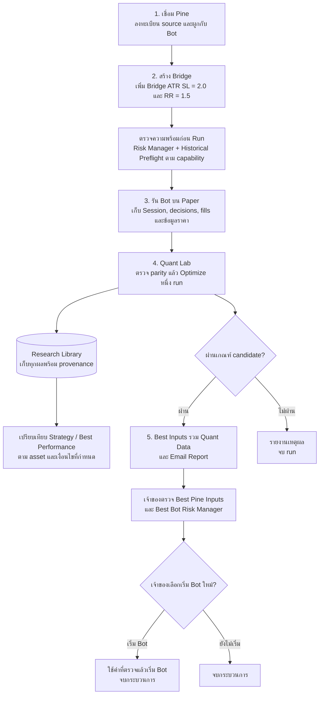

# Robot trade VPS 2.2.0 — PostgreSQL Paper staging

Claude local root, 2026-10-21 (Bangkok): The Claude cloud root landed the [executor slice S3 of RS-6 (candidate plan, engine closure mp-combined-closure-v1, fixture executor, runner and operator script)](docs/evidence/PM1_F11_01_EXECUTOR_S3_LOCAL_2026-10-21.json) and the [F09 builder S3a trace driver](docs/evidence/PM1_F09_BUILDER_S3A_TRACE_DRIVER_LOCAL_2026-10-21.json) at c90f6a3 and d45f5d5 as local engineering evidence; neither is installed and no route or worker imports them. The cloud root then handed the root back to the local checkout ([handoff](docs/CLAUDE_CLOUD_TO_LOCAL_ROOT_HANDOFF_2026-10-21.md)). The local root then landed the F09 builder S3b trace reproduction module at 730efee, recorded the F11 R6 package rulings (RD-MP-36 to RD-MP-43) at bbe00ec, landed the R6-1 package renderer and trace producer at 8c21fa9 (RD-MP-44; not wired), and landed the [F11 S1 follow-up](docs/evidence/PM1_F11_01_S1_FOLLOWUP_LOCAL_2026-10-21.json) at 3576153 (RD-MP-45): the job supplies its final ledger state, the executor validates the closed HOLDOUT ledger, and a real run on the synthetic bars-v2 fixture ends SUCCEEDED; that fixture is not market or research evidence, owner_recommendation_ready stays false and MULTI_PINE_REQUIRES_APP_3B stays. The local root then landed the R6-2 package gates at 19de3a5 (RD-MP-46) and the R6-3 package store extension at f1b7e15 (RD-MP-47), and the F09 builder S3c acceptance tests at 0b405e1 ([record](docs/evidence/PM1_F09_BUILDER_S3C_ACCEPTANCE_LOCAL_2026-10-21.json)); none is installed, routed or wired. CI passed all 9 checks on f1b7e15 and on 0b405e1; on 0b405e1 the PostgreSQL job requires an interpreter and the Quant Lab job runs the closure file with TRACE_REQUIRE_PYTHON=1, so the interpreter-gated trace cases ran, and root accepted F09 builder S3 (S3a, S3b, S3c) as local engineering evidence. The local root then landed the R6-4 package build service at c5be80a (RD-MP-48; not installed, routed or wired; CI passed all 9 checks on c5be80a). On 2026-10-22 (Bangkok) the owner had the whole project handed to a Codex cloud root ([handoff](docs/CLAUDE_TO_CODEX_CLOUD_ROOT_HANDOFF_2026-10-22.md)); the R6-4 follow-up, the R6-5 isolation suite and the R6-6 acceptance harness are unverified work in progress on the branch codex/f11-r6-wip-2026-10-22, and the owner-local F1 to F30 acceptance is open. CI was red from 05e7a47 to d45f5d5 (Windows CRLF checkout, and a bare python in the PostgreSQL real-job test); commit 6fabc04 fixed it in tests and .gitattributes only, with no product file changed, and CI passed all 9 checks on 6fabc04. No host step or GO occurred.

Claude local slices, 2026-10-21 (Bangkok): The [QR-3 comparison result tables (S2c-2)](docs/evidence/PM1_QR3_S2C2_LOCAL_2026-10-21.json), the [QR-4 selection evaluation tables (S2-2)](docs/evidence/PM1_QR4_S2_2_LOCAL_2026-10-21.json) and the [QR-2 route computation in a worker thread (S3b)](docs/evidence/PM1_QR2_S3B_LOCAL_2026-10-21.json) are committed locally; none is installed on staging, and the QR-2 route stays off until the target server is measured again and its memory headroom is read. The [multi-Pine research run contract builder](docs/evidence/PM1_F11_01_RUN_CONTRACT_LOCAL_2026-10-21.json) and two QR-2 S4 sub-slices, the [capital-model declaration extension (S4-1)](docs/evidence/PM1_QR2_S4_1_LOCAL_2026-10-21.json) and the [owner-total allocation module (S4-2)](docs/evidence/PM1_QR2_S4_2_LOCAL_2026-10-21.json), are also committed locally; the S4 rules are provisional until the owner decides the open S4 items, and nothing is installed or routed. The [S4-3 export, confirmed rollback and local restore rehearsal](docs/evidence/PM1_QR2_S4_3_LOCAL_2026-10-21.json) and a [foreign-key trigger check in every extension classifier](docs/evidence/PM1_EXTENSION_FK_TRIGGERS_LOCAL_2026-10-21.json) are also committed locally. The [multi-Pine internal run store (RS-1)](docs/evidence/PM1_F11_01_RUN_STORE_RS1_LOCAL_2026-10-21.json), for isolated clusters only, and the [per-member admission checks (RS-4)](docs/evidence/PM1_F11_01_MEMBER_ADMISSION_RS4_LOCAL_2026-10-21.json) are also committed locally, with the [run-store writer and readers (RS-2)](docs/evidence/PM1_F11_01_RUN_STORE_RS2_LOCAL_2026-10-21.json) and an [isolation suite (RS-3)](docs/evidence/PM1_F11_01_RUN_STORE_ISOLATION_RS3_LOCAL_2026-10-21.json); no service, route or worker uses the run store yet. The Claude cloud root then added the [internal fixture admission service (RS-5)](docs/evidence/PM1_F11_01_FIXTURE_ADMISSION_RS5_LOCAL_2026-10-21.json) (RD-MP-23), which admits a multi-Pine run on isolated fixture clusters only; no route, worker or runtime root imports it and nothing is installed. It also added the [combined Paper evaluator and its Node oracle (RS-6 S1, S2)](docs/evidence/PM1_F11_01_COMBINED_EVALUATOR_S1_S2_LOCAL_2026-10-21.json) (RD-MP-24 to RD-MP-34): the Python evaluator and the oracle agree on every scripted and fixture case; the private-source runs have not run (RD-MP-34), and the later state is in the paragraph above. The QR-2 compute pool now refuses to start under process-wide heap flags (RC-Q40; local only, not checked on any host). The All Bots card shows book equity per currency (RC-Q41); it is checked in JSDOM only, not in a browser. The PF-2 R4 real-supervisor tests skip without a systemd user manager, so the Linux real-process path of R4 has no automated evidence. The RS-5 admission service re-checks authorization and the key inside its transaction (RD-MP-35). The F09 builder S3 trace-reproduction design is recorded ([design record](docs/design/f09-trace-repro/README.md)) with owner question OQ-1 open. No host step or GO occurred.

Claude pure modules and a shutdown fix, 2026-10-20 (Bangkok): three pure libraries are committed locally and are not wired into any route, worker or view, so they show the owner nothing yet. They are the [package-gate module](docs/evidence/PM1_F09_PACKAGE_GATES_LOCAL_2026-10-19.json) for QL-4B/QL-4C, the [QR-2 S1 portfolio performance library](docs/evidence/PM1_QR2_S1_LOCAL_2026-10-19.json) and the [QR-3 S1 fair-comparison module](docs/evidence/PM1_QR3_S1_LOCAL_2026-10-19.json). Each passed independent review rounds and mutation runs, and root recorded the resulting clarifications in its contract. The owner decided that a requested QR-2 period ending after the request time ends at the request time with a shown flag. Two QR-3 owner items stay open and fail closed: a tie band wider than 0.50, and the outcome when exactly one participant is eligible. A runtime-lock defect is fixed on this branch: a server-side connection end during a graceful shutdown could exit the service with code 1, which also caused the intermittent CI failure. The [QR-3 S2a exposure register](docs/evidence/PM1_QR3_S2A_LOCAL_2026-10-20.json), a PostgreSQL extension shared by QR-3 and QR-4, is also committed locally; it is not installed on staging and nothing writes to it yet. The [F09 package renderer, builder slice S1](docs/evidence/PM1_F09_PACKAGE_RENDER_S1_LOCAL_2026-10-20.json), is committed locally as a pure module; no package can be built, stored or shown yet. The [F09 builder tables, slice S2](docs/evidence/PM1_F09_BUILDER_S2_LOCAL_2026-10-20.json), and the [derived exit version for multi-Pine member sets](docs/evidence/PM1_F11_01_EXIT_VERSION_LOCAL_2026-10-20.json) are also committed locally; the tables are not installed on staging and nothing writes them. The [QR-2 per-Bot performance route, slice S3a](docs/evidence/PM1_QR2_S3A_LOCAL_2026-10-20.json), is committed locally behind a setting that is off by default; it must not be enabled before slice S3b moves its computation off the server's main thread. The [QR-3 comparison tables (S2c-1)](docs/evidence/PM1_QR3_S2C1_LOCAL_2026-10-20.json), the [QR-4 selection registration tables (S2-1)](docs/evidence/PM1_QR4_S2_1_LOCAL_2026-10-20.json) and the [multi-Pine member-set tables](docs/evidence/PM1_F11_01_MEMBER_SET_TABLES_LOCAL_2026-10-20.json) are committed locally as offline extensions; none is installed on staging and no route writes them. Library G5 now also reads the exposure register ([QR-3 S2b](docs/evidence/PM1_QR3_S2B_LOCAL_2026-10-20.json), qualification version v2), the [multi-Pine member-set store function](docs/evidence/PM1_F11_01_MEMBER_SET_STORE_LOCAL_2026-10-20.json) exists locally, and a [hardening slice](docs/evidence/PM1_EXTENSION_HARDENING_LOCAL_2026-10-20.json) tightened every extension's install checks; the research freeze tool must now run as the owner of quant_jobs. No host step or GO occurred.

PM-1 scorecard S2 completed, 2026-10-20 (Bangkok): the successor scorecard rescores all 54 rows of the unchanged inventory PM1-I1 at commit `ca6abb1`, and root accepted it after an independent arithmetic and provenance check and a consistency review on another model. Engineering bounds are project **64.29–72.79%** (S1 50.17–74.12%) and prototype **72.75–80.42%** (S1 52.00–82.42%). UNKNOWN credits remain in both views, so neither view has a single score. The lower bounds rise mainly from new independent verification of 14 project rows and their prototype mirrors on the current code, and from the root-accepted package, QR-2, QR-3 and QR-4 contracts (definition credit for F09-01, F10-01, F10-02 and F10-03). The upper bounds fall where staging is now known to lack verified behaviour (target integration 0 for F01-03, F06-01, P05-01 and P06-03). F11-01 keeps an unknown definition credit until its fixture acceptance. Later commits, including the QR-2 S1 library, are not scored. See [the S2 scorecard](docs/progress/PM1_SCORECARD_S2_2026-10-19.md).

Claude multi-Pine contract and package clarifications, 2026-10-20 (Bangkok): the owner chose the recommended option for all eleven decisions of [the F11-01 multi-Pine contract](docs/MULTI_PINE_CONTRACT.md), which root accepted after independent review. A later Bot may hold up to three member Pine scripts that share one Bridge pair. Before APP-3B such a package stays internal, is never READY and shows the owner nothing. Root also recorded eleven clarifications (RC-1 to RC-11) in [the package contract](docs/QL_4B_4C_QUALIFIED_PACKAGE_CONTRACT.md) from the first review of the gate module; the owner decisions are unchanged. Nothing is wired into a route, and no host step or GO occurred.

Claude QR-3 and QR-4 contracts, 2026-10-20 (Bangkok): the owner chose the recommended option for every decision of [the QR-3 fair comparison contract](docs/QR_3_FAIR_COMPARISON_CONTRACT.md) and [the QR-4 qualified selection contract](docs/QR_4_QUALIFIED_SELECTION_CONTRACT.md). Root accepted both after independent review and a reconciliation that makes them share one exposure register. QR-4 ranks only READY packages on a new common window, and it rechecks that window at each evaluation start and before it writes an outcome. The [package contract](docs/QL_4B_4C_QUALIFIED_PACKAGE_CONTRACT.md) gains OD-19: a window that a comparison or a selection used counts as exposed data for the holdout check. Nothing is implemented. No ranking, recommendation, apply or Bot action exists, and no host step or GO occurred.

Claude QR-2 contract and journey copy, 2026-10-19 (Bangkok): the owner chose the recommended option for every QR-2 portfolio-performance decision, including the earlier O1-O16 and D4 items. [The QR-2 contract](docs/QR_2_PORTFOLIO_PERFORMANCE_CONTRACT.md) now defines the actual Paper portfolio view: ledger sources of truth, mark prices with age limits, time-weighted and Modified Dietz returns with money PnL, reconciliation checks with exact codes, graded handling of gaps and ledger-rule epochs, and the slices to build it. Root accepted it after independent and second-opinion design review and a fidelity review; it is not implemented and changes no ledger, tile or Bot. The journey's next-step texts for steps 2 to 5 now state what is done and what is still open, with cited evidence. No host step or GO occurred.

Claude owner decisions and package contract, 2026-10-19 (Bangkok): the owner settled the open questions of today's reconciliation. The adapter document now matches the code's proposal-bounded input list (O1), and a server test pins that rule. The PF-2 acceptance packet no longer claims a database-frozen published result; the lease fence and re-validation on every read protect it (O3). The owner chose the recommended option for all eighteen decisions of [the QL-4B/QL-4C qualified Best Inputs package contract](docs/QL_4B_4C_QUALIFIED_PACKAGE_CONTRACT.md), which root accepted after independent and second-opinion design review; it is not implemented and grants no recommendation, apply, email or Bot action. PF-2 Preflight (F04-03) now reconciles on the merged release lineage. The setup guide now shows Bridge steps as unavailable when a release disables the Bridge. No host step or GO occurred.

Claude release-lineage merge, 2026-10-19 (Bangkok): at the owner's choice, the staging release lineage (commit eb532ff) is now merged into this branch, so a later release from it keeps the evaluator-binding refusals, the PF-2 runtime DELETE revoke, the one-active-PROFILE enrollment guard and the child diagnostics. Branch-only tests were adapted to the release grant script and privilege model; the freeze test now proves both the privilege layer and the triggers. On the merged tree the full Node, PostgreSQL and Python suites pass locally, and independent and second-opinion reviews found no lost protection. The merged tree is not identical to the release: the graceful-stop change rotates the foundation, ingestion and PF-2 engine hashes, while the legacy engine and the PF-2 evaluator are unchanged. [The deploy note](docs/RELEASE_LINEAGE_MERGE_2026-10-19.md) lists the offline migrations, the grant reapply, the startup policy check and the queued-job effects a later release must handle. Nothing was deployed, migrated or restarted, and no host step or GO occurred.

Claude PM-1 verification carry, round 3, 2026-10-19 (Bangkok): six more rows were reconciled on the current code with independent auditors and testers. Charts (F04-02), PF-3 readiness (F04-04), PF-4 proposals (F04-05) and the artifact freeze (F08-02) still match their accepted contracts. The Library (F08-01) had one defect: the comparison view showed an empty shared-context block, fixed earlier today. PF-2 Preflight (F04-03) could not be reconciled, because the accepted staging release lineage was not part of this branch and the branch lacked its evaluator-binding refusals and its runtime DELETE revoke; the owner chose to merge that lineage, which is in progress in a separate worktree. Five new test files cover the remaining chart, Library and proposal-race clauses, and independent single-edit mutations were caught except four that are redundant or unreachable. One owner question is new: the PF-2 packet calls the published result immutable, but the database does not freeze it. See [the record](docs/evidence/PM1_VCARRY_R3_LOCAL_2026-10-19.json). PM-1 credits stay unchanged until a successor scorecard; no staging readback, host step or GO occurred.

Claude graceful-stop decision, 2026-10-19 (Bangkok): the owner chose to scope the durable-jobs recovery clause to legacy mode. In foundation mode a graceful worker stop is now terminal by contract: the research job ends FAILED with RESEARCH_INTERRUPTED and the foundation job is CANCELLED after stop proof. The worker checks for the stop before it creates a chunk, before each chunk commit and before the final commit, so a late answer, an abort at finish or an abort between steps commits nothing; a stop inside an already running commit cannot be undone. A new PostgreSQL test file pins both modes, and an independent tester's eight single-edit mutations were all caught. This changes the foundation engine hash, so queued foundation jobs from an older engine fail closed after any later deployment. Backfill and preflight paths are outside this clause. See [the record](docs/evidence/PM1_D1_GRACEFUL_STOP_LOCAL_2026-10-19.json). No deployment, migration, staging readback, host step or GO occurred.

Claude PM-1 verification carry, round 2, 2026-10-19 (Bangkok): Bot creation and lifecycle (F01-02), ten-input selection (F02-02) and immutable research jobs (F06-01) were reconciled on the current code, and their existing tests pass on a local PostgreSQL that mirrors CI. Three new PostgreSQL test files now assert the remaining clauses: plan capacity, frozen policy, unsupported transitions, funded-capital and stopped-Bot refusals; generate refusals before any write or provider call, snapshot hash rechecks and selection coherence; and frozen research contracts and engine-change refusals. Independent single-edit mutations were all caught except two equivalent ones. No product code changed. One owner decision is open: the input list is limited to the AI analysis proposal, while the adapter document says it shows every eligible input. The second, graceful worker stop in foundation mode, was decided later the same day (see the note above). PostgreSQL files ran on a local cluster that mirrors CI, and no staging readback was done. See [the record](docs/evidence/PM1_VCARRY_R2_LOCAL_2026-10-19.json). PM-1 credits stay unchanged until a successor scorecard. No host step or GO occurred; REA is paused and PM-1 S1 is unchanged.

Claude PM-1 verification carry, 2026-10-19 (Bangkok): Claude reconciled the verification carry of three early rows on the current code. Owner authentication and tenant isolation (F01-01), versioned Bridge transport and targeting (F02-03) and the Paper risk, allocation and targeted EXIT baseline (F03-01) all still match their accepted contracts, with no defect found, and their existing tests pass on a local PostgreSQL that mirrors CI. Their clauses without decisive assertions now have three new PostgreSQL test files: foreign-owner, missing-session and CSRF refusals across the remaining owner routes; Bridge refusals for wrong versions, inactive or unknown senders, foreign or closed targets and conflicting redeliveries; and exact cap and rejection reasons for Paper entries. An independent tester's single-edit mutations of the product code were caught except two that remove one of two redundant checks; these slices had no separate architecture review of the new tests, because usage was near the floor. No product code changed. See [the record](docs/evidence/PM1_VCARRY_R0_APP3A_LOCAL_2026-10-19.json). PM-1 credits stay unchanged until a successor scorecard, and no staging readback was done. No host step or GO occurred; REA is paused and PM-1 S1 is unchanged.

Claude takeover and PM-1 F05 reconciliation, 2026-10-19 (Bangkok): Claude took sole command from Codex at `138644c` after re-verifying Git, the owner's files, processes and usage. The next N1 action, the terminal-evidence contract, is held for an owner decision: an automated safety screen stopped Claude's review of it, and the handoff forbids working around such screens. Claude instead reconciled two local PM-1 rows. For F05-01, the current QL-2A evaluator path matches the accepted baseline under its frozen policy; the 92 recorded decisions were not replayed, because the original chart exports are not in the repository. For F05-03, the research engine still matches its accepted contract, and a new PostgreSQL test file now asserts the screen, ranking, sensitivity, holdout, report and live-counter clauses that earlier tests only exercised; an independent tester's 19 single-edit mutations were all caught. See [the reconciliation record](docs/evidence/PM1_F05_LOCAL_RECONCILIATION_2026-10-19.json). PM-1 credits stay unchanged until a successor scorecard. No host step or GO occurred; REA is paused and PM-1 S1 is unchanged.

Codex to Claude stop handoff, 2026-10-19 (Bangkok): the owner requested transfer of the whole project and latest work. Codex stopped implementation and dispatch; all children completed and no owned test, operations session or GO remains active. B2 is complete, and the latest accepted local work is the R3C6 evidence requirements and twelve synthetic data-correspondence cases. Claude must read [the handoff](docs/CODEX_TO_CLAUDE_HANDOFF_2026-10-19.md) and its private companion, then reverify Git, ownership, processes and its own usage before taking sole command. Next is the exact terminal-evidence contract and permitted producer scope; all host and production gates remain open. This handoff issues no GO. REA is paused and PM-1 S1 is unchanged.

Codex N1 local progress, 2026-10-19 (Bangkok): root adopted the producer-provenance and final-emission evidence requirements after independent review, then accepted twelve synthetic data-correspondence cases after one test run and static architecture review. The tests compose the existing config, memory sink and full observation parser without changing runtime interfaces. They demonstrate that valid altered history can parse while failing memory correspondence, that final UNKNOWN does not promote a result, and that retained history survives caller mutation and rejected persistence. These are separate data checks, not authentic execution or delivery. Earlier local components remain accepted in their narrow scopes. Next is an exact independently reviewed terminal-evidence contract and permitted producer scope before implementation; the original screened broad orchestration dispatch remains closed. D2 transport applicability, D4 health applicability, fresh health/admission, source/output fit, native timing and Clock/production gates remain open. No host step or GO occurred. See [the N1 local record](docs/evidence/DP1P_N1_LOCAL_2026-10-19.json).

Codex B2 completion, 2026-10-19 (Bangkok): Codex is the sole root after the whole-project handoff. Five fresh real-turn synthetic runs passed before the owner's new continuous-work and continuous-GO instruction was applied to W-A06-K01. Admission A06 was CLEAR and [the KILL window](docs/evidence/DP1P_B2_WINDOW_KILL_2026-10-19.json) passed: TERM_IGNORED, timeout exit 137 after 7.01 seconds, no observer signal, and the probe absent afterwards. NORMAL, TERM and KILL have now all passed B2. This window's GO is consumed; Clock and settlement qualification, RD7 and approved limits, and production S3 remain gated. Nothing was deployed, migrated or restarted; REA remains paused and PM-1 S1 is unchanged.

Claude to Codex handoff, 2026-10-19 (Bangkok): the owner asked Claude to hand the whole project and the latest work to Codex, so Claude stopped with no agent running and no GO open. Read [the handoff](docs/CLAUDE_TO_CODEX_HANDOFF_2026-10-19.md) and its private companion first. The NORMAL and TERM supervision windows both passed; the KILL window is prepared and checked but has not run and needs a fresh owner GO under the new root, after its own real-turn dry runs on a quiet computer.

Claude B2 window TERM, 2026-10-19 (Bangkok): under the owner GO W-A05-T01, admission A05 was CLEAR and the inert TERM probe ran once. At the 2-second limit timeout sent TERM, the probe recorded that it handled it, and timeout exited with code 124 and no signal; the observer itself sent no signal. The post-window review classed it BEHAVIOUR_PASS, recorded in [the TERM window record](docs/evidence/DP1P_B2_WINDOW_TERM_2026-10-19.json). The GO is consumed. The KILL window needs its own preparation and a fresh owner GO. This is one bounded probe, not service health or production readiness.

Claude B2 window NORMAL, 2026-10-19 (Bangkok): under the owner GO W-A04-N01, root ran the first supervision window. Admission A04 was CLEAR, root released the NORMAL job, and the inert NORMAL probe ran once under the coreutils 9.4 env and timeout profile: it reported READY under the timeout process, finished, and the timeout process exited with code 0 and no signal, with no TERM or KILL requested. The post-window review classed it BEHAVIOUR_PASS, recorded in [the NORMAL window record](docs/evidence/DP1P_B2_WINDOW_NORMAL_2026-10-19.json). Before the window, the five real-turn dry runs passed on corrected tools after preparation on the real records found and fixed one size-limit defect. The GO is consumed. The TERM window needs its own preparation and a fresh owner GO. This is one bounded probe, not service health or production readiness.

Claude resumed as root, 2026-10-19 (Bangkok): the owner returned sole command to Claude after Codex could not start the dry runs, because another project's tests were loading this computer. While the machine was busy, Claude prepared the NORMAL window locally: the prior review for C01 passed on the real records, admission A04 and the NORMAL stage-one job were prepared without any SSH, and the real window contract was built and checked. This preparation found one real defect: a root tool still used an old file name in its size limits, so it refused the real C01 receipt, which is larger than any test receipt. The one-line fix (W4B R3) and the matching dry-run harness update (W6B R3) passed independent tests. The real-turn dry runs restart on the corrected tools when the computer is quiet. No host step, admission or GO occurred.

Claude to Codex handoff, 2026-10-18 (Bangkok): the owner asked Claude to hand the whole project and the latest work to Codex, so Claude stopped with no agent running and no GO open. Read [the handoff](docs/CLAUDE_TO_CODEX_HANDOFF_2026-10-18.md) and its private companion first. In this tenure Claude ran one owner-approved release window with two read-only host steps (admission A03 CLEAR, metadata read C01 observed) and built and accepted the B1 supervision tools locally, recorded in [the B1 build record](docs/evidence/DP1P_SUPERVISOR_B1_BUILD_LOCAL_2026-10-18.json). The next step is to finish the real-turn dry runs under the new root, with five consecutive passes including TERM and KILL, then prepare the NORMAL window, which needs a fresh owner GO. Nothing was deployed, migrated or restarted.

Claude B1 build stop checkpoint 3, 2026-10-18 (Bangkok): root accepted the dry-run harness W6B locally after one correction round. The first version overstated the adapter time, and its controls missed the review check for a non-zero runner exit; both are fixed. On a quiet computer the stage-two adapter now takes about 2 to 2.5 seconds against its 10-second budget, and the runner reaches its contact point in about 1 to 1.5 seconds against 4 seconds. The real-turn dry runs began: the first run, with the single operations worker and live root decisions, passed with the GO 18.7 seconds old, well inside the 75-second cap. Four more consecutive passing runs are needed before preparing the NORMAL window. One known limit is kept: a local runner refusal before any contact would be classed UNKNOWN rather than not executed, which stops B2 for an owner decision but cannot produce a false pass. No host step, admission or GO occurred.

Claude B1 build stop checkpoint 2, 2026-10-18 (Bangkok): the dry-run harness W6B was built and its own runs passed for every result class, but its independent check was stopped when the owner asked to stop, so W6B is not yet accepted. The runs showed that two local time budgets, 4 seconds for the runner before contact and 10 seconds for the stage-two adapter, are tight when this computer is busy; one busy run stopped safely before contact. Dry runs and real windows will therefore run with nothing else active on this computer. No host step, admission or GO occurred.

Claude B1 build checkpoint 3, 2026-10-18 (Bangkok): root accepted three more B1 tools locally. The stage-two adapter AD-P3B now checks the pure finalizer's full import list against its pinned proof before loading it. The post-window review W5B now requires the case in the window contract to match the GO, the job configuration and the receipt, and it treats truncated output as UNKNOWN. The root commands W4B include a new prior-review tool, which writes the review that lets the next window start. W4B needed one correction round: the first version would have refused the real C01 window record and did not check that root had accepted the previous window. It now reads a separate root acceptance record and checks the order of earlier job IDs. Each tool passed an independent test and an Opus audit, and AD-P3B and W4B also had a Fable second opinion. The adapter's 10-second time budget is tight on this computer, so the dry runs will measure it before any window. The dry-run harness W6B is being built next. No host step, admission or GO occurred.

Claude B1 build checkpoint 2, 2026-10-18 (Bangkok): root accepted behaviour package P3B locally after a third correction round. The prior review now binds how the previous window ended, and the runner checks that the observed case matches the job. Root also accepted the stage-one materializer M3B, the window library W2B (pending one job-id binding), the operations-session deny-list update W3B and the pure finalizer F3B, each after independent tests and, where the logic carries risk, an Opus audit. The post-window review W5B passed review but needs one tightening round, and the stage-two adapter AD-P3B was being built when the owner asked to stop. Both partial outputs are treated as untrusted and will be rebuilt. No host step, admission or GO occurred.

Claude B1 build stop checkpoint, 2026-10-18 (Bangkok): root accepted the behaviour assembly locally. The assembled observer source is about 60 KB, under the 64 KiB cap, and behaves the same as the unassembled runtime in fake-world comparisons. Package P3B needed one correction round to pin the probe source hash and the prior route's SSH binary hash in the lineage. Its independent test found no defect, and its Opus audit found no blocking issue but asked for the prior-window outcome to be bound in the prior review. The stage-one materializer M3B and the operations-session deny-list update W3B were built and reviewed. One M3B test run hung and was stopped, so M3B still needs its independent test. Nothing new is accepted beyond the assembly. No host step or GO occurred; the overnight GO authority ended with the owner's stop message.

Claude B1 supervision build checkpoint, 2026-10-18 (Bangkok): after the first metadata read, the next Roadmap step is the native supervision check B1. Root adopted a [B1 source review and design](docs/evidence/DP1P_SUPERVISOR_B1_LOCAL_2026-10-18.json). For the coreutils 9.4 env and timeout binaries seen at C01, a plain exit should give 0, a handled TERM 124 and an ignored TERM 137 in foreground mode. The design uses one behaviour package for three inert probe cases, NORMAL, TERM and KILL, and an observer that may send one SIGTERM but never SIGKILL. The owner accepted all ten design decisions as recommended: three separate windows in that order, each with its own GO, and an UNKNOWN result stops B2. Root accepted the three fixed probe sources and the remote behaviour runtime locally after independent tests and Opus audits. The runtime needed two correction rounds so that unexpected output gives UNKNOWN rather than NONPASS. All work was local with synthetic inputs, and real signal delivery and timeout exit codes can be shown only on the target in B2. No host step, admission or GO occurred. Fable is paused by the owner.

Claude release-window run, 2026-10-17 (Bangkok): the owner installed PowerShell 7.6.5, root accepted the remaining window tools after independent tests and audits, and five real-turn dry runs passed. Under a fresh bounded owner GO, the single operations worker ran the [release window](docs/evidence/DP1P_RELEASE_WINDOW_A03_C01_2026-10-17.json) once. Admission A03 was CLEAR from one read-only SSH session. Root compared the result with the frozen criteria, finalized metadata job C01 locally and wrote the metadata GO 12.1 seconds after admission. The metadata runner then made one read-only SSH read and returned OBSERVED_METADATA, with post-run pins valid and the diagnostic verified at capture. This is the first real metadata read in this chain. It is not a service health, supervision or production qualification. The GO is consumed, and any further host step needs a new owner GO.

Claude release-window checkpoint, 2026-10-17 (Bangkok): the metadata step must start its SSH contact within 120 seconds of a fresh admission, so root adopted a [release-window design](docs/evidence/DP1P_RELEASE_WINDOW_TOOLS_LOCAL_2026-10-17.json) from an Opus draft, an independent Fable draft and an Opus judge. Root accepted two local candidates: a pure window library and a pre-armed operations session that starts each launcher once, only after a verified root ticket. Each passed one correction round with independent tests and audits. With the owner's approval, admission A03 was prepared on real local inputs by exact substitution from A02, with no SSH connection and no GO. Root commands for the window, a post-window review tool and a dry-run harness are in a correction round. Synthetic dry runs finished the chain with the metadata GO 14 to 18 seconds after admission; these are not real timings. No host step or GO occurred. Next: the owner installs PowerShell 7.6.5, root runs real-turn dry runs, then a fresh bounded owner GO for one admission and one metadata SSH.

Claude private stage-one checkpoint, 2026-10-17 (Bangkok): with the owner’s approval, the single operations worker ran stage-one materializer M2 once on the real local inputs. It [prepared job DP1P-D1-METADATA-NATIVE-20261017-C01](docs/evidence/DP1P_METADATA_STAGE1_PRIVATE_C01_2026-10-17.json) with admission still missing and no GO. The installed SSH binary passed the pinned shared two-link profile through the accepted reader; this is a local point check, not image-at-spawn attestation. A first attempt stopped before the materializer started because of a wrapper path error and created nothing. No SSH connection, network access, key read, host step or GO occurred. The next step is a fresh read-only admission on the target host. It needs a protected PowerShell 7 installation while the owner is at the PC, current authorized health evidence and a new bounded owner GO. Claude weekly usage is 44 percent remaining; REA and PM-1 S1 are unchanged.

Claude P2 chain checkpoint, 2026-10-17 (Bangkok): root accepted the rebuilt [P2 chain](docs/evidence/DP1P_METADATA_P2_CHAIN_LOCAL_2026-10-17.json) locally. It consists of package P2, stage-one materializer M2, pure finalizer P2 r2 and stage-two adapter P2, and each step pins only the previous accepted hash. P1 and its chain stay immutable. An earlier finalizer revision was rejected because it still imported modules from P1. All inputs were synthetic, the installed SSH binary was not read, and no host step, admission or GO occurred. The next step is the actual private stage-one preparation. It reads the installed SSH binary and other local trust files, and is followed by a fresh admission and GO through the single operations worker. That step needs the owner’s decision, together with a protected PowerShell 7 installation. Claude weekly usage is 44 percent remaining; REA and PM-1 S1 are unchanged.

Claude takeover checkpoint, 2026-10-17 (Bangkok): Claude took sole command after the Codex stop at 4bddbd5 and continued local DP1-P work under the owner’s continuous-work instruction. Root accepted four local pieces. The [PowerShell SSH handle helper](docs/evidence/DP1P_SSH_PS_HELPER_F1_LOCAL_2026-10-17.json) passed 136 of 149 real Windows inert-fixture cases with none failing; the rest were one skip and record-only observations. The [runner and launcher SSH wiring](docs/evidence/DP1P_SSH_WIRING_S1_LOCAL_2026-10-17.json) retains and compares SSH snapshots, with recorded limits. A static package P2 replaces only those two members of P1, and a stage-one materializer M2 is anchored to P2. The pure finalizer and adapter rebuild for P2 is in progress. All of this is local evidence on inert fixtures: the installed SSH binary was not read, and no host step, deployment, migration or GO occurred. A later native launch needs a stable, protected PowerShell 7 installation, which requires the owner’s approval. Claude weekly usage is 45 percent remaining; REA and PM-1 S1 are unchanged.

Codex-to-Claude stop checkpoint, 2026-10-17: the owner requested a stop and [whole-project handoff](docs/CODEX_TO_CLAUDE_HANDOFF_2026-10-17.md). Codex dispatch and implementation are stopped; all children returned, with no owned job or open GO. SSH-READER-R2 is accepted locally. SSH-PS-HELPER-C1 is partial and unaccepted: original C# compilation passed, but no native API fixture or independent review ran. Its source and evidence are frozen privately. Read the private handoff first, then reverify Git, ownership, runtime and Claude usage before authorized takeover/resume. HEAD remains 4bddbd5; the latest evidence and handoff are uncommitted and unpushed. Codex weekly remaining is 14%, short-window unknown; REA and PM-1 S1 remain unchanged. [Stop record](docs/evidence/DP1P_CODEX_TO_CLAUDE_STOP_2026-10-17.json).

SSH reader checkpoint, 2026-10-17: root accepted [SSH-READER-R2 locally](docs/evidence/DP1P_SSH_READER_R2_LOCAL_2026-10-17.json) after 16 independent injected cases, one control and ten actual Windows inert cases. The comparator now rejects missing or accessor-backed identity facts. The fixed shared-image profile checks exact hash, size, two links and separator-only spelling; filesystem identity changes and incomplete reads refuse. Windows shared-profile fixtures transform only the fixed hash and size, so they do not qualify the installed SSH image. Next is the authenticated PowerShell handle helper, then four consumer integrations and a rebuilt package/source-pin chain before retrying private preparation. No new host step or GO occurred. Usage is 15% weekly remaining, short-window unknown, floor 3%; REA and PM-1 S1 remain unchanged.

Metadata stage-two checkpoint, 2026-10-17: root accepted [ADAPTER-C1 locally](docs/evidence/DP1P_METADATA_STAGE2_ADAPTER_C1_LOCAL_2026-10-17.json) after 34 independent VM cases, one control and one actual Windows synthetic case. The Windows call completed in 1,659 ms. Six exclusive files, final layout, original clocks and source/trust rechecks passed; late failures retain evidence and never grant GO. [PURE-C1](docs/evidence/DP1P_METADATA_STAGE2_PURE_C1_LOCAL_2026-10-17.json) remains accepted. Actual private preparation [stopped before draft creation](docs/evidence/DP1P_METADATA_PRIVATE_PROFILE_STOP_2026-10-17.json): the authenticated SSH binary has two hard links and a noncanonical lexical path spelling, outside the strict reader profile. Its hash still matches. Review of a narrow supported profile across the pinned chain is next; no materializer invocation or new GO occurred. Usage is 19% weekly remaining, short-window unknown, floor 3%; REA and PM-1 S1 remain unchanged.

Metadata stage-one checkpoint, 2026-10-17: root accepted [MATERIALIZER-R4 locally](docs/evidence/DP1P_METADATA_STAGE1_MATERIALIZER_R4_LOCAL_2026-10-17.json). Independent verification passed 34 VM cases with two separate controls and one real Windows filesystem case. The stdout completion defect is corrected. Ten immutable files and an empty controller directory are prepared without admission or GO; a retained stage-one record alone is never sufficient after a late failure. Next is reviewed stage-two release finalization before fresh admission and actual private preparation. Usage is 24% weekly remaining, short-window unknown, floor 3%. No new host execution, Git write or production change occurred; REA and PM-1 S1 remain unchanged.

Metadata preparation checkpoint, 2026-10-17: the stage-one materializer is under implementation and is not accepted. Its bounded file reader passed six author checks, in addition to eight foundation checks. Authenticated helper wiring is defined; complete publication and independent verification remain pending. The accepted Windows filesystem and package evidence is unchanged. Usage is 26% weekly remaining, short-window unknown, with the owner-authorized 3% floor. Work continues one bounded local slice at a time; no new host execution or GO is open. REA remains paused.

Metadata Windows filesystem checkpoint, 2026-10-17: root accepted [WIN-FS-P1 locally](docs/evidence/DP1P_METADATA_WINDOWS_FS_P1_LOCAL_2026-10-17.json) after three fresh runs with actual Windows files and injected transport. Conditional COMPLETE passed post-pin checks; malformed raw data and postcontact launcher drift retained evidence and returned STOP. Native fallback spawn stayed zero. Remote witnesses and clocks remain synthetic. Next is a reviewed stage-one materializer for immutable release inputs before fresh admission. Usage is 28% weekly remaining, short-window unknown, floor 3%. No new host execution, Git write or production change occurred; REA and PM-1 S1 remain unchanged.

Metadata package checkpoint, 2026-10-17: root accepted [PACKAGE-P1 locally](docs/evidence/DP1P_METADATA_PACKAGE_P1_LOCAL_2026-10-17.json). All 41 files match accepted sources; 39 modules contain 61 relative import declarations, representing 60 distinct module requests, with no dynamic imports or cycles. Five full preflight checks and five actual-helper runner checks passed on the final package. Conditional COMPLETE still uses a trusted witness seam. Actual Windows filesystem composition, private release materialization and fresh admission/GO remain pending. Usage is 29% weekly remaining, short-window unknown, floor 3%; work continues one small slice at a time. No new host execution, Git write or production change occurred; REA and PM-1 S1 remain unchanged.

Metadata controller checkpoint, 2026-10-17: root accepted [CONTROLLER-C1 locally](docs/evidence/DP1P_METADATA_CONTROLLER_C1_LOCAL_2026-10-17.json) after 15 independent fake lifecycle cases plus one control, 12 actual writer/drain checks including one control, and three bounded native local cases. Binary exit 7 was captured accurately, dual overflow remained nonpass, and the original 50-second timeout closed the captured local process while preserving UNKNOWN remote settlement. No owned test process remains. The native cases used synthetic preflight; final package integration and fresh admission/GO remain pending. Usage is 30% weekly remaining, short-window unknown, floor 3%; subsequent slices run one at a time. No new host execution, Git write or production change occurred; REA and PM-1 S1 remain unchanged.

Metadata runner checkpoint, 2026-10-17: root accepted [RUNNER-R3 locally](docs/evidence/DP1P_METADATA_RUNNER_R3_LOCAL_2026-10-17.json) after 25 independent lifecycle/raw/path checks and 10 CLI/request/clock checks, with one reverse control included in each group. The tests use the actual lineage, assembly and envelope helpers; COMPLETE still uses an explicit trusted witness seam. Safe raw prefixes and diagnostic candidates survive tested failures. The controller candidate is under independent review; final package closure and native execution remain pending. Usage is 32% weekly remaining, short-window unknown, floor 3%. No new host execution, Git write or production change occurred; REA and PM-1 S1 remain unchanged.

Metadata launcher checkpoint, 2026-10-17: root accepted [R4 preflight locally](docs/evidence/DP1P_METADATA_LAUNCHER_PREFLIGHT_R4_LOCAL_2026-10-17.json) after 19 independent checks and two included reverse controls. The fixed 41-file closure, 11 roles, strict review types and conservative no-link file profile are checked before JavaScript evaluation. The executable entry still refuses; controller integration, final package verification and a fresh bounded GO remain pending. No new host execution or production change occurred. Usage is 34% weekly remaining, short-window unknown, floor 3%; REA and PM-1 S1 remain unchanged.

Metadata transport checkpoint, 2026-10-17: root accepted [TRANSPORT-X locally](docs/evidence/DP1P_METADATA_TRANSPORT_X_LOCAL_2026-10-17.json) after whole-module extraction parity and 23 independent synthetic checks, including one changed-count control. The fixed package design has 41 entries, 37 frozen copies and 53 resolved relative imports. Runner and generic launcher implementation remain pending. Transport termination requests still do not prove actual close or drains; no new host execution or GO is accepted. Usage is 40% weekly remaining, short-window unknown, floor 3%. REA and PM-1 S1 remain unchanged.

Metadata release lineage checkpoint, 2026-10-17: root accepted [L2 locally](docs/evidence/DP1P_METADATA_RELEASE_LINEAGE_L2_LOCAL_2026-10-17.json) after 46 independent chain checks and 45 focused extraction/grammar/input checks, with one control in each set. The actual accepted helpers preserve separate bootstrap and admission bindings; route and selected Node facts agree under the external PINS anchor. Freshness, native events and execution authority remain unestablished. Next are the fixed package map, authenticated runner and generic launcher; a launcher that embeds its own containing PINS hash would create a hash cycle and is excluded. Usage is 42% weekly remaining, short-window unknown, stop floor 3%. No new host execution, Git write or production change; REA and PM-1 S1 remain unchanged.

Metadata admission lineage checkpoint, 2026-10-17: root accepted [L2-A locally](docs/evidence/DP1P_METADATA_ADMISSION_LINEAGE_L2_A_LOCAL_2026-10-17.json) after 81 independent checks, including one anchor control, and a local historical A02 compatibility check. Independent AST evidence confirms the extracted validator and producer field inventories. Output counts and hashes are authenticated producer claims; absent remote bytes were not rehashed. Historical compatibility grants neither freshness nor GO. Full L2 release composition is next, followed by the authenticated runner. Usage is 45% weekly remaining, short-window unknown, stop floor 3%. No new host execution, Git write or production change; REA and PM-1 S1 remain unchanged.

Metadata bootstrap lineage checkpoint, 2026-10-17: root accepted [L1 r2 locally](docs/evidence/DP1P_METADATA_BOOTSTRAP_LINEAGE_L1_R2_LOCAL_2026-10-17.json) after 90 independent checks, including one type-guard control, and a local compatibility check on the authenticated historical bootstrap archive. The correction rejects an object substituted for the selected limitations array. Original external anchors were not bypassed. The private result proves bounded historical relationships; freshness and execution authority remain false. Next is admission lineage, then the L2 release chain and authenticated runner. Usage is 46% weekly remaining, short-window unknown, stop floor 3%. No new host execution, Git write or production change; REA and PM-1 S1 remain unchanged.

Metadata envelope checkpoint, 2026-10-17: root accepted [ENVELOPE-E1 locally](docs/evidence/DP1P_METADATA_ENVELOPE_E1_LOCAL_2026-10-17.json) after 64 independent checks, including one status-guard control. Diagnostic parsing retains valid nonpass candidates while acceptance requires COMPLETE, zero exit and the exact empty-stderr conditions. UNKNOWN remains nonpass. The raw record does not independently prove OS close, stream drains or producer authenticity. Next is authenticated bootstrap lineage, followed by fresh admission/release lineage and runner integration. Usage is 48% weekly remaining, short-window unknown, stop floor 3%. No new host execution, Git write or production change; REA and PM-1 S1 remain unchanged.

Metadata source assembly checkpoint, 2026-10-17: root accepted [ASSEMBLY-A2 locally](docs/evidence/DP1P_METADATA_ASSEMBLY_A2_LOCAL_2026-10-17.json). Independent AST comparison preserves all eleven selected module bodies and their import/export wiring. A plan check/use gap is corrected with one private snapshot. Independent verification passed nine static checks with three controls, one default-graph comparison, then 18 cap/range/subset checks and six event/clock comparisons. The baseline fixture emits 47,637 source bytes; exact 65,536-byte source succeeds and 65,537 is refused. This is fixed-source assembly evidence, not native target qualification; the offline inspector is not a generic initializer safety filter. Next are the pure metadata envelope and authenticated runner. Usage is 50% weekly remaining, short-window unknown, stop floor 3%. No new host execution, Git write or production change; REA and PM-1 S1 remain unchanged.

Metadata emission checkpoint, 2026-10-17: root accepted [EMIT-R2 locally](docs/evidence/DP1P_METADATA_EMISSION_R2_LOCAL_2026-10-17.json). One LF-terminated record uses the original clock boundary and retains nonzero exit until callback and required drain complete. A synthetic prewrite-drain gap is corrected; observed stream faults now suppress incomplete diagnostics as well. Independent verification passed 24 event regressions, one default-graph refusal case, 19 completion checks and 11 source checks; three controls are included in those counts. These are VM and synthetic event results, not native stdout or target qualification. Next is pinned source assembly, then metadata envelope/runner verification. Usage is 53% weekly remaining, short-window unknown, stop floor 3%. No new host execution, Git write or production change; REA and PM-1 S1 remain unchanged.

Metadata native-binding checkpoint, 2026-10-17: root accepted [NATIVE-M1 r2 locally](docs/evidence/DP1P_METADATA_NATIVE_BINDING_R2_LOCAL_2026-10-17.json). The internal session retains one original W1 boundary and partial candidates; the native API fixes all capabilities. A rejected nested-clock bridge had changed deadline classification and is preserved as failed evidence. Independent verification reran 74 O1 checks and 11 termination scenarios, then added 15 session/source, four actual-graph VM, 12 memory-sink and eight binding-completion checks. Counts and controls remain separated in the evidence. Capture storage is IN_MEMORY_ONLY; no native target success or durable publication is claimed. Next are stdout emission with original-clock completion, pinned source assembly and metadata envelope/runner verification. Usage is 57% weekly remaining, short-window unknown, stop floor 3%. No new host execution, Git write or production change; REA and PM-1 S1 remain unchanged.

Metadata observer checkpoint, 2026-10-17: root accepted [O1 r3 local composition](docs/evidence/DP1P_METADATA_OBSERVER_O1_R3_LOCAL_2026-10-17.json) after 74 independent checks, including seven dependency checks and one finalization control. Canonical-path false success and hidden health-data loss are corrected. The final original clock read follows detached-copy and JSON-roundtrip validation. A synthetic 32,768-byte raw specimen produced a 50,232-byte private candidate within the 65,536-byte cap; this is not a bound for every layout. The subsequent [TERM/KILL composition checks](docs/evidence/DP1P_METADATA_TERMINATION_LOCAL_2026-10-17.json) passed 11 synthetic scenarios, including four UNKNOWN close/drain combinations; 22 forged-success mutations are included within those scenarios. Native binding, source assembly and runner verification remain prerequisites before another host GO. Usage is 59% weekly remaining, short-window unknown, stop floor 3%. No new host execution, Git write or production change occurred; REA and PM-1 S1 remain unchanged.

Metadata witness checkpoint, 2026-10-17: root accepted the [W1 shared boundary and witness helpers](docs/evidence/DP1P_METADATA_WITNESS_W1_LOCAL_2026-10-17.json) after 59 independent checks, including three extraction checks and two controls. The original health parser and guarded call remain byte-identical; file streaming changes only fatal-state access. Tests cover identity drift, complete-size checks, cleanup and one asynchronous composition with the accepted capture. These are local fake-IO results, not native host qualification. Root also accepted the [config/version foundation](docs/evidence/DP1P_METADATA_FOUNDATION_O1_LOCAL_2026-10-17.json) after 61 independent checks, including five helper-copy checks and one parser control. Full observer composition is in progress in a separate local candidate and is not accepted. Usage is now 63% weekly remaining, short-window unknown, stop floor 3%; no new GO, host execution, Git write or production change. REA and PM-1 S1 remain unchanged.

Absolute metadata capture checkpoint, 2026-10-17: root accepted the [r3 local capture unit](docs/evidence/DP1P_ABSOLUTE_METADATA_R3_LOCAL_2026-10-17.json) after 43 independent regression scenarios, two additional combined-fault scenarios and three source checks. Two meaningful controls are included within the 43, not added to them. Earlier late-completion and post-persistence false successes are corrected; the successor also preserves truthful first-failure receipts after a direct KILL request. All evidence is synthetic, with no new host execution. The next local slice extracts the shared original clock boundary and bounded health/file witnesses before metadata observer composition. Native supervisor qualification remains UNKNOWN; REA remains paused. Weekly usage is 65% remaining, short-window unknown, owner stop floor 3%. No commit, push, fresh CI run or production change occurred; PM-1 S1 is unchanged.

Native Clock continuation, 2026-10-17 (Bangkok): the owner authorizes continuous Roadmap work and bounded GOs down to 3% remaining usage. Root accepted the [r2 receipt verifier](docs/evidence/DP1P_NATIVE_RECEIPT_R2_LOCAL_2026-10-17.json), [local owned-child supervision](docs/evidence/DP1P_NATIVE_SUPERVISION_R2_LOCAL_2026-10-17.json) and [fresh Windows native self-probe](docs/evidence/DP1P_NATIVE_SELFPROBE_R2_LOCAL_2026-10-17.json). The target bootstrap now also has accepted [observer](docs/evidence/DP1P_BOOTSTRAP_OBSERVER_R3_LOCAL_2026-10-17.json) and [source/runner](docs/evidence/DP1P_BOOTSTRAP_RUNNER_R5_LOCAL_2026-10-17.json) evidence: 71 independent envelope cases, 77 synthetic runner scenarios and exact emitted-source AST checks. Earlier stdin-error and backward-clock false successes were corrected; historical failures remain preserved. The [local launcher](docs/evidence/DP1P_ADMISSION_LAUNCH_LOCAL_2026-10-17.json) passed raw-drain and inert controller tests. Its first real attempt [stopped before controller launch](docs/evidence/DP1P_NATIVE_ADMISSION_A01_STOP_2026-10-17.json); source-extracted diagnosis found PowerShell timestamp conversion, and the [one-line parser correction](docs/evidence/DP1P_LAUNCH_DATEKIND_LOCAL_2026-10-17.json) passed 26 independent checks. Fresh [A02 process admission](docs/evidence/DP1P_NATIVE_ADMISSION_A02_CLEAR_2026-10-17.json) then returned root-reviewed CLEAR. Root subsequently accepted the [bounded target bootstrap observation](docs/evidence/DP1P_NATIVE_BOOTSTRAP_A01_OBSERVED_2026-10-17.json): Node v24.21.0, uv 1.52.1, Linux x64; healthy PRE/POST point samples; matching two-pass hashes for the three named binaries; actual controller close, exit zero and empty stderr. These are observed file bytes and bounded samples, not loaded-image attestation or continuing host health. The bootstrap wrapper remains UNQUALIFIED_EXISTING_TRANSPORT; supervisor qualification is UNKNOWN, service health is NOT_ASSESSED and no target native clock probe ran. Next is a bounded absolute ENV/TIMEOUT qualification contract and independent local verification before another host GO. No GO remains open; operations reports no owned job left. Weekly usage was 69% remaining, with the short-window counter unknown. Git remains at 4bddbd5 with local documentation/evidence changes; no commit, push, fresh CI run or production change occurred. REA remains paused; PM-1 S1 is unchanged.

Local Clock chain checkpoint, 2026-10-17 (Bangkok): COLLECT-C1 and seven subsequent bounded slices are complete within their recorded local scopes. The next native producer/capture and target-evidence prerequisites remain open. Weekly usage is 87% remaining, above the owner's 3% floor; the short-window counter is unknown. All children and owned test jobs are stopped. No host action, commit, push or fresh CI run occurred; REA stays paused. [Checkpoint and exact evidence](docs/evidence/DP1P_CLOCK_LOCAL_CHECKPOINT_2026-10-17.json).

Clock continuation resumed, 2026-10-17 (Bangkok): refreshed weekly usage allowed serial local work; the short-window counter remains unknown. Root accepted [COLLECT-C1](docs/evidence/DP1P_COLLECT_C1_LOCAL_2026-10-17.json) after the prior 18 independent direct cases and 15 remaining window/S3 cases, including exact outer-fatal precedence and fail-closed payload checks. Health/SQL completion now checks the original boundary before publication or sqlSoft handling. One publication mutation control confirms the health post-check. Native settlement and deployment remain unqualified. Root also accepted [PRESTOP-C1](docs/evidence/DP1P_PRESTOP_C1_LOCAL_2026-10-17.json) after 28 independent cases and one meaningful publication control. Query completion is checked before decoding; earlier effects remain reported while stop/start are suppressed after a fault. Deadline equality still requires the original restart reserve. Author fixture defects were repaired in a separate copy; candidate source remained unchanged. Root accepted [EPOCH-A1](docs/evidence/DP1P_EPOCH_A1_LOCAL_2026-10-17.json) after 50 independent gate/lineage/S3 cases and one future-check control. The S3 pin gate rejects future or malformed scalar timestamps while retaining the existing inclusive age cap. Remote startedAt and controller finished remain distinct; clock agreement and receipt provenance are still unqualified. Root accepted [EPOCH-H1](docs/evidence/DP1P_EPOCH_H1_LOCAL_2026-10-17.json) after 84 independent cases and two whole-result refusal controls. Three S3 phases reject malformed or future heartbeat facts while preserving completion-fatal precedence and truthful partial effects. Valid facts retain the original cap/slack; writer identity and DB/application clock calibration remain unknown. Root accepted [PROC-E1](docs/evidence/DP1P_PROC_E1_LOCAL_2026-10-17.json) after 54 independent helper/S3 cases and two syntax/range controls. The S3 process-start helper rejects nondecimal tokens and unsafe derived arithmetic with unchanged read order. Its retained 100Hz assumption remains unqualified; exact arithmetic is not clock or process identity evidence. Root accepted the [inert selected-source assembly](docs/evidence/DP1P_S3_CLOSURE1_STATIC_2026-10-17.json): four exact modules, independently checked conservative AST references, and explicitly unresolved producer/private-capability bindings. This is not complete runtime closure or executable wiring. S3 payload cap remains unassessed; file size and the unrelated D4 cap do not establish it. Root accepted the [synthetic full-module caller](docs/evidence/DP1P_S3_INJECT1_LOCAL_2026-10-17.json) after seven independent cases and one caller-bypass control. Actual selected modules preserve inner success while outer faults reject with the original identity. Fixed fixture capabilities and finite samples do not qualify a real clock, native settlement or deployment. Root accepted the [actual serializer witness](docs/evidence/DP1P_SERIALIZE_W1_LOCAL_2026-10-17.json): two inert specimens measure 90,024 and 90,051 UTF-8 bytes, with all 85 function slices and repeated-process identities verified. Eight text controls cover identity, shape and syntax. Emitted payload was parsed only and still calls S3 without duration. Native producer/capture selection, target evidence and applicable input-cap policy remain prerequisites before delivery wiring; no deployment qualification follows from these local results. REA remains paused; no host operation or Git write occurred.

Clock continuation checkpoint, 2026-10-17 (Bangkok): work stopped at the owner's 3% usage floor. CLK3-B4 remains the latest accepted local source. The subsequent COLLECT-C1 candidate passed 14 author cases and 18 independent direct cases with one meaningful publication control, but is not accepted: successor S3 composition and focused window variants remain unrun. The remaining-gates inventory and exact completion contract are prepared. Resume with those independent checks after fresh Git, runtime and usage verification. No active jobs, host change, commit or push; REA remains paused. [Checkpoint evidence](docs/evidence/DP1P_CLOCK_STOP_CHECKPOINT_2026-10-17.json).

DP1-P local resume, 2026-10-16: Root accepted [SQL-C1](docs/evidence/DP1P_SQL_C1_LOCAL_2026-10-16.json) after 190 independent assertions, [HTTP-L1 r2](docs/evidence/DP1P_HTTP_L1_R2_LOCAL_2026-10-16.json) after 329, [HTTP-C1](docs/evidence/DP1P_HTTP_C1_LOCAL_2026-10-16.json) after 196, and [CLK-L1 r3](docs/evidence/DP1P_CLOCK_L1_R3_LOCAL_2026-10-16.json) after 176. Their scopes, controls and overlapping counts are recorded separately. Earlier asynchronous publication, target-coherence and hidden-schema failures remain preserved. These are trusted local fixture models, not actual driver settlement or clock-provenance proofs.

A subsequent root probe found that TF3 accepted known hidden data fields but dropped them during spread copying. The [narrow copy successor](docs/evidence/DP1P_TF3_COPY_R3_LOCAL_2026-10-16.json) passed 57 independent tests with 528 overlapping assertions and three historical-spread controls. Root then accepted the [assembled local source graph](docs/evidence/DP1P_LOCAL_CLOSURE_2026-10-16.json): seven selected modules, actual packaged entry, 196 matrix assertions, 22 focused hidden-identity assertions and two separate controls. No source fallback or substitution was used in that baseline; only explicit control runs used mutants. This new closure selects the corrected readiness source. Historical directories and evidence remain unchanged and retain the recorded hidden-field limitation. The wrapper control proves a port-channel violation while outer TF3 still blocks aggregate facts.

Root accepted the process-only Clock consumer after 283 independent tests with 2,042 overlapping assertions, plus 287 packaged-graph integration assertions. A separate parent-post fault confirms that an inner success cannot trigger diagnosis when the outer boundary rejects; exact fatal identity is preserved. Diagnostic provenance remains UNKNOWN, even on conditional SAME. [Clock consumer evidence](docs/evidence/DP1P_CLOCK_CONSUMER_C1_LOCAL_2026-10-16.json). Root also accepted [heartbeat consumer r2](docs/evidence/DP1P_CLOCK_HEARTBEAT_E1_R2_LOCAL_2026-10-16.json) after 316 independent tests with 3,225 overlapping assertions, three consumer controls and 287 packaged-graph assertions. The preserved r1 Symbol-endpoint failure is fixed by numeric guards. FRESH applies only at the supplied DB sample; target, clock, writer and cap qualifications remain UNKNOWN. The [finite monotonic adapter](docs/evidence/DP1P_CLOCK_MONOTONIC_M1_LOCAL_2026-10-16.json) also passed 176 independent tests with 937 assertions and seven focused packaged-graph cases. It preserves one original budget and first fatal identity; parent-post domain, backward and expired faults suppress both diagnostics. This adapter consumes supplied fixture records and does not read a real clock. The [host stop-report successor](docs/evidence/DP1P_HOST_STOP_REPORT_SR1_LOCAL_2026-10-16.json) passed 17 independent extracted-source cases and three source controls. Its S3 catch and payload failure envelope retain partial evidence, suppress automatic unwind and avoid new host timestamps after that catch boundary. Inner helper cleanup and SIGTERM behavior remain open; this is not an earliest-fault guarantee or host qualification. The [S3 duration successor](docs/evidence/DP1P_HOST_CLOCK_CLK1_LOCAL_2026-10-16.json) passed 39 independent cases and two source controls. Two budget gates and success elapsed now use the original injected boundary; five cached fatal guards precede effects. Its unchanged one-argument payload fails closed before helpers, so it is not deployable. The [S3 readiness duration successor r3](docs/evidence/DP1P_HOST_CLOCK_CLK2_R3_LOCAL_2026-10-16.json) passed 63 independent core cases, four semantic controls and eight actual extracted S3 composition cases. It preserves the original deadline, captures duration caps, resets only process stability, and checks both fulfilled and rejected helper settlement before continuing. Earlier bind, final-read and rejection-precedence defects remain preserved. Legacy rollback/post helpers and lib are unchanged; the payload still fails closed without injection. The [API read helper and clock window](docs/evidence/DP1P_HOST_CLOCK_CLK3A_LOCAL_2026-10-16.json) passed 93 independent cases, two semantic controls and a shared-budget regression baseline. It retains performed read counters and sticky window faults; all existing host functions remain unchanged. A third control survived because the next pre-check still blocked. The [directory walker successor](docs/evidence/DP1P_HOST_CLOCK_CLK3B1_LOCAL_2026-10-16.json) passed 45 independent cases and three semantic controls using the accepted read helper. It closes acquired handles once, preserves fatal precedence and records close uncertainty. Existing error paths do not measure cleanup duration. The [API observation successor](docs/evidence/DP1P_HOST_CLOCK_CLK3B2_LOCAL_2026-10-16.json) passed 136 independent cases and three semantic controls. It preserves short-circuit ordering, separate environ limits and private-result compatibility while checking IO completion and final publication. The [API identity assembly](docs/evidence/DP1P_HOST_CLOCK_CLK3B3_LOCAL_2026-10-16.json) passed 67 independent cases and three semantic controls. It finalizes detached scalar reports before terminal rethrow, preserves cleanup uncertainty and retains ordinary mismatch behavior. The [API routing and S3 composition](docs/evidence/DP1P_HOST_CLOCK_CLK3B4_LOCAL_2026-10-16.json) passed 41 direct cases with three semantic controls and nine composition cases. API exceptions suppress later collection health/SQL; ordinary identity false reaches the existing collection suffix but actual gateFresh blocks effects. S3 retains partial API reports and uses the accepted API/readiness chain with the original boundary. The unchanged payload remains fail-closed and not deployable. The remaining clock-domain and producer inventory is complete; its next local completion contract and partial verification are recorded in the current checkpoint. Epoch, process and heartbeat association, actual settlement and runtime wiring remain separate gates. Actual HTTP/SQL settlement, target provenance, clock mapping, RD7 measurements, approved limits, payload qualification and production wiring remain open. REA remains paused under the latest owner instruction; no retry or installation is part of this continuation. No REA installation, host operation, production change or new GO occurred in this resume. PM-1 S1 is unchanged.

DP1-P local continuation, 2026-10-16 (Bangkok): the staging checkpoint is committed and pushed as 4bddbd5; CI completed with seven successful checks and Quant skipped. Root accepted the complete-text runner, RD6 static consistency validator, TF1 r2 boundary, TF3 r2 scoped calls, TF2 r3 placement model and their synthetic composition. Independent r3 verification passed 230 TF2 cases, 40 composition cases and 22 targeted checks. Composition review exposed a recovery-entry TERM budget refusal incorrectly classified as INTERNAL; the narrow r3 correction now reports STOP_REPORT/TIME_RESERVE and preserves fatal precedence during terminal close. Original failure evidence remains intact. The historical 62 mutation controls retain their qualified classifications; they were not all rerun or claimed as behavioral kills. Root also accepted SQL-L1 r2 after 202 independent checks across 14 groups. It requires explicit resource and phase evidence before each driver action and detaches validated facts from mutable raw rows; the two r1 defects remain preserved in historical evidence. Four behavioral controls were confirmed; a redundant fatal-check control was not counted as a kill. A static review of the installed pg client found that query timeout, end and cancellation do not independently prove server settlement. Root accepted the local pg event probe after seven synthetic scenarios, 19 independent trace assertions and two behavioral controls. These counts overlap; injected protocol and close events do not prove server termination. Next are pure SQL/TF3 composition and the HTTP settlement contract. [pg event evidence](docs/evidence/DP1P_PG_EVENT_LOCAL_2026-10-16.json). [SQL-L1 r2](docs/evidence/DP1P_SQL_L1_R2_LOCAL_2026-10-16.json), [pg source review](docs/evidence/DP1P_PG_CAPABILITY_STATIC_2026-10-16.json). Actual RD6 provenance, RD7 measurements, approved limits, host clock mapping, real SQL/HTTP lifecycle, native transport, payload qualification and production wiring remain open. Model recovery routes do not authorize production rollback, which remains a separately approved job. No new host GO or production action occurred. The native observer remains paused, and PM-1 S1 is unchanged. [Runner](docs/evidence/DP1P_RUNNER_LOCAL_2026-10-16.json), [RD6 validator](docs/evidence/DP1P_RD6_VALIDATOR_LOCAL_2026-10-16.json), [TF1 r2](docs/evidence/DP1P_TF1_BOUNDARY_LOCAL_2026-10-16.json), [TF3 r2](docs/evidence/DP1P_TF3_SCOPED_LOCAL_2026-10-16.json), [TF2 r3](docs/evidence/DP1P_TF2_R3_LOCAL_2026-10-16.json), [Composition](docs/evidence/DP1P_TF23_COMPOSITION_LOCAL_2026-10-16.json).

Staging 24-hour observation accepted, 2026-10-16 (Bangkok): Codex resumed as sole root after checking Git, local runtime and usage. The owner authorized one read-only observation. Job dp1s-post-24h returned POST_PASS at 16:47:35 Bangkok. The sample began 127,781,220 ms after the accepted switch receipt. The worker process was unchanged, restart count was zero, watched units were unchanged, health was HTTP 200, and queued, processing and Live counts were zero. Root accepted G-DP1-24H after the receipt review and 205 independent assertions, including two negative GO controls. This is one dated sample, not continuous-health proof; zero O3-rule fills provides no positive-fill acceptance, and service identity remains UNKNOWN. No production deployment, rollback or follow-on host action occurred, and no GO remains open. Next are local DP1-P wiring prerequisites; RD7 measurements require a separate owner GO, and the native observer line remains paused. PM-1 S1 is unchanged pending a new scorecard. The owner also changed the usage floor and reserve to 3% in AGENTS.md. [Observation](docs/evidence/DP1S_C02_POST24H_2026-10-16.json). [Root acceptance](docs/evidence/DP1S_C02_POST24H_ROOT_ACCEPTANCE_2026-10-16.json).

Claude-to-Codex handoff prepared, 2026-10-16 (Bangkok): the owner asked Claude to hand the whole project and the latest work to Codex. Claude has stopped dispatching, and no agent, workflow, GO or host step is open. The [whole-project handoff](docs/CLAUDE_TO_CODEX_HANDOFF_2026-10-16.md) records the Git state at ecceac3, the local-only DP1-P acceptances and PM-1 scorecard S1, the paused native observer line, the owner decisions of 2026-10-15 and the staging 24-hour observation, which is prepared and eligible but has not run because no owner GO was given. Incoming Codex must reverify Git, ownership, runtime and its own usage before it takes sole command; this handoff opens no GO or implementation packet.

DP1-P local acceptances and PM-1 scorecard S1, 2026-10-15 (Bangkok): Root is now Claude (Opus 5.5), the sole root since the 7e6ccd1 takeover. Root accepted the revised C3 packaging (C1L composer, E2 encoding) and the runtime seam as LOCAL candidates only: the grammar-max payload is 47,904 bytes of the 49,152-byte cap, leaving 1,248 bytes of headroom, 224 over the 1,024-byte floor. Neither is wired, and no host step or GO was used. Root also accepted the CREDIT2 placement adapter and trace model as a LOCAL MODEL only; its totals are derived, not approved. The owner decided on 2026-10-15 to stop and report after a fatal fault, to allow recovery only through a separate rollback job that needs its own owner GO each time, and to stay reachable for the whole S3 window. Limits and credits wait for measurement on the target host and owner approval. Before wiring, bindings and certificate provenance, host-class measurements (which need an operations GO) and the host.mjs wall-clock fixes remain open. The owner paused the native observer line, because it cannot prove WATCH identity and would need two host steps; WATCH identity stays UNKNOWN. Two Fable 5.1 dispatches fell back mid-run to a non-team model, so Opus 5.5 substituted in later reviews. [Packaging evidence](docs/evidence/DP1P_C3R_PACKAGING_LOCAL_2026-10-15.json). [Runtime seam evidence](docs/evidence/DP1P_C3R2_RUNTIME_SEAM_LOCAL_2026-10-15.json). [Placement model evidence](docs/evidence/DP1P_CR2_PLACEMENT_MODEL_LOCAL_2026-10-15.json). [Paused observer review](docs/evidence/DP1P_NATIVE_OBSERVER_REVIEW_PAUSED_2026-10-15.json). Gates are unchanged: the staging 24-hour observation is not before 2026-10-15T22:17:53.400Z and needs a fresh owner GO and root acceptance; nothing is deployed to production; DP1-P candidate 70ea7f9 is not deployed. Next are the staging 24-hour observation (with that GO, not before the time above), then the DP1-P wiring prerequisites (RD6/RD7 measurements under a GO).

PM-1 scorecard S1 completed, 2026-10-15 (Bangkok): the successor scorecard rescores all 54 rows of the unchanged inventory PM1-I1, and root accepted it. Engineering bounds are project **50.17–74.12%** (baseline 46.12–70.40%; F03-04 gains V, now 1/1/1/0, and F06-03 local 1/1/1/1) and prototype **52.00–82.42%**, unchanged. These are bounds, not a single score, and UNKNOWN credits remain in both views. S1 is the latest PM-1 result. The [S1 scorecard](docs/progress/PM1_SCORECARD_S1_2026-10-15.md) ([data](docs/progress/PM1_SCORECARD_S1_2026-10-15.json)) replaces the baseline as the latest result; the [baseline](docs/progress/PM1_BASELINE_2026-10-15.md) stays unchanged as the prior result.

Codex-to-Claude handoff prepared, 2026-10-15 (Bangkok): implementation and dispatch remain stopped after all returned work was reviewed. The [whole-project handoff](docs/CODEX_TO_CLAUDE_HANDOFF_2026-10-15.md) records current code, staging versus production state, local-only acceptances, open owner gates and the private artifact read order. Incoming Claude must reverify Git, ownership, runtime and its own usage before sole-root takeover; this handoff opens no GO or new implementation packet.

Owner-requested checkpoint and stop, 2026-10-15 (Bangkok): Root reviewed all three returned worktree packets. The injected typed observer and native capture normalizer have local acceptance; the normalizer passed 16 copied and 9 independent tests, including three independent mutations. This is Windows fixture evidence, not installed Linux/busctl or production integration proof. The exact C3 packaging witness remains blocked at 50,767 bytes against the unchanged 49,152-byte cap; four feasibility tests and independent measurement confirm that draft only. CREDIT2 placement remains a static model: fixed reserve arithmetic requires 22 credits in the stated model, but no quota is approved, and fatal drift/UNKNOWN cannot authorize guarded cleanup. Revised packaging and cleanup authority are deferred. All worker turns completed, no new work or GO is open, and PM1-I1 remains unchanged. Two automatic return attempts failed; Root obtained their artifacts directly, with delivery reliability unresolved. [Reviewed evidence and resume gates](docs/evidence/DP1P_WORKTREE_CLOSE_CHECKPOINT_2026-10-15.json).

DP1-P property observation completed, 2026-10-15 (Bangkok): the separately approved D4-P1 observation succeeded, but adding --all still left EnvironmentFiles absent for both bound watch services. Their full identity remains UNKNOWN. Package observations remain metadata-only; sampled worker/API directory agreement does not establish loaded code. The first discovery attempt stopped locally on stale GO before any SSH; a fresh admission and separate E02 GO then completed without changing freshness limits. Root has now accepted the corrected local recovery ledger after independent verification; production guard placement and budgets remain unapproved. The injected directory/process bridge is also accepted locally; actual bounded-reader and runner integration remain unverified. The narrow typed-empty parser is accepted locally and always leaves role identity UNKNOWN. The payload assessment found strict size constraints; next are independent typed-observer verification and a bounded dedicated-template candidate. [Parser evidence](docs/evidence/DP1P_TYPED_EMPTY_PARSER_LOCAL_2026-10-15.json). [Bridge evidence](docs/evidence/DP1P_DIRECTORY_BRIDGE_LOCAL_2026-10-15.json). [Ledger evidence](docs/evidence/DP1P_RECOVERY_LEDGER_LOCAL_2026-10-15.json). No deployment or service change occurred. [Evidence](docs/evidence/DP1P_PROPERTY_OBSERVATION_2026-10-15.json).

DP1-P worktree review checkpoint, 2026-10-15 (Bangkok): Root accepted the local property-output flag candidate after 171 copied tests, seven independent controls and one detected semantic mutation. Root also accepted the standalone payload composer after 13 copied tests, twelve independent controls and three detected mutations. Independent review blocks general recovery-ledger integration: two controls show normal-budget refusal prevents use of remaining recovery reserves. Root requires a contract revision before a new candidate. The property-test report's teardown claim was corrected: inert synthetic fixtures remain retained. Operational observation, observer integration and production quotas remain separate gates. The standalone directory helper is accepted only within its recorded local scope. [Helper evidence](docs/evidence/DP1P_DIRECTORY_GUARD_LOCAL_2026-10-15.json). [Local results, limits and next slices](docs/evidence/DP1P_PARALLEL_DESIGN_REVIEW_2026-10-15.json).

DP1-P identity diagnostics accepted with remaining gaps, 2026-10-15 (Bangkok): both bound watch services report loaded/active but omit EnvironmentFiles, so full identity stays UNKNOWN. Metadata-only observation measured package files at 980 and 25392 bytes; contents and hashes remain unobserved. The shared symlink again matched sampled worker/API process directories. A stale admission prevented the first discovery GO; a separately approved fresh admission preceded the successful observation. Next is review of property-output behavior and explicit baseline-byte hypotheses, alongside directory-helper and recovery-budget verification. No deployment or service change occurred. [Evidence](docs/evidence/DP1P_PRODUCTION_IDENTITY_DIAGNOSTICS_2026-10-15.json).

DP1-P layout discovery accepted with open identity gaps, 2026-10-15 (Bangkok): the configured directory is a symlink resolving to the sampled worker/API process directory. Environment-file metadata was observed without reading contents. Both package files exceeded the reviewed historical-source byte caps, so no package hashes were obtained. Two bound watch services lacked required properties and remain UNKNOWN; two other slots remain unbound. Next is bounded property diagnostics and metadata-only package observation, followed by review of the alias identity contract. No cap increase, deployment or service change occurred. [Evidence](docs/evidence/DP1P_PRODUCTION_LAYOUT_DISCOVERY_2026-10-15.json).

DP1-P first production discovery accepted, 2026-10-15 (Bangkok): a fresh process-signature admission observed 46 processes with no listed busy signature or unknown result. A separate read-only observation found both bound worker/API roles active with process identities observed. Configured working directories differ from process cwd, so current literal identity gates need further evidence before PC can apply. The earlier silent SSH failure remains recorded; the minimal Windows PROGRAMDATA correction passed independent review and fresh execution. Next is D2 preparation for directory aliases, the observed dependency, and explicit environment/package metadata. Watch coverage, installed dependencies, effective PORT, staging 24-hour and owner-policy gates remain open. No deployment or service change occurred. [Evidence](docs/evidence/DP1P_PRODUCTION_DISCOVERY_2026-10-15.json).

DP1-P exact artifact passed Linux qualification, 2026-10-15 (Bangkok): Ubuntu x64 with Node 24.21.0 validated the original archive hashes, 182 source files, 145 dependency files and 15 packages. Both CJS/ESM dependency probes, twelve closure syntax checks and 23 negative controls passed; post-run inventories and cleanup matched. All ten checks on carrier commit 6fe7a9e passed. Root accepts only this exact inert artifact on the recorded runner. Current production identity/configuration/installed dependencies, staging 24-hour observation and owner policies remain separate gates. No application entrypoint, database connection or deployment occurred. [Evidence](docs/evidence/DP1P_LINUX_EXACT_ARTIFACT_2026-10-15.json).

DP1-P Linux carrier accepted for execution, 2026-10-15 (Bangkok): independent review passed 23 local controls and 15 additional checks on the exact 13-file publication set. The runner reconstructs the original source archive from existing Git commit 70ea7f9 and requires its exact hash; no source archive is published. The dependency payload preserves accepted bytes. Ubuntu Node 24 execution is next and remains unproven until its receipt confirms both module probes, twelve syntax checks, all inventories and cleanup. LO1 exact CI is closed separately. Production candidate, staging 24-hour and owner-policy gates are unchanged; no deployment occurred. [Evidence](docs/evidence/DP1P_LINUX_CARRIER_LOCAL_2026-10-15.json).

LO1 exact-commit CI passed, 2026-10-15 (Bangkok): all nine checks on pushed commit 3a55976 completed successfully, including PostgreSQL, Node on Ubuntu/Windows, Quant on Ubuntu/Windows and the container build. The earlier Windows fixture failure and independently verified test-only correction remain recorded separately; the original CI failure cause remains unknown. Root closes the legacy optimize containment integration gate using exact CI, independent 20-case PostgreSQL evidence and 95 integrated pure tests. Next is DP1-P Linux qualification of the existing inert dependency artifact for candidate 70ea7f9. No production candidate change or deployment occurred; staging 24-hour and owner-policy gates remain open. [Evidence](docs/evidence/LO1_EXACT_CI_2026-10-15.json).

LO1 CI fixture follow-up, 2026-10-15 (Bangkok): commit 6d8cf5d passed eight of nine checks, including PostgreSQL and Ubuntu Node. Windows failed one existing Python parity fixture after about ten seconds with a null process status. A controlled slow startup reproduces that symptom, but the actual CI cause remains unknown. The reviewed test-only correction raises the subprocess bound to 60 seconds and adds safe launch, exit and JSON diagnostics; all 17 vectors and parity assertions remain unchanged. Independent execution and five negative controls passed with clean teardown. Fresh exact-commit CI is required before closing LO1 or publishing the prepared DP1-P Linux carrier. No deployment occurred. [Evidence](docs/evidence/LO1_CI_FIXTURE_CORRECTION_2026-10-15.json).

LO1 containment accepted locally, 2026-10-15 (Bangkok): legacy optimize now has a fixed ten-second monotonic upstream deadline, complete stream settlement and truthful unknown or unrecorded outcomes without retry advice. Independent PostgreSQL verification passed 19 cases plus one actual pre-attempt disconnect/rollback case; integrated pure tests passed 95/95. Source review, pinned inputs and cleanup passed. The transaction boundary and 20-second database idle limit are unchanged. The optimize response cap now counts one MiB of UTF-8 bytes, so non-ASCII responses may be rejected earlier. Actual network lost-COMMIT acknowledgement remains untested. Exact-commit CI is pending; after it passes, the next eligible local slice is Linux qualification of the frozen DP1-P dependency artifact for candidate 70ea7f9. Staging 24-hour, production and owner-policy gates remain open. No deployment occurred. [Evidence](docs/evidence/LO1_LOCAL_2026-10-15.json).

PO1 exact-commit CI passed, 2026-10-15 (Bangkok): all nine checks on pushed commit 9b63d77 completed successfully, including PostgreSQL, Node on Ubuntu/Windows, Quant on Ubuntu/Windows and the container build. Root closes the fixture integration gate using this result and the independent six-case proof. Next is local legacy optimize containment: a fixed ten-second upstream deadline, complete stream settlement and truthful post-attempt error outcomes. The transaction boundary, database limits and operational gates remain unchanged; no deployment occurred. [Evidence](docs/evidence/PO1_FIXTURE_EXACT_CI_2026-10-15.json).

PO1 fixture correction accepted locally, 2026-10-15 (Bangkok): all six original failing cases passed independently with zero failures or skips in 36.828 seconds. The complete fixture contains 843 committed source files and 2012 pinned dependency files; all pins match before and after. The earlier setup failure was traced to 24 missing quant_lab engine inputs. Five receiver corrections across four test files preserve every assertion, query recorder and fault injection. UTF8 inventories and cleanup passed with no generated databases, roles, owned processes or listeners left. Only test fixtures are integrated; final exact-commit CI remains pending. No deployment occurred. After CI passes, the next eligible local slice is the reviewed legacy optimize deadline and outcome-containment contract; staging 24-hour, production and owner-policy gates remain separate. [Evidence](docs/evidence/PO1_FIXTURE_CORRECTION_2026-10-15.json).

PM-1 baseline completed, 2026-10-15 (Bangkok): all 40 project and 14 prototype deliverables are scored against frozen inventory PM1-I1. Engineering bounds are project **46.12–70.40%** and prototype **52.00–82.42%**. Rows containing unresolved evidence carry 72.57% and 75.83% of their respective weights; these figures are not unfinished-work percentages. No single score or comparison delta to historical 70/85 or 60/75 estimates is justified. Product and operational gates are unchanged. [Baseline and evidence](docs/progress/PM1_BASELINE_2026-10-15.md).

PO1 runtime lease enforcement integrated locally, 2026-10-15 (Bangkok): pushed commit `3d01b03` validates origin on each runtime checkout, refuses discarded runtime-lock adoption and latches terminal database failures before callers can dispatch more work. Independent PostgreSQL verification passed 24/24; durable lifecycle tests passed 13/13, including the integrated root replay. Two semantic mutation families detect the repaired defects. Earlier failed runs remain preserved. Cleanup and all 383 candidate pins passed. This is checkout-only protection; privileged in-lease changes and raw-pool bypass remain outside its boundary. Exact-commit CI subsequently failed: eight checks passed, but PostgreSQL reported 743 passes, six failures and six skips. Actual-class probes traced the six failures to private-brand incompatibility in database recording/fault-injection wrappers. A five-replacement fixture correction remains unintegrated: its independent PostgreSQL run failed before the selected test bodies with PF2_ENGINE_HASH_MISMATCH in the incomplete or mismatched copied fixture. Prepare the exact fixture closure and verify those six original cases next. Integration closure remains held until that correction is verified and exact-commit CI passes. No deployment occurred; staging 24-hour observation cannot begin before 2026-10-15T22:17:53.400Z and still requires successful observation. [Evidence](docs/evidence/PO1_LOCAL_INTEGRATION_2026-10-15.json).

DP1-P actual dependency artifact accepted locally, 2026-10-15 (Bangkok): an independent parser verified 145 dependency files in 15 packages and all 327 manifest entries; 182 source files match final commit `70ea7f9`. Extracted CJS/ESM imports and twelve closure syntax checks passed. Package and lock bytes are unchanged, all scripts were disabled during installation, and final inventory is exact. The initial audit prefix-lookup failure and its narrowly corrected replay remain separate evidence. This accepts an inert Windows-built archive only; Linux execution, production installed-dependency identity, staging 24-hour observation and policy gates remain open. While operational gates wait, the next bounded local follow-up is per-pool replication-role enforcement, following its retained design and completed integration prerequisite. [Evidence](docs/evidence/DP1P_REAL_DEPENDENCIES_LOCAL_2026-10-15.json).

DP1-P reserve and signal applicability accepted, 2026-10-15 (Bangkok): all 14 unchanged reserve checks passed on current r3 source; removing the actual first-effect reserve guard caused the intended semantic failure. Independent source comparison supports narrowly carrying the four historical Ubuntu signal scenarios: twelve helpers and PRELUDE are unchanged, and the two rollback API additions are unobserved by those fixed seams. This is qualified historical evidence, not a fresh DP1-P Linux run or actual systemd/timing proof. Next is an actual dependency archive and inert bundle bound to the final application lockfile. Fresh operational identity, staging 24-hour and production/policy gates remain open. [Evidence](docs/evidence/DP1P_LINUX_CARRY_RESERVES_2026-10-15.json).

DP1-P historical-schema SQL accepted, 2026-10-15 (Bangkok): all eight frozen queries passed against the complete old schema in isolated PostgreSQL 16.15. Eleven fill controls, a zero-match control and three valid-SQL semantic mutations passed. The actual historical marker `paper-exit-cost-o3-v1` was explicitly excluded from the v2 count; the earlier generic-marker result remains preserved separately. Queries ran in a read-only snapshot and cleanup left no generated database, owned process or listener. The TEXT substring predicate also counts malformed text containing the v2 marker, so this is not JSON or accounting validation. Applicable Linux/reserve evidence is next; dependency, staging 24-hour and production/policy gates remain open. [Evidence](docs/evidence/DP1P_OLD_SCHEMA_SQL_2026-10-15.json).

DP1-P combined synthetic evidence accepted, 2026-10-15 (Bangkok): the full local run completed in 710.990 seconds with 136 passes, one inherited PORT fixture failure and no skips. Independent corrected tests passed 5/5, isolating missing PORT and forbidden SITE override; removing the actual SITE guard produced a false pass and was detected. Root accepts these separate scopes together on unchanged runtime bytes. The original full run remains failed, and no single 137/137 green run is claimed. Cleanup found no owned processes, listeners or junctions. Actual old-schema SQL verification is next; Linux, dependency, staging 24-hour and production/policy gates remain open. [Evidence](docs/evidence/DP1P_SYNTHETIC_COMBINED_2026-10-15.json).

DP1-P preparation checkpoint, 2026-10-15 (Bangkok): independent review closed the second-observation API identity defect. The final source passes 14 API controls and five semantic mutations, including unchanged-identity acceptance, changed start/configuration refusal and API-down rollback. This accepts bounded source review only; full synthetic proof, old-schema SQL and applicable Linux checks remain open. The separately reviewed application candidate is committed and pushed as `70ea7f9`; all 182 working files match the retained comparison, including 41 preserved Quant files. Committed-byte normalization is recorded explicitly. All nine exact-commit CI checks passed at 23:46:36 UTC on October 14. [CI evidence](docs/evidence/DP1P_APPLICATION_EXACT_CI_2026-10-15.json). Staging 24-hour and production/policy gates remain open. [Evidence](docs/evidence/DP1P_S2_LOCAL_AND_APPLICATION_COMMIT_2026-10-15.json).

Integration CI update, 2026-10-15 (Bangkok): all nine checks passed on exact pushed commit `837a953`, completing the CI gate for CX1–CX3 and fixture corrections. Independent production-tool S2 review is next. Host and staging observation gates remain separate. [Evidence](docs/evidence/INT_R7_FCL_EXACT_CI_2026-10-15.json).

Local integration update, 2026-10-15 (Bangkok): reviewed CX1–CX3 and test-fixture corrections are committed through `48bd05a`. The unchanged application code passed both INT-R7 suites; separate focused checks verified the fixture cleanup correction and bounded connection wait. The earlier cleanup failure remains preserved. Exact final-commit CI is pending; no host deployment follows this integration. [Evidence](docs/evidence/INT_R7_FCL_LOCAL_INTEGRATION_2026-10-15.json).

Integration checkpoint, 2026-10-15 (Bangkok): both INT-R7 test suites passed, but the cleanup inventory found one generated database after a swallowed test-admin timeout. The owned cluster was fully removed afterward. CX1–CX3 integration remains held for a test-only cleanup correction and focused verification. DP1-P S2 is locally prepared and awaiting independent review. [Evidence](docs/evidence/INT_R7_UTF8_CLEANUP_GATE_2026-10-15.json).

Local preparation update, 2026-10-15 (Bangkok): production-tool S1-r2 passed independent focused review; its accepted scope covers namespace separation, tagged-fill reporting and SCP directory binding. API identity guards and further proof remain open. INT-R7's PostgreSQL suite passed 740 tests with six skips and no failures; unit verification and cleanup are still running, so CX1–CX3 are not yet integrated. [Evidence](docs/evidence/DP1P_S1_LOCAL_2026-10-15.json).

Staging follow-up, 2026-10-15: the ten-minute read-only check passed with the same worker, unchanged watched services and no new faults. The 24-hour observation remains open until at least October 16, 05:17:53.400 Bangkok; production remains unchanged. [Evidence](docs/evidence/DP1S_C02_POST10M_2026-10-15.json).

Staging worker update, 2026-10-15: the trading worker now runs pinned candidate `4d86822`. Exact file verification, readiness and the immediate post-check passed. Ten-minute and 24-hour observations remain open; no new O3-rule fill was observed. Production is unchanged. [Evidence](docs/evidence/DP1S_C02_STAGING_SWITCH_2026-10-15.json). This supersedes the earlier no-deployment summary below.

Read-only host checkpoint, 2026-10-15: staging and production ledger checks completed with HTTP 200 health and no detected accounting findings or stall signature. Production still has 352 O3-exposed lots; no fix was deployed. Local integration and staging-tool verification remain open. [Evidence](docs/evidence/PAPER_LEDGER_RO2_READ_ONLY_2026-10-15.json) and current [Roadmap](docs/ROADMAP.md) supersede older host-status summaries below.

Progress reporting, 2026-10-15: future project/prototype percentages use [PM-1](docs/PROGRESS_MEASUREMENT.md). The first scored baseline is pending. Earlier headline estimates below are historical and uncalibrated; acceptance and deployment gates remain separate.

Database guard hardening extended, local candidate accepted, 2026-10-13 (Bangkok): the I/O release guard and the bot-parent check now have the same separate temporary-table hardening as the research mode guards, in migrations that are committed and pushed to the branch codex/app3a-market-wait-checkpoint (not main) but not deployed. Independent probes showed that the original I/O release guard could release a running job with an unresolved I/O launch when a runtime-role temporary table or view hid the launch records; the hardened guard refused every tested variant. The I/O schema installer now accepts exactly the original or exactly the hardened release-guard definition and still refuses any other change, and the migrations refuse to overwrite a tampered definition. Existing I/O, recovery and profile suites pass with and without the hardening, and the measured overhead was about 0.01 ms per update. The owner still decides whether to apply these and the result freeze in one staging window and whether to remove the temporary-table privilege from the application database. A follow-up made six shared test fixtures install the guards and the result freeze; with them, the whole database suite passed 617 of 621 tests with none failing and four skipped when run serially, and no legitimate path tripped a guard. A later follow-up made 17 more database test suites and one more shared fixture install them as well; with this wider coverage every database test file, run as its own process, passed (681 of 687 tests with none failing and six skipped, including the new Paper tests described below), and still no product path tripped a guard; one test fixture that writes frozen rows directly now pauses the freeze for that insert only. One test that failed only on long runs, because it mixed the real clock with the suite's fixed clock, was fixed. Running the whole suite as one process, as CI does, failed on this machine and in CI: about 37 suites prepared their test databases at the same moment, the database server reached its connection limit and one setup passed the 15 second statement limit, which failed every test of the run; this was first misread as an environment limit. A second CI cause was that six new guard suites log in as test roles created without a password, which CI's password-checked server refuses. CI's log then showed the server running out of connections, because a single-process run keeps every file's database pools open until the end. The database suite now runs each test file in its own process, one at a time, and those roles log in with the connection's password; on a clean local copy with password checks, run exactly as CI now runs it, the whole suite passed (687 tests, 681 pass, 0 fail, 6 skipped; CI confirmed on 4d86822, see below). The freeze migration now also checks the existing database state first and refuses anything unexpected, and every guard tool has a read-only inspection mode for the staging pre-check. A local tool to inspect, remove or restore the temporary-table privilege is ready but not applied; a static scan and two HTTP suites run with the privilege revoked found no application path that needs it; a revoke reaches new sessions only, so services must restart after it. The tool now also checks every login role and refuses to change the privilege while other sessions are connected, or when it cannot see them, unless an explicit unsafe override is given. A final serial run of the whole database suite with every local candidate found one intermittent test failure; it came from an older race in which a research cancel can get a retryable 409 answer while the worker heartbeat updates the same job, not from the new guards, and the test now retries that answer. The database steps of the planned staging window, including rollback, re-apply and a restart, were rehearsed twice on a throwaway local database: the first run found three draft defects, the revised draft fixed them and the second run matched it; the host steps and the service startup checks were not rehearsed, and this is not a staging rehearsal. A third local rehearsal showed that a full restore of a backup into an empty database keeps the guards and the freeze, while a data-only restore loses rows or, with triggers disabled, silently weakens the freeze, so only a full restore is safe. After the hardening the foundation migration of any tree from before the hardening refuses, so the window must deploy the hardened tree with it and confirm the deployed tree first ([rehearsal](docs/evidence/DB_GUARD_WINDOW_LOCAL_REHEARSAL_2026-10-13.json)). A local audit also found, and a local probe confirmed, a Paper accounting race: a capital withdrawal made while a bot is in setup can be checked against cash from before a fill that commits at the same moment, so Paper cash can end negative; the fix changes accounting, so it needed a design review, and it is now fixed in code but not deployed (see below; the provisional rules still need an owner decision) ([finding](docs/evidence/PAPER_FUNDING_RACE_F4_LOCAL_2026-10-13.json)). A second local probe confirmed a Paper ledger defect on the legacy signal path: an exit of a position sized by the legacy rules can fail on a decimal-scale limit, and because the worker retries it forever, Paper execution then stalls for every owner; the Pine Bridge path showed no failure, whether staging uses the legacy path is unknown, and this was not fixed at that point ([finding](docs/evidence/PAPER_EXIT_SCALE_O3_LOCAL_2026-10-13.json)). An owner-approved read-only check of the VPS found no damage from either defect yet (no stuck signals, fresh worker heartbeats, no negative Paper cash), but production Paper holds 352 open lots whose exit would hit the decimal-scale failure under the analysed code, so the next such exit could stall Paper execution there; staging holds none. Local fixes for the decimal-scale failure and the worker stall are now written and were verified on this machine; they are committed and pushed to that branch but not deployed. An exit now rounds the removed cost once and a full close removes the whole remaining cost; the worker now rejects a signal with an execution-fault reason after three failed attempts in one worker process (the counters are in memory, so several worker processes would allow three attempts each) while other owners' Paper signals keep running, never counts connection or environment faults, and holds signals instead of rejecting them, with an audit record for the owners present when the hold starts, when the same fault hits two or more owners within a minute; a held signal older than the maximum signal age (60 seconds by default) is still rejected as stale once the fault clears, so the hold avoids a wave of fault rejections but does not save the trade instruction. Independent review and testing passed; the retry and hold rules are provisional until the owner decides them, and the funding race was still open at that point ([fix record](docs/evidence/PAPER_EXIT_SCALE_O3_LOCAL_2026-10-13.json)). All open owner decisions from this continuation are collected in one [decision list](docs/OWNER_DECISIONS_2026-10-13.md). The three test-harness causes (PGX1-PGX3) were fixed in 1de80b6, 82dde57 and 4d86822, which change tests and test scripts only; on 4d86822 all nine CI checks passed (postgres job 563 s; test on Windows and Ubuntu; quant on Windows and Ubuntu; container; gate; two scope checks), read from the GitHub check-runs API on 2026-10-14 at 09:28 UTC. CI green shows the test suites pass on CI, not that anything works on a host. Nothing is deployed: no staging or production change, no migration applied and no host change made (the only host contact was the owner-approved read-only VPS check described above); each host step needs its own owner GO. Four more commits were pushed without force to that branch (not main) on 2026-10-14 after independent review and owner authorization: 8aefbf4 (the execution worker treats seven more network error codes as transient, and a network error during Pine Bridge preparation is a transient fault, not a rejection), 6ef8045 (G1: a FIFO exit larger than the open lots prices the uncovered part at the average cost of the unlotted rest), e0626aa (CR1B: the request dispatcher retries an API transaction at most twice on serialization or deadlock conflicts, within a 2 second budget, never for /api/auth, the legacy Quant proxy paths, after headers were sent, after the client left or after an outbound call) and 7d6edb9 (F4 slice S3: migrate() ensures the Paper ledger fence table public.paper_ledger_fence with a strict shape check, plus an offline inspect and rollback script; no application code uses the table yet). All nine CI checks passed on 6ef8045 and on 7d6edb9 (GitHub check-runs API, read 2026-10-14 at about 11:52 and 13:37 UTC); this shows the suites pass on CI, not that anything works on a host. Local integrated full runs on this machine: on the tree of 6ef8045 the database suite ran 695 tests, 689 pass, 0 fail, 6 skipped, and the unit suite 1403 tests, 1398 pass, 0 fail, 5 skipped; on the tree of 7d6edb9 the first database run gave 715 tests, 708 pass, 1 fail, 6 skipped, because one existing multi-worker test filled 17 of 20 signals under heavy host load; this was not reproduced in 8 isolated runs or in 4 runs under extra load, on the new tree or its base, neither change touches that path, and it is treated as a timing flake in that test (follow-up open); the second run gave 715 tests, 709 pass, 0 fail, 6 skipped, and the unit suite 1425 tests, 1420 pass, 0 fail, 5 skipped. Three more commits were pushed without force to that branch (not main) on 2026-10-14: 40e3b6b (F4 slice S4: every Paper capital decision takes the Paper ledger fence inside its transaction, namely funding after validation and the user-row lock, every fill and status update that continues to write, and the first run that stores a capital snapshot, which now reads Paper accounts after the fence; the fence writer refuses to run outside a transaction; the API and the worker now refuse to start when the fence table is missing), 08b4cb8 (S5b: scripts/check-paper-ledger.mjs, a read-only detection script that runs in one REPEATABLE READ READ ONLY transaction with per-check savepoints and timeouts and prints counts and opaque ids only) and 10ad82e (test-only: the phase2 OS workers drain the queue instead of a fixed tick count, the research prepare suite drops its own 409 retry, and the canary script and three suites stop passing an ignored argument). All nine CI checks passed on 40e3b6b and on 10ad82e (GitHub check-runs API, read about 15:42 and 17:17 UTC); this shows the suites pass on CI, not that anything works on a host. Local integrated full runs: on the tree of 40e3b6b the database suite ran 725 tests, 719 pass, 0 fail, 6 skipped, and the unit suite 1433 tests, 1428 pass, 0 fail, 5 skipped; on that tree plus S5b and TH1 the database suite ran 729 tests, 723 pass, 0 fail, 6 skipped, and the unit suite again 1433/1428/0/5. The earlier non-reproduced phase2 failure did not recur, and TH1 removes its likely cause (a fixed tick budget under SKIP LOCKED contention). S4 had an Opus accounting and fencing audit (accept), a Fable second opinion (accept) and a Tester check (pass with notes: the original F4 race probes and the O3 probes now pass, and a backlog run at a 50 ms worker interval had 1 of 50 funding requests answer 409 with no negative cash); S5b had an Opus audit (accepted after a fix round) and two Tester runs. The funding race (F4) is therefore fixed in code and committed, not deployed; with O3, W1, G1 and the fence committed, the Paper ledger correctness release (FD1-r2) is code-complete on this branch except the host steps. Deploy impact: from 40e3b6b on, the API and the worker exit at startup on a database without the fence table, so any staging or production deploy of this branch must first run scripts/migrate-postgres.mjs offline (and scripts/paper-ledger-fence.mjs --inspect) under its own owner GO. The staging worker switch tooling (DP1-S) is still local, in a further fix round after its second review, and would target a commit before 40e3b6b or follow such a migrate window. Running the detection script on staging is a later owner-GO step. The fence decisions D1, D2, D3 (every funding call is fenced; load-bearing), D4, D5 and D12, the W1 rules and the G1 order stay provisional until the owner decides; repair policy D6 is unchanged (no SQL repair). Engineering estimates remain 60% for the project and 75% for the prototype. [Evidence](docs/evidence/DB_GUARD_HARDENING_GH2_LOCAL_2026-10-13.json).

Historical Quant research guard hardening, local candidate accepted, 2026-10-13 (Bangkok): the two existing research mode guards now resist temporary-table shadowing in a separate migration that is committed and pushed to the branch codex/app3a-market-wait-checkpoint (not main) but not deployed. They keep identical logic, qualify every table and pin the search path; rollback restores the exact original definitions. Independent probes showed that the original guards could be bypassed by a runtime-role temporary table and that the hardened guards refuse every tested shadow. The same review confirmed two more exposed guards outside research: the I/O release guard can be bypassed to release a job with an unresolved launch, and the bot-parent check can accept an invalid child. Hardening those two, or revoking the temporary-table privilege from the runtime role, is next and the privilege change needs an owner decision. This is defense in depth against an attacker who can already run SQL as the application. Engineering estimates remain 60% for the project and 75% for the prototype. [Evidence](docs/evidence/QR_GUARD_HARDENING_LOCAL_2026-10-13.json).

QR-1b result freeze, local candidate accepted, 2026-10-13 (Bangkok): stored research results can no longer be edited after a run ends in a candidate that is committed and pushed to that branch but not deployed. Database triggers refuse updates of finished runs, any run deletion, and new steps, links or chunks for finished runs; the only allowed change clears a cancelled run's worker unit fields. The Research Library reports database protection only when every guard is installed. An independent second-model review found that unqualified table names could be shadowed by temporary tables; the candidate qualifies every name and pins the search path, and an independent tester's 28 attack probes all failed. The freeze tests and the edited suites pass, and the non-database test suite passes 1,385 tests. In a whole database-suite run, six failures came from two files that this change does not touch, although no baseline run without the candidate was made. The owner still needs to decide four questions, the first of which approves the design and its delete rule, and staging needs a restore rehearsal and its own GO. Older mode-guard functions had the same temporary-table weakness; a separate hardening candidate now covers them (see the database guard hardening paragraph above) and is committed and pushed to that branch but not deployed. Engineering estimates remain 60% for the project and 75% for the prototype. [Evidence](docs/evidence/QR1B_FREEZE_LOCAL_2026-10-13.json).

EM2 amendment draft prepared, 2026-10-13 (Bangkok): a private draft of the next measurement amendment now exists for owner review. It is marked as a draft, is not a GO and grants no authority. An independent second-model review found one stale input pin, a submission-key rule that must follow the stricter submit template, a missing description of the release, binding and dispatch certificates, and an omitted optional research stop during API downtime; root confirmed these against the code and the revision applied all 14 review findings. The code requires collision and readiness review evidence before m0, so those reviews come first. A fixture check found that if the research stop leaves the measurement job queued, the close path records MARKED_JOB_STATE and the close step can pass, but no measurement record exists, so that epoch cannot pass the final JF acceptance; the decision record is correct and a code comment is stale. Thirty-seven values still need m0 or fresh host reads, and 19 open questions await decision. Real execution remains locked; owner-present measurement, immediate submission approval and final Preflight remain gated. Engineering estimates remain 60% for the project and 75% for the prototype. [Evidence](docs/evidence/R7B_EM2_AMENDMENT_DRAFT_2026-10-13.json).

Historical EM2 lessons audit, 2026-10-13 (Bangkok): a read-only architecture audit found that the EM2 core candidate carries all four EM-1 lessons: the API storage-limit and dataset-root settings with an m0 enabled-configuration check, receipt parsing that keeps host-listed effects, an API stop that tolerates a failed unit, and new names with a refusal when the policy file already exists. Remaining risks are recorded: the worker stop path still throws on a failed unit; abnormal host output shapes are recorded locally with unknown effects, although the raw output keeps them and the lock holds; and before any release the EM2 files must be installed byte for byte at the namespace that the allowlist check requires, because that location still holds older tool bytes. No core change was made, because one would require re-acceptance of the pinned core and controller evidence. The audit is source-level and proves nothing on the host. Real execution remains locked; owner-present measurement, immediate submission approval and final Preflight remain gated. Engineering estimates remain 60% for the project and 75% for the prototype. [Evidence](docs/evidence/R7B_EM2_EM1_LESSONS_AUDIT_2026-10-13.json).

Historical EM2 held-lock report revision accepted, 2026-10-13 (Bangkok): version 12 of the read-only report closes the three gaps found by the controller tests. It now binds evidence after a genuine raw-retention failure and reports the raw record as not retained. It flags a lock retained after a recorded release, and it flags any claim whose outcome is unknown because no native receipt exists. The acceptance rule for a native receipt without a raw record is narrow: the receipt must match its journal hash and state the core raw-retention failure exactly; 22 independent adversarial variants were all rejected. Across 30 retained cases, consistency did not change, no result became stable, nothing was written and no authority was granted. A contradictory state with a raw file but no raw journal record still reports incomplete, with an extra not-retained flag. Version 11 stays frozen. With this, the local controller and report checks from the handoff are complete; remaining EM2 work is owner-gated measurement preparation. An owner-facing [readiness summary](docs/EM2_MEASUREMENT_READINESS_2026-10-13.md) lists the remaining gates, who acts on each and a proposed order; it grants no authority. Real execution remains locked; owner-present measurement, immediate submission approval and final Preflight remain gated. Engineering estimates remain 60% for the project and 75% for the prototype. [Evidence](docs/evidence/R7B_EM2_HELD_REPORT_V12_LOCAL_2026-10-13.json).

Historical EM2 local controller process-kill handling accepted, 2026-10-13 (Bangkok): a separate parent process terminated a running controller at each of its 13 named boundaries and inside the fake transport, 17 rows across XS and M4A. When the kill came before the lock existed, the controller stayed FREE and one later run released normally with one claim. In the other 16 rows, the lock remained, inspection reported HELD, and every second run was refused before claim with CONTROLLER_EPOCH_HELD, without new claims, transports or files. The read-only held-lock report stayed stable and granted no authority. An independent replay matched all 17 rows, but its final child-liveness check failed. That check tests process numbers only; every child had a recorded exit and no orphan process was found, so root treats it as a harness probe defect rather than a pass. The report still has three conservative gaps: it cannot bind evidence after a raw-retention failure, does not flag a lock retained after a recorded release, and does not state that an outcome is unknown after a claim. A narrow report revision is next. Process termination does not prove power-loss durability. Real execution remains locked; owner-present measurement, immediate submission approval and final Preflight remain gated. Engineering estimates remain 60% for the project and 75% for the prototype. [Evidence](docs/evidence/R7B_EM2_CONTROLLER_PROCESS_KILL_LOCAL_2026-10-13.json).

Historical EM2 local controller unknown-outcome handling accepted, 2026-10-13 (Bangkok): nine cases ran through the persistent controller for M4A, M4B and XS with three faults: a transport failure with unknown outcome, an unconfirmed completion and a raw-retention write failure. Every case made one claim and one fake transport, ended HELD with a HOLD terminal record, kept its lock and refused a second run before claim with CONTROLLER_EPOCH_HELD. The read-only held-lock report gave stable results and granted no authority. The author wrote expectations before the run; an independent reviewer derived its own expectations, verified the artifacts and replayed all nine cases with the same result. One low-severity, fail-closed gap remains: the held-lock report cannot bind evidence after a raw-retention failure, because it does not yet accept a native receipt without a raw record. An actual process-kill matrix is next. Real execution remains locked; owner-present measurement, immediate submission approval and final Preflight remain gated. Engineering estimates remain 60% for the project and 75% for the prototype. [Evidence](docs/evidence/R7B_EM2_CONTROLLER_UNKNOWN_OUTCOME_LOCAL_2026-10-13.json).

Historical EM2 local controller recovery matrix accepted, 2026-10-13 (Bangkok): Claude resumed as root after verifying the Codex handoff; all 30 inventoried checkout files and eight private anchors matched. A fresh instrumented run through the persistent controller passed all 12 recovery cases: M4A, M4B and XS, each with valid, missing, malformed and correctly pinned expired operational allowlists, with XS/malformed and XS/expired first. Each case made exactly one claim and one fake transport, kept durable event order and hashes, released its lock and reopened FREE. All 336 Windows filesystem-proof calls returned within 889 ms; the 5,000 ms timeout is unchanged. An independent replay passed the same 12 cases, and 12 replay attempts were refused before claim with CONTROLLER_JOB_ALREADY_CLAIMED. The earlier XS/malformed refusal remains preserved with its cause unknown. Source analysis places it at the pre-lock admission snapshot proof, but these runs neither explain nor fix it. Unknown-transport and raw-retention cases through the controller are next. Real execution remains locked; owner-present measurement, immediate submission approval and final Preflight remain gated. The owner set a 2% usage floor for this Claude continuation, followed by the API-credit continuation. Engineering estimates remain 60% for the project and 75% for the prototype. [Evidence](docs/evidence/R7B_EM2_CONTROLLER_RECOVERY_LOCAL_2026-10-13.json).

Historical owner-requested stop and Claude handoff, 2026-10-13 (Bangkok): J3 and J4 remain accepted, as do the scoped EM2 local controller and read-only held-lock report. The latest persistent-controller recovery matrix has ten passes, one XS/malformed refusal before claim or transport, and one XS/expired case not run; it is not accepted. A subsequent single read-only snapshot passed, but the original Windows filesystem-proof failure remains unexplained. All assigned agents and test sessions are stopped. No new host action, commit, push or deployment occurred. Incoming Claude must recheck the checkout and its own usage before continuing; measurement and final Preflight gates remain open. [Handoff](docs/CODEX_TO_CLAUDE_HANDOFF_2026-10-13.md).

Historical EM2 local held-lock report accepted, 2026-10-13 (Bangkok): the read-only report distinguishes missing, retained-but-unbound and bound recorded evidence without releasing locks or issuing authority. Independent final-version checks passed for 13 retained fixtures, three changing-read cases, two embedded JSON resource cases, five FULL/archive-limit checks and eight history/identity/truncation checks; 13 additional assertion groups checked the retained files. Reviewed defects in inventory, duplicate history, receipt identity and bounded JSON parsing were corrected. FULL held-lock testing used a disclosed synthetic reconstruction, and two matching reads prove observed stability only. Real execution remains locked. The next local task is recovery verification through the persistent controller; owner-present measurement, immediate submission approval and final Preflight remain gated. Engineering estimates remain 60% for the project and 75% for the prototype. [Evidence](docs/evidence/R7B_EM2_HELD_REPORT_LOCAL_2026-10-13.json).

Historical EM2 local FULL controller accepted, 2026-10-13 (Bangkok): FULL now verifies its archived STAGE parent, pins, source identities and evidence before admission. An independent run reproduced the actual synthetic STAGE-to-FULL chain through the controller with two claims, two fake transports and the same epoch journal; eight script checks and six independent archive checks passed. Separate assertions verified durable record order and result hashes. Twelve injected persistence-failure boundaries retained the lock and refused replay. Actual Windows junction refusal and changed-owner-token retention also passed. A reviewed exception permits the fixed native validation library to load after its constant code hash check; selection and execution still require index and native admission. Real execution remains locked. Next are read-only reconciliation preparation and remaining controller recovery checks; owner-present measurement, immediate submission approval and final Preflight remain gated. Engineering estimates remain 60% for the project and 75% for the prototype. [Evidence](docs/evidence/R7B_EM2_CONTROLLER_FULL_LOCAL_2026-10-13.json).

Historical EM2 local STAGE controller accepted, 2026-10-13 (Bangkok): admission now checks durable history while holding its own epoch lock, preventing a delayed controller with fresh test state from reusing an earlier claim. The final version passed 10 baseline checks, five hardening checks, three race cases and one FULL refusal when independently replayed. Five independent filesystem checks passed, including an actual Windows hardlink refusal. Physical unlock follows durable aggregate and terminal records. This accepts STAGE with trusted fake callbacks only; FULL parent lineage, broader persistence faults and held-lock reconciliation remain pending. The next local task is archived STAGE parent closure for FULL. Real execution remains locked, and owner presence, immediate submission approval and final Preflight remain gated. Engineering estimates remain 60% for the project and 75% for the prototype. [Evidence](docs/evidence/R7B_EM2_CONTROLLER_STAGE_LOCAL_2026-10-13.json).

Historical EM2 local recovery checks accepted, 2026-10-13 (Bangkok): the final synthetic matrix passed 19 checks, covering 15 transport cases and four refusals before claim or transport. M2A emits its follow-on hint only after confirmed success. M4A, M4B and XS retain their close path when the operational allowlist is missing, malformed or correctly pinned but expired; XS still requires its exact sentence. Nine independent checks on the prior fixture and three additional expiry checks support the result; the final 19 checks replayed independently. Earlier fixture failures and the invalid-pin expiry coverage gap remain recorded. Native code is unchanged, and no host payload function ran. The next local task is independent review of the persistent controller and its final filesystem tests. Real measurement, owner presence, immediate submission approval and final Preflight remain gated. Engineering estimates remain 60% for the project and 75% for the prototype. [Evidence](docs/evidence/R7B_EM2_RECOVERY_LOCAL_2026-10-13.json).

Historical EM2 native chain acceptance, 2026-10-13 (Bangkok): actual local M0 execution retained its raw output and PLAN, native hbOf/fullOf derived FULL from those exact bytes, and native M1 admission completed with synthetic host responses. The two-stage chain used two claims, two fake transports and two retained raw records. All 119 source records were verified before imports; seven named checks, five negative cases and two M1 suppression cases passed. Independent review reproduced the six retained artifacts exactly and passed 14 additional grouped checks, including nonempty observed effects and correct M1 hint suppression. The original fixture failure remains preserved. This accepts local orchestration and provenance equality only; all host facts and authority remain synthetic, and the real adapter stays locked. The next local work is recovery-mode verification and a persistent controller. Owner-present measurement, immediate submission approval, parity and final Preflight remain gated. Engineering estimates remain 60% for the project and 75% for the prototype. [Evidence](docs/evidence/R7B_EM2_NATIVE_CHAIN_2026-10-13.json).

Historical EM2 local core acceptance, 2026-10-13 (Bangkok): the admission core now retains its lock after unknown or unconfirmed transport and reports local nonpass while preserving observed host receipts and effects. Raw retention failure remains a separate nonpass condition. The 37 core, 13 native positive/retention and 12 completion checks passed; independent review passed 11 original regressions and 12 additional checks. Exact source reconstruction confirms that native host functions and budgets are unchanged. The real adapter remains locked. A7 is accepted only as retained local evidence: 40 independent checks confirm the adapted script and inputs, and the reported result digest matches the reference. Full result/frame bodies were not retained, and the source inventory completed after execution; neither byte-for-byte result revalidation nor fresh source revision certification is claimed. Parity and source-settings gates remain open. Next are the complete synthetic STAGE-to-FULL admission chain and persistent local controller. Engineering estimates remain 60% for the project and 75% for the prototype. [Evidence](docs/evidence/R7B_EM2_CORE_AND_A7_2026-10-13.json).

Historical EM2 native preview acceptance, 2026-10-13 (Bangkok): synthetic STAGE passed 47 author checks and 134 independent grouped checks, including 36 comparisons with the original builder. Synthetic FULL passed 34 author checks, 267 independent grouped checks and three additional edge checks using the actual pinned product validation and derivation. Both previews produce pins in memory only; no operational pins were installed. Independent review found that the separate release-admission core can release its local lock after an unknown transport outcome; that defect must be corrected before core acceptance. A single local A7 reproduction matches the historical result but remains under evidence review. The next step is core correction and a complete synthetic STAGE-to-FULL admission proof. J1–J4 remain accepted within their scopes. Measurement, owner presence, immediate submission approval and final Preflight gates remain open. Engineering estimates remain 60% for the project and 75% for the prototype. [Evidence](docs/evidence/R7B_EM2_NATIVE_PREVIEWS_2026-10-13.json).

Historical EM2 local preparation acceptance, 2026-10-13 (Bangkok): the static readiness inventory passed 17 checks and 256 independent grouped checks across 110 records and 83 declared product files. The deterministic proposal compiler passed 75 author checks and 112 independent checks, including actual budgets for ten modes and Windows junction refusal. It derives planning windows from the pinned code rather than the stale PLAN figures; these are code envelopes, not measured downtime. Planned EM2/V2 names may remain, subject to fresh collision and nonconsumption proof. Native STAGE preview and a release-admission core are now being prepared with synthetic inputs and fake IO. The executor remains locked; no new host action, measurement, enrollment or Preflight is authorized by these local results. J1–J4 and source reconciliation remain accepted within their scopes. Engineering estimates remain 60% for the project and 75% for the prototype. [Evidence](docs/evidence/R7B_EM2_LOCAL_PREPARATION_2026-10-13.json).

Historical J1–J4 source reconciliation acceptance, 2026-10-13 (Bangkok): the four individually accepted jobs cover 20 unique cases with the same measurement tool and product bytes. The RC11-to-RC15 package delta changes four harness files; 431 payload files and the permission policy are unchanged. Root accepts source-based carry for J1/J2, with no mandatory rerun from this delta. This is not a single-package run of all 20 cases. The isolated harness prerequisite is complete; the measurement executor and non-dry helper remain locked. The next action is a locally verified fresh-epoch helper and effect contract, followed by the remaining owner-present measurement gates. R7, capacity and final Preflight remain open; engineering estimates stay 60% for the project and 75% for the prototype. [Evidence](docs/evidence/R7B_HARNESS_RECONCILIATION_2026-10-13.json).

Historical J4-R1 host acceptance, 2026-10-13 (Bangkok): unchanged RC15 passed H-13 for SUCCEEDED, cancellation from QUEUED and cancellation after launch. All three paths retained M2B_PASS, IDLE_AMENDED_MARKED, zero verification effects, correct replay/marked/ledger/launch facts and donor counts. Root and independent review verified the complete artifact and direct case hashes without normalization, plus the 109-file seal. Actual resolution used one thread with no refusal. The chain completed with 17 contacts, one start, no retry or stop row; all 13 outer proofs, recovery, lock release and strict postflight passed. Unit tasks peaked at 23/32 and role backends at 4/9; the separate job-task peak remains unknown. Both failed local full-path attempts remain preserved. Synthetic host facts and vacuous consumer lapse revalidation remain disclosed. J1 through J4 are now individually accepted within their recorded package scopes; full R7 and operating capacity are not accepted. Next is local coverage/source reconciliation and preparation of a fresh measurement epoch contract. Measurement activation, enrollment submission and final Preflight retain their specific owner gates. Whole-project/prototype engineering estimates remain 60%/75%. [Evidence](docs/evidence/R7B_J4R1_2026-10-13.json).

Historical J4-R1 local acceptance (superseded by the host result above), 2026-10-13 (Bangkok): root accepted and froze one bounded H-13 trial on unchanged RC15 after 29 preparation checks, 22 health checks, 32 runner checks and 26 independent checks. J4 changes only the packet job kind/case list and fresh roots; caps and permissions remain unchanged. Eleven simulated H13 checks and five unit-witness helper checks passed. Two local full no-exemption attempts failed with UNCLASSIFIED_STOP and remain preserved; their exact inner cause is unknown. The memory donor bypasses the real donor accounting preparation, so these failures do not establish a real PostgreSQL defect. After independent architecture review, root defers the actual full three-shape proof to the bounded host trial. Acceptance still requires the complete artifact, direct hashes, all three M2B_PASS/IDLE_AMENDED_MARKED results, clean resolution, outer proofs, recovery and strict postflight. No H15 hash normalization applies. A fresh root GO under existing owner authority is next; J4 is not yet host accepted. [Local evidence](docs/evidence/R7B_J4R1_LOCAL_2026-10-13.json).

Historical J3-R4 host acceptance, 2026-10-13 (Bangkok): RC15 passed H-12b, H-14 and H-15 against isolated real PostgreSQL. Root and independent review verified the full retained artifact, all three case hashes and the 109-file seal. Actual cumulative threads were two with no resolution refusal. H15 retained 14 real-mode drift refusals and 24 pool checks with zero open clients. The chain completed with 17 contacts, one start, no retry and no stop row; all 13 outer checks, recovery, lock release and strict postflight passed. The earlier local preload entry failures remain historical failures; the required actual host observation is now present. Synthetic host facts, the startup seam and operational-authority limitations remain explicit. Unit tasks peaked at 24/32 and role backends at 4/9; the separate job-task peak remains unknown. This closes J3 only. J4 preparation is now active under the owner instruction allowing reviewed root GOs; wider R7, capacity and research admission remain gated. Whole-project/prototype engineering estimates remain 60%/75%. [Evidence](docs/evidence/R7B_J3R4_2026-10-13.json).

Historical J3-R4 local acceptance (superseded by the host result above), 2026-10-13 (Bangkok): RC15 replaces the four sequential configuration Workers with one isolated Worker, shared imports, exact environment resets and fresh constructor instances. Strict result and exit checks precede cleanup. Product, accepted tool, adapters, permissions and all caps remain unchanged. The 42 author checks, 38 independent source checks, reproducible 435-file package, 20 synthetic capture checks and six independent capture checks passed. Preparation and 31 runner checks passed; independent preparation review passed 11 negatives. Three local preload entry attempts failed and remain preserved. Exact preload proof is explicitly deferred to the one bounded host trial after architecture review; host acceptance requires exactly two cumulative threads, clean resolution, the full undegraded artifact with case hashes, all detailed retention criteria, outer proofs and strict postflight. Synthetic capture tests prove protocol compatibility only. Root accepted and froze the local packet; a fresh root GO under existing owner authority is next. J3 is not yet accepted on the host, and J4 waits. Estimates remain 60% for the whole project and 75% for the prototype. [Local evidence](docs/evidence/R7B_J3R4_LOCAL_2026-10-13.json).

Historical J3-R3 on the VPS, 2026-10-13 (Bangkok): RC14 ran once. H-12b, H-14 and H-15 all reported PASS, so the H15 baseline now completes on the isolated PostgreSQL. The attempt still failed with RESOLUTION_REFUSED: the retained resolution record reports five threads, while the pinned driver accepts at most two. Detailed source diagnosis is next; no limit or confinement check has been relaxed. Full suite evidence is absent and all three case-evidence hashes are null, so the mandatory evidence criterion is not met. The 17-contact chain completed with one start, no retry, no stop row and no exceeded limit. All 13 outer proof checks passed, recovery completed and the lock was released. Failure-path point-in-time health remained PAPER_ONLY with all five flags OFF, queued0 and research inactive; this is not strict postflight acceptance. Unit tasks peaked at 24/32 and role backends at 4/9; job task peak remains unknown. The attestation reports four ancestors, 502 answers and no unanswered, overflow or post-check differences. Raw evidence is sealed and retained. Root continues diagnosis and a reviewed new GO under the existing owner instruction; J4 waits for J3 acceptance. Whole-project/prototype estimates remain 60%/75%. [Evidence](docs/evidence/R7B_J3R3_2026-10-13.json).

Historical J3-R3 local acceptance (superseded by the host result above), 2026-10-13 (Bangkok): RC14 corrects the H15 fixture so only the selected m1 reader receives the effect-pre gate, with NONE expectation and the clock guard. The original fixture reproduced PRE / ALLOWLIST_SCOPE_READER; the corrected full m1Main reached its first createExclusive fence with zero completed effects. The 29 author checks and 15 independent checks passed, with disclosed M0 preparation, accounting snapshot, readiness and memory-SQL seams. This does not prove real SQL or the exact inner cause of J3-R2. The 435-file package builds reproducibly and differs from RC13 only in h15-cases. Preparation and 31 runner checks passed. Independent review reconstructed the sources and generated inputs; seven negatives passed, and root separately completed the recovery-tamper check after an independent test setup error. Root accepted and froze the local package and effect packet. A fresh root GO under the existing owner instruction is next, with fresh health and all resource, recovery and retained-evidence gates unchanged. J3 remains incomplete until the host attempt passes; J4 waits for that acceptance. Whole-project/prototype estimates remain 60%/75%. [Local evidence](docs/evidence/R7B_J3R3_LOCAL_2026-10-13.json).

J3-R2 on the VPS, 2026-10-13 (Bangkok): RC13 ran once under the owner-authorized root GO. H-12b and H-14 passed; H-15 failed with the now-retained diagnostic code H15_M1_BASELINE. J3 remains incomplete. The exact phase, inner code and blocker details were not retained. Reaching this assertion implies the preceding M0, FULL-binding and host-comparison assertions completed in the pinned case control flow; those intermediate observations were not exported as successful evidence. The17-contact chain ended with one start, no retry, no stop row and no exceeded limit. All13 outer proof checks passed, recovery completed and the lock was released. Point-in-time failure-path health showed PAPER_ONLY, all five research flagsOFF, queued0 and research inactive; this is not strict postflight acceptance. Unit tasks peaked24/32 and role backends4/9; job task peak remains unknown. The resolution attestation held with4 ancestors,502 answers and zero unanswered/overflow/post-check differences. Raw evidence is sealed and retained. Root continues local diagnosis and a separately reviewed fix/new GO under the existing owner instruction. J4 waits for J3 acceptance; estimates remain60%/75%. [Evidence](docs/evidence/R7B_J3R2_2026-10-13.json).

Historical J3-R2 preparation (superseded by the host result above), 2026-10-13: the owner authorizes root to fix J3 and issue a fresh reviewed GO for each attempt until it passes, then do the same for J4 and continue under Roadmap gates. Separate owner confirmation for each J3/J4 attempt is superseded; package review, independent verification, fresh health, resource limits, recovery and immutable evidence remain required. RC12 diagnostic serialization is locally accepted after independent source/package review and 37 independent serialization checks. A separate nine-check reproduction proves that the H15 synthetic host lacks the unit-status witness required by the real idle path; the exact assertion from the prior VPS failure remains unknown. RC13 now includes the reviewed bounded donor-unit witness fix:15 author and14 independent helper checks passed, plus two independent retained-hash checks. The435-file package is reproducible; only suite diagnostics and two H15 fixture files differ from RC11. Root accepted and froze RC13 locally. J3-R2 command preparation and its GO packet are under review; no new host attempt or GO has run. The usage reserve for this continuation is 2% remaining; current short-window usage is unavailable. Overall/prototype estimates remain approximately 60%/75%.

J3-R1 on the VPS, 2026-10-13 (Bangkok): the one approved attempt completed with 17 host contacts, one start and no retry or stop row. H-12b and H-14 passed against the isolated real PostgreSQL; H-15 failed with ERR_ASSERTION, so J3 failed and its GO is consumed. The retained failure evidence does not name the assertion or contain the H-15 detail needed for acceptance. All 13 outer proof checks passed and the job lock was released. The final health observation showed PAPER_ONLY, all five research flags OFF, queued0 and research inactive; it is a failure-path point-in-time record, not strict postflight acceptance. Unit tasks peaked at24/32 and role connections at4/9; job task peak remains unexported. The parent-folder attestation held with four ancestors,502 attested answers, zero unanswered/overflow and no post-check difference. All retained artifacts stay. Next is local-only diagnosis from the sealed evidence; another host attempt needs a new reviewed packet and owner GO. J4 remains closed. Whole-project/prototype estimates remain60%/75%. [Evidence](docs/evidence/R7B_J3R1_2026-10-13.json).

J3 local diagnosis, 2026-10-13: the exact H-15 host assertion remains unknown. Source review and a pure reproduction confirmed that colon-bearing assertion messages lose their diagnostic label. A proposed finite mapping now preserves 31 known labels through the existing frame, driver, receipt and sanitizer contracts, with FAIL unchanged. The first proposal lost 21 labels in the driver's code filter; the revised mapping passed 45 author checks and 31 independent pipelines plus six independent precedence/refusal checks. Root accepted this diagnostic design for bounded local integration only. RC11 and the sealed host evidence are unchanged; no new package or host GO exists. The real M0/m1 idle check is a hypothesis to investigate, not a confirmed cause. [Diagnostic evidence](docs/evidence/R7B_J3_DIAGNOSTIC_LOCAL_2026-10-13.json).

Historical J3-R1 local acceptance, 2026-10-13 (superseded by the host result above): root accepted and froze preparation for H-12b, H-14 and H-15 on unchanged RC11 after independent review. The gate passed 26 author checks; operations passed 320, and the runner completed a fresh 136/136 full suite. Independent review reconstructed the derived sources, reproduced ten generated outputs, passed 42 negative checks and six copied runner smoke checks. All three actual case bodies passed with simulated SQL; four real constructor Workers ran under the direct Windows test entry. These checks do not prove production suite-entry, real PostgreSQL/Linux or host capacity. The additional retained-evidence criterion was corrected after review and passed eight reconciliation checks. Earlier fixture failures remain archived. The GO packet and runbook are frozen with no unresolved local blocker. No J3 host contact occurred; execution requires its own owner GO for one attempt without retry. J2 remains a scoped host PASS with its GO consumed; J4 remains closed. Whole-project and prototype estimates remain approximately 60% and 75%. [Local evidence](docs/evidence/R7B_J3R1_LOCAL_2026-10-13.json).

J2-R1 on the VPS, 2026-10-13 (Bangkok): under the owner GO, one attempt on unchanged RC11 passed all five cases, H-4, H-5, H-7b, H-7c and H-7d, against the job’s own real PostgreSQL. The complete chain passed with 17 host contacts, one start, no retry, no stop row and no limit exceeded. The bundle and strict postflight were accepted; product health remained PAPER_ONLY with all five research flags OFF. Unit tasks peaked at 23/32 and role backends at 4/9; the job cgroup task peak remains unexported. H-4 observed guarded RUNNING-to-QUEUED transition and equal job, launch and ledger JSON round trips. The outer proof passed all 13 checks and released the lock. Resolution audit recorded four ancestors, 396 attested answers, zero unanswered or overflow, and no post-check difference. All retained artifacts stay. This closes J2 only: J3 and J4 remain closed and each needs its own owner GO; no full R7, new epoch, enrollment, product change or deployment is implied. [Evidence](docs/evidence/R7B_J2R1_2026-10-13.json). The [current diagram](docs/ROADMAP.md#target-system-diagram) marks the scoped J2 pass green. Broad delivery estimates remain approximately 60% for the whole project and 75% for the prototype, not formal gate scores.

Historical J2-R1 local acceptance checkpoint, 2026-10-12 (superseded by the host result above): Codex completed the local derivation, independent verification and architecture review on unchanged RC11. All 30 derived source files reconstruct, ten generated outputs match independently derived bytes, and injected J2 cases pass in packet order. The import-before-pin finding was fixed and independently rechecked. Runner verification recorded 135 full-run passes plus one focused pass after a missing historical fixture was supplied; this is not a clean 136/136 full run. Root accepted and froze the gate, operations preparation, runner and independent evidence. The GO packet and runbook are now reviewed and frozen, awaiting the owner GO. No unresolved local blocker remains. Real J2 PostgreSQL/Linux behavior and host capacity remain unproved; current disk space and job task peak are unknown. One J2-R1 owner GO remains required; one attempt, no retry, with J3/J4 closed. No host contact, new measurement epoch, enrollment, deployment or product change occurred. [Local evidence](docs/evidence/R7B_J2R1_LOCAL_2026-10-12.json). The [current project diagram](docs/ROADMAP.md#target-system-diagram) uses green, yellow and grey status boxes. Indicative estimates remain 60% for the whole project and 75% for the prototype; open acceptance gates remain visible.

Historical handoff checkpoint, 2026-10-12 (superseded by the current J2-R1 status above): at the owner's request Claude planned J2 and handed the whole project to Codex. J2 runs five cases (H-4, H-5, H-7b, H-7c, H-7d) on the unchanged RC11 package that J1 passed on. The plan found one blocker to fix locally first: the preflight gate used for J1 accepts only J1, so J2 needs its own reviewed gate. The owner also accepted two disclosed risks: the job's task peak is unknown, and a failing stateful case reports only its code. Retained host artefacts stay. No J2 file exists yet and no host contact occurred. Next: Codex rechecks the checkout and builds the J2 gate; the J2-R1 attempt needs its own owner GO. [Handoff](docs/CLAUDE_TO_CODEX_HANDOFF_2026-10-12.md).

J1-R9 on the VPS, 2026-10-12: under the owner GO, one attempt with package candidate 11 ran from 13:18 to 13:25 UTC with 17 host contacts and no retry, and passed. All eleven cases passed on the job's own PostgreSQL, including startup-schema, which failed in J1-R8; RC11's handling of the oid values worked on the host. The parent-folder attestation from RC10 held again. Unit tasks peaked at 22 of 32 and role connections at 3 of 9; the suite took about 22.5 s. The controller's outer proof passed every check and released the job lock, the bundle and the strict postflight were accepted, and product health stayed PAPER_ONLY with the research flags off. This is one J1 pass, not the full PostgreSQL gate: J2 to J4 have not run and each needs its own GO. [Evidence](docs/evidence/R7B_J1R9_2026-10-12.json).

J1-R8 diagnosis, RC11 and J1-R9 local preparation, 2026-10-12: the J1-R8 startup-schema failure came from the measurement tool, not the product. The tool's readiness core reads the product's schema queries through a JSON envelope, PostgreSQL writes oid values there as strings, and the product's check compares two of them with numbers, so it refused; the core then dropped the reason. A local stub reproduced it; it is consistent with a reading of the PostgreSQL 16 source and was not observed on the host. Package candidate 11 (`2964b5e3`, 435 files, reproducible) changes only the tool's readiness core and the harness. The core turns six listed oid columns back into numbers and accepts only strict decimal strings, the checks after the product's own check carry their own codes, and the harness now records a code-less reason. The adapters and the product are unchanged. J1-R9 keeps the J1-R8 rows, limits and acceptance. Nothing ran on Linux or PostgreSQL and no host contact occurred. The owner GO for one J1-R9 attempt is pending. [Evidence](docs/evidence/R7B_J1R9_RC11_LOCAL_2026-10-12.json).

J1-R8 on the VPS, 2026-10-12: under the owner GO, one attempt with package candidate 10 ran from 10:08 to 10:15 UTC with 17 host contacts and no retry. RC10 worked on Linux: the driver attested the parent folders of the job scratch, the suite answered the product's parent-folder check from that record 484 times without adding any permission, and nothing changed before the end. Ten of the eleven cases passed on the job's own PostgreSQL. Only startup-schema failed, with a generic code: the product's startup check reports its reason only in the error message, which the harness does not record, so the exact check is still open. Unit tasks peaked at 22 of 32 and role connections at 2 of 9. The controller's outer proof passed every check and released the job lock. Product health stayed PAPER_ONLY with the research flags off; only the fallback timer's start time advanced, which the rule allows. Next: find the failing startup check, then a fix and a new GO. [Evidence](docs/evidence/R7B_J1R8_2026-10-12.json).

J1-R7 diagnosis, RC10 and J1-R8 local preparation, 2026-10-12: the nine J1-R7 case failures have one cause. The product checks every parent folder of its dataset store for symlinks, and the suite may read only the package and the job scratch, so reading the scratch's parent is denied. Package candidate 10 (`c53b337c`, 435 files, reproducible) changes only the driver and the suite preload. Before the suite starts, the driver checks those parent folders with the product's own rule and records them in a read-only file. The suite answers that one check only for exactly those folders, adding no permission, and the driver checks them again at the end. Permission denials are now recorded as enums without machine paths. The first audit caught an ordering bug between the two sides that would have failed on the host; round 2 fixed it with a test across the boundary. J1-R8 keeps the J1-R7 rows and limits; a PASS now also needs the new audit record intact. Nothing ran on Linux or PostgreSQL and no host contact occurred. The owner GO for one J1-R8 attempt is pending. [Evidence](docs/evidence/R7B_J1R8_RC10_LOCAL_2026-10-12.json).

J1-R7 on the VPS, 2026-10-12: under the owner GO, one attempt with package candidate 9 ran from 07:10 to 07:17 UTC with 17 host contacts and no retry. RC9 fixed the J1-R6 defect: the suite passed its strict entry and ran all 11 cases against the job's own PostgreSQL on Linux for the first time. Two cases passed (H-6 and H-8); nine failed with ERR_ACCESS_DENIED from the Node permission model, which limits the suite to reading the package and job scratch and writing only the scratch tmp directory. The recorded evidence names the code but not the denied resource, so the exact cause is still open. Tasks peaked at 22 of 32 and role connections at 2 of 9. The controller's outer proof passed every check, released the job lock, and the bundle was fetched. Product health stayed PAPER_ONLY with the research flags off; only the fallback timer's start time advanced, which the rule allows. Next: find the denied access, then a fix and a new GO. [Evidence](docs/evidence/R7B_J1R7_2026-10-12.json).

RC9 and J1-R7 local preparation, 2026-10-12: package candidate 9 (`f0840703`, 435 files, reproducible) changes only the Linux host adapter. The small /bin/sh wrapper that moves each job child into its cgroup now removes PWD before it starts the real program, so the suite sees exactly the environment the driver built; the suite entry still accepts only its exact set of names. J1-R7 keeps the J1-R6 rows, limits, health budget and root gate, with only new names and pins. Author, independent and mutation tests, two Opus audits, a Fable second opinion and a Fable check of the GO packet left no open high or medium finding. The 11 suite cases have still never run against real PostgreSQL, and tasks and connections near their limits stay disclosed. Nothing ran on Linux or PostgreSQL and no host contact occurred. The owner GO for one J1-R7 attempt is pending. [Evidence](docs/evidence/R7B_J1R7_RC9_LOCAL_2026-10-12.json).

J1-R6 on the VPS, 2026-10-12: under the owner GO, one attempt with package candidate 8 ran from 05:29 to 05:38 UTC with 17 host contacts and no retry. RC8 fixed the J1-R5 defect: PostgreSQL started and became ready, the readiness and lockdown checks passed, and the suite started, all on Linux for the first time. The controller's outer proof passed every check, including System V, released the job lock, and the bundle was fetched. The job still failed: the suite refused at its entry because its environment held one extra name, PWD. Every job child starts through a small /bin/sh wrapper that moves it into the job cgroup, and the host's shell exports PWD; the suite entry accepts only an exact set of names. None of the 11 cases ran. Product health stayed PAPER_ONLY with the research flags off; only the fallback timer's start time advanced, which the rule allows. Next: an RC9 fix in the wrapper, then a new GO. [Evidence](docs/evidence/R7B_J1R6_2026-10-12.json).

RC8 and J1-R6 local preparation, 2026-10-12: package candidate 8 (`e2fce0b7`, 435 files, reproducible) changes only the driver and the two host adapters. The postmaster.pid parser now accepts the space-padded status lines PostgreSQL 16 writes, the shared memory identity is saved as soon as it parses (and after a failed start the driver tries once more before stopping), a segment that vanishes between two ipcs calls no longer fails the stop proof, and postgres -C values come from stdout only. A read-only sweep of every parser on the job path found no other job-failing format. J1-R6 keeps the J1-R5 rows, limits, health budget and root gate, with only new names and pins. Two fix rounds with author, independent and mutation tests, three Opus audits and two Fable second opinions left no open high or medium finding. Nothing ran on Linux or PostgreSQL and no host contact occurred. The owner GO for one J1-R6 attempt is pending. [Evidence](docs/evidence/R7B_J1R6_RC8_LOCAL_2026-10-12.json).

J1-R5 read-only diagnostic, 2026-10-12: under its own owner GO, two read-only host contacts fetched the J1-R5 job's sanitized bundle and listed System V shared memory; nothing on the host was changed. The job failed with HOST_PARSE: initdb succeeded and PostgreSQL 16.15 started and reported ready, but the driver's postmaster.pid parser rejected the status line, because PostgreSQL pads it with spaces ("ready   ") and the parser expected the bare word. The driver then shut the server down cleanly and completed its own stop proof. Because the shared memory identity is saved only after that parse, the controller could not prove the segment was gone; the listing found no job segment left. The applied IO limits equal the plan, which confirms the RC7 IO fix on the host. This corrects the J1-R5 note: the server did start, and the failure came right after it. Next: an RC8 fix round with real PostgreSQL 16 formats, then a new GO. [Evidence](docs/evidence/R7B_J1R5_DIAG_2026-10-12.json).

J1-R5 on the VPS, 2026-10-12: under the owner GO, one attempt with package candidate 7 ran from 00:31 to 00:38 UTC with 16 host contacts and no retry. Every preparation step passed on Linux, including the new RC7 preflight checks, and the job started once. RC7 fixed the J1-R4 defect: the IO limit read-back now matched and the outer proof's IO check passed. The job still failed. The controller's outer proof could not prove that no PostgreSQL System V shared memory segment remained (SYSV_IDENTITY_UNKNOWN), so the receipt did not pass, the job lock stayed held and no bundle was fetched. From the code, initdb and the configuration checks most likely passed and the failure most likely came at the PostgreSQL server start; the case results and the exact cause are unknown. Product health stayed PAPER_ONLY with the research flags off, and the protected units and product tool hashes were unchanged. The attempt is a failure; the next step is an owner decision between a read-only diagnostic of this job and a local fix round. [Evidence](docs/evidence/R7B_J1R5_2026-10-12.json).

RC7 and J1-R5 local preparation, 2026-10-11: two Opus debuggers traced the J1-R4 failure. The RC6 code formats the IO bandwidth limits for systemd as "20M" and "40M" (the host command line was not captured), systemd reads those suffixes in base 1000, and the kernel applied 20,000,000 and 40,000,000 bytes per second instead of the planned 20,971,520 and 41,943,040. The driver's own stop proof also rejected a kernel 6.8 `cpu.stat` key; that second cause is likely but not confirmed on the host. Package candidate 7 (`fdeebe23`, 435 files, reproducible) changes only the controller, the driver and the Linux host adapter: IO limits go out as plain bytes, the cgroup parsers accept real kernel output, the controller checks the IO properties before launch and 16 PostgreSQL runtime files at preflight, and cgroup and SQL monitor read timeouts count toward the existing failure limit. J1-R5 keeps the J1-R4 rows, limits, health budget and root gate, with only new names and pins. Two fix rounds with author, independent and mutation tests, three Opus audits and four Fable second opinions left no open high or medium finding. Correction to the J1-R4 record: 20,000,000 and 40,000,000 were the applied values, recorded in the receipt, not the plan. Nothing ran on Linux or PostgreSQL and no host contact occurred. The owner GO for one J1-R5 attempt is pending. [Evidence](docs/evidence/R7B_J1R5_RC7_LOCAL_2026-10-11.json).

J1-R4 on the VPS, 2026-10-11: under the owner GO, one attempt ran from 18:14 to 18:26 UTC with 17 host contacts and no retry. Every preparation step passed on Linux: the boot check, a fresh job base, five uploads, extraction, strict package verification (435 files, owner and mode checked), the explicit preflight with exactly the two allowed warnings, and prestart health. The job then stopped before PostgreSQL started, so none of the 11 cases ran: the driver's read-back of the job's IO limits did not match the plan (LIMIT_READBACK_MISMATCH), and its own stop proof hit a parse error on real host output. The controller's outer proof passed every check, the lock was released, host tool hashes matched before and after, and product health stayed PAPER_ONLY with the research flags off. The fallback timer fired once between the two health observations; an informational root-gate comparison showed the RC6 rule tolerating exactly that field, while the postflight itself was recorded as failure-path health only. The attempt is a failure and its GO is consumed; J2 to J4 stay closed. The receipt recorded the IO read-back as 20,000,000 and 40,000,000 bytes per second; local diagnosis afterwards traced the IO defect to the code and the stop-proof parse error to a likely cause. The new job base, inputs and package root stay on the host, and the controller removed the job runtime. The next step is a local fix (RC7) and a new GO. [Evidence](docs/evidence/R7B_J1R4_2026-10-11.json).

RC6 and J1-R4 local preparation, 2026-10-11: Claude took over from Codex and found that the five-minute staging fallback timer would very likely fail J1-R3's strict protected-service check for a benign reason, so the owner chose a narrow rule. Package candidate 6 (`3cc3d5c1`, 435 files, reproducible) changes only the controller and the receipt: the fallback stage unit's start time may advance when the unit is inactive before and after, with the same restart count and no pending job; every other field stays strict, and the receipt now carries a hash instead of the unit name. A new J1-R4 root gate applies the same rule between the prestart and postflight health observations. J1-R4 uses a fresh job base, adds a read-only boot check before any write, keeps every J1-R3 job, health and recovery limit, and runs through a reviewed runner that executes only rows root has admitted. Author and independent checks passed, mutation runs left only the survivors listed in the evidence (judged equivalent, pre-existing or not yet examined), and six Opus audits left no open high or medium finding. Nothing ran on Linux or PostgreSQL and no host contact occurred. The owner then granted one J1-R4 attempt (see the run paragraph above); J1-R3 was superseded and never ran. [Evidence](docs/evidence/R7B_J1R4_RC6_LOCAL_2026-10-11.json).

The owner requested transfer to Claude on 2026-10-11. Codex is stopped at the frozen J1-R3 local proposal; no new host GO is granted. Read the [current handoff](docs/CODEX_TO_CLAUDE_HANDOFF_2026-10-11.md) before resuming.

J1-R3 is accepted as a local retained-RC5 proposal: 45 author, 31 independent and 21 root checks passed. It rechecks the five retained inputs, preserves strict package/job/health gates and establishes a fresh execution baseline after preparation. The exact two known warnings are conditional on fresh PG endpoint proof; the internal-start warning observation gap is disclosed. No host action or harness job ran during this preparation. A new owner GO is required for one attempt. [J1-R3 local evidence](docs/evidence/R7B_J1R3_LOCAL_2026-10-11.json).

The newly approved J1-R2 A2 attempt reached successful RC5 Linux verification and controller preflight on 2026-10-11. The PostgreSQL root fix worked, but root admission stopped on PG_CLUSTERS_UNKNOWN, a known CAP3 inventory warning omitted from the approved packet allowlist. No harness job started. Postflight bounded health passed; strict cross-phase identity failed because the inactive fallback service last-start timestamp changed. The other 79 unit fields and PG/device/tool observations matched. All new artifacts are retained; no retry or cleanup ran. This GO is consumed. The retained-artifact proposal is now locally reviewed as J1-R3; no further host action is authorized. [A2 run evidence](docs/evidence/R7B_J1R2_A2_2026-10-11.json).

The approved J1-R2 attempt stopped at its first SSH connection on 2026-10-11, 08:39:27-08:39:42 UTC: connection timeout after 15,074 ms, exit 255, no stdout and no health result. Root rejected the health gate. No bootstrap, upload, extraction, preflight, harness job or cleanup command was issued. Remote probe completion and current health remain unknown. No retry or further host lookup ran; this attempt GO is consumed. Frozen RC5/J1-R2 preparation is unchanged. [J1-R2 run evidence](docs/evidence/R7B_J1R2_2026-10-11.json).

The approved unit diagnostic completed at 08:16:30-08:16:32 UTC on 2026-10-11 (1823 ms, exit 0, no stderr). Root accepted current bounded health: all 80 protected-unit fields were stable within the capture, five admission flags were OFF, both PostgreSQL endpoints were ready, and five tool hashes matched before/after. Independent comparison with CAP3 found 79 of 80 fields unchanged; only the inactive fallback service last-start timestamp changed. The documented five-minute timer is a possible explanation, not proof of the historical J1 digest mismatch. That cause remains unknown. The diagnostic GO is consumed; no job or cleanup ran. [Diagnostic run](docs/evidence/R7B_J1_UNIT_DIAGNOSTIC_2026-10-11.json).

The PostgreSQL binding propagation fix passed 10 author checks, four independent checks and 128 regression checks (2,444 assertions). Root built RC5 locally with reproducible bytes; only adapter/control.mjs differs among 435 payload files. RC5 has now been uploaded and passed Linux strict verification and controller preflight during A2; no harness job ran. Independent package review verified all 435 payload files, the single control.mjs change, 13 unchanged adapters and 27 unchanged harness code files. J1-R2 is now locally reviewed: 58 worker checks, 24 independent checks and 22 root health checks passed. Its one-attempt proposal uses new paths, fresh structured health observations and unchanged strict gates. Its subsequent approved attempt stopped at SSH connection timeout, as recorded above; no harness job ran. [J1-R2 preparation](docs/evidence/R7B_J1R2_LOCAL_2026-10-11.json). [RC5 evidence](docs/evidence/R7B_LPG_PACKAGE_RC5_LOCAL_2026-10-11.json). [Binding fix](docs/evidence/R7B_J1_PG_ROOT_FIX_LOCAL_2026-10-11.json).

The approved J1 attempt stopped before starting a job on 2026-10-11. Five files uploaded with matching hashes and Linux strict package verification passed, but controller preflight refused FACT_MISSING: pg (ENOENT). No harness case, transient job unit or PostgreSQL harness cluster ran. Postflight API/PG and binary hashes passed, but the protected-unit digest differed from preupload; the changed unit and cause remain unknown. The created package and inputs are retained. No retry or cleanup ran; the J1 GO is consumed. [J1 run evidence](docs/evidence/R7B_J1_2026-10-11.json). The reviewed local follow-up is recorded above; further host actions remain gated.

J1 preparation is locally reviewed and frozen on 2026-10-11. Operations checks passed 29 plus 19 independent root checks; health checks passed 49 plus 25 independent checks. The packet proposes one 11-case isolated PostgreSQL job, five exclusive uploads, three bounded health observations and ownership-verified recovery with the original RC4 controller. It preserves mechanism B, the harness-only socket guard and product binary hashes before/after. That separate owner GO was subsequently consumed by the stopped attempt above. Linux behavior and non-atomic filesystem races remain unproved. [J1 local evidence](docs/evidence/R7B_J1_LOCAL_2026-10-11.json).

HCAP4 completed at 07:25:04-07:25:06 UTC on 2026-10-11 (1712 ms transport, exit 0, no stderr). Root accepted the bounded health observation: API PAPER_ONLY, five admission flags OFF, ten stable protected unit identities, both PG readiness connections and three matching PG snapshots, five binary hashes matching before/after, pinned device match and job base absent. The database admission ledger and whole-host idleness were not proved. Success device-format diagnostics were omitted; the actual HCAP3 refusal cause remains unknown. No retry or J1 execution occurred. [HCAP4 evidence](docs/evidence/R7B_HCAP4_2026-10-11.json). The J1 proposal was subsequently attempted and stopped as recorded above.

HCAP3 ran once at 07:05:47-07:05:48 UTC on 2026-10-11 (1313 ms, exit 2, no stderr). Both PostgreSQL readiness connections and stable PG snapshots were observed, then DEVICE_DRIFT stopped the probe before after-checks. The complete health gate remains open. No retry or J1 run occurred. Actual device output was not retained, so the cause remains unknown. [Run evidence](docs/evidence/R7B_HCAP3_2026-10-11.json).

HCAP4 is locally reviewed and frozen: it parses the same findmnt read into two exact pinned fields, accepts column alignment and retains safe device-match diagnostics. Root checks passed 43 and independent checks passed 29. No host read scope was added. Its one owner GO has since been consumed by the completed observation above; J1 remains gated. [Local evidence](docs/evidence/R7B_HCAP4_LOCAL_2026-10-11.json).

HCAP2 completed its one approved observation at 06:51:41 UTC on 2026-10-11 and refused PG_ARGUMENT_UNSUPPORTED at PG_ENDPOINT, PostgreSQL index 0 (exit 2, no stderr, 1359 ms). The observed shape has -D and -c, no explicit -p/-k, and one terminal NUL. The parser intentionally refuses -c; padding does not explain this attempt. API PAPER_ONLY, five flags OFF and five before-hashes were observed, but no PostgreSQL readiness connection or after-check ran. These partial facts do not close the health gate. No retry or J1 execution occurred. [HCAP2 evidence](docs/evidence/R7B_HCAP2_2026-10-11.json). The subsequent HCAP3 attempt is recorded above.

HCAP1 stopped under its owner GO on 2026-10-11 at 06:36:01 UTC with PG_ARGUMENT_UNSUPPORTED (one attempt, exit 2, no stderr or timeout). No retry, configuration change or service action occurred. Its output does not establish health, admission or PostgreSQL readiness. A trailing-NUL parser refusal was reproduced locally, but the actual host argument shape is unknown. HCAP2 is prepared in a new frozen namespace with safe failure diagnostics; the subsequent HCAP2 attempt is recorded above. J1 remains gated. [Evidence](docs/evidence/R7B_HCAP1_2026-10-11.json).

HCAP2 is now frozen and accepted as a local proposal: 51 author checks, 14 root parser checks and 15 root diagnostic checks passed. It handles terminal NUL padding and retains redacted failure context without adding host reads. The actual HCAP1 cause remains unknown. Its owner GO has since been consumed by the refused attempt recorded above; J1 is not authorized. [Local evidence](docs/evidence/R7B_HCAP2_LOCAL_2026-10-11.json).

CAP3 completed under its owner GO on 2026-10-11 at 06:14:28-06:14:31 UTC: one lookup and one read-only capture succeeded. Local evaluation returned goFinal=true and bindingReady=true with no refusals; all five binary hashes match CAP2 and the five changed directories now reject group/other write. This accepts capability only. API health, admission flags and current PostgreSQL endpoints/health still need a scoped read; package and cluster inventories remain unknown. J1 has not run and requires its own GO. [Evidence](docs/evidence/R7B_LPG_CAP3_2026-10-11.json).

Historical HCAP1 local preparation covered a separate read-only observation of API health and five admission flags, protected services, PostgreSQL endpoints/readiness and current pins. Its 32 injected local checks and independent focused review passed; the subsequent live attempt refused as recorded above. The local J1 packet covers 11 cases but is not an execution approval. A 90-second local transport limit does not guarantee remote termination. [Local evidence](docs/evidence/R7B_HCAP1_LOCAL_2026-10-11.json).

RC4 accepted locally and frozen, 2026-10-11: the reviewed product-ExecStart-first Node collector is integrated. Only one of 435 payload files changed from RC3; the 436-file package builds reproducibly. Host checks passed 140/140 and CAP checks 64/64. CAP3 has since completed under a separate owner GO; its current findings are recorded above. Linux/PostgreSQL execution and current health/admission remain unverified; J1-J4 retain separate GOs. [RC4 evidence](docs/evidence/R7B_LPG_PACKAGE_RC4_LOCAL_2026-10-11.json).

PERM2 completed under the owner GO on 2026-10-11 at 05:33:11-05:33:13 UTC: exactly five directories changed from 0775 to 0755, with their identities and owner permissions preserved. All five binary hashes matched before and after; there were no errors, unknown outcomes, retries, rollback or service actions. Root verified the actual observations. The collector is integrated and RC4 is sealed locally; CAP3 has since completed under its separate owner GO. J1 remains gated. [Evidence](docs/evidence/R7B_PERM2_2026-10-11.json).

Historical PERM1 read under the owner GO on 2026-10-11 at 05:18:09 UTC: all five named directories had mode 0775 and the service user as owner and group. Group write was enabled; other write was not. The single metadata read changed nothing on the host. PERM2 was locally reviewed (40 author checks and 14 root independent checks) and has since completed under a separate owner GO to remove only group write (0775 to 0755); ACL contents and other group members remain unknown. J1 remains NO-GO. [Evidence](docs/evidence/R7B_PERM1_2026-10-11.json).

CAP2 completed under the owner GO on 2026-10-11 at 03:57:52-03:57:54 UTC: one read-only lookup and one capture succeeded, without retries or host changes. Local evaluation is NO-GO: the Node capability probe returned HOST_IO, and the existing tool policy rejected writable ancestor directories. The capture GO is consumed; no J1 or repeat capture is authorized. Diagnosis confirms five writable ancestor directories; policy remains unchanged. A separate Node collector candidate passed 28 focused, 41 capability regression and 9 root independent checks and is now integrated into RC4. PERM1 and PERM2 have since completed; fresh CAP3 observations are still required. API health and admission flags remain unverified. [Evidence](docs/evidence/R7B_LPG_CAP2_2026-10-11.json).

RC3 accepted locally and frozen, 2026-10-11: disk mechanism B, the harness-only socket guard and existing product Node/PostgreSQL tools with pre/post-job hash checks are implemented and independently reviewed. The 436-file package built twice with identical bytes; driver 102/102, controller 128/128, host 140/140 and binding 71/71 passed. Linux/PostgreSQL execution and Linux file-mode checks remain unrun. CAP2 has since completed; its NO-GO findings now block J1. Each J1-J4 job retains its separate GO. A1R02 auxiliary truncation recovery and the ack convenience command remain deferred. See [final evidence](docs/evidence/R7B_LPG_PACKAGE_RC3_LOCAL_2026-10-11.json) and [whole-project handoff](docs/CODEX_TO_CLAUDE_HANDOFF_2026-10-11.md).

Owner decisions, 2026-10-11: use B with a harness-only socket guard and the existing product Node/PostgreSQL binaries with hashes checked before and after every job. RC3 implements these choices locally. They do not authorize CAP2 or J1-J4 host execution.

Historical CAP1 observation, 2026-10-11: under the owner GO, one read-only capture ran on the VPS with no host writes. The host has Ubuntu 24.04, systemd 255, cgroup v2 with the cpu, io, memory and pids controllers delegated, 2 CPUs, 7.8 GiB memory and 88 GiB free disk, and the Paper units were in their expected states. It also confirmed that systemd prints an empty Job= line with and without --all, which matches the measurement tool v3 fix. J1 is blocked for now: unprivileged user namespaces are off, so the tmpfs disk cap and the path hiding are not available and only the owner's fallback disk mechanism remains; the Node binary and the PostgreSQL 16 runtime are owned by the service user; and the capture exposed a host-layer defect (bigint file metadata) that would have failed every real job. [Evidence](docs/evidence/R7B_LPG_CAP_2026-10-11.json).

Sealed Linux package, candidate 2, 2026-10-10: the isolated PostgreSQL harness now has a sealed package and execution adapter, built and tested locally. The deterministic 434-file package (`78e9e5a8`) holds the product export, measurement tool v3, harness v8.1 (`80379cac`) and 13 adapter modules: package verifier, confinement preload, suite entry, on-host driver, Linux host layer, receipt and sanitizer, and controller. An integration contract made the harness runner the single owner of the job lifecycle. Two Opus audits found no path to a false PASS; the first found one high and seven medium defects, and all are fixed except two items for the fallback disk mechanism, which the controller refuses until a later wave. The independent tester reproduced every suite and killed all 21 safety mutations. Nothing ran on Linux or PostgreSQL, and no host action occurred. [Evidence](docs/evidence/R7B_LPG_PACKAGE_RC2_LOCAL_2026-10-10.json).

Accounting review and harness v7, 2026-10-10: the accounting cases H-1, H-4 and H-5 had their first architecture review. An Opus audit found no path to a false PASS, a missed or double-counted active charge, a hidden foreign job, or the W7 CRASHED record being treated as settled. It asked for fixes: production-shaped baseline reads, a lower connection peak (5 of 9), H-5 tied to a passing H-4, real lapse checks, an independent job-hash check, a W7 record drift case and unmasked runtime error codes. The coder applied them all in harness v7 (`41f76f04`), and the independent tester passed 49. The first real run must record a few facts the audit could only reason about. No PostgreSQL ran. All three execution locks remain, and no host action, epoch or enrollment occurred. [Evidence](docs/evidence/R7B_LINUX_PG_V7_ACCOUNTING_LOCAL_2026-10-10.json).

Root helpers on tool v3, 2026-10-10: the R7B root helpers now read measurement tool v3. Root installed the v3 `host.mjs` in the live tool namespace after checking it held exactly the previous bytes; no helper code changed. An independent tester re-ran the helper evidence: root 57, AB/PB 14, static 16, isolation 9, syntax 11 and the startup chain 22 all match the earlier records. The AB, PB and hB goldens are unchanged; only the tool hash and the m1 payload size differ, as expected. No host action occurred. [Evidence](docs/evidence/R7B_HELPERS_TOOL_V3_LOCAL_2026-10-10.json).

Measurement tool v3 and harness v6, 2026-10-10: the stop-proof defect is fixed locally. Tool v3 (`89cdc7c9`) changes only two lines in `host.mjs`: an API or research stop now counts as proven only when systemd reports an empty `Job` value. A missing `Job` line or a queued job still fails closed. Every copied Codex suite gives the same counts on the old and new tool. A focused regression passed 20, and the independent tester confirmed the three stop sites now end STOPPED. An Opus audit accepted the change and found no change in any payload cap or guard verdict. Harness v6 (`148a43ec`) now pins tool v3. All 19 legacy cases pass in local injected simulation, including H-7b, H-7d and the EM-1 failed-unit shape. A copy with the old predicate still trips the defect detector. The independent tester passed 40. No PostgreSQL ran, and the real `Job` line on the VPS has not been read. Before any epoch, the root helpers must be moved to tool v3 and their evidence re-run. The three original execution locks remain, and no host action, epoch or enrollment occurred. [Tool evidence](docs/evidence/R7B_MEASURE_TOOL_V3_LOCAL_2026-10-10.json), [harness evidence](docs/evidence/R7B_LINUX_PG_V6_TOOL_V3_LOCAL_2026-10-10.json).

Linux PostgreSQL harness v5 checkpoint, 2026-10-10: H-7b, H-7c, H-7d and H-15 are now defined, so all 19 legacy cases exist. Root accepted local injected simulations only, which run the accepted measurement tool's mains whole: the stateful checks passed 36, H-15 passed 26, suite regression 21 and the independent tester 36. The work found a HIGH defect in the accepted measurement tool `3447f121`. Its API stop proof requires the systemd `Job` property to read `0`, but real `systemctl show -p Job` prints an empty value when there is no job. Every API stop in m1, m4 and xm would therefore report STOP_FAILED after the API had already stopped, the same class of outage as EM-1. An independent Opus audit confirmed this from the systemd source; it has not been observed on the VPS. With the real shape, H-7b and H-7d fail honestly on this defect, and H-7c and H-15 pass. H-15 also proves the EM-1 root cause is closed locally: the tool refuses an enroll layer without the storage settings before any effect, and the `eb532ff` storage readers accept the tool's API environment but fail with `QUANT_STORAGE_LIMITS_REQUIRED` without it. No PostgreSQL ran. Source `a9becea2` is frozen. A fourth execution lock, `TOOL_DEFECT_STOPAPI_JOB_EMPTY_OPEN`, now applies; no host action, epoch or enrollment occurred. [Evidence](docs/evidence/R7B_LINUX_PG_V5_STATEFUL_H15_LOCAL_2026-10-10.json).

Linux PostgreSQL harness v4 producer checkpoint, 2026-10-10: Claude resumed as root after verifying the Codex handoff and committed it in `a2605d4`. H-12b and H-13 are now defined, bringing legacy definitions to 15 of 19. H-12b checks the enrollment guard while the job is QUEUED and RUNNING, and the m2b KEY_FOREIGN stop for a foreign bot or owner. H-13 checks replay after SUCCEEDED, after CANCELLED from QUEUED and after CANCELLED following launch, each followed by a whole m2b pass. Root accepted local injected simulations only: producer checks passed 40, suite regression 21 and the independent tester 140. An Opus audit found no path from a simulation switch to a real-mode pass; its seven fixes were applied and re-verified. No PostgreSQL ran, so guard triggers, constraints, the real runtime and the idle result remain unproven. Source `9527d9c4` is frozen. Four cases remain NOT_BUILT: H-7b, H-7c, H-7d and H-15. All three execution locks remain; no host action, epoch or enrollment occurred. [Evidence](docs/evidence/R7B_LINUX_PG_V4_PRODUCER_LOCAL_2026-10-10.json).

Owner-requested handoff to Claude, 2026-10-10: Codex stopped implementation after the local v3 checkpoint. Read the private `.qa-local/codex-to-claude-handoff-2026-10-10.md` first, then the [whole-project and latest-work handoff](docs/CODEX_TO_CLAUDE_HANDOFF_2026-10-10.md). All children are complete. Current runtime remains unknown; all R7 execution locks and fresh owner-GO gates remain. No commit or push occurred.

Linux PostgreSQL harness v3 checkpoint, 2026-10-10: H-7/H-9 close definitions and H-14 SQL checks are implemented, bringing legacy definitions to 13 of 19. Independent local checks passed 32 and suite regression passed 20. Root accepted the simulated close flow and H-14 query-response scope only; real PostgreSQL, native producer setup and accounting donor paths remain unverified. Six cases remain NOT_BUILT: H-12b/H-13, H-7b/H-7c/H-7d and H-15. Partial producer helpers are excluded from suite dispatch. Source `5fe8e2b3` is frozen. Producer setup now binds its database and temporary directory before allocation, preserves primitive errors and rejects invalid numeric SQL facts. Next: complete those six cases, then the sealed package and real Linux adapter. All three execution locks remain; no host or new epoch action occurred. [Evidence](docs/evidence/R7B_LINUX_PG_V3_PORTS_LOCAL_2026-10-10.json).

Linux PostgreSQL harness v2 checkpoint, 2026-10-10: six additional legacy cases are implemented. Root accepted H-6/H-8/H-11 only for local service and timer simulations; H-1/H-4/H-5 remain accounting candidates without whole-case execution. Fifteen independent functional checks and 20 suite regression checks passed. Ten of 19 legacy cases now have implementations, with nine still `NOT_BUILT`; implementation is not PostgreSQL acceptance. Source `06607aa8` is frozen. The loader now binds auxiliary files to the trusted identity, and default product imports pass through inventory checks. No real PostgreSQL, Linux adapter or VPS run occurred. Next: finish the nine missing ports, complete accounting verification and prepare the sealed package and real adapter before concrete host approval packets. All three execution locks remain. [Evidence](docs/evidence/R7B_LINUX_PG_V2_PORTS_LOCAL_2026-10-10.json).

Linux PostgreSQL harness preparation, 2026-10-10: root accepted the local runner and partial suite after 59 independent simulation checks and 30 focused audit checks. Four legacy cases and the startup schema path are implemented; fifteen legacy cases remain unported. The source inventory verifies product, dependency and accepted tool bytes. No real PostgreSQL or VPS execution occurred. Next: finish the remaining cases, build the isolated package and real Linux adapter, and review concrete operational packets before requesting host GOs. [Local preparation evidence](docs/evidence/R7B_LINUX_PG_FOUNDATION_LOCAL_2026-10-10.json).

Local startup readiness accepted, 2026-10-10: tool `3447f121` passed independent core, receipt and complete pre-effect pipeline checks (81 cases), service-access checks (48 cases) and architecture review. The actual m0 collector, FULL derivation and m1 readiness path run on isolated adapters through the first-effect boundary; 27 historical gates remain stubbed. Helper rehearsal passed 57 checks and AB/PB validation passed 14. Execution remains locked, and no host readiness or successful operational m1 is claimed. Next: prepare the portable Linux PostgreSQL harness and its separate operational packet. [Readiness evidence](docs/evidence/R7B_STARTUP_READINESS_LOCAL_2026-10-10.json).

Local R7B tool correction, 2026-10-10: the fresh measurement-v2 candidate passed 162 independent fixture checks and review of the reported receipt, recovery, storage and rollback defects. Helper rehearsal passed 57 checks and AB/PB validation passed 14. The missing API storage settings were supplied by the earlier R7 tool; they are not new startup requirements introduced by `eb532ff`. Root accepted these local corrections only. Execution remains locked; complete startup readiness and an isolated VPS PostgreSQL harness are still required before a new epoch. No host operation or new enrollment has run. [Local evidence](docs/evidence/R7B_MEASURE_V2_LOCAL_2026-10-10.json).

สถานะล่าสุด (inactive release) 2026-10-09: root รับ inactive release `eb532ff` บน staging เมื่อ 13:08:44 UTC และปิดหน้าต่าง amendment ตามนั้น (GO ของเจ้าของ 09:40 ถึงปิด 13:08 UTC ประมาณ 3.5 ชั่วโมง แก้โค้ด 3 รอบ) ทุกขั้นผ่าน (X4_PASS, R5_PASS, R6_PASS) และ idle gate ทุกครั้งได้ IDLE_AMENDED โดยมีเพียง operation CRASHED ของ W7 C2 หนึ่งรายการ staging รัน `eb532ff` โดย flag ทั้ง 5 เป็น 0 และ research worker STOPPED ยังไม่ได้ทำ enrollment, bootstrap, Preflight, holdout หรืองานวิจัยใหม่ ไม่ reset/เปิดซ้ำ/แก้ไข/ลบ record ที่ CRASHED และคงเป็น Spot/Paper เท่านั้น ถัดไป: เจ้าของตัดสินใจ R7 gate ถัดไป ([หลักฐาน](docs/evidence/R7B_INACTIVE_RELEASE_2026-10-09.json)).

สถานะล่าสุด (รอบสอง) 2026-10-08: การตรวจอ่านอย่างเดียวรอบที่สองบน staging ผ่าน B1_PASS ไม่มี blocker และยืนยันว่า operation ที่ CRASHED คือ diagnostic W7 window 2 C2 (การเทียบทั้ง 4 ข้อเป็นจริง) สร้างในเครื่องแล้วแต่ยังไม่ deploy: release candidate `eb532ff`, inactive-release package, ข้อเสนอแก้ gate v3.3 (ยังไม่ผ่านการอนุมัติของเจ้าของ) และ executor ทั้งหมดรอ GO ของเจ้าของ 2026-10-09 16:30 (เวลาไทย) ไม่มีการ reset/reopen/release/enroll, Preflight ยัง OFF, ข้อกำหนด SETTLED ของ O1 ไม่เปลี่ยน และ staging ไม่เปลี่ยนนอกจากการอ่านอย่างเดียว 2 ครั้ง [หลักฐาน](docs/evidence/R7_OPERATION_BIND_2026-10-08.json)

สถานะล่าสุด 2026-10-08: ตรวจอ่านอย่างเดียวของ IO ledger บน staging (O1_PASS, ไม่มี blocker) พบ 3 operations: SETTLED 2 และ CRASHED 1 (นับแบบเข้มงวดที่ไม่ใช่ SETTLED = 1); ตัวนี้ไม่ใช่ job O1 เดิม และเป็นเพียงสมมติฐานว่าตรงกับ W7 C2 ยังไม่ใช่การพิสูจน์ตัวตน ไม่มีการ reset, reopen, แก้ gate, release, enrollment หรือ Preflight (Preflight ยัง OFF, staging ไม่เปลี่ยน); ขั้นถัดไปคือร่างข้อเสนอแก้ gate แคบ ๆ ให้เจ้าของพิจารณา โดยข้อกำหนด SETTLED ของ O1 ไม่เปลี่ยน ([หลักฐาน](docs/evidence/R7_OPERATION_READ_2026-10-08.json))

Handoff, 2026-10-10 about 07:30 UTC: the owner handed root from Claude to Codex. Read the [whole-project handoff](docs/CLAUDE_TO_CODEX_HANDOFF_2026-10-10.md) and its private handoff first. Staging runs `eb532ff` with all five flags 0 and the research worker stopped. The first R7B measurement epoch did not complete: the API failed to start with enrollment on, an owner-approved manual recovery restored staging, and the window is closed ([evidence](docs/evidence/R7B_MEASURE_EM1_2026-10-10.json)).

Handoff, 2026-10-08: the owner stopped Codex and requested transfer to Claude. Read the [whole-project handoff](docs/CODEX_TO_CLAUDE_HANDOFF_2026-10-08.md) and its private handoff first. All Codex children are completed/frozen. Latest read at 15:52 UTC observed healthy Paper API and no queued/running jobs or leases, but one non-SETTLED ledger operation blocked the idle gate. Its status and proof remain unknown; no deployment or ledger reset occurred. Claude must re-verify and diagnose it before amending any gate.

Native child diagnostics, 2026-10-08: `79c22b2` is committed and pushed on the combined release branch, with independent local review and full CI passing. It retains bounded, sanitized child metadata through terminal cleanup while preserving the parent error and proof. The inactive-release package passed independent reconstruction and 31 negative checks; fresh baseline and executor review remain pending. It is not deployed. [Evidence](docs/evidence/R7_CHILD_DIAGNOSTICS_2026-10-08.json).

Parent diagnostic correction, 2026-10-08: `bb0327c` is committed and pushed on the combined release branch. Author checks passed 11/11 and independent checks 15/15. It preserves two parent enrollment refusal codes without changing admission or accounting; CI passed and staging is unchanged. Exact-input pipeline reproduction also passed independently. Offline bootstrap proposal checks also passed author and independent review (9/9 plus six independent adversarial refusals); the tool cannot authorize execution. Preferred next route: separately approved staging measurement on existing genuine records, with Preflight OFF, distinct final policy/enrollment and reviewed child diagnostics; no execution packet is ready yet. [Evidence](docs/evidence/R7_PARENT_LOG_CORRECTION_2026-10-08.json).

Diagnostic preparation, 2026-10-08: `f1daede` CI passed. Synthetic 515-bar pipeline execution and a bounded error observer (14/14 independent checks) pass locally; staging cause remains unknown. One reviewed read-only export completed at 12:47 UTC: 515 original bars and the original payload hash were verified; runtime remained healthy and idle. Exact-input local reproduction now passes in both author and independent runs, producing the same result hash with 15 processed bars. Parent authority/ticket diagnostic coverage is accepted at `bb0327c`; proposal-only bootstrap validation is also locally accepted; Linux readiness and the historical cause remain unproven. No deployment or enrollment retry has run. See the [diagnostic update](docs/R7_OBSERVABILITY_RELEASE_PLAN_2026-10-08.md#diagnostic-preparation-update).

Local correction, 2026-10-08: `f1daede` is committed and pushed on the combined release branch; independent focused checks passed 13/13. It preserves a safe terminal error code and is not deployed. Release preparation found that the old capacity envelope covers only one enrollment on `325d335`; a separately approved engineering authority is required for bootstrap measurement, and a new measured envelope is required for final enrollment under another release. An inactive code release with admission closed is a separate effect and still needs its own reviewed owner approval. See the [release preparation plan](docs/R7_OBSERVABILITY_RELEASE_PLAN_2026-10-08.md).

Codex continuation, 2026-10-08: the owner submitted one R7 enrollment, which finished CANCELLED on its first attempt without a valid enrollment receipt. A read-only diagnostic at 11:18 UTC confirmed STOP_PROVEN and MEASURED_FINAL_SETTLED, with the lease and slot released. The original failure remains UNKNOWN. Local reproduction identified a diagnostic-loss path after cancellation; it does not establish the staging cause. Preflight remains OFF; no a2, new enrollment or rollback has run. W7 and D6 remain accepted. See [R7 stop evidence](docs/evidence/R7_ENROLLMENT_STOP_2026-10-08.json).

Handoff, 2026-10-08 about 10:20 UTC: the owner handed root from Claude to Codex ([handoff](docs/CLAUDE_TO_CODEX_HANDOFF_2026-10-08.md)). Staging runs the combined release 325d335; D6 passed on staging (1100/1100 samples, prepare plus BEGIN p99 about 117 ms, acceptance inequality holds, no engine change); R7 is in progress: the new capacity policy (evaluator 3fb2d465) is installed and enrollment is on in the API and research worker, preflight is off. Next is O1, the owner's one enrollment POST from the signed-in staging tab (Codex will drive it with computer use and the owner's per-submit permission), then root checks w1/v1, preflight activation a2, the permanent holdout boundary O2, the preflight O3 and q1. The UI Preflight runner panel (0ff67ba) is committed but not released.

Staging combined release, 2026-10-08: root accepted the combined API + research worker release of `325d335` (`codex-worker/combined-r7`: CX-A Python readiness early, CX-B, evaluator binding A + D `432b328`, docs) at about 04:00 UTC under the owner GO of about 03:38 UTC ([S07 release record](docs/evidence/COMBINED_S07_STAGING_RELEASE_2026-10-08.json)). Prechecks r0 (20:22 UTC on 2026-10-07) and r1 (20:24 UTC) passed read-only. The first x1 GO at 03:39:06 was refused locally by the tool (older than 60 s at executor start; no host connection, not consumed) and was reissued at 03:42:47. Steps x1 to x4 and x3w passed: one transfer of 4 files (38,642,076 bytes, about 4 s), API tree exact at 833 files (651 source, 182 dependencies), research-worker tree exact at 362 files copied by hash, 80 engine files equal between the trees, and both units switched in one step: API ready 03:48:19 (about 13 s down), research worker ready 03:48:30 (about 25 s down), no rollback. The CX-A cold start measured on staging at 120 / 75 / 403 ms (limit 1500 ms). Checks r5 (about 2 min) and r6 (about 654 s after ready, same processes, cgroup events 0) passed: 31/31 served files, 3/3 auth guards, health 200 PAPER_ONLY, flags unchanged, queue idle, dataset unchanged. Engine identities now on staging: legacy 98817114, foundation 4304a00f, ingestion 2999dbac, PF-2 engine fcc1303e, PF-2 evaluator 3fb2d465. The trading worker (`f2bd332`) was not touched. Residuals: webhooks during the about 13 s API gap were not served; `TRUST_LOOPBACK_PROXY` stays unset; rollback to `db9fb98` / `5e398e7` (x7) stays available only until D6 or the first flag change. Not done: D6 staging measurement, new capacity policy install, R7 durable enrollment, PF-2 activation, any holdout access or campaign; the UI preflight runner panel `0ff67ba` is committed (CI 9/9) but not released (planned s08 after R7). Next: D6 on staging (owner GO, 50 min quiet window), then R7 GO-1 and PF-2 activation.

Staging UI/API release, 2026-10-07: root accepted the API-only release `db9fb98` at 13:37:46 UTC under the owner GO of about 13:20 UTC ([S06 release record](docs/evidence/UI_API_S06_STAGING_RELEASE_2026-10-07.json)). Prechecks r0 and r1 and steps x1 to x4 passed: one transfer of 3 files (38,514,197 bytes), 823 files extracted exactly (641 source, 182 dependencies), and the API ready at 13:25:19 UTC about 12 s after the stop, with no rollback. The immediate check r5 and the delayed check r6 (about 670 s after ready, same API process) passed: 31/31 served files with new cache tokens, 3/3 auth guards including `/api/overview`, health 200 PAPER_ONLY, API admission flags off and the research queue idle. Engine identities are unchanged from `5e398e7`; the research worker (`5e398e7`) and the trading worker (`f2bd332`) were not restarted, with no migration and no TradingView action. Residuals: a webhook arriving during the about 12 s gap would not have been served, and `TRUST_LOOPBACK_PROXY` is unset on staging, so all clients share one application rate bucket (acceptable at single-owner volume; unchanged). Rollback to `5e398e7` stays available until the combined release. Next: the combined CX-A + CX-B + evaluator binding A + D release (`codex-worker/combined-r7`, `31aa9ef`), then D6, the new capacity policy and R7.

Latest status, 2026-10-07: Claude is sole root. W7 is complete. Window 1 passed earlier the same day ([W7 window 1](docs/evidence/W7_WINDOW1_2026-10-07.json)), and window 2 passed on staging on 2026-10-07 under owner GO (about 05:51 UTC; C2 re-confirmed about 07:30 UTC after a classification-only tool change). Steps: r2 and r2-2 R2_PASS, d0 D0_PASS (dry run, nothing written), C1 C1_PASS_MEASURED (one unmarked diagnostic job, compute about 1 s, terminal MEASURED_FINAL_SETTLED, ledger equals charge equals frozen, final status CANCELLED by design), q1 Q1_PASS, C2 C2_PASS (worker stopped 1020 ms after STOPPING inside the terminal drain; clean stop, no kill line; terminal UNKNOWN_FINAL_CHARGED charged the full provisional allowance; worker back in about 11 s), q2 Q2_PASS. C2 PASS proves the stop-during-drain recovery path, not that compute ended normally. Tool history: after C1 root found its own C2 rule (60 s run) could never pass for a ~1 s diagnostic, held C2 and replaced it with a normal-terminal signature check (classification only, no host-effect change). Hold state: PROFILE V2 layer on the research worker, release 5e398e7, enrollment, preflight and API admission off, worker idle, API and trading worker untouched, health 200 PAPER_ONLY, no job queued; provisional I/O bounds are W7-only and not reused for D6, R7 or PF-2. Not done: D6 staging measurement, R7 durable enrollment, PF-2 activation, any holdout access or campaign. Branch work since window 1 (integrated, CI green, not released; staging still serves 5e398e7): 2bce8fd, c5a7f4a, c057340, 61083d9 (test flake fixes), 227f1a8 (D6 measurement harness, local; a staging run needs its own owner GO), db9fb98 (new cache tokens for six UI scripts plus a test pinning tokens to asset digests). Held branches (reviewed, CI green, not integrated, rotate engine hashes, for the release before R7): codex-worker/py-ready-early (cold start measured locally 8-11 s before vs 0.2 s after; staging measurement pending) and codex-worker/pf2-backlog. Next: staging release of the UI/API batch from db9fb98 (API-only; engine hashes unchanged; read-only host check, release tool, owner GO), then integrate held branches, then D6 on staging, then R7. Evidence: [W7 window 2](docs/evidence/W7_WINDOW2_2026-10-07.json).

Handoff ล่าสุด 2026-10-06 ราว 22:22 น. (กรุงเทพฯ, 15:22 UTC): ตามคำขอของเจ้าของโครงการ Claude ส่งงานทั้งโครงการและงานล่าสุดให้ Codex และหยุดเป็น root โดย Codex เป็น root เพียงรายเดียว อ่าน private handoff ก่อน แล้วอ่าน [handoff จาก Claude ถึง Codex](docs/CLAUDE_TO_CODEX_HANDOFF_2026-10-06.md) สรุปนี้ไม่ใช่หลักฐานสถานะสดและต้องตรวจ Git, usage และ runtime ใหม่ก่อนสั่งงาน รายการก่อนหน้าด้านล่างเก็บไว้เป็นประวัติ

Historical handoff, 2026-10-05: the owner transfers the whole project and latest work from Codex to Claude. Codex stops dispatching after this checkpoint. Read the private handoff first, then [Codex to Claude handoff](docs/CODEX_TO_CLAUDE_HANDOFF_2026-10-05.md); Claude re-verifies Git, runtime, file ownership and its own usage before taking command. Earlier root and runtime statements retain their recorded historical scope.

First BACKFILL, 2026-10-06 15:20 UTC: with the owner present, one API restart opened the research flags temporarily; the owner enqueued once through the UI for the bot SPT Prototype Paper 2026-10-03, and the job succeeded at 15:06:04 UTC with 515 raw BTCUSDT 1m bars (opens 11:18 to 19:52 UTC on 2026-09-25, ending at holdout boundary E). Immediate and delayed checks passed with no drift, and pre-existing research storage was unchanged. A second restart at 15:17 UTC closed the flags, and the API environment again equals its pre-admission baseline. Two tool fixes ran during the session while the flags stayed open by owner choice. The dataset is raw only; W7, D6, R7 and PF-2 remain open. See the [first BACKFILL evidence](docs/evidence/B3_FIRST_BACKFILL_2026-10-06.json).

B3 worker switch, 2026-10-06 12:45 UTC: after owner approval, the staging research worker now runs the API release `5e398e7`, so both use the same research engine. It restarted once at 10:17:53 UTC, became ready in 12.3 seconds with unchanged limits, passed the immediate check, and passed the delayed check at 11:45:58 UTC after a reviewed tool fix for a host process that touches each new file's ctime once. The API and trading services were untouched. The API-settings tool's read-only baseline passed at 12:40 UTC after a reviewed exception for a research flag in the API env file that an earlier drop-in shadows to 0; all API flags remain off and the API was not restarted. Next is the owner-present BACKFILL admission session. See the [worker switch evidence](docs/evidence/B3_WORKER_SWITCH_2026-10-06.json).

B3 grants, 2026-10-05 20:35 UTC: a source-derived privilege matrix for the BACKFILL path (76 rows, with an independent second opinion) was compared with live read-only privilege facts on staging. The API and the research worker use the same database role, and that role holds every required privilege for both paths; no table uses row-level security and no guard function runs as definer. The shared role also holds broad excess privileges from earlier blanket grants; these are recorded, and a least-privilege split is a separate owner decision. Root accepted the grants as a sufficient candidate only; an end-to-end enqueue proof waits for an admitted run. The API environment still lacks the storage-limits and dataset-root settings its research path needs, so BACKFILL admission will need an owner-approved API configuration change. No grant was changed. See [B3 grants evidence](docs/evidence/B3_GRANTS_2026-10-05.json).

B3 storage acceptance, 2026-10-05 18:30 UTC: one reviewed read-only observation at 18:14 UTC confirmed that every directory on the dataset storage chain blocks group and other writes, the storage marker is private and bound to its store, root and database, the former shared ancestor has no ACL, and the database identity, worker role and idle state match. The owner then confirmed that every process running as the project Linux user on staging is trusted, including processes in separate user namespaces whose identity was not individually established. Root accepted storage trust under that domain only. Capacity against the dataset budget, grants for the API enqueue path, native/executable closure, BACKFILL admission, W7, D6, R7 and PF-2 remain open. See [B3 storage acceptance evidence](docs/evidence/B3_STORAGE_ACCEPTANCE_2026-10-05.json).

B3 worker limits, 2026-10-05 17:20 UTC: after owner approval and a reviewed tool chain, one run applied finite limits to the staging research worker only: CPU 50%, memory 512 MiB, swap 0 and 32 tasks, with I/O unchanged. The worker was reloaded and restarted once, and became ready 12.3 seconds after start; an immediate check at 56 seconds and a delayed check at 646 seconds both passed with the same process, no restarts, about 54 MB of memory, 11 tasks, no out-of-memory or task-limit events, and 18 CPU throttling events (about 1 second) all during startup. Health stayed PAPER_ONLY with an empty queue, and other services and existing configuration files were unchanged. Root accepted "applied, idle survival only"; capacity, BACKFILL feasibility and admission, Node heap behavior under the memory limit, storage acceptance, grants, native/executable closure, principal closure (still UNKNOWN), PROFILE/PREFLIGHT under these limits, W7, D6, R7 and PF-2 are not accepted, and rollback needs a separate owner approval. See [B3 worker limits evidence](docs/evidence/B3_WORKER_LIMITS_2026-10-05.json).

Prerequisite update, 2026-10-05 13:43 UTC: one reviewed read-only principal observation passed 11 of 12 closure gates; the other-principal task check stays UNKNOWN because 13 processes run in non-initial user namespaces, so that closure is not claimed. After owner approval and a fresh root GO, one reviewed run removed group write (0775 to 0755, non-recursive) on exactly three staging directories: two configuration ancestors of the research worker unit drop-in directory and one ancestor of the research dataset root. Identity, mounts and runtime guards were unchanged and health stayed PAPER_ONLY with an empty queue; root accepted group-write closure for those three directories only. Finite worker limits, storage acceptance, grants, native/executable closure, BACKFILL admission, PF-2, W7, D6, R7 and authenticated acceptance stay open, and rollback needs a separate owner step. No deployment, restart, flag change or research job ran. See [B3 principal and group-write evidence](docs/evidence/B3_PRINCIPAL_GROUP_WRITE_2026-10-05.json) and [B3 observations](docs/evidence/B3_PREREQUISITE_OBSERVATIONS_2026-10-05.json).

Current checkpoint, 2026-10-05: API-only staging `5e398e7` passed activation, the immediate check and the delayed check at 08:40:29.836 UTC, 698.965 seconds after activation. Root accepted the staging API release at 08:41:52 UTC. Authenticated behavioral acceptance, full S4 and full Step 2 remain separate. S7 is accepted only for local mechanical replay; S6, successful authenticated Create Bot at three-of-three capacity and PF-2 B3/W7/D6/R7 remain open. No qualified candidate exists, and four API admission flags stay off. See the [release checkpoint](docs/STEP2_S4_CONTINUATION_2026-10-05.md#api-only-staging-release-checkpoint).

ระบบรับสัญญาณ TradingView สำหรับ Bot แบบ Spot Paper พร้อมบัญชีผู้ใช้, License, Risk Manager, Trade log และ Quant Lab สำหรับวิจัยย้อนหลัง โดย Worker เป็นผู้ตัดสินคำสั่งและบันทึกบัญชีเงินสด Paper ของระบบ

## เอกสารหลักและสถานะโครงการ

ประวัติก่อนการ activate API วันที่ 2026-10-05: [งาน S4 และสถานะ prototype](docs/STEP2_S4_CONTINUATION_2026-10-05.md) เพิ่มตัวตรวจให้ input ของคำขอวิจัยตรงกับ deployment ผ่านการตรวจอิสระและ PostgreSQL 50 ข้อ (ข้าม fixture ส่วนตัว 1 ข้อ) ยังไม่ deploy; PF-2 และ research admission ยังปิด S7 ผ่านเฉพาะการ replay เชิงกลในเครื่องแล้ว ส่วน S4 บน staging, S6 และการเลือก candidate ที่ผ่าน validation ยังไม่เสร็จ

Handoff ล่าสุด 2026-10-05 ราว 11:00 น. (กรุงเทพฯ, 04:00 UTC): ตามคำขอของเจ้าของโครงการ Claude ส่งงานทั้งโครงการและงานล่าสุดให้ Codex และหยุดเป็น root โดย Codex เป็น root เพียงรายเดียว อ่านที่ [handoff จาก Claude ถึง Codex](docs/CLAUDE_TO_CODEX_HANDOFF_2026-10-05.md) ก่อน สรุปนี้ไม่ใช่หลักฐานสถานะสดและต้องตรวจ Git, usage และ runtime ใหม่ก่อนสั่งงาน รายการก่อนหน้าด้านล่างเก็บไว้เป็นประวัติ

ส่งต่องาน Codex ให้ Claude วันที่ 2026-10-03 โดยอ้างอิง checkpoint เวลา 22:25 น. (กรุงเทพฯ): ดู [เอกสารส่งต่อทั้งโครงการ](docs/CODEX_TO_CLAUDE_HANDOFF_2026-10-03.md) และอ่าน private handoff ที่ระบุในเอกสารก่อนเริ่มต่อ งานของ agents หยุดที่ checkpoint ไม่มีการแก้สิทธิ์หรือ deploy เพิ่ม หลักฐานฐานข้อมูลล่าสุดเวลา 21:19 น. เก่าแล้ว ส่วนหน้า UI แสดง 9 สัญญาณและยังไม่พิสูจน์ EXIT ของ entry ที่ BUY สำเร็จ ผู้รับงานต้องตรวจ Git, usage, ownership และ runtime ผ่านช่องทางที่ได้รับอนุญาตก่อน dispatch ใหม่ ข้อความสถานะด้านล่างเป็นประวัติ ณ เวลาที่ระบุ

Checkpoint ล่าสุด 2026-10-05 ราว 04:27 น. (กรุงเทพฯ, 21:27 UTC ของ 2026-10-04): ความคืบหน้า Step 2 (ค่า input ทั้งสิบไป-กลับครบ) ในเครื่อง (local) เท่านั้น เมื่อ 2026-10-04 ราว 19:55 ถึง 21:27 UTC ยังไม่ผ่านการยอมรับ Step 2 เกณฑ์คือผู้ใช้เลือก source input ที่เข้าเกณฑ์ 8 ตัวบวก Bridge ATR multiplier และ RR แล้วทั้งสิบค่าต้องไป-กลับผ่าน UI, Pine ที่สร้าง และ snapshot ที่เก็บไว้โดยไม่ถูกตัดทอนเงียบ และแต่ละค่ามีผลจริงที่รองรับและมี domain สำหรับ optimizer หลักฐานก่อนหน้าคือเทียบ artifact สิบเอ็ดครั้งยืนยันค่าทั้งสิบ ส่วนการไป-กลับและผลยังเปิดอยู่ commit `40253be` (CI ผ่าน 9/9) เพิ่ม test/step2-ten-input-roundtrip.test.js บน source SPT proxy ที่ติดตามใน repo (ไฟล์ Pine สาธารณะคนละไฟล์ ไม่ใช่ไบต์ที่รองรับของเจ้าของ) ชุดย่อย 8 ตัวสองชุดจาก CATALOG บวก ATR 60 และ RR 1.5 ผ่าน validateSelection, assemble และการอ่านกลับ JSON ครบ (10 binding, slot 1..10 ไม่ซ้ำ, domain และค่าจริงไม่เปลี่ยน, ไบต์ต้นฉบับไม่เปลี่ยน) ค่า ATR และ RR ที่อ่านกลับจาก Pine ตรงกับที่เลือก รวมค่าทศนิยม 62.5 และ 1.75 slot ที่เก้า (INVALID_SLOT_COUNT), slot ซ้ำ (DUPLICATE_BINDING) และ input ที่เข้าเกณฑ์แต่ไม่อยู่ใน CATALOG (UNSUPPORTED_CUSTOM_BINDING) ถูกปฏิเสธ และ quant_lab/tests/test_catalog_parity.py ตรึง CATALOG ฝั่ง Node (ชื่อ ขอบเขต int flag) กับ hash ของ source ที่รองรับให้ตรงกับ custom evaluator ฝั่ง Python ผู้ทดสอบอิสระฆ่า mutant ได้ 16 จาก 17 ตัว ตัวที่รอดนำไปสู่เคส slot ซ้ำที่เพิ่ม commit `56bbedc` (quant CI เขียวบน Windows และ Ubuntu ส่วน job ฝั่ง Node ถูกข้ามเพราะไม่มีไฟล์ Node เปลี่ยน) เพิ่ม quant_lab/tests/test_custom_effects.py 103 เทสต์ บนข้อมูลสังเคราะห์แบบกำหนดแน่นอน การขยับ input ใน CATALOG ตัวใดตัวหนึ่ง, Bridge ATR multiplier หรือ RR ทำให้สัญญาณของ custom evaluator หรือการตัดสินใจของ Paper เปลี่ยน ที่ปลายขอบ domain, ที่คู่ค่าภายในที่ทั้งสองรันยิงสัญญาณ และสำหรับ gate ต่อฝั่งทั้งห้าบน fixture ที่มีแต่ BUY และแต่ EXIT การทบทวนโดย Opus และการตรวจซ้ำฆ่า mutant ได้ 28 จาก 28 ตัว (16 ทั้งมิติ, 12 เฉพาะฝั่ง) ขอบเขตคือการเข้าถึงในระดับโมเดลเท่านั้น ไม่ยืนยันผลจริงบน BTCUSDT 1m, parity กับ TradingView หรือกำไร ข้อค้นพบสำหรับเจ้าของ: confirmLookback (slot 10 ใน owner lock 9db0f772) เปลี่ยนสัญญาณเฉพาะบนแท่ง gap และให้เวกเตอร์เหมือนเดิมใน TradingView axis parity ก่อนหน้า จึงยังไม่ตรงเกณฑ์ "ผลจริงที่รองรับ" สำหรับ slot 10 บนข้อมูลจริง slAtrBuffer และ minRiskATR มีผลผ่านผลต่างของทั้งสองเท่านั้น (หนึ่งมิติที่มีผล) setupExpiry มีผลอ่อนและขึ้นกับ fixture และค่าต่ำสุด 1 ของ emaSlow ใน CATALOG เข้าถึงไม่ได้เพราะ fast ต้องน้อยกว่า slow ทางเลือกของ slot 10 เป็นการตัดสินใจของเจ้าของ ยังไม่แก้ไขอะไร: แทน confirmLookback ด้วย minRiskATR หรือ slAtrBuffer ภายใต้ lock ใหม่พร้อม TradingView axis parity หรือบันทึกข้อยกเว้นเป็นเอกสาร ที่ยังเปิดอยู่ของ Step 2 (S2 ปิดแล้ว: commit `277b07b` CI ผ่าน 9/9 รวมงาน PostgreSQL ยืนยันว่า UI ส่งครบ 8 ช่องพร้อม ATR และ RR และ snapshot ใน deployment เก็บ binding ทั้ง 8 ค่าเดิมครบ): ความสอดคล้องของการเลือกระหว่าง deployment กับ research lock (S4, root ออกแบบ), การตัดสินใจ slot 10 (S6, เจ้าของ) และผลเชิงประจักษ์ของ RR และ multiplier บนข้อมูลที่เก็บ (S7) ปิด S5 แล้วเมื่อ 2026-10-05 ราว 03:35-03:50 UTC (อ่านอย่างเดียวผ่าน API ที่ยืนยันตัวตน): บอท QL-P2 มี deployment เดียวคือ b45d9f9d (READY) บนแหล่ง SPT ที่รองรับ (hash prefix 0be2c64c) ภาพรวม Pine Bridge รายงาน input ตัวเลข 20 ตัวที่มีสิทธิ์และตรวจแล้ว กับ 8 slot ที่เลือกจาก snapshot ที่เก็บไว้ งาน generate ที่สร้างมันมี 10 binding (slot 1 ATR multiplier, slot 2 RR, slot 3-10 emaFast, emaSlow, atrLen, stFactor, zoneAtrMult, setupExpiry, cooldown, confirmLookback) ซึ่ง input id, ขอบเขต และ baseline ตรงกับ owner input lock 9db0f772 ทุกประการ 50 input คงที่ และ byte ของแหล่งเดิมไม่เปลี่ยน Step 2 ยังไม่ผ่านการยอมรับ (S4, S6, S7 ยังเปิด การตัดสินใจ slot 10 เป็นของเจ้าของ) ไม่มีการเปลี่ยน lock, optimizer, Pine, Risk Manager หรือ deployment

Checkpoint ล่าสุด 2026-10-05 ช่วง 01:52 ถึง 02:06 น. (กรุงเทพฯ, 18:52 ถึง 19:06 UTC ของ 2026-10-04): chart v3 indicators release `2919f9b` ขึ้น staging แล้ว (เฉพาะ API) CI ผ่านครบ 9 รายการบน `2919f9b` หลังแก้ test ที่ล้มเหลวเรื่อง line ending บน `0f110ff` ชาร์ตบนหน้า Overview มี EMA 50 และ 200, เส้น ATR stop (เป็นเส้นช่วยดูเท่านั้น ไม่ใช่ stop-loss ของ Bot) และแผง RSI กับ MACD เปิดปิดได้และจำค่าตั้งต่อผู้ใช้ indicator ไม่ถูกส่งไปที่ Bot, Risk Manager, Preflight หรือคำสั่งใดเลย ชุด release ผ่านการตรวจอิสระ ACCEPT_NARROW (164 รายการ ล้มเหลว 0) ACTIVATE_PASS เวลา 18:55:29 UTC รีสตาร์ตเฉพาะ API (downtime แบบระมัดระวังประมาณ 2.1 วินาที) แล้ว POSTCHECK_PASS ทั้งทันทีและหลังผ่านไป 634 วินาที ไม่ต้อง retry, recover หรือ rollback การเทรดและงานวิจัยไม่ถูกแตะ จำนวน activity เพิ่มตามธรรมชาติเป็น 65, 65, 65, 5 และ 5 ก่อนรีสตาร์ต และ allocation เก่า QL-3A 0.01181 BTC ยัง OPEN เมื่อเจ้าของล็อกอินแล้ว ค่าเริ่มต้น การสลับ การตั้งค่าที่จำกัดช่วง และ Reset ทำงานถูกต้องบน BTCUSDT 1d ส่วน 1h ใช้ข้อมูล Binance public REST ที่ติดป้ายไว้เพราะข้อมูลที่เก็บไว้สั้นกว่าช่วง warm-up ที่ใหญ่ขึ้น ตรวจ layout มือถือและหน้าภาษาไทยในเครื่อง (local) แล้วเมื่อ 2026-10-04 ซึ่งไม่ใช่การทดสอบมือถือบน staging ส่วนการเทียบค่ากับ TradingView ใน 1m ตรงกันเมื่อ 2026-10-05 และ daily ยังไม่ได้รัน Create Bot แบบล็อกอินและ gate MD-1 ยังเปิดอยู่ ดู [checkpoint](docs/STAGING_P2_CHECKPOINT_2026-10-03.md#chart-v3-indicators-release-2919f9b-upload-extraction-and-activation) และ [หลักฐาน](docs/evidence/P2_CHART_INDICATORS_RELEASE_2919F9B_2026-10-04.json)

Checkpoint ล่าสุด 2026-10-04 ช่วง 22:38 ถึง 23:05 น. (กรุงเทพฯ, 15:38 ถึง 16:05 UTC): chart v2 release `f22f3d0` ขึ้น staging แล้ว (เฉพาะ API) CI ผ่านครบ 9 รายการบน `f22f3d0` รวมงาน PostgreSQL ชาร์ตบนหน้า Overview เลือกสัญลักษณ์ Binance Spot ที่อยู่ใน allow-list ได้ทุกตัว มี 14 timeframe (1m ถึง 1w ค่าเริ่มต้น 1d) ใช้แท่ง BTCUSDT ที่เก็บไว้เมื่อสดและครบ ไม่เช่นนั้นใช้ proxy ฝั่งเซิร์ฟเวอร์แบบไม่ใช้ key (เปิดเป็นค่าเริ่มต้นตามที่เจ้าของอนุญาต ปิดได้ด้วย `MARKET_PUBLIC_PROXY=0` ไม่มี API key และไม่มีเส้นทางเทรด) และแสดงเส้น entry, SL, TP ต่อ lot ติดป้ายชื่อ Bot adapter ของ release ผ่านการตรวจอิสระ 3 รอบ เวอร์ชัน 1 และ 2 ถูกปฏิเสธ (เวอร์ชัน 2 เพราะ finding ระดับสูง 1 รายการ) เวอร์ชัน 3 ได้ ACCEPT_NARROW (110 รายการ ล้มเหลว 0) ทุกขั้นบน staging ใช้ session ปฏิบัติการที่เตรียมไว้ล่วงหน้า การอนุมัติ read-only 1 ครั้ง การตรวจของ root และการอนุมัติเฟสแยกอีก 1 ครั้ง ได้แก่ PRECHECK_PASS (22:38:40 น. activity เพิ่มตามธรรมชาติจาก 39, 39, 39, 2 และ 2 เป็น 60, 60, 60, 4 และ 4 โดย OPEN เดิม 0.01181 BTC ยังอยู่) INCOMING_PASS การอัปโหลด 3 ไฟล์ด้วย scp ครั้งเดียว (ราว 16 วินาที ไม่ retry) EXTRACT_PASS (784 ไฟล์) ACTIVATE_PASS (22:41:21 น. restart เฉพาะ API ช่วงหยุดตามการประเมินแบบอนุรักษ์ 2.898 วินาที ส่วน trading, research, ฐานข้อมูลและบริการที่ป้องกันไว้ไม่เปลี่ยน) และการตรวจทันทีกับการตรวจหลังหน่วงเวลา (22:51:41 น. สร้าง refresh ราว 616 วินาทีหลัง activate) ผ่านทั้งคู่ (POSTCHECK_PASS) โดย activity ไม่เปลี่ยน ไม่ต้องใช้ขั้น recover ไม่มี retry หรือ rollback (เป้าหมาย rollback หากจำเป็นมีเพียง `02af486`) และทุก approval ถูกใช้และปิดแล้ว ผ่าน local forwarding หลังเจ้าของ sign in ไฟล์ `interactive-chart.js` และ `market-chart.css` ที่ให้บริการตรงกับ Git `f22f3d0` ทุกไบต์ ไม่โหลดสคริปต์ unpkg API บน staging เข้าถึง REST สาธารณะของ Binance ได้ (1,331 สัญลักษณ์) และในขอบเขต All Bots ชาร์ตแสดงเส้น TP, entry (LONG 0.01181) และ SL ของ OPEN เดิมที่ติดป้าย QL-3A ตรวจยืนยันแบบ read-only ผ่าน API ที่ authenticate เมื่อเวลาประมาณ 23:05 น. (16:05 UTC): EXIT ตามธรรมชาติของ entry เดียวกันสำหรับ allocation 0.01179 BTC ของ Bot QL-P2 พิสูจน์แล้ว สัญญาณ BUY หมายเลข 66 (Paper) FILLED 0.01179 BTC ที่ 84,697.31 เมื่อ 2026-10-03 12:02 UTC และสัญญาณ EXIT หมายเลข 85 (SELL แบบ reduce-only จาก event EXIT ของ Pine Bridge เหตุผล NATIVE) ใช้ entry reference เดียวกัน อ้างอิง position ที่สัญญาณ 66 เปิด และ FILLED เต็ม 0.01179 BTC ที่ 84,776.51 (quote 999.515 USDT) เมื่อ 2026-10-03 19:45 UTC ปัจจุบัน Bot ไม่มี position หรือ lot ที่เปิดอยู่ ผลรวมก่อนค่าธรรมเนียมจำลองประมาณ +0.93 USDT และประมาณการสุทธิตามค่าธรรมเนียม Paper 10 bps ต่อข้างอยู่ที่ราว -1.06 USDT (เป็นค่าประมาณ เพราะ analytics API ใช้ไม่ได้ขณะเปิด managed Quant execution) ยังเหลือ: alert QL-3A เดิมยังหยุดจนกว่า OPEN เดิม 0.01181 BTC จะจบ ยังไม่ได้ตรวจแยกว่า webhook ถูกส่งเข้าในช่วง restart ราว 2.9 วินาที และยังไม่ได้ตรวจ journey Create Bot แบบ authenticated PF-2 ยังปิด gate D6, R7, B3, W7 และ MD-1 ไม่เปลี่ยน และยังไม่อนุมัติ capacity ข้อความนี้แทนที่ข้อความในรายการด้านล่างที่ว่าชาร์ตใหม่ยังไม่ขึ้นระบบและ EXIT ตามธรรมชาติยังไม่พิสูจน์ ดู [checkpoint chart v2](docs/STAGING_P2_CHECKPOINT_2026-10-03.md#chart-v2-release-f22f3d0-upload-extraction-and-activation) และ [หลักฐาน chart v2 release](docs/evidence/P2_CHART_RELEASE_F22F3D0_2026-10-04.json)

Checkpoint ล่าสุด 2026-10-04 เวลา 16:20 น. (กรุงเทพฯ, 09:20 UTC): Quant History release `02af486` ขึ้น staging แล้ว (เฉพาะ API) root เตรียม adapter ในเครื่อง 1 ตัวครอบเครื่องมือ UI release ที่ freeze ไว้ ผ่าน control ของผู้เขียน 38 รายการ (ล้มเหลว 0) และการตรวจอิสระ 3 มุมมองรวม 81 รายการ (ล้มเหลว 0; mutant 109 ตัว ถูกจับ 105 และเทียบเท่า 4) ได้ผล ACCEPT_NARROW ทุกขั้นบน staging ใช้ session ปฏิบัติการที่เตรียมไว้ล่วงหน้า การอนุมัติ read-only 1 ครั้ง การตรวจของ root และการอนุมัติเฟสแยกอีก 1 ครั้ง การ precheck เวลา 16:02:50 น. (PRECHECK_PASS) พบเพียง activity ที่เพิ่มตามธรรมชาติ จาก events, pending และ signals อย่างละ 15, entry 1, allocation 1 เป็น 39, 39, 39, 2 และ 2 โดย OPEN เดิม 0.01181 BTC ยังอยู่ หลัง INCOMING_PASS และการอัปโหลด 3 ไฟล์ด้วย scp ครั้งเดียว (ราว 16 วินาที ไม่ retry) การแตกไฟล์ (EXTRACT_PASS) วางไฟล์ 768 ไฟล์ และการ activate (ACTIVATE_PASS เวลา 16:06:25 น.) restart เฉพาะ API ไปที่ `02af486` โดยมีช่วงหยุดตามการประเมินแบบอนุรักษ์ 2.841 วินาที ส่วน trading, research, ฐานข้อมูลและบริการที่ป้องกันไว้ไม่เปลี่ยน การตรวจทันที (ประมาณ 16:07 น.) และการตรวจหลังหน่วงเวลา (16:17:09 น. หลัง activate 641 วินาที) ผ่านทั้งคู่ (POSTCHECK_PASS) โดย activity ไม่เปลี่ยน (39, 39, 39, 2 และ 2) job แรกของการตรวจหลังหน่วงเวลาหมดเวลา (REFRESH_WAIT_TIMEOUT) เวลา 16:16:18 น. ก่อนมีการอนุมัติหรือการติดต่อโฮสต์ เพราะหน้าต่าง refresh ของ session ปิดก่อนครบเกณฑ์ 10 นาทีอยู่ 8 วินาที เป็นความคลาดเคลื่อนเรื่องเวลาที่ไม่ส่งผลอะไร และ job ใหม่ผ่าน ผ่าน local forwarding แบบไม่ authenticate ไฟล์ `quant-lab.js` ที่ให้บริการ (31,738 ไบต์) ตรงกับ Git `02af486` ทุกไบต์ แต่หน้าเว็บยังโหลดสคริปต์ชาร์ตเดิมอยู่ ดังนั้นชาร์ตใหม่ที่ดึงข้อมูลตลาด (commit `e44dfba` และ test fix `5516a7f` push แล้ว CI ผ่านครบ 9 รายการบน `5516a7f` ยังไม่ deploy) ยังไม่ขึ้นระบบ ทุก approval ถูกใช้และปิดแล้ว ไม่มีการ retry หรือ rollback (เป้าหมาย rollback หากจำเป็นมีเพียง `256251b`) การตัดสินใจของเจ้าของ: ใช้ข้อมูล Binance Global จริงได้เฉพาะกราฟ OHLCV และ Preflight ผ่าน endpoint สาธารณะแบบไม่ใช้ key ห้ามเทรด ใช้ Paper เท่านั้น และ Live ถูกล็อก ยังเหลือ: เจ้าของต้อง sign in เพื่อตรวจมุมมอง History แบบ authenticated, ยังไม่พิสูจน์ EXIT ตามธรรมชาติของ entry เดียวกันสำหรับ OPEN ใหม่ 0.01179 BTC และ alert QL-3A เดิมยังหยุดจนกว่า OPEN เดิม 0.01181 BTC จะจบ ยังไม่ได้ตรวจแยกว่า webhook ถูกส่งเข้าในช่วง restart ราว 2.8 วินาที PF-2 ยังปิด และยังไม่อนุมัติ capacity ดู [checkpoint การอัปโหลดและ activate](docs/STAGING_P2_CHECKPOINT_2026-10-03.md#quant-history-release-02af486-upload-extraction-and-activation) และ [หลักฐาน Quant History release](docs/evidence/P2_HISTORY_RELEASE_02AF486_2026-10-04.json)

Checkpoint ล่าสุด 2026-10-04 เวลา 02:07 น. (กรุงเทพฯ, 19:07 UTC): UI release `256251b` (Create Bot) ขึ้น staging แล้ว และ API ทำงานบน release นี้ ก่อนหน้านั้นการตรวจแบบ read-only เวลา 00:04 น. ยืนยันค่าคงที่ 23 รายการ มีเพียง activity ที่เพิ่มตามธรรมชาติ และการอนุมัติ permission หนึ่งครั้งเปลี่ยนโฟลเดอร์ parent ของ UI release จาก `0775` เป็น `0755` จากนั้น root เตรียม adapter ในเครื่อง 2 ตัวครอบเครื่องมือ release ที่ freeze ไว้ โดยแต่ละตัวผ่าน control ของผู้เขียนและการทดสอบอิสระแบบ ACCEPT_NARROW เวลา 01:13 น. การ publish สำเร็จ (PUBLISH_PREPARED_PASS): วางไฟล์ 767 ไฟล์ด้วย rename แบบ atomic ที่ไม่ทับของเดิม และไม่มีบริการใดเปลี่ยน เวลา 01:56 น. การ activate สำเร็จ (ACTIVATE_PASS) โดย restart เฉพาะ API มีช่วงหยุดตามการประเมินแบบอนุรักษ์ราว 2.5 วินาที ส่วน trading, research, ฐานข้อมูลและบริการที่ป้องกันไว้ไม่เปลี่ยน การตรวจทันทีเวลา 01:57 น. และการตรวจหลังหน่วงเวลา 02:07 น. (ประมาณ 629 วินาทีหลัง activate) ผ่านทั้งคู่ (POSTCHECK_PASS) โดย activity ไม่เปลี่ยน (events, pending และ signals อย่างละ 15, entry 1, allocation 1) และไฟล์ `bots.js` กับ `index.html` ที่ให้บริการผ่าน local forwarding เดิมตรงกับ Git release `256251b` ทุกไบต์ ทุก approval ถูกใช้และปิดแล้ว ไม่มีการ retry หรือ rollback ยังเหลือ: เจ้าของต้อง sign in เพื่อตรวจ Create Bot แบบ authenticated ในบราวเซอร์, Quant History `02af486` ไม่ได้อยู่ใน `256251b` และขึ้น staging เป็น release แยกแล้ว (ดู checkpoint ใหม่ด้านบน), ยังไม่พิสูจน์ EXIT ตามธรรมชาติของ entry เดียวกันสำหรับ OPEN ใหม่ 0.01179 BTC, alert QL-3A เดิมยังหยุดจนกว่า OPEN เดิม 0.01181 BTC จะจบ, และยังไม่ได้ตรวจแยกว่า webhook ถูกส่งเข้าในช่วง restart ราว 2.5 วินาที ดู [checkpoint การ publish และ activate](docs/STAGING_P2_CHECKPOINT_2026-10-03.md#ui-release-256251b-publication-and-activation) และ [หลักฐาน UI release](docs/evidence/P2_UI_RELEASE_256251B_2026-10-03.json)

อัปเดต 2026-10-03 20:56 น. (กรุงเทพฯ): ตรวจ staging แบบอ่านอย่างเดียวพบสัญญาณ 8 รายการ โดยบริการ, Risk, READY/evidence, membership และข้อมูลวิจัยเดิมคงเดิม ยังไม่รับรองคู่ BUY/targeted EXIT หรืออนุมัติ deploy กำลังปรับเครื่องมือ deploy ให้รับสถานะหลังมีสัญญาณจริง โดยยังไม่เปลี่ยนสิทธิ์หรือ restart บริการ ดู [หลักฐานสถานะปัจจุบัน](docs/evidence/P2_CURRENT_RUNTIME_FACTS_2026-10-03.json)

อัปเดต 2026-10-03 20:22 น. (กรุงเทพฯ): ตรวจ ledger ยืนยัน BUY แรก fill `0.01179 BTC` และ allocation ยัง OPEN ส่วน EXIT แบบ TP อ้างถึง entry อื่นที่ไม่มี mapping จึงถูกปฏิเสธ ยังไม่ผ่านคู่ BUY/targeted EXIT และยังไม่ deploy UI รุ่นใหม่ ดู [หลักฐาน BUY จริง](docs/evidence/P2_NATURAL_PAPER_BUY_2026-10-03.json)

อัปเดต 2026-10-03 20:00 น. (กรุงเทพฯ): หน้า staging ของ bot ใหม่แสดงสัญญาณจริง 6 รายการ มี BUY ที่ Paper fill สำเร็จ 1 รายการเวลา 19:02 น. อีก 5 รายการถูกปฏิเสธด้วย `BELOW_QUANTITY_STEP` และ `TARGET_NOT_OPEN` ยังต้องตรวจ ledger และคู่ BUY/targeted EXIT เครื่องมือแก้สิทธิ์ผ่านการตรวจอิสระ 17 กรณี แต่การตรวจ runtime ล่าสุดหยุดที่ `NATURAL_ACTIVITY_REQUIRES_REBASELINE` จึงยังไม่แก้สิทธิ์หรือ deploy UI ดู [checkpoint P2](docs/STAGING_P2_CHECKPOINT_2026-10-03.md)

อัปเดต 2026-10-03 18:48 น. (กรุงเทพฯ): เจ้าของแก้ Webhook และสร้าง alert ใหม่แล้ว ตรวจ TradingView พบ `QL-P2 SPT ATR60 PAPER staging 1m b45d9f9d` เป็น Active บน BTCUSDT 1m และ alert เก่า ATR60 ยังหยุดอยู่ ยังต้องตรวจสัญญาณและ BUY/targeted EXIT ของ Paper จริง แก้หน้า Quant History ในเครื่องให้รองรับข้อมูลเก่าและใหม่โดยไม่ล้ม พร้อมตรวจอิสระ 7 กรณีผ่าน แต่ยังไม่ deploy ปุ่ม Create Bot และการปรับ research worker ยังติดเงื่อนไขเดิม ดู [checkpoint P2](docs/STAGING_P2_CHECKPOINT_2026-10-03.md)

อัปเดต 2026-10-03 18:12 น. (กรุงเทพฯ): ตรวจ staging เวลา 17:59 น. ผ่าน พร้อม READY/evidence และข้อมูลวิจัยเดิมครบ การ publish UI หยุดที่ `RENAME_PARENT` เพราะ parent directory ใช้ `0775` แต่เครื่องมือคาด `0755` ตรวจซ้ำเวลา 18:05 น. พบ partial ยังอยู่ target และ override ยังไม่มี API ปกติและบริการเดิมคงอยู่ กำลังตรวจ group/ACL ก่อนแก้เครื่องมือ โดยยังไม่เปลี่ยนสิทธิ์ directory ปุ่ม Create Bot ยังไม่ deploy ตัวอ่านไฟล์ Linux ผ่านเฉพาะ local mock และการแก้ integer timestamp; adapter และการจำกัดทรัพยากรยังไม่รับรองบน VPS ดู [checkpoint P2](docs/STAGING_P2_CHECKPOINT_2026-10-03.md)

อัปเดต 2026-10-03 17:25 น. (กรุงเทพฯ): ตรวจ VPS เวลา 17:22 น. พบ API healthy, Paper-only, คิวว่าง และ process เดิมคงอยู่ Package UI อัปโหลดแล้ว แต่ขั้น extract หยุดระหว่างอ่าน research digest มี partial ที่เก็บไว้และยังไม่มี target release หรือ override ใหม่ กำลังเตรียมขั้นตรวจ partial ก่อน publish ยังไม่สลับบริการ ปุ่ม Create Bot ยังไม่ deploy และยังรอเจ้าของแก้ webhook ดู [checkpoint P2](docs/STAGING_P2_CHECKPOINT_2026-10-03.md)

อัปเดต 2026-10-03 16:30 น. (กรุงเทพฯ): ตัวตรวจ worker ผ่านการตรวจอิสระ local แล้ว แต่ยังไม่ปรับ worker บน VPS ปุ่ม Create Bot ยังไม่ deploy การอ่าน staging สองครั้งหยุดที่เงื่อนไขเครื่องมือก่อนรับรองสถานะครบ ไม่มีการเปลี่ยนบริการหรือฐานข้อมูล กำลังให้ Debugger ตรวจสาเหตุและเพิ่มรหัส error ที่ปลอดภัย ดู [checkpoint P2](docs/STAGING_P2_CHECKPOINT_2026-10-03.md)

อัปเดต 2026-10-03 15:40 น. (กรุงเทพฯ): ปุ่ม Create Bot commit `256251b` push แล้วและ CI ผ่าน ยังไม่ deploy เพราะเครื่องมือสลับ API ต้องแก้ตามผลตรวจอิสระ ตรวจ staging แบบอ่านอย่างเดียวเวลา 15:31 น. ผ่าน ระบบและ READY คงเดิม ไม่มีงานวิจัยใหม่ ทีมกำลังแก้เครื่องมือ local และตัวตรวจ worker ดู [checkpoint P2](docs/STAGING_P2_CHECKPOINT_2026-10-03.md)

อัปเดต 2026-10-03 14:43 น. (กรุงเทพฯ): เตรียมปุ่ม Create Bot ในเครื่องแล้ว ใช้โควตาจาก API ป้องกันการกดซ้ำ และแสดงข้อผิดพลาด ตรวจอิสระ 12 กรณีและชุดทดสอบ 8 กรณีผ่าน พร้อมตรวจ desktop/mobile ยังไม่ deploy ปรับ research worker ยังอยู่ขั้นเตรียมเครื่องมือและตรวจอิสระ ไม่มีการเปิดรับงานหรือรัน optimizer เพิ่ม ดู [checkpoint P2](docs/STAGING_P2_CHECKPOINT_2026-10-03.md)

อัปเดต 2026-10-03 14:16 น. (กรุงเทพฯ): Activate bot ใหม่เป็น READY ผ่านหน้าระบบแล้ว ตรวจ staging แบบอ่านอย่างเดียวเวลา 14:10 น. ยืนยัน deployment, snapshot และ evidence หนึ่งรายการตรงกัน ระบบ Paper ปกติและปิดรับ research อยู่ URL ใน alert ใหม่ยังมี URL ภายในเครื่องซ้อนอยู่ เจ้าของต้องแก้ก่อนสร้าง alert; ยังไม่มีสัญญาณหรือ BUY/EXIT ของ bot ใหม่ ตรวจหน้า Risk และ Research Library บน desktop/มือถือบางส่วนผ่าน แต่ PF-2 ยังปิดและไม่มี qualified winner ดู [checkpoint P2](docs/STAGING_P2_CHECKPOINT_2026-10-03.md)

อัปเดต 2026-10-03 13:47 น. (กรุงเทพฯ): staging API/trading ใช้ f2bd332 และตรวจซ้ำหลัง deploy ผ่านแล้ว สร้าง SPT Paper bot ใหม่ผ่าน API และให้ AI สร้าง Bridge draft สำเร็จ สคริปต์ใหม่ compile ใน TradingView ผ่าน ตรวจและเปิดค่าที่บันทึกกลับมาครบ 58 source inputs + 2 Bridge inputs แล้ว บันทึก readiness evidence สำเร็จเวลา 13:44 น. พร้อมตรวจระบบหลังเปิดกลับผ่าน หยุด API ไม่เกิน 3.792 วินาที ยังรอ Activate, webhook ที่เจ้าของกรอก และ alert ใหม่ก่อนพิสูจน์ BUY/targeted EXIT จริง ดู [checkpoint P2](docs/STAGING_P2_CHECKPOINT_2026-10-03.md)

อัปเดต 2026-10-03 04:15 UTC: ส่งต่องานจาก Claude ให้ Codex ตามที่เจ้าของขอ ([เอกสารส่งต่อ](docs/CLAUDE_TO_CODEX_HANDOFF_2026-10-03.md)) งานใน TradingView จะให้ Codex ใช้ computer use
- ตรวจฐานข้อมูลครบ 24 ชั่วโมงหลัง Window 2 ผ่าน: ไม่มีการรีสตาร์ท โหมด FOUNDATION 66 ตาราง สิทธิ์ตรงกับบันทึกหลัง Window 2
- ย้ายไฟล์เหลือใช้เพิ่ม 3 รายการ (408.7 MB) ไปโฟลเดอร์พัก ยังไม่ลบอะไร
- ขั้นที่ 4 ยังติด: bot Paper ของ SPT ที่ READY ยังถือ Long ค้างตั้งแต่ 2026-09-27 ซึ่งปิดได้ด้วย EXIT ของ entry นั้นเท่านั้น ต้องเลือกระหว่างเพิ่มคำสั่งปิด position หรือสร้าง bot SPT ใหม่ ก่อนเปิด alert อีกครั้ง
- 2 commit ของวันที่ 2026-10-02 ยังไม่ขึ้น staging

อัปเดต 2026-10-02 20:55 UTC: push แล้ว 2 commit ผ่าน CI 9/9 แต่ยังไม่ขึ้น staging
- `34e8652` เพิ่มจุดตั้งโควตา AI ตามแพ็กเกจ เปลี่ยนข้อความค่าใช้จ่ายเป็น "มีค่าใช้จ่ายและโควตาจำกัด" และออกแบบการบล็อกข่าวใหม่
  - ซ่อนตัวเลือกราย bot และเปิดเป็นค่าเริ่มต้นสำหรับ bot ใหม่
  - บล็อกเฉพาะ BUY ช่วงที่มีหน้าต่างข่าว EXIT ทำได้เสมอ
  - ไม่ปฏิเสธเพราะไม่มีข้อมูลข่าวอีก
  - มี port รับข่าวที่ปิดไว้เป็นค่าเริ่มต้น
- `f21deff` เพิ่มปุ่ม Activate for Paper พร้อมรายการ deployment แบบอ่านอย่างเดียว และเอาตัวเลข USD ออกจากหน้า journey
- การขึ้น staging ต้องใช้เครื่องมือสลับ release รุ่นใหม่ เพราะตัวประเมินความเสี่ยงฝั่ง Python เปลี่ยน
- ย้ายไฟล์เหลือใช้ที่ตรวจแล้วราว 1 GB ไปไว้ในโฟลเดอร์พักที่ระบุว่าเตรียมลบหลังจบ project ยังไม่ลบอะไร
- Bridge ที่ generate ใหม่ต้องมีหลักฐานการตรวจก่อน Activate

อัปเดต 2026-10-02 17:46 UTC: งาน optimizer แบบจำกัดขอบเขตของขั้นที่ 5 รันจบบน staging แล้ว ผลเป็น `NO_VALID_CANDIDATE` ทดสอบ 21 ชุดในราว 3.4 นาที ไม่มีชุดที่ผ่าน train/validation จึงไม่เปิด holdout และไม่มีค่าแนะนำหรือการ apply การส่งครั้งแรกเวลา 15:23 UTC ล้มด้วย `QUANT_IO_GATE_FAILED` เพราะ Python ของงานย่อยต้อง compile โมดูลใหม่ทุกครั้งภายใต้ CPU 50% จนเกินเวลาพร้อม 3 วินาที จึงเพิ่ม bytecode cache แบบอ่านอย่างเดียวให้ research worker (เปิด Python ราว 1 วินาที) แล้วรันคำขอเดิมซ้ำหนึ่งครั้งตามที่เจ้าของอนุมัติ ปิดรับงานแล้วและตรวจการเก็บกวาดผ่าน release ของ API/trading และ research worker คงเดิม

อัปเดต 2026-10-02 13:45 UTC: research worker บน staging เลือกใช้ Python สำเนาแยกที่ตรวจแล้ว ตรวจทันทีและหลัง 10 นาทีผ่าน โดยไม่มี restart หรือ error เพิ่ม API/trading, ฐานข้อมูลและ production คงเดิม ยังปิดรับ optimizer และยังไม่มีงานวิจัยใหม่ ขั้นต่อไปคือเตรียมเปิด–ปิด admission และยืนยันช่องทางส่งงานที่ล็อกอิน ดู [checkpoint ขั้นที่ 5](docs/STAGING_STEP5_CHECKPOINT_2026-10-02.md)

อัปเดต 2026-10-02 12:02 UTC: สำเนา Python สำหรับ staging ผ่านการตรวจโมดูล, native libraries และไฟล์ก่อน–หลังแล้ว ต้นทางไม่เปลี่ยนและไม่มี bytecode ใหม่ แต่ research worker ยังไม่ได้เลือกใช้สำเนานี้ และยังปิดรับ optimizer อยู่ ดู [checkpoint ขั้นที่ 5](docs/STAGING_STEP5_CHECKPOINT_2026-10-02.md) และ [handoff จาก Codex ให้ Claude](docs/CODEX_TO_CLAUDE_HANDOFF_2026-10-02.md)

อัปเดต 2026-10-02 10:14 UTC: หน้าสั่ง research job ขึ้น staging แล้วที่ release `c3fa9e5` รวม 10 inputs การยืนยันก่อนรัน ติดตามและยกเลิกงาน และหน้าจอ EN/TH หลังสลับ API/trading ตรวจ health, ไฟล์หน้าเว็บ และฐานข้อมูลผ่าน ส่วน research worker ยังอยู่ `3309d07` และปิดรับงาน ยังไม่มี optimizer run ใหม่ ขั้นถัดไปคือเตรียม Python แยกสำหรับ staging แล้วเปิดรับงานหนึ่งรอบที่กำหนดไว้ ดู [checkpoint ขั้นที่ 5](docs/STAGING_STEP5_CHECKPOINT_2026-10-02.md)

อัปเดต 2026-10-02 08:30 UTC: ส่งต่องานจาก Claude ให้ Codex แล้วตามที่เจ้าของสั่ง หยุดงานทั้งหมดที่ checkpoint โดยไม่มีโค้ดค้าง staging ยังรัน release `f36181c` (API และ trading) และ `3309d07` (research worker ปิดรับงาน) ดูรายละเอียดใน [Claude to Codex handoff](docs/CLAUDE_TO_CODEX_HANDOFF_2026-10-02.md)

อัปเดต staging วันที่ 2026-10-02 07:34 UTC: staging API และ trading worker เปลี่ยนเป็น release `f36181c` แล้ว หน้า Quant มีแผงคลังผลการวิจัย (ขั้นที่ 6) ที่แสดงทุกการรันแยกตามผล เปิดดูที่มาและผลตรวจว่าข้อมูลไม่ถูกแก้ไขได้ และเปรียบเทียบได้เฉพาะการรันที่บริบทตรงกัน ตอนนี้ยังไม่มีผลที่ผ่านเกณฑ์ ส่วน research worker ยังอยู่ release `3309d07` ฐานข้อมูลและ production ไม่เปลี่ยน

อัปเดต staging วันที่ 2026-10-02 05:02 UTC: staging API และ trading worker เปลี่ยนเป็น release `b2f0bae` แล้ว หน้า Risk manager มีแผงเสนอค่า Risk (PF-4) ที่แสดงค่าก่อนและหลังให้ดูก่อน และบันทึกได้เมื่อกดยืนยันเท่านั้น ส่วน research worker ยังอยู่ release `3309d07` ฐานข้อมูล, market stream และ production ไม่เปลี่ยน

อัปเดต B2 วันที่ 2026-10-02 03:47 UTC: ย้ายฐานข้อมูล staging รอบ 2 เสร็จแล้ว ฐานข้อมูลอยู่ในโหมด FOUNDATION ใช้สิทธิ์ฐานข้อมูลชุด v4 และ research worker ย้ายไป release `3309d07` แบบ idle ยังปิดรับงานเหมือนเดิม API ดับไม่เกิน 1 นาที 36 วินาที หน้า Analytics และ backtest/optimize แบบเก่าบน staging ตอบ 409 ตามที่ตกลงไว้ ส่วน PF-4 (ระบบเสนอค่า Risk) commit แล้วที่ `68a6268` แต่ยังไม่ขึ้น staging

อัปเดต B2 วันที่ 2026-10-01 23:04 UTC: ย้ายฐานข้อมูล staging ออกจาก /tmp ไปไว้ในโฟลเดอร์ถาวรภายใต้ service ของตัวเองแล้ว ฐานข้อมูลดับราว 9 วินาที และ API ดับไม่เกิน 3 นาที 29 วินาที ข้อมูลตรงกับก่อนย้ายครบ ถ้า VPS reboot ฐานข้อมูลจะขึ้นเอง ส่วน service ที่เขียนข้อมูลทั้ง 5 ตัวยังต้องเปิดเอง

อัปเดต staging วันที่ 2026-10-01 22:35 UTC: staging API และ trading worker เปลี่ยนเป็น release `3309d07` แล้ว มีแผง Readiness report ในหน้า Risk manager และ wizard ของ Bridge ที่ปลดล็อกทีละขั้นพร้อม pop-up บอกขั้นถัดไป ส่วนฐานข้อมูล, research worker, market stream และ production ไม่เปลี่ยน

อัปเดต P1 วันที่ 2026-10-01 19:50 UTC: ขั้นที่ 1 มีหลักฐานกับ AI จริงแล้ว (วิเคราะห์ล้มเหลวที่มองเห็นได้ 1 ครั้งแล้วลองใหม่สำเร็จ และ Generate draft ได้ 2 ครั้ง รวมราว USD 0.03) ส่วนการ compile ใน TradingView รอเจ้าของ PF-3 รายงานความพร้อมก่อนเริ่ม Paper ผ่านการรับงานระดับ local ที่ commit `0aabe14` (CI 9/9) แต่ยังไม่ขึ้น staging และจะขึ้นพร้อม wizard ของ Bridge ในรอบเดียว PF-3 พบว่าค่า Risk ตั้งต้นที่เปิด block during news จะปฏิเสธทุก BUY จาก Bridge เพราะ alert ไม่มีข้อมูลข่าว ต้องปิดก่อนทดสอบสัญญาณจริง ฝั่ง B2 สำรองฐานข้อมูล staging และซ้อมกู้คืนได้ตรงครบ 49 ตาราง และซ้อมเครื่องมือย้ายฐานข้อมูลออกจากโฟลเดอร์ชั่วคราวครบวงจรบน unit และ port ทดสอบแล้ว ตอนนี้ให้ auditor ตรวจอยู่ การย้ายจริงจะแจ้งเจ้าของก่อนและทำก่อน 2026-10-10

อัปเดต P0 วันที่ 2026-10-01 16:16 UTC: staging API และ trading worker ของ staging เปลี่ยนเป็น release `533755b` แล้ว มีหน้า **Prototype journey** แสดง 6 ขั้นพร้อมสถานะจริงและสิ่งที่ยังต้องทำ และ API อ่านอย่างเดียวสำหรับประวัติ research และภาพรวม Bridge ส่วน research worker, market stream, fallback timer, ฐานข้อมูล และ production ไม่เปลี่ยน การรับงาน research ยังปิด และ foundation ยังไม่เปิด นี่คือ preview ไม่ใช่การรับรองครบ 6 ขั้น ดู [บันทึก P0](docs/STAGING_PREVIEW_P0_2026-10-01.md)

แผนล่าสุด 2026-10-01: ส่งมอบ prototype บน staging ให้เห็นก่อน แล้วเติมครบ 6 ขั้นตั้งแต่ AI Bridge, numeric inputs 10 ช่อง, Preflight และค่าแนะนำ Risk, สัญญาณจริงแบบ Paper, Optimizer และ Quant Library ดู [แผน P0/P1](docs/STAGING_PROTOTYPE_PLAN_2026-10-01.md) และ [handoff สำหรับ Claude](docs/CODEX_TO_CLAUDE_PROTOTYPE_HANDOFF_2026-10-01.md) รอบนี้เป็นการวางแผน ยังไม่ได้ deploy และไม่เปลี่ยน acceptance gates เดิม

อัปเดต B2 recovery discovery วันที่ 2026-10-01: พบ fallback timer ทุก 5 นาทีที่เรียก collector เพิ่มจาก 4 บริการเดิม ต้องตรวจ source/ฐานข้อมูลเป้าหมายและ recovery ของ timer ก่อน offline ค่า `fsync`, `synchronous_commit`, `full_page_writes` ที่อ่านจาก PostgreSQL เป็น `on` แต่ยังไม่มี backup/restore proof หรือ automatic restart proof จึงยังไม่ migration ดู [gate ล่าสุด](docs/PF2_W7_PREREQUISITE_CHECKPOINT_2026-10-01.md#b2-recovery-and-activation-discovery)

อัปเดต B2 Linux release proof เมื่อ 2026-10-01 13:58 UTC: upload, native timeout proof และ extraction/import ผ่านแล้ว มี candidate แยก 714 ไฟล์ / 17 packages ที่ยังไม่ถูกใช้งาน ตรวจ CJS/ESM ครบ 4 entrypoints และสถานะบริการก่อน–หลังตรงเดิม ยังไม่สลับ release, migration หรือเปิด foundation ขั้นต่อไปตรวจ activation/database recovery และผูก policy ก่อน B2 offline ตาม [หลักฐาน](docs/PF2_W7_PREREQUISITE_CHECKPOINT_2026-10-01.md#b2-dormant-release-linux-acceptance)

อัปเดต B2 release preparation เมื่อ 2026-10-01 13:31 UTC: ตรวจ host แบบอ่านอย่างเดียวผ่าน และชุดแตกไฟล์ release แยก 714 ไฟล์ผ่าน parser tests 18 ข้อกับ control tests 7 ข้อในเครื่อง ผู้ตรวจปิดข้อแก้ environment สำหรับ systemd แล้ว ยังไม่ upload หรือแตกไฟล์บน VPS ขั้นต่อไปคือ upload ไปยังพื้นที่ใหม่ ตรวจ timeout และ preflight บน Linux ก่อนอนุญาต extraction แยก ตาม [checkpoint](docs/PF2_W7_PREREQUISITE_CHECKPOINT_2026-10-01.md#b2-release-preparation-and-host-observations)

อัปเดต B2 dependencies เมื่อ 2026-10-01 12:36 UTC: bundle แยก 17 packages ผ่านการตรวจ local แล้ว รวม import closure, source ตรง Git, CJS/ESM functional checks และ archive 182 ไฟล์ ยังไม่ส่งขึ้น VPS; ขั้นต่อไปตรวจ host แบบ read-only แล้วพิสูจน์ extraction/import บน Linux ก่อน B2 offline ตาม [checkpoint](docs/PF2_W7_PREREQUISITE_CHECKPOINT_2026-10-01.md#b2-local-dependency-bundle)

อัปเดต B2-R วันที่ 2026-10-01: เตรียม fallback service files ครบ 4 บริการและ reload manager ครั้งเดียวแล้ว ไม่มี stop/restart รอบนี้ Root รับผลจาก read-only reconciliation และการทดสอบ 21 ข้อ โดยเก็บ runner เดิมที่ exit 2 เพราะลำดับแสดง dependency ไว้ครบ B1 controls ยังเดิม; ยังไม่พิสูจน์ fallback stop/start และยังไม่ migration หรือเปิด foundation งานถัดไปคือ dependency bundle แยกในเครื่อง แล้วตรวจ release/policy bindings ก่อน B2 offline ดู [หลักฐาน](docs/PF2_W7_PREREQUISITE_CHECKPOINT_2026-10-01.md#b2-r-recovery-publication-and-read-only-reconciliation)

อัปเดต W7 วันที่ 2026-10-01: B1 ผ่าน staging แล้วและตรวจซ้ำเมื่อ 11:08 UTC โดย API ปิดรับงาน research และ research worker ยังเปิดแต่ไม่มีงาน พร้อม I/O limits จริง 512 KiB/s ทั้งอ่านและเขียน มีเพียง staging API/research worker ที่ restart; production และ trading worker คงเดิม ยังไม่เปิด FOUNDATION/V2/enrollment/preflight หรือรัน W7 งานถัดไปคือ B2: เตรียมบริการที่กู้คืนได้ ตรวจผู้ใช้ฐานข้อมูล/locks และ bootstrap foundation แบบไม่มีงาน ตามสิทธิ์ downtime/ผลกระทบ/commit/push ที่เจ้าของให้ไว้ ดู [checkpoint ล่าสุด](docs/PF2_W7_PREREQUISITE_CHECKPOINT_2026-10-01.md)

ตลาดหลักที่เจ้าของยืนยันสำหรับเก็บข้อมูลและวิจัยคือ **BINANCE:BTCUSDT Spot 1m** ใช้ตลาดเดิมต่อ ตามขอบเขต source/settings ที่ตรวจแล้ว

- **README นี้:** ภาพรวมโครงการ วิธีเริ่มใช้งานและขอบเขตผลิตภัณฑ์
- **[Context.md](Context.md):** สถาปัตยกรรม กติกาและบริบทการดำเนินงาน
- **[Roadmap](docs/ROADMAP.md):** ศูนย์รวมแผน ลำดับงาน สถานะล่าสุด เงื่อนไขเดินต่อและประวัติการเปลี่ยนแปลง
- **[Time Management](docs/TIME_MANAGEMENT.md):** งบชั่วโมง งานที่ทำระหว่างรอข้อมูลได้ Collection ETA และบันทึกเวลาคงเหลือ โดยใช้ลำดับและ gates จาก Roadmap

ทุก checkpoint ที่เปลี่ยนแผนหรือสถานะ ให้อัปเดต Roadmap และ Time Management พร้อมกัน และทบทวน README/Context ให้ตรงกับขอบเขตล่าสุด งบ Paper ที่ปรับตามงาน capacity/scheduler รวมเผื่ออยู่ที่ 410–720 ชั่วโมงก่อนหักเวลารอที่ซ้อนกันได้ ไม่ใช่กำหนดเวลารับประกัน Best Inputs ดูสมมติฐานและวิธีติดตามใน Time Management

สถานะ ณ 2026-09-27: APP-3A ผ่าน engineering acceptance ใน staging และ QL-2A ผ่าน baseline ตาม profile ที่ตรวจแล้ว SPT Custom ผ่าน axis parity และ scoped repaint งานวิจัย 100 candidates เสร็จแล้วแต่คืน `NO_VALID_CANDIDATE` เพราะ validation ไม่มี closed trades ส่วน Spot EXIT v1 เป็น draft ที่ยังไม่ผ่าน development preflight Checkpoint ที่ push ณ วันนั้นคือ `a4e524f`; สถานะและ checkpoint ล่าสุดดู [Roadmap](docs/ROADMAP.md#current-status--2026-09-29) การ push ไม่ใช่การ deploy production

แผน **ตรวจ Risk Manager ก่อน Run Bot** ทำถึง [PF-1C engineering checkpoint](docs/PF_1C_CHECKPOINT_2026-09-28.md): venue filters, shared cost model V2, pending fees และ UI Saved/Draft/Bridge ผ่าน 319 checks ในเครื่อง, 30 checks ซ้ำบน staging แยก, browser จริง และ metadata refresh ต่อเนื่องเกิน 120 วินาทีแล้ว ยังไม่เปลี่ยน release/Bot เดิม รุ่น V1 คงเดิม; V2 Quant ต้องผ่าน evaluator parity ก่อนใช้งาน ผล preview ไม่ใช่คำอนุมัติ Run Bot ดู [Roadmap](docs/ROADMAP.md#approved-extension--readiness-before-run-bot)

PF-2 ณ 2026-10-01 เชื่อม API, worker และ PROFILE enrollment พร้อม receipt แล้ว การทดสอบ local 10,000 แท่งผ่านตั้งแต่ BACKFILL จนได้ผล PF-2 โดยใช้ source/OS จำลองและ Python shim สำหรับ source ทดสอบ ยังไม่เปิดบน staging; รอ Linux acceptance ตาม [checkpoint](docs/PF2_ENROLLMENT_LOCAL_CHECKPOINT_2026-10-01.md) และ [ขั้นตอน staging](docs/PF2_STAGING_ACCEPTANCE_PACKET_2026-10-01.md) ขอบเขตยังเป็น Spot/Paper 1m รวม warm-up ไม่ใช่ 50,000 แท่ง รอบ Claude root ในวันเดียวกันแก้ CI ของ WIP checkpoint `f52d4be` (`258e865`) และ E2 measured settlement race (`3742961`) แล้วรอบที่สอง (`5b1641f`, `06a0f0f`, `4eb041a`, `e6f0dff`, `2b7915f`, `28d6f7e`) เพิ่ม proof tests ที่ขาด, E2 follow-up (veto enrollment เมื่อ settled I/O operation มี stop reason, คิด terminal runtime ใน unknown-final fallback, unsafe clock totals) และ W7 diagnostic PROFILE enqueue helper สำหรับเจ้าของ; full Node local ล่าสุด 783 tests ผ่าน 780 ล้ม 0 ข้าม 3 ที่ `7b8a08d` และ CI ผ่าน 9/9 ที่ `28d6f7e` ซึ่งเป็น W7 release commit ตามแผน ชุดขั้นตอน W7 สำหรับเจ้าของพร้อมแล้วหลังผ่านการตรวจ รอคำตอบของเจ้าของและการรัน W7 โดยเจ้าของ ยังไม่มี deploy, migration หรือ VPS action การวัด D6 p99 บน Linux ยัง block durable enrollment proof (Roadmap R7) และ staging activation แต่ไม่ block W7 diagnostic ต่อมาบน HEAD เพิ่ม fail-closed defaults (`89d8e8c`) และ E2 optional accounting follow-ups สำหรับ release ถัดไป ส่วน W7 ยังใช้ release `28d6f7e`; Claude root หยุดและเตรียม handoff ส่งต่อ Codex เมื่อ 2026-10-01

Historical Preflight ใช้ราคา Spot จาก exchange API และ evaluator ที่ผ่านการตรวจ หรือ CSV สัญญาณจาก TradingView ที่ผูกกับ source/input snapshot จึงไม่ต้องต่อ TradingView MCP การรองรับ CSV ใช้จำลอง Risk Manager ของสัญญาณชุดเดิม; ไม่ได้ทำให้เปลี่ยน source inputs หรือรองรับ Pine ทุกตัวได้

PF-2 และ QD/QS มี [local checkpoint วันที่ 2026-09-29](docs/QD_QS_DURABLE_IO_PF2_CHECKPOINT_2026-09-29.md): PostgreSQL I/O ledger ผ่าน 10 checks รวม settlement และการเปลี่ยน lease โดยรักษายอดสะสม ส่วน Python cost-v2 order finalizer ผ่าน 12 checks และเทียบ Node 17 กรณี ผู้ตรวจอิสระไม่พบ blocker ในขอบเขตนี้

[Runtime checkpoint](docs/QD_QS_RUNTIME_CANCEL_CHECKPOINT_2026-09-29.md) เชื่อม scheduler/ledger กับ launch intent และการ cancel ของ child ทดสอบที่ยังรอ payload แล้ว ผ่าน PostgreSQL 4 checks, ตรวจ source อิสระ และหนึ่งกรณี staging ที่จบ `CANCELLED`/`STOP_PROVEN` พร้อมคืน slot หลังหยุด process ตรวจซ้ำแล้วบริการและหลักฐานเดิมไม่เปลี่ยน ขั้นส่ง payload ยังปฏิเสธจนกว่าจะผูก I/O counters เริ่มต้นที่เชื่อถือได้ จึงยังไม่ใช่การเชื่อม PROFILE/evaluator ครบ ต้องตรวจ runtime accounting และ stateful replay ต่อก่อนเปิด Historical V2 replay หรือ capacity เพิ่ม

ลำดับผู้ใช้: เชื่อม Indicator → สร้าง Bridge → ตรวจความพร้อมก่อน Run และรัน Paper → Quant Optimize หนึ่ง run → ส่งผลที่ผ่านเกณฑ์ให้เจ้าของตรวจ → เจ้าของเลือกเริ่ม Bot ใหม่หรือจบ หากไม่พบ candidate ให้รายงานเหตุผลและจบ run โดยไม่ส่ง Best Inputs หรือวน Optimize อัตโนมัติ

[Initial I/O binding ในเครื่อง](docs/QD_QS_INITIAL_IO_BINDING_CHECKPOINT_2026-09-29.md) เพิ่มขั้นอ่าน counters และตรวจตัวตน unit/process/cgroup/device ก่อนบันทึก `ACTIVE` แล้วจึงปล่อย payload ผ่าน PostgreSQL 14 checks และ launcher/I/O controls 11 checks พร้อมตรวจ source อิสระ ขอบเขตนี้จำกัด diagnostic child หนึ่งตัวต่อ job [หลักฐาน Linux ล่าสุด](docs/QD_QS_LINUX_BINDING_CHECKPOINT_2026-09-29.md) ผ่าน binding/release ด้วย counters จริง read 0/write 4,096 bytes พร้อม marker รับ payload และ cleanup แล้ว [PROFILE runtime ภายใน](docs/QD_QS_PROFILE_BINDING_CHECKPOINT_2026-09-29.md) ผ่าน local checks/ตรวจ source อิสระ และ staging Linux หนึ่งกรณีแล้ว: 600 แท่งได้ผล 100 แท่งหลัง warm-up มี binding ก่อน release และหยุด child ครบ ผลยังเป็น provisional; counters หลังหยุดของกรณีนั้นยังไม่ผ่าน measured settlement ต่อมา [FTR-1c-INT](docs/QS_FTR1C_INT_LINUX_PROOF_2026-09-30.md) ผ่าน measured settlement บน Linux หนึ่งกรณี (PASS-MEASURED บนโค้ด FTR-1c-C) แต่ยังไม่ต่อเข้า product wiring (W2 ผ่านในเครื่องแล้ว แต่ยังไม่มี product code เรียกใช้จนกว่า W3; W3–W7 ยังไม่ทำ) และยังไม่ deploy

รายละเอียด phase และ test counts ด้านล่างเป็นประวัติของแต่ละ release ไม่ใช่สถานะ feature ปัจจุบันทั้งหมด ให้ใช้ Roadmap เป็นหลักในการเลือกงานถัดไป

## ทีม Agent สำหรับเดินโครงการ

อัปเดตงาน PF-2 วันที่ 2026-09-30: [holdout และ W3 local checkpoint](docs/PF2_W3_LOCAL_CHECKPOINT_2026-09-30.md)
เพิ่มขอบเขต holdout ร่วมที่เข้มที่สุดของเจ้าของเดียวกัน ผ่าน service tests 47/47
ส่วน W3 มีโค้ดเชื่อมในเครื่องแล้ว แต่ยังไม่ผ่าน acceptance ครบ และยังไม่ได้เปิด API บน staging
ต้องทำ durable trusted PROFILE V2 enrollment เพิ่มก่อน R7; ผล provisional ที่จบ CANCELLED ใช้แทนไม่ได้

ใช้หัวหน้าเดียวตาม [AGENTS.md](AGENTS.md) และ [คู่มือทีม](docs/AGENT_TEAM.md): Astra High คุม workflow/timeline/usage; Astra Medium audit งานยาก; บทบาท Codex ที่เหลือใช้ `gpt-6.1-sol` ทั้งหมด โดย Debugger/Operations ใช้ High, Coder/Tester/Routine worker ใช้ Medium และ Documentation/Release clerk ใช้ Low เริ่มด้วย routine worker หนึ่งคนสำหรับงานเล็กที่เข้าเกณฑ์ ไม่เปิด swarm เป็นค่าเริ่มต้น และ(Codex root) ทำงานพร้อมกันไม่เกิน 3 subagents โดยไม่ให้เขียนไฟล์เดียวกันพร้อมกัน งาน routine worker ที่เปลี่ยนพฤติกรรมต้องมี coder/tester/debugger ตรวจอิสระก่อน root รับงาน ถ้าหัวหน้ารันบน Claude ให้ใช้ model/effort ตามคอลัมน์ Claude ใน AGENTS.md (Opus 5.5, Sonnet 5.5 และ Haiku 5.5) เพิ่ม Fable 5.1 กลับเข้าทีมเมื่อ 2026-10-11 เป็นผู้ตรวจความเห็นที่สอง ผู้ออกแบบทางเลือก และผู้ตรวจความสอดคล้อง ตาม AGENTS.md

สำหรับ root ฝั่ง Claude ตั้งแต่ 2026-10-03: root ใช้ Opus 5.5 / xhigh พร้อม ultracode (ใช้ Workflow เป็นค่าเริ่มต้นสำหรับงานสำคัญ) บทบาทลูกไล่ระดับโดยใช้ Opus 5.5, Sonnet 5.5 และ Haiku 5.5 เท่านั้น (เจ้าของเพิ่ม Haiku 5.5 เมื่อ 2026-10-08 สำหรับ Scout ค้นหาแบบอ่านอย่างเดียว, Release clerk และงานเอกสารแบบกลไกล้วน ตามข้อจำกัดใน AGENTS.md; ถอด Fable 5.1 ออกจากทีมเมื่อ 2026-10-07 แล้วเพิ่ม Fable 5.1 กลับเข้าทีมเมื่อ 2026-10-11 เป็นผู้ตรวจความเห็นที่สอง ผู้ออกแบบทางเลือก และผู้ตรวจความสอดคล้อง ตาม AGENTS.md) ทำงานพร้อมกันได้ไม่เกิน 6 agents โดยเขียนไฟล์พร้อมกันไม่เกิน 3 และหนึ่งไฟล์มีผู้เขียนคนเดียว ดูรายละเอียดใน [AGENTS.md](AGENTS.md)

ตั้ง project defaults และ role profiles ใน `.codex/` แล้ว การเลือก model ของ task ที่เปิดอยู่ยังต้องตรวจจาก app ไม่ถือว่าไฟล์ config เปลี่ยน model ระหว่าง turn อัตโนมัติ ตรวจ quota ก่อนส่งงานและแต่ละ checkpoint พร้อม reserve 15 percentage points ตาม AGENTS.md; ไม่รับประกัน quota เมื่อหน้าต่างบางส่วนไม่มีข้อมูล ใช้ local สำหรับพัฒนาและ VPS เฉพาะงานที่ผ่าน scope/health/capability gates

ทุก role รวมหัวหน้าและ routine worker ใช้ Caveman สำหรับบทสนทนา, task packets, compact และ handoff ที่ agent เขียนเอง รวมถึงไฟล์ memory ภายใน ตาม [กติกากลาง](AGENTS.md#communication-compact-summaries-and-handoffs) ส่งเฉพาะไฟล์/สัญญา/หลักฐานที่จำเป็น ย่อข้อความซ้ำแต่คงข้อจำกัด หลักฐานและงานถัดไป เอกสารผลิตภัณฑ์ใช้ภาษาปกติ ยังไม่ได้วัดผลประหยัด token หรือ throughput จากการเปลี่ยน model

## แผน Quant Research Library และ Best Performance

ผล [worker-managed lifecycle staging](docs/QD_QS_LIFECYCLE_STAGING_2026-09-28.md) ผ่าน baseline ที่เชื่อมฐานข้อมูล, scheduler, main worker และ evaluator จริงภายใต้ I/O controls แล้ว ใช้ข้อมูลเดิมและหนึ่ง candidate ได้ `NO_VALID_CANDIDATE` ตาม fixture ตรวจ checkpoint ผ่าน คืน slot และหยุด process ครบ บริการเดิมปกติ ยังต้องตรวจ stop/recovery ที่เหลือก่อนปิด QD-1/QS-1; คงเพดาน 10K/1m และ Bot ทั้งหมดหยุดอยู่

รอบ active cancel ใหม่ผ่านใน staging แล้ว: หยุด process ภายใน 1.474 วินาที รักษา slot จนหยุด ไม่มี checkpoint/result เขียนเพิ่ม และ automatic cleanup ยืนยันสำเร็จ แก้เฉพาะ helper ที่เคยปฏิเสธ transient unit ซึ่งถูกลบไปแล้ว รอบเดิมที่แจ้ง `STOP_UNCONFIRMED` ยังคงเป็นหลักฐานล้มเหลว; scheduler deadline, pressure, crash/recovery และ readiness crash cleanup ภายใต้ controls ใหม่ยังต้องตรวจต่อ

รอบ evaluator timeout หลัง readiness ผ่านแล้ว: ยืนยัน SIGSTOP ของ child, ได้ `EVALUATION_TIMED_OUT`, คืน slot และ cleanup สำเร็จ โดย deadline และ checkpoint ไม่เปลี่ยน สองรอบเตรียมทดสอบที่ล้มเหลวยังคงเก็บไว้; scheduler deadline, pressure และ crash/recovery ยังต้องตรวจต่อ

แก้ปัญหาไฟล์ readiness ค้างหลัง crash ในเครื่องแล้ว โดยคง retention 24 ชั่วโมง ผ่าน source audit และการตรวจเฉพาะส่วน 18/18 ยังต้องตรวจ staging ก่อนรับรอง runtime ส่วน proxy ทดสอบผ่าน startup ที่ `TasksMax=16` แล้ว แต่ pressure run ใหม่พบ `QUANT_IO_GATE_FAILED` ใน evaluator ที่ cursor 0 ก่อนฉีด fault จึงยังไม่ผ่าน pressure acceptance งานทดสอบหยุดครบ บริการเดิมปกติ ต้องหาสาเหตุ I/O gate ก่อนรันใหม่

ชุด diagnostic แยกบน Linux staging ผ่าน 1,000 แท่งใน 2.526 วินาที ส่วน actual-main รอบต่อมาถึง checkpoint 3,000 แล้วล้มเพราะอ่านไฟล์ I/O ไม่พบ และ cleanup ครบ การแก้ terminal handshake ผ่าน [actual-worker fixture ใน staging](docs/QD_QS_TERMINAL_HANDSHAKE_2026-09-29.md) ถึง 3,876 แท่งและ cleanup ครบแล้ว แต่ยังไม่ผ่าน pressure acceptance ในเครื่องเพิ่ม health recovery แบบ opt-in, PROFILE streaming และ contract V2 ที่ใช้ scheduler policy แบบระบุชัดแล้ว รวมทั้งปฏิเสธ legacy calculation และรายงานประวัติทั้งหมดที่ข้าม scheduler เมื่อเปิด managed mode ชุดตรวจรวมผ่าน 105 กรณี ข้าม symlink บน Windows 1 กรณี; PostgreSQL ผ่าน 25 กรณี ข้าม Python parity 1 กรณี ยังไม่เปิด V2 enrollment, capacity เพิ่ม หรือ deploy production ดู [งานปิด QD-1/QS-1](docs/QD_QS_PHASE_CLOSURE.md) และ [หลักฐานล่าสุด](docs/QD_QS_CLOSURE_PROGRESS_2026-09-29.md)

เพิ่มขั้นเตรียม telemetry สำหรับ main/evaluator แล้ว: ใช้ไฟล์ชั่วคราว 4 KiB ผ่าน storage budget ตรวจ device/limits และรอ counters จริงก่อนรับงาน พร้อมปฏิเสธผลที่มาหลัง deadline ชุดทดสอบ I/O ล่าสุดผ่าน 8/8 และผ่าน staging ตามขอบเขตใน [บันทึกการตรวจ](docs/QD_QS_RUNTIME_IO_COMPLETION_2026-09-28.md)

ผล [ตรวจ worker จริงและแก้ completion](docs/QD_QS_RUNTIME_IO_COMPLETION_2026-09-28.md): main startup และ evaluator 1,000 แท่งผ่าน supervisor จริงแบบเรียงลำดับ ผ่าน I/O readback และตรวจ hash แล้ว Driver ส่ง completion อัตโนมัติหลัง cleanup ใน 35.250 วินาที; monitor รับผลทัน deadline และ health ผ่านครบ บริการเดิมทั้ง 8 ตัวคง PID เดิม หยุด unit ทดสอบและถอน override แล้ว ขอบเขตนี้ยังไม่ใช่การตรวจ research job ใหม่ที่ main จัดการผ่านฐานข้อมูล หรือการเพิ่ม capacity

ผล [physical PROFILE recovery และ I/O เดิม](docs/QD_QS_PROFILE_STAGING_IO_2026-09-28.md): recovery ได้ผลตรง baseline และ deadline เดิมคงอยู่ แต่ monitor รอบนั้นไม่ผ่านเพราะ done marker ช้า 11 วินาที หลักฐานเดิมยังคงสถานะล้มเหลว; รอบใหม่ด้านบนผ่าน completion แล้ว ยังต้องทบทวน acceptance ที่เหลือก่อนปิด QD-1/QS-1 และ Bot ทั้งหมดคงหยุดจนกว่าจะ deploy ใหม่

งาน local ล่าสุดเพิ่ม [resource controls และ data/profile contracts](docs/QD_QS_RESOURCE_PROFILE_CHECKPOINT_2026-09-28.md): ตรวจ I/O limits ของ worker, ใช้ deadline ร่วมในการวัดโหลด และเพิ่มช่วงเวลา UTC กับงาน PROFILE ผ่าน scheduler เดียวกัน PROFILE แปลงข้อมูลเปิดแท่งเป็นเวลาปิดแท่งพร้อม ATR14 แต่ยังไม่อนุญาต evaluator โดยอัตโนมัติ Local lifecycle, HTTP, การถอนสิทธิ์ระหว่าง conversion และ browser desktop/mobile ผ่านแล้ว; ผลทดสอบ staging ล่าสุดและ gates ที่เหลืออยู่ในบันทึกด้านบน ยังคงเพดาน 10K/1m และไม่มี production deployment

Git checkpoint ก่อนงาน recovery/storage คือ `2f6b1be` ซึ่งรวม QD/QS foundation และ worker integration บน branch `codex/app3a-market-wait-checkpoint` การ deploy เป็นขั้นตอนแยก

ต่อยอด [QD-1/QS-1 foundation](docs/QD_QS_FOUNDATION_CHECKPOINT_2026-09-28.md) ด้วย [research worker integration](docs/QD_QS_WORKER_CHECKPOINT_2026-09-28.md): worker แบบ opt-in อ่าน dataset ผ่าน reference, เก็บ SPT/Paper state ข้าม chunk และใช้ scheduler slot เดียว มี supervisor จำกัด process บน Linux และ health admission ที่ปฏิเสธเมื่อข้อมูลสุขภาพไม่ครบ การเปิดใช้ต้อง migration แบบ offline และตรวจ staging/headroom; capacity ยังเป็น 10K/1m และ V1 เดิม กรณี worker ตายขณะทำงานจะกัก slot ไว้จนพิสูจน์การหยุดได้

[งาน recovery/storage/staging](docs/QD_QS_RECOVERY_STAGING_2026-09-28.md) เพิ่มเครื่องมือกู้ slot แบบ offline, disk/temp reservations, retention ที่รักษา reference และสัญญาช่วงข้อมูล UTC ผ่านการรัน worker จริงใน staging แยกและซ้อม SIGKILL หลัง checkpoint 1,000 แท่งแล้ว ผลหลัง resume ตรงกับ baseline เดิมและ token เก่าถูกปฏิเสธ การวัด API/DB ช่วงสั้นผ่าน แต่ยังไม่ใช่การรับรอง sustained load หรือเพิ่ม capacity

[งาน Data capability และ ingestion](docs/QD_QS_INGESTION_CALIBRATION_2026-09-28.md) เพิ่มหน้า Data สำหรับตรวจช่วงเวลา UTC และส่งงานดึงประวัติ Spot ผ่าน scheduler เดียวกับ research โดยคงเพดานรวม warm-up 10,000 แท่ง ผ่านการตรวจ HTTP/browser แบบ local และดึงข้อมูลจริง 2,100 แท่งผ่าน managed worker ใน staging แยกแล้ว การวัดโหลดผ่านเกณฑ์เฉพาะช่วงที่ตรวจ: evaluator มี nonidle intervals 173.210 วินาทีภายใน 300 วินาที บริการเดิมปกติและหยุดบริการทดสอบครบแล้ว ยังวัด I/O counters ไม่ได้และยังไม่เพิ่ม capacity ข้อมูลที่ได้เป็น raw history ไม่ได้สร้าง Paper trades หรือเปิดใช้ profile สำหรับ Quant โดยอัตโนมัติ

อนุมัติแผนเก็บผล Quant ทุกรอบเป็นข้อมูลวิจัยที่มี version/hash และเพิ่ม `quant-data/` ใน Best Inputs package ส่วน Email Report ยังคงเป็น deliverable หลักรายการที่สอง ผลไม่ผ่านเก็บเป็น diagnostic ที่ตรวจย้อนหลังได้ โดยไม่สร้าง Best Inputs ให้ใช้งาน

รายงานมีสองมุมมอง: **Portfolio Performance** ใช้บัญชีและการซื้อขาย Paper ที่เกิดขึ้นจริง พร้อมแผนเพิ่มมูลค่าตามราคาตลาดและผลตอบแทนที่คำนึงถึงการฝากถอน; **Strategy Comparison / Best Performance** เปรียบเทียบ strategy ของ asset เดียวกันภายใต้เงื่อนไขที่สอดคล้องกัน จัดอันดับเฉพาะผลที่ผ่านเกณฑ์ และรายงานได้ว่าไม่มีผู้ผ่านเกณฑ์

เป้าหมายใหม่: **50,000 แท่งเป็นเพดาน Historical Preflight และขนาด processing chunk** ส่วน Quant Research ใช้ budget ตาม timeframe/stage รวม warm-up สำหรับ BTCUSDT Spot 1m ใช้ 100K–250K ค้นหา, 500K ตรวจ shortlist และ 750K–1M ตรวจขั้นสุดท้าย; 30m ถึง 1D ใช้ 50K ต่อ timeframe ที่รองรับ งานเกินมาตรฐานต้องขอ Deep Research และผ่าน admission ไม่เปิด 1M × 100 candidates เป็นค่าเริ่มต้น **โค้ดปัจจุบันยังจำกัด 10,000 แท่งและ profile 1m ที่รองรับอยู่**

เลือกช่วงวิจัย 1 Week / 1 Month / 3 Months / 6 Months / 1 Year / 2 Years / 3 Years / YTD / All Available / Custom ตามข้อมูลจริงและงบของงาน โดย All Time Registered คงไว้สำหรับประวัติ Bot จริง ระบบไม่ตัดช่วงหรือเปลี่ยน timeframe เอง; จำนวนแท่งเพียงพอไม่ได้รับประกัน candidate ผ่าน

เจ้าของเลือก Replay ผลเดิม, Backtest ช่วงใหม่ หรือ Optimize รอบใหม่ได้ตามแผน โดยเป็นงานใหม่ที่อ้างอิงผลต้นทาง ไม่มีการวนวิจัยหรือเปลี่ยน Bot อัตโนมัติ การเปลี่ยน source inputs ยังต้องมี evaluator ที่รองรับ; CSV สัญญาณใช้ได้เฉพาะ snapshot ที่ตรวจแล้ว

ดู [แผนรวมและ diagram](docs/ROADMAP.md#approved-extension--quant-research-library-and-best-performance), [ตารางช่วงเวลาต่อ timeframe](docs/ROADMAP.md#report-range-and-50000-bar-contract) และ [รายละเอียดข้อมูล/รายงาน](docs/QUANT_RESEARCH_LIBRARY.md) PF-1 engineering ผ่านแล้ว; งานถัดไปคือปิด gates ของ QD-1/QS-1 ก่อนเปิดงานข้อมูลขนาดใหญ่ พร้อมทำ PF-2 V2 evaluator parity ตาม dependency ส่วน QR-1 ถึง QR-4 ยังเป็นแผน

คง VPS ตามข้อมูลเจ้าของที่ 2 vCPU / 8 GB RAM / 100 GB NVMe / 8 TB bandwidth / 1 snapshot ยังไม่ต้อง upgrade แผนให้ **งาน Quant หนักรันได้ 1 งานรวมทั้งระบบ** ผ่าน durable queue และ resource/health admission โดยให้ Trading/Web/PostgreSQL มีทรัพยากรก่อน จำนวน Bot ไม่ใช่สิทธิ์รัน Quant พร้อมกัน แผน [โครงสร้างพื้นฐาน](docs/ROADMAP.md#quant-resource-protection-and-infrastructure-scaling) รองรับการแยก Quant ไปอีกเครื่องภายหลังตาม telemetry; snapshot เดียวไม่แทน off-host backup และ restore drill

**รุ่นนี้ล็อก Live ทุก Broker ทั้ง UI, API, Worker และ Adapter ไม่ใช่ระบบพร้อมเทรดเงินจริง**
ไม่ต้องใส่ API key จริงเพื่อทดสอบ Paper และอย่าเปิดบริการสาธารณะก่อนผ่าน deployment checklist

## Phase 0 — deploy แล้ว (50062f5)

เพิ่มบัญชีเงินสด Paper, ประวัติการเพิ่ม/ลดทุน และ recovery หลัง restart พร้อมนิยาม Analytics แบบปิดครบหนึ่งรอบ รายละเอียดและขั้นตอนทดสอบ migration บนสำเนา DB อยู่ใน [Phase 0](docs/PHASE0.md)

ช่อง Equity/Balance คือทุนสะสมที่กำหนด ไม่ใช่ยอดเงินปัจจุบัน การเปลี่ยนค่าเป็นการเพิ่ม/ลดทุนโดยไม่ล้างกำไรขาดทุน หน้า Risk แสดงเงินสดและทุนตามบัญชีแยกต่างหาก รุ่นนี้ยังไม่ประเมินทุนด้วยราคาตลาดสด

## Phase 1 — deploy แล้ว (b441476, schema 10)

Deploy บน VPS แล้วเมื่อ 2026-09-18 (Asia/Bangkok) เพิ่ม MFA/TOTP และ recovery codes, HttpOnly cookie + CSRF, กู้รหัสผ่านทางอีเมล, USER/SUPPORT/ADMIN และเครื่องมือหมุนกุญแจเข้ารหัส ระบบยังคง Paper-only ไม่พร้อมเทรดเงินจริงหรือเปิดขายบริการ

สำรอง DB และซ้อม migration ก่อนอัปเกรด schema 9 → 10 แล้ว ตั้ง `PUBLIC_ORIGIN` ตรงโดเมนจริง โดยคง master key และ webhook เดิมไว้ Tests ก่อน deploy ผ่าน 88/88 ทั้งในเครื่องและ VPS พร้อมตรวจ Desktop/Mobile บน Chrome

ตรวจรับล่าสุดเมื่อ 2026-09-18: service และฐานข้อมูลปกติ Admin เปิด MFA แล้ว 1/1 บัญชี และพบ session ที่ผ่าน MFA Gmail ส่งอีเมลทดสอบถึงผู้ใช้แล้ว แต่ยังไม่มีหลักฐานการกู้รหัสผ่านครบวงจรบน production

งานตรวจรับที่ยังค้าง:

- ผู้ใช้ทดสอบ Forgot Password ครบวงจรและยืนยันว่าเก็บ recovery codes อย่างปลอดภัย
- ซ้อมกู้ระบบครบวงจรในพื้นที่แยก; migration rehearsal ไม่ใช่การทดสอบ restore ระบบทั้งหมด
- ทดสอบอุปกรณ์ iOS/Android จริงและ Safari พร้อมประเมินความปลอดภัยแยกต่างหากก่อนเปิดขายบริการ

รายละเอียดผล deploy และข้อจำกัดอยู่ใน [Phase 1](docs/PHASE1.md)

## Phase 2 — deploy แล้ว (0321ae6, PostgreSQL schema 11)

เพิ่ม PostgreSQL schema 11, การคำนวณเงิน Decimal, API/Worker แยก process, คิวหลาย Worker, transaction ป้องกันบันทึก Fill/เงินซ้ำ และเครื่องมือ import/backup/หมุนกุญแจ ระบบยังคง Paper-only

Tests: ชุดเดิมและ UI 89/89; PostgreSQL จริง 15/15 รวมฆ่า Worker กลาง transaction, หลาย process, MFA/CSRF และ backup/restore ตรวจ Chrome Desktop/Mobile ผ่าน Production ย้ายจริง 534 signals / 151 fills โดยไม่มีงานค้างหรือบัญชีเงินสดติดลบ และผ่าน restart/HTTPS health check หลัง deploy

Production ใช้ PostgreSQL API และ Worker แยก service; `npm start`/SQLite เก็บไว้ชั่วคราวสำหรับประวัติและ recovery เท่านั้น อ่าน [Phase 2](docs/PHASE2.md) โดยเฉพาะ backup และข้อจำกัด rollback หลังรับรายการใหม่

## Phase R-1 — เสร็จสมบูรณ์ใน repo (b2cb863, PostgreSQL schema 12)

เพิ่มระบบติดตาม Position รายไม้ (per-entry allocation tracking) ผ่านตาราง `ledger_position_allocations` บน Schema 12 เพื่อแก้ปัญหาการ Scale-in แล้วคำสั่ง Take Profit ของไม้แรกไปปิดรวบทุกไม้ (Targeted TP/SL per lot) ทำให้แต่ละ Order Lot มีการจัดการกำไร/ขาดทุนที่เป็นอิสระต่อกัน ผ่านการทดสอบครบถ้วนด้วย `test/scale-in.test.js`

## Quant Lab (QL-1 ถึง QL-4) — เสร็จสมบูรณ์ใน repo พร้อม Audit Hardening

เพิ่มสภาพแวดล้อมวิจัยเชิงปริมาณแบบแยกส่วน (`quant_lab/`) บน Python 3.12 โดยไม่ยุ่งเกี่ยวกับ Node runtime หรือ Docker release payload พร้อมผ่านการ Audit วิศวกรรมซอฟต์แวร์และการแก้ 4 P1 Blockers ครบถ้วน:
- **QL-1 (Contracts & Scaffolding)**: `contracts.py` กำหนด frozen Pydantic schema สำหรับ RiskProfile, ParameterBounds, StrategyDefinition, OptimizationRun, ExportMetadata พร้อมล็อก dependencies ผ่าน `uv.lock`
- **QL-2 (Data & Accounting Parity)**: ตัวแปลงข้อมูล Parquet/DuckDB และเอนจินจำลอง FIFO/Risk Parity ที่ให้ผลลัพธ์ตรงกับ Node.js runtime แบบ 100%
- **QL-3 (Backtest & Constrained Optimizer)**: ระบบ Discrete-event simulation, Chronological / Walk-forward validation ปราศจาก Data leakage, การค้นหาพารามิเตอร์แบบ Multi-stage gate (Sensitivity, Stress, Out-of-sample)
- **QL-4 (Reports & Pine Script Export)**: สร้าง HTML Tear sheet พร้อมกราฟ SVG Equity/Drawdown ออฟไลน์, ส่งออกชุดบันเดิล Pine Script v6 (6 ไฟล์) ทั้งโหมด `alert_calls` และ `order_fills`, เอนจินอัปเดต Input preset diff, และการส่งต่อ Strategy metadata ผ่าน Webhook
- **Audit Hardening & P1 Blocker Fixes**:
  1. *P1#1*: ส่งต่อค่า RiskProfile, broker, symbol และ timeframe จริงเข้าสู่ Pine Script และ JSON bundles พร้อมตรวจเช็ค Hash digest
  2. *P1#2*: แยก `balance` ออกจาก `initial_capital` ในการทดสอบ Backtest อย่างถูกต้อง
  3. *P1#3*: ปรับลำดับการคำนวณขนาด Order ให้โหมด Quote/Percent equity ทำงานก่อนการจำกัดขอบเขต Allocation ของ Target
  4. *P1#4*: ปรับปรุง Pine Script โหมด order_fills ให้ใช้ `var string currentEntryId` และสั่ง `strategy.close(currentEntryId)` เพื่อคงความเป็นเจ้าของของแต่ละ Entry
  5. *Positive Regression Suite*: ชุดทดสอบถาวร `quant_lab/tests/test_audit_regressions.py` ครอบคลุมทุกจุดบกพร่อง (Passed 7/7)
  6. *Direct Node Parity Verification*: สร้าง IPC script เรียก Node `src/postgres/risk.js` โดยตรงเพื่อตรวจสอบ parity ของ quantity/notional ผลลัพธ์ตรงกัน 100% กับ Python (Passed)

คำสั่งตรวจในเครื่อง:

```sh
cd quant_lab
uv sync --locked --all-extras
uv run --no-sync ruff check .
uv run --no-sync pytest
uv run --no-sync python -m robot_quant.smoke
uv run --no-sync python quant_lab/tests/test_node_direct_parity.py
```

ผลตรวจ checkout ใน R-0: Node tests 111/111 ผ่าน และ Quant offline pytest 71/71 ผ่าน; Direct Parity 100% เป็นผลจากการตรวจรอบก่อน (ดู [Quant Lab README](quant_lab/README.md))

## Pine / Quant integration ปัจจุบัน

QL-2A fixed SPT Spot profile ผ่าน engineering baseline แล้ว ส่วน SPT Custom มี evaluator สำหรับ numeric source slots ที่รองรับสูงสุด 8 ช่อง และ ATR(14) ของ Bridge แยกจาก ATR ของ Indicator หลักฐาน baseline + 16 axis settings และ Custom repaint อยู่ใน [รายละเอียด parity](docs/QL_3A_VARIED_INPUT_PARITY.md) การรับรองยังจำกัด source/settings และไม่ครอบคลุม arbitrary Pine หรือ Spot EXIT v1 draft ใหม่

QL-3A durable research ประเมินครบ 100 candidates บนข้อมูล Spot 10,000 แท่ง ผลคือ `NO_VALID_CANDIDATE`; holdout ยังไม่ถูกประเมิน ประวัติของ baseline พบ 9 allocations ใน 3 รอบถือสถานะที่ขาดทุนต่อเนื่อง จึงชน loss-streak guard การมีจำนวนแท่งครบอย่างเดียวไม่ทำให้มี Best Inputs ดู [ผลวิจัย](docs/QL_3A_HISTORY_RESEARCH_2026-09-27.md)

[Spot EXIT v1 draft](docs/QL_3A_SPOT_EXIT_V1_2026-09-27.md) ลดขาดทุนย้อนหลังแต่ยังมี validation trades เป็นศูนย์ จึงยังไม่ activate งานถัดไปตามแผนคือ PF-1 ตรวจความสอดคล้องของ Risk Manager โดยใช้ขอบเขตที่เจ้าของกำหนด และแยก engineering acceptance ออกจากการพบ candidate ที่เหมาะสมสำหรับแนะนำ

## Interactive Dashboard Charting — เสร็จสมบูรณ์ใน repo

เพิ่มหน้าต่างกราฟราคาเทคนิคัลแบบ Interactive ด้วย TradingView `lightweight-charts` (v4+) ในหน้า Analytics:
- ดึงแท่งเทียน OHLCV ตรงจาก Public API ของ Broker (Binance) เพื่อลดภาระ Bandwidth และ CPU ของ VPS
- คำนวณอินดิเคเตอร์แบบ Real-time บน Frontend: Dual Custom EMAs (ตั้งค่า period แยกอิสระ 2 เส้น) และ Custom ATR Bands (กำหนด Period และ Multiplier ได้)
- แสดงเส้นระดับราคาคำสั่งและ Position สด (Entry, Stop Loss, Take Profit) โดยดึงข้อมูลตำแหน่งที่ถือครองจาก `/api/positions`

## Trading Control Panel & Risk Guard UI — เสร็จสมบูรณ์ใน repo

ปรับปรุงระบบควบคุมสถานะการเทรดของบอทและมาตรการป้องกันความเสี่ยง (ตาม Schema 14 Bot Lifecycle):
- **Bot Manager v2 & 4-Button TCP**: แผงควบคุม 4 ปุ่มคงที่ (`RUN`, `PAUSE`, `STOP`, `RESET`) ตาม State machine, Desktop แสดง 4 คอลัมน์ / Mobile ตัด 2x2 grid (target ≥ 44px)
- **Account Cards & Micro-animations**: การ์ดคู่ขนาดใหญ่แสดงยอด **EQUITY** และ **BALANCE** แยกสกุลเงิน/โบรกเกอร์ชัดเจน พร้อมไฮไลต์ `.value-flash` เมื่อตัวเลขเปลี่ยนแปลงจริง
- **State Gating & Dialogs**: ระบบ Modal Dialog ยืนยันคำสั่ง `STOP` (เตือนว่าไม่ปิด position ในตลาด) และ `RESET` (เตือนเรื่องการ archive session)
- **Risk Policy Lock**: หน้า Risk Manager ทำการ Freeze/Lock ฟอร์มอัตโนมัติเมื่อบอทอยู่ในสถานะ `RUNNING` หรือ `PAUSED` และปิดการกดปุ่ม RUN หากมี Unsaved Draft ในฟอร์ม

## Risk Manager — next usability and Quant Lab alignment

Risk Manager ปัจจุบันยังเป็นผู้คุมเพดานจริงของ Bot: **Max Value** คือเพดานที่ Worker บังคับใช้ ส่วน **Default** ใช้เป็นค่าตั้งต้นของหน้า UI และเครื่องคำนวณเท่านั้น การปรับ Default ไม่เพิ่มสิทธิ์ให้สัญญาณ TradingView หรือ Quant Lab

ตามแผน PF-1 ถึง PF-4 ใน Roadmap จะเพิ่ม static checks, Historical Preflight, readiness report และ calculated proposals พร้อมแยกหน้าเป็น Bot Risk Policy, Capital และ Order Preview ให้ชัดเจน แสดง cash/reserved cash/book equity และจำนวน Symbol/จำนวนไม้แยกกัน Preview จะไม่ทำให้เกิด unsaved risk draft และ Quant Lab จะอ่าน policy snapshot ของ Bot ที่เลือกจาก Server แทนการเชื่อค่าที่ Browser ส่งมา ดูรายละเอียดและเกณฑ์รับงานที่ [Risk Manager next scope](docs/RISK_MANAGER_NEXT.md)

## Quant Lab Studio & Service Deployment — initial rollout (39590f7)

เปิดใช้งานระบบวิจัยเชิงปริมาณบน VPS อย่างเป็นทางการ (`39590f7`):
- **Quant Service**: `astra-trade-quant.service` ทำงานแบบ offline research บน loopback แยก Python environment ด้วย `uv 0.12.17`
- **Authenticated Proxy**: Node.js ทำหน้าที่ Reverse Proxy ส่งต่อ `/api/quant/*` พร้อมบังคับตรวจ Session (ปฏิเสธ 401 ทันทีหากไม่ได้ล็อกอิน) และคุม Timeout / Error handling
- **Quant Lab UI**: สตูดิโอ 4 แท็บในหน้าเว็บ:
  1. *Backtest Panel*: รัน Synthetic-data Backtest แบบ Discrete-event พร้อมวาดกราฟเส้น SVG Equity Curve
  2. *Optimizer Panel*: รัน Constrained Optimizer พร้อมคัดกรองผ่าน Sensitivity, Stress และ Walk-forward gates
  3. *Risk Preview*: จำลอง Position Sizing และตรวจสอบเพดานความเสี่ยงก่อนเทรด
  4. *Pine Export*: **ยังไม่เปิดใช้งาน (Not released)** เนื่องจากสัญญาส่งออกยังอยู่ในระหว่างการตรวจสอบ
- **Verification**: Quant tests ผ่าน 71/71, Node tests ผ่าน 111/111, API health `PAPER_ONLY`, Quant bridge health `OFFLINE_RESEARCH_ONLY`

**R-0 VPS snapshot (2026-09-24)**: Release `ff5a9d1` and four active services were confirmed through SSH; public health remained `PAPER_ONLY` and queue count later reached 0. Local test results do not certify that deployed release. After an initial authentication failure, an authorized read-only database check directly verified schema 14 and outbox SENT 2,946 / FAILED 1,151 / DISABLED 513. Earlier journal checks counted 1,864 SMTP 550 rejections, so Email Report delivery still needs diagnosis and a confirmed receipt. See [R-0 baseline](docs/R0_BASELINE_2026-09-24.md).

## APP-4 เดิม: Customer Lifecycle & Quotas — มีโค้ดพื้นฐานใน repo

รายการด้านล่างคือฐานงานเดิม ไม่ใช่การผ่านเกณฑ์ APP-4 ของ [roadmap ฉบับใหม่](docs/ROADMAP.md) ซึ่งยังต้องรับรองความปลอดภัย การกู้คืน และ paid Paper beta หลัง APP-3B

กำหนดและบังคับใช้โควต้าตามระดับ License/Plan (`src/postgres/quotas.js`):
- **FREE**: บอท 1 ตัว / ประวัติย้อนหลัง 30 วัน
- **PERSONAL**: บอท 3 ตัว / ประวัติ 90 วัน
- **PRO**: บอท 10 ตัว / ประวัติ 180 วัน
- **ENTERPRISE**: บอท 50 ตัว / ประวัติไม่จำกัด
- **Server Enforcement**: `POST /api/bots` ปฏิเสธการสร้างบอทเกินโควต้า (403), `GET /api/analytics/*` บล็อกการดึงข้อมูลย้อนหลังเกินที่แพ็กเกจกำหนด
- **Dynamic Frontend**: หน้า Bots สร้างการ์ดตาม `maxBots` อัตโนมัติ พร้อมสลับเลย์เอาต์เป็น `.enterprise-grid` เมื่อมีจำนวนบอทมากกว่า 10 ตัว และหน้า Analytics ล็อกปฏิทินไม่ให้เลือกย้อนหลังเกินโควต้า

## TradingView → Production Paper Forward Acceptance — ผ่านการทดสอบครบถ้วน (2026-09-22)

ทดสอบส่งสัญญาณ Webhook ผ่าน `scripts/test-paper-acceptance.mjs` เข้าสู่ Production จริง (`https://www.robottrade.io` บน Release `c2921f3`, Schema 14):
- **BUY 1 (Allocation P1)**: สำเร็จ (HTTP 202, สร้าง Allocation P1)
- **Repeated BUY (Allocation P2 / Scale-in)**: สำเร็จ (HTTP 202, สร้าง Allocation P2 ซ้อนโดยไม่ทับ P1)
- **Duplicate Webhook Rejection**: สำเร็จ (HTTP 409 ปฏิเสธ Trade ID ซ้ำ)
- **Stale Webhook Rejection**: สำเร็จ (HTTP 400 ปฏิเสธ Timestamp เก่าเกินกำหนด)
- **Targeted TP1**: สำเร็จ (HTTP 202, ปิดเฉพาะ Allocation P1 โดยคงไม้ P2 ไว้)
- **Targeted TP2**: สำเร็จ (HTTP 202, ปิด Allocation P2, พอร์ตกลับสู่ Flat)
- **Reduce-Only SL Guard**: สำเร็จ (Worker ตรวจสอบและปฏิเสธคำสั่งเกิน ไม่เปิด Short ฝั่งตรงข้าม)
- **Queue & Health**: Queue เคลียร์สู่ 0 ทันที Health ตรวจสอบผ่าน `{"ok":true,"version":"2.2.0","mode":"PAPER_ONLY","queued":0}`

**ขั้นตอนถัดไป:** 
1. **SMTP Diagnosis**: ตรวจสอบการแจ้งเตือนอีเมลของ Worker (ปัญหา SMTP 550)
2. **PostgreSQL Password Rotation**: ดำเนินการหมุนรหัสผ่าน DB ตามรอบความปลอดภัย

## การแก้ไขจาก v2.0

- ตรวจ Max risk หลังคำนวณจำนวนทุกโหมด รวม explicit quantity และ fixed notional; BUY ต้องมี SL
- ผูก `execution_mode`, `account_id`, `client_order_id` กับสัญญาณตั้งแต่รับเข้า ไม่เปลี่ยนตาม Risk profile ภายหลัง
- แยก Position/สถิติด้วย user + account + mode; หนึ่ง primary account ต่อ Broker ในรุ่นนี้
- บันทึก Fill, Position, PnL, สถานะ Order และ Email outbox ใน transaction เดียว
- ใช้ cumulative fill ป้องกันลงบัญชีซ้ำ และคิด R จากความเสี่ยงตั้งต้น ไม่เพิ่ม Loss streak ทุก partial fill
- เมื่อ restart งาน LIVE/LEGACY ที่ PROCESSING เปลี่ยนเป็น UNKNOWN ไม่ส่งคำสั่งซ้ำอัตโนมัติ ส่วน Paper ใช้ recovery ตาม Phase 0
- ตรวจรายการค้างตามเวลาแม้คิวไม่ว่าง และหมุนรายการที่ตรวจไม่สำเร็จ
- นับ Pending BUY ใน exposure และจองวงเงิน; อนุญาต Scale-in ตาม Risk settings และใช้ trade_id ไม่ซ้ำ
- Kill switch หมายถึง **หยุดเปิดใหม่**; reduce-only exits ผ่านได้เมื่อ pause หรือ License หมดอายุ แต่ผู้ใช้ Suspended ยังถูกบล็อกทั้งหมด
- Volatility Guard ปฏิเสธ entry เมื่อเปิด Guard แต่ข้อมูลขาดหาย ส่วน News Guard บล็อก BUY เฉพาะช่วงที่มีหน้าต่างข่าว และไม่ปฏิเสธเมื่อไม่มีข้อมูลข่าว (commit `34e8652`, ยังไม่ขึ้น staging)
- จำกัด request body, rate, queue; ตรวจ boolean อย่างเข้มงวด; เปลี่ยนรหัสผ่าน/ระงับบัญชีแล้วเพิกถอน Session
- ไม่รับ Broker URL จากผู้ใช้; credentials ใหม่เข้ารหัส AES-GCM พร้อมผูก user/Broker
- Schema migration แบบ transaction, single-instance lock, graceful shutdown, queue health, backup integrity check
- เพิ่ม unit/integration tests และ GitHub Actions สำหรับ Windows/Linux, PostgreSQL 16 และ container build

## Architecture

```text
TradingView → HTTP validation / authentication → durable signal queue
                                                    ↓
                                            Risk / Paper worker
                                                    ↓
                       transaction: fills + allocations + positions + daily ledger
                                                    ↓
                                           notification outbox → SMTP worker

Reconciliation loop → unresolved / pending outcomes → manual review or verified ledger update
Live adapters: LOCKED
```

## Pine → Bot → Quant → Owner Workflow 5 ขั้นตอนหลัก

Workflow เป้าหมายนี้เพิ่ม Preflight ที่ยังอยู่ในแผนก่อน Paper แล้วทำ Quant optimization หนึ่ง run ส่งออกเฉพาะ candidate ที่ผ่านเกณฑ์ ไม่มีการวนกลับไป Optimize ซ้ำหลัง Export:



1. **เชื่อม Pine**: รับเฉพาะ Pine v5/v6 Indicator ที่มี source ให้ตรวจสอบ ลงทะเบียน source/version/inputs และผูกกับ Bot; หากเป็น Strategy ให้ผู้ใช้แปลงภายนอกก่อนส่งเข้า ระบบปฏิเสธก่อนเรียก AI
2. **สร้าง Bridge**: Chatbot ใช้ AI API กับ Template/คู่มือให้ AI โดยตรง โดยไม่เชื่อม MCP เข้า Backend; มีช่องตัวเลขบังคับ Bridge ATR for SL = 2.0 และ RR = 1.5 พร้อม Dropdown ให้ผู้ใช้เลือกแมปตัวเลขจาก Indicator ได้ 0–8 ช่อง รวมไม่เกิน 10 ช่อง แยกจาก logic เดิม ดูขอบเขตและเกณฑ์ parity เชิงตัวเลขใน [Bridge Adapter](docs/PINE_BRIDGE_ADAPTER_API.md)
3. **รัน Bot บน Paper**: ผ่าน Universal Risk Engine และบันทึก Session, decisions, fills และข้อมูลที่ Quant ต้องใช้ (ระบบปัจจุบันล็อกโหมด Paper-only)
4. **Quant Lab Optimize หนึ่ง run**: ผ่านเกณฑ์ parity เชิงตัวเลขก่อน; Pine เดียวปรับเฉพาะ numeric inputs ที่เลือกไม่เกิน 8 ตัวและ Bridge ATR/RR โดยตรึง input อื่นไว้ ส่วนหลาย Pine ตรึง source inputs แล้วปรับเฉพาะ Bridge ATR/RR คู่เดียวของ Bot
5. **ส่งออกและให้เจ้าของตรวจ**: ส่ง Best Inputs (`inputs.json`, Pine Script, Setup Guide) และ Email Report เจ้าของตรวจ Best Pine Inputs กับค่าที่เสนอสำหรับ Bot Risk Manager แล้วเลือกนำไปใช้และเริ่ม Bot ใหม่ หรือจบโดยไม่เริ่ม Bot

เมื่อเจ้าของเริ่ม Bot ใหม่ workflow นี้จบลง การ Optimize ครั้งต่อไปเป็นงานใหม่ที่เจ้าของเริ่มเอง ไม่ใช่การวนกลับอัตโนมัติจาก Paper ไป Quant Lab

ลำดับการเปิดใช้: APP-3A กำหนด webhook/receiver ที่ผูก owner, Bot, deployment และ entry กับ allocation ก่อน QL-2A ใช้ข้อมูลเดียวกัน; QL-4B สร้างชุดผลลัพธ์/รายงานเป็น candidate ภายใน, QL-4C ตรวจแล้วจึงเปิดให้เจ้าของใช้ผลของ Pine เดียว การส่งอีเมลรอแก้ SMTP และยืนยันรับอีเมล ส่วนหลาย Pine เปิดใช้กับเจ้าของหลัง APP-3B ผ่านการแยก allocation และ Paper canary

สถานะ 2026-09-26: **APP-3A ผ่าน acceptance ด้าน Bridge ใน staging แล้ว เริ่ม QL-2A ได้** หลักฐานแยก capture จาก TradingView จริงออกจากการทดสอบ hosted Paper ด้วยสัญญาณควบคุมและแท่ง Spot จริง ดู [Acceptance record](docs/APP_3A_ACCEPTANCE_2026-09-26.md) และ [Readiness summary](docs/evidence/APP_3A_READINESS_2026-09-26.json) การ activate ทำเฉพาะ Bot ทดสอบแยกแล้วหยุด/ล้างฐานข้อมูล; SPT เดิมยัง DRAFT และ production ไม่เปลี่ยน SPT ยังไม่รองรับ Quant จนกว่าจะผ่าน evaluator/parity ใน QL-2A

แผนแยกความพร้อม Bridge ออกจาก Quant: ส่งร่าง Pine ได้ก่อนเก็บข้อมูล parity จำนวนมาก โดยคง MTF/pivot เดิมไว้หากต่อ Bridge ได้ การรัน Paper ในขอบเขตทดลองต้องผ่านการ compile/แมปตัวแปร/ตรวจ webhook ส่วน Quant ต้องผ่าน evaluator และเกณฑ์ข้อมูลแยกกัน งาน AI มี job ID, ป้องกันการกดซ้ำ, ยกเลิกได้ และจำกัดเวลา/retry/token/ค่าใช้จ่าย Pine ใหม่ใช้ `bridge-exit-v2` พร้อม bounded market wait ไม่เกิน 5 วินาที; legacy v1 ยังคง fail-fast ทั้งสองใช้กติกา SL/TP และราคา fill ในเอกสาร Bridge Adapter ส่วน evaluator ของ Quant ยังเป็นงาน QL-2A

ระบบปัจจุบันรันบน PostgreSQL 16 (Schema 14) แยก process ชัดเจนระหว่าง Web API, Background Worker และ Quant Bridge Service

QL-3A checkpoint 2026-09-27: เพิ่มโค้ด research job ใน PostgreSQL พร้อม progress/cancel/recovery และ snapshot ที่ตรึง source, input bounds, policy และ dataset เจ้าของอนุมัติ source 8 ช่องและ Bridge ATR/RR แล้ว ตรวจ Node/PostgreSQL 47/47 และ Python 3/3 ผ่าน แต่ยังไม่ deploy ส่วนนี้หรือเริ่ม optimization ใหม่ ยังต้องผ่าน varied-input parity, Custom repaint และจำนวน trades; QL-4B ยังไม่เปิด ดู [API และขั้นตอน rollout](docs/QL_3A_DURABLE_JOBS.md)
SQLite ในอดีตถูกเก็บไว้เป็นประวัติก่อน cutover เท่านั้น ห้ามเปิด writer บน SQLite ซ้ำ

Staging rollout 2026-09-27: checkpoint `6320169` push แล้ว เปิด Quant extension 1 และ API/Quant worker แยก โดยคง schema 14 และ policy/session/capital/risk counters เดิม ตรวจ auth/CSRF และ submission แบบ rollback ผ่าน ยังไม่เริ่ม optimization จริง ต้องตรวจ cutoff/trades, varied-input parity และ Custom repaint ก่อน QL-4B ดู [หลักฐาน rollout](docs/evidence/QL_3A_DURABLE_JOBS_STAGING_ROLLOUT_2026-09-27.json)

## เริ่มทดสอบในเครื่อง

ต้องมี Node.js 24 ขึ้นไป

```sh
npm ci
npm test              # รัน unit/regression tests ทั่วไป
npm run test:postgres # รัน integration tests กับฐานข้อมูล PostgreSQL จริง
```

cp .env.example .env

แก้ `.env`: ตั้งค่าเชื่อมต่อฐานข้อมูล PostgreSQL, ตั้งรหัสผ่าน Admin ใหม่ และสร้าง Master key ด้วย `openssl rand -hex 32`
จากนั้นรัน `npm run start:postgres` และเปิด `http://127.0.0.1:8080`
ค่า `PAPER_TRADING=false` จะทำให้ startup ถูกปฏิเสธ ไม่ใช่ช่องทางปลดล็อก Live

## VPS แบบส่วนตัว

1. สำรองระบบเดิมก่อนอัปเกรด ตาม [คู่มือ deployment](docs/DEPLOYMENT.md)
2. Copy `.env.example` เป็น `.env`
3. ตั้ง `MASTER_ENCRYPTION_KEY` เป็น hex 64 ตัว, `ADMIN_EMAIL`, `ADMIN_BOOTSTRAP_PASSWORD` อย่างน้อย 10 ตัว
4. ใช้ `DOMAIN=http://localhost` และ `PUBLIC_ORIGIN=http://localhost:8080` สำหรับ private staging ผ่าน tunnel ตามข้อ 6
5. รัน `docker compose up -d --build`
6. เชื่อมจากเครื่องส่วนตัวด้วย `ssh -L 8080:127.0.0.1:80 USER@VPS` แล้วเปิด `http://localhost:8080`

Compose bind proxy ที่ localhost เท่านั้น จึง **ยังรับ webhook จาก TradingView ภายนอกไม่ได้**
ให้ทดสอบ payload ผ่าน tunnel ก่อน การเปิด HTTPS สาธารณะต้องผ่านรายการตรวจในคู่มือ
อย่านำ HTTP ส่วนตัวนี้ไปเปิดบน public interface โดยไม่มี TLS และการจำกัดหน้า Admin

## Universal Webhook

สร้าง Secret ในหน้า Account แล้วใช้ URL ที่ระบบแสดง:

```text
/webhooks/tradingview/USER_WEBHOOK_SECRET
```

```json
{
  "trade_id": "unique-order-0001",
  "broker": "Binance Global",
  "account_type": "Spot",
  "symbol": "BTCUSDT",
  "timeframe": "15m",
  "event": "BUY",
  "order_type": "MARKET",
  "risk_mode": "PERCENT_EQUITY",
  "risk_value": 0.5,
  "entry": 61000,
  "sl": 60000,
  "tp": 63000,
  "volatility_percent": 2.4,
  "news_risk": false,
  "timestamp": "REPLACE_WITH_CURRENT_ISO_TIME"
}
```

ใช้ `trade_id` ใหม่ต่อคำสั่งจริง และใช้ค่าเดิมเมื่อส่งซ้ำเพราะไม่ทราบผล HTTP
HTTP 202 หมายถึงเข้าคิวแล้ว ไม่ใช่ Fill; ตรวจ Trade log เสมอ
Secret อยู่ใน URL ไม่ส่ง API key หรือ secret ของ Broker ใน payload

TP/SL เป็น reduce-only SELL; SL/TP ที่แนบมากับ BUY **ยังไม่ใช่คำสั่งป้องกันที่ Broker**
Paper เติมเต็มทันทีที่ราคาอ้างอิง แม้เป็น LIMIT ไม่จำลอง order book, gap, slippage, fee หรือราคาตลาดจริง
Pine ใน `tradingview/` เป็นตัวอย่าง signal generator ไม่ใช่แหล่งข้อมูล Position ที่เชื่อถือแทน Broker ได้

## ขอบเขต Risk และบัญชี

- Risk settings ใช้ต่อบัญชี Broker; dashboard ไม่บวก notional คนละสกุลเงินเข้าด้วยกัน
- Binance Global จำลองคู่ quote USDT; Binance TH จำลองคู่ quote THB
- InnovestX/Settrade จำลองราคาและ equity หน่วย THB เท่านั้น ไม่ได้เชื่อม API จริง
- MT5/Future ไม่รองรับ Spot simulation และไม่เปิด execution
- Equity เป็นยอดตั้งค่าจำลอง ไม่ได้ดึง balance/mark-to-market จาก Broker
- วันตัดยอด UTC; trade count นับ Order ที่เริ่ม Fill รวม BUY/SELL ไม่ใช่จำนวนรอบเข้าออก
- Daily loss R อัปเดตทุก Fill; Loss streak อัปเดตเมื่อปิด Position ทั้งหมด และไม่ reset เมื่อข้ามวัน
- Zero-fee Paper ไม่ใช่ผลตอบแทนสุทธิจริง; Live fee ledger ยังเป็น release gate
- News/Volatility มาจาก upstream payload ไม่ได้ตรวจสอบกับบริการข่าว/ราคาภายนอก
- เปิด BUY ซ้ำใน symbol เดิมได้เมื่อ `onePositionPerSymbol=false` (ค่าเริ่มต้น) แต่ทุกคำสั่งต้องใช้ `trade_id` ใหม่และผ่าน Risk Manager แยกกัน
- เปิด `onePositionPerSymbol` ใน Risk Manager ได้เมื่อต้องการบล็อกการเพิ่ม Position ใน symbol เดิม; reduce-only SELL ยังบังคับเสมอ

## Bot Manager: Main + 4 Sub-Bots

เลือก Bot Manager เพื่อสร้าง Sub-Bot ได้สูงสุด 4 ตัว รวม Main เป็น 5 Slots ตั้งชื่อแต่ละ Bot แล้วสลับด้วยช่อง Bot ด้านบน

- แต่ละ Bot มี Webhook URL/Secret, Risk, Equity, Balance, Position, Trade Log และ Analytics แยกกัน
- Sub-Bot ใหม่เริ่ม Equity/Balance ที่ 0 ให้เลือก Bot แล้วตั้งทุนใน Risk Manager ก่อนส่งสัญญาณ
- ปุ่ม Copy webhook คัดลอก URL ของ Bot นั้นโดยตรง Main Bot ที่ยังไม่มี URL ให้สร้างใน Account and License
- All Bots รวมรายการของเจ้าของบัญชีเท่านั้น แสดง Broker/สกุลเงินแยกกัน เลือก Bot รายตัวก่อนแก้การตั้งค่า
- Login และ License ใช้บัญชีหลัก การระงับบัญชีหลักมีผลกับทุก Bot
- ระบบรองรับ Multi-bot Slot โดยเก็บ Bot ID ใน users.id และเชื่อมโยงผ่าน parent_user_id พร้อมความปลอดภัยระดับ Schema 12

## Analytics reports

หน้า Analytics ใช้ Paper fills สร้าง Closed Position แบบ FIFO แยกตาม user, Broker และ symbol แล้วคำนวณ Total Trades, Win/Loss, Win Rate, Net Profit, Profit Factor, MDD, Expectancy, Realized Win/Loss Ratio, streak, Average Holding Time และ Fee Impact

- Binance Global แสดง USDT; Binance TH, InnovestX และ Settrade แสดง THB โดยไม่รวมข้ามสกุล
- เลือก Daily, Weekly, Monthly, Annually หรือ Custom UTC date range และกรอง Asset ได้
- Custom fee กำหนดเป็น basis points ต่อ user/Broker และใช้คำนวณรายงานย้อนหลังโดยไม่แก้ historical fills
- Normal user อ่านได้เฉพาะข้อมูลตัวเอง; Admin เลือก user ได้

API ที่ต้องมี authenticated session:

```text
GET /api/analytics/summary?broker=binance-global&period=monthly&symbol=BTCUSDT
GET /api/analytics/equity-curve?broker=binance-global&period=custom&from=2026-09-01&to=2026-09-30
GET /api/analytics/breakdown?broker=binance-global&period=monthly
PUT /api/analytics/settings
```

Body สำหรับตั้งค่าธรรมเนียม: `{"broker":"binance-global","feeBps":10}`

## Credentials และ Email

ไม่จำเป็นต้องเก็บ credentials ใน Paper staging หากต้องทดสอบ storage ให้ใช้ค่าทดสอบ
Binance รับเฉพาะ `apiKey` และ `apiSecret`; ไม่รับ `baseUrl` หรือ `bridgeUrl`
ข้อมูลเข้ารหัส v1 เดิมต้องกรอกใหม่ก่อนใช้ recovery เพราะยังไม่ได้ผูก tenant แบบ v2
อย่าเปลี่ยน Master key โดยไม่มีแผน re-encryption; เก็บ key แยกจาก DB backup

SMTP ใช้ TLS หรือ STARTTLS, ส่งผ่าน outbox แยกและ retry ไม่เกิน 5 ครั้ง
หากไม่ตั้ง SMTP รายการเป็น DISABLED; ส่งล้มเหลวครบจำนวนเป็น FAILED และต้องตรวจติดตาม
License/subscription ยังควบคุมด้วย Admin ไม่ใช่ระบบรับชำระเงินอัตโนมัติ

## ข้อจำกัดและ Release gates

อ่าน [docs/DEPLOYMENT.md](docs/DEPLOYMENT.md) ก่อนอัปเกรด
ยังต้องทำ native protective orders, authoritative balances/prices, exchange precision/filter verification,
fee-aware live ledger, broker-specific contract/sandbox tests, และขั้นตอน cancel/close/reconcile จริง
ก่อนออก release ที่เปิด Live ได้ การล็อก Live เป็นมาตรการป้องกัน ไม่ได้หมายความว่างานเหล่านี้เสร็จแล้ว

PF-2 local update (2026-10-01): W3 runtime ผ่าน 43/43, W5 authority ผ่าน 4/4 และ
full Node ผ่าน 728 ข้าม 3 ณ checkpoint นั้น ต่อมา Claude root แก้ CI ของ WIP
checkpoint `f52d4be` (`258e865`) และ E2 measured settlement race (`3742961`); full
regression local ล่าสุดที่ `7b8a08d`: Node 783 tests ผ่าน 780 ล้ม 0 ข้าม 3 และ
PostgreSQL 450 tests ผ่าน 448 ล้ม 0 ข้าม 2; รอบที่สอง (`5b1641f` ถึง `28d6f7e`)
ผ่าน CI 9/9 ที่ `28d6f7e` Native Linux proof, การวัด D6 p99 บน
Linux, durable PROFILE V2 enrollment บน Linux และ staging activation ยังเป็น gate
แยก; PF-2 API ยังปิด

## Astra Claude Chat — สั่งงาน Claude ตอนติด usage limit

หน้าแชทส่วนตัวใน [tools/claude-chat](tools/claude-chat/README.md) ใช้ Claude Agent SDK สั่ง Claude อ่าน แก้ และทดสอบ repo นี้ โดยคิดเงินจากเครดิต API รายเดือนของ Max แทนโควตา usage เป็นเครื่องมือพัฒนาที่รันบนเครื่องผู้พัฒนาเท่านั้น ไม่อยู่ใน Docker image หรือ runtime ของบอท
