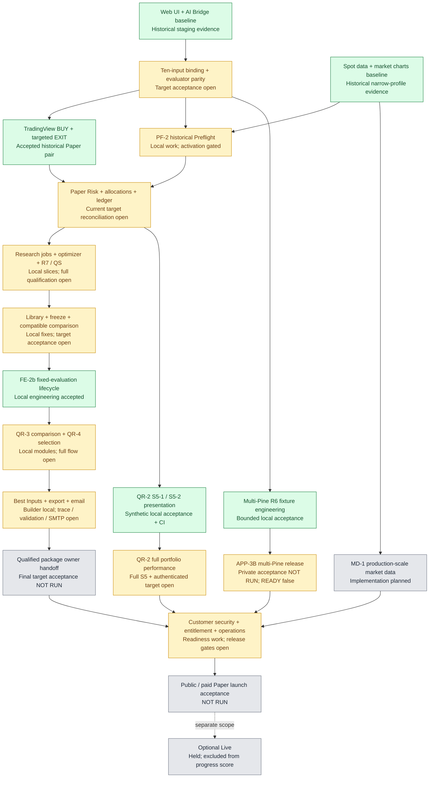
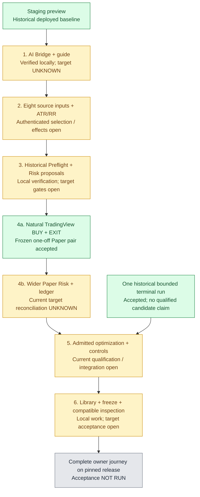

# Project and prototype status — 2026-10-23

Snapshot reviewed on 2026-10-23 (Asia/Bangkok), against `4591b1dacb31fea46a89948d83603e2901c9d2a9`. This is a status and diagram refresh, not a new PM-1 scorecard, deployment, runtime-health check or acceptance grant. [Roadmap](ROADMAP.md) owns scope and sequence; [PM-1](PROGRESS_MEASUREMENT.md) owns numerical measurement.

Green means the **exact scope written in the box** has accepted completion evidence. Yellow means started or partial work, including an open acceptance gate. Grey means the named implementation or final acceptance step has not run. Historical staging and local verification are labelled explicitly. A completed local component does not complete its parent release. UNKNOWN remains explicit rather than being coloured as not started.

## Whole Paper project

Arrows show major information flows and dependencies, not permission to execute the next box. QR-2 uses actual Paper ledger history; research comparison uses historical simulation. The diagram does not combine their performance claims. A future qualified owner handoff remains an explicit action; no automatic optimizer loop, Best Inputs apply or Bot start is implied.

## Minimal functional prototype

Scope: one owner, one Bot, one supported Pine, BINANCE:BTCUSDT Spot 1m and the existing 10K-bar profile. Full portfolio valuation, broader multi-Pine, full export/email, paid launch and Live are outside this denominator. A valid journey may end with `NO_VALID_CANDIDATE`; profitability is not required. The [prototype plan](STAGING_PROTOTYPE_PLAN_2026-10-01.md) defines the journey; its early status table is historical.

## Engineering progress and acceptance readiness

The latest accepted numerical measurement is [PM-1 S2](progress/PM1_SCORECARD_S2_2026-10-19.md), measured at `ca6abb1` on **2026-10-20 02:45 Bangkok**. It remains the latest measured baseline, not a fresh score for the current source revision.

| Measure | Displayed engineering bounds | Retained calculation | Weight of outcomes containing UNKNOWN |
| --- | ---: | ---: | ---: |
| Whole Paper project | **64–73%** | 64.2933–72.7900% | 41.57% |
| Minimal prototype | **73–80%** | 72.7500–80.4167% | 41.67% |

PM-1 uses 40 project outcomes and 14 prototype outcomes with frozen category weights and shares. Each outcome earns definition, implementation, independent verification and target integration credits weighted 10%, 40%, 30% and 20%. UNKNOWN credits produce bounds. There is no justified midpoint, confidence interval, test-count percentage or diagram-box percentage. The two measures must not be added or averaged. Optional Live is excluded from the whole Paper-project denominator.

Current interpretation: there is more accepted local engineering than at S2, especially FE-2b, F09 builder work, multi-Pine R6 and QR-2 APIs/UI. This review does not assign new numerical credit to those slices: each frozen outcome needs its complete stage criteria and source applicability reconciled in a successor scorecard. Full QR-2 and multi-Pine completion cannot be inferred from their green local components. These broader features also do not automatically advance the minimal prototype denominator.

| Required boundary | Current evidence status | What remains |
| --- | --- | --- |
| QR-2 S5-2 bounded local view | PASS locally; repaired exact CI PASS | Full S5 residual review, real authentication and target integration |
| Supported ten-input journey | Local implementation/review present | Coherent authenticated target selection and supported effects/parity acceptance |
| PF-2 / R7 / QS admission | Partial; wider gates OPEN | Scoped target qualification and current readiness evidence before activation |
| Current Library/freeze/comparison | Local work verified; target OPEN or UNKNOWN | Readback of an applicable pinned target release |
| F09 one-Pine package integration | OPEN | G7-compatible v3 trace; active trace profile recorded as v1 |
| Multi-Pine owner/private acceptance | NOT RUN; READY false | Existing owner-local prerequisites and bounded F1–F30 acceptance; F30 QR-4 deferred |
| Complete prototype owner journey | NOT RUN / NOT ACCEPTED | End-to-end acceptance on one pinned release |
| N1, target deployment and customer launch | N1 held; release gates unchanged | Separate existing GO and acceptance requirements; no action granted by this review |

## Evidence and recent CI

- [PM-1 S2 scorecard](progress/PM1_SCORECARD_S2_2026-10-19.md) and [machine-readable scores](progress/PM1_SCORECARD_S2_2026-10-19.json): numerical baseline, UNKNOWN credits and named gates.
- [Paper/UI checkpoint](STAGING_P2_CHECKPOINT_2026-10-03.md) and [prototype baseline](progress/PM1_BASELINE_2026-10-15.md): historical deployed preview, natural Paper pair and bounded terminal-run scopes.
- [FE-2b lifecycle evidence](evidence/PM1_FE2B_LOCAL_2026-10-22.json): local engineering only; native QS/systemd and target activation are not established.
- [QR-2 S5-1 evidence](evidence/PM1_QR2_S5_1_UI_LOCAL_2026-10-22.json) and [S5-2 evidence](evidence/PM1_QR2_S5_2_UI_LOCAL_2026-10-22.json): local synthetic rendering, exact values, time/identity guards and limits.
- [F11 R6 evidence](evidence/PM1_F11_01_R6_LOCAL_2026-10-22.json) and [cloud-to-local handoff](CODEX_CLOUD_CHECKPOINT_2026-10-22.md): local fixture engineering, remaining private acceptance and the one-Pine trace gap.
- Repair `09ecab3020ce6612183951968a5b86dae477cad2` passed [Safety checks](https://github.com/sanchatmd-dev/trading-bot/actions/runs/39822914924) and [Quant Lab](https://github.com/sanchatmd-dev/trading-bot/actions/runs/39822914467): nine jobs and 16 actual test/build/lint/parity/trace/smoke steps ran successfully. No test counts are inferred. Original `819adaf` failed five stale exact cache-token assertions; the test-only repair reproduced all five failures and passed six focused checks after correction.
- Documentation checkpoint `4591b1dacb31fea46a89948d83603e2901c9d2a9` passed [Safety checks](https://github.com/sanchatmd-dev/trading-bot/actions/runs/39825819507) and [Quant Lab](https://github.com/sanchatmd-dev/trading-bot/actions/runs/39825819299): scope/gate steps ran; runtime test jobs were skipped. Those runs add no runtime-test evidence.

Validation passed for 13 relative evidence links, all 30 node colour assignments, matching Roadmap/status graphs, four top notes and exact reproduction of the existing S2 bounds. Independent status review found no blocking defect. These are static document checks; no Mermaid renderer or application test was run for this refresh.

This refresh performs repository/document review only. No fresh target health, browser matrix, private acceptance or application tests are claimed. Spot/Paper, private source local, private acceptance NOT RUN, READY false and N1 held remain unchanged. No deployment, target route activation, migration, host/VPS work, Live, guard reset or Best Inputs apply occurred.
