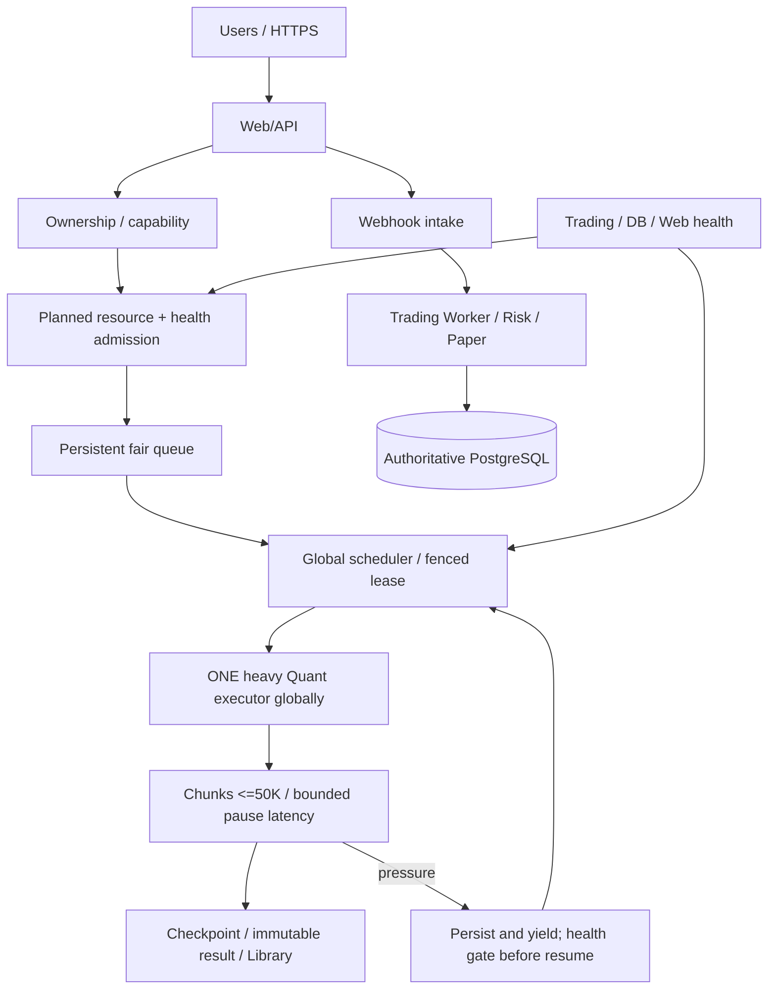
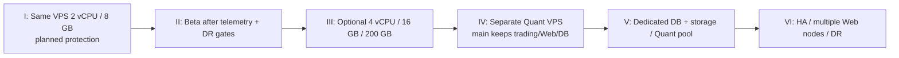
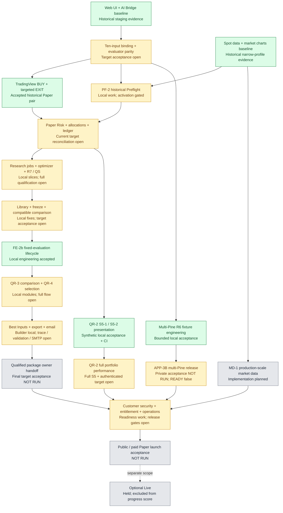
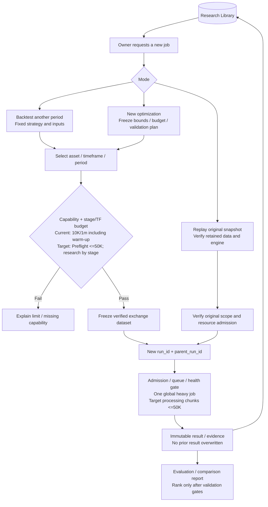

# Robot Trade — Pine → Bot → Quant → Owner Workflow

Claude root intake, 2026-10-24 (Bangkok): Claude verified the [Codex-to-Claude handoff](CODEX_TO_CLAUDE_HANDOFF_2026-10-24.md) and is sole root. HEAD and the permitted remote matched `3a46849`; the four transferred drafts, both protected stashes, the original checkout's nine preserved paths and all 19 handoff pins verified, and Codex dispatch is stopped. The owner then resumed preparation, gave a new GO naming S6-API-SERVICE-RO-1, with the environment taken from the packet binding, and granted continuous local work. No deployment or target route activation.

S6 staging market data, second attempt, 2026-10-27 (Bangkok): P4M m1 attempt a02 started the market stream, caught up the 14-page gap and stored a live bar, then rolled back because the one fallback collector run could not be proved ([result](S6_STAGING_FOLLOWUP_P4M_M1_A02_RESULT_2026-10-27.md)); the stored bars stay and the three market units are stopped. The owner chose stream only; rulings D40 and D41 (packet revision 9) apply it and both tools are re-verified ([P4M build R3](evidence/S6_STAGING_FOLLOWUP_P4M_BUILD_R3_2026-10-27.json)). Next: attempt a03 under a new owner GO.

S6 staging market data, first attempt, 2026-10-27 (Bangkok): P4M m1 attempt a01 stopped at its gate before any effect because the fallback collector timer uses a calendar trigger ([result](S6_STAGING_FOLLOWUP_P4M_M1_A01_RESULT_2026-10-27.md)); rulings D38 and D39 (packet revision 7) accept it and both tools are re-verified ([P4M build R2](evidence/S6_STAGING_FOLLOWUP_P4M_BUILD_R2_2026-10-27.json)). Next: attempt a02 under a new owner GO.

S6 staging per-Bot performance panel on, 2026-10-27 (Bangkok): follow-up phase P5a passed every check, and a browser check of the panel (delegated by the owner to Root) loaded reports ([result](S6_STAGING_FOLLOWUP_P5A_A01_RESULT_2026-10-27.md)); the staging API was unavailable for about 4 seconds and production identity stayed equal to the baseline. Finding: a report range that reaches back before the stored staging bars begin (about 3 October) answers 503. Next: P4M (fresh market data) under its own owner GO.

S6 staging follow-up tools accepted, 2026-10-27 (Bangkok): the follow-up packet [S6-STAGING-PROTO-FOLLOWUP-1](S6_STAGING_PROTOTYPE_FOLLOWUP_PACKET_2026-10-26.md) (revision 5) and its two tools are accepted locally after three review rounds each: P5a/R5a turns the QR-2 per-Bot performance panel on and off ([build](evidence/S6_STAGING_FOLLOWUP_P5A_BUILD_2026-10-27.json)), and P4M/RM restarts and stops the staging market stream and fallback collector ([build](evidence/S6_STAGING_FOLLOWUP_P4M_BUILD_2026-10-27.json)). Nothing ran on staging; each phase needs its own owner GO, in the order P5a, then P4M.

S6 staging production baseline, 2026-10-26 (Bangkok): a second read-only check under ruling D30 passed every staging check again and gave stable production digests ([result](S6_STAGING_PROTOTYPE_DEPLOY_P4_R6_A02_RESULT_2026-10-26.md)). Root accepted them as the production baseline, so the pair rollbacks are ready at their gates again; each still needs its own owner GO. Residual: the restore does not re-check production after its own reload.

S6 staging prototype on the pin, 2026-10-26 (Bangkok): the staging API and trading worker run revision ba1a433, and the read-only delayed check passed every staging check ([result](S6_STAGING_PROTOTYPE_DEPLOY_P4_R6_A01_RESULT_2026-10-26.md)). The production-identity stop is explained by ruling D29 (one production unit whose raw start-command status text changed after the in-scope reload; its process never restarted; owner confirmed production healthy). Residual: rollbacks refuse until a reviewed re-baseline of the production identity. Market stream, collector and research worker stay stopped.

S6 staging deploy P4 attempt a02 switched the pair, 2026-10-26 (Bangkok): the staging API and trading worker now run the pinned prototype ([result](S6_STAGING_PROTOTYPE_DEPLOY_P4_X4_A02_RESULT_2026-10-26.md)), but the run stopped after readiness (P4_STOP_AFTER_READY, CHK_PROTECTED): the combined identity of the production units changed within about 20 seconds after the switch. Production is checked first; the delayed check and the rollbacks wait for an owner decision.

S6 staging deploy P4 attempt a01 stopped before any effect, 2026-10-26 (Bangkok): the switch job refused at its first host stage because one public asset of the package (a 5.07 MB image) exceeds the tool's 4 MiB per-asset bound ([result](S6_STAGING_PROTOTYPE_DEPLOY_P4_X4_A01_RESULT_2026-10-26.md)); staging unchanged, GO-P4 consumed. Ruling D27 fixes the bound and makes the runner check it before its marker; attempt a02 needs a new owner GO-P4.

S6 staging deploy P0c read, 2026-10-26 (Bangkok): under the owner's GO-P0c, attempt a01 ran once read only ([result](S6_STAGING_PROTOTYPE_DEPLOY_P0C_A01_RESULT_2026-10-26.md)), verdict P0C_PASS. The P4 binding facts match the accepted P0a and P3 digests. Next: P4.

S6 staging deploy P4 tool and P0c accepted, 2026-10-26 (Bangkok): the P4 pair-activation tool with its R4, R4H and RX rollbacks passed fix round 1 ([build record](evidence/S6_STAGING_PROTOTYPE_DEPLOY_P4_BUILD_2026-10-26.json)). Ruling D24 found that its binding needs the loaded unit settings and drop-in hashes of the staging API and trading worker, which no accepted record held, so a new read-only phase P0c reads them first; its collector is accepted ([build record](evidence/S6_STAGING_PROTOTYPE_DEPLOY_P0C_BUILD_2026-10-26.json)). Nothing ran on the host. Next: owner GO-P0c, the P0c read, the P4 binding and dry admission, then GO-P4.

S6 staging deploy P3 migrated, 2026-10-26 (Bangkok): under a new owner GO-P3, attempt a02 ran once (one SSH session, about 27 seconds, no retry) and passed ([result](S6_STAGING_PROTOTYPE_DEPLOY_P3_A02_RESULT_2026-10-26.md)): the Paper ledger fence is installed on the staging database, the staging API was stopped for 19 seconds and restarted on its current code with no refusal, and window and post-migration backups stay on the host. The P4 facts show no queued work, heartbeat rows or foreign sessions. Next: the P4 tool round, a dry admission and GO-P4.

S6 staging deploy P3 attempt a01 stopped, 2026-10-26 (Bangkok): under the owner GO-P3, attempt a01 ran once (about 13 seconds, no retry) and stopped at its fresh gate before any effect ([result](S6_STAGING_PROTOTYPE_DEPLOY_P3_A01_RESULT_2026-10-26.md)): the staging API unit stop timeout exceeds the tool stop budget, and two partial code-directory walks cannot be compared by count. Nothing changed on staging. Ruling D23 widens the P3 and R3 stop budget and records partial walks as a fact; attempt a02 needs a reviewed fix round and a new owner GO-P3.

S6 staging deploy P3 tool accepted, 2026-10-26 (Bangkok): the P3 migration-window tool and its R3 rollback passed their fix round ([build record](evidence/S6_STAGING_PROTOTYPE_DEPLOY_P3_BUILD_2026-10-26.json)): unit suite 302 of 302, rehearsal 23 of 23 on PostgreSQL 16.15, independent tester PASS, audit GO with conditions. Ruling D22 sets the GO-P3 and GO-R3 wording from the reviewed tool and the 123-second API-gap bound from the P2 dump time. Nothing ran on the host for P3; GO-P3 waits for a dry admission and the owner. The P4 round follows.

S6 staging deploy P2 verified, 2026-10-26 (Bangkok): under the owner's GO-P2, attempt a01 ran once (one SSH session, about 13 seconds, no retry) and passed ([result](S6_STAGING_PROTOTYPE_DEPLOY_P2_A01_RESULT_2026-10-25.md)): a 7981962-byte live backup of the 86 MiB staging database restored in a capped throwaway cluster with every accounting table, ACL, row count, sequence, inspect state and the ledger check equal, decryption verified with no failure, and the throwaway copy removed (teardown proven). Staging services and the database are unchanged. Next: GO-P3 after the P3 tool record and a dry admission.

S6 staging deploy P2 tool accepted, 2026-10-25 (Bangkok): the P2 backup-and-restore verification tool passed its fix round under new rulings D20 and D21 ([build record](evidence/S6_STAGING_PROTOTYPE_DEPLOY_P2_BUILD_2026-10-25.json)). A local dry admission on the real bindings, before any GO request, found that the backup volume also holds the trees and the database, and that the staging public schema carries one extra grant; P2 now uses one dedicated protected backup directory that it creates if absent, and the restore prediction accepts that grant. Unit suite 89 of 89, rehearsal 27 of 27 on PostgreSQL 16.15, independent tester PASS, audit GO with conditions (met). Nothing ran on the host; GO-P2 waits for the owner. The P3 tool is in its fix round; P4 follows the accepted P3 and R3 tools.

S6 staging deploy P0b read, 2026-10-25 (Bangkok): under the owner permission for GO-P0b, the reviewed read-only database preflight ran once from the staged API tree (one SSH session, about 3 seconds, no retry) and passed with no stop and nothing blocking P2 or P3 ([result](S6_STAGING_PROTOTYPE_DEPLOY_P0B_A1_RESULT_2026-10-25.md)): PostgreSQL 16, 86 MiB, schema 14, fence absent as expected, M1 prerequisites met, runtime role with Paper funding rights, no foundation work, Paper ledger check with 0 findings, and about 87 GiB free on the database volume. Next: build and review the P2 backup-and-restore tool (ruling D9), then owner GOs for P2, P3 and P4. Staging still serves the 9 October API until P4. Spot/Paper, private source local, private acceptance NOT RUN, READY false and P13j/N1 held remain unchanged.

S6 staging deploy P1 staged, 2026-10-25 (Bangkok): under a new owner GO-P1, attempt a02 ran once (one SSH session, about 14 seconds, no retry) and passed: the API and trading-worker trees of pin ba1a433 (QR-2 O7 included) are staged exact and inert on the staging host, node --check passed on both entry closures, every unit is unchanged and the old trees stay ([result](S6_STAGING_PROTOTYPE_DEPLOY_P1_A02_RESULT_2026-10-25.md)). Next: P0b read-only database preflight under the owner GO-P0b; P2 to P5a need new owner GOs. Staging still serves the 9 October API until P4. Spot/Paper, private source local, private acceptance NOT RUN, READY false and P13j/N1 held remain unchanged.

S6 staging deploy P1 attempt a01, 2026-10-25 (Bangkok): under the owner permission for GO-P1, the reviewed P1 tool ran once (one SSH session, about 6 seconds, no retry). The host received and verified the whole 55 MB package, but the run stopped before any write (P1_STOP_PRE, PRE_STAGE_ANCHOR) because Root bound the API stage directory one level above the R7B releases directory ([result](S6_STAGING_PROTOTYPE_DEPLOY_P1_A01_RESULT_2026-10-25.md)). No host write happened and GO-P1 is consumed; attempt a02, bound to the shared releases directory, is prepared and needs a new owner GO-P1. P0b waits for P1. Staging still runs the 9 October API. Spot/Paper, private source local, private acceptance NOT RUN, READY false and P13j/N1 held remain unchanged.

S6 staging deploy P1 tool ready, 2026-10-25 (Bangkok): the P1 build-and-stage tool passed spec review, build, independent test and Opus audit plus one narrow fix for the real nested stage-directory layout ([build record](evidence/S6_STAGING_PROTOTYPE_DEPLOY_P1_BUILD_2026-10-25.json)); Root built and verified the package from pin ba1a433 (1589 files, about 55 MB) and validated the real binding. The owner allowed GO-P1 and GO-P0b when ready (2026-10-24 18:31Z); P1 stages the trees inert with no unit change. Spot/Paper, private source local, private acceptance NOT RUN, READY false and P13j/N1 held remain unchanged.

S6 staging deploy P0a read, 2026-10-24 (Bangkok): under a new owner GO the second P0a attempt read every stage in one SSH session (about 10 seconds, no retry; [result](S6_STAGING_PROTOTYPE_DEPLOY_P0A_A2_RESULT_2026-10-24.md), [evidence](evidence/S6_STAGING_PROTOTYPE_DEPLOY_P0A_A2_RESULT_2026-10-24.json)). Staging API runs eb532ff on Node 24 with the QR-2 flag unset and the research flags held at 0; the trading worker tree is 4d86822 but the trading worker, market stream and fallback collector are stopped, so staging Paper trading is not running; production units are all running; no heavy job; about 87 GiB free on the release-tree volume. The only stop came from a stale database path in Root binding; ruling D16 measures the database volume in P0b before P2 and carries the other findings to P3 and P4. Next: build and review the P1 staging tool and the P0b runner (ruling D9), then owner GOs. Spot/Paper, private source local, private acceptance NOT RUN, READY false and P13j/N1 held remain unchanged; no deployment, migration, service change or database access.

S6 staging deploy P0a D15 build, 2026-10-24 (Bangkok): after the first P0a attempt stopped on an empty EnvironmentFiles list that systemctl leaves out, a sixth review round accepted the ruling-D15 collector for a second attempt in a new namespace (99 author and 194 independent tests, 33 of 33 targeted mutants killed, Opus GO with conditions after an independent sweep of the host output format; [build record](evidence/S6_STAGING_PROTOTYPE_DEPLOY_P0A_BUILD_D15_2026-10-24.json)). The real-binding payload fits with 2362 bytes to spare. Known pre-existing stops that could use up a GO are recorded. A new owner GO naming P0a is needed; nothing ran on the host since the first attempt. Staging still runs the 9 October API. Spot/Paper, private source local, private acceptance NOT RUN, READY false and P13j/N1 held remain unchanged.

S6 staging deploy P0a first attempt, 2026-10-24 (Bangkok): under the owner GO-P0a, the reviewed D14 collector ran once (one SSH session, about 1.2 seconds, no retry) and stopped at the unit-properties stage with MISSING_KEY ([result](S6_STAGING_PROTOTYPE_DEPLOY_P0A_RESULT_2026-10-24.md), [evidence](evidence/S6_STAGING_PROTOTYPE_DEPLOY_P0A_RESULT_2026-10-24.json)); the channel, binding and host-health stages completed and Root verified the linkage. The likely cause is a host behaviour already recorded on 15 October: systemctl show --all leaves out an empty EnvironmentFiles list. Root ruling D15 in the packet records such an absent list as ABSENT, never as empty, with fail-closed rules for the API; a reviewed collector fix and a new owner GO naming P0a come before another attempt. The GO is consumed. Staging still runs the 9 October API. Spot/Paper, private source local, private acceptance NOT RUN, READY false and P13j/N1 held remain unchanged; no deployment, migration, service change, database access or target route activation.

S6 staging deploy P0a collector D14 build, 2026-10-24 (Bangkok): while building the private P0a binding from local evidence before the run, Root found that no record exists of the market stream or fallback collector code directories, so ruling D14 in the [staging prototype deploy packet](S6_STAGING_PROTOTYPE_DEPLOY_PACKET_2026-10-24.md) now has P0a record each one from the directory its loaded unit names as the baseline that the P3 check compares against, instead of comparing with a record that does not exist. A fifth review round accepted the change (89 author and 179 independent tests, 29 of 29 targeted mutants killed, Opus GO with conditions met or recorded; [build record](evidence/S6_STAGING_PROTOTYPE_DEPLOY_P0A_BUILD_D14_2026-10-24.json)). The binding draft validates and the payload fits with 2819 bytes to spare. The owner gave GO-P0a with notAfter 2026-10-25T14:00:00Z after Root reported the change; the run has not happened yet. Staging still runs the 9 October API. Spot/Paper, private source local, private acceptance NOT RUN, READY false and P13j/N1 held remain unchanged; no deployment, migration, service change or target route activation.

S6 staging deploy P0a collector built and reviewed, 2026-10-24 (Bangkok): under ruling D9 the read-only P0a host-preflight collector of the [staging prototype deploy packet](S6_STAGING_PROTOTYPE_DEPLOY_PACKET_2026-10-24.md) was built and reviewed ahead of any GO ([build record](evidence/S6_STAGING_PROTOTYPE_DEPLOY_P0A_BUILD_2026-10-24.json)). Four narrow fix rounds closed every P1 and P2 that the independent Opus reviews found (a host-change vector, environment-file contents read beyond the API, and env-file parsing gaps that could hide a flag); the final tester run passed 85 author and 165 independent tests with all 28 targeted mutants killed, and the last Opus re-check gave GO with conditions that Root has met or recorded. Ruling D13 and its addenda in the packet state the exact read rules, and GO-P0a now says that bash may keep the collector input in a private temporary file that it removes at once. The payload fits the 64 KiB limit with about 1 KB to spare at realistic lengths; Root re-checks it on the real binding before the run. Nothing ran on the host: GO-P0a has not been given, and staging still runs the 9 October API. Spot/Paper, private source local, private acceptance NOT RUN, READY false and P13j/N1 held remain unchanged; no deployment, migration, service change or target route activation.

QR-2 O7 coverage rendering accepted locally, 2026-10-24 (Bangkok): under root ruling R1 (continuous local grant; no response-contract change), the Paper performance view now renders the per-Bot and owner market coverage in English and Thai, with a client structural check that fails closed, each epoch value shown with its UTC ISO time, and the full gap interval list ([packet](QR2_S5_4_STAGE3C_O7_UI_PACKET_2026-10-24.md), [evidence](evidence/PM1_QR2_S5_4_STAGE3C_O7_LOCAL_2026-10-24.json)). An independent 681-check render oracle found no mismatch, the Opus auditor gave GO with conditions, a test-only fix round closed every mutation gap, root's full run passed 3109 tests with no failure, and root's local rendered check passed all 23 captures (EN/TH, desktop and mobile, the 4096-interval maximum and markup safety). B1 (owner-body coverage made mandatory in the server validator) waits for an owner GO naming it; the owner aggregate view needs the deferred capital-model packet. Nothing is deployed; staging still runs the 9 October API. Spot/Paper, private source local, private acceptance NOT RUN, READY false and P13j/N1 held remain unchanged.

S6 staging prototype deploy packet prepared, 2026-10-24 (Bangkok): at the owner's request, [S6-STAGING-PROTO-DEPLOY-1](S6_STAGING_PROTOTYPE_DEPLOY_PACKET_2026-10-24.md) is prepared and not run. Staging runs API eb532ff and trading worker 4d86822; the current branch adds 316 commits and the API and worker now refuse to start without the Paper ledger fence, so the packet uses a short offline migration window (fence only) and switches the API and worker together, with a backup and restore check first and a rollback at every phase. It splits into separately approved phases: a read-only look (P0a), database inspection, build and backup (P0b, P1, P2), the migration window (P3), the switch (P4) and, optionally, turning on the per-Bot performance page (P5a); the owner aggregate view and paper capital model are deferred to a follow-up packet. Three read-only maps, two review rounds with a separate second opinion and a narrow re-check are recorded ([preparation evidence](evidence/S6_STAGING_PROTOTYPE_DEPLOY_PREPARATION_2026-10-24.json)). No tool is built yet, the target revision is pinned at final preparation, and every phase needs its own owner GO. Spot/Paper only, Live hard-locked, private source local, private acceptance NOT RUN, READY false and P13j/N1 held; no deployment, migration, service change or target route activation.

S6 API working-directory diagnostic result, 2026-10-24 (Bangkok): under the owner's GO naming [S6-API-CWD-RO-1](S6_API_CWD_READONLY_PACKET_2026-10-24.md), the reviewed collector ran once (one SSH session, about one second, no retry). The service guard passed. Class OTHER: the API process runs from a directory next to the one the binding was frozen from, the unit's WorkingDirectory and the live server-script argument both point there, and the live argument vector differs from the frozen one ([result](S6_API_CWD_READONLY_RESULT_2026-10-24.md), [evidence](evidence/S6_API_CWD_READONLY_RESULT_2026-10-24.json)); an independent reviewer verified the linkage. Tracked release evidence suggests the 8 October S07 release switched the API through drop-ins; that is not established. The owner-ID path stays blocked until the owner explains the layout or a reviewed binding update re-freezes it. Owner ID stays UNKNOWN and applicability UNKNOWN_NOT_QUERIED. Spot/Paper, private source local, private acceptance NOT RUN, READY false and P13j/N1 held remain unchanged; no deployment, migration, service change or target route activation.

QR-2 O6 response wiring accepted locally, 2026-10-24 (Bangkok): under the owner's GO naming [QR-2 O6](QR2_S5_4_STAGE3B_RESPONSE_WIRING_PACKET_2026-10-24.md), the per-Bot and owner performance responses now carry the public market coverage projection, and the generic metadata view keeps the raw keys out. An independent 438-case oracle found no mismatch, the Opus auditor and a separate Opus second opinion (substituting for paused Fable) reviewed it, and a test-only fix round closed every mutation gap; root's full run passed 3092 tests with no failure ([evidence](evidence/PM1_QR2_S5_4_STAGE3B_O6_LOCAL_2026-10-24.json)). PostgreSQL suites run in CI. Rendering the coverage in EN/TH is O7; no rendered check, deployment or target route activation took place. Full S5 and prototype completion stay open. Spot/Paper, private source local, private acceptance NOT RUN, READY false and P13j/N1 held remain unchanged.

S6 API working-directory diagnostic prepared, 2026-10-24 (Bangkok): RO-2 stopped because the serving process's working directory did not equal the frozen value. [S6-API-CWD-RO-1](S6_API_CWD_READONLY_PACKET_2026-10-24.md) is a one-session read-only diagnostic that classifies why: it reads one service property set, the process working-directory link and argument vector, and path metadata, and returns labels only, with no database access, no service environment and no path leaving the host. The packet went through four revisions and three text reviews; the collector and runner were built ahead of any GO as local-only work and reviewed by a tester (twice, PASS), an Opus auditor (twice) and a separate Opus second opinion substituting for paused Fable, with every condition closed or recorded ([preparation evidence](evidence/S6_API_CWD_READONLY_PREPARATION_2026-10-24.json)). The result is a snapshot and cannot by itself say why RO-2 differed. Not run: it needs an owner GO naming S6-API-CWD-RO-1. Owner ID stays UNKNOWN and applicability UNKNOWN_NOT_QUERIED. Spot/Paper, private source local, private acceptance NOT RUN, READY false and P13j/N1 held remain unchanged; no deployment, migration, service change or target route activation.

S6 owner identity read RO-2 result, 2026-10-24 (Bangkok): under the owner GO naming [S6-OWNER-ID-RO-2](S6_QL_P2_OWNER_ID_READONLY_RO2_PACKET_2026-10-24.md), the reviewed collector ran once (one SSH session, about one second, no retry). The service guard passed (the API service is active and running), but the serving-process stage stopped because the running process working directory differs from the frozen expected value; verdict STOP_UNKNOWN. No database client was created and no SQL ran. An independent reviewer verified the linkage ([result](S6_QL_P2_OWNER_ID_READONLY_RO2_RESULT_2026-10-24.md), [evidence](evidence/S6_QL_P2_OWNER_ID_READONLY_RO2_RESULT_2026-10-24.json)). The cause is not established and a different revision is not implied. Owner ID stays UNKNOWN and applicability UNKNOWN_NOT_QUERIED; the next step is a reviewed read-only working-directory diagnostic under its own owner GO. Spot/Paper, private source local, private acceptance NOT RUN, READY false and P13j/N1 held remain unchanged; no deployment, database write or service change.

S6 API service start result, 2026-10-24 (Bangkok): under the owner's GO for [S6-API-SERVICE-START-1](S6_API_SERVICE_START_PACKET_2026-10-24.md), with the hard-gate checklist confirmed and the deployed revision's source checked first (no migration at start, Live locked in code), the twice-reviewed collector ran once (one SSH session, about eight seconds, no retry). All pre-check gates passed, one start was issued, and two polls five seconds apart found the Staging QL-P2 API unit active and running: verdict VERIFIED_RUNNING. An independent reviewer verified the result linkage ([result](S6_API_SERVICE_START_RESULT_2026-10-24.md), [evidence](evidence/S6_API_SERVICE_START_RESULT_2026-10-24.json)). The unit is not enabled at boot, so a host reboot would stop it again. Owner ID stays UNKNOWN and applicability UNKNOWN_NOT_QUERIED; the read-only owner identity read S6-OWNER-ID-RO-2 needs an owner GO naming it. Spot/Paper, private source local, private acceptance NOT RUN, READY false and P13j/N1 held remain unchanged; no deployment, migration or target route activation.

S6 API service diagnostic result, 2026-10-24 (Bangkok): under the owner's GO naming [S6-API-SERVICE-RO-1](S6_API_SERVICE_MISMATCH_READONLY_PACKET_2026-10-24.md), a newly built and twice independently reviewed collector ran once (one SSH session, one read-only property query, about one second, no retry). The exact selected Staging QL-P2 API unit matched its identity and expected configuration, but it was not running (active state inactive, substate dead); verdict SERVICE_GUARD_MISMATCH_OBSERVED_AT_NEW_SNAPSHOT. An independent reviewer verified the result linkage, and root accepts it as a diagnostic observation only ([result](S6_API_SERVICE_MISMATCH_READONLY_RESULT_2026-10-24.md), [evidence](evidence/S6_API_SERVICE_MISMATCH_READONLY_RESULT_2026-10-24.json)). It does not prove the earlier stop's cause or why the service is stopped. Owner ID stays UNKNOWN and applicability UNKNOWN_NOT_QUERIED. Starting the service is a service change that needs its own packet and an explicit owner GO. Spot/Paper, private source local, private acceptance NOT RUN, READY false and P13j/N1 held remain unchanged; no deployment, service change or target route activation.

Packets awaiting owner GO, 2026-10-24 (Bangkok): two packets are prepared and independently reviewed twice (root applied the final wording fixes and confirmed them by diff, as the reviewers allowed) but not run. [S6-API-SERVICE-START-1](S6_API_SERVICE_START_PACKET_2026-10-24.md) would start the stopped Staging QL-P2 API user service once, after a read-only pre-check that includes the user-manager linger setting and unit dependencies, and verify it within 30 seconds; it is a service change and needs an explicit owner GO naming it, with the owner checklist answered ([preparation evidence](evidence/S6_API_SERVICE_START_PREPARATION_2026-10-24.json)). [QR-2 O6](QR2_S5_4_STAGE3B_RESPONSE_WIRING_PACKET_2026-10-24.md) would wire the accepted Stage 3A coverage objects into the QR-2 responses; it changes the public response contract, so root requires an explicit owner GO naming O6 ([preparation evidence](evidence/PM1_QR2_S5_4_STAGE3B_PREPARATION_2026-10-24.json)). Neither packet authorizes anything yet. Ahead of any GO, root also had the start collector and runner built and independently reviewed twice (tester PASS, Opus GO after one fix round; 101 synthetic tests), without any host contact, and prepared [S6-OWNER-ID-RO-2](S6_QL_P2_OWNER_ID_READONLY_RO2_PACKET_2026-10-24.md), the read-only owner identity read that may follow only a verified start and needs its own owner GO naming it ([preparation evidence](evidence/S6_QL_P2_OWNER_ID_READONLY_RO2_PREPARATION_2026-10-24.json)). Spot/Paper, private source local, private acceptance NOT RUN, READY false and P13j/N1 held remain unchanged; no deployment, service change or target route activation.

F09 recommendation-contract draft, 2026-10-24 (Bangkok): a [proposed v3 research-contract design](design/f09-recommendation-contract/README.md) addresses the open F09 gap that no trace profile both reproduces and passes the G7 owner-recommendation gate. It proposes the v3 fields, an ACTIVE trace profile with closure-bound ports, a closure-membership matrix showing that seven of nine engine identities would rotate, per-family release consequences and test specifications, and lists owner and root questions. Two independent Opus reviews found it ready as a proposal after one revision. It is PROPOSED only: it adopts no ruling, authorizes no code or engine change and earns no PM-1 credit; any implementation needs the FE-2b release plan and an explicit owner GO. Spot/Paper, private source local, private acceptance NOT RUN, READY false and P13j/N1 held remain unchanged; no deployment or target route activation.

C3 guardian model r5, 2026-10-24 (Bangkok): a new pure composition test found that a workload start failing after EXIT could leave the supervisor reducer VERIFIED while the guardian recorded a failed cleanup (FINDING S1, a contract gap). Root adopted erratum E10 after an independent two-auditor design panel: the workload start settles before the normal cleanup starts, and a failed start is refused before EXIT, so both sides fail. Guardian revision r5 is accepted as a pure model only (root run: 244 of 244 guardian, 26 of 26 composition and 127 of 127 adapter tests; mutation 17 of 22 killed with 5 equivalent; Opus auditor GO). The adapter, reducer and wire format are unchanged, and accepted bytes are pinned through an immutable copy. See the [combined measurement packet](QR2_S5_4_STAGE2C_COMBINED_MEASUREMENT_PACKET_2026-10-23.md) and [evidence](evidence/PM1_QR2_S5_4_STAGE2C_LOCAL_2026-10-23.json). Native compilation, process fixtures, PostgreSQL and the C3 runtime stay closed; P13j and N1 stay held by the owner. Spot/Paper, private source local, private acceptance NOT RUN and READY false remain unchanged; no deployment or target route activation.

QR-3 S3a, 2026-10-24 (Bangkok): root accepts a pure evaluation record assembler as local engineering evidence under the owner's continuous local GO. It turns one validated fixed-evaluation result into the evaluation, benchmark and outcome bodies that the existing result-table writers accept, with explicit bar-close to bar-open time translation and exact-decimal cross-checks. Nothing imports it. Under root ruling R1 the RD-5 V8 hold is not discharged, so every record states an unconfirmed valuation basis and every outcome is NO_QUALIFIED_RESULT. Independent review found two blocking issues, a benchmark body too large for admitted windows and metrics kept for hidden participant statuses; both were fixed without any SQL or store change, and the re-review passed (tester PASS, Opus auditor GO, mutation PASS with two low test gaps). Root ran 41 of 41 new tests, the fair-comparison suite (105 pass, 5 existing todo) and the parity suite (8 of 8). The first push failed the fixed-evaluation importer guard in exact-revision CI; the assembler now takes its validators as arguments and imports none of the guarded modules (new suite 44 of 44, guard 10 of 10, re-audited GO, tester PASS), and exact-revision CI then passed on all jobs. The [packet](QR3_S3A_EVALUATION_RECORD_PACKET_2026-10-24.md) and [evidence](evidence/PM1_QR3_S3A_LOCAL_2026-10-24.json) record the scope. This is not S3 acceptance: the database orchestrator, capacity review and PostgreSQL recovery and cancel evidence remain. Spot/Paper, private source local, private acceptance NOT RUN, READY false and P13j/N1 held remain unchanged; no deployment or target route activation.

QR-2 S5-4 Stage 3A, 2026-10-24 (Bangkok): root accepts the pure public coverage projection as local engineering evidence under the owner's continuous local GO. A new unwired module projects the validated coverage registry into the frozen `qr2-bar-coverage-v1` objects and the owner `market_coverage` envelope, with a closed validator; nothing imports it yet. Root ran the new suite (28 of 28) and the four existing coverage suites (38 of 38 combined); an independent oracle over 600 seeds found no mismatch against the Stage 1 builder; the Opus auditor gave GO after one P2 fix (an above-estimate size is an estimator defect, not an admission refusal). The [packet](QR2_S5_4_STAGE3A_PUBLIC_COVERAGE_PACKET_2026-10-24.md) and [evidence](evidence/PM1_QR2_S5_4_STAGE3A_LOCAL_2026-10-24.json) record the scope. Stage 3A runs ahead of the C3 harness because the C3 runtime is closed. No public response, worker, route or UI changed; wiring (O6), the EN/TH UI (O7), full S5 and performance remain open, and no PM-1 credit is claimed. Spot/Paper, private source local, private acceptance NOT RUN, READY false and P13j/N1 held remain unchanged; no deployment or target route activation.

S6 API service diagnostic prepared, 2026-10-24 (Bangkok): at the owner's instruction, preparation of [S6-API-SERVICE-RO-1](S6_API_SERVICE_MISMATCH_READONLY_PACKET_2026-10-24.md) resumed and is complete. Both corrections from the first review are applied: explicit `--all --no-pager`, and timeout checks through in-process injected transport and timer simulation with no subprocess, native or process-fixture testing. A second round by two independent Opus reviewers, one substituting for the paused Fable reviewer, found one privacy issue (tracked hashes of guessable values could be reversed) and five smaller items; root fixed the privacy issue and four of the smaller items in the packet and assigned the fifth to the collector tests and the re-check found no blocking finding. The [preparation evidence](evidence/S6_API_SERVICE_MISMATCH_READONLY_PREPARATION_2026-10-24.json) pins the final packet and every review. The owner has since given a new GO naming the packet. Execution has not run: the collector and runner must first be built and independently verified, and one bounded read-only attempt follows Root admission. The previous owner-ID attempt remains consumed; owner ID stays UNKNOWN and applicability UNKNOWN_NOT_QUERIED. README and Context retain the local-freeze status. Spot/Paper, private source local, private acceptance NOT RUN, READY false, unchanged input lock and P13j/N1 held remain unchanged; no deployment, service change or target route activation.

S6 owner identity attempt, 2026-10-24 (Bangkok): after explicit owner GO and collector review, the single Staging QL-P2 attempt stopped at `API_SERVICE_MISMATCH` in 1.228 seconds. The exact service predicate is unknown; no DB connection, transaction or SQL ran, and no current environment/revision/schema attestation or owner candidate was obtained. Final independent synthetic checks passed 89/89, with full collector/runtime behavior outside that test scope. The [result](S6_QL_P2_OWNER_ID_READONLY_RESULT_2026-10-24.md) and [evidence](evidence/S6_QL_P2_OWNER_ID_READONLY_RESULT_2026-10-24.json) record the consumed attempt and its limits. This supersedes the preparation's awaiting-GO status only. Owner ID remains unknown and applicability remains UNKNOWN_NOT_QUERIED. Do not retry or continue applicability; a separately reviewed diagnostic scope and fresh owner GO are required before further target contact. README and Context were reviewed and retain the accurate local-freeze status. Spot/Paper, private source local, private acceptance NOT RUN, READY false, unchanged input lock and P13j/N1 held remain unchanged; no deployment or target route activation.

S6 owner identity read preparation, 2026-10-24 (Bangkok; packet started 23 October): the owner selected Staging QL-P2 Prototype and requested a reviewable read-only packet before any target connection. Additional local records support historical execution provenance, but the exact owner UUID remains unknown. The [owner identity packet](S6_QL_P2_OWNER_ID_READONLY_PACKET_2026-10-23.md) specifies one bounded environment preflight and one parameterized deployment/Bot identity read, separate from applicability. Independent static review passed; [preparation evidence](evidence/S6_QL_P2_OWNER_ID_READONLY_PREPARATION_2026-10-23.json) records the limits. Status is PREPARED, NOT RUN, AWAITING OWNER GO. No collector is executable yet, no target was contacted and no SQL or runtime tests ran. The later applicability checks remain UNKNOWN_NOT_QUERIED. README and Context were reviewed and retain the local-freeze status. Spot/Paper, private source local, private acceptance NOT RUN, READY false, unchanged input lock and P13j/N1 held remain unchanged; no deployment or target route activation.

S6 read-only applicability intake, 2026-10-23 (Bangkok): the owner authorized readback only after prior evidence confirms the environment and exact owner/Bot/import/version/deployment tuple. Local archive records agree after an older status is linked to the previous deployment. The inspected staging receipt nevertheless describes different deployment/Bot row prefixes; matching nested snapshot.market identities do not establish the row binding, and owner plus row import/version were not projected. Root stopped before target contact as instructed. Independent gap review passed; [evidence](evidence/S6_APPLICABILITY_IDENTITY_GAP_2026-10-23.json) records the limits without publishing identifiers. This does not establish current target corruption or invalidate the accepted local freeze. Applicability stays UNKNOWN_NOT_QUERIED until the intended environment/tuple is resolved. No SQL, runtime tests, generation, deployment or target route activation ran; Spot/Paper, private source local, private acceptance NOT RUN, READY false and P13j/N1 held remain unchanged.

S6 applicability preparation, 2026-10-23 (Bangkok): after the accepted local freeze, the next gate is a separately authorized read-only check of the exact current proposal and deployment. The [readback packet](S6_APPLICABILITY_READBACK_PACKET_2026-10-23.md) now specifies identity binding, latest-successful analysis semantics, all-eight-input membership, snapshot/generate provenance, complete selection comparison and conservative collection bounds. Independent static review passed; [preparation evidence](evidence/S6_APPLICABILITY_READBACK_PREPARATION_2026-10-23.json) pins the source contract. No target was queried, no product tests or runtime checks ran, and current applicability remains UNKNOWN_NOT_QUERIED. README and Context retain the accurate local-freeze status. Existing review/selection guards and all Spot/Paper, private-local, READY false and P13j/N1 held gates remain unchanged; no deployment or target route activation.

S6 local freeze, 2026-10-23 (Bangkok): following the owner's explicit GO, metadata and all 58 historical effective values were rechecked before creating an additive local lock. Slot 10 is minRiskATRInput (0.50–2.50, step 0.50, baseline 0.50); confirmLookback stays fixed at 5. New lock `8a25b8021c98d24f81913ea6386c6743d7b0f32fcb4df30b5ae95f5aa05604d8` is local only; the old lock, private files, slots 3–9, Bridge, signals and other domains remain unchanged. Five focused pure unit tests passed, and independent artifact review passed. The [local freeze record](S6_INPUT_LOCAL_FREEZE_2026-10-23.md) and [evidence](evidence/S6_INPUT_LOCAL_FREEZE_2026-10-23.json) supersede only the earlier pending-freeze status. Current proposal/deployment applicability remains unknown; no generation, runtime admission, real-data effects, parity or S6 acceptance is claimed. Spot/Paper, private source local, private acceptance NOT RUN, READY false and P13j/N1 held remain unchanged; no deployment or target route activation.

P13h N9 reporting verification, 2026-10-23 (Bangkok): a fresh 1,292 MiB RAM reading passed the unchanged 1 GiB admission floor. One bounded run of byte-identical accepted r4b model/tests, in a new local directory without supervisor source, produced 234 total tests: 233 passed, one explicitly skipped and zero failed. TAP and JSON identify the same missing-source ENOENT reason, with labelsCrossCheck.ran=false; the skipped cross-check is not a pass. Independent artifact review passed. This closes only the carried N9 reporting gap; permuted-CLEAN coverage was already covered by r4b (50/130 main seeds), and the historical 234-pass positive run remains distinct. [Evidence](evidence/PM1_P13H_N9_SKIP_REPORTING_LOCAL_2026-10-23.json) pins the local artifacts. No native, process-fixture, PostgreSQL, C3 runtime or prototype acceptance follows. Spot/Paper, private source local, private acceptance NOT RUN, READY false, unchanged input lock and P13j/N1 held remain unchanged; no deployment or target route activation.

S6 owner decision and pre-freeze preparation, 2026-10-23 (Bangkok): the owner selected `minRiskATRInput` for slot 10, baseline/minimum 0.50, maximum 2.50 and step 0.50, keeping `confirmLookback=5` fixed. Static inspection of the exact archived private source verified its input ID, float type, eligibility, source minimum 0.05 and step 0.05 (no declared maximum); the five-value grid also fits the separate evaluator bounds. All 58 input identities and the historical effective-input, snapshot and existing lock hashes matched. The old lock and private files remain unchanged. The [pre-freeze packet](S6_INPUT_REPLACEMENT_PRE_FREEZE_PACKET_2026-10-23.md) records the decision and [metadata evidence](evidence/S6_INPUT_METADATA_PRE_FREEZE_2026-10-23.json). Current analysis-proposal membership and deployment selection remain unknown because no DB/target action ran. Freeze, real-data effects, TradingView parity and S6 acceptance remain pending; private acceptance NOT RUN, READY false, Spot/Paper only and P13j/N1 held. This preparation grants no target, deployment or runtime authority.

Prototype shared UI rendering, 2026-10-23 (Bangkok): twelve synthetic local page checks passed across desktop/mobile and English/Thai: four six-card journey views and eight seven-step setup-guide views with Bridge disabled or its flag missing. The inspected layouts had no horizontal overflow, console warnings/errors or external HTTP requests. Unavailable states, closed research admission and no-qualified-winner wording remained visible. Independent review and source hashes are recorded in [rendering evidence](evidence/PM1_PROTOTYPE_SHARED_UI_RENDER_LOCAL_2026-10-23.json). The fixture used unchanged public components and shared styles with synthetic navigation and in-memory replies; it did not exercise app.js/authentication, provider calls, target runtime or the complete prototype journey. The local server and browser were closed. No product code changed, no PM1 score is recalculated, and all existing gates remain unchanged. The next full-prototype verification still requires an authorized pinned target journey and its separate admission gates.

Astra-only policy checkpoint `fed76e0bfc006a5aec0c52554068d75d66ec7711` passed [Safety checks](https://github.com/sanchatmd-dev/trading-bot/actions/runs/39933814540) and [Quant Lab](https://github.com/sanchatmd-dev/trading-bot/actions/runs/39933814519). Actual Ubuntu and Windows Node test steps, PostgreSQL test step and container build succeeded. Quant Lab ran scope and gate only; its runtime job was skipped. No test counts are inferred, and local C3/runtime and target gates remain unchanged.

Codex sole-root intake and Astra-only policy, 2026-10-23 (Bangkok): the owner authorized Codex to resume within the Claude handoff. All Codex roles now use Astra until explicit owner revocation: Root/high; auditor/coder/tester/routine worker medium; debugger/operations high; documentation/release clerk low (the owner's light). Maximum useful capacity is three independent children, lanes and writers, subject to usage and ownership gates. Static independent review confirms unchanged role instructions, efforts and Claude policy; the running root model remains unobservable. Intake verified 260 evidence pins and seven accepted snapshot hashes. The handoff manifest matched 19 of 20 entries; the checkpoint's original 7,410-byte prefix matches its recorded hash, and its later CI append is preserved separately. Exact revision `006dabc932a04b031eeedda26168775396e19968` passed [Safety scope checks](https://github.com/sanchatmd-dev/trading-bot/actions/runs/39930920575) and [Quant Lab scope checks](https://github.com/sanchatmd-dev/trading-bot/actions/runs/39930920219), with four runtime jobs skipped and zero new runtime tests. A separate deterministic pure-model follow-up closes the disclosed missing-WORKLOAD_STARTED composition coverage gap with three cases: ordinary order, delayed resume after cleanup, and invalid delivered EXIT proof. Author and independent runs passed the same three cases; counts are not additive. The initial wrong-field test assertion remains preserved. Accepted models and runtime gates are unchanged. The refreshed memory reading passed the resource floor, but grants no runtime authority. P13j and N1 remain HELD; native compilation, process fixtures, PostgreSQL and C3 runtime remain closed. Spot/Paper, private source local, private acceptance NOT RUN and READY false remain unchanged; no deployment or target route activation. [Evidence](evidence/PM1_CODEX_ROOT_RETURN_2026-10-23.json) records the scope and preserved findings.

Claude root prepared the handoff of the project to Codex, 2026-10-23 (Bangkok), at the owner's request; delivery is not claimed. The [Claude-to-Codex handoff](CLAUDE_TO_CODEX_HANDOFF_2026-10-23.md) records the transferred state, and the [earlier Codex-to-Claude handoff](CODEX_TO_CLAUDE_HANDOFF_2026-10-23.md) (intake commit `0c97828`) keeps the whole-project table. Claude dispatch is stopped; Codex becomes root only after verifying the handoff, Git state, file ownership, runtime and its own usage. Current C3 runtime remains NOT RUN, and any admission needs a fresh resource reading against the unchanged 1 GiB floor. P13j, the native-slice proposal, stays held by owner decision. No new product tests, deployment, target route activation or acceptance beyond the pure-model record below are claimed. Spot/Paper, private source local, private acceptance NOT RUN, READY false and N1 held remain unchanged.

C3 diagnostic preparation, 2026-10-23 (Bangkok): P13g is accepted at design level. The Windows launch-contract amendment (revision r4 plus root errata E1 to E9) closes the P13f design gap after four review rounds by independent Opus auditors (Fable paused by the owner); a first errata check found three wording defects, which root amended and a re-check confirmed. The design starts a guardian first, owning separate workload, PostgreSQL, supervisor and cleanup-tool jobs, with a fixed surviving INVENTORY/STOP cleanup path and guardian-clock deadlines that never block enforcement. Still open: A5.2 implementation obligations, unverified author-knowledge items, the connection-slot ruling point and job-list attribute qualification, which blocks runtime until qualified. No native source, compilation, process fixture, PostgreSQL or runtime was run or authorized. P13h, the pure guardian contract model, is also accepted as a pure model only (182 of 182 root-run tests on Node 24.19.0; a round-1 hole where inventory output was accepted before the INVENTORY role exited and its job was empty is fixed; final mutation run 51 runs, 39 killed, 12 survived as equivalent or unreachable (raw result file; the report text said 38 and 13); Opus auditor GO; thin permuted-CLEAN coverage and the N9 skip path are carried). It is not runtime, native, process or PostgreSQL evidence. P13i, the pure supervisor adapter model, is likewise accepted as a pure model only (126 of 126 root-run tests; round-1 audit GO and a fix round with 19 of 19 mutants killed; round-2 audit GO), and the two protocol sides, the guardian model and the supervisor side, agree under a seeded composition test (300 seeds). A P13h revision (rounds r3 to r4b) is now the accepted guardian model, again as a pure model only (root run: 234 of 234 guardian tests and 127 of 127 adapter tests). It caps the tick interval at 1000 ms, honours early role exits, fails START_POSTGRES on any postmaster exit observed before POSTGRES_READY (a safety defect found in review, contract A1.5.2), sends no workload frame after EXIT and terminates the PROVISION job when the postmaster exits during provisioning. The last round's mutation run passed (18 mutants, 17 killed, one equivalent) and the independent Opus auditor gave GO. Seven evidence pins on edited working copies were superseded; accepted bytes are now pinned through immutable copies. The next gate stays a source packet; native compilation, process fixtures, PostgreSQL and the C3 runtime remain closed until their own packet and admission. The earlier pure model retains its fourteen-group scoped evidence. Runner, lifecycle, other member gates, performance, full S5 and prototype completion remain open. Spot/Paper, private source local, private acceptance NOT RUN, READY false and N1 held remain unchanged; no deployment or target route activation.

QR-2 S5-4 Stage 2C implementation checkpoint, 2026-10-23 (Bangkok): the account and owner readers now produce a bounded shared coverage registry, and the worker validates its context and member references before financial computation. Root accepts the reviewed implementation and the bounded PostgreSQL scope verified in exact-revision Ubuntu CI (21 selected tests plus the single financial differential); broader integration acceptance remains incomplete. Focused C1 checks passed 36/36 before narrow corrections; the final affected C1 file passed 9/9. Focused C2 worker checks passed 10/10 before a metadata-bound correction, whose affected test passed 1/1. Independent checks and the preserved initial findings are recorded separately in [evidence](evidence/PM1_QR2_S5_4_STAGE2C_LOCAL_2026-10-23.json); overlapping counts are not added. Public response fields, routes, pool guards and financial composers remain unchanged.

Exact product revision `d0acf931c2cf14cf330e69350d759599c2b503fe` passed [Safety checks](https://github.com/sanchatmd-dev/trading-bot/actions/runs/39859557820) and [Quant Lab](https://github.com/sanchatmd-dev/trading-bot/actions/runs/39859557826): all nine jobs and 16 substantive steps succeeded. Raw PostgreSQL logs and checkout provenance verify all 21 selected named tests, including the three new integration scenarios; this is not the full-suite test count. The [local functional packet](QR2_S5_4_STAGE2C_FUNCTIONAL_PACKET_2026-10-23.md) remains NOT RUN; its earlier admission was held below the unchanged 1 GiB headroom gate, and no local database was started, and CI does not prove Windows lifecycle/resource behavior.

The financial differential passed on exact revision `2a89d1826902290ca54af3c8bf6be84c82267b47`: [Safety checks](https://github.com/sanchatmd-dev/trading-bot/actions/runs/39862387031) and [Quant Lab](https://github.com/sanchatmd-dev/trading-bot/actions/runs/39862387010) succeeded with nine jobs and sixteen actual substantive steps. Root and independent review verified 22 selected named PostgreSQL PASS records, comprising the earlier 21 and this one regression; this is not a full-suite count. Removing an interior bar unused by valuation preserved the complete financial response except its established timers. The original import finding and local Windows NOT RUN limitation remain recorded. The [C3 preparation packet](QR2_S5_4_STAGE2C_COMBINED_MEASUREMENT_PACKET_2026-10-23.md) now records independently checked coverage charges and an analytical owner-cap recipe: owner 5000 rows, heavy account 4990, with the standalone at-limit gap explicit. No C3 runtime or performance acceptance follows. Next is the coupled diagnostic harness, compatible clock and lifecycle qualification before separate runtime admission. Combined performance, production limits, Stage 3 public intervals/rendering and full S5 remain OPEN. Spot/Paper, private source local, private acceptance NOT RUN, READY false and N1 held remain unchanged; no deployment or target route activation.

QR-2 S5-4 Stage 2B-M2 checkpoint, 2026-10-23 (Bangkok): root accepts only the local synthetic measurement evidence: 16 outcomes (14 successes and two expected refusals), all 14 saved owner outputs independently checked, nine unchanged source hashes and actual worker transport. Dense fixtures held 43,200 rows; alternating fixtures held 720. Five-window cases represent the supported-owner shape at the seam; twenty-window cases are planner stress only. The measurement worker is not the production compute pool. [Evidence](evidence/PM1_QR2_S5_4_STAGE2B_M2_LOCAL_2026-10-23.json) records verified cleanup and the limits; no immutable defaults, integrated/public response acceptance or full Stage 2/S5 acceptance follows.

Product revision `a5d4db6` retains its full green CI. Documentation revision `1d7523b8ce5e82b7310e33742abcc0a9b1bf931f` passed [Safety scope checks](https://github.com/sanchatmd-dev/trading-bot/actions/runs/39855134051) and [Quant Lab scope checks](https://github.com/sanchatmd-dev/trading-bot/actions/runs/39855134093): scope/gate steps executed; runtime jobs were skipped. No test counts are inferred. Next is a separately reviewed local reader/compute integration and combined-cost qualification with gates disabled, following the bounded limit proposal; no larger research matrix is admitted. Spot/Paper, private source local, private acceptance NOT RUN, READY false and N1 held remain unchanged; no deployment or target route activation.

QR-2 S5-4 Stage 2B-M1 checkpoint, 2026-10-23 (Bangkok): root accepts twelve named local PG16 synthetic cases on the unchanged Stage 2A source, including three expected refusals, numeric timestamp ordering and repeatable-read late arrival. The first attempt failed at a harness import before case DB queries; its failure remains preserved. The corrected run passed independent evidence verification, completed in 11.342 seconds (13.724 seconds including supervisor verification), and stopped its fixture with PID/port checks. The [evidence](evidence/PM1_QR2_S5_4_STAGE2B_M1_LOCAL_2026-10-23.json) records six memory samples and tiny-table Seq Scan/Sort plans, not hard heap limits or index/target capacity. No product source changed. Next is a separate bounded M2 measurement packet for shared windows, output allocation and worker transport before selecting immutable limits or integrating account/owner readers. Full Stage 2, S5 and prototype completion remain open. Spot/Paper, private source local, private acceptance NOT RUN, READY false and N1 held remain unchanged; no deployment or target route activation.

QR-2 S5-4 Stage 2A checkpoint, 2026-10-23 (Bangkok): root accepts the unwired shared coverage registry and bounded timestamp-reader seams after source review and query-fake verification. Final focused Node tests passed 29/29. An independent 409-check suite passed before a targeted P2 error-classification finding; that correction passed 28 narrow independent checks and a separate audit. Counts are not additive. The [evidence](evidence/PM1_QR2_S5_4_STAGE2A_LOCAL_2026-10-23.json) preserves the original finding and final source pins. Exact Stage 2A revision `a5d4db611b07062e0a302a05f5027e842c42a11b` passed [Safety checks](https://github.com/sanchatmd-dev/trading-bot/actions/runs/39849193764) and [Quant Lab](https://github.com/sanchatmd-dev/trading-bot/actions/runs/39849193796): all nine jobs and 16 actual substantive test/build/lint/parity/trace/smoke steps succeeded. No CI test counts are inferred. Existing readers, responses, routes, worker guards and UI remain unchanged. The subsequent M1 checkpoint above records the first small real PostgreSQL qualification; further bounded measurements precede numerical budgets and account/owner integration. Query fakes do not establish database behavior, heap safety or target readiness. Full Stage 2, S5 and prototype completion remain open. Spot/Paper, private source local, private acceptance NOT RUN, READY false and N1 held remain unchanged; no deployment or target route activation.

QR-2 S5-4 pure Stage 1 checkpoint, 2026-10-23 (Bangkok): root accepts the bounded coverage builder, closed validator and mechanical BARS helper extraction after 51/51 focused Node tests, 442/442 independent oracle/schema/compatibility checks and independent architecture review. These counts describe separate checks and are not added together. The [evidence](evidence/PM1_QR2_S5_4_STAGE1_LOCAL_2026-10-23.json) preserves source identities and limits. Exact Stage 1 revision `37a010b5897cea95d20d11a1f006dce84b9e6576` passed [Safety checks](https://github.com/sanchatmd-dev/trading-bot/actions/runs/39845736925) and [Quant Lab](https://github.com/sanchatmd-dev/trading-bot/actions/runs/39845736868): all nine jobs and 16 substantive test/build/lint/parity/trace/smoke steps succeeded. No CI test counts are inferred. Stage 2A CI is tracked separately. Nothing is wired into a reader, response, route or UI. Next is a bounded Stage 2 measurement/admission packet before selecting numerical budgets or integrating account and owner coverage. Full S5 and prototype completion remain open. Spot/Paper, private source local, private acceptance NOT RUN, READY false and N1 held remain unchanged; no deployment or target route activation.

QR-2 gap-reporting design checkpoint, 2026-10-23 (Bangkok): independent source qualification confirmed that sparse valuation bars cannot establish complete interval coverage. The [S5-4 packet](QR2_S5_4_GAP_INTERVAL_PACKET_2026-10-23.md) records full-closed-candle bounds, explicit partial edges, closed completeness states, BARS reuse and shared owner coverage with whole-request budget refusal. Root admits only the pure adapter/validator and mechanical helper extraction as Stage 1; implementation has not started. Database reads, numerical budgets and later account/owner/UI integration await their own measured packets. [Evidence](evidence/PM1_QR2_GAP_DESIGN_LOCAL_2026-10-23.json) records source review and design, not executed tests or runtime acceptance. S5-3 exact-revision CI remains separately tracked. Full S5 and prototype completion remain unproved. Spot/Paper, private source local, private acceptance NOT RUN, READY false and N1 held remain unchanged; no deployment or target route activation.

QR-2 S5-3 local checkpoint, 2026-10-23 (Bangkok): root accepts the bounded synthetic symbol display and EN/TH “Price recorded later” notice after source/time qualification and independent review. Four producer-grounded states preserve exact decimal strings, usable STALE values, unavailable-price reasons and distinct request/valuation times. Review caught and corrected historical reservation fields in the fixture; no backend or security guard changed. UI/cache/language tests passed 177/177 before that fixture correction; the final affected slice passed 2/2 afterward. Producer suites passed 121 tests with two existing todo tests. Final actual-shell rendering covers 16 desktop/mobile EN/TH cases with no measured horizontal overflow, 880 loopback HTTP GETs, 16 inline images and no external HTTP or truncated capture. Earlier capture attempts are explicitly excluded. [Evidence](evidence/PM1_QR2_S5_3_UI_LOCAL_2026-10-23.json) and [UI traceability](QR2_S5_UI_TRACEABILITY_2026-10-23.md) preserve the limits. Exact implementation revision `0ffc20011bbde1ec397f51bf344fe929557b054a` passed [Safety checks](https://github.com/sanchatmd-dev/trading-bot/actions/runs/39841875708) and [Quant Lab](https://github.com/sanchatmd-dev/trading-bot/actions/runs/39841875739): all nine jobs and 16 actual test/build/lint/parity/trace/smoke steps succeeded. No CI test counts are inferred. The documentation checkpoint has a separate scope-only CI check. Full S5 remains open because the API does not expose gap intervals; next action is bounded source/contract analysis, not an invented interval display. Real authentication and target integration remain NOT RUN. Spot/Paper, private source local, private acceptance NOT RUN, READY false and N1 held remain unchanged; no deployment or target route activation.

Local codebase map, 2026-10-23 (Bangkok): the owner-confirmed English analysis at `63d465f` covers all 1,312 eligible files, with 4,066 nodes, 7,847 edges, 10 architecture layers and an 11-step tour. [The evidence record](evidence/PM1_CODEBASE_KNOWLEDGE_GRAPH_LOCAL_2026-10-23.json) reports independent assembly review, schema/coverage validation, fingerprints and a bounded local dashboard check. The graph and access token remain ignored and local; private inputs, secrets and runtime data were excluded. There are 372 orphan-node warnings and documented extraction limits. This is repository navigation, not new product acceptance, a successor progress score or target readiness. Spot/Paper, private acceptance NOT RUN, READY false and N1 held remain unchanged; no deployment or target route activation.

Project status diagrams refreshed, 2026-10-23 (Bangkok): [current project and prototype maps](PROJECT_STATUS_2026-10-23.md) distinguish completed scoped evidence, partial work and unrun acceptance. The latest accepted PM-1 S2 measurement remains project 64–73% and prototype 73–80%, measured on 2026-10-20 Bangkok; later FE-2b, F09/F11 and QR-2 engineering is shown in the diagrams but has not received successor row scoring. These are engineering bounds, not current target readiness or a new numerical assessment. Original S5-2 CI failed five stale test tokens; repair `09ecab3` and documentation checkpoint `4591b1d` passed their respective full and scope-only CI. Spot/Paper, private source local, private acceptance NOT RUN, READY false and N1 held remain unchanged; no deployment or target route activation.

QR-2 S5-2 local checkpoint, 2026-10-23 (Bangkok): the owner approved the bounded packet, and independent source/time qualification passed before UI edits. Root accepts the synthetic local book/marked-equity presentation: a fresh selected-Bot account GET supplies exact book decimal strings, with unavailable valuation time and a separate snapshot warning beside the historical marked report. Ownership, currency, source-shape, expiry and stale-response guards remain enforced. Final focused tests passed 21/21, language checks passed 2/2, and six independent verifier checks passed; these are distinct checks, not repeated-suite totals. Actual-shell rendering passed six bounded cases with eight viewport screenshots: desktop/mobile EN/TH success plus missing/wrong-currency book states. All six width observations show no overflow. The local server journal records 302 GET requests, including six reports and six explicit book reads; captured console entries are zero. This is not a complete external-network capture. The fixture is stopped and browser tab closed. [Evidence](evidence/PM1_QR2_S5_2_UI_LOCAL_2026-10-22.json) pins the sources and local artifacts; Exact repaired revision `09ecab3020ce6612183951968a5b86dae477cad2` passed [Safety checks](https://github.com/sanchatmd-dev/trading-bot/actions/runs/39822914924) and [Quant Lab](https://github.com/sanchatmd-dev/trading-bot/actions/runs/39822914467): all nine jobs and 16 actual test/build/lint/parity/trace/smoke steps succeeded. No CI test counts are inferred. Original revision `819adaf` failed five stale i18n token assertions on Windows; Ubuntu was cancelled, while PostgreSQL, container and Quant Lab passed. The test-only repair preserved all assertions and product guards; five failures reproduced before correction and all five affected tests plus the asset-cache test passed afterward (6/6), with independent review. This closes the code CI item; the documentation checkpoint will receive a separate scope-only CI check. Full S5, real authentication and target integration remain open. Spot/Paper, private source local, private acceptance NOT RUN, READY false and N1 held remain unchanged; no deployment or target route activation. Earlier S8 notes awaiting this GO are historical.

Owner team restoration, 2026-10-23 (Bangkok): the owner restored Root to Astra/high, architecture auditor to Astra/medium, and all other Codex roles to GPT-6.1 Sol at their prior efforts: debugger/operations high; coder/tester/routine worker medium; documentation/release clerk low. The Astra-only override is ended. Maximum useful capacity remains three children, lanes and writers within usage and file ownership gates. Existing agents and work remain preserved; configuration does not change already running models. This policy change does not resume the blocked prototype goal or its paused heartbeat. Spot/Paper, private source local, READY false and N1 held remain unchanged; no deployment or target route activation.

QR-2 S8 next-scope checkpoint, 2026-10-22 (Bangkok): S5-1 and its shell follow-up are locally accepted; code CI and the subsequent documentation CI are green. A bounded root/auditor review found no confirmed remaining implementation requirement in the existing GO. The next concrete full-S5 gap is book equity beside marked equity. A [proposed S5-2 packet](QR2_S5_2_LOCAL_UI_GO_PACKET_2026-10-22.md) requires a new bounded GO and independent source/time qualification before product edits; inspected account GET shapes provide decimal strings but no book-valuation timestamp. [Scope evidence](evidence/PM1_QR2_S5_2_SCOPE_PREPARATION_2026-10-22.json) records static findings, prior exact CI and limits. This checkpoint changes documentation only; no runtime tests or browser matrix were repeated. Full S5 and target integration remain open. Spot/Paper, private source local, private acceptance NOT RUN, READY false and N1 held are unchanged; no deployment or target route activation.

QR-2 S5-1 shell follow-up, 2026-10-22 (Bangkok): within the existing local GO, actual-shell synthetic verification found and fixed a stale sign-in prompt after session boot and a Load button re-enabled during a pending report on session refresh. The correction preserves all authentication/stale-response guards and financial behavior. Focused tests passed 14/14 (two new regressions failed before the fix); independent code review found no blocker. Desktop 1440×1000 and mobile 390×844 in EN/TH passed bounded fast/slow boot and report checks with no page overflow; navigation, same-session refresh and 401 delayed-response suppression also passed. Seven network capture intervals contain 372 GET events, including seven explicit report requests, with no external HTTP, truncation or console warnings/errors. Seven viewport screenshots and 19 DOM observations are retained; full-page capture failed, and three ancillary chart/position GET endpoints intentionally return fixture 404. [Evidence](evidence/PM1_QR2_S5_1_UI_LOCAL_2026-10-22.json) pins the corrected sources and distinguishes this synthetic shell verification from real authentication, full-app or target acceptance. Exact-revision CI on `735bf9f7c11955396550ec60cbad479f9c050197` passed [Safety checks](https://github.com/sanchatmd-dev/trading-bot/actions/runs/39807968713) and [Quant Lab](https://github.com/sanchatmd-dev/trading-bot/actions/runs/39807968738): all nine jobs and 16 actual test/build/lint/parity/trace/smoke steps succeeded; no CI test counts are inferred. The fixture is stopped and test tab closed. Full S5 remains open; Spot/Paper, private source local, private acceptance NOT RUN, READY false and N1 held remain unchanged. No deployment or target route activation.

Historical QR-2 S5-1 rendered closure, 2026-10-22 (Bangkok): the owner resumed local synthetic rendering. Root accepts only the bounded S5-1 read-only component view on unchanged candidate assets at `8c34a38b48bd53e631a352e29c28f75679fbaba0`. Desktop 1440×1000 and mobile 390×844 in English/Thai passed 36 main state checks, four custom-date checks and four pending/selection-change checks; 45 screenshots include one extra expanded Bot view. All 41 measured observations have no horizontal overflow. Complete per-case network capture covers 44 cases and 528 GET events, with no external HTTP requests or truncated cases. Exact decimal strings, null reasons, notices and separate owner currencies remain intact. Independent review found no new blocker; focused asset/QR-2 tests passed 12/12 with no failures or skips. [Evidence](evidence/PM1_QR2_S5_1_UI_LOCAL_2026-10-22.json) records hashes, the replaced truncated network diagnostic and harness limits. The harness isolates this component with synthetic session/GET data; full-app layout, real authentication and target integration remain NOT RUN. Actual-code CI remains green on `581f6e3`. Rendered-evidence checkpoint `22c7f08e1af56f79c2a5ff6eba88659dc89967c3` passed [Safety checks](https://github.com/sanchatmd-dev/trading-bot/actions/runs/39802965606) and [Quant Lab](https://github.com/sanchatmd-dev/trading-bot/actions/runs/39802965453): scope/gate steps ran successfully; runtime test jobs were skipped by documentation scope and add no test counts. No product change was needed. The fixture is stopped, browser tab closed and viewport reset. Stop at this checkpoint: full S5 and target activation remain open. Spot/Paper, private source local, private acceptance NOT RUN, READY false and N1 held remain unchanged; no deployment or target route activation.

Historical QR-2 S5-1 CI repair (superseded for rendered status by the closure above), 2026-10-22 (Bangkok): [Safety checks on 6f7fcff](https://github.com/sanchatmd-dev/trading-bot/actions/runs/39760612800) exposed stale asset/token assertions and incomplete or colliding UI translations; its Ubuntu Node job failed and Windows was cancelled by matrix fail-fast. [Quant Lab](https://github.com/sanchatmd-dev/trading-bot/actions/runs/39760612786) passed both OS jobs and their actual test steps. The bounded repair updates cache pins/token assertions and translations while retaining every cache/language/collision assertion. Final focused reruns passed 16 language tests and 12 asset/QR-2 tests, with zero failures or skips. [Evidence](evidence/PM1_QR2_S5_1_UI_LOCAL_2026-10-22.json) retains the earlier 107/108 intermediate result and independent verification. Exact-revision CI on `581f6e37ed25010aa4dc9dd5d095886b6886ac05` is green: [Safety checks](https://github.com/sanchatmd-dev/trading-bot/actions/runs/39763265408) and [Quant Lab](https://github.com/sanchatmd-dev/trading-bot/actions/runs/39763265564), with all nine jobs and their actual test/build steps successful. The earlier Safety run finished with failure despite its successful PostgreSQL job; it is not the repaired revision. No financial logic, backend or security guard changed. Rendered desktop/mobile English/Thai checks remain NOT RUN because local browser use is disabled. S5-1 remains unaccepted; Spot/Paper, private source local, private acceptance NOT RUN, READY false and N1 held remain unchanged. No deployment or target route activation.

Historical QR-2 S5-1 implementation checkpoint, 2026-10-22 (Bangkok): the owner explicitly approved the [bounded local UI packet](QR2_S5_1_LOCAL_UI_GO_PACKET_2026-10-22.md). The read-only Overview view now consumes existing Bot/owner GET responses with separate currencies, exact decimal strings, null reasons, API status/method/range metadata and English/Thai notices. Focused UI tests passed 11/11; shared Overview/Bot regressions passed 28/28, with no failures or skips. Independent review closed the owner-allocation eligibility finding. [Evidence](evidence/PM1_QR2_S5_1_UI_LOCAL_2026-10-22.json) records the actual checks and source identities. Desktop/mobile rendered acceptance is NOT RUN because local browser use is disabled in Work settings; the synthetic loopback harness is prepared and stopped. S5-1 remains unaccepted pending rendering and root review; The initial CI result and bounded repair follow-up are recorded above. No backend, security guard, deployment or target route activation changed. Spot/Paper, private source local, private acceptance NOT RUN, READY false and N1 held remain unchanged.

Historical authorized-scope preparation checkpoint, 2026-10-22 (Bangkok): FE-2b and QR-2 S4-4/S4-5, their identified repairs and focused follow-up verification are accepted locally with exact-revision CI green. A bounded root/auditor review found no confirmed remaining local implementation requirement in that GO. Native QS and target gates remain open; WSL is not installed on the local Windows environment. [Scope evidence](evidence/PM1_AUTHORIZED_SCOPE_CHECKPOINT_2026-10-22.json) and a [concrete S5-1 read-only local UI proposal](QR2_S5_1_LOCAL_UI_GO_PACKET_2026-10-22.md) prepare the next decision; S5-1 implementation requires an explicit scope extension. This checkpoint changes documentation only. Spot/Paper, private source local, private acceptance NOT RUN, READY false and N1 held remain unchanged.

QR-2 S4-5 owner-worker verification, 2026-10-22 (Bangkok): a second focused slice verifies nonzero fees and positive/negative PnL through the PostgreSQL owner reader and actual worker. Two synthetic accounts match hand-calculated fees/PnL of 1.26/58.74 and 1.17/-31.17; undeclared owner totals remain null with CAPITAL_MODEL_NOT_DECLARED. Five focused tests passed with zero failures or skips, independent review found no blocker, and the fixture cluster was removed. [Evidence](evidence/PM1_QR2_S4_5_OWNER_VALUES_LOCAL_2026-10-22.json) records the real ledger-writer path and fixture limitations. No product, clock or guard changed; this does not prove a declared owner aggregate or exact boundary events. Exact-revision CI on `e6db0222806693c8b41a37e531c4ca5da7018134` is green: [Safety checks](https://github.com/sanchatmd-dev/trading-bot/actions/runs/39751289372) and [Quant Lab](https://github.com/sanchatmd-dev/trading-bot/actions/runs/39751289295), with all nine jobs and their test/build steps successful. Spot/Paper only; private source local, private acceptance NOT RUN, READY false and N1 held.

QR-2 S4-5 HTTP verification, 2026-10-22 (Bangkok): the actual server now has regression coverage for owner/account shared-slot contention in both request orders. A database lock observes the deferred reader; the second request returns the contract's 429 concurrency refusal with Retry-After: 2, and both routes work after completion. Focused PostgreSQL regression passed 15 tests with zero failures or skips; a separated-slot mutation was caught in both orders and source was restored byte for byte. Independent review closed the cleanup finding. [Evidence](evidence/PM1_QR2_S4_5_HTTP_CONTENTION_LOCAL_2026-10-22.json) records the initial incorrect 503 expectation, correction and limits. No product or security guard changed. All new fixture clusters were removed. CI passed on the original HTTP checkpoint `d93c52a` ([Safety checks](https://github.com/sanchatmd-dev/trading-bot/actions/runs/39750212068), [Quant Lab](https://github.com/sanchatmd-dev/trading-bot/actions/runs/39750212086)) and on final verification revision `e6db022`; the evidence records both exact revisions. Active-compute/physical-stop timing and target capacity remain separate evidence; private acceptance NOT RUN, READY false, Spot/Paper only and N1 held.

Windows Python environment repair, 2026-10-22 (Bangkok): the remaining local environment assertion is resolved by preventing implicit inheritance of nine libuv-required parent values while explicitly preserving SYSTEMROOT for Windows sockets. Secret-name guards remain unchanged; tests now check blank defaults, mixed-case secrets, deterministic explicit extras and duplicate rejection. Focused verification passed 21 Node/closure tests and five PostgreSQL runner/evaluator tests, with no failures or skips. Independent verification passed two standalone tests and an actual Python isolation/socket probe; architecture review found no blocker. A follow-up using bare PATH Python without project dependencies passed the changed security case after the dependency smoke was directed to the project interpreter. Only the multi-Pine closure changes; historical evidence and stored hashes remain immutable. [Repair evidence](evidence/PM1_FE2B_WINDOWS_ENV_REPAIR_2026-10-22.json) records the new inventory and compatibility limits. No full local suite was rerun. Exact-revision CI on `a2268bfafbd7ddd2056642477ea43b1428b17608` is now green: [Safety checks](https://github.com/sanchatmd-dev/trading-bot/actions/runs/39735524272) and [Quant Lab](https://github.com/sanchatmd-dev/trading-bot/actions/runs/39735524235), with all nine jobs and their test/build steps successful. This closes the pending CI item; no target release eligibility is established. Original edits/stashes remain preserved; private acceptance NOT RUN, READY false and N1 held.

Owner-local FE-2b repair, 2026-10-22 (Bangkok): the seven PostgreSQL CI failures are repaired and verified on `46c7ef3966c7af35dd0331a0ca7566e22d7430aa`. Safety checks and Quant Lab passed, including Linux/Windows Node, container and full Linux PostgreSQL (1,593 passes, zero failures, 17 skips; isolation-none seven passes). Focused local checks passed 99 PostgreSQL and 82 independent Node tests; architecture review found no blocker, and all eight runtime closure hashes remain unchanged. The full local Windows process run has 1,591 passes, one unchanged minimal-environment assertion failure and 18 skips; separate isolation-none passed all seven tests. No security or stop/release assertion was relaxed. [Repair evidence](evidence/PM1_FE2B_CI_REPAIR_LOCAL_2026-10-22.json) records exact CI runs, local limitations and cleanup. This closes the handoff CI repair item as engineering integration evidence; no target release eligibility is established. The original dirty checkout and both stashes remain preserved. Private acceptance is NOT RUN, READY remains false and N1 remains held.

Owner-local root transfer, 2026-10-22 (Bangkok): [Complete handoff](CODEX_CLOUD_TO_LOCAL_ROOT_HANDOFF_2026-10-22.md). Cloud implementation and dispatch stop after the handoff push. Latest implementation `15e7bbf` has **red integration CI**: Quant Lab, Linux/Windows Node and container passed, but full PostgreSQL CI has 1,584 passes, seven failures and 17 skips. [CI readback](evidence/PM1_FE2B_CI_READBACK_2026-10-22.json) records package-query parity drift and the PROFILE fixture missing `q.contract`; neither is fixed in this handoff. Incoming root first preserves the owner-local dirty files/stashes, verifies the fetched work branch and fixes these failures. Earlier local acceptance and pending-CI notes are historical; no target release eligibility is established. Existing gates remain unchanged.

Codex FE-2b checkpoint, 2026-10-22 (Bangkok): the internal fixed-evaluation lifecycle is accepted as local engineering evidence under the owner GO. It admits immutable QR3/QR4 participants, runs exactly base/stress, validates frozen SHA on readback, and cancels/recovers only after stop and launch-exclusion proof. Final checks passed 2,902 Node tests (four skips, nine existing TODOs), 391 PostgreSQL tests (one private-case skip), and four assertion-killing mutations; all fixture clusters were removed. [Evidence](evidence/PM1_FE2B_LOCAL_2026-10-22.json) and the [eight-family closure inventory](evidence/PM1_FE2B_CLOSURES_LOCAL_2026-10-22.json) record the scope and limitations. Native QS/systemd proof remains NOT RUN. The feature stays off, no customer route is added, and target release/activation remains gated; READY false and N1 held. FE-2b CI is pending at commit preparation.

QR-2 CI readback, 2026-10-22 (Bangkok): both Safety checks and Quant Lab passed on `cfe0bc938eed06cc840e1119a1bdc17206fca96c`. This closes the pending CI item in the checkpoint below; FE-2b CI is tracked separately.

Codex QR-2 checkpoint, 2026-10-22 (Bangkok): S4-4/S4-5 are accepted as local engineering evidence under RC-Q44/RC-Q45: owner capital declarations and the owner performance API, both behind the existing flag that stays off. Regression passed 271 unit tests with two pre-existing TODOs and 125 PostgreSQL tests; seven serialized mutations were caught and every fixture cluster was removed. [Evidence](evidence/PM1_QR2_S4_4_S4_5_LOCAL_2026-10-22.json) records independent review, actual owner worker computation and limitations. FE-2b lifecycle work continues separately. CI is pending for this checkpoint; no target deployment, migration or activation, private acceptance NOT RUN, READY false and N1 held.

Owner GO, 2026-10-22 (Bangkok): cloud implementation of **FE-2b and QR-2 S4-4/S4-5** is authorized, with independent verification and periodic commit/push. [QR-2 OD-S4-1 to OD-S4-10](QR_2_PORTFOLIO_PERFORMANCE_CONTRACT.md#owner-continuation-decisions-2026-10-22-bangkok) record the approved declaration, currency, range-fee and all-period history rules; O-1 is closed. Work is in progress, not accepted or activated. Target deployment/migrations and activation retain their separate gates; no host/VPS work from cloud, private acceptance NOT RUN, READY false and N1 held. Earlier pending-GO notes below are historical.

Codex cloud continuation, 2026-10-22 (Bangkok): [Cloud checkpoint and remaining dependencies](CODEX_CLOUD_CHECKPOINT_2026-10-22.md) records all nine CI jobs passing on `d8a9c6f`, the completed R6 engineering work, and the QR-2 S5a rendered component check (24 desktop/mobile EN/TH scenario/surface checks; RC-Q42). No UI change was needed. The owner-local F11 runbook, F09 S4 compatibility/design preparation and FE-2b release-plan draft are ready for later decisions. Successful one-Pine S4 integration remains blocked: the ACTIVE trace profile is v1 while G7 requires the v3 placeholder. Private acceptance is NOT RUN; owner gates, READY false and the held N1 line remain unchanged. The owner authorizes periodic commit/push, not deployment or gate bypass.

Codex root, 2026-10-22 (Bangkok), R6 checkpoint: [R6-1 through R6-6 engineering evidence](evidence/PM1_F11_01_R6_LOCAL_2026-10-22.json) now includes the R6-6 harness under [RD-MP-50](MULTI_PINE_CONTRACT.md). The final default suite passed 21 tests and skipped 11 private cases; the opt-in synthetic dry run passed 31 tests and skipped the optional operator path, with all P1 to P9 checks held and cleanup verified. Independent testing, architecture review and a separate leak review are complete; 20 snapshot-specific mutants were caught. R6-4/R6-5 landed at `072461f`. The owner authorizes periodic commit/push; CI for this R6-6 checkpoint is pending at commit preparation. The next handoff step is owner-local F1 to F30 acceptance after O1, O2, O3 and O7, with a fresh disposable PostgreSQL cluster. Private acceptance remains NOT RUN; F30 QR-4 remains deferred. No installation or runtime wiring; READY remains false. Spot/Paper and all explicit GO gates remain in force; the held N1 terminal-evidence line is unchanged.

Codex root, 2026-10-22 (Bangkok): The [R6-4 follow-up and R6-5 isolation evidence](evidence/PM1_F11_01_R6_4_FOLLOWUP_R6_5_LOCAL_2026-10-22.json) is accepted as local fixture engineering evidence under [RD-MP-49](MULTI_PINE_CONTRACT.md), on work branch `codex/app3a-market-wait-checkpoint-gwylmk` at base `85f5331`. The owner authorized commit and push of this reviewed set; this note records the pre-commit evidence, with CI pending. Focused regression passed 136 tests; after a test-only QR-4 probe correction, the final isolation file passed 20/20. Independent review closed both findings. Sixteen valid mutations yielded 14 assertion kills, one database-constraint rejection and one equivalent EXECUTE grant; three invalid setup attempts are excluded. R6-6 remains unaccepted on WIP `a877733`; its privacy fixes, review and no-private dry run are next after this checkpoint. CI is pending at commit preparation. F1 to F30 owner-local acceptance remains open, including the existing F30 QR-4 carry-over. Nothing is installed, routed or wired; READY remains false. Spot/Paper only; the held N1 terminal-evidence line is unchanged.

Claude local root, 2026-10-21 (Bangkok): The Claude cloud root landed the [executor slice S3 of RS-6 (candidate plan, engine closure mp-combined-closure-v1, fixture executor, runner and operator script)](evidence/PM1_F11_01_EXECUTOR_S3_LOCAL_2026-10-21.json) and the [F09 builder S3a trace driver](evidence/PM1_F09_BUILDER_S3A_TRACE_DRIVER_LOCAL_2026-10-21.json) at c90f6a3 and d45f5d5 as local engineering evidence; neither is installed and no route or worker imports them. The cloud root then handed the root back to the local checkout ([handoff](CLAUDE_CLOUD_TO_LOCAL_ROOT_HANDOFF_2026-10-21.md)). The local root then landed the F09 builder S3b trace reproduction module at 730efee, recorded the F11 R6 package rulings (RD-MP-36 to RD-MP-43) at bbe00ec, landed the R6-1 package renderer and trace producer at 8c21fa9 (RD-MP-44; not wired), and landed the [F11 S1 follow-up](evidence/PM1_F11_01_S1_FOLLOWUP_LOCAL_2026-10-21.json) at 3576153 (RD-MP-45): the job supplies its final ledger state, the executor validates the closed HOLDOUT ledger, and a real run on the synthetic bars-v2 fixture ends SUCCEEDED; that fixture is not market or research evidence, owner_recommendation_ready stays false and MULTI_PINE_REQUIRES_APP_3B stays. The local root then landed the R6-2 package gates at 19de3a5 (RD-MP-46) and the R6-3 package store extension at f1b7e15 (RD-MP-47), and the F09 builder S3c acceptance tests at 0b405e1 ([record](evidence/PM1_F09_BUILDER_S3C_ACCEPTANCE_LOCAL_2026-10-21.json)); none is installed, routed or wired. CI passed all 9 checks on f1b7e15 and on 0b405e1; on 0b405e1 the PostgreSQL job requires an interpreter and the Quant Lab job runs the closure file with TRACE_REQUIRE_PYTHON=1, so the interpreter-gated trace cases ran, and root accepted F09 builder S3 (S3a, S3b, S3c) as local engineering evidence. The local root then landed the R6-4 package build service at c5be80a (RD-MP-48; not installed, routed or wired; CI passed all 9 checks on c5be80a); R6-5 and R6-6 are in progress and the owner-local F1 to F30 acceptance is open. CI was red from 05e7a47 to d45f5d5 (Windows CRLF checkout, and a bare python in the PostgreSQL real-job test); commit 6fabc04 fixed it in tests and .gitattributes only, with no product file changed, and CI passed all 9 checks on 6fabc04. No host step or GO occurred.

Claude local slices, 2026-10-21 (Bangkok): The [QR-3 comparison result tables (S2c-2)](evidence/PM1_QR3_S2C2_LOCAL_2026-10-21.json), the [QR-4 selection evaluation tables (S2-2)](evidence/PM1_QR4_S2_2_LOCAL_2026-10-21.json) and the [QR-2 route computation in a worker thread (S3b)](evidence/PM1_QR2_S3B_LOCAL_2026-10-21.json) are committed locally; none is installed on staging, and the QR-2 route stays off until the target server is measured again and its memory headroom is read. The [multi-Pine research run contract builder](evidence/PM1_F11_01_RUN_CONTRACT_LOCAL_2026-10-21.json) and two QR-2 S4 sub-slices, the [capital-model declaration extension (S4-1)](evidence/PM1_QR2_S4_1_LOCAL_2026-10-21.json) and the [owner-total allocation module (S4-2)](evidence/PM1_QR2_S4_2_LOCAL_2026-10-21.json), are also committed locally; the S4 rules are provisional until the owner decides the open S4 items, and nothing is installed or routed. The [S4-3 export, confirmed rollback and local restore rehearsal](evidence/PM1_QR2_S4_3_LOCAL_2026-10-21.json) and a [foreign-key trigger check in every extension classifier](evidence/PM1_EXTENSION_FK_TRIGGERS_LOCAL_2026-10-21.json) are also committed locally. The [multi-Pine internal run store (RS-1)](evidence/PM1_F11_01_RUN_STORE_RS1_LOCAL_2026-10-21.json), for isolated clusters only, and the [per-member admission checks (RS-4)](evidence/PM1_F11_01_MEMBER_ADMISSION_RS4_LOCAL_2026-10-21.json) are also committed locally, with the [run-store writer and readers (RS-2)](evidence/PM1_F11_01_RUN_STORE_RS2_LOCAL_2026-10-21.json) and an [isolation suite (RS-3)](evidence/PM1_F11_01_RUN_STORE_ISOLATION_RS3_LOCAL_2026-10-21.json); no service, route or worker uses the run store yet. The Claude cloud root then added the [internal fixture admission service (RS-5)](evidence/PM1_F11_01_FIXTURE_ADMISSION_RS5_LOCAL_2026-10-21.json) (RD-MP-23), which admits a multi-Pine run on isolated fixture clusters only; no route, worker or runtime root imports it and nothing is installed. It also added the [combined Paper evaluator and its Node oracle (RS-6 S1, S2)](evidence/PM1_F11_01_COMBINED_EVALUATOR_S1_S2_LOCAL_2026-10-21.json) (RD-MP-24 to RD-MP-34): the Python evaluator and the oracle agree on every scripted and fixture case; the private-source runs have not run (RD-MP-34), and the later state is in the paragraph above. The QR-2 compute pool now refuses to start under process-wide heap flags (RC-Q40; local only, not checked on any host). The All Bots card shows book equity per currency (RC-Q41); it is checked in JSDOM only, not in a browser. The PF-2 R4 real-supervisor tests skip without a systemd user manager, so the Linux real-process path of R4 has no automated evidence. The RS-5 admission service re-checks authorization and the key inside its transaction (RD-MP-35). The F09 builder S3 trace-reproduction design is recorded ([design record](design/f09-trace-repro/README.md)) with owner question OQ-1 open. No host step or GO occurred.

Claude pure modules and a shutdown fix, 2026-10-20 (Bangkok): three pure libraries are committed locally and are not wired into any route, worker or view, so they show the owner nothing yet. They are the [package-gate module](evidence/PM1_F09_PACKAGE_GATES_LOCAL_2026-10-19.json) for QL-4B/QL-4C, the [QR-2 S1 portfolio performance library](evidence/PM1_QR2_S1_LOCAL_2026-10-19.json) and the [QR-3 S1 fair-comparison module](evidence/PM1_QR3_S1_LOCAL_2026-10-19.json). Each passed independent review rounds and mutation runs, and root recorded the resulting clarifications in its contract. The owner decided that a requested QR-2 period ending after the request time ends at the request time with a shown flag. Two QR-3 owner items stay open and fail closed: a tie band wider than 0.50, and the outcome when exactly one participant is eligible. A runtime-lock defect is fixed on this branch: a server-side connection end during a graceful shutdown could exit the service with code 1, which also caused the intermittent CI failure. The [QR-3 S2a exposure register](evidence/PM1_QR3_S2A_LOCAL_2026-10-20.json), a PostgreSQL extension shared by QR-3 and QR-4, is also committed locally; it is not installed on staging and nothing writes to it yet. The [F09 package renderer, builder slice S1](evidence/PM1_F09_PACKAGE_RENDER_S1_LOCAL_2026-10-20.json), is committed locally as a pure module; no package can be built, stored or shown yet. The [F09 builder tables, slice S2](evidence/PM1_F09_BUILDER_S2_LOCAL_2026-10-20.json), and the [derived exit version for multi-Pine member sets](evidence/PM1_F11_01_EXIT_VERSION_LOCAL_2026-10-20.json) are also committed locally; the tables are not installed on staging and nothing writes them. The [QR-2 per-Bot performance route, slice S3a](evidence/PM1_QR2_S3A_LOCAL_2026-10-20.json), is committed locally behind a setting that is off by default; it must not be enabled before slice S3b moves its computation off the server's main thread. The [QR-3 comparison tables (S2c-1)](evidence/PM1_QR3_S2C1_LOCAL_2026-10-20.json), the [QR-4 selection registration tables (S2-1)](evidence/PM1_QR4_S2_1_LOCAL_2026-10-20.json) and the [multi-Pine member-set tables](evidence/PM1_F11_01_MEMBER_SET_TABLES_LOCAL_2026-10-20.json) are committed locally as offline extensions; none is installed on staging and no route writes them. Library G5 now also reads the exposure register ([QR-3 S2b](evidence/PM1_QR3_S2B_LOCAL_2026-10-20.json), qualification version v2), the [multi-Pine member-set store function](evidence/PM1_F11_01_MEMBER_SET_STORE_LOCAL_2026-10-20.json) exists locally, and a [hardening slice](evidence/PM1_EXTENSION_HARDENING_LOCAL_2026-10-20.json) tightened every extension's install checks; the research freeze tool must now run as the owner of quant_jobs. No host step or GO occurred.

PM-1 scorecard S2 completed, 2026-10-20 (Bangkok): the successor scorecard rescores all 54 rows of the unchanged inventory PM1-I1 at commit `ca6abb1`, and root accepted it after an independent arithmetic and provenance check and a consistency review on another model. Engineering bounds are project **64.29–72.79%** (S1 50.17–74.12%) and prototype **72.75–80.42%** (S1 52.00–82.42%). UNKNOWN credits remain in both views, so neither view has a single score. The lower bounds rise mainly from new independent verification of 14 project rows and their prototype mirrors on the current code, and from the root-accepted package, QR-2, QR-3 and QR-4 contracts (definition credit for F09-01, F10-01, F10-02 and F10-03). The upper bounds fall where staging is now known to lack verified behaviour (target integration 0 for F01-03, F06-01, P05-01 and P06-03). F11-01 keeps an unknown definition credit until its fixture acceptance. Later commits, including the QR-2 S1 library, are not scored. See [the S2 scorecard](progress/PM1_SCORECARD_S2_2026-10-19.md).

Claude multi-Pine contract and package clarifications, 2026-10-20 (Bangkok): the owner chose the recommended option for all eleven decisions of [the F11-01 multi-Pine contract](MULTI_PINE_CONTRACT.md), which root accepted after independent review. A later Bot may hold up to three member Pine scripts that share one Bridge pair. Before APP-3B such a package stays internal, is never READY and shows the owner nothing. Root also recorded eleven clarifications (RC-1 to RC-11) in [the package contract](QL_4B_4C_QUALIFIED_PACKAGE_CONTRACT.md) from the first review of the gate module; the owner decisions are unchanged. Nothing is wired into a route, and no host step or GO occurred.

Claude QR-3 and QR-4 contracts, 2026-10-20 (Bangkok): the owner chose the recommended option for every decision of [the QR-3 fair comparison contract](QR_3_FAIR_COMPARISON_CONTRACT.md) and [the QR-4 qualified selection contract](QR_4_QUALIFIED_SELECTION_CONTRACT.md). Root accepted both after independent review and a reconciliation that makes them share one exposure register. QR-4 ranks only READY packages on a new common window, and it rechecks that window at each evaluation start and before it writes an outcome. The [package contract](QL_4B_4C_QUALIFIED_PACKAGE_CONTRACT.md) gains OD-19: a window that a comparison or a selection used counts as exposed data for the holdout check. Nothing is implemented. No ranking, recommendation, apply or Bot action exists, and no host step or GO occurred.

Claude QR-2 contract and journey copy, 2026-10-19 (Bangkok): the owner chose the recommended option for every QR-2 portfolio-performance decision, including the earlier O1-O16 and D4 items. [The QR-2 contract](QR_2_PORTFOLIO_PERFORMANCE_CONTRACT.md) now defines the actual Paper portfolio view: ledger sources of truth, mark prices with age limits, time-weighted and Modified Dietz returns with money PnL, reconciliation checks with exact codes, graded handling of gaps and ledger-rule epochs, and the slices to build it. Root accepted it after independent and second-opinion design review and a fidelity review; it is not implemented and changes no ledger, tile or Bot. The journey's next-step texts for steps 2 to 5 now state what is done and what is still open, with cited evidence. No host step or GO occurred.

Claude owner decisions and package contract, 2026-10-19 (Bangkok): the owner settled the open questions of today's reconciliation. The adapter document now matches the code's proposal-bounded input list (O1), and a server test pins that rule. The PF-2 acceptance packet no longer claims a database-frozen published result; the lease fence and re-validation on every read protect it (O3). The owner chose the recommended option for all eighteen decisions of [the QL-4B/QL-4C qualified Best Inputs package contract](QL_4B_4C_QUALIFIED_PACKAGE_CONTRACT.md), which root accepted after independent and second-opinion design review; it is not implemented and grants no recommendation, apply, email or Bot action. PF-2 Preflight (F04-03) now reconciles on the merged release lineage. The setup guide now shows Bridge steps as unavailable when a release disables the Bridge. No host step or GO occurred.

Claude release-lineage merge, 2026-10-19 (Bangkok): at the owner's choice, the staging release lineage (commit eb532ff) is now merged into this branch, so a later release from it keeps the evaluator-binding refusals, the PF-2 runtime DELETE revoke, the one-active-PROFILE enrollment guard and the child diagnostics. Branch-only tests were adapted to the release grant script and privilege model; the freeze test now proves both the privilege layer and the triggers. On the merged tree the full Node, PostgreSQL and Python suites pass locally, and independent and second-opinion reviews found no lost protection. The merged tree is not identical to the release: the graceful-stop change rotates the foundation, ingestion and PF-2 engine hashes, while the legacy engine and the PF-2 evaluator are unchanged. [The deploy note](RELEASE_LINEAGE_MERGE_2026-10-19.md) lists the offline migrations, the grant reapply, the startup policy check and the queued-job effects a later release must handle. Nothing was deployed, migrated or restarted, and no host step or GO occurred.

Claude PM-1 verification carry, round 3, 2026-10-19 (Bangkok): six more rows were reconciled on the current code with independent auditors and testers. Charts (F04-02), PF-3 readiness (F04-04), PF-4 proposals (F04-05) and the artifact freeze (F08-02) still match their accepted contracts. The Library (F08-01) had one defect: the comparison view showed an empty shared-context block, fixed earlier today. PF-2 Preflight (F04-03) could not be reconciled, because the accepted staging release lineage was not part of this branch and the branch lacked its evaluator-binding refusals and its runtime DELETE revoke; the owner chose to merge that lineage, which is in progress in a separate worktree. Five new test files cover the remaining chart, Library and proposal-race clauses, and independent single-edit mutations were caught except four that are redundant or unreachable. One owner question is new: the PF-2 packet calls the published result immutable, but the database does not freeze it. See [the record](evidence/PM1_VCARRY_R3_LOCAL_2026-10-19.json). PM-1 credits stay unchanged until a successor scorecard; no staging readback, host step or GO occurred.

Claude graceful-stop decision, 2026-10-19 (Bangkok): the owner chose to scope the durable-jobs recovery clause to legacy mode. In foundation mode a graceful worker stop is now terminal by contract: the research job ends FAILED with RESEARCH_INTERRUPTED and the foundation job is CANCELLED after stop proof. The worker checks for the stop before it creates a chunk, before each chunk commit and before the final commit, so a late answer, an abort at finish or an abort between steps commits nothing; a stop inside an already running commit cannot be undone. A new PostgreSQL test file pins both modes, and an independent tester's eight single-edit mutations were all caught. This changes the foundation engine hash, so queued foundation jobs from an older engine fail closed after any later deployment. Backfill and preflight paths are outside this clause. See [the record](evidence/PM1_D1_GRACEFUL_STOP_LOCAL_2026-10-19.json). No deployment, migration, staging readback, host step or GO occurred.

Claude PM-1 verification carry, round 2, 2026-10-19 (Bangkok): Bot creation and lifecycle (F01-02), ten-input selection (F02-02) and immutable research jobs (F06-01) were reconciled on the current code, and their existing tests pass on a local PostgreSQL that mirrors CI. Three new PostgreSQL test files now assert the remaining clauses: plan capacity, frozen policy, unsupported transitions, funded-capital and stopped-Bot refusals; generate refusals before any write or provider call, snapshot hash rechecks and selection coherence; and frozen research contracts and engine-change refusals. Independent single-edit mutations were all caught except two equivalent ones. No product code changed. One owner decision is open: the input list is limited to the AI analysis proposal, while the adapter document says it shows every eligible input. The second, graceful worker stop in foundation mode, was decided later the same day (see the note above). PostgreSQL files ran on a local cluster that mirrors CI, and no staging readback was done. See [the record](evidence/PM1_VCARRY_R2_LOCAL_2026-10-19.json). PM-1 credits stay unchanged until a successor scorecard. No host step or GO occurred; REA is paused and PM-1 S1 is unchanged.

Claude PM-1 verification carry, 2026-10-19 (Bangkok): Claude reconciled the verification carry of three early rows on the current code. Owner authentication and tenant isolation (F01-01), versioned Bridge transport and targeting (F02-03) and the Paper risk, allocation and targeted EXIT baseline (F03-01) all still match their accepted contracts, with no defect found, and their existing tests pass on a local PostgreSQL that mirrors CI. Their clauses without decisive assertions now have three new PostgreSQL test files: foreign-owner, missing-session and CSRF refusals across the remaining owner routes; Bridge refusals for wrong versions, inactive or unknown senders, foreign or closed targets and conflicting redeliveries; and exact cap and rejection reasons for Paper entries. An independent tester's single-edit mutations of the product code were caught except two that remove one of two redundant checks; these slices had no separate architecture review of the new tests, because usage was near the floor. No product code changed. See [the record](evidence/PM1_VCARRY_R0_APP3A_LOCAL_2026-10-19.json). PM-1 credits stay unchanged until a successor scorecard, and no staging readback was done. No host step or GO occurred; REA is paused and PM-1 S1 is unchanged.

Claude takeover and PM-1 F05 reconciliation, 2026-10-19 (Bangkok): Claude took sole command from Codex at `138644c` after re-verifying Git, the owner's files, processes and usage. The next N1 action, the terminal-evidence contract, is held for an owner decision: an automated safety screen stopped Claude's review of it, and the handoff forbids working around such screens. Claude instead reconciled two local PM-1 rows. For F05-01, the current QL-2A evaluator path matches the accepted baseline under its frozen policy; the 92 recorded decisions were not replayed, because the original chart exports are not in the repository. For F05-03, the research engine still matches its accepted contract, and a new PostgreSQL test file now asserts the screen, ranking, sensitivity, holdout, report and live-counter clauses that earlier tests only exercised; an independent tester's 19 single-edit mutations were all caught. See [the reconciliation record](evidence/PM1_F05_LOCAL_RECONCILIATION_2026-10-19.json). PM-1 credits stay unchanged until a successor scorecard. No host step or GO occurred; REA is paused and PM-1 S1 is unchanged.

Codex to Claude stop handoff, 2026-10-19 (Bangkok): the owner requested transfer of the whole project and latest work. Codex stopped implementation and dispatch; all children completed and no owned test, operations session or GO remains active. B2 is complete, and the latest accepted local work is the R3C6 evidence requirements and twelve synthetic data-correspondence cases. Claude must read [the handoff](CODEX_TO_CLAUDE_HANDOFF_2026-10-19.md) and its private companion, then reverify Git, ownership, processes and its own usage before taking sole command. Next is the exact terminal-evidence contract and permitted producer scope; all host and production gates remain open. This handoff issues no GO. REA is paused and PM-1 S1 is unchanged.

Codex N1 local progress, 2026-10-19 (Bangkok): root adopted the producer-provenance and final-emission evidence requirements after independent review, then accepted twelve synthetic data-correspondence cases after one test run and static architecture review. The tests compose the existing config, memory sink and full observation parser without changing runtime interfaces. They demonstrate that valid altered history can parse while failing memory correspondence, that final UNKNOWN does not promote a result, and that retained history survives caller mutation and rejected persistence. These are separate data checks, not authentic execution or delivery. Earlier local components remain accepted in their narrow scopes. Next is an exact independently reviewed terminal-evidence contract and permitted producer scope before implementation; the original screened broad orchestration dispatch remains closed. D2 transport applicability, D4 health applicability, fresh health/admission, source/output fit, native timing and Clock/production gates remain open. No host step or GO occurred. See [the N1 local record](evidence/DP1P_N1_LOCAL_2026-10-19.json).

Codex B2 completion, 2026-10-19 (Bangkok): Codex took sole command at `5928166` and passed five fresh real-turn synthetic runs on W6B R3 (`e6` through `e10`, including KILL), with 18 checks per run. Under the owner's new continuous-work and continuous-GO instruction, the single operations worker ran W-A06-K01 once: A06 admission was CLEAR, root released K01, and the KILL probe recorded TERM_IGNORED before timeout exited 137 after 7.01 seconds. W5B returned BEHAVIOUR_PASS with no anomalies; the observer sent no signal and the probe was absent afterwards. [The KILL record](evidence/DP1P_B2_WINDOW_KILL_2026-10-19.json) completes the three B2 cases with the earlier NORMAL and TERM passes. This window's GO is consumed. Clock qualification, settlement qualification, RD7 and owner-approved limits, and production S3 remain gated. No deployment, migration or service restart occurred; REA remains paused and PM-1 S1 is unchanged.

Claude to Codex handoff, 2026-10-19 (Bangkok): the owner asked Claude to hand the whole project and the latest work to Codex, so Claude stopped with no agent running and no GO open. Read [the handoff](CLAUDE_TO_CODEX_HANDOFF_2026-10-19.md) and its private companion first. The NORMAL and TERM supervision windows both passed; the KILL window is prepared and checked but has not run and needs a fresh owner GO under the new root, after its own real-turn dry runs on a quiet computer.

Claude B2 window TERM, 2026-10-19 (Bangkok): under the owner GO W-A05-T01, admission A05 was CLEAR and the inert TERM probe ran once. At the 2-second limit timeout sent TERM, the probe recorded that it handled it, and timeout exited with code 124 and no signal; the observer itself sent no signal. The post-window review classed it BEHAVIOUR_PASS, recorded in [the TERM window record](evidence/DP1P_B2_WINDOW_TERM_2026-10-19.json). The GO is consumed. The KILL window needs its own preparation and a fresh owner GO. This is one bounded probe, not service health or production readiness.

Claude B2 window NORMAL, 2026-10-19 (Bangkok): under the owner GO W-A04-N01, root ran the first supervision window. Admission A04 was CLEAR, root released the NORMAL job, and the inert NORMAL probe ran once under the coreutils 9.4 env and timeout profile: it reported READY under the timeout process, finished, and the timeout process exited with code 0 and no signal, with no TERM or KILL requested. The post-window review classed it BEHAVIOUR_PASS, recorded in [the NORMAL window record](evidence/DP1P_B2_WINDOW_NORMAL_2026-10-19.json). Before the window, the five real-turn dry runs passed on corrected tools after preparation on the real records found and fixed one size-limit defect. The GO is consumed. The TERM window needs its own preparation and a fresh owner GO. This is one bounded probe, not service health or production readiness.

Claude resumed as root, 2026-10-19 (Bangkok): the owner returned sole command to Claude after Codex could not start the dry runs, because another project's tests were loading this computer. While the machine was busy, Claude prepared the NORMAL window locally: the prior review for C01 passed on the real records, admission A04 and the NORMAL stage-one job were prepared without any SSH, and the real window contract was built and checked. This preparation found one real defect: a root tool still used an old file name in its size limits, so it refused the real C01 receipt, which is larger than any test receipt. The one-line fix (W4B R3) and the matching dry-run harness update (W6B R3) passed independent tests. The real-turn dry runs restart on the corrected tools when the computer is quiet. No host step, admission or GO occurred.

Codex takeover, 2026-10-18 (Bangkok): the owner transferred sole command from Claude without a host GO. Codex verified HEAD and the locally recorded origin at `0c2ad2c`, the three unchanged owner files, and 146 source and manifest pins for the local B1 tool chain. DRY-1 has not started under Codex: other local Python tests remain active, so the required quiet-machine gate is not met. The next fresh run is `d3`; the five-run count starts at zero. No new dry-run world, agent, host step or GO was started. PREP-NORMAL follows only after DRY-1 passes, and every B2 window still requires a fresh owner GO. REA remains paused and PM-1 S1 is unchanged.

Claude to Codex handoff, 2026-10-18 (Bangkok): the owner asked Claude to hand the whole project and the latest work to Codex, so Claude stopped with no agent running and no GO open. Read [the handoff](CLAUDE_TO_CODEX_HANDOFF_2026-10-18.md) and its private companion first. In this tenure Claude ran one owner-approved release window with two read-only host steps (admission A03 CLEAR, metadata read C01 observed) and built and accepted the B1 supervision tools locally, recorded in [the B1 build record](evidence/DP1P_SUPERVISOR_B1_BUILD_LOCAL_2026-10-18.json). The next step is to finish the real-turn dry runs under the new root, with five consecutive passes including TERM and KILL, then prepare the NORMAL window, which needs a fresh owner GO. Nothing was deployed, migrated or restarted.

Claude B1 build stop checkpoint 3, 2026-10-18 (Bangkok): root accepted the dry-run harness W6B locally after one correction round. The first version overstated the adapter time, and its controls missed the review check for a non-zero runner exit; both are fixed. On a quiet computer the stage-two adapter now takes about 2 to 2.5 seconds against its 10-second budget, and the runner reaches its contact point in about 1 to 1.5 seconds against 4 seconds. The real-turn dry runs began: the first run, with the single operations worker and live root decisions, passed with the GO 18.7 seconds old, well inside the 75-second cap. Four more consecutive passing runs are needed before preparing the NORMAL window. One known limit is kept: a local runner refusal before any contact would be classed UNKNOWN rather than not executed, which stops B2 for an owner decision but cannot produce a false pass. No host step, admission or GO occurred.

Claude B1 build stop checkpoint 2, 2026-10-18 (Bangkok): the dry-run harness W6B was built and its own runs passed for every result class, but its independent check was stopped when the owner asked to stop, so W6B is not yet accepted. The runs showed that two local time budgets, 4 seconds for the runner before contact and 10 seconds for the stage-two adapter, are tight when this computer is busy; one busy run stopped safely before contact. Dry runs and real windows will therefore run with nothing else active on this computer. No host step, admission or GO occurred.

Claude B1 build checkpoint 3, 2026-10-18 (Bangkok): root accepted three more B1 tools locally. The stage-two adapter AD-P3B now checks the pure finalizer's full import list against its pinned proof before loading it. The post-window review W5B now requires the case in the window contract to match the GO, the job configuration and the receipt, and it treats truncated output as UNKNOWN. The root commands W4B include a new prior-review tool, which writes the review that lets the next window start. W4B needed one correction round: the first version would have refused the real C01 window record and did not check that root had accepted the previous window. It now reads a separate root acceptance record and checks the order of earlier job IDs. Each tool passed an independent test and an Opus audit, and AD-P3B and W4B also had a Fable second opinion. The adapter's 10-second time budget is tight on this computer, so the dry runs will measure it before any window. The dry-run harness W6B is being built next. No host step, admission or GO occurred.

Claude B1 build checkpoint 2, 2026-10-18 (Bangkok): root accepted behaviour package P3B locally after a third correction round. The prior review now binds how the previous window ended, and the runner checks that the observed case matches the job. Root also accepted the stage-one materializer M3B, the window library W2B (pending one job-id binding), the operations-session deny-list update W3B and the pure finalizer F3B, each after independent tests and, where the logic carries risk, an Opus audit. The post-window review W5B passed review but needs one tightening round, and the stage-two adapter AD-P3B was being built when the owner asked to stop. Both partial outputs are treated as untrusted and will be rebuilt. No host step, admission or GO occurred.

Claude B1 build stop checkpoint, 2026-10-18 (Bangkok): root accepted the behaviour assembly locally. The assembled observer source is about 60 KB, under the 64 KiB cap, and behaves the same as the unassembled runtime in fake-world comparisons. Package P3B needed one correction round to pin the probe source hash and the prior route's SSH binary hash in the lineage. Its independent test found no defect, and its Opus audit found no blocking issue but asked for the prior-window outcome to be bound in the prior review. The stage-one materializer M3B and the operations-session deny-list update W3B were built and reviewed. One M3B test run hung and was stopped, so M3B still needs its independent test. Nothing new is accepted beyond the assembly. No host step or GO occurred; the overnight GO authority ended with the owner's stop message.

Claude B1 supervision build checkpoint, 2026-10-18 (Bangkok): after the first metadata read, the next Roadmap step is the native supervision check B1. Root adopted a [B1 source review and design](evidence/DP1P_SUPERVISOR_B1_LOCAL_2026-10-18.json). For the coreutils 9.4 env and timeout binaries seen at C01, a plain exit should give 0, a handled TERM 124 and an ignored TERM 137 in foreground mode. The design uses one behaviour package for three inert probe cases, NORMAL, TERM and KILL, and an observer that may send one SIGTERM but never SIGKILL. The owner accepted all ten design decisions as recommended: three separate windows in that order, each with its own GO, and an UNKNOWN result stops B2. Root accepted the three fixed probe sources and the remote behaviour runtime locally after independent tests and Opus audits. The runtime needed two correction rounds so that unexpected output gives UNKNOWN rather than NONPASS. All work was local with synthetic inputs, and real signal delivery and timeout exit codes can be shown only on the target in B2. No host step, admission or GO occurred. Fable is paused by the owner.

Claude release-window run, 2026-10-17 (Bangkok): the owner installed PowerShell 7.6.5, root accepted the remaining window tools after independent tests and audits, and five real-turn dry runs passed. Under a fresh bounded owner GO, the single operations worker ran the [release window](evidence/DP1P_RELEASE_WINDOW_A03_C01_2026-10-17.json) once. Admission A03 was CLEAR from one read-only SSH session. Root compared the result with the frozen criteria, finalized metadata job C01 locally and wrote the metadata GO 12.1 seconds after admission. The metadata runner then made one read-only SSH read and returned OBSERVED_METADATA, with post-run pins valid and the diagnostic verified at capture. This is the first real metadata read in this chain. It is not a service health, supervision or production qualification. The GO is consumed, and any further host step needs a new owner GO.

Claude release-window checkpoint, 2026-10-17 (Bangkok): the metadata step must start its SSH contact within 120 seconds of a fresh admission, so root adopted a [release-window design](evidence/DP1P_RELEASE_WINDOW_TOOLS_LOCAL_2026-10-17.json) from an Opus draft, an independent Fable draft and an Opus judge. Root accepted two local candidates: a pure window library and a pre-armed operations session that starts each launcher once, only after a verified root ticket. Each passed one correction round with independent tests and audits. With the owner's approval, admission A03 was prepared on real local inputs by exact substitution from A02, with no SSH connection and no GO. Root commands for the window, a post-window review tool and a dry-run harness are in a correction round. Synthetic dry runs finished the chain with the metadata GO 14 to 18 seconds after admission; these are not real timings. No host step or GO occurred. Next: the owner installs PowerShell 7.6.5, root runs real-turn dry runs, then a fresh bounded owner GO for one admission and one metadata SSH.

Claude private stage-one checkpoint, 2026-10-17 (Bangkok): with the owner’s approval, the single operations worker ran stage-one materializer M2 once on the real local inputs. It [prepared job DP1P-D1-METADATA-NATIVE-20261017-C01](evidence/DP1P_METADATA_STAGE1_PRIVATE_C01_2026-10-17.json) with admission still missing and no GO. The installed SSH binary passed the pinned shared two-link profile through the accepted reader; this is a local point check, not image-at-spawn attestation. A first attempt stopped before the materializer started because of a wrapper path error and created nothing. No SSH connection, network access, key read, host step or GO occurred. The next step is a fresh read-only admission on the target host. It needs a protected PowerShell 7 installation while the owner is at the PC, current authorized health evidence and a new bounded owner GO. Claude weekly usage is 44 percent remaining; REA and PM-1 S1 are unchanged.

Claude P2 chain checkpoint, 2026-10-17 (Bangkok): root accepted the rebuilt [P2 chain](evidence/DP1P_METADATA_P2_CHAIN_LOCAL_2026-10-17.json) locally. It consists of package P2, stage-one materializer M2, pure finalizer P2 r2 and stage-two adapter P2, and each step pins only the previous accepted hash. P1 and its chain stay immutable. An earlier finalizer revision was rejected because it still imported modules from P1. All inputs were synthetic, the installed SSH binary was not read, and no host step, admission or GO occurred. The next step is the actual private stage-one preparation. It reads the installed SSH binary and other local trust files, and is followed by a fresh admission and GO through the single operations worker. That step needs the owner’s decision, together with a protected PowerShell 7 installation. Claude weekly usage is 44 percent remaining; REA and PM-1 S1 are unchanged.

Claude takeover checkpoint, 2026-10-17 (Bangkok): Claude took sole command after the Codex stop at 4bddbd5 and continued local DP1-P work under the owner’s continuous-work instruction. Root accepted four local pieces. The [PowerShell SSH handle helper](evidence/DP1P_SSH_PS_HELPER_F1_LOCAL_2026-10-17.json) passed 136 of 149 real Windows inert-fixture cases with none failing; the rest were one skip and record-only observations. The [runner and launcher SSH wiring](evidence/DP1P_SSH_WIRING_S1_LOCAL_2026-10-17.json) retains and compares SSH snapshots, with recorded limits. A static package P2 replaces only those two members of P1, and a stage-one materializer M2 is anchored to P2. The pure finalizer and adapter rebuild for P2 is in progress. All of this is local evidence on inert fixtures: the installed SSH binary was not read, and no host step, deployment, migration or GO occurred. A later native launch needs a stable, protected PowerShell 7 installation, which requires the owner’s approval. Claude weekly usage is 45 percent remaining; REA and PM-1 S1 are unchanged.

Codex-to-Claude stop checkpoint, 2026-10-17: the owner requested a stop and [whole-project handoff](CODEX_TO_CLAUDE_HANDOFF_2026-10-17.md). Codex dispatch and implementation are stopped; all children returned, with no owned job or open GO. SSH-READER-R2 is accepted locally. SSH-PS-HELPER-C1 is partial and unaccepted: original C# compilation passed, but no native API fixture or independent review ran. Its source and evidence are frozen privately. Read the private handoff first, then reverify Git, ownership, runtime and Claude usage before authorized takeover/resume. HEAD remains 4bddbd5; the latest evidence and handoff are uncommitted and unpushed. Codex weekly remaining is 14%, short-window unknown; REA and PM-1 S1 remain unchanged. [Stop record](evidence/DP1P_CODEX_TO_CLAUDE_STOP_2026-10-17.json).

SSH reader checkpoint, 2026-10-17: root accepted [SSH-READER-R2 locally](evidence/DP1P_SSH_READER_R2_LOCAL_2026-10-17.json) after 16 independent injected cases, one control and ten actual Windows inert cases. The comparator now rejects missing or accessor-backed identity facts. The fixed shared-image profile checks exact hash, size, two links and separator-only spelling; filesystem identity changes and incomplete reads refuse. Windows shared-profile fixtures transform only the fixed hash and size, so they do not qualify the installed SSH image. Next is the authenticated PowerShell handle helper, then four consumer integrations and a rebuilt package/source-pin chain before retrying private preparation. No new host step or GO occurred. Usage is 15% weekly remaining, short-window unknown, floor 3%; REA and PM-1 S1 remain unchanged.

Metadata stage-two checkpoint, 2026-10-17: root accepted [ADAPTER-C1 locally](evidence/DP1P_METADATA_STAGE2_ADAPTER_C1_LOCAL_2026-10-17.json) after 34 independent VM cases, one control and one actual Windows synthetic case. The Windows call completed in 1,659 ms. Six exclusive files, final layout, original clocks and source/trust rechecks passed; late failures retain evidence and never grant GO. [PURE-C1](evidence/DP1P_METADATA_STAGE2_PURE_C1_LOCAL_2026-10-17.json) remains accepted. Actual private preparation [stopped before draft creation](evidence/DP1P_METADATA_PRIVATE_PROFILE_STOP_2026-10-17.json): the authenticated SSH binary has two hard links and a noncanonical lexical path spelling, outside the strict reader profile. Its hash still matches. Review of a narrow supported profile across the pinned chain is next; no materializer invocation or new GO occurred. Usage is 19% weekly remaining, short-window unknown, floor 3%; REA and PM-1 S1 remain unchanged.

Metadata stage-one checkpoint, 2026-10-17: root accepted [MATERIALIZER-R4 locally](evidence/DP1P_METADATA_STAGE1_MATERIALIZER_R4_LOCAL_2026-10-17.json). Independent verification passed 34 VM cases with two separate controls and one real Windows filesystem case. The stdout completion defect is corrected. Ten immutable files and an empty controller directory are prepared without admission or GO; a retained stage-one record alone is never sufficient after a late failure. Next is reviewed stage-two release finalization before fresh admission and actual private preparation. Usage is 24% weekly remaining, short-window unknown, floor 3%. No new host execution, Git write or production change occurred; REA and PM-1 S1 remain unchanged.

Metadata preparation checkpoint, 2026-10-17: the stage-one materializer is under implementation and is not accepted. Its bounded file reader passed six author checks, in addition to eight foundation checks. Authenticated helper wiring is defined; complete publication and independent verification remain pending. The accepted Windows filesystem and package evidence is unchanged. Usage is 26% weekly remaining, short-window unknown, with the owner-authorized 3% floor. Work continues one bounded local slice at a time; no new host execution or GO is open. REA remains paused.

Metadata Windows filesystem checkpoint, 2026-10-17: root accepted [WIN-FS-P1 locally](evidence/DP1P_METADATA_WINDOWS_FS_P1_LOCAL_2026-10-17.json) after three fresh runs with actual Windows files and injected transport. Conditional COMPLETE passed post-pin checks; malformed raw data and postcontact launcher drift retained evidence and returned STOP. Native fallback spawn stayed zero. Remote witnesses and clocks remain synthetic. Next is a reviewed stage-one materializer for immutable release inputs before fresh admission. Usage is 28% weekly remaining, short-window unknown, floor 3%. No new host execution, Git write or production change occurred; REA and PM-1 S1 remain unchanged.

Metadata package checkpoint, 2026-10-17: root accepted [PACKAGE-P1 locally](evidence/DP1P_METADATA_PACKAGE_P1_LOCAL_2026-10-17.json). All 41 files match accepted sources; 39 modules contain 61 relative import declarations, representing 60 distinct module requests, with no dynamic imports or cycles. Five full preflight checks and five actual-helper runner checks passed on the final package. Conditional COMPLETE still uses a trusted witness seam. Actual Windows filesystem composition, private release materialization and fresh admission/GO remain pending. Usage is 29% weekly remaining, short-window unknown, floor 3%; work continues one small slice at a time. No new host execution, Git write or production change occurred; REA and PM-1 S1 remain unchanged.

Metadata controller checkpoint, 2026-10-17: root accepted [CONTROLLER-C1 locally](evidence/DP1P_METADATA_CONTROLLER_C1_LOCAL_2026-10-17.json) after 15 independent fake lifecycle cases plus one control, 12 actual writer/drain checks including one control, and three bounded native local cases. Binary exit 7 was captured accurately, dual overflow remained nonpass, and the original 50-second timeout closed the captured local process while preserving UNKNOWN remote settlement. No owned test process remains. The native cases used synthetic preflight; final package integration and fresh admission/GO remain pending. Usage is 30% weekly remaining, short-window unknown, floor 3%; subsequent slices run one at a time. No new host execution, Git write or production change occurred; REA and PM-1 S1 remain unchanged.

Metadata runner checkpoint, 2026-10-17: root accepted [RUNNER-R3 locally](evidence/DP1P_METADATA_RUNNER_R3_LOCAL_2026-10-17.json) after 25 independent lifecycle/raw/path checks and 10 CLI/request/clock checks, with one reverse control included in each group. The tests use the actual lineage, assembly and envelope helpers; COMPLETE still uses an explicit trusted witness seam. Safe raw prefixes and diagnostic candidates survive tested failures. The controller candidate is under independent review; final package closure and native execution remain pending. Usage is 32% weekly remaining, short-window unknown, floor 3%. No new host execution, Git write or production change occurred; REA and PM-1 S1 remain unchanged.

Metadata launcher checkpoint, 2026-10-17: root accepted [R4 preflight locally](evidence/DP1P_METADATA_LAUNCHER_PREFLIGHT_R4_LOCAL_2026-10-17.json) after 19 independent checks and two included reverse controls. The fixed 41-file closure, 11 roles, strict review types and conservative no-link file profile are checked before JavaScript evaluation. The executable entry still refuses; controller integration, final package verification and a fresh bounded GO remain pending. No new host execution or production change occurred. Usage is 34% weekly remaining, short-window unknown, floor 3%; REA and PM-1 S1 remain unchanged.

Metadata transport checkpoint, 2026-10-17: root accepted [TRANSPORT-X locally](evidence/DP1P_METADATA_TRANSPORT_X_LOCAL_2026-10-17.json) after whole-module extraction parity and 23 independent synthetic checks, including one changed-count control. The fixed package design has 41 entries, 37 frozen copies and 53 resolved relative imports. Runner and generic launcher implementation remain pending. Transport termination requests still do not prove actual close or drains; no new host execution or GO is accepted. Usage is 40% weekly remaining, short-window unknown, floor 3%. REA and PM-1 S1 remain unchanged.

Metadata release lineage checkpoint, 2026-10-17: root accepted [L2 locally](evidence/DP1P_METADATA_RELEASE_LINEAGE_L2_LOCAL_2026-10-17.json) after 46 independent chain checks and 45 focused extraction/grammar/input checks, with one control in each set. The actual accepted helpers preserve separate bootstrap and admission bindings; route and selected Node facts agree under the external PINS anchor. Freshness, native events and execution authority remain unestablished. Next are the fixed package map, authenticated runner and generic launcher; a launcher that embeds its own containing PINS hash would create a hash cycle and is excluded. Usage is 42% weekly remaining, short-window unknown, stop floor 3%. No new host execution, Git write or production change; REA and PM-1 S1 remain unchanged.

Metadata admission lineage checkpoint, 2026-10-17: root accepted [L2-A locally](evidence/DP1P_METADATA_ADMISSION_LINEAGE_L2_A_LOCAL_2026-10-17.json) after 81 independent checks, including one anchor control, and a local historical A02 compatibility check. Independent AST evidence confirms the extracted validator and producer field inventories. Output counts and hashes are authenticated producer claims; absent remote bytes were not rehashed. Historical compatibility grants neither freshness nor GO. Full L2 release composition is next, followed by the authenticated runner. Usage is 45% weekly remaining, short-window unknown, stop floor 3%. No new host execution, Git write or production change; REA and PM-1 S1 remain unchanged.

Metadata bootstrap lineage checkpoint, 2026-10-17: root accepted [L1 r2 locally](evidence/DP1P_METADATA_BOOTSTRAP_LINEAGE_L1_R2_LOCAL_2026-10-17.json) after 90 independent checks, including one type-guard control, and a local compatibility check on the authenticated historical bootstrap archive. The correction rejects an object substituted for the selected limitations array. Original external anchors were not bypassed. The private result proves bounded historical relationships; freshness and execution authority remain false. Next is admission lineage, then the L2 release chain and authenticated runner. Usage is 46% weekly remaining, short-window unknown, stop floor 3%. No new host execution, Git write or production change; REA and PM-1 S1 remain unchanged.

Metadata envelope checkpoint, 2026-10-17: root accepted [ENVELOPE-E1 locally](evidence/DP1P_METADATA_ENVELOPE_E1_LOCAL_2026-10-17.json) after 64 independent checks, including one status-guard control. Diagnostic parsing retains valid nonpass candidates while acceptance requires COMPLETE, zero exit and the exact empty-stderr conditions. UNKNOWN remains nonpass. The raw record does not independently prove OS close, stream drains or producer authenticity. Next is authenticated bootstrap lineage, followed by fresh admission/release lineage and runner integration. Usage is 48% weekly remaining, short-window unknown, stop floor 3%. No new host execution, Git write or production change; REA and PM-1 S1 remain unchanged.

Metadata source assembly checkpoint, 2026-10-17: root accepted [ASSEMBLY-A2 locally](evidence/DP1P_METADATA_ASSEMBLY_A2_LOCAL_2026-10-17.json). Independent AST comparison preserves all eleven selected module bodies and their import/export wiring. A plan check/use gap is corrected with one private snapshot. Independent verification passed nine static checks with three controls, one default-graph comparison, then 18 cap/range/subset checks and six event/clock comparisons. The baseline fixture emits 47,637 source bytes; exact 65,536-byte source succeeds and 65,537 is refused. This is fixed-source assembly evidence, not native target qualification; the offline inspector is not a generic initializer safety filter. Next are the pure metadata envelope and authenticated runner. Usage is 50% weekly remaining, short-window unknown, stop floor 3%. No new host execution, Git write or production change; REA and PM-1 S1 remain unchanged.

Metadata emission checkpoint, 2026-10-17: root accepted [EMIT-R2 locally](evidence/DP1P_METADATA_EMISSION_R2_LOCAL_2026-10-17.json). One LF-terminated record uses the original clock boundary and retains nonzero exit until callback and required drain complete. A synthetic prewrite-drain gap is corrected; observed stream faults now suppress incomplete diagnostics as well. Independent verification passed 24 event regressions, one default-graph refusal case, 19 completion checks and 11 source checks; three controls are included in those counts. These are VM and synthetic event results, not native stdout or target qualification. Next is pinned source assembly, then metadata envelope/runner verification. Usage is 53% weekly remaining, short-window unknown, stop floor 3%. No new host execution, Git write or production change; REA and PM-1 S1 remain unchanged.

Metadata native-binding checkpoint, 2026-10-17: root accepted [NATIVE-M1 r2 locally](evidence/DP1P_METADATA_NATIVE_BINDING_R2_LOCAL_2026-10-17.json). The internal session retains one original W1 boundary and partial candidates; the native API fixes all capabilities. A rejected nested-clock bridge had changed deadline classification and is preserved as failed evidence. Independent verification reran 74 O1 checks and 11 termination scenarios, then added 15 session/source, four actual-graph VM, 12 memory-sink and eight binding-completion checks. Counts and controls remain separated in the evidence. Capture storage is IN_MEMORY_ONLY; no native target success or durable publication is claimed. Next are stdout emission with original-clock completion, pinned source assembly and metadata envelope/runner verification. Usage is 57% weekly remaining, short-window unknown, stop floor 3%. No new host execution, Git write or production change; REA and PM-1 S1 remain unchanged.

Metadata observer checkpoint, 2026-10-17: root accepted [O1 r3 local composition](evidence/DP1P_METADATA_OBSERVER_O1_R3_LOCAL_2026-10-17.json) after 74 independent checks, including seven dependency checks and one finalization control. Canonical-path false success and hidden health-data loss are corrected. The final original clock read follows detached-copy and JSON-roundtrip validation. A synthetic 32,768-byte raw specimen produced a 50,232-byte private candidate within the 65,536-byte cap; this is not a bound for every layout. The subsequent [TERM/KILL composition checks](evidence/DP1P_METADATA_TERMINATION_LOCAL_2026-10-17.json) passed 11 synthetic scenarios, including four UNKNOWN close/drain combinations; 22 forged-success mutations are included within those scenarios. Native binding, source assembly and runner verification remain prerequisites before another host GO. Usage is 59% weekly remaining, short-window unknown, stop floor 3%. No new host execution, Git write or production change occurred; REA and PM-1 S1 remain unchanged.

Metadata witness checkpoint, 2026-10-17: root accepted the [W1 shared boundary and witness helpers](evidence/DP1P_METADATA_WITNESS_W1_LOCAL_2026-10-17.json) after 59 independent checks, including three extraction checks and two controls. The original health parser and guarded call remain byte-identical; file streaming changes only fatal-state access. Tests cover identity drift, complete-size checks, cleanup and one asynchronous composition with the accepted capture. These are local fake-IO results, not native host qualification. Root also accepted the [config/version foundation](evidence/DP1P_METADATA_FOUNDATION_O1_LOCAL_2026-10-17.json) after 61 independent checks, including five helper-copy checks and one parser control. Full observer composition is in progress in a separate local candidate and is not accepted. Usage is now 63% weekly remaining, short-window unknown, stop floor 3%; no new GO, host execution, Git write or production change. REA and PM-1 S1 remain unchanged.

Absolute metadata capture checkpoint, 2026-10-17: root accepted the [r3 local capture unit](evidence/DP1P_ABSOLUTE_METADATA_R3_LOCAL_2026-10-17.json) after 43 independent regression scenarios, two additional combined-fault scenarios and three source checks. Two meaningful controls are included within the 43, not added to them. Earlier late-completion and post-persistence false successes are corrected; the successor also preserves truthful first-failure receipts after a direct KILL request. All evidence is synthetic, with no new host execution. The next local slice extracts the shared original clock boundary and bounded health/file witnesses before metadata observer composition. Native supervisor qualification remains UNKNOWN; REA remains paused. Weekly usage is 65% remaining, short-window unknown, owner stop floor 3%. No commit, push, fresh CI run or production change occurred; PM-1 S1 is unchanged.

Native Clock continuation, 2026-10-17 (Bangkok): the owner authorizes continuous Roadmap work and bounded GOs down to 3% remaining usage. Root accepted the [r2 receipt verifier](evidence/DP1P_NATIVE_RECEIPT_R2_LOCAL_2026-10-17.json), [local owned-child supervision](evidence/DP1P_NATIVE_SUPERVISION_R2_LOCAL_2026-10-17.json) and [fresh Windows native self-probe](evidence/DP1P_NATIVE_SELFPROBE_R2_LOCAL_2026-10-17.json). The target bootstrap now also has accepted [observer](evidence/DP1P_BOOTSTRAP_OBSERVER_R3_LOCAL_2026-10-17.json) and [source/runner](evidence/DP1P_BOOTSTRAP_RUNNER_R5_LOCAL_2026-10-17.json) evidence: 71 independent envelope cases, 77 synthetic runner scenarios and exact emitted-source AST checks. Earlier stdin-error and backward-clock false successes were corrected; historical failures remain preserved. The [local launcher](evidence/DP1P_ADMISSION_LAUNCH_LOCAL_2026-10-17.json) passed raw-drain and inert controller tests. Its first real attempt [stopped before controller launch](evidence/DP1P_NATIVE_ADMISSION_A01_STOP_2026-10-17.json); source-extracted diagnosis found PowerShell timestamp conversion, and the [one-line parser correction](evidence/DP1P_LAUNCH_DATEKIND_LOCAL_2026-10-17.json) passed 26 independent checks. Fresh [A02 process admission](evidence/DP1P_NATIVE_ADMISSION_A02_CLEAR_2026-10-17.json) then returned root-reviewed CLEAR. Root subsequently accepted the [bounded target bootstrap observation](evidence/DP1P_NATIVE_BOOTSTRAP_A01_OBSERVED_2026-10-17.json): Node v24.21.0, uv 1.52.1, Linux x64; healthy PRE/POST point samples; matching two-pass hashes for the three named binaries; actual controller close, exit zero and empty stderr. These are observed file bytes and bounded samples, not loaded-image attestation or continuing host health. The bootstrap wrapper remains UNQUALIFIED_EXISTING_TRANSPORT; supervisor qualification is UNKNOWN, service health is NOT_ASSESSED and no target native clock probe ran. Next is a bounded absolute ENV/TIMEOUT qualification contract and independent local verification before another host GO. No GO remains open; operations reports no owned job left. Weekly usage was 69% remaining, with the short-window counter unknown. Git remains at 4bddbd5 with local documentation/evidence changes; no commit, push, fresh CI run or production change occurred. REA remains paused; PM-1 S1 is unchanged.

Local Clock chain checkpoint, 2026-10-17 (Bangkok): COLLECT-C1 and seven subsequent bounded slices are complete within their recorded local scopes. The next native producer/capture and target-evidence prerequisites remain open. Weekly usage is 87% remaining, above the owner's 3% floor; the short-window counter is unknown. All children and owned test jobs are stopped. No host action, commit, push or fresh CI run occurred; REA stays paused. [Checkpoint and exact evidence](evidence/DP1P_CLOCK_LOCAL_CHECKPOINT_2026-10-17.json).

Clock continuation resumed, 2026-10-17 (Bangkok): refreshed weekly usage allowed serial local work; the short-window counter remains unknown. Root accepted [COLLECT-C1](evidence/DP1P_COLLECT_C1_LOCAL_2026-10-17.json) after the prior 18 independent direct cases and 15 remaining window/S3 cases, including exact outer-fatal precedence and fail-closed payload checks. Health/SQL completion now checks the original boundary before publication or sqlSoft handling. One publication mutation control confirms the health post-check. Native settlement and deployment remain unqualified. Root also accepted [PRESTOP-C1](evidence/DP1P_PRESTOP_C1_LOCAL_2026-10-17.json) after 28 independent cases and one meaningful publication control. Query completion is checked before decoding; earlier effects remain reported while stop/start are suppressed after a fault. Deadline equality still requires the original restart reserve. Author fixture defects were repaired in a separate copy; candidate source remained unchanged. Root accepted [EPOCH-A1](evidence/DP1P_EPOCH_A1_LOCAL_2026-10-17.json) after 50 independent gate/lineage/S3 cases and one future-check control. The S3 pin gate rejects future or malformed scalar timestamps while retaining the existing inclusive age cap. Remote startedAt and controller finished remain distinct; clock agreement and receipt provenance are still unqualified. Root accepted [EPOCH-H1](evidence/DP1P_EPOCH_H1_LOCAL_2026-10-17.json) after 84 independent cases and two whole-result refusal controls. Three S3 phases reject malformed or future heartbeat facts while preserving completion-fatal precedence and truthful partial effects. Valid facts retain the original cap/slack; writer identity and DB/application clock calibration remain unknown. Root accepted [PROC-E1](evidence/DP1P_PROC_E1_LOCAL_2026-10-17.json) after 54 independent helper/S3 cases and two syntax/range controls. The S3 process-start helper rejects nondecimal tokens and unsafe derived arithmetic with unchanged read order. Its retained 100Hz assumption remains unqualified; exact arithmetic is not clock or process identity evidence. Root accepted the [inert selected-source assembly](evidence/DP1P_S3_CLOSURE1_STATIC_2026-10-17.json): four exact modules, independently checked conservative AST references, and explicitly unresolved producer/private-capability bindings. This is not complete runtime closure or executable wiring. S3 payload cap remains unassessed; file size and the unrelated D4 cap do not establish it. Root accepted the [synthetic full-module caller](evidence/DP1P_S3_INJECT1_LOCAL_2026-10-17.json) after seven independent cases and one caller-bypass control. Actual selected modules preserve inner success while outer faults reject with the original identity. Fixed fixture capabilities and finite samples do not qualify a real clock, native settlement or deployment. Root accepted the [actual serializer witness](evidence/DP1P_SERIALIZE_W1_LOCAL_2026-10-17.json): two inert specimens measure 90,024 and 90,051 UTF-8 bytes, with all 85 function slices and repeated-process identities verified. Eight text controls cover identity, shape and syntax. Emitted payload was parsed only and still calls S3 without duration. Native producer/capture selection, target evidence and applicable input-cap policy remain prerequisites before delivery wiring; no deployment qualification follows from these local results. REA remains paused; no host operation or Git write occurred.

Clock continuation checkpoint, 2026-10-17 (Bangkok): work stopped at the owner's 3% usage floor. CLK3-B4 remains the latest accepted local source. The subsequent COLLECT-C1 candidate passed 14 author cases and 18 independent direct cases with one meaningful publication control, but is not accepted: successor S3 composition and focused window variants remain unrun. The remaining-gates inventory and exact completion contract are prepared. Resume with those independent checks after fresh Git, runtime and usage verification. No active jobs, host change, commit or push; REA remains paused. [Checkpoint evidence](evidence/DP1P_CLOCK_STOP_CHECKPOINT_2026-10-17.json).

DP1-P local resume, 2026-10-16: Root accepted [SQL-C1](evidence/DP1P_SQL_C1_LOCAL_2026-10-16.json) after 190 independent assertions, [HTTP-L1 r2](evidence/DP1P_HTTP_L1_R2_LOCAL_2026-10-16.json) after 329, [HTTP-C1](evidence/DP1P_HTTP_C1_LOCAL_2026-10-16.json) after 196, and [CLK-L1 r3](evidence/DP1P_CLOCK_L1_R3_LOCAL_2026-10-16.json) after 176. Their scopes, controls and overlapping counts are recorded separately. Earlier asynchronous publication, target-coherence and hidden-schema failures remain preserved. These are trusted local fixture models, not actual driver settlement or clock-provenance proofs.

A subsequent root probe found that TF3 accepted known hidden data fields but dropped them during spread copying. The [narrow copy successor](evidence/DP1P_TF3_COPY_R3_LOCAL_2026-10-16.json) passed 57 independent tests with 528 overlapping assertions and three historical-spread controls. Root then accepted the [assembled local source graph](evidence/DP1P_LOCAL_CLOSURE_2026-10-16.json): seven selected modules, actual packaged entry, 196 matrix assertions, 22 focused hidden-identity assertions and two separate controls. No source fallback or substitution was used in that baseline; only explicit control runs used mutants. This new closure selects the corrected readiness source. Historical directories and evidence remain unchanged and retain the recorded hidden-field limitation. The wrapper control proves a port-channel violation while outer TF3 still blocks aggregate facts.

Root accepted the process-only Clock consumer after 283 independent tests with 2,042 overlapping assertions, plus 287 packaged-graph integration assertions. A separate parent-post fault confirms that an inner success cannot trigger diagnosis when the outer boundary rejects; exact fatal identity is preserved. Diagnostic provenance remains UNKNOWN, even on conditional SAME. [Clock consumer evidence](evidence/DP1P_CLOCK_CONSUMER_C1_LOCAL_2026-10-16.json). Root also accepted [heartbeat consumer r2](evidence/DP1P_CLOCK_HEARTBEAT_E1_R2_LOCAL_2026-10-16.json) after 316 independent tests with 3,225 overlapping assertions, three consumer controls and 287 packaged-graph assertions. The preserved r1 Symbol-endpoint failure is fixed by numeric guards. FRESH applies only at the supplied DB sample; target, clock, writer and cap qualifications remain UNKNOWN. The [finite monotonic adapter](evidence/DP1P_CLOCK_MONOTONIC_M1_LOCAL_2026-10-16.json) also passed 176 independent tests with 937 assertions and seven focused packaged-graph cases. It preserves one original budget and first fatal identity; parent-post domain, backward and expired faults suppress both diagnostics. This adapter consumes supplied fixture records and does not read a real clock. The [host stop-report successor](evidence/DP1P_HOST_STOP_REPORT_SR1_LOCAL_2026-10-16.json) passed 17 independent extracted-source cases and three source controls. Its S3 catch and payload failure envelope retain partial evidence, suppress automatic unwind and avoid new host timestamps after that catch boundary. Inner helper cleanup and SIGTERM behavior remain open; this is not an earliest-fault guarantee or host qualification. The [S3 duration successor](evidence/DP1P_HOST_CLOCK_CLK1_LOCAL_2026-10-16.json) passed 39 independent cases and two source controls. Two budget gates and success elapsed now use the original injected boundary; five cached fatal guards precede effects. Its unchanged one-argument payload fails closed before helpers, so it is not deployable. The [S3 readiness duration successor r3](evidence/DP1P_HOST_CLOCK_CLK2_R3_LOCAL_2026-10-16.json) passed 63 independent core cases, four semantic controls and eight actual extracted S3 composition cases. It preserves the original deadline, captures duration caps, resets only process stability, and checks both fulfilled and rejected helper settlement before continuing. Earlier bind, final-read and rejection-precedence defects remain preserved. Legacy rollback/post helpers and lib are unchanged; the payload still fails closed without injection. The [API read helper and clock window](evidence/DP1P_HOST_CLOCK_CLK3A_LOCAL_2026-10-16.json) passed 93 independent cases, two semantic controls and a shared-budget regression baseline. It retains performed read counters and sticky window faults; all existing host functions remain unchanged. A third control survived because the next pre-check still blocked. The [directory walker successor](evidence/DP1P_HOST_CLOCK_CLK3B1_LOCAL_2026-10-16.json) passed 45 independent cases and three semantic controls using the accepted read helper. It closes acquired handles once, preserves fatal precedence and records close uncertainty. Existing error paths do not measure cleanup duration. The [API observation successor](evidence/DP1P_HOST_CLOCK_CLK3B2_LOCAL_2026-10-16.json) passed 136 independent cases and three semantic controls. It preserves short-circuit ordering, separate environ limits and private-result compatibility while checking IO completion and final publication. The [API identity assembly](evidence/DP1P_HOST_CLOCK_CLK3B3_LOCAL_2026-10-16.json) passed 67 independent cases and three semantic controls. It finalizes detached scalar reports before terminal rethrow, preserves cleanup uncertainty and retains ordinary mismatch behavior. The [API routing and S3 composition](evidence/DP1P_HOST_CLOCK_CLK3B4_LOCAL_2026-10-16.json) passed 41 direct cases with three semantic controls and nine composition cases. API exceptions suppress later collection health/SQL; ordinary identity false reaches the existing collection suffix but actual gateFresh blocks effects. S3 retains partial API reports and uses the accepted API/readiness chain with the original boundary. The unchanged payload remains fail-closed and not deployable. The remaining clock-domain and producer inventory is complete; its next local completion contract and partial verification are recorded in the current checkpoint. Epoch, process and heartbeat association, actual settlement and runtime wiring remain separate gates. Actual HTTP/SQL settlement, target provenance, clock mapping, RD7 measurements, approved limits, payload qualification and production wiring remain open. REA remains paused under the latest owner instruction; no retry or installation is part of this continuation. No REA installation, host operation, production change or new GO occurred in this resume. PM-1 S1 is unchanged.

DP1-P local continuation, 2026-10-16 (Bangkok): the staging checkpoint is committed and pushed as 4bddbd5; CI completed with seven successful checks and Quant skipped. Root accepted the complete-text runner, RD6 static consistency validator, TF1 r2 boundary, TF3 r2 scoped calls, TF2 r3 placement model and their synthetic composition. Independent r3 verification passed 230 TF2 cases, 40 composition cases and 22 targeted checks. Composition review exposed a recovery-entry TERM budget refusal incorrectly classified as INTERNAL; the narrow r3 correction now reports STOP_REPORT/TIME_RESERVE and preserves fatal precedence during terminal close. Original failure evidence remains intact. The historical 62 mutation controls retain their qualified classifications; they were not all rerun or claimed as behavioral kills. Root also accepted SQL-L1 r2 after 202 independent checks across 14 groups. It requires explicit resource and phase evidence before each driver action and detaches validated facts from mutable raw rows; the two r1 defects remain preserved in historical evidence. Four behavioral controls were confirmed; a redundant fatal-check control was not counted as a kill. A static review of the installed pg client found that query timeout, end and cancellation do not independently prove server settlement. Root accepted the local pg event probe after seven synthetic scenarios, 19 independent trace assertions and two behavioral controls. These counts overlap; injected protocol and close events do not prove server termination. Next are pure SQL/TF3 composition and the HTTP settlement contract. [pg event evidence](evidence/DP1P_PG_EVENT_LOCAL_2026-10-16.json). [SQL-L1 r2](evidence/DP1P_SQL_L1_R2_LOCAL_2026-10-16.json), [pg source review](evidence/DP1P_PG_CAPABILITY_STATIC_2026-10-16.json). Actual RD6 provenance, RD7 measurements, approved limits, host clock mapping, real SQL/HTTP lifecycle, native transport, payload qualification and production wiring remain open. Model recovery routes do not authorize production rollback, which remains a separately approved job. No new host GO or production action occurred. The native observer remains paused, and PM-1 S1 is unchanged. [Runner](evidence/DP1P_RUNNER_LOCAL_2026-10-16.json), [RD6 validator](evidence/DP1P_RD6_VALIDATOR_LOCAL_2026-10-16.json), [TF1 r2](evidence/DP1P_TF1_BOUNDARY_LOCAL_2026-10-16.json), [TF3 r2](evidence/DP1P_TF3_SCOPED_LOCAL_2026-10-16.json), [TF2 r3](evidence/DP1P_TF2_R3_LOCAL_2026-10-16.json), [Composition](evidence/DP1P_TF23_COMPOSITION_LOCAL_2026-10-16.json).

Staging 24-hour observation accepted, 2026-10-16 (Bangkok): Codex resumed as sole root after checking Git, local runtime and usage. The owner authorized one read-only observation. Job dp1s-post-24h returned POST_PASS at 16:47:35 Bangkok. The sample began 127,781,220 ms after the accepted switch receipt. The worker process was unchanged, restart count was zero, watched units were unchanged, health was HTTP 200, and queued, processing and Live counts were zero. Root accepted G-DP1-24H after the receipt review and 205 independent assertions, including two negative GO controls. This is one dated sample, not continuous-health proof; zero O3-rule fills provides no positive-fill acceptance, and service identity remains UNKNOWN. No production deployment, rollback or follow-on host action occurred, and no GO remains open. Next are local DP1-P wiring prerequisites; RD7 measurements require a separate owner GO, and the native observer line remains paused. PM-1 S1 is unchanged pending a new scorecard. The owner also changed the usage floor and reserve to 3% in AGENTS.md. [Observation](evidence/DP1S_C02_POST24H_2026-10-16.json). [Root acceptance](evidence/DP1S_C02_POST24H_ROOT_ACCEPTANCE_2026-10-16.json).

Claude-to-Codex handoff prepared, 2026-10-16 (Bangkok): the owner asked Claude to hand the whole project and the latest work to Codex. Claude has stopped dispatching, and no agent, workflow, GO or host step is open. The [whole-project handoff](CLAUDE_TO_CODEX_HANDOFF_2026-10-16.md) records the Git state at ecceac3, the local-only DP1-P acceptances and PM-1 scorecard S1, the paused native observer line, the owner decisions of 2026-10-15 and the staging 24-hour observation, which is prepared and eligible but has not run because no owner GO was given. Incoming Codex must reverify Git, ownership, runtime and its own usage before it takes sole command; this handoff opens no GO or implementation packet.

DP1-P local acceptances and PM-1 scorecard S1, 2026-10-15 (Bangkok): Root is now Claude (Opus 5.5), the sole root since the 7e6ccd1 takeover. Root accepted the revised C3 packaging (C1L composer, E2 encoding) and the runtime seam as LOCAL candidates only: the grammar-max payload is 47,904 bytes of the 49,152-byte cap, leaving 1,248 bytes of headroom, 224 over the 1,024-byte floor. Neither is wired, and no host step or GO was used. Root also accepted the CREDIT2 placement adapter and trace model as a LOCAL MODEL only; its totals are derived, not approved. The owner decided on 2026-10-15 to stop and report after a fatal fault, to allow recovery only through a separate rollback job that needs its own owner GO each time, and to stay reachable for the whole S3 window. Limits and credits wait for measurement on the target host and owner approval. Before wiring, bindings and certificate provenance, host-class measurements (which need an operations GO) and the host.mjs wall-clock fixes remain open. The owner paused the native observer line, because it cannot prove WATCH identity and would need two host steps; WATCH identity stays UNKNOWN. Two Fable 5.1 dispatches fell back mid-run to a non-team model, so Opus 5.5 substituted in later reviews. [Packaging evidence](evidence/DP1P_C3R_PACKAGING_LOCAL_2026-10-15.json). [Runtime seam evidence](evidence/DP1P_C3R2_RUNTIME_SEAM_LOCAL_2026-10-15.json). [Placement model evidence](evidence/DP1P_CR2_PLACEMENT_MODEL_LOCAL_2026-10-15.json). [Paused observer review](evidence/DP1P_NATIVE_OBSERVER_REVIEW_PAUSED_2026-10-15.json). Gates are unchanged: the staging 24-hour observation is not before 2026-10-15T22:17:53.400Z and needs a fresh owner GO and root acceptance; nothing is deployed to production; DP1-P candidate 70ea7f9 is not deployed. Next are the staging 24-hour observation (with that GO, not before the time above), then the DP1-P wiring prerequisites (RD6/RD7 measurements under a GO).

PM-1 scorecard S1 completed, 2026-10-15 (Bangkok): the successor scorecard rescores all 54 rows of the unchanged inventory PM1-I1, and root accepted it. Engineering bounds are project **50.17–74.12%** (baseline 46.12–70.40%; F03-04 gains V, now 1/1/1/0, and F06-03 local 1/1/1/1) and prototype **52.00–82.42%**, unchanged. These are bounds, not a single score, and UNKNOWN credits remain in both views. S1 is the latest PM-1 result. The [S1 scorecard](progress/PM1_SCORECARD_S1_2026-10-15.md) ([data](progress/PM1_SCORECARD_S1_2026-10-15.json)) replaces the baseline as the latest result; the [baseline](progress/PM1_BASELINE_2026-10-15.md) stays unchanged as the prior result.

Codex-to-Claude handoff prepared, 2026-10-15 (Bangkok): implementation and dispatch remain stopped after all returned work was reviewed. The [whole-project handoff](CODEX_TO_CLAUDE_HANDOFF_2026-10-15.md) records current code, staging versus production state, local-only acceptances, open owner gates and the private artifact read order. Incoming Claude must reverify Git, ownership, runtime and its own usage before sole-root takeover; this handoff opens no GO or new implementation packet.

Owner-requested checkpoint and stop, 2026-10-15 (Bangkok): Root reviewed all three returned worktree packets. The injected typed observer and native capture normalizer have local acceptance; the normalizer passed 16 copied and 9 independent tests, including three independent mutations. This is Windows fixture evidence, not installed Linux/busctl or production integration proof. The exact C3 packaging witness remains blocked at 50,767 bytes against the unchanged 49,152-byte cap; four feasibility tests and independent measurement confirm that draft only. CREDIT2 placement remains a static model: fixed reserve arithmetic requires 22 credits in the stated model, but no quota is approved, and fatal drift/UNKNOWN cannot authorize guarded cleanup. Revised packaging and cleanup authority are deferred. All worker turns completed, no new work or GO is open, and PM1-I1 remains unchanged. Two automatic return attempts failed; Root obtained their artifacts directly, with delivery reliability unresolved. [Reviewed evidence and resume gates](evidence/DP1P_WORKTREE_CLOSE_CHECKPOINT_2026-10-15.json).

DP1-P property observation completed, 2026-10-15 (Bangkok): the separately approved D4-P1 observation succeeded, but adding --all still left EnvironmentFiles absent for both bound watch services. Their full identity remains UNKNOWN. Package observations remain metadata-only; sampled worker/API directory agreement does not establish loaded code. The first discovery attempt stopped locally on stale GO before any SSH; a fresh admission and separate E02 GO then completed without changing freshness limits. Root has now accepted the corrected local recovery ledger after independent verification; production guard placement and budgets remain unapproved. The injected directory/process bridge is also accepted locally; actual bounded-reader and runner integration remain unverified. The narrow typed-empty parser is accepted locally and always leaves role identity UNKNOWN. The payload assessment found strict size constraints; next are independent typed-observer verification and a bounded dedicated-template candidate. [Parser evidence](evidence/DP1P_TYPED_EMPTY_PARSER_LOCAL_2026-10-15.json). [Bridge evidence](evidence/DP1P_DIRECTORY_BRIDGE_LOCAL_2026-10-15.json). [Ledger evidence](evidence/DP1P_RECOVERY_LEDGER_LOCAL_2026-10-15.json). No deployment or service change occurred. [Evidence](evidence/DP1P_PROPERTY_OBSERVATION_2026-10-15.json).

DP1-P worktree review checkpoint, 2026-10-15 (Bangkok): Root accepted the local property-output flag candidate after 171 copied tests, seven independent controls and one detected semantic mutation. Root also accepted the standalone payload composer after 13 copied tests, twelve independent controls and three detected mutations. Independent review blocks general recovery-ledger integration: two controls show normal-budget refusal prevents use of remaining recovery reserves. Root requires a contract revision before a new candidate. The property-test report's teardown claim was corrected: inert synthetic fixtures remain retained. Operational observation, observer integration and production quotas remain separate gates. The standalone directory helper is accepted only within its recorded local scope. [Helper evidence](evidence/DP1P_DIRECTORY_GUARD_LOCAL_2026-10-15.json). [Local results, limits and next slices](evidence/DP1P_PARALLEL_DESIGN_REVIEW_2026-10-15.json).

DP1-P identity diagnostics accepted with remaining gaps, 2026-10-15 (Bangkok): both bound watch services report loaded/active but omit EnvironmentFiles, so full identity stays UNKNOWN. Metadata-only observation measured package files at 980 and 25392 bytes; contents and hashes remain unobserved. The shared symlink again matched sampled worker/API process directories. A stale admission prevented the first discovery GO; a separately approved fresh admission preceded the successful observation. Next is review of property-output behavior and explicit baseline-byte hypotheses, alongside directory-helper and recovery-budget verification. No deployment or service change occurred. [Evidence](evidence/DP1P_PRODUCTION_IDENTITY_DIAGNOSTICS_2026-10-15.json).

DP1-P layout discovery accepted with open identity gaps, 2026-10-15 (Bangkok): the configured directory is a symlink resolving to the sampled worker/API process directory. Environment-file metadata was observed without reading contents. Both package files exceeded the reviewed historical-source byte caps, so no package hashes were obtained. Two bound watch services lacked required properties and remain UNKNOWN; two other slots remain unbound. Next is bounded property diagnostics and metadata-only package observation, followed by review of the alias identity contract. No cap increase, deployment or service change occurred. [Evidence](evidence/DP1P_PRODUCTION_LAYOUT_DISCOVERY_2026-10-15.json).

DP1-P first production discovery accepted, 2026-10-15 (Bangkok): a fresh process-signature admission observed 46 processes with no listed busy signature or unknown result. A separate read-only observation found both bound worker/API roles active with process identities observed. Configured working directories differ from process cwd, so current literal identity gates need further evidence before PC can apply. The earlier silent SSH failure remains recorded; the minimal Windows PROGRAMDATA correction passed independent review and fresh execution. Next is D2 preparation for directory aliases, the observed dependency, and explicit environment/package metadata. Watch coverage, installed dependencies, effective PORT, staging 24-hour and owner-policy gates remain open. No deployment or service change occurred. [Evidence](evidence/DP1P_PRODUCTION_DISCOVERY_2026-10-15.json).

DP1-P exact artifact passed Linux qualification, 2026-10-15 (Bangkok): Ubuntu x64 with Node 24.21.0 validated the original archive hashes, 182 source files, 145 dependency files and 15 packages. Both CJS/ESM dependency probes, twelve closure syntax checks and 23 negative controls passed; post-run inventories and cleanup matched. All ten checks on carrier commit 6fe7a9e passed. Root accepts only this exact inert artifact on the recorded runner. Current production identity/configuration/installed dependencies, staging 24-hour observation and owner policies remain separate gates. No application entrypoint, database connection or deployment occurred. [Evidence](evidence/DP1P_LINUX_EXACT_ARTIFACT_2026-10-15.json).

DP1-P Linux carrier accepted for execution, 2026-10-15 (Bangkok): independent review passed 23 local controls and 15 additional checks on the exact 13-file publication set. The runner reconstructs the original source archive from existing Git commit 70ea7f9 and requires its exact hash; no source archive is published. The dependency payload preserves accepted bytes. Ubuntu Node 24 execution is next and remains unproven until its receipt confirms both module probes, twelve syntax checks, all inventories and cleanup. LO1 exact CI is closed separately. Production candidate, staging 24-hour and owner-policy gates are unchanged; no deployment occurred. [Evidence](evidence/DP1P_LINUX_CARRIER_LOCAL_2026-10-15.json).

LO1 exact-commit CI passed, 2026-10-15 (Bangkok): all nine checks on pushed commit 3a55976 completed successfully, including PostgreSQL, Node on Ubuntu/Windows, Quant on Ubuntu/Windows and the container build. The earlier Windows fixture failure and independently verified test-only correction remain recorded separately; the original CI failure cause remains unknown. Root closes the legacy optimize containment integration gate using exact CI, independent 20-case PostgreSQL evidence and 95 integrated pure tests. Next is DP1-P Linux qualification of the existing inert dependency artifact for candidate 70ea7f9. No production candidate change or deployment occurred; staging 24-hour and owner-policy gates remain open. [Evidence](evidence/LO1_EXACT_CI_2026-10-15.json).

LO1 CI fixture follow-up, 2026-10-15 (Bangkok): commit 6d8cf5d passed eight of nine checks, including PostgreSQL and Ubuntu Node. Windows failed one existing Python parity fixture after about ten seconds with a null process status. A controlled slow startup reproduces that symptom, but the actual CI cause remains unknown. The reviewed test-only correction raises the subprocess bound to 60 seconds and adds safe launch, exit and JSON diagnostics; all 17 vectors and parity assertions remain unchanged. Independent execution and five negative controls passed with clean teardown. Fresh exact-commit CI is required before closing LO1 or publishing the prepared DP1-P Linux carrier. No deployment occurred. [Evidence](evidence/LO1_CI_FIXTURE_CORRECTION_2026-10-15.json).

LO1 containment accepted locally, 2026-10-15 (Bangkok): legacy optimize now has a fixed ten-second monotonic upstream deadline, complete stream settlement and truthful unknown or unrecorded outcomes without retry advice. Independent PostgreSQL verification passed 19 cases plus one actual pre-attempt disconnect/rollback case; integrated pure tests passed 95/95. Source review, pinned inputs and cleanup passed. The transaction boundary and 20-second database idle limit are unchanged. The optimize response cap now counts one MiB of UTF-8 bytes, so non-ASCII responses may be rejected earlier. Actual network lost-COMMIT acknowledgement remains untested. Exact-commit CI is pending; after it passes, the next eligible local slice is Linux qualification of the frozen DP1-P dependency artifact for candidate 70ea7f9. Staging 24-hour, production and owner-policy gates remain open. No deployment occurred. [Evidence](evidence/LO1_LOCAL_2026-10-15.json).

PO1 exact-commit CI passed, 2026-10-15 (Bangkok): all nine checks on pushed commit 9b63d77 completed successfully, including PostgreSQL, Node on Ubuntu/Windows, Quant on Ubuntu/Windows and the container build. Root closes the fixture integration gate using this result and the independent six-case proof. Next is local legacy optimize containment: a fixed ten-second upstream deadline, complete stream settlement and truthful post-attempt error outcomes. The transaction boundary, database limits and operational gates remain unchanged; no deployment occurred. [Evidence](evidence/PO1_FIXTURE_EXACT_CI_2026-10-15.json).

PO1 fixture correction accepted locally, 2026-10-15 (Bangkok): all six original failing cases passed independently with zero failures or skips in 36.828 seconds. The complete fixture contains 843 committed source files and 2012 pinned dependency files; all pins match before and after. The earlier setup failure was traced to 24 missing quant_lab engine inputs. Five receiver corrections across four test files preserve every assertion, query recorder and fault injection. UTF8 inventories and cleanup passed with no generated databases, roles, owned processes or listeners left. Only test fixtures are integrated; final exact-commit CI remains pending. No deployment occurred. After CI passes, the next eligible local slice is the reviewed legacy optimize deadline and outcome-containment contract; staging 24-hour, production and owner-policy gates remain separate. [Evidence](evidence/PO1_FIXTURE_CORRECTION_2026-10-15.json).

PM-1 baseline completed, 2026-10-15 (Bangkok): all 40 project and 14 prototype deliverables are scored against frozen inventory PM1-I1. Engineering bounds are project **46.12–70.40%** and prototype **52.00–82.42%**. Rows containing unresolved evidence carry 72.57% and 75.83% of their respective weights; these figures are not unfinished-work percentages. No single score or comparison delta to historical 70/85 or 60/75 estimates is justified. Product and operational gates are unchanged. [Baseline and evidence](progress/PM1_BASELINE_2026-10-15.md).

PO1 runtime lease enforcement integrated locally, 2026-10-15 (Bangkok): pushed commit `3d01b03` validates origin on each runtime checkout, refuses discarded runtime-lock adoption and latches terminal database failures before callers can dispatch more work. Independent PostgreSQL verification passed 24/24; durable lifecycle tests passed 13/13, including the integrated root replay. Two semantic mutation families detect the repaired defects. Earlier failed runs remain preserved. Cleanup and all 383 candidate pins passed. This is checkout-only protection; privileged in-lease changes and raw-pool bypass remain outside its boundary. Exact-commit CI subsequently failed: eight checks passed, but PostgreSQL reported 743 passes, six failures and six skips. Actual-class probes traced the six failures to private-brand incompatibility in database recording/fault-injection wrappers. A five-replacement fixture correction remains unintegrated: its independent PostgreSQL run failed before the selected test bodies with PF2_ENGINE_HASH_MISMATCH in the incomplete or mismatched copied fixture. Prepare the exact fixture closure and verify those six original cases next. Integration closure remains held until that correction is verified and exact-commit CI passes. No deployment occurred; staging 24-hour observation cannot begin before 2026-10-15T22:17:53.400Z and still requires successful observation. [Evidence](evidence/PO1_LOCAL_INTEGRATION_2026-10-15.json).

DP1-P actual dependency artifact accepted locally, 2026-10-15 (Bangkok): an independent parser verified 145 dependency files in 15 packages and all 327 manifest entries; 182 source files match final commit `70ea7f9`. Extracted CJS/ESM imports and twelve closure syntax checks passed. Package and lock bytes are unchanged, all scripts were disabled during installation, and final inventory is exact. The initial audit prefix-lookup failure and its narrowly corrected replay remain separate evidence. This accepts an inert Windows-built archive only; Linux execution, production installed-dependency identity, staging 24-hour observation and policy gates remain open. While operational gates wait, the next bounded local follow-up is per-pool replication-role enforcement, following its retained design and completed integration prerequisite. [Evidence](evidence/DP1P_REAL_DEPENDENCIES_LOCAL_2026-10-15.json).

DP1-P reserve and signal applicability accepted, 2026-10-15 (Bangkok): all 14 unchanged reserve checks passed on current r3 source; removing the actual first-effect reserve guard caused the intended semantic failure. Independent source comparison supports narrowly carrying the four historical Ubuntu signal scenarios: twelve helpers and PRELUDE are unchanged, and the two rollback API additions are unobserved by those fixed seams. This is qualified historical evidence, not a fresh DP1-P Linux run or actual systemd/timing proof. Next is an actual dependency archive and inert bundle bound to the final application lockfile. Fresh operational identity, staging 24-hour and production/policy gates remain open. [Evidence](evidence/DP1P_LINUX_CARRY_RESERVES_2026-10-15.json).

DP1-P historical-schema SQL accepted, 2026-10-15 (Bangkok): all eight frozen queries passed against the complete old schema in isolated PostgreSQL 16.15. Eleven fill controls, a zero-match control and three valid-SQL semantic mutations passed. The actual historical marker `paper-exit-cost-o3-v1` was explicitly excluded from the v2 count; the earlier generic-marker result remains preserved separately. Queries ran in a read-only snapshot and cleanup left no generated database, owned process or listener. The TEXT substring predicate also counts malformed text containing the v2 marker, so this is not JSON or accounting validation. Applicable Linux/reserve evidence is next; dependency, staging 24-hour and production/policy gates remain open. [Evidence](evidence/DP1P_OLD_SCHEMA_SQL_2026-10-15.json).

DP1-P combined synthetic evidence accepted, 2026-10-15 (Bangkok): the full local run completed in 710.990 seconds with 136 passes, one inherited PORT fixture failure and no skips. Independent corrected tests passed 5/5, isolating missing PORT and forbidden SITE override; removing the actual SITE guard produced a false pass and was detected. Root accepts these separate scopes together on unchanged runtime bytes. The original full run remains failed, and no single 137/137 green run is claimed. Cleanup found no owned processes, listeners or junctions. Actual old-schema SQL verification is next; Linux, dependency, staging 24-hour and production/policy gates remain open. [Evidence](evidence/DP1P_SYNTHETIC_COMBINED_2026-10-15.json).

DP1-P preparation checkpoint, 2026-10-15 (Bangkok): independent review closed the second-observation API identity defect. The final source passes 14 API controls and five semantic mutations, including unchanged-identity acceptance, changed start/configuration refusal and API-down rollback. This accepts bounded source review only; full synthetic proof, old-schema SQL and applicable Linux checks remain open. The separately reviewed application candidate is committed and pushed as `70ea7f9`; all 182 working files match the retained comparison, including 41 preserved Quant files. Committed-byte normalization is recorded explicitly. All nine exact-commit CI checks passed at 23:46:36 UTC on October 14. [CI evidence](evidence/DP1P_APPLICATION_EXACT_CI_2026-10-15.json). Staging 24-hour and production/policy gates remain open. [Evidence](evidence/DP1P_S2_LOCAL_AND_APPLICATION_COMMIT_2026-10-15.json).

Exact integration CI passed, 2026-10-15 (Bangkok): all nine GitHub Actions checks completed successfully on pushed commit `837a953`, observed at 23:35:04 UTC on October 14. This closes the exact-commit CI gate for CX1–CX3, TH2 and FCL2 integration, while preserving the earlier failed local cleanup evidence and its separately verified correction. Next is independent DP1-P S2 source, API identity, recovery and budget review; per-pool origin enforcement remains a later local follow-up. Production deployment and the staging 24-hour observation remain separate gates. [Evidence](evidence/INT_R7_FCL_EXACT_CI_2026-10-15.json).

CX1–CX3 and fixture corrections integrated locally, 2026-10-15 (Bangkok): five serial commits through `48bd05a` contain the reviewed transaction-closure, startup replication-role and SQLSTATE/retry-boundary changes, plus TH2 and FCL2 fixture corrections. Root accepted the unchanged application code's two passing INT-R7 suites together with separate focused correction evidence: FCL1 passed 19/19 with zero generated databases/roles before teardown; FCL2's sole added connection bound passed actual-client and semantic mutation checks. The original INT-R7 cleanup failure remains recorded. All 19 final reviewed inputs match their expected working bytes; eight Git blobs differ only by CRLF-to-LF normalization. Exact final-commit CI is next. Per-pool replication-role enforcement remains a follow-up, and DP1-P S2 still needs independent review. [Evidence](evidence/INT_R7_FCL_LOCAL_INTEGRATION_2026-10-15.json).

INT-R7 cleanup gate failed, 2026-10-15 (Bangkok): both UTF8 integration suites passed (PostgreSQL 740 passes and unit 1434 passes, each with six skips and no failures), but the independent pre-teardown inventory found one generated fence-test database. Its DROP exceeded the test admin's 15-second timeout while a checkpoint took 17.249 seconds; teardown suppressed the error. Final removal of the exact owned cluster succeeded, with no owned process, listener, data or password left. All 19 candidate and five prepared-input hashes are unchanged. Integration remains held. Next is a bounded test-only administrative connection/cleanup correction and focused verification; application timeouts remain unchanged. [Evidence](evidence/INT_R7_UTF8_CLEANUP_GATE_2026-10-15.json). DP1-P S2 is locally prepared and frozen, awaiting independent review.

DP1-P local preparation, 2026-10-15 (Bangkok): S1-r2 is accepted only for production-tool namespace separation, v2 tagged-fill reporting and SCP directory binding. Independent review passed 36 parser boundary cases, ten controls and eight semantic mutations; the prior record-boundary defect is closed. API certificate/identity guards and their budgets are now in a separate local S2 implementation packet. No production readiness or GO follows this result. [Evidence](evidence/DP1P_S1_LOCAL_2026-10-15.json). INT-R7's PostgreSQL suite passed 740 tests with six skips and no failures; the unit suite, cleanup and final source checks are still pending. CX1–CX3 integration remains held until that cycle completes.

DP1-S ten-minute observation passed, 2026-10-15 (Bangkok): the read-only check at 22:28:32 UTC on October 14 found the same switched worker process, zero restarts, unchanged watched services, HTTP 200, one fresh heartbeat, empty queue and no new execution/systemic faults. Cost/exposure deltas and O3-rule fills were zero; this does not prove a positive corrected fill. The 24-hour observation remains open and cannot run before 2026-10-15 22:17:53.400 UTC (October 16, 05:17:53.400 Bangkok). Production is unchanged. [Evidence](evidence/DP1S_C02_POST10M_2026-10-15.json). INT-R7's frozen UTF8 integration cycle has now been dispatched locally; no result is claimed yet. Production-tool preparation identified the need for a separate backport identity, production-specific configuration proof and v2-marker handling if G1 is included.

DP1-S staging worker switched, 2026-10-15 (Bangkok): candidate `4d86822` is now running in the staging trading worker. The first transfer stopped locally with ENOENT because its relative bundle directory resolved against the checkout; its UNKNOWN receipt remains immutable. After independent diagnosis and the conservative wait, a fresh second transfer passed from the exact run directory. Extraction verified all incoming bytes, 983 manifest files and 37 syntax checks before the separately authorized switch. S3 passed with 37/37 loaded files matching, a stable new worker and HTTP 200. The immediate read-only post-check passed with unchanged watched services, no new faults, no queue backlog and no Live signals. No new O3-rule fill was observed. The ten-minute check is due after 2026-10-14 22:27:53.400 UTC and the 24-hour gate after 2026-10-15 22:17:53.400 UTC; both remain open. Production is unchanged. [Evidence](evidence/DP1S_C02_STAGING_SWITCH_2026-10-15.json). Next: the dated post-checks, local INT-R7 integration verification and bounded production-tool preparation under the remaining gates. This entry supersedes the earlier no-host-effect status below.

DP1-S c02 PC accepted, 2026-10-15 (Bangkok): r8 changes only the bulk systemctl argument form. Independent focused verification passed 9/9, including two argv mutations; the full proof passed 137/137 with no failures or skips and clean fixture teardown. The c02 preparation review found a receipt-inspector gap; the separate correction binds raw stdout to the complete receipt facts and passed 32/32 independent cases. One fresh read-only c02 PC then passed in 1713 ms: closure 37/37, exact dependencies, PORT from ENV_FILE, HTTP 200, API/worker database agreement, empty queue, one fresh heartbeat and all six namespace objects absent. Root reviewed the complete facts and wrote local pins. The informational unknownRunning count is one; no heavy unit/process pattern or other payload was observed, and its service identity remains unknown. No guard was relaxed. No host effect or deployment has occurred. Next: separately authorized S2 mkdir, transfer and inert extraction, then S3 and dated post-checks. [Evidence](evidence/DP1S_R8_C02_PC_2026-10-15.json). INT-R7 remains prepared and queued.

DP1-S read-only diagnosis, 2026-10-15 (Bangkok): two separately reviewed diagnostics completed under fresh root GOs, with one SSH connection each and no effects. The first localized PC1's `SYSTEMCTL_SHOW` refusal to the bulk command; all six individual role queries passed. The second found two leading-dash names among 192 requests: the original bulk invocation returned `INVALID_OPTION`, while the comparison with properties before `--` returned all 192 requested unique IDs, no missing/duplicate/unrequested IDs and no pending reload. The comparison changes both argument ordering and the option terminator, so it does not isolate their individual effects. A separate r8 candidate now adopts the successful argument form while preserving the existing refusal guards. Its nine focused author checks and the existing pure/reserve/namespace/report controls pass; this is not independent acceptance. Independent source review and verification remain required before a fresh PC; c01 and both consumed diagnostic attempts remain immutable. No pins, service change or deployment are accepted. [Evidence](evidence/DP1S_SYSTEMCTL_DIAGNOSTICS_2026-10-15.json). INT-R7's UTF8 launcher is prepared and its 19 candidate pins match; execution remains queued behind DP1-S.

DP1-S PC1 checkpoint, 2026-10-15 (Bangkok): root accepted the bounded local candidate after the independent 137/137 proof, controls, selected mutation evidence and derived Linux signal check. Four of five selected mutations were killed by the main harness; R17 survived there but was killed by the unchanged one-millisecond reserve suite. Five additional namespace/identity/wait mutations were also killed. No exhaustive mutation claim is made. Under a fresh root GO, one read-only staging PC then stopped with `SYSTEMCTL_SHOW` in PRE after 1083 ms transport time. The command finished, its GO is consumed, no pins were written and no service or database was changed. The exact failing systemd read remains unknown. Next is separately reviewed read-only diagnosis and a new GO, not replay of PC1. [Evidence](evidence/DP1S_LOCAL_VERIFICATION_PC1_2026-10-15.json).

Linux signal and r7 checkpoint, 2026-10-15 (Bangkok): all nine CI checks on `5698fa1` passed. Ubuntu passed 1416 of 1440 tests with 24 skips; Windows passed 1412 of 1440 with 28 skips; PostgreSQL passed 726 of 732 with six skips. None failed. The derived DP1-S signal fixture passed all four Linux scenarios, including deferred termination during stop/start, start-limit recovery and the exhausted-budget refusal. This proves the bounded synthetic Linux seam, not real systemd recovery or deployment. [Evidence](evidence/DP1S_DERIVED_LINUX_SIGNAL_2026-10-15.json). Independent r7 full proof passed 137/137 cases with zero failures/skips and exit zero; focused mutation evidence remains required before root admits the staging PC. A coverage review added five isolated namespace, identity and cumulative-wait mutations to the five existing selected mutations. The fresh `c01` candidate is prepared locally; no operational GO is open. Site provenance passed review, but effective PORT, the exact dependency graph, namespace and live identity must still be verified by PC before deriving pins.

DP1-S verification update, 2026-10-15 (Bangkok): the independent r5 fake proof finished with 133 of 136 cases passing and three failures, with no skips. The third case incorrectly expected pinned readiness after deliberately changing the database setting; the runtime correctly refused that readiness. A separately frozen r7 harness candidate corrects all three expectations, retains bounded failed-report evidence and makes a failed full proof exit nonzero. Its independent full run is now running; mutations remain gated on a clean baseline. Ubuntu CI on `ce74974` failed in the new synthetic signal fixture before any stop/start because generated source has a syntax error; Windows was cancelled by matrix fail-fast. The independently reviewed derived fixture adds only two object-return parentheses and preserves the original source and runtime helpers. All-OS syntax/derivation/diagnostic checks passed on Windows (four passes and one explicit Linux skip); fresh Ubuntu execution remains required. PostgreSQL CI on ce74974 passed 726 tests with six skips and no failures. Separately, a read-only staging configuration discovery completed under its own GO after a local timestamp-parsing refusal made zero SSH connections. Worker/API were active with no pending reload at the sample; the expected old-tree directory matched. This is configuration evidence, not deployment or health acceptance. [Discovery evidence](evidence/DP1S_CONFIG_DISCOVERY_2026-10-15.json).

RO2 read-only host checkpoint, 2026-10-15 (Bangkok): root issued separate bounded GOs under the owner's continuation authority. A process snapshot found no observed deploy/migration activity, then staging and production each returned a complete ledger report with HTTP 200 health. Staging had no detected findings or O3 exposure. Production had no detected negative cash, missed funding/fill, stuck queue, lots-over-position or flat-cost finding, but still had 352 O3-exposed lots and one informational unlotted-quantity result. No stall signature was observed. These are dated observations, not continuous-health or deployment evidence. No host file, service, database schema or data was changed. [Sanitized evidence](evidence/PAPER_LEDGER_RO2_READ_ONLY_2026-10-15.json).

Current local gates: INT-R6's PostgreSQL run had 739 passes, one failure and six skips; its fixture was incorrectly initialized as WIN1252, causing the Unicode test failure. Its unit suite passed 1428 tests with five skips. CX1–CX3 are still pending a fresh UTF8 integration cycle, prepared with TH2 and CX5 tests. DP1-S r5 source corrections passed independent review, but the continuing full fake proof has found stale harness assumptions: a changed name lacks its namespace hash, and an old deadline stops before the intended effect gate. A separate r6 harness correction preserves r5 evidence and runtime bytes; mutation execution is held until a valid baseline passes. The Linux signal CI carrier passed independent source review and Windows integrity checks; actual Ubuntu execution remains open. The proposed VPS signal fixture has no GO. DP1-S validation remains the local priority because production exposure remains; the target stays the separately pinned staging candidate, not the current checkout.

CX5 local test guard accepted, 2026-10-15 (Bangkok): the Paper writer inventory now includes recursive tracked scripts and source files, with a narrow exception for the known offline import. Final root tests passed 10/10 and independent source review found no actionable regression. This closes the bounded U4 script-coverage follow-up; arbitrary dynamic SQL and per-connection replication-role enforcement remain outside this check. [Evidence](evidence/PAPER_WRITER_GUARD_CX5_LOCAL_2026-10-15.md). CX1–CX3 full integration verification and TH2 database verification remain pending; DP1-S is in a local fix round after independent review. No host action has run in this continuation.

Owner-authorized continuation, 2026-10-15 (Bangkok): Codex may continue Roadmap work, review failures, prepare corrections and issue fresh bounded GOs for this continuation. The owner permits usage down to 2% remaining in every relevant known window; unknown short-window usage still limits admission to bounded slices. Technical acceptance, recovery, immutable evidence and Spot/Paper-only restrictions remain. Current work is local CX1–CX3 integration verification, independent DP1-S r3 review and a test-only recovery-cleanup correction. No new host result or deployment is claimed by this entry.

Progress reporting method, 2026-10-15 (Bangkok): use [PM-1](PROGRESS_MEASUREMENT.md) for subsequent percentage reviews. It fixes separate project/prototype weights and evidence credits, separates engineering progress from acceptance, and requires explained scope changes. The first scored inventory is pending. Earlier 70%/85% chat estimates and 60%/75% document estimates are historical and uncalibrated; they do not establish a measured regression. This documentation change opens no implementation or host GO.

Database guard hardening extended, local candidate accepted, 2026-10-13 (Bangkok): the I/O release guard and the bot-parent check now have the same separate temporary-table hardening as the research mode guards, in migrations that are committed and pushed to the branch codex/app3a-market-wait-checkpoint (not main) but not deployed. Independent probes showed that the original I/O release guard could release a running job with an unresolved I/O launch when a runtime-role temporary table or view hid the launch records; the hardened guard refused every tested variant. The I/O schema installer now accepts exactly the original or exactly the hardened release-guard definition and still refuses any other change, and the migrations refuse to overwrite a tampered definition. Existing I/O, recovery and profile suites pass with and without the hardening, and the measured overhead was about 0.01 ms per update. The owner still decides whether to apply these and the result freeze in one staging window and whether to remove the temporary-table privilege from the application database. A follow-up made six shared test fixtures install the guards and the result freeze; with them, the whole database suite passed 617 of 621 tests with none failing and four skipped when run serially, and no legitimate path tripped a guard. A later follow-up made 17 more database test suites and one more shared fixture install them as well; with this wider coverage every database test file, run as its own process, passed (681 of 687 tests with none failing and six skipped, including the new Paper tests described below), and still no product path tripped a guard; one test fixture that writes frozen rows directly now pauses the freeze for that insert only. One test that failed only on long runs, because it mixed the real clock with the suite's fixed clock, was fixed. Running the whole suite as one process, as CI does, failed on this machine and in CI: about 37 suites prepared their test databases at the same moment, the database server reached its connection limit and one setup passed the 15 second statement limit, which failed every test of the run; this was first misread as an environment limit. A second CI cause was that six new guard suites log in as test roles created without a password, which CI's password-checked server refuses. CI's log then showed the server running out of connections, because a single-process run keeps every file's database pools open until the end. The database suite now runs each test file in its own process, one at a time, and those roles log in with the connection's password; on a clean local copy with password checks, run exactly as CI now runs it, the whole suite passed (687 tests, 681 pass, 0 fail, 6 skipped; CI confirmed on 4d86822, see below). The freeze migration now also checks the existing database state first and refuses anything unexpected, and every guard tool has a read-only inspection mode for the staging pre-check. A local tool to inspect, remove or restore the temporary-table privilege is ready but not applied; a static scan and two HTTP suites run with the privilege revoked found no application path that needs it; a revoke reaches new sessions only, so services must restart after it. The tool now also checks every login role and refuses to change the privilege while other sessions are connected, or when it cannot see them, unless an explicit unsafe override is given. A final serial run of the whole database suite with every local candidate found one intermittent test failure; it came from an older race in which a research cancel can get a retryable 409 answer while the worker heartbeat updates the same job, not from the new guards, and the test now retries that answer. The database steps of the planned staging window, including rollback, re-apply and a restart, were rehearsed twice on a throwaway local database: the first run found three draft defects, the revised draft fixed them and the second run matched it; the host steps and the service startup checks were not rehearsed, and this is not a staging rehearsal. A third local rehearsal showed that a full restore of a backup into an empty database keeps the guards and the freeze, while a data-only restore loses rows or, with triggers disabled, silently weakens the freeze, so only a full restore is safe. After the hardening the foundation migration of any tree from before the hardening refuses, so the window must deploy the hardened tree with it and confirm the deployed tree first ([rehearsal](evidence/DB_GUARD_WINDOW_LOCAL_REHEARSAL_2026-10-13.json)). A local audit also found, and a local probe confirmed, a Paper accounting race: a capital withdrawal made while a bot is in setup can be checked against cash from before a fill that commits at the same moment, so Paper cash can end negative; the fix changes accounting, so it needed a design review, and it is now fixed in code but not deployed (see below; the provisional rules still need an owner decision) ([finding](evidence/PAPER_FUNDING_RACE_F4_LOCAL_2026-10-13.json)). A second local probe confirmed a Paper ledger defect on the legacy signal path: an exit of a position sized by the legacy rules can fail on a decimal-scale limit, and because the worker retries it forever, Paper execution then stalls for every owner; the Pine Bridge path showed no failure, whether staging uses the legacy path is unknown, and this was not fixed at that point ([finding](evidence/PAPER_EXIT_SCALE_O3_LOCAL_2026-10-13.json)). An owner-approved read-only check of the VPS found no damage from either defect yet (no stuck signals, fresh worker heartbeats, no negative Paper cash), but production Paper holds 352 open lots whose exit would hit the decimal-scale failure under the analysed code, so the next such exit could stall Paper execution there; staging holds none. Local fixes for the decimal-scale failure and the worker stall are now written and were verified on this machine; they are committed and pushed to that branch but not deployed. An exit now rounds the removed cost once and a full close removes the whole remaining cost; the worker now rejects a signal with an execution-fault reason after three failed attempts in one worker process (the counters are in memory, so several worker processes would allow three attempts each) while other owners' Paper signals keep running, never counts connection or environment faults, and holds signals instead of rejecting them, with an audit record for the owners present when the hold starts, when the same fault hits two or more owners within a minute; a held signal older than the maximum signal age (60 seconds by default) is still rejected as stale once the fault clears, so the hold avoids a wave of fault rejections but does not save the trade instruction. Independent review and testing passed; the retry and hold rules are provisional until the owner decides them, and the funding race was still open at that point ([fix record](evidence/PAPER_EXIT_SCALE_O3_LOCAL_2026-10-13.json)). All open owner decisions from this continuation are collected in one [decision list](OWNER_DECISIONS_2026-10-13.md). The three test-harness causes (PGX1-PGX3) were fixed in 1de80b6, 82dde57 and 4d86822, which change tests and test scripts only; on 4d86822 all nine CI checks passed (postgres job 563 s; test on Windows and Ubuntu; quant on Windows and Ubuntu; container; gate; two scope checks), read from the GitHub check-runs API on 2026-10-14 at 09:28 UTC. CI green shows the test suites pass on CI, not that anything works on a host. Nothing is deployed: no staging or production change, no migration applied and no host change made (the only host contact was the owner-approved read-only VPS check described above); each host step needs its own owner GO. Four more commits were pushed without force to that branch (not main) on 2026-10-14 after independent review and owner authorization: 8aefbf4 (the execution worker treats seven more network error codes as transient, and a network error during Pine Bridge preparation is a transient fault, not a rejection), 6ef8045 (G1: a FIFO exit larger than the open lots prices the uncovered part at the average cost of the unlotted rest), e0626aa (CR1B: the request dispatcher retries an API transaction at most twice on serialization or deadlock conflicts, within a 2 second budget, never for /api/auth, the legacy Quant proxy paths, after headers were sent, after the client left or after an outbound call) and 7d6edb9 (F4 slice S3: migrate() ensures the Paper ledger fence table public.paper_ledger_fence with a strict shape check, plus an offline inspect and rollback script; no application code uses the table yet). All nine CI checks passed on 6ef8045 and on 7d6edb9 (GitHub check-runs API, read 2026-10-14 at about 11:52 and 13:37 UTC); this shows the suites pass on CI, not that anything works on a host. Local integrated full runs on this machine: on the tree of 6ef8045 the database suite ran 695 tests, 689 pass, 0 fail, 6 skipped, and the unit suite 1403 tests, 1398 pass, 0 fail, 5 skipped; on the tree of 7d6edb9 the first database run gave 715 tests, 708 pass, 1 fail, 6 skipped, because one existing multi-worker test filled 17 of 20 signals under heavy host load; this was not reproduced in 8 isolated runs or in 4 runs under extra load, on the new tree or its base, neither change touches that path, and it is treated as a timing flake in that test (follow-up open); the second run gave 715 tests, 709 pass, 0 fail, 6 skipped, and the unit suite 1425 tests, 1420 pass, 0 fail, 5 skipped. Three more commits were pushed without force to that branch (not main) on 2026-10-14: 40e3b6b (F4 slice S4: every Paper capital decision takes the Paper ledger fence inside its transaction, namely funding after validation and the user-row lock, every fill and status update that continues to write, and the first run that stores a capital snapshot, which now reads Paper accounts after the fence; the fence writer refuses to run outside a transaction; the API and the worker now refuse to start when the fence table is missing), 08b4cb8 (S5b: scripts/check-paper-ledger.mjs, a read-only detection script that runs in one REPEATABLE READ READ ONLY transaction with per-check savepoints and timeouts and prints counts and opaque ids only) and 10ad82e (test-only: the phase2 OS workers drain the queue instead of a fixed tick count, the research prepare suite drops its own 409 retry, and the canary script and three suites stop passing an ignored argument). All nine CI checks passed on 40e3b6b and on 10ad82e (GitHub check-runs API, read about 15:42 and 17:17 UTC); this shows the suites pass on CI, not that anything works on a host. Local integrated full runs: on the tree of 40e3b6b the database suite ran 725 tests, 719 pass, 0 fail, 6 skipped, and the unit suite 1433 tests, 1428 pass, 0 fail, 5 skipped; on that tree plus S5b and TH1 the database suite ran 729 tests, 723 pass, 0 fail, 6 skipped, and the unit suite again 1433/1428/0/5. The earlier non-reproduced phase2 failure did not recur, and TH1 removes its likely cause (a fixed tick budget under SKIP LOCKED contention). S4 had an Opus accounting and fencing audit (accept), a Fable second opinion (accept) and a Tester check (pass with notes: the original F4 race probes and the O3 probes now pass, and a backlog run at a 50 ms worker interval had 1 of 50 funding requests answer 409 with no negative cash); S5b had an Opus audit (accepted after a fix round) and two Tester runs. The funding race (F4) is therefore fixed in code and committed, not deployed; with O3, W1, G1 and the fence committed, the Paper ledger correctness release (FD1-r2) is code-complete on this branch except the host steps. Deploy impact: from 40e3b6b on, the API and the worker exit at startup on a database without the fence table, so any staging or production deploy of this branch must first run scripts/migrate-postgres.mjs offline (and scripts/paper-ledger-fence.mjs --inspect) under its own owner GO. The staging worker switch tooling (DP1-S) is still local, in a further fix round after its second review, and would target a commit before 40e3b6b or follow such a migrate window. Running the detection script on staging is a later owner-GO step. The fence decisions D1, D2, D3 (every funding call is fenced; load-bearing), D4, D5 and D12, the W1 rules and the G1 order stay provisional until the owner decides; repair policy D6 is unchanged (no SQL repair). Engineering estimates remain 60% for the project and 75% for the prototype. [Evidence](evidence/DB_GUARD_HARDENING_GH2_LOCAL_2026-10-13.json).

Historical Quant research guard hardening, local candidate accepted, 2026-10-13 (Bangkok): the two existing research mode guards now resist temporary-table shadowing in a separate migration that is committed and pushed to the branch codex/app3a-market-wait-checkpoint (not main) but not deployed. They keep identical logic, qualify every table and pin the search path; rollback restores the exact original definitions. Independent probes showed that the original guards could be bypassed by a runtime-role temporary table and that the hardened guards refuse every tested shadow. The same review confirmed two more exposed guards outside research: the I/O release guard can be bypassed to release a job with an unresolved launch, and the bot-parent check can accept an invalid child. Hardening those two, or revoking the temporary-table privilege from the runtime role, is next and the privilege change needs an owner decision. This is defense in depth against an attacker who can already run SQL as the application. Engineering estimates remain 60% for the project and 75% for the prototype. [Evidence](evidence/QR_GUARD_HARDENING_LOCAL_2026-10-13.json).

QR-1b result freeze, local candidate accepted, 2026-10-13 (Bangkok): stored research results can no longer be edited after a run ends in a candidate that is committed and pushed to that branch but not deployed. Database triggers refuse updates of finished runs, any run deletion, and new steps, links or chunks for finished runs; the only allowed change clears a cancelled run's worker unit fields. The Research Library reports database protection only when every guard is installed. An independent second-model review found that unqualified table names could be shadowed by temporary tables; the candidate qualifies every name and pins the search path, and an independent tester's 28 attack probes all failed. The freeze tests and the edited suites pass, and the non-database test suite passes 1,385 tests. In a whole database-suite run, six failures came from two files that this change does not touch, although no baseline run without the candidate was made. The owner still needs to decide four questions, the first of which approves the design and its delete rule, and staging needs a restore rehearsal and its own GO. Older mode-guard functions had the same temporary-table weakness; a separate hardening candidate now covers them (see the database guard hardening paragraph above) and is committed and pushed to that branch but not deployed. Engineering estimates remain 60% for the project and 75% for the prototype. [Evidence](evidence/QR1B_FREEZE_LOCAL_2026-10-13.json).

EM2 amendment draft prepared, 2026-10-13 (Bangkok): a private draft of the next measurement amendment now exists for owner review. It is marked as a draft, is not a GO and grants no authority. An independent second-model review found one stale input pin, a submission-key rule that must follow the stricter submit template, a missing description of the release, binding and dispatch certificates, and an omitted optional research stop during API downtime; root confirmed these against the code and the revision applied all 14 review findings. The code requires collision and readiness review evidence before m0, so those reviews come first. A fixture check found that if the research stop leaves the measurement job queued, the close path records MARKED_JOB_STATE and the close step can pass, but no measurement record exists, so that epoch cannot pass the final JF acceptance; the decision record is correct and a code comment is stale. Thirty-seven values still need m0 or fresh host reads, and 19 open questions await decision. Real execution remains locked; owner-present measurement, immediate submission approval and final Preflight remain gated. Engineering estimates remain 60% for the project and 75% for the prototype. [Evidence](evidence/R7B_EM2_AMENDMENT_DRAFT_2026-10-13.json).

Historical EM2 lessons audit, 2026-10-13 (Bangkok): a read-only architecture audit found that the EM2 core candidate carries all four EM-1 lessons: the API storage-limit and dataset-root settings with an m0 enabled-configuration check, receipt parsing that keeps host-listed effects, an API stop that tolerates a failed unit, and new names with a refusal when the policy file already exists. Remaining risks are recorded: the worker stop path still throws on a failed unit; abnormal host output shapes are recorded locally with unknown effects, although the raw output keeps them and the lock holds; and before any release the EM2 files must be installed byte for byte at the namespace that the allowlist check requires, because that location still holds older tool bytes. No core change was made, because one would require re-acceptance of the pinned core and controller evidence. The audit is source-level and proves nothing on the host. Real execution remains locked; owner-present measurement, immediate submission approval and final Preflight remain gated. Engineering estimates remain 60% for the project and 75% for the prototype. [Evidence](evidence/R7B_EM2_EM1_LESSONS_AUDIT_2026-10-13.json).

Historical EM2 held-lock report revision accepted, 2026-10-13 (Bangkok): version 12 of the read-only report closes the three gaps found by the controller tests. It now binds evidence after a genuine raw-retention failure and reports the raw record as not retained. It flags a lock retained after a recorded release, and it flags any claim whose outcome is unknown because no native receipt exists. The acceptance rule for a native receipt without a raw record is narrow: the receipt must match its journal hash and state the core raw-retention failure exactly; 22 independent adversarial variants were all rejected. Across 30 retained cases, consistency did not change, no result became stable, nothing was written and no authority was granted. A contradictory state with a raw file but no raw journal record still reports incomplete, with an extra not-retained flag. Version 11 stays frozen. With this, the local controller and report checks from the handoff are complete; remaining EM2 work is owner-gated measurement preparation. An owner-facing [readiness summary](EM2_MEASUREMENT_READINESS_2026-10-13.md) lists the remaining gates, who acts on each and a proposed order; it grants no authority. Real execution remains locked; owner-present measurement, immediate submission approval and final Preflight remain gated. Engineering estimates remain 60% for the project and 75% for the prototype. [Evidence](evidence/R7B_EM2_HELD_REPORT_V12_LOCAL_2026-10-13.json).

Historical EM2 local controller process-kill handling accepted, 2026-10-13 (Bangkok): a separate parent process terminated a running controller at each of its 13 named boundaries and inside the fake transport, 17 rows across XS and M4A. When the kill came before the lock existed, the controller stayed FREE and one later run released normally with one claim. In the other 16 rows, the lock remained, inspection reported HELD, and every second run was refused before claim with CONTROLLER_EPOCH_HELD, without new claims, transports or files. The read-only held-lock report stayed stable and granted no authority. An independent replay matched all 17 rows, but its final child-liveness check failed. That check tests process numbers only; every child had a recorded exit and no orphan process was found, so root treats it as a harness probe defect rather than a pass. The report still has three conservative gaps: it cannot bind evidence after a raw-retention failure, does not flag a lock retained after a recorded release, and does not state that an outcome is unknown after a claim. A narrow report revision is next. Process termination does not prove power-loss durability. Real execution remains locked; owner-present measurement, immediate submission approval and final Preflight remain gated. Engineering estimates remain 60% for the project and 75% for the prototype. [Evidence](evidence/R7B_EM2_CONTROLLER_PROCESS_KILL_LOCAL_2026-10-13.json).

Historical EM2 local controller unknown-outcome handling accepted, 2026-10-13 (Bangkok): nine cases ran through the persistent controller for M4A, M4B and XS with three faults: a transport failure with unknown outcome, an unconfirmed completion and a raw-retention write failure. Every case made one claim and one fake transport, ended HELD with a HOLD terminal record, kept its lock and refused a second run before claim with CONTROLLER_EPOCH_HELD. The read-only held-lock report gave stable results and granted no authority. The author wrote expectations before the run; an independent reviewer derived its own expectations, verified the artifacts and replayed all nine cases with the same result. One low-severity, fail-closed gap remains: the held-lock report cannot bind evidence after a raw-retention failure, because it does not yet accept a native receipt without a raw record. An actual process-kill matrix is next. Real execution remains locked; owner-present measurement, immediate submission approval and final Preflight remain gated. Engineering estimates remain 60% for the project and 75% for the prototype. [Evidence](evidence/R7B_EM2_CONTROLLER_UNKNOWN_OUTCOME_LOCAL_2026-10-13.json).

Historical EM2 local controller recovery matrix accepted, 2026-10-13 (Bangkok): Claude resumed as root after verifying the Codex handoff; all 30 inventoried checkout files and eight private anchors matched. A fresh instrumented run through the persistent controller passed all 12 recovery cases: M4A, M4B and XS, each with valid, missing, malformed and correctly pinned expired operational allowlists, with XS/malformed and XS/expired first. Each case made exactly one claim and one fake transport, kept durable event order and hashes, released its lock and reopened FREE. All 336 Windows filesystem-proof calls returned within 889 ms; the 5,000 ms timeout is unchanged. An independent replay passed the same 12 cases, and 12 replay attempts were refused before claim with CONTROLLER_JOB_ALREADY_CLAIMED. The earlier XS/malformed refusal remains preserved with its cause unknown. Source analysis places it at the pre-lock admission snapshot proof, but these runs neither explain nor fix it. Unknown-transport and raw-retention cases through the controller are next. Real execution remains locked; owner-present measurement, immediate submission approval and final Preflight remain gated. The owner set a 2% usage floor for this Claude continuation, followed by the API-credit continuation. Engineering estimates remain 60% for the project and 75% for the prototype. [Evidence](evidence/R7B_EM2_CONTROLLER_RECOVERY_LOCAL_2026-10-13.json).

Historical owner-requested stop and Claude handoff, 2026-10-13 (Bangkok): J3 and J4 remain accepted, as do the scoped EM2 local controller and read-only held-lock report. The latest persistent-controller recovery matrix has ten passes, one XS/malformed refusal before claim or transport, and one XS/expired case not run; it is not accepted. A subsequent single read-only snapshot passed, but the original Windows filesystem-proof failure remains unexplained. All assigned agents and test sessions are stopped. No new host action, commit, push or deployment occurred. Incoming Claude must recheck the checkout and its own usage before continuing; measurement and final Preflight gates remain open. [Handoff](CODEX_TO_CLAUDE_HANDOFF_2026-10-13.md).

Historical EM2 local held-lock report accepted, 2026-10-13 (Bangkok): the read-only report distinguishes missing, retained-but-unbound and bound recorded evidence without releasing locks or issuing authority. Independent final-version checks passed for 13 retained fixtures, three changing-read cases, two embedded JSON resource cases, five FULL/archive-limit checks and eight history/identity/truncation checks; 13 additional assertion groups checked the retained files. Reviewed defects in inventory, duplicate history, receipt identity and bounded JSON parsing were corrected. FULL held-lock testing used a disclosed synthetic reconstruction, and two matching reads prove observed stability only. Real execution remains locked. The next local task is recovery verification through the persistent controller; owner-present measurement, immediate submission approval and final Preflight remain gated. Engineering estimates remain 60% for the project and 75% for the prototype. [Evidence](evidence/R7B_EM2_HELD_REPORT_LOCAL_2026-10-13.json).

Historical EM2 local FULL controller accepted, 2026-10-13 (Bangkok): FULL now verifies its archived STAGE parent, pins, source identities and evidence before admission. An independent run reproduced the actual synthetic STAGE-to-FULL chain through the controller with two claims, two fake transports and the same epoch journal; eight script checks and six independent archive checks passed. Separate assertions verified durable record order and result hashes. Twelve injected persistence-failure boundaries retained the lock and refused replay. Actual Windows junction refusal and changed-owner-token retention also passed. A reviewed exception permits the fixed native validation library to load after its constant code hash check; selection and execution still require index and native admission. Real execution remains locked. Next are read-only reconciliation preparation and remaining controller recovery checks; owner-present measurement, immediate submission approval and final Preflight remain gated. Engineering estimates remain 60% for the project and 75% for the prototype. [Evidence](evidence/R7B_EM2_CONTROLLER_FULL_LOCAL_2026-10-13.json).

Historical EM2 local STAGE controller accepted, 2026-10-13 (Bangkok): admission now checks durable history while holding its own epoch lock, preventing a delayed controller with fresh test state from reusing an earlier claim. The final version passed 10 baseline checks, five hardening checks, three race cases and one FULL refusal when independently replayed. Five independent filesystem checks passed, including an actual Windows hardlink refusal. Physical unlock follows durable aggregate and terminal records. This accepts STAGE with trusted fake callbacks only; FULL parent lineage, broader persistence faults and held-lock reconciliation remain pending. The next local task is archived STAGE parent closure for FULL. Real execution remains locked, and owner presence, immediate submission approval and final Preflight remain gated. Engineering estimates remain 60% for the project and 75% for the prototype. [Evidence](evidence/R7B_EM2_CONTROLLER_STAGE_LOCAL_2026-10-13.json).

Historical EM2 local recovery checks accepted, 2026-10-13 (Bangkok): the final synthetic matrix passed 19 checks, covering 15 transport cases and four refusals before claim or transport. M2A emits its follow-on hint only after confirmed success. M4A, M4B and XS retain their close path when the operational allowlist is missing, malformed or correctly pinned but expired; XS still requires its exact sentence. Nine independent checks on the prior fixture and three additional expiry checks support the result; the final 19 checks replayed independently. Earlier fixture failures and the invalid-pin expiry coverage gap remain recorded. Native code is unchanged, and no host payload function ran. The next local task is independent review of the persistent controller and its final filesystem tests. Real measurement, owner presence, immediate submission approval and final Preflight remain gated. Engineering estimates remain 60% for the project and 75% for the prototype. [Evidence](evidence/R7B_EM2_RECOVERY_LOCAL_2026-10-13.json).

Historical EM2 native chain acceptance, 2026-10-13 (Bangkok): actual local M0 execution retained its raw output and PLAN, native hbOf/fullOf derived FULL from those exact bytes, and native M1 admission completed with synthetic host responses. The two-stage chain used two claims, two fake transports and two retained raw records. All 119 source records were verified before imports; seven named checks, five negative cases and two M1 suppression cases passed. Independent review reproduced the six retained artifacts exactly and passed 14 additional grouped checks, including nonempty observed effects and correct M1 hint suppression. The original fixture failure remains preserved. This accepts local orchestration and provenance equality only; all host facts and authority remain synthetic, and the real adapter stays locked. The next local work is recovery-mode verification and a persistent controller. Owner-present measurement, immediate submission approval, parity and final Preflight remain gated. Engineering estimates remain 60% for the project and 75% for the prototype. [Evidence](evidence/R7B_EM2_NATIVE_CHAIN_2026-10-13.json).

Historical EM2 local core acceptance, 2026-10-13 (Bangkok): the admission core now retains its lock after unknown or unconfirmed transport and reports local nonpass while preserving observed host receipts and effects. Raw retention failure remains a separate nonpass condition. The 37 core, 13 native positive/retention and 12 completion checks passed; independent review passed 11 original regressions and 12 additional checks. Exact source reconstruction confirms that native host functions and budgets are unchanged. The real adapter remains locked. A7 is accepted only as retained local evidence: 40 independent checks confirm the adapted script and inputs, and the reported result digest matches the reference. Full result/frame bodies were not retained, and the source inventory completed after execution; neither byte-for-byte result revalidation nor fresh source revision certification is claimed. Parity and source-settings gates remain open. Next are the complete synthetic STAGE-to-FULL admission chain and persistent local controller. Engineering estimates remain 60% for the project and 75% for the prototype. [Evidence](evidence/R7B_EM2_CORE_AND_A7_2026-10-13.json).

Historical EM2 native preview acceptance, 2026-10-13 (Bangkok): synthetic STAGE passed 47 author checks and 134 independent grouped checks, including 36 comparisons with the original builder. Synthetic FULL passed 34 author checks, 267 independent grouped checks and three additional edge checks using the actual pinned product validation and derivation. Both previews produce pins in memory only; no operational pins were installed. Independent review found that the separate release-admission core can release its local lock after an unknown transport outcome; that defect must be corrected before core acceptance. A single local A7 reproduction matches the historical result but remains under evidence review. The next step is core correction and a complete synthetic STAGE-to-FULL admission proof. J1–J4 remain accepted within their scopes. Measurement, owner presence, immediate submission approval and final Preflight gates remain open. Engineering estimates remain 60% for the project and 75% for the prototype. [Evidence](evidence/R7B_EM2_NATIVE_PREVIEWS_2026-10-13.json).

Historical EM2 local preparation acceptance, 2026-10-13 (Bangkok): the static readiness inventory passed 17 checks and 256 independent grouped checks across 110 records and 83 declared product files. The deterministic proposal compiler passed 75 author checks and 112 independent checks, including actual budgets for ten modes and Windows junction refusal. It derives planning windows from the pinned code rather than the stale PLAN figures; these are code envelopes, not measured downtime. Planned EM2/V2 names may remain, subject to fresh collision and nonconsumption proof. Native STAGE preview and a release-admission core are now being prepared with synthetic inputs and fake IO. The executor remains locked; no new host action, measurement, enrollment or Preflight is authorized by these local results. J1–J4 and source reconciliation remain accepted within their scopes. Engineering estimates remain 60% for the project and 75% for the prototype. [Evidence](evidence/R7B_EM2_LOCAL_PREPARATION_2026-10-13.json).

Historical J1–J4 source reconciliation acceptance, 2026-10-13 (Bangkok): the four individually accepted jobs cover 20 unique cases with the same measurement tool and product bytes. The RC11-to-RC15 package delta changes four harness files; 431 payload files and the permission policy are unchanged. Root accepts source-based carry for J1/J2, with no mandatory rerun from this delta. This is not a single-package run of all 20 cases. The isolated harness prerequisite is complete; the measurement executor and non-dry helper remain locked. The next action is a locally verified fresh-epoch helper and effect contract, followed by the remaining owner-present measurement gates. R7, capacity and final Preflight remain open; engineering estimates stay 60% for the project and 75% for the prototype. [Evidence](evidence/R7B_HARNESS_RECONCILIATION_2026-10-13.json).

Historical J4-R1 host acceptance, 2026-10-13 (Bangkok): unchanged RC15 passed H-13 for SUCCEEDED, cancellation from QUEUED and cancellation after launch. All three paths retained M2B_PASS, IDLE_AMENDED_MARKED, zero verification effects, correct replay/marked/ledger/launch facts and donor counts. Root and independent review verified the complete artifact and direct case hashes without normalization, plus the 109-file seal. Actual resolution used one thread with no refusal. The chain completed with 17 contacts, one start, no retry or stop row; all 13 outer proofs, recovery, lock release and strict postflight passed. Unit tasks peaked at 23/32 and role backends at 4/9; the separate job-task peak remains unknown. Both failed local full-path attempts remain preserved. Synthetic host facts and vacuous consumer lapse revalidation remain disclosed. J1 through J4 are now individually accepted within their recorded package scopes; full R7 and operating capacity are not accepted. Next is local coverage/source reconciliation and preparation of a fresh measurement epoch contract. Measurement activation, enrollment submission and final Preflight retain their specific owner gates. Whole-project/prototype engineering estimates remain 60%/75%. [Evidence](evidence/R7B_J4R1_2026-10-13.json).

Historical J4-R1 local acceptance (superseded by the host result above), 2026-10-13 (Bangkok): root accepted and froze one bounded H-13 trial on unchanged RC15 after 29 preparation checks, 22 health checks, 32 runner checks and 26 independent checks. J4 changes only the packet job kind/case list and fresh roots; caps and permissions remain unchanged. Eleven simulated H13 checks and five unit-witness helper checks passed. Two local full no-exemption attempts failed with UNCLASSIFIED_STOP and remain preserved; their exact inner cause is unknown. The memory donor bypasses the real donor accounting preparation, so these failures do not establish a real PostgreSQL defect. After independent architecture review, root defers the actual full three-shape proof to the bounded host trial. Acceptance still requires the complete artifact, direct hashes, all three M2B_PASS/IDLE_AMENDED_MARKED results, clean resolution, outer proofs, recovery and strict postflight. No H15 hash normalization applies. A fresh root GO under existing owner authority is next; J4 is not yet host accepted. [Local evidence](evidence/R7B_J4R1_LOCAL_2026-10-13.json).

Historical J3-R4 host acceptance, 2026-10-13 (Bangkok): RC15 passed H-12b, H-14 and H-15 against isolated real PostgreSQL. Root and independent review verified the full retained artifact, all three case hashes and the 109-file seal. Actual cumulative threads were two with no resolution refusal. H15 retained 14 real-mode drift refusals and 24 pool checks with zero open clients. The chain completed with 17 contacts, one start, no retry and no stop row; all 13 outer checks, recovery, lock release and strict postflight passed. The earlier local preload entry failures remain historical failures; the required actual host observation is now present. Synthetic host facts, the startup seam and operational-authority limitations remain explicit. Unit tasks peaked at 24/32 and role backends at 4/9; the separate job-task peak remains unknown. This closes J3 only. J4 preparation is now active under the owner instruction allowing reviewed root GOs; wider R7, capacity and research admission remain gated. Whole-project/prototype engineering estimates remain 60%/75%. [Evidence](evidence/R7B_J3R4_2026-10-13.json).

Historical J3-R4 local acceptance (superseded by the host result above), 2026-10-13 (Bangkok): RC15 replaces the four sequential configuration Workers with one isolated Worker, shared imports, exact environment resets and fresh constructor instances. Strict result and exit checks precede cleanup. Product, accepted tool, adapters, permissions and all caps remain unchanged. The 42 author checks, 38 independent source checks, reproducible 435-file package, 20 synthetic capture checks and six independent capture checks passed. Preparation and 31 runner checks passed; independent preparation review passed 11 negatives. Three local preload entry attempts failed and remain preserved. Exact preload proof is explicitly deferred to the one bounded host trial after architecture review; host acceptance requires exactly two cumulative threads, clean resolution, the full undegraded artifact with case hashes, all detailed retention criteria, outer proofs and strict postflight. Synthetic capture tests prove protocol compatibility only. Root accepted and froze the local packet; a fresh root GO under existing owner authority is next. J3 is not yet accepted on the host, and J4 waits. Estimates remain 60% for the whole project and 75% for the prototype. [Local evidence](evidence/R7B_J3R4_LOCAL_2026-10-13.json).

Historical J3-R3 on the VPS, 2026-10-13 (Bangkok): RC14 ran once. H-12b, H-14 and H-15 all reported PASS, so the H15 baseline now completes on the isolated PostgreSQL. The attempt still failed with RESOLUTION_REFUSED: the retained resolution record reports five threads, while the pinned driver accepts at most two. Detailed source diagnosis is next; no limit or confinement check has been relaxed. Full suite evidence is absent and all three case-evidence hashes are null, so the mandatory evidence criterion is not met. The 17-contact chain completed with one start, no retry, no stop row and no exceeded limit. All 13 outer proof checks passed, recovery completed and the lock was released. Failure-path point-in-time health remained PAPER_ONLY with all five flags OFF, queued0 and research inactive; this is not strict postflight acceptance. Unit tasks peaked at 24/32 and role backends at 4/9; job task peak remains unknown. The attestation reports four ancestors, 502 answers and no unanswered, overflow or post-check differences. Raw evidence is sealed and retained. Root continues diagnosis and a reviewed new GO under the existing owner instruction; J4 waits for J3 acceptance. Whole-project/prototype estimates remain 60%/75%. [Evidence](evidence/R7B_J3R3_2026-10-13.json).

Historical J3-R3 local acceptance (superseded by the host result above), 2026-10-13 (Bangkok): RC14 corrects the H15 fixture so only the selected m1 reader receives the effect-pre gate, with NONE expectation and the clock guard. The original fixture reproduced PRE / ALLOWLIST_SCOPE_READER; the corrected full m1Main reached its first createExclusive fence with zero completed effects. The 29 author checks and 15 independent checks passed, with disclosed M0 preparation, accounting snapshot, readiness and memory-SQL seams. This does not prove real SQL or the exact inner cause of J3-R2. The 435-file package builds reproducibly and differs from RC13 only in h15-cases. Preparation and 31 runner checks passed. Independent review reconstructed the sources and generated inputs; seven negatives passed, and root separately completed the recovery-tamper check after an independent test setup error. Root accepted and froze the local package and effect packet. A fresh root GO under the existing owner instruction is next, with fresh health and all resource, recovery and retained-evidence gates unchanged. J3 remains incomplete until the host attempt passes; J4 waits for that acceptance. Whole-project/prototype estimates remain 60%/75%. [Local evidence](evidence/R7B_J3R3_LOCAL_2026-10-13.json).

Historical J3-R2 on the VPS, 2026-10-13 (Bangkok) (superseded by the J3-R4 host acceptance): RC13 ran once under the owner-authorized root GO. H-12b and H-14 passed; H-15 failed with the now-retained diagnostic code H15_M1_BASELINE. J3 remains incomplete. The exact phase, inner code and blocker details were not retained. Reaching this assertion implies the preceding M0, FULL-binding and host-comparison assertions completed in the pinned case control flow; those intermediate observations were not exported as successful evidence. The17-contact chain ended with one start, no retry, no stop row and no exceeded limit. All13 outer proof checks passed, recovery completed and the lock was released. Point-in-time failure-path health showed PAPER_ONLY, all five research flagsOFF, queued0 and research inactive; this is not strict postflight acceptance. Unit tasks peaked24/32 and role backends4/9; job task peak remains unknown. The resolution attestation held with4 ancestors,502 answers and zero unanswered/overflow/post-check differences. Raw evidence is sealed and retained. Root continues local diagnosis and a separately reviewed fix/new GO under the existing owner instruction. J4 waits for J3 acceptance; estimates remain60%/75%. [Evidence](evidence/R7B_J3R2_2026-10-13.json).

Historical J3-R2 preparation (superseded by the host result above), 2026-10-13: the owner authorizes root to fix J3 and issue a fresh reviewed GO for each attempt until it passes, then do the same for J4 and continue under Roadmap gates. Separate owner confirmation for each J3/J4 attempt is superseded; package review, independent verification, fresh health, resource limits, recovery and immutable evidence remain required. RC12 diagnostic serialization is locally accepted after independent source/package review and 37 independent serialization checks. A separate nine-check reproduction proves that the H15 synthetic host lacks the unit-status witness required by the real idle path; the exact assertion from the prior VPS failure remains unknown. RC13 now includes the reviewed bounded donor-unit witness fix:15 author and14 independent helper checks passed, plus two independent retained-hash checks. The435-file package is reproducible; only suite diagnostics and two H15 fixture files differ from RC11. Root accepted and froze RC13 locally. J3-R2 command preparation and its GO packet are under review; no new host attempt or GO has run. The usage reserve for this continuation is 2% remaining; current short-window usage is unavailable. Overall/prototype estimates remain approximately 60%/75%.

Historical J3-R1 on the VPS, 2026-10-13 (Bangkok) (superseded by the J3-R4 host acceptance): the one approved attempt completed with 17 host contacts, one start and no retry or stop row. H-12b and H-14 passed against the isolated real PostgreSQL; H-15 failed with ERR_ASSERTION, so J3 failed and its GO is consumed. The retained failure evidence does not name the assertion or contain the H-15 detail needed for acceptance. All 13 outer proof checks passed and the job lock was released. The final health observation showed PAPER_ONLY, all five research flags OFF, queued0 and research inactive; it is a failure-path point-in-time record, not strict postflight acceptance. Unit tasks peaked at24/32 and role connections at4/9; job task peak remains unexported. The parent-folder attestation held with four ancestors,502 attested answers, zero unanswered/overflow and no post-check difference. All retained artifacts stay. Next is local-only diagnosis from the sealed evidence; another host attempt needs a new reviewed packet and owner GO. J4 remains closed. Whole-project/prototype estimates remain60%/75%. [Evidence](evidence/R7B_J3R1_2026-10-13.json).

J3 local diagnosis, 2026-10-13: the exact H-15 host assertion remains unknown. Source review and a pure reproduction confirmed that colon-bearing assertion messages lose their diagnostic label. A proposed finite mapping now preserves 31 known labels through the existing frame, driver, receipt and sanitizer contracts, with FAIL unchanged. The first proposal lost 21 labels in the driver's code filter; the revised mapping passed 45 author checks and 31 independent pipelines plus six independent precedence/refusal checks. Root accepted this diagnostic design for bounded local integration only. RC11 and the sealed host evidence are unchanged; no new package or host GO exists. The real M0/m1 idle check is a hypothesis to investigate, not a confirmed cause. [Diagnostic evidence](evidence/R7B_J3_DIAGNOSTIC_LOCAL_2026-10-13.json).

Historical J3-R1 local acceptance, 2026-10-13 (superseded by the host result above): root accepted and froze preparation for H-12b, H-14 and H-15 on unchanged RC11 after independent review. The gate passed 26 author checks; operations passed 320, and the runner completed a fresh 136/136 full suite. Independent review reconstructed the derived sources, reproduced ten generated outputs, passed 42 negative checks and six copied runner smoke checks. All three actual case bodies passed with simulated SQL; four real constructor Workers ran under the direct Windows test entry. These checks do not prove production suite-entry, real PostgreSQL/Linux or host capacity. The additional retained-evidence criterion was corrected after review and passed eight reconciliation checks. Earlier fixture failures remain archived. The GO packet and runbook are frozen with no unresolved local blocker. No J3 host contact occurred; execution requires its own owner GO for one attempt without retry. J2 remains a scoped host PASS with its GO consumed; J4 remains closed. Whole-project and prototype estimates remain approximately 60% and 75%. [Local evidence](evidence/R7B_J3R1_LOCAL_2026-10-13.json).

J2-R1 on the VPS, 2026-10-13 (Bangkok): under the owner GO, one attempt on unchanged RC11 passed all five cases, H-4, H-5, H-7b, H-7c and H-7d, against the job’s own real PostgreSQL. The complete chain passed with 17 host contacts, one start, no retry, no stop row and no limit exceeded. The bundle and strict postflight were accepted; product health remained PAPER_ONLY with all five research flags OFF. Unit tasks peaked at 23/32 and role backends at 4/9; the job cgroup task peak remains unexported. H-4 observed guarded RUNNING-to-QUEUED transition and equal job, launch and ledger JSON round trips. The outer proof passed all 13 checks and released the lock. Resolution audit recorded four ancestors, 396 attested answers, zero unanswered or overflow, and no post-check difference. All retained artifacts stay. This closes J2 only: J3 and J4 remain closed and each needs its own owner GO; no full R7, new epoch, enrollment, product change or deployment is implied. [Evidence](evidence/R7B_J2R1_2026-10-13.json).

Historical J2-R1 local acceptance checkpoint, 2026-10-12 (superseded by the host result above): Codex completed the local derivation, independent verification and architecture review on unchanged RC11. All 30 derived source files reconstruct, ten generated outputs match independently derived bytes, and injected J2 cases pass in packet order. The import-before-pin finding was fixed and independently rechecked. Runner verification recorded 135 full-run passes plus one focused pass after a missing historical fixture was supplied; this is not a clean 136/136 full run. Root accepted and froze the gate, operations preparation, runner and independent evidence. The GO packet and runbook are now reviewed and frozen, awaiting the owner GO. No unresolved local blocker remains. Real J2 PostgreSQL/Linux behavior and host capacity remain unproved; current disk space and job task peak are unknown. One J2-R1 owner GO remains required; one attempt, no retry, with J3/J4 closed. No host contact, new measurement epoch, enrollment, deployment or product change occurred. [Local evidence](evidence/R7B_J2R1_LOCAL_2026-10-12.json).

Historical handoff checkpoint, 2026-10-12 (superseded by the current J2-R1 status above): at the owner's request Claude planned J2 and handed the whole project to Codex. J2 runs five cases (H-4, H-5, H-7b, H-7c, H-7d) on the unchanged RC11 package that J1 passed on. The plan found one blocker to fix locally first: the preflight gate used for J1 accepts only J1, so J2 needs its own reviewed gate. The owner also accepted two disclosed risks: the job's task peak is unknown, and a failing stateful case reports only its code. Retained host artefacts stay. No J2 file exists yet and no host contact occurred. Next: Codex rechecks the checkout and builds the J2 gate; the J2-R1 attempt needs its own owner GO. [Handoff](CLAUDE_TO_CODEX_HANDOFF_2026-10-12.md).

J1-R9 on the VPS, 2026-10-12: under the owner GO, one attempt with package candidate 11 ran from 13:18 to 13:25 UTC with 17 host contacts and no retry, and passed. All eleven cases passed on the job's own PostgreSQL, including startup-schema, which failed in J1-R8; RC11's handling of the oid values worked on the host. The parent-folder attestation from RC10 held again. Unit tasks peaked at 22 of 32 and role connections at 3 of 9; the suite took about 22.5 s. The controller's outer proof passed every check and released the job lock, the bundle and the strict postflight were accepted, and product health stayed PAPER_ONLY with the research flags off. This is one J1 pass, not the full PostgreSQL gate: J2 to J4 have not run and each needs its own GO. [Evidence](evidence/R7B_J1R9_2026-10-12.json). Next: the owner decides the next step.

J1-R8 diagnosis, RC11 and J1-R9 local preparation, 2026-10-12: the J1-R8 startup-schema failure came from the measurement tool, not the product. The tool's readiness core reads the product's schema queries through a JSON envelope, PostgreSQL writes oid values there as strings, and the product's check compares two of them with numbers, so it refused; the core then dropped the reason. A local stub reproduced it; it is consistent with a reading of the PostgreSQL 16 source and was not observed on the host. Package candidate 11 (`2964b5e3`, 435 files, reproducible) changes only the tool's readiness core and the harness. The core turns six listed oid columns back into numbers and accepts only strict decimal strings, the checks after the product's own check carry their own codes, and the harness now records a code-less reason. The adapters and the product are unchanged. J1-R9 keeps the J1-R8 rows, limits and acceptance. Nothing ran on Linux or PostgreSQL and no host contact occurred. The owner GO for one J1-R9 attempt is pending. [Evidence](evidence/R7B_J1R9_RC11_LOCAL_2026-10-12.json). Next: the owner GO for one J1-R9 attempt; J2 to J4 each need their own GO.

J1-R8 on the VPS, 2026-10-12: under the owner GO, one attempt with package candidate 10 ran from 10:08 to 10:15 UTC with 17 host contacts and no retry. RC10 worked on Linux: the driver attested the parent folders of the job scratch, the suite answered the product's parent-folder check from that record 484 times without adding any permission, and nothing changed before the end. Ten of the eleven cases passed on the job's own PostgreSQL. Only startup-schema failed, with a generic code: the product's startup check reports its reason only in the error message, which the harness does not record, so the exact check is still open. Unit tasks peaked at 22 of 32 and role connections at 2 of 9. The controller's outer proof passed every check and released the job lock. Product health stayed PAPER_ONLY with the research flags off; only the fallback timer's start time advanced, which the rule allows. Next: find the failing startup check, then a fix and a new GO. [Evidence](evidence/R7B_J1R8_2026-10-12.json). J2 to J4 stay closed.

J1-R7 diagnosis, RC10 and J1-R8 local preparation, 2026-10-12: the nine J1-R7 case failures have one cause. The product checks every parent folder of its dataset store for symlinks, and the suite may read only the package and the job scratch, so reading the scratch's parent is denied. Package candidate 10 (`c53b337c`, 435 files, reproducible) changes only the driver and the suite preload. Before the suite starts, the driver checks those parent folders with the product's own rule and records them in a read-only file. The suite answers that one check only for exactly those folders, adding no permission, and the driver checks them again at the end. Permission denials are now recorded as enums without machine paths. The first audit caught an ordering bug between the two sides that would have failed on the host; round 2 fixed it with a test across the boundary. J1-R8 keeps the J1-R7 rows and limits; a PASS now also needs the new audit record intact. Nothing ran on Linux or PostgreSQL and no host contact occurred. The owner GO for one J1-R8 attempt is pending. [Evidence](evidence/R7B_J1R8_RC10_LOCAL_2026-10-12.json). Next: the owner GO for one J1-R8 attempt; J2 to J4 each need their own GO.

J1-R7 on the VPS, 2026-10-12: under the owner GO, one attempt with package candidate 9 ran from 07:10 to 07:17 UTC with 17 host contacts and no retry. RC9 fixed the J1-R6 defect: the suite passed its strict entry and ran all 11 cases against the job's own PostgreSQL on Linux for the first time. Two cases passed (H-6 and H-8); nine failed with ERR_ACCESS_DENIED from the Node permission model, which limits the suite to reading the package and job scratch and writing only the scratch tmp directory. The recorded evidence names the code but not the denied resource, so the exact cause is still open. Tasks peaked at 22 of 32 and role connections at 2 of 9. The controller's outer proof passed every check, released the job lock, and the bundle was fetched. Product health stayed PAPER_ONLY with the research flags off; only the fallback timer's start time advanced, which the rule allows. Next: find the denied access, then a fix and a new GO. [Evidence](evidence/R7B_J1R7_2026-10-12.json). J2 to J4 stay closed.

RC9 and J1-R7 local preparation, 2026-10-12: package candidate 9 (`f0840703`, 435 files, reproducible) changes only the Linux host adapter. The small /bin/sh wrapper that moves each job child into its cgroup now removes PWD before it starts the real program, so the suite sees exactly the environment the driver built; the suite entry still accepts only its exact set of names. J1-R7 keeps the J1-R6 rows, limits, health budget and root gate, with only new names and pins. Author, independent and mutation tests, two Opus audits, a Fable second opinion and a Fable check of the GO packet left no open high or medium finding. The 11 suite cases have still never run against real PostgreSQL, and tasks and connections near their limits stay disclosed. Nothing ran on Linux or PostgreSQL and no host contact occurred. The owner GO for one J1-R7 attempt is pending. [Evidence](evidence/R7B_J1R7_RC9_LOCAL_2026-10-12.json). Next: the owner GO for one J1-R7 attempt; J2 to J4 each need their own GO.

J1-R6 on the VPS, 2026-10-12: under the owner GO, one attempt with package candidate 8 ran from 05:29 to 05:38 UTC with 17 host contacts and no retry. RC8 fixed the J1-R5 defect: PostgreSQL started and became ready, the readiness and lockdown checks passed, and the suite started, all on Linux for the first time. The controller's outer proof passed every check, including System V, released the job lock, and the bundle was fetched. The job still failed: the suite refused at its entry because its environment held one extra name, PWD. Every job child starts through a small /bin/sh wrapper that moves it into the job cgroup, and the host's shell exports PWD; the suite entry accepts only an exact set of names. None of the 11 cases ran. Product health stayed PAPER_ONLY with the research flags off; only the fallback timer's start time advanced, which the rule allows. Next: an RC9 fix in the wrapper, then a new GO. [Evidence](evidence/R7B_J1R6_2026-10-12.json). J2 to J4 stay closed.

RC8 and J1-R6 local preparation, 2026-10-12: package candidate 8 (`e2fce0b7`, 435 files, reproducible) changes only the driver and the two host adapters. The postmaster.pid parser now accepts the space-padded status lines PostgreSQL 16 writes, the shared memory identity is saved as soon as it parses (and after a failed start the driver tries once more before stopping), a segment that vanishes between two ipcs calls no longer fails the stop proof, and postgres -C values come from stdout only. A read-only sweep of every parser on the job path found no other job-failing format. J1-R6 keeps the J1-R5 rows, limits, health budget and root gate, with only new names and pins. Two fix rounds with author, independent and mutation tests, three Opus audits and two Fable second opinions left no open high or medium finding. Nothing ran on Linux or PostgreSQL and no host contact occurred. The owner GO for one J1-R6 attempt is pending. [Evidence](evidence/R7B_J1R6_RC8_LOCAL_2026-10-12.json). Next: the owner GO for one J1-R6 attempt; J2 to J4 each need their own GO.

J1-R5 read-only diagnostic, 2026-10-12: under its own owner GO, two read-only host contacts fetched the J1-R5 job's sanitized bundle and listed System V shared memory; nothing on the host was changed. The job failed with HOST_PARSE: initdb succeeded and PostgreSQL 16.15 started and reported ready, but the driver's postmaster.pid parser rejected the status line, because PostgreSQL pads it with spaces ("ready   ") and the parser expected the bare word. The driver then shut the server down cleanly and completed its own stop proof. Because the shared memory identity is saved only after that parse, the controller could not prove the segment was gone; the listing found no job segment left. The applied IO limits equal the plan, which confirms the RC7 IO fix on the host. This corrects the J1-R5 note: the server did start, and the failure came right after it. Next: an RC8 fix round with real PostgreSQL 16 formats, then a new GO. [Evidence](evidence/R7B_J1R5_DIAG_2026-10-12.json).

J1-R5 on the VPS, 2026-10-12: under the owner GO, one attempt with package candidate 7 ran from 00:31 to 00:38 UTC with 16 host contacts and no retry. Every preparation step passed on Linux, including the new RC7 preflight checks, and the job started once. RC7 fixed the J1-R4 defect: the IO limit read-back now matched and the outer proof's IO check passed. The job still failed. The controller's outer proof could not prove that no PostgreSQL System V shared memory segment remained (SYSV_IDENTITY_UNKNOWN), so the receipt did not pass, the job lock stayed held and no bundle was fetched. From the code, initdb and the configuration checks most likely passed and the failure most likely came at the PostgreSQL server start; the case results and the exact cause are unknown. Product health stayed PAPER_ONLY with the research flags off, and the protected units and product tool hashes were unchanged. The attempt is a failure; the next step is an owner decision between a read-only diagnostic of this job and a local fix round. [Evidence](evidence/R7B_J1R5_2026-10-12.json). Next: the owner decides between a read-only diagnostic GO for this job and a local fix round; J2 to J4 stay closed.

RC7 and J1-R5 local preparation, 2026-10-11: two Opus debuggers traced the J1-R4 failure. The RC6 code formats the IO bandwidth limits for systemd as "20M" and "40M" (the host command line was not captured), systemd reads those suffixes in base 1000, and the kernel applied 20,000,000 and 40,000,000 bytes per second instead of the planned 20,971,520 and 41,943,040. The driver's own stop proof also rejected a kernel 6.8 `cpu.stat` key; that second cause is likely but not confirmed on the host. Package candidate 7 (`fdeebe23`, 435 files, reproducible) changes only the controller, the driver and the Linux host adapter: IO limits go out as plain bytes, the cgroup parsers accept real kernel output, the controller checks the IO properties before launch and 16 PostgreSQL runtime files at preflight, and cgroup and SQL monitor read timeouts count toward the existing failure limit. J1-R5 keeps the J1-R4 rows, limits, health budget and root gate, with only new names and pins. Two fix rounds with author, independent and mutation tests, three Opus audits and four Fable second opinions left no open high or medium finding. Correction to the J1-R4 record: 20,000,000 and 40,000,000 were the applied values, recorded in the receipt, not the plan. Nothing ran on Linux or PostgreSQL and no host contact occurred. The owner GO for one J1-R5 attempt is pending. [Evidence](evidence/R7B_J1R5_RC7_LOCAL_2026-10-11.json). Next: the owner GO for one J1-R5 attempt; J2 to J4 each need their own GO.

J1-R4 on the VPS, 2026-10-11: under the owner GO, one attempt ran from 18:14 to 18:26 UTC with 17 host contacts and no retry. Every preparation step passed on Linux: the boot check, a fresh job base, five uploads, extraction, strict package verification (435 files, owner and mode checked), the explicit preflight with exactly the two allowed warnings, and prestart health. The job then stopped before PostgreSQL started, so none of the 11 cases ran: the driver's read-back of the job's IO limits did not match the plan (LIMIT_READBACK_MISMATCH), and its own stop proof hit a parse error on real host output. The controller's outer proof passed every check, the lock was released, host tool hashes matched before and after, and product health stayed PAPER_ONLY with the research flags off. The fallback timer fired once between the two health observations; an informational root-gate comparison showed the RC6 rule tolerating exactly that field, while the postflight itself was recorded as failure-path health only. The attempt is a failure and its GO is consumed; J2 to J4 stay closed. The receipt recorded the IO read-back as 20,000,000 and 40,000,000 bytes per second; local diagnosis afterwards traced the IO defect to the code and the stop-proof parse error to a likely cause. The new job base, inputs and package root stay on the host, and the controller removed the job runtime. The next step is a local fix (RC7) and a new GO. [Evidence](evidence/R7B_J1R4_2026-10-11.json). Next: diagnose the IO read-back and stop-proof parse defects, RC7 with tests and audit, then a new owner GO; J2 to J4 stay closed.

RC6 and J1-R4 local preparation, 2026-10-11: Claude took over from Codex and found that the five-minute staging fallback timer would very likely fail J1-R3's strict protected-service check for a benign reason, so the owner chose a narrow rule. Package candidate 6 (`3cc3d5c1`, 435 files, reproducible) changes only the controller and the receipt: the fallback stage unit's start time may advance when the unit is inactive before and after, with the same restart count and no pending job; every other field stays strict, and the receipt now carries a hash instead of the unit name. A new J1-R4 root gate applies the same rule between the prestart and postflight health observations. J1-R4 uses a fresh job base, adds a read-only boot check before any write, keeps every J1-R3 job, health and recovery limit, and runs through a reviewed runner that executes only rows root has admitted. Author and independent checks passed, mutation runs left only the survivors listed in the evidence (judged equivalent, pre-existing or not yet examined), and six Opus audits left no open high or medium finding. Nothing ran on Linux or PostgreSQL and no host contact occurred. The owner then granted one J1-R4 attempt (see the run paragraph above); J1-R3 was superseded and never ran. [Evidence](evidence/R7B_J1R4_RC6_LOCAL_2026-10-11.json). J2 to J4 each need their own GO.

Owner handoff to Claude, 2026-10-11T09:30:24.080Z: Codex stopped dispatch and project work with all children completed. J1-R3 remains locally accepted and frozen, awaiting a new owner GO. No host action occurred during handoff. Claude must re-verify ownership/evidence and its own usage. Latest Codex usage is37% used/63% remaining weekly; short window unknown. [Whole-project handoff](CODEX_TO_CLAUDE_HANDOFF_2026-10-11.md).

J1-R3 is accepted as a local retained-RC5 proposal: 45 author, 31 independent and 21 root checks passed. It rechecks the five retained inputs, preserves strict package/job/health gates and establishes a fresh execution baseline after preparation. The exact two known warnings are conditional on fresh PG endpoint proof; the internal-start warning observation gap is disclosed. No host action or harness job ran during this preparation. A new owner GO is required for one attempt. [J1-R3 local evidence](evidence/R7B_J1R3_LOCAL_2026-10-11.json).

The newly approved J1-R2 A2 attempt reached successful RC5 Linux verification and controller preflight on 2026-10-11. The PostgreSQL root fix worked, but root admission stopped on PG_CLUSTERS_UNKNOWN, a known CAP3 inventory warning omitted from the approved packet allowlist. No harness job started. Postflight bounded health passed; strict cross-phase identity failed because the inactive fallback service last-start timestamp changed. The other 79 unit fields and PG/device/tool observations matched. All new artifacts are retained; no retry or cleanup ran. This GO is consumed. The retained-artifact proposal is now locally reviewed as J1-R3; no further host action is authorized. [A2 run evidence](evidence/R7B_J1R2_A2_2026-10-11.json).

The approved J1-R2 attempt stopped at its first SSH connection on 2026-10-11, 08:39:27-08:39:42 UTC: connection timeout after 15,074 ms, exit 255, no stdout and no health result. Root rejected the health gate. No bootstrap, upload, extraction, preflight, harness job or cleanup command was issued. Remote probe completion and current health remain unknown. No retry or further host lookup ran; this attempt GO is consumed. Frozen RC5/J1-R2 preparation is unchanged. [J1-R2 run evidence](evidence/R7B_J1R2_2026-10-11.json).

The approved unit diagnostic completed at 08:16:30-08:16:32 UTC on 2026-10-11 (1823 ms, exit 0, no stderr). Root accepted current bounded health: all 80 protected-unit fields were stable within the capture, five admission flags were OFF, both PostgreSQL endpoints were ready, and five tool hashes matched before/after. Independent comparison with CAP3 found 79 of 80 fields unchanged; only the inactive fallback service last-start timestamp changed. The documented five-minute timer is a possible explanation, not proof of the historical J1 digest mismatch. That cause remains unknown. The diagnostic GO is consumed; no job or cleanup ran. [Diagnostic run](evidence/R7B_J1_UNIT_DIAGNOSTIC_2026-10-11.json).

The PostgreSQL binding propagation fix passed 10 author checks, four independent checks and 128 regression checks (2,444 assertions). Root built RC5 locally with reproducible bytes; only adapter/control.mjs differs among 435 payload files. RC5 has now been uploaded and passed Linux strict verification and controller preflight during A2; no harness job ran. Independent package review verified all 435 payload files, the single control.mjs change, 13 unchanged adapters and 27 unchanged harness code files. J1-R2 is now locally reviewed: 58 worker checks, 24 independent checks and 22 root health checks passed. Its one-attempt proposal uses new paths, fresh structured health observations and unchanged strict gates. Its subsequent approved attempt stopped at SSH connection timeout, as recorded above; no harness job ran. [J1-R2 preparation](evidence/R7B_J1R2_LOCAL_2026-10-11.json). [RC5 evidence](evidence/R7B_LPG_PACKAGE_RC5_LOCAL_2026-10-11.json). [Binding fix](evidence/R7B_J1_PG_ROOT_FIX_LOCAL_2026-10-11.json).

The approved J1 attempt stopped before starting a job on 2026-10-11. Five files uploaded with matching hashes and Linux strict package verification passed, but controller preflight refused FACT_MISSING: pg (ENOENT). No harness case, transient job unit or PostgreSQL harness cluster ran. Postflight API/PG and binary hashes passed, but the protected-unit digest differed from preupload; the changed unit and cause remain unknown. The created package and inputs are retained. No retry or cleanup ran; the J1 GO is consumed. [J1 run evidence](evidence/R7B_J1_2026-10-11.json). The reviewed local follow-up is recorded above; further host actions remain gated.

J1 preparation is locally reviewed and frozen on 2026-10-11. Operations checks passed 29 plus 19 independent root checks; health checks passed 49 plus 25 independent checks. The packet proposes one 11-case isolated PostgreSQL job, five exclusive uploads, three bounded health observations and ownership-verified recovery with the original RC4 controller. It preserves mechanism B, the harness-only socket guard and product binary hashes before/after. That separate owner GO was subsequently consumed by the stopped attempt above. Linux behavior and non-atomic filesystem races remain unproved. [J1 local evidence](evidence/R7B_J1_LOCAL_2026-10-11.json).

HCAP4 completed at 07:25:04-07:25:06 UTC on 2026-10-11 (1712 ms transport, exit 0, no stderr). Root accepted the bounded health observation: API PAPER_ONLY, five admission flags OFF, ten stable protected unit identities, both PG readiness connections and three matching PG snapshots, five binary hashes matching before/after, pinned device match and job base absent. The database admission ledger and whole-host idleness were not proved. Success device-format diagnostics were omitted; the actual HCAP3 refusal cause remains unknown. No retry or J1 execution occurred. [HCAP4 evidence](evidence/R7B_HCAP4_2026-10-11.json). The J1 proposal was subsequently attempted and stopped as recorded above.

HCAP3 ran once at 07:05:47-07:05:48 UTC on 2026-10-11 (1313 ms, exit 2, no stderr). Both PostgreSQL readiness connections and stable PG snapshots were observed, then DEVICE_DRIFT stopped the probe before after-checks. The complete health gate remains open. No retry or J1 run occurred. Actual device output was not retained, so the cause remains unknown. [Run evidence](evidence/R7B_HCAP3_2026-10-11.json).

HCAP4 is locally reviewed and frozen: it parses the same findmnt read into two exact pinned fields, accepts column alignment and retains safe device-match diagnostics. Root checks passed 43 and independent checks passed 29. No host read scope was added. Its one owner GO has since been consumed by the completed observation above; J1 remains gated. [Local evidence](evidence/R7B_HCAP4_LOCAL_2026-10-11.json).

HCAP2 completed its one approved observation at 06:51:41 UTC on 2026-10-11 and refused PG_ARGUMENT_UNSUPPORTED at PG_ENDPOINT, PostgreSQL index 0 (exit 2, no stderr, 1359 ms). The observed shape has -D and -c, no explicit -p/-k, and one terminal NUL. The parser intentionally refuses -c; padding does not explain this attempt. API PAPER_ONLY, five flags OFF and five before-hashes were observed, but no PostgreSQL readiness connection or after-check ran. These partial facts do not close the health gate. No retry or J1 execution occurred. [HCAP2 evidence](evidence/R7B_HCAP2_2026-10-11.json). The subsequent HCAP3 attempt is recorded above.

HCAP1 stopped under its owner GO on 2026-10-11 at 06:36:01 UTC with PG_ARGUMENT_UNSUPPORTED (one attempt, exit 2, no stderr or timeout). No retry, configuration change or service action occurred. Its output does not establish health, admission or PostgreSQL readiness. A trailing-NUL parser refusal was reproduced locally, but the actual host argument shape is unknown. HCAP2 is prepared in a new frozen namespace with safe failure diagnostics; the subsequent HCAP2 attempt is recorded above. J1 remains gated. [Evidence](evidence/R7B_HCAP1_2026-10-11.json).

HCAP2 is now frozen and accepted as a local proposal: 51 author checks, 14 root parser checks and 15 root diagnostic checks passed. It handles terminal NUL padding and retains redacted failure context without adding host reads. The actual HCAP1 cause remains unknown. Its owner GO has since been consumed by the refused attempt recorded above; J1 is not authorized. [Local evidence](evidence/R7B_HCAP2_LOCAL_2026-10-11.json).

CAP3 completed under its owner GO on 2026-10-11 at 06:14:28-06:14:31 UTC: one lookup and one read-only capture succeeded. Local evaluation returned goFinal=true and bindingReady=true with no refusals; all five binary hashes match CAP2 and the five changed directories now reject group/other write. This accepts capability only. API health, admission flags and current PostgreSQL endpoints/health still need a scoped read; package and cluster inventories remain unknown. J1 has not run and requires its own GO. [Evidence](evidence/R7B_LPG_CAP3_2026-10-11.json).

Historical HCAP1 local preparation covered a separate read-only observation of API health and five admission flags, protected services, PostgreSQL endpoints/readiness and current pins. Its 32 injected local checks and independent focused review passed; the subsequent live attempt refused as recorded above. The local J1 packet covers 11 cases but is not an execution approval. A 90-second local transport limit does not guarantee remote termination. [Local evidence](evidence/R7B_HCAP1_LOCAL_2026-10-11.json).

RC4 accepted locally and frozen, 2026-10-11: the reviewed product-ExecStart-first Node collector is integrated. Only one of 435 payload files changed from RC3; the 436-file package builds reproducibly. Host checks passed 140/140 and CAP checks 64/64. CAP3 has since completed under a separate owner GO; its current findings are recorded above. Linux/PostgreSQL execution and current health/admission remain unverified; J1-J4 retain separate GOs. [RC4 evidence](evidence/R7B_LPG_PACKAGE_RC4_LOCAL_2026-10-11.json).

PERM2 completed under the owner GO on 2026-10-11 at 05:33:11-05:33:13 UTC: exactly five directories changed from 0775 to 0755, with their identities and owner permissions preserved. All five binary hashes matched before and after; there were no errors, unknown outcomes, retries, rollback or service actions. Root verified the actual observations. The collector is integrated and RC4 is sealed locally; CAP3 has since completed under its separate owner GO. J1 remains gated. [Evidence](evidence/R7B_PERM2_2026-10-11.json).

Historical PERM1 read under the owner GO on 2026-10-11 at 05:18:09 UTC: all five named directories had mode 0775 and the service user as owner and group. Group write was enabled; other write was not. The single metadata read changed nothing on the host. PERM2 was locally reviewed (40 author checks and 14 root independent checks) and has since completed under a separate owner GO to remove only group write (0775 to 0755); ACL contents and other group members remain unknown. J1 remains NO-GO. [Evidence](evidence/R7B_PERM1_2026-10-11.json).

CAP2 completed under the owner GO on 2026-10-11 at 03:57:52-03:57:54 UTC: one read-only lookup and one capture succeeded, without retries or host changes. Local evaluation is NO-GO: the Node capability probe returned HOST_IO, and the existing tool policy rejected writable ancestor directories. The capture GO is consumed; no J1 or repeat capture is authorized. Diagnosis confirms five writable ancestor directories; policy remains unchanged. A separate Node collector candidate passed 28 focused, 41 capability regression and 9 root independent checks and is now integrated into RC4. PERM1 and PERM2 have since completed; fresh CAP3 observations are still required. API health and admission flags remain unverified. [Evidence](evidence/R7B_LPG_CAP2_2026-10-11.json).

RC3 accepted locally and frozen, 2026-10-11: disk mechanism B, the harness-only socket guard and existing product Node/PostgreSQL tools with pre/post-job hash checks are implemented and independently reviewed. The 436-file package built twice with identical bytes; driver 102/102, controller 128/128, host 140/140 and binding 71/71 passed. Linux/PostgreSQL execution and Linux file-mode checks remain unrun. CAP2 has since completed; its NO-GO findings now block J1. Each J1-J4 job retains its separate GO. A1R02 auxiliary truncation recovery and the ack convenience command remain deferred. See [final evidence](evidence/R7B_LPG_PACKAGE_RC3_LOCAL_2026-10-11.json) and [whole-project handoff](CODEX_TO_CLAUDE_HANDOFF_2026-10-11.md).

Owner usage exception, 2026-10-11: for the current R7 continuation, Codex may continue in bounded slices until any relevant known usage window has 2% remaining. This replaces the 15% stop/reserve for this continuation only. Unknown short-window data remains a limitation. Host, job, commit and push approval gates are unchanged.

Owner decisions, 2026-10-11: use B with a harness-only socket guard and the existing product Node/PostgreSQL binaries with hashes checked before and after every job. RC3 implements these choices locally. They do not authorize CAP2 or J1-J4 host execution.

Historical CAP1 observation, 2026-10-11: under the owner GO, one read-only capture ran on the VPS with no host writes. The host has Ubuntu 24.04, systemd 255, cgroup v2 with the cpu, io, memory and pids controllers delegated, 2 CPUs, 7.8 GiB memory and 88 GiB free disk, and the Paper units were in their expected states. It also confirmed that systemd prints an empty Job= line with and without --all, which matches the measurement tool v3 fix. J1 is blocked for now: unprivileged user namespaces are off, so the tmpfs disk cap and the path hiding are not available and only the owner's fallback disk mechanism remains; the Node binary and the PostgreSQL 16 runtime are owned by the service user; and the capture exposed a host-layer defect (bigint file metadata) that would have failed every real job. [Evidence](evidence/R7B_LPG_CAP_2026-10-11.json). The owner decisions and local RC3 implementation are now complete; fresh CAP2 and job GOs remain.

Sealed Linux package, candidate 2, 2026-10-10: the isolated PostgreSQL harness now has a sealed package and execution adapter, built and tested locally. The deterministic 434-file package (`78e9e5a8`) holds the product export, measurement tool v3, harness v8.1 (`80379cac`) and 13 adapter modules: package verifier, confinement preload, suite entry, on-host driver, Linux host layer, receipt and sanitizer, and controller. An integration contract made the harness runner the single owner of the job lifecycle. Two Opus audits found no path to a false PASS; the first found one high and seven medium defects, and all are fixed except two items for the fallback disk mechanism, which the controller refuses until a later wave. The independent tester reproduced every suite and killed all 21 safety mutations. Nothing ran on Linux or PostgreSQL, and no host action occurred. [Evidence](evidence/R7B_LPG_PACKAGE_RC2_LOCAL_2026-10-10.json). Next: the owner GO for the read-only capability packet on the VPS; then candidate 3 with the low fixes and a controller acknowledge command; then the J1 GO if the capability gate passes under the tmpfs mechanism.

Accounting review and harness v7, 2026-10-10: the accounting cases H-1, H-4 and H-5 had their first architecture review. An Opus audit found no path to a false PASS, a missed or double-counted active charge, a hidden foreign job, or the W7 CRASHED record being treated as settled. It asked for fixes: production-shaped baseline reads, a lower connection peak (5 of 9), H-5 tied to a passing H-4, real lapse checks, an independent job-hash check, a W7 record drift case and unmasked runtime error codes. The coder applied them all in harness v7 (`41f76f04`), and the independent tester passed 49. The first real run must record a few facts the audit could only reason about. No PostgreSQL ran. All three execution locks remain, and no host action, epoch or enrollment occurred. [Evidence](evidence/R7B_LINUX_PG_V7_ACCOUNTING_LOCAL_2026-10-10.json). Next: the sealed Linux package and execution adapter, then capability/health and harness packets, each with a fresh owner GO.

Root helpers on tool v3, 2026-10-10: the R7B root helpers now read measurement tool v3. Root installed the v3 `host.mjs` in the live tool namespace after checking it held exactly the previous bytes; no helper code changed. An independent tester re-ran the helper evidence: root 57, AB/PB 14, static 16, isolation 9, syntax 11 and the startup chain 22 all match the earlier records. The AB, PB and hB goldens are unchanged; only the tool hash and the m1 payload size differ, as expected. No host action occurred. [Evidence](evidence/R7B_HELPERS_TOOL_V3_LOCAL_2026-10-10.json). Next: the accounting review, the sealed package and Linux adapter, and capability/health and harness packets, each with a fresh owner GO.

Measurement tool v3 and harness v6, 2026-10-10: the stop-proof defect is fixed locally. Tool v3 (`89cdc7c9`) changes only two lines in `host.mjs`: an API or research stop now counts as proven only when systemd reports an empty `Job` value. A missing `Job` line or a queued job still fails closed. Every copied Codex suite gives the same counts on the old and new tool. A focused regression passed 20, and the independent tester confirmed the three stop sites now end STOPPED. An Opus audit accepted the change and found no change in any payload cap or guard verdict. Harness v6 (`148a43ec`) now pins tool v3. All 19 legacy cases pass in local injected simulation, including H-7b, H-7d and the EM-1 failed-unit shape. A copy with the old predicate still trips the defect detector. The independent tester passed 40. No PostgreSQL ran, and the real `Job` line on the VPS has not been read. Before any epoch, the root helpers must be moved to tool v3 and their evidence re-run. The three original execution locks remain, and no host action, epoch or enrollment occurred. [Tool evidence](evidence/R7B_MEASURE_TOOL_V3_LOCAL_2026-10-10.json), [harness evidence](evidence/R7B_LINUX_PG_V6_TOOL_V3_LOCAL_2026-10-10.json). Next: move the root helpers to tool v3, then the accounting review, the sealed package and Linux adapter, and capability/health and harness packets, each with a fresh owner GO.

Linux PostgreSQL harness v5 checkpoint, 2026-10-10: H-7b, H-7c, H-7d and H-15 are now defined, so all 19 legacy cases exist. Root accepted local injected simulations only, which run the accepted measurement tool's mains whole: the stateful checks passed 36, H-15 passed 26, suite regression 21 and the independent tester 36. The work found a HIGH defect in the accepted measurement tool `3447f121`. Its API stop proof requires the systemd `Job` property to read `0`, but real `systemctl show -p Job` prints an empty value when there is no job. Every API stop in m1, m4 and xm would therefore report STOP_FAILED after the API had already stopped, the same class of outage as EM-1. An independent Opus audit confirmed this from the systemd source; it has not been observed on the VPS. With the real shape, H-7b and H-7d fail honestly on this defect, and H-7c and H-15 pass. H-15 also proves the EM-1 root cause is closed locally: the tool refuses an enroll layer without the storage settings before any effect, and the `eb532ff` storage readers accept the tool's API environment but fail with `QUANT_STORAGE_LIMITS_REQUIRED` without it. No PostgreSQL ran. Source `a9becea2` is frozen. A fourth execution lock, `TOOL_DEFECT_STOPAPI_JOB_EMPTY_OPEN`, now applies; no host action, epoch or enrollment occurred. [Evidence](evidence/R7B_LINUX_PG_V5_STATEFUL_H15_LOCAL_2026-10-10.json). Next: fix the stop proof in a new measurement tool version and re-accept it, then the accounting review, the sealed package and Linux adapter, and capability/health and harness packets, each with a fresh owner GO.

Linux PostgreSQL harness v4 producer checkpoint, 2026-10-10: Claude resumed as root after verifying the Codex handoff and committed it in `a2605d4`. H-12b and H-13 are now defined, bringing legacy definitions to 15 of 19. H-12b checks the enrollment guard while the job is QUEUED and RUNNING, and the m2b KEY_FOREIGN stop for a foreign bot or owner. H-13 checks replay after SUCCEEDED, after CANCELLED from QUEUED and after CANCELLED following launch, each followed by a whole m2b pass. Root accepted local injected simulations only: producer checks passed 40, suite regression 21 and the independent tester 140. An Opus audit found no path from a simulation switch to a real-mode pass; its seven fixes were applied and re-verified. No PostgreSQL ran, so guard triggers, constraints, the real runtime and the idle result remain unproven. Source `9527d9c4` is frozen. Four cases remain NOT_BUILT: H-7b, H-7c, H-7d and H-15. All three execution locks remain; no host action, epoch or enrollment occurred. [Evidence](evidence/R7B_LINUX_PG_V4_PRODUCER_LOCAL_2026-10-10.json). Next: H-7b/H-7c/H-7d and H-15, then the independent accounting review, the sealed package and Linux adapter, and capability/health and harness packets that each need a fresh owner GO.

Owner-requested handoff to Claude, 2026-10-10: read the private handoff first, then the [whole-project and latest-work handoff](CODEX_TO_CLAUDE_HANDOFF_2026-10-10.md). Codex stopped implementation with all children complete. The next implementation action remains a bounded local H-12b/H-13 slice, followed by H-7b/H-7c/H-7d/H-15, accounting verification, sealed packaging and the real Linux adapter. Current runtime is unknown. Capability/health, isolated PostgreSQL execution and a fresh measurement epoch retain separate owner-GO gates; all three execution locks remain.

Linux PostgreSQL harness v3 checkpoint, 2026-10-10: H-7/H-9 close definitions and H-14 SQL checks are implemented, bringing legacy definitions to 13 of 19. Independent local checks passed 32 and suite regression passed 20. Root accepted the simulated close flow and H-14 query-response scope only; real PostgreSQL, native producer setup and accounting donor paths remain unverified. Six cases remain NOT_BUILT: H-12b/H-13, H-7b/H-7c/H-7d and H-15. Partial producer helpers are excluded from suite dispatch. Source `5fe8e2b3` is frozen. Producer setup now binds its database and temporary directory before allocation, preserves primitive errors and rejects invalid numeric SQL facts. Next: complete those six cases, then the sealed package and real Linux adapter. All three execution locks remain; no host or new epoch action occurred. [Evidence](evidence/R7B_LINUX_PG_V3_PORTS_LOCAL_2026-10-10.json).

Linux PostgreSQL harness v2 checkpoint, 2026-10-10: six additional legacy cases are implemented. Root accepted H-6/H-8/H-11 only for local service and timer simulations; H-1/H-4/H-5 remain accounting candidates without whole-case execution. Fifteen independent functional checks and 20 suite regression checks passed. Ten of 19 legacy cases now have implementations, with nine still `NOT_BUILT`; implementation is not PostgreSQL acceptance. Source `06607aa8` is frozen. The loader now binds auxiliary files to the trusted identity, and default product imports pass through inventory checks. No real PostgreSQL, Linux adapter or VPS run occurred. Next: finish the nine missing ports, complete accounting verification and prepare the sealed package and real adapter before concrete host approval packets. All three execution locks remain. [Evidence](evidence/R7B_LINUX_PG_V2_PORTS_LOCAL_2026-10-10.json).

Linux PostgreSQL harness local checkpoint, 2026-10-10: root accepted source `86187429` for the injected runner, verified input inventory, H-2/H-3/H-10/H-12a ports and startup schema preparation. Independent checks passed 59 cases and audit rechecks passed 30. This is partial local acceptance; the full PostgreSQL gate is open. Next implementation action: port H-1/H-4/H-5/H-6/H-7/H-8/H-9/H-11/H-12b/H-13/H-7b/H-7c/H-7d/H-14/H-15 with synthetic authority and isolated fixtures, then build the sealed Linux package and real execution adapter. Verify resource enforcement and stop/recovery locally where possible; prepare concrete capability/health and harness packets before requesting fresh per-effect owner GOs. All three execution locks remain. No VPS check, real PostgreSQL run or new epoch occurred. [Evidence](evidence/R7B_LINUX_PG_FOUNDATION_LOCAL_2026-10-10.json).

Local startup readiness accepted, 2026-10-10: exact schema, full worker configuration, module closure, service-access and receipt checks passed independent review on tool `3447f121`. The actual collector/FULL/m1 chain is verified through first-effect interception with explicit historical stubs; this is local acceptance only. Next implementation action: port the locked Windows PostgreSQL harness into a separately reviewed Linux runner with immutable export inputs, synthetic fixtures, bounded resources, logs and stop/recovery proof. Prepare the concrete packet before requesting fresh owner GOs for host capability/health review and the isolated harness run. All three execution locks remain; EM-1 approvals stay closed. [Evidence](evidence/R7B_STARTUP_READINESS_LOCAL_2026-10-10.json).

Local R7B correction checkpoint, 2026-10-10: root accepted the fresh measurement-v2 receipt, failed/inactive API stop-proof, storage, rollback and helper-isolation corrections after 162 independent fixture checks, architecture review and successful helper rehearsal (57 root checks, 14 AB/PB checks). The API storage-settings omission is a tool regression; the relevant startup files are unchanged between `325d335` and `eb532ff`. Execution remains blocked. Next implementation gate: complete and independently verify exact startup-schema, full worker-health and service-access checks, then prepare the isolated Linux PostgreSQL harness with bounded resources, logs and recovery before requesting a VPS GO. Only after those gates may a new epoch receive fresh pins, allowlist, policy and owner GOs. No replay of EM-1 authority, host action, enrollment or staging acceptance occurred. [Evidence](evidence/R7B_MEASURE_V2_LOCAL_2026-10-10.json).

Measurement attempt and handoff, 2026-10-10: the first R7B bootstrap measurement epoch (R7B-MEASURE-EM-1) did not complete. After two tool fix rounds the baseline read passed 28 of 28 checks; the bootstrap artifact, measurement policy and full pins were independently reviewed; Node and PostgreSQL identity matched the D6 record. The owner gave GO R7B-MEASURE-V1 at 07:07 UTC. Step m1 turned enrollment on for the first time under `eb532ff` (R7 a1 had done so under `325d335` on 2026-10-08) and the `eb532ff` API refused to start (`QUANT_STORAGE_LIMITS_REQUIRED`: with data and foundation enabled the API needs a storage-limits file and a dataset root, which the enrollment layer lacked, and the baseline read had no enabled-configuration check). The tool's convergence step could not recover an API unit in the failed state, so the owner approved a one-time manual recovery; by about 07:15 UTC staging was back to `eb532ff` with all five flags 0, health 200 PAPER_ONLY and the research worker stopped (API outage about 8 minutes; nothing deleted). Root closed the measurement window at 07:16 UTC; no enrollment was submitted and no marked job exists. Next: audit the enabled API configuration, fix the tool in a new version (enabled-configuration check, receipt parser that hid the m1 effects, failed-unit convergence, new policy file name), run its PostgreSQL harness on the VPS under its own GO, then a new epoch under new owner GOs. Root handed the project to Codex at about 07:30 UTC ([handoff](CLAUDE_TO_CODEX_HANDOFF_2026-10-10.md)). [Evidence](evidence/R7B_MEASURE_EM1_2026-10-10.json).

Inactive release, 2026-10-09: root accepted the inactive staging release of `eb532ff` at 13:08:44 UTC and closed the amendment window then. Owner GOs: the narrow amendment R7-CRASHED-BASELINE-AMENDMENT-V3 (first 09:40 UTC, re-issued 11:29 and 12:56 after code fixes; only the final one for code `e7ebf314` was used), STAGE and CLOSE (11:41), SWITCH and ROLLBACK (11:41, re-issued 12:56). The executor `claude-r7b-release-v1` (final code `e7ebf314`) needed three fix rounds (env-file shadow rule, blocker collection and explicit pins, empty values for a stopped unit), each with an independent tester and an Opus delta audit (no HIGH finding). The window session ran about 3.5 hours (09:40 to 13:08 UTC). Steps: r0 first stopped read-only at ENVFILE_FLAG, then r0-2 R0_PASS; old-tool retirement 13/13; x1a to x1d passed (package of 836 entries, worker tree 363 files, bytecode cache 2,011 files with 0 failed); x2 X2_PASS (API restart gap about 12 s); x3 X3_PASS (research worker stopped, stayed down); x4 was refused locally once before any host connection (not consumed) and then X4_PASS at 12:56:57; r5 R5_PASS; r6 R6_PASS 644 s after ready. Every idle gate returned IDLE_AMENDED: only the one W7 C2 CRASHED operation, accepted as historical, and no other non-SETTLED operation. Staging now runs `eb532ff` with all five research/Preflight/PROFILE v2 flags 0 and the research worker STOPPED; the `325d335` trees are kept as rollback target, and any rollback now needs a new idle authority and a new owner GO. Residuals: a manual worker start and stop that writes no rows would not be detected (owner told); the x4 stop printed 165 bytes of stderr with rc 0 (content not read); failed-unit systemd values for ControlGroup are assumed empty. Not done: no enrollment, bootstrap, Preflight, measured capacity, holdout, calibration or new research work; the CRASHED record was not reset, reopened, edited or deleted; Spot/Paper-only is unchanged, with no Live, optimizer, Best Inputs or guard reset. Next: owner decides the next R7 gate (the Roadmap does not define a step after the inactive release). [Evidence](evidence/R7B_INACTIVE_RELEASE_2026-10-09.json).

Binding read, 2026-10-08: a second root-authorized read-only diagnostic (job r7-operation-read-v2-b1, one host connection, no retry) finished 19:52 UTC with verdict B1_PASS and no blockers. It saw the same record as the 18:39 read (revision 5, charge 7,864,320/7,864,320, STOP_PROOF_V1), and all four W7 C2 comparisons (unsalted job hash, contract hash, policy hash, revision 5) are true, so the single CRASHED operation is proven to be the W7 window 2 C2 diagnostic of 2026-10-07 (runtime terminal-drain path, UNKNOWN_FINAL_CHARGED after STOP_REQUESTED); the W7 window 2 evidence wording that credited recovery is corrected. Built locally, not deployed: release candidate `eb532ff` (`claude-worker/combined-r7b`, guard re-review ACCEPTABLE, CI 9/9) with a rebuilt inactive-release package (independently reconstructed 69/69, audit ACCEPTABLE_WITH_FIXES, root accepted package provenance only), a narrow gate amendment proposal v3.3 (three independent reviews) and an inactive-release executor (all five admission flags OFF, research STOPPED, rollback to `325d335`; final audit ACCEPTABLE_WITH_FIXES on PLAN text only). The owner GOs were given on 2026-10-09 and the inactive release is recorded in the paragraph above. Not done: no reset, reopen, transition, release, enrollment, Preflight or holdout action; the O1 exact SETTLED requirement is unchanged; Preflight stays OFF and staging is unchanged apart from the two read-only reads. [Evidence](evidence/R7_OPERATION_BIND_2026-10-08.json).

IO ledger operation read, 2026-10-08: one root-authorized read-only diagnostic (job r7-operation-read-v1-o1, owner GO for steps 1-3) finished 18:39 UTC with verdict O1_PASS and no blockers: one host connection, read-only transaction, no retry, empty stderr. Of 3 ledgers and 3 operations, 2 are SETTLED and 1 is CRASHED (strict non-SETTLED count 1; legacy count 0). The CRASHED ledger is not the original O1 job: class CRASHED_VALIDATED, product checks OK, job CANCELLED with no lease, one STOP_PROVEN launch, charge equal to the full 7,864,320-byte read and write allowance, final readback UNKNOWN. Hypothesis, not identity proof: it matches the W7 window 2 C2 diagnostic of 2026-10-07; the W7 C2 receipt keeps an unsalted job hash and the contract and policy hashes, which a later read can compare; until then the binding is unproven. Earlier readers excluded CRASHED from the idle count; the v6 reader counted it. Fresh idle counters are all zero. Not done: no reset, reopen, transition, gate amendment, release, enrollment, Preflight or holdout action; Preflight stays OFF and staging is unchanged. Next: a narrow gate amendment proposal for the inactive-release baseline is being drafted for owner review; O1's exact SETTLED requirement is unchanged. Also pending, not deployed: one-active-enrollment guard on `claude-worker/enroll-guard` (`8840b91` plus fixes `eb532ff`, CI 9/9, independent re-review ACCEPTABLE; it rotates engine hashes, so root accepted `eb532ff` as the new candidate base `claude-worker/combined-r7b` before install, bootstrap and the final enrollment; package rebuild in progress) and s08 UI branch (CI 9/9). [Evidence](evidence/R7_OPERATION_READ_2026-10-08.json).

Handoff, 2026-10-08: the owner stopped Codex and requested transfer to Claude. Read the [whole-project handoff](CODEX_TO_CLAUDE_HANDOFF_2026-10-08.md) and its private handoff first. All Codex children are completed/frozen. Latest read at 15:52 UTC observed healthy Paper API and no queued/running jobs or leases, but one non-SETTLED ledger operation blocked the idle gate. Its status and proof remain unknown; no deployment or ledger reset occurred. Claude must re-verify and diagnose it before amending any gate.

Baseline preparation, 2026-10-08 15:52 UTC: the bounded read collected health 200/PAPER_ONLY, Preflight OFF and zero queued/running jobs or leases, but stopped at QUEUE_NOT_IDLE because one ledger operation is not SETTLED. Its exact status and physical/accounting meaning remain unverified. Later gates are incomplete; no deployment occurred. Next: review terminal-operation semantics and collect only the missing evidence. Do not reset or ignore the ledger.

Native child diagnostics, 2026-10-08: `79c22b2` is committed and pushed on the combined release branch, with independent local review and full CI passing. It retains bounded, sanitized child metadata through terminal cleanup while preserving the parent error and proof. The inactive-release package passed independent reconstruction and 31 negative checks; fresh baseline and executor review remain pending. It is not deployed. [Evidence](evidence/R7_CHILD_DIAGNOSTICS_2026-10-08.json).

Parent diagnostic correction, 2026-10-08: `bb0327c` is committed and pushed on the combined release branch. Author checks passed 11/11 and independent checks 15/15. It preserves two parent enrollment refusal codes without changing admission or accounting; CI passed and staging is unchanged. Exact-input pipeline reproduction also passed independently. Offline bootstrap proposal checks also passed author and independent review (9/9 plus six independent adversarial refusals); the tool cannot authorize execution. Preferred next route: separately approved staging measurement on existing genuine records, with Preflight OFF, distinct final policy/enrollment and reviewed child diagnostics; no execution packet is ready yet. [Evidence](evidence/R7_PARENT_LOG_CORRECTION_2026-10-08.json).

## R7 local diagnostic preparation, 2026-10-08

`f1daede` CI passed. Actual product pipeline execution with synthetic 515 bars passes; the bounded error observer has 14/14 independent checks, including valid-frame and real negative-path cases. Root accepted local diagnostic tooling only. Reader corrections passed independent checks (16/16 and 17/17). One root-authorized read-only export completed at 12:47 UTC, preserving 515 original bars and attesting the original payload hash. Runtime remained healthy and idle. Exact-input reproduction passed twice, including independent verification with the production default clock: 15 processed bars, two frames and an identical result hash. Parent authority/ticket coverage is accepted at `bb0327c`. Proposal-only bootstrap validation is also locally accepted. The staging measurement route supersedes scratch import preparation; fresh baseline verification and bounded execution controls remain next. Pipeline success does not establish a Linux or parent failure. No new enrollment, host calibration or deployment has run. The original cancellation cause remains UNKNOWN. The preferred staging measurement route still requires separate bootstrap authority and full-path verification; scratch import is outside the immediate path. [Evidence](evidence/R7_LOCAL_DIAGNOSTICS_2026-10-08.json).

## R7 local correction checkpoint, 2026-10-08

The isolated terminal-log correction `f1daede` is pushed on `codex-worker/combined-r7`; independent checks passed 13/13. No deployment or retry occurred. Legacy/evaluator identities are unchanged; three runtime identities change. The old envelope is expressly limited to one enrollment on `325d335`, so unchanged evaluator identity does not authorize reuse. Next: design and independently review the bounded measurement contract, then prepare fresh release/policy/activation tools and concrete owner approval packets. Preserve historical failed evidence, keep Preflight OFF and defer the UI release. [Plan](R7_OBSERVABILITY_RELEASE_PLAN_2026-10-08.md), [evidence](evidence/R7_LOG_CORRECTION_2026-10-08.json).

## Codex continuation — R7 enrollment stopped, 2026-10-08

After fresh intake and S1/S2 checks, the owner submitted O1 exactly once. The job finished CANCELLED on attempt one without a valid enrollment receipt. The read-only diagnostic at 11:18 UTC confirmed a direct launch in STOP_PROVEN and MEASURED_FINAL_SETTLED (0 read bytes, 28,672 write bytes), with no remaining lease. Receipt-dependent policy and launch fields do not establish a policy mismatch or an absent launch. The original cause remains UNKNOWN. Local reproduction confirms a diagnostic-loss path: runtime cancellation precedes the worker catch, whose diagnostic write requires RUNNING status. The reproduction does not identify the staging error. Next: review and implement a bounded diagnostic correction with focused failure-path tests, then determine release and capacity-policy pin consequences before seeking any new enrollment approval. Do not run a2, retry enrollment, mint another key or infer rollback authority from this failure. W7 and D6 remain accepted; R7 and PF-2 remain open, with Preflight OFF. [Evidence](evidence/R7_ENROLLMENT_STOP_2026-10-08.json).

## Handoff — Claude to Codex, 2026-10-08

Handoff, 2026-10-08 about 10:20 UTC: the owner handed root from Claude to Codex ([handoff](CLAUDE_TO_CODEX_HANDOFF_2026-10-08.md)). Staging runs the combined release 325d335; D6 passed on staging (1100/1100 samples, prepare plus BEGIN p99 about 117 ms, acceptance inequality holds, no engine change); R7 is in progress: the new capacity policy (evaluator 3fb2d465) is installed and enrollment is on in the API and research worker, preflight is off. Next is O1, the owner's one enrollment POST from the signed-in staging tab (Codex will drive it with computer use and the owner's per-submit permission), then root checks w1/v1, preflight activation a2, the permanent holdout boundary O2, the preflight O3 and q1. The UI Preflight runner panel (0ff67ba) is committed but not released.

## Historical status — Claude resumed as root, 2026-10-07

Staging combined release, 2026-10-08: root accepted the combined API + research worker release of `325d335` (`codex-worker/combined-r7`: CX-A Python readiness early, CX-B, evaluator binding A + D `432b328`, docs) at about 04:00 UTC under the owner GO of about 03:38 UTC ([S07 release record](evidence/COMBINED_S07_STAGING_RELEASE_2026-10-08.json)). Prechecks r0 (20:22 UTC on 2026-10-07) and r1 (20:24 UTC) passed read-only. The first x1 GO at 03:39:06 was refused locally by the tool (older than 60 s at executor start; no host connection, not consumed) and was reissued at 03:42:47. Steps x1 to x4 and x3w passed: one transfer of 4 files (38,642,076 bytes, about 4 s), API tree exact at 833 files (651 source, 182 dependencies), research-worker tree exact at 362 files copied by hash, 80 engine files equal between the trees, and both units switched in one step: API ready 03:48:19 (about 13 s down), research worker ready 03:48:30 (about 25 s down), no rollback. The CX-A cold start measured on staging at 120 / 75 / 403 ms (limit 1500 ms). Checks r5 (about 2 min) and r6 (about 654 s after ready, same processes, cgroup events 0) passed: 31/31 served files, 3/3 auth guards, health 200 PAPER_ONLY, flags unchanged, queue idle, dataset unchanged. Engine identities now on staging: legacy 98817114, foundation 4304a00f, ingestion 2999dbac, PF-2 engine fcc1303e, PF-2 evaluator 3fb2d465. The trading worker (`f2bd332`) was not touched. Residuals: webhooks during the about 13 s API gap were not served; `TRUST_LOOPBACK_PROXY` stays unset; rollback to `db9fb98` / `5e398e7` (x7) stays available only until D6 or the first flag change. Not done: D6 staging measurement, new capacity policy install, R7 durable enrollment, PF-2 activation, any holdout access or campaign; the UI preflight runner panel `0ff67ba` is committed (CI 9/9) but not released (planned s08 after R7). Next: D6 on staging (owner GO, 50 min quiet window), then R7 GO-1 and PF-2 activation.

Staging UI/API release, 2026-10-07: root accepted the API-only release `db9fb98` at 13:37:46 UTC under the owner GO of about 13:20 UTC ([S06 release record](evidence/UI_API_S06_STAGING_RELEASE_2026-10-07.json)). Prechecks r0 and r1 and steps x1 to x4 passed: one transfer of 3 files (38,514,197 bytes), 823 files extracted exactly (641 source, 182 dependencies), and the API ready at 13:25:19 UTC about 12 s after the stop, with no rollback. The immediate check r5 and the delayed check r6 (about 670 s after ready, same API process) passed: 31/31 served files with new cache tokens, 3/3 auth guards including `/api/overview`, health 200 PAPER_ONLY, API admission flags off and the research queue idle. Engine identities are unchanged from `5e398e7`; the research worker (`5e398e7`) and the trading worker (`f2bd332`) were not restarted, with no migration and no TradingView action. Residuals: a webhook arriving during the about 12 s gap would not have been served, and `TRUST_LOOPBACK_PROXY` is unset on staging, so all clients share one application rate bucket (acceptable at single-owner volume; unchanged). Rollback to `5e398e7` stays available until the combined release. Next: the combined CX-A + CX-B + evaluator binding A + D release (`codex-worker/combined-r7`, `31aa9ef`), then D6, the new capacity policy and R7.

Latest status, 2026-10-07: Claude is sole root. W7 is complete. Window 1 passed earlier the same day ([W7 window 1](evidence/W7_WINDOW1_2026-10-07.json)), and window 2 passed on staging on 2026-10-07 under owner GO (about 05:51 UTC; C2 re-confirmed about 07:30 UTC after a classification-only tool change). Steps: r2 and r2-2 R2_PASS, d0 D0_PASS (dry run, nothing written), C1 C1_PASS_MEASURED (one unmarked diagnostic job, compute about 1 s, terminal MEASURED_FINAL_SETTLED, ledger equals charge equals frozen, final status CANCELLED by design), q1 Q1_PASS, C2 C2_PASS (worker stopped 1020 ms after STOPPING inside the terminal drain; clean stop, no kill line; terminal UNKNOWN_FINAL_CHARGED charged the full provisional allowance; worker back in about 11 s), q2 Q2_PASS. C2 PASS proves the stop-during-drain recovery path, not that compute ended normally. Tool history: after C1 root found its own C2 rule (60 s run) could never pass for a ~1 s diagnostic, held C2 and replaced it with a normal-terminal signature check (classification only, no host-effect change). Hold state: PROFILE V2 layer on the research worker, release 5e398e7, enrollment, preflight and API admission off, worker idle, API and trading worker untouched, health 200 PAPER_ONLY, no job queued; provisional I/O bounds are W7-only and not reused for D6, R7 or PF-2. Not done: D6 staging measurement, R7 durable enrollment, PF-2 activation, any holdout access or campaign. Branch work since window 1 (integrated, CI green, not released; staging still serves 5e398e7): 2bce8fd, c5a7f4a, c057340, 61083d9 (test flake fixes), 227f1a8 (D6 measurement harness, local; a staging run needs its own owner GO), db9fb98 (new cache tokens for six UI scripts plus a test pinning tokens to asset digests). Held branches (reviewed, CI green, not integrated, rotate engine hashes, for the release before R7): codex-worker/py-ready-early (cold start measured locally 8-11 s before vs 0.2 s after; staging measurement pending) and codex-worker/pf2-backlog. Next: staging release of the UI/API batch from db9fb98 (API-only; engine hashes unchanged; read-only host check, release tool, owner GO), then integrate held branches, then D6 on staging, then R7. Evidence: [W7 window 2](evidence/W7_WINDOW2_2026-10-07.json).

## Historical handoff — Claude to Codex, 2026-10-06

At about 15:22 UTC (22:22 Bangkok) on 2026-10-06 the owner asked Claude to hand the whole project and the latest work to Codex. Claude stopped as root and Codex is the sole root. See the [Claude to Codex handoff](CLAUDE_TO_CODEX_HANDOFF_2026-10-06.md) for the Git baseline, staging state (API and research worker on `5e398e7`, flags closed, first BACKFILL dataset raw only), what Claude did, lessons, open owner decisions and next work (W7, then D6, R7, PF-2). No gate changes with this handoff, and it is not a live-state certificate.

## Historical handoff — Codex to Claude, 2026-10-05

The owner requests transfer of the whole project and latest work to Claude.
Codex saves this checkpoint and stops dispatching; no child or host command
remains active. Read the private handoff before the
[whole-project handoff](CODEX_TO_CLAUDE_HANDOFF_2026-10-05.md).
Claude re-verifies Git, file ownership, authorized runtime and its own usage
before becoming the sole root. Current next work remains bounded B3 trust,
grant and executable prerequisites; full S4, S6 and authenticated acceptance
remain open. This transfer does not authorize a new runtime effect or close a gate.
Claude has since re-verified the handoff and is the sole root.

## Claude continuation — 2026-10-06

The first staging BACKFILL completed on 2026-10-06. With the owner present, one API restart at 13:24 UTC opened the two research flags and storage settings temporarily. The opening run did all its work and its post check passed, but reported a stop because a constant was missing from the script sent to the host; after a reviewed fix root accepted that run by its recorded facts, and the delayed check passed at 14:11 UTC. A first BACKFILL pre-read stopped on a pre-existing dataset and ATR14 entry and on two READY deployments; the tool now binds pre-existing storage and the job's bot and owner, and the second pre-read passed. The owner enqueued once through the UI for the bot SPT Prototype Paper 2026-10-03. The job succeeded at 15:06:04 UTC in one attempt: 515 raw BTCUSDT 1m bars (500 warmup plus 15) with opens from 11:18 to 19:52 UTC on 2026-09-25, ending at holdout boundary E. Immediate and delayed checks passed with no drift and the pre-existing entries unchanged. A second API restart at 15:17 UTC closed the flags; the API environment again equals its pre-admission baseline. The owner chose to keep the flags open during both tool fixes, so they were open for about 1 hour 52 minutes. The dataset is raw only, not a verified execution profile. Next: W7, then D6, R7 and PF-2; QL-3A, S6 and authenticated acceptance are unchanged. See the [first BACKFILL evidence](evidence/B3_FIRST_BACKFILL_2026-10-06.json).

After owner approval at 09:22 UTC, the staging research worker moved to the API release `5e398e7`, so both now run the same research engine, a prerequisite for the first BACKFILL. A first staging run copied the release tree, created a new recovery policy and sealed a checked-hash Python cache, then stopped at its final timing check without diagnostics; the worker was untouched. A reviewed resume run re-verified the staged files and passed at 10:15 UTC; the first cold import took 3.4 seconds (warm 1.1 seconds), recorded as a warning. At 10:17:53 UTC one run restarted the worker onto the new release. It became ready in 12.3 seconds with unchanged limits, the API and trading services were untouched, and the immediate check passed. The first delayed check stopped on a ctime-only change: a periodic host process, most likely the provider's root security scanner (not proven), touches each new file's metadata once. The worker-switch, API-settings and BACKFILL tools now treat a ctime-only difference as evidence while every other change still stops; the second delayed check passed at 11:45:58 UTC.

The API-settings tool's first read-only baseline stopped because the API's research env file sets QUANT_RESEARCH_ENABLED=1. An earlier drop-in sets all five research flags to 0 and wins, and the application treats only the exact value 1 as on. After a narrow, reviewed exception the second read passed at 12:40 UTC and root pinned the baseline. All API flags remain off and the API was not restarted. Next: the owner-present admission session (API settings restart, checks, one owner UI enqueue of 515 BTCUSDT 1m bars ending before holdout E, checks, then closing the flags). The cold Python import exceeds the 3-second evaluation readiness deadline; that matters for W7 and PROFILE, not for the Node-only BACKFILL path. W7, D6, R7, PF-2, full S4, S6 and authenticated acceptance remain open, and the QL-3A OPEN allocation is unchanged. See the [worker switch evidence](evidence/B3_WORKER_SWITCH_2026-10-06.json).

## Claude continuation — 2026-10-05

Claude re-verified the Codex handoff and became sole root at about 11:30 UTC. At 12:52 UTC one reviewed read-only B3 principal observation passed 11 of 12 closure gates. The task check stays UNKNOWN because 13 processes run in non-initial user namespaces; root chose no rerun or broader scan. After owner approval, one run at 13:42 UTC removed group write (0775 to 0755, non-recursive) on three staging directories, verified with identity, mounts, runtime guards and health unchanged. Root accepted group-write closure for those three directories only; rollback is a separate owner step.

Still open: storage acceptance, grants, native/executable closure, BACKFILL admission, PF-2, W7, D6 and R7. Principal closure stays UNKNOWN, and full S4, S6, authenticated acceptance and the old QL-3A OPEN allocation are unchanged. The group-write change involved no deployment, restart, flag change or research job. See the [B3 principal and group-write evidence](evidence/B3_PRINCIPAL_GROUP_WRITE_2026-10-05.json).

At about 17:04 UTC, after owner approval, one reviewed run applied finite limits to the staging research worker: CPU 50%, memory 512 MiB, swap 0 and 32 tasks, with I/O unchanged. Immediate and delayed checks passed with the same process and no restarts, out-of-memory or task-limit events; health stayed PAPER_ONLY with an empty queue. Root accepted "applied, idle survival only". Capacity, BACKFILL feasibility and admission, Node heap behavior under the memory limit, storage acceptance, grants, native/executable closure, principal closure (UNKNOWN), PROFILE/PREFLIGHT under these limits, W7, D6, R7 and PF-2 stay open, and rollback needs a separate owner approval. The next B3 slice is storage acceptance evidence or grants/native closure preparation, each with its own review and GO. See the [B3 worker limits evidence](evidence/B3_WORKER_LIMITS_2026-10-05.json).

At 18:14 UTC one reviewed read-only observation confirmed the dataset storage chain, marker binding, database identity and idle state after the group-write change and the worker restart. The owner confirmed that every process running as the project Linux user on staging is trusted, and root accepted storage trust under that domain only. Next B3 slice: grants closure for the API enqueue path (identify the API database role without reading secrets), then a native drift-baseline decision and a fresh pre-admission read. BACKFILL admission stays a separate owner GO. See the [B3 storage acceptance evidence](evidence/B3_STORAGE_ACCEPTANCE_2026-10-05.json).

At 20:32 UTC a reviewed read-only collector compared live database privileges with a source-derived BACKFILL privilege matrix. One shared role serves the API and the worker and holds every required privilege; excess privileges are recorded for a later owner decision. A first attempt stopped on an unclassified error without facts or writes; the collector gained safe diagnostics and per-query isolation before the passing run. Root accepted grants as a sufficient candidate and recorded the first-observed Node executable digest as a drift-detection baseline, not provenance. Remaining before BACKFILL: the API storage settings (owner-approved configuration change), a fresh pre-admission read, and the owner BACKFILL GO with range and job ID; W7, D6 and R7 stay distinct. See the [B3 grants evidence](evidence/B3_GRANTS_2026-10-05.json).

## Codex continuation — 2026-10-05

At 09:57 UTC, a reviewed read-only diagnostic measured the research worker at
64,782,336 bytes of memory, zero swap, one process and 11 threads. CPU, memory
and swap limits remain unlimited; the effective task limit is 9,483. Observed
OOM and task-limit event counters are zero. Two shared configuration ancestors
are group-writable, so configuration-write trust remains unresolved. This does
not establish an untrusted writer or authorize changing shared permissions.
The 10:08 UTC capability read found Python xattr support and absent access/default
ACL attributes on those two ancestors. NSS uses files plus systemd; membership
and mount interpretation remain unproved, so the read does not close trust.
Next: complete a targeted filesystem/principal proof or prepare a separately
authorized shared-permission proposal. Finite worker limits still require trust,
an audited executor and fresh runtime evidence; scoped grants and executable
closure remain separate B3 work.
No worker restart, permission change, BACKFILL or admission change occurred.
Fresh browser reload also found the owner access channel unavailable; cached UI
content is not authenticated acceptance. See the
[prerequisite evidence](evidence/B3_PREREQUISITE_OBSERVATIONS_2026-10-05.json).

At 08:40:29.836 UTC, API-only staging `5e398e7` passed its delayed postcheck,
698.965 seconds after activation. Root accepted the staging API release at
08:41:52 UTC after reviewing all six closed phase receipts and the single
upload. This does not close full S4, Step 2 or the authenticated behavioral
journey. S6, successful authenticated Create Bot at three-of-three capacity
and PF-2 B3/W7/D6/R7 remain open. S7 remains locally accepted only, and no
qualified candidate exists.
Four API admission flags remain off; worker and protected-service identities,
the old QL-3A 0.01181 BTC OPEN allocation and its stopped alert are preserved.
Existing owner staging and checkpoint commit/push continuation authority persists;
root owns acceptance and Git. See the [release checkpoint](STEP2_S4_CONTINUATION_2026-10-05.md#api-only-staging-release-checkpoint).

The earlier time-specific entries below are historical preparation checkpoints.

At 07:46 UTC, the S05 switch tool received local root acceptance after 30 passing
test groups and six independently checked critical groups. Thirty tool files are
pinned. This does not authorize or prove a runtime phase. The separate upload
supervisor's two corrections also passed independent local review. Host execution
is waiting for the designated operations model after capacity refusals; no upload,
restart or backfill has occurred. Release target `5e398e7` and normal rollback
`2919f9b` remain unchanged. S4 runtime acceptance remains open.

At 07:06 UTC, the B3 follow-up had confirmed namespace/database identity and an
idle research queue, but storage trust remained unknown: ACL information was
unavailable and the process scan reached its byte cap. Shared-parent permission
work is parked without a permission change. The S05 runner passed local and
independent execution-gate checks; complete session integration and fresh runtime
acceptance remain before releasing `5e398e7`. Keep B3 worker mutations parked
until that API release preserves and verifies the current worker identities.
The [continuation record](STEP2_S4_CONTINUATION_2026-10-05.md#remaining-work)
separates observed facts from unresolved admission gates.

Latest checkpoint: **S7 local mechanical replay accepted**. All nine predeclared cases matched Node/Python execution parity; multiplier changed targets and quantities, while RR changed TP targets without changing realized decision records on the frozen development prefix. No holdout, search, guard reset or qualified-candidate claim. S4 runtime and S6 remain open. Release target `5e398e7` passed all nine CI checks; its package is locally reviewed, with S05 switch preparation still pending. B3 resource checks confirmed unlimited effective memory/swap/CPU; declared ingestion/dependency hashes matched, but a later storage check stopped at `STORAGE_TRUST`. No deployment, backfill or PF-2 activation occurred. See [continuation and evidence](STEP2_S4_CONTINUATION_2026-10-05.md#remaining-work). Older paragraphs below retain their checkpoint-time status.

CI found stale cache-token assertions outside the first local test selection; journey and readiness expectations were corrected, and both suites passed all 56 tests. The release remains gated on corrected-checkpoint CI and the revised switch tool. Owner-wide historical metadata was verified at 06:15 UTC; the frozen TradingView development boundary remains earlier and controls the proposed S7 diagnostic and B3 range. No replay or backfill has been admitted by that metadata check.

Release preparation caught stale cache tokens for the changed Bridge and translation scripts. Their URLs now use `s4b1`; a fresh package must include this correction. The earlier local package is not approved for publication. Staging remains unchanged.

At 06:00 UTC, read-only research checkpoints confirmed loss-streak pause rejections in all 21 candidates. Counters cover training and validation together, so the exact partition-level cause remains unproved. This is diagnostic evidence, not permission to reset a guard or rerun optimization. The cache correction passed 98 related UI tests.

S4 input-picker follow-up is locally accepted: known-source research dimensions and Bridge-only inputs have distinct English/Thai labels, and AI omissions are counted without changing selection. Related UI tests passed 51, with independent focused 6/6 verification. No deployment occurred; see the same continuation record below. README and Context were reviewed and remain accurate for this follow-up.

The owner resumed the prototype blockers. [S4 continuation](STEP2_S4_CONTINUATION_2026-10-05.md) records the accepted local deployment/research selection guard, independent review, 50 PostgreSQL passes with one intentional skip, and fresh read-only staging observations. S4 runtime acceptance remains separate from local code; S6 and S7 remain open. Next implementation and operations gates: prepare the B3/W7 prerequisite transition from the current runtime before D6/R7, and review S4 release compatibility. B2 is complete. PF-2 and research admission remain off. Authenticated Create Bot success is blocked by full 3/3 capacity; the latest research run has zero validation trades in all 21 candidates, so no qualified winner exists. No new campaign or holdout access is approved by this checkpoint.

## Latest handoff — 2026-10-05

At about 04:00 UTC (11:00 Bangkok) on 2026-10-05 the owner asked Claude to hand the whole project and the latest work to Codex. Claude stopped as root and Codex is the sole root. See the [Claude to Codex handoff](CLAUDE_TO_CODEX_HANDOFF_2026-10-05.md) for the Git baseline (`f4ce608`), staging state (API on `2919f9b`), the six-step state, open owner decisions and the backlog. No gate changes with this handoff, and it is not a live-state certificate. The sections below stay as history.

## Claude continuation — 2026-10-04

Claude remained root after the Create Bot release and put Quant History release `02af486` live on staging (API only) between about 09:00 and 09:20 UTC on 2026-10-04. Root prepared one local adapter, `claude-p2-history-tool`, over the frozen UI release tool: the probe is the frozen probe plus 9 exact substitutions, the runner is the accepted activation runner plus 11 exact substitutions, and the package is 768 files from Git `02af486`. Author controls passed 38 with 0 failures. An independent audit workflow with three lenses passed 81 controls with 0 failures (diff 52 and 0, behavior 20 and 0 with 109 mutants, of which 105 were killed and 4 are equivalent, host safety 9 and 0) and returned ACCEPT_NARROW with the frozen directories unchanged. Acknowledged findings: a medium finding that a STOP after the write step of activate or rollback has no in-tool recovery (it needs a read-only reconcile and a named recovery packet), and four low findings (the rollback capacity floor, an extract rename check-then-use race under the same user id, a pin change without a count change, which matches the root rule, and a late STOP burning the extract-once namespace). Root accepted local delivery only, and the activity-tolerant comparison rule is the same as for `256251b`. Each live step used one pre-armed operations session, a separate root read-only refresh approval, root review of the fresh facts and then one separate phase approval; the upload used its own root upload approval. The precheck at about 09:02:50 UTC returned PRECHECK_PASS against the 19:07 UTC delayed-check state of `256251b`: activity grew naturally from 15, 15, 15, 1 and 1 (events, pending, signals, entries, allocations) to 39, 39, 39, 2 and 2 with all four activity table pins changed and no other drift, and the old OPEN allocation of 0.01181 BTC was preserved, the deployment was READY, the bot was ACTIVE and research jobs were idle. INCOMING_PASS followed at about 09:03:44 UTC. One scp of three files (37,468,856 bytes, about 16 seconds, 09:04:37 to 09:04:53 UTC) ran without retry, and EXTRACT_PASS at about 09:05:30 UTC placed 768 files with Linux modes verified in an inert target and the service unchanged. At 09:06:25 UTC ACTIVATE_PASS followed: an API-only restart onto `02af486` with conservative API downtime of 2.841 seconds, while trading and research processes, the database and protected services stayed unchanged and activity stayed at 39, 39, 39, 2 and 2. The immediate check at about 09:07:04 UTC returned POSTCHECK_PASS. The first delayed-check job closed with REFRESH_WAIT_TIMEOUT at 09:16:18 UTC with zero refresh and phase attempts and no host contact, because the 240-second refresh window of the session closed 8 seconds before the 600-second minimum delay passed; no approval was issued, so this timing slip had no effect. A fresh job returned POSTCHECK_PASS at 09:17:09 UTC, 641 seconds after activation, with activity unchanged. Through the existing local forwarding, without authentication, the served `index.html` references `/quant-lab.js?v=robot25-history1` and the served `quant-lab.js` (31,738 bytes, against 29,922 bytes in `256251b`) is byte-identical to `public/quant-lab.js` in Git `02af486`. The authenticated History view is not checked because the browser session expired and the owner must sign in. The served page still loads the old unpkg chart script and `interactive-chart.js?v=robot21`, so the new chart was not deployed at that point (chart v2 went live later the same day; see below). All approvals are closed and must not be replayed; no retry or rollback was needed, and the rollback target, if ever needed, is `256251b` only.

Chart v2 release `f22f3d0` then went live on staging (API only) between about 15:38 and 15:52 UTC on 2026-10-04, which replaces the earlier local-only, not-deployed status of commit `e44dfba` with test fix `5516a7f`. The release is commit `dc775e8` (the chart v2 code) plus `f22f3d0` (the MD-1 gate text below), and hosted CI passed all nine checks on `f22f3d0`, including the PostgreSQL job. The owner decision of 2026-10-03/04 still bounds it: real Binance Global data only for OHLCV charts and Preflight, through keyless public endpoints, with no trading, Paper only and Live locked. The release adds `GET /api/market/ohlcv` v2 (any allow-listed Binance Spot symbol and 14 intervals from 1m to 1w, default 1d; stored BTCUSDT bars when fresh and complete, otherwise a keyless server-side proxy; forming bar flagged), `GET /api/market/symbols`, `GET /api/positions/levels` (entry, stop-loss and take-profit per lot for the bot or all bots) and an Overview chart with a symbol picker, a timeframe selector, held-asset chips and per-lot lines labelled with the bot name, which delivers the chart v2 requirements of the owner. The proxy has a fixed host, a budget of 600 weight per minute, a used-weight guard at 3000, per-user limits of 60 requests and 20 cache misses a minute and a circuit for 429, 418, 403 and 451 responses; it is on by default under the authorization of the owner, `MARKET_PUBLIC_PROXY=0` disables it, and it uses no API key and has no trading path. Root prepared one local adapter over the frozen UI release tool in three iterations, each with an independent audit. Version 1 (author 42 and 0) was rejected (medium: no tool path back to `02af486` after a failed activation; low: server import linkage not proven on the host). Version 2 added a recover phase, a health retry and a link-only import gate (author 51 and 0) and was rejected on one high finding, because recover ran `reset-failed` unconditionally and could leave the API stopped if systemd had unloaded the unit. Version 3 runs it only for a loaded failed unit and returns a clean error code (author 53 and 0); its independent narrow audit passed 110 controls with 0 failures (diff 35, behavior 55 with 30 mutants, of which 28 were killed and 2 are equivalent, safety 20), returned ACCEPT_NARROW and left two accepted low findings. Root accepted local delivery only at about 15:37 UTC. The package is 784 files (602 source and 182 dependency files, the dependency archive unchanged from `02af486`), differs from `02af486` in 33 paths, uses layer s03 and has `02af486` as its only rollback target.

Each live step used one pre-armed operations session, a separate root read-only refresh approval, root review of the fresh facts and then one separate phase approval with the token written last; the upload used its own root upload approval. The precheck at about 15:38:40 UTC returned PRECHECK_PASS against the 09:17 UTC delayed-check state of `02af486`: activity grew naturally from 39, 39, 39, 2 and 2 (events, pending, signals, entries, allocations) to 60, 60, 60, 4 and 4 with all four activity table pins changed and no other drift, and the old OPEN allocation of 0.01181 BTC was preserved, the deployment was READY, the bot was ACTIVE and research jobs were idle. INCOMING_PASS followed at about 15:39:18 UTC. One scp of three files (37,898,636 bytes, 15:39:45 to 15:40:01 UTC) ran without retry, and EXTRACT_PASS at about 15:40:41 UTC placed 784 files with Linux modes verified in an inert target while the server syntax, import and link gates passed on the host. ACTIVATE_PASS followed at 15:41:21.9 UTC: an API-only restart onto `f22f3d0` with conservative API downtime of 2.898 seconds, while trading and research processes, the database and protected services stayed unchanged and activity stayed at 60, 60, 60, 4 and 4. The immediate check at about 15:41:47 UTC and the delayed check at 15:51:41 UTC (its refresh created about 616 seconds after activation, against the 600-second minimum) both returned POSTCHECK_PASS with activity unchanged; the recover phase was not needed, all approvals are closed and must not be replayed, and no retry or rollback was needed. With the owner signed in, through the existing local forwarding, the served `interactive-chart.js` (33,561 bytes) and `market-chart.css` (4,166 bytes) are byte-identical to Git `f22f3d0` and the page loads no unpkg script. The staging API reaches Binance public REST: `/api/market/symbols` returned 1,331 symbols, BTCUSDT on 1d returned 365 bars from REST with the forming bar flagged, and ETHUSDT on 1h returned 336 bars. The Overview page shows the Market chart with the symbol picker, 14 timeframes with 1d selected, a source badge and a view-only note; with the All Bots scope it drew a held-asset chip and take-profit, entry (LONG 0.01181) and stop-loss lines labelled with the QL-3A bot name for the old OPEN allocation, and the Main Bot scope has no open position and no lines. The Quant History table rendered rows without the unavailable message.

Verified at about 16:05 UTC on 2026-10-04, read-only through the authenticated API: the natural same-entry EXIT for the 0.01179 BTC allocation of the QL-P2 bot is proved. Paper BUY signal 66 was FILLED for 0.01179 BTC at 84,697.31 and processed at 12:02 UTC on 2026-10-03; EXIT signal 85, a reduce-only SELL from the Pine Bridge EXIT event with reason NATIVE, carries the same entry reference, targets the position opened by signal 66 and was FILLED for the full 0.01179 BTC at 84,776.51 (quote 999.515 USDT), processed at 19:45 UTC on 2026-10-03. The bot now has no open position or open lot. The gross result is about +0.93 USDT before simulated fees, and the estimated net with the 10 bps per side Paper fee model is about -1.06 USDT; this is an estimate because the analytics API is unavailable while managed Quant execution is enabled. Later round trips on the same bot also matched entry and exit references (one TP exit at 09:30 UTC and two NATIVE exits at 14:17 UTC on 2026-10-04), and its signal history shows rejections consistent with fail-closed behavior: 21 BUY signals rejected as BELOW_QUANTITY_STEP and 31 SELL signals rejected as TARGET_NOT_OPEN (reduce-only exits whose entries never filled in the ledger).

Owner request, 2026-10-04: the recommended production market-data work is now the pre-launch [market-data gate MD-1](#pre-launch-gate-md-1--market-data-at-production-scale) (WebSocket market-data service, egress separation, shared limiter and alerts, load test, data-rights and region review).

Still open: the authenticated Create Bot journey remains unchecked (it was not part of the chart proof); the old QL-3A alert stays stopped until the old OPEN allocation of 0.01181 BTC is resolved; and webhook delivery during the roughly 2.9-second restart window of the chart release (and the roughly 2.8-second window of the Quant History release) was not separately verified. PF-2 stays off, the D6, R7, B3, W7 and related gates are unchanged, the pre-launch gate MD-1 is unchanged and capacity is not approved. Accepted low risks: the recover phase depends on host systemd semantics that were not tested, and the market proxy is on by default, so its kill switch is an environment change outside the release tool. Claude usage at about 15:05 UTC, before the live steps, was 14% of the 5-hour window and 11% of the weekly all-models window, with Fable at 6%. See the [chart v2 release checkpoint](STAGING_P2_CHECKPOINT_2026-10-03.md#chart-v2-release-f22f3d0-upload-extraction-and-activation), its [evidence](evidence/P2_CHART_RELEASE_F22F3D0_2026-10-04.json), the [Quant History release checkpoint](STAGING_P2_CHECKPOINT_2026-10-03.md#quant-history-release-02af486-upload-extraction-and-activation) and its [evidence](evidence/P2_HISTORY_RELEASE_02AF486_2026-10-04.json).

Chart v3 indicators release `2919f9b` then went live on staging (API only) between about 18:52 and 19:06 UTC on 2026-10-04, as the next deliverable after chart v2. Chart v3 adds indicators to the Overview market chart: two EMAs (default 50 and 200, on), an ATR stop line, close minus k times ATR(14) with Wilder smoothing (default 2x, on; a visual guide only, not a bot stop-loss), and RSI 14 and MACD 12/26/9 panes (off). Every indicator toggles on or off with bounded settings saved per viewer, the math lives in `public/chart-indicators.js`, and the chart requests up to 1000 bars for warm-up (for example BTCUSDT 1h 720 and 2h 360 bars) while drawing the usual visible count. Indicators never reach a bot, the Risk Manager, Preflight or any order, and the chart cache tokens moved from mc2 to mc3. Code commit `0f110ff` and test fix `2919f9b`. Hosted CI on `0f110ff` passed 8 of 9 checks; the Windows test job failed on a test-only line-ending assertion under a CRLF checkout, which `2919f9b` fixed, and CI on `2919f9b` passed all nine checks (about 18:05 UTC). A package built for `0f110ff` was superseded and never uploaded. Local focused tests and the full `npm test` passed (coder and tester run: 1286 passed, 0 failed).

The release target is `2919f9b` on baseline `f22f3d0`. The package is 787 files (605 source and 182 dependency files; the dependency archive is unchanged) and differs from `f22f3d0` in 18 paths (3 added, 15 modified); the change in `src/postgres/market-ohlcv.js` is comment-only. The adapter is the accepted chart tool plus exact substitutions, and an independent three-lens audit passed 164 controls with 0 failures (diff 51, behavior 101, safety 12) and returned ACCEPT_NARROW with no blocker, high or medium finding; root accepted local delivery at about 18:51 UTC. Live sequence on 2026-10-04 (UTC), one operations worker with a root approval per step: PRECHECK_PASS at 18:52:25, INCOMING_PASS at 18:53:25, one scp of the package (38,011,088 bytes, 18:54:01 to 18:54:17, exit 0, no retry), EXTRACT_PASS at 18:54:55 (787 files, Linux modes), ACTIVATE_PASS at 18:55:29.654 (API-only restart onto `2919f9b`, conservative downtime about 2.1 seconds, new layer s04; the next layer must sort after s04), the immediate POSTCHECK_PASS at 18:56:08 and the delayed POSTCHECK_PASS at 19:06:03 (634 seconds after activation, delay proof true). No recover step or rollback was used, and trading and research were untouched. At the delayed check the API ran `2919f9b`, the Paper deployment was READY, the QL-P2 bot was ACTIVE, the old QL-3A allocation of 0.01181 BTC stayed OPEN (its alert stays stopped) and no research job was active. Activity counts rose naturally from 60, 60, 60, 4 and 4 at the chart v2 delayed check to 65, 65, 65, 5 and 5; every change passed the tolerance rule and happened before the API restart, so the release did not cause it, and the content of the new rows was not inspected in this release.

With the owner signed in, the root browser check at about 19:00 to 19:02 UTC found the page loading the i18n, chart-indicators and interactive-chart scripts with `?v=mc3`. The defaults showed EMA 50, EMA 200 and ATR stop 2.0x14 on, with RSI and MACD off. BTCUSDT 1d showed 245 visible bars with the three overlays, dashed tails on the forming bar and a values list. The RSI pane (70, 50 and 30 guides) and the MACD pane (histogram, MACD and signal) appeared when toggled and hid when off, and toggles sent no market request. A multiplier of 2.35 was shown as 2.4, an EMA length of 50.5 was refused with the range note and 50 was kept, and Reset restored the defaults. BTCUSDT 1h showed the source "Binance public REST": with the larger 720-bar window the staging stored coverage is shorter than needed, so the chart uses the labelled REST data (a known and accepted product trade-off; the stored bot-feed source is kept only when its coverage spans the window). The phone-width layout and the Thai language view were checked locally only on 2026-10-04 (not a staging phone test; see the chart v3 section note); the TradingView 1m value comparison matched on 2026-10-05 and the daily one was not run.

Still open (unchanged): the authenticated Create Bot journey, the pre-launch market-data gate MD-1, and any claim of a natural same-entry EXIT for a new allocation. Webhook delivery during the roughly 2.1-second restart window was not separately verified. PF-2 stays off, the D6, R7, B3, W7 and related gates are unchanged and capacity is not approved. Scope is staging (Spot/Paper) only. See the [chart v3 indicators release checkpoint](STAGING_P2_CHECKPOINT_2026-10-03.md#chart-v3-indicators-release-2919f9b-upload-extraction-and-activation) and its [evidence](evidence/P2_CHART_INDICATORS_RELEASE_2919F9B_2026-10-04.json).

Step 2 (ten-input round trip) progress, local only, 2026-10-04 about 19:55 to 21:27 UTC; Step 2 is not accepted. The criterion in the staging prototype plan matrix: the user selects 8 eligible source inputs plus the Bridge ATR multiplier and RR, and all ten round-trip through the UI, generated Pine and stored snapshot without silent truncation, each with a real supported effect and a declared optimizer domain. Earlier evidence was eleven artifact comparisons confirming the ten values; round trip and effects were open. Commit `40253be` (CI 9/9) adds test/step2-ten-input-roundtrip.test.js on the tracked SPT proxy source (a different, public Pine file, not the owner-private supported bytes): two different 8-subsets of the CATALOG plus ATR 60 and RR 1.5 survive validateSelection, assemble and JSON readback (10 bindings, slots 1..10 unique, domains and effective values unchanged, original bytes unchanged); the ATR and RR literals parsed back out of the generated Pine equal the selection, also for fractional 62.5 and 1.75; lockInputs accepts both subsets; a ninth slot (INVALID_SLOT_COUNT), a duplicate slot (DUPLICATE_BINDING) and an eligible non-CATALOG input (UNSUPPORTED_CUSTOM_BINDING) are rejected. quant_lab/tests/test_catalog_parity.py pins the Node research CATALOG (names, bounds, int flags) and the supported source hash to the Python custom evaluator. An independent tester killed 16 of 17 mutants; the survivor led to the added duplicate-slot case. Commit `56bbedc` (quant CI green on Windows and Ubuntu; Node jobs skipped because no Node file changed) adds quant_lab/tests/test_custom_effects.py, 103 tests: on deterministic synthetic data, moving any one of the ten CATALOG inputs, the Bridge ATR multiplier or RR changes the custom evaluator signals or the Paper decisions, at domain ends, on an interior pair where both runs fire, and for the five per-side gates on BUY-only and EXIT-only fixtures. An Opus review and recheck killed 28 of 28 mutants (16 whole-dimension, 12 side-only). Scope is model reachability only; it makes no real BTCUSDT 1m effect, TradingView parity or profitability claim. Findings for the owner: confirmLookback (slot 10 in owner lock 9db0f772) changes signals only on gap bars and gave identical vectors in the earlier TradingView axis parity, so the literal "real supported effect" criterion is not met for slot 10 on real data; slAtrBuffer and minRiskATR act only through their difference (one effective dimension); setupExpiry has a weak, fixture-sensitive effect; the emaSlow CATALOG minimum 1 is unreachable because fast must be below slow. Slot-10 options, an owner decision with no change made: replace confirmLookback with minRiskATR or slAtrBuffer under a new lock plus a TradingView axis parity, or record a documented exception. S2 is closed: commit `277b07b` (CI 9/9, including the PostgreSQL job) proves that the UI sends all eight slots with ATR and RR in one generate request and that the stored deployment snapshot keeps the eight bindings, their domains and values, and the bridge values. Still open for Step 2: selection coherence between deployment and research lock (S4, root design), the slot-10 decision (S6, owner) and the RR and multiplier empirical effect on collected data (S7). S5 closed on 2026-10-05 about 03:35 to 03:50 UTC (read-only, through the authenticated API): the QL-P2 bot has one deployment, b45d9f9d (READY), on the supported SPT source (hash prefix 0be2c64c); the Pine Bridge overview reports 20 eligible and reviewed numeric inputs and 8 selected slots read from the stored snapshot; the generate job that created it lists 10 bindings (slot 1 ATR multiplier, slot 2 RR, slots 3 to 10 emaFast, emaSlow, atrLen, stFactor, zoneAtrMult, setupExpiry, cooldown, confirmLookback) whose input ids, bounds and baselines equal the owner input lock 9db0f772 ([evidence](evidence/QL_3A_APPROVED_INPUT_LOCK_2026-09-27.json)) exactly; 50 inputs stay fixed and the original source bytes are unchanged. Step 2 remains not accepted (S4, S6 and S7 open; the slot-10 decision is the owner's). No lock, optimizer, Pine, Risk Manager or deployment change was made.

## Claude continuation — 2026-10-03

Claude took over as root from Codex at `1fab165` at 16:10 UTC and, under the 2% weekly usage floor set by the owner, put the Create Bot UI release live on staging by about 19:10 UTC. At 17:04 UTC a read-only observation matched all 23 stable fields of the 14:19 UTC state (only natural activity grew), and one exact permission approval tightened the UI release parent directory from `0775` to `0755` (PARENT_TIGHTEN_PASS). Root then prepared two local adapters over the frozen UI release tool, each with author controls and an independent ACCEPT_NARROW: publication (author 75 passed and 0 failed, independent 506 and 0) and activation with checks and rollback (author 39 and 0, independent 50 and 0, using an activity-tolerant comparison in which only the five activity counts and four activity table pins may change). Each live step used one pre-armed operations session, a separate root read-only refresh approval, root review of the fresh facts and then one separate phase approval. At about 18:13 UTC publication returned PUBLISH_PREPARED_PASS (767 files of release `256251b` by an atomic no-replace rename, no service change). At 18:56:31 UTC activation returned ACTIVATE_PASS: an API-only restart onto `256251b` with conservative API downtime of about 2.5 seconds, while trading, research, database and protected services stayed unchanged. The immediate check at about 18:57 UTC and the delayed check at about 19:07 UTC (about 629 seconds after activation) both returned POSTCHECK_PASS with no activity change, and the served `bots.js` and `index.html` are byte-identical to Git release `256251b`. All approvals are closed and must not be replayed; no retry or rollback was needed. Activity at the last check was 15 events, 15 pending, 15 signals, one entry and one allocation. The next actions are: an authenticated Create Bot browser journey after the owner signs in; Quant History `02af486`, which was not part of `256251b` and went live on staging as a separate release on 2026-10-04 (see the 2026-10-04 section above); and watching for the natural same-entry EXIT of the new 0.01179 BTC OPEN allocation, which remains unproved (proved on 2026-10-04 at about 16:05 UTC; see the 2026-10-04 section above). The old QL-3A alert stays stopped until the old OPEN allocation of 0.01181 BTC is resolved, PF-2 stays off and the D6, R7, B3, W7 and related gates are unchanged. Webhook delivery during the roughly 2.5-second restart window was not separately verified, and the console Content Security Policy inline-style and external chart-script errors predate this release. See the [UI release checkpoint](STAGING_P2_CHECKPOINT_2026-10-03.md#ui-release-256251b-publication-and-activation), its [evidence](evidence/P2_UI_RELEASE_256251B_2026-10-03.json) and the earlier [parent permission checkpoint](STAGING_P2_CHECKPOINT_2026-10-03.md#parent-permission-correction).

## Codex to Claude handoff — 2026-10-03

The outgoing root stops dispatch at the owner's handoff request. Read the [whole-project handoff](CODEX_TO_CLAUDE_HANDOFF_2026-10-03.md) and its private handoff first. The operational checkpoint is 22:25 Bangkok (15:25 UTC); all jobs launched by the outgoing root are closed. Runtime has not been refreshed for this handoff. The incoming root must reverify Git, usage, ownership and authorized runtime before dispatch. The next bounded local action prepares a reviewed watcher in a new immutable namespace for fresh observation 4, preserving observation 3's STOP. Finish all local setup before issuing a new read-only approval; review actual fresh state/activity/headroom before a separate permission approval and readiness token. Retain the 120-second gate, separate publication/API activation/delayed-check/browser gates, and the natural same-entry EXIT requirement. Older entries below are historical evidence, not current authority to replay closed approvals.

## Staging prototype priority — 2026-10-01

**Local delivery checkpoint, 2026-10-03 15:25 UTC:** the watcher correction passed sixty-one author and sixty-five independent local controls. Its first bounded wait ended without a child attempt. The separately issued current-facts command reached its local boundary after the permitted start time and stopped with zero SSH connections; it produced no fresh state or capacity evidence. No permission or service changed. Complete local setup before issuing the next separately named read-only approval, preserve the failed receipt, and review actual fresh facts before any permission approval. The 120-second freshness gate and separate publication/activation gates remain required. The staging UI shows nine signals, but the latest full database facts remain the 14:19 UTC observation and the natural same-entry EXIT remains unverified.

**Local release checkpoint, 2026-10-03 14:21 UTC:** the parent current-facts adapter passed twenty-seven independent controls. A fresh 14:19 UTC observation matched the earlier current state, but the permission command's window expired before invocation. No SSH or chmod ran and the journal was not consumed. Prepare a bounded local delivery watcher that waits for an actual root-issued approval after fresh facts are reviewed; retain the 120-second freshness gate and separate publication/activation gates. README and Context remain consistent with the last runtime facts.

**Current checkpoint, 2026-10-03 13:56 UTC:** one read-only collection reports eight events and signals, one entry and one allocation. Root comparison confirms unchanged service identities, configuration, cache, research evidence, READY membership, policy, run and funding; only four activity-table hashes changed. The facts do not approve capacity, permission changes or deployment, and do not prove a same-entry EXIT. Next is a bounded, independently reviewed parent-tool adapter for the actual current-facts envelope, followed by fresh checks and separate permission/publication/activation gates. No guard reset, permission change or service restart occurred. See [current runtime facts](evidence/P2_CURRENT_RUNTIME_FACTS_2026-10-03.json).

**Current checkpoint, 2026-10-03 13:22 UTC:** a bounded read-only ledger observation confirms natural BUY signal 66 filled `0.01179 BTC`, with one matching OPEN allocation and a recorded fee of `0.9985812849 USDT`. EXIT signal 69 is a TP for a different, unmapped entry; it does not match any of the four rejected BUYs in the six persisted events. Step 4 remains open for a natural same-entry EXIT. The old OPEN allocation is preserved. Prepare current facts for explicit baseline review without substituting zero activity or changing policy, capital or Pine. The narrow observation does not approve deployment, capacity or whole snapshot membership. See [natural BUY evidence](evidence/P2_NATURAL_PAPER_BUY_2026-10-03.json).

**Current checkpoint, 2026-10-03 13:00 UTC:** the new bot's staging UI reports six received signals, one Paper BUY fill at 12:02 UTC and five rejections (`BELOW_QUANTITY_STEP` and `TARGET_NOT_OPEN`). Step 4 now has visible natural reception and BUY evidence, but the ledger correlation and same-entry targeted EXIT are still open. The 12:56 UTC read-only check stopped at `NATURAL_ACTIVITY_REQUIRES_REBASELINE`, without an accepted current state or capacity certificate. Next is bounded read-only signal and ledger diagnosis before reviewing a new runtime baseline; do not reset guards or rewrite Risk Manager/Pine to force acceptance. Parent permission corrections passed seventeen independent local controls, but no host permission change or UI deployment occurred. Keep the old alert stopped.

**Local checkpoint, 2026-10-03 12:22 UTC:** the inventory supervisor passed fifty-nine independent mock controls after two callback-ordering defects were corrected. This accepts only the local lifecycle contract; actual Linux resource enforcement, inventory and worker alignment remain open. Eleven local artifact comparisons confirm the ten input values, with historical saved Pine and snapshot evidence; current selection/domain roundtrip and supported evaluator effects remain unproved. The parent permission tool is blocked on missing current SQL and environment guards. Correct those guards, obtain independent acceptance and fresh runtime checks before any permission change or UI publication. No service or permission changed in this checkpoint.

**Current update, 2026-10-03 11:48 UTC:** the owner corrected the webhook and created the new `QL-P2 SPT ATR60 PAPER staging 1m b45d9f9d` alert. Computer Use verifies Active on BTCUSDT 1m; the old ATR60 alert remains stopped. Step 4 still requires observed webhook delivery and a natural Paper BUY with targeted EXIT. Quant History has a local, independently checked correction for legacy configuration shapes and safe text rendering; it is not deployed. Create Bot publication still waits for the parent permission gate. The Linux adapter passed twenty-five independent mock controls; supervisor acceptance and actual Linux enforcement remain separate. No new optimizer, holdout evaluation or Live activation occurred. See [P2 checkpoint](STAGING_P2_CHECKPOINT_2026-10-03.md).

The owner requests a visible staging preview first, then a functional six-step
journey: AI Bridge, ten numeric inputs, Preflight recommendations, real signals
with Paper execution, bounded optimization and Quant Library selection. The
[prototype delivery plan](STAGING_PROTOTYPE_PLAN_2026-10-01.md) defines P0 preview
and P1 functional acceptance without changing phase gates. P0 may use a reviewed
compatible UI release while foundation remains off; changes requiring migration
or foundation startup still wait for B2. PF-3, PF-4 and the QR-1 library/comparison view are on staging (`3309d07`, `b2f0bae`, `f36181c`); owner P1-F acceptance remains open. The plan was handed to Claude through the
[Claude handoff](CODEX_TO_CLAUDE_PROTOTYPE_HANDOFF_2026-10-01.md).

**P0 status, 2026-10-01 16:16 UTC: visible preview deployed on staging.** Release
`533755b` adds a Prototype journey page and two read-only status endpoints. The
staging API and trading worker run it; research worker, market stream, fallback
timer, database and production are unchanged, and research admission stays
closed. The owner's signed-in walkthrough is pending. This is not six-step
acceptance. See the [P0 preview record](STAGING_PREVIEW_P0_2026-10-01.md).

**P1 progress, 2026-10-01 19:50 UTC.** Step 1 has real-provider evidence on
release `533755b`: one AI analysis failed visibly with `INVALID_AI_OUTPUT`, the
retry succeeded in 4.2 s, and two Generate jobs produced complete Bridge drafts,
for about USD 0.03 in total. The owner's TradingView compile of the draft is
pending. PF-3 readiness reporting passed local engineering acceptance in commit
`0aabe14` (hosted CI 9/9) and is not deployed yet; it will ship together with the
guided Bridge wizard (UX round 1, in progress) in one staging release switch.
PF-3 found that the default Risk policy rejects every Bridge BUY, because news
blocking is enabled and Bridge alerts carry no news flag; the owner must turn
news blocking off before the real-signal Paper demonstration. For B2, the
staging database still runs from a temporary directory that a reboot would
erase. A protected backup was taken and restored in isolation with all 49 tables
matching, and the Window-1 relocation tools were rehearsed end to end on a
separate test unit and port. The rehearsal showed that stopping any of the five
transient staging writers unloads it, so the tools now reload the persistent
copies before restarting. One live side effect occurred: the fallback collector
timer was down for 45 seconds during an optional test and recovered without a
missed run. An independent tool audit is running. The live relocation (about
10–15 minutes of API downtime) will be announced to the owner first and is
planned before 2026-10-10. Migration, grants and foundation startup (Window 2)
remain gated.

**P1 staging release, 2026-10-01 22:35 UTC.** The staging API and trading worker
now run release `3309d07`, which adds the PF-3 readiness report (Risk manager
panel) and the guided Bridge wizard (UX round 1) to the P0 preview. The switch
used new reviewed drop-ins with per-unit rollback, a gated manager reload and
read-only database gates; all five steps passed, and the served page and script
bytes match the commit. The research worker, market stream, fallback timer,
database and production are unchanged. On staging, PF-3 reports PF-2 evidence as
unavailable because PF-2 stays off, so Step 3 is visible but not accepted. The
PostgreSQL relocation tools were revised twice after an independent audit and two
tester passes and are now in a host proof on throwaway units.

**B2 Window 1 done, 2026-10-01 23:04 UTC.** The staging PostgreSQL cluster now
runs from a persistent data directory under its own enabled user service instead
of a temporary directory that a reboot would erase. The database was down for
about 9 seconds and the staging API for at most 3 minutes 29 seconds. System
identity, the checkpoint position and the row counts of all 49 tables matched
the pre-stop record; the socket directory and socket are now owner-only. A
protected backup and a cold archive were taken inside the window, and the old
directory is kept. All five writers restarted from their persistent unit copies.
Checks ten minutes later found no restarts or error lines, a successful fallback
run and flowing bars. Three tool defects were waived with recorded evidence and
are queued for the next tool version. After a reboot only the database starts
automatically; the five writers still need a manual start. Window 2 (migration,
grants and foundation start) remains gated on its own rehearsal and owner notice.

**B2 Window 2 done, 2026-10-02 03:47 UTC.** The staging database now runs in FOUNDATION mode (66 tables, schema 14). Bootstrap grants v4 are applied: v3 plus a revoke that keeps `quant_job_steps` append-only. Legacy table privileges are unchanged. The research worker runs release `3309d07` in foundation idle mode; research admission stays closed and its I/O limit is kept. The API was down for at most 1 minute 36 seconds and the database for about 4 seconds, while a cold archive was taken. Staging Analytics and legacy backtest/optimize now answer 409, as accepted. PF-4 deterministic Risk proposals are committed (`68a6268`, CI 9/9) and accepted after an independent audit, but are not yet deployed. Next in P1-A: B3 (one bounded backfill), W7 C1/C2 diagnostics and D6 Linux p99, then R7 PF-2 staging activation.

**PF-4 staging release, 2026-10-02 05:02 UTC.** The staging API and trading worker now run release `b2f0bae`, which adds the PF-4 Risk proposals panel (read-only preview and confirmed save) to release `3309d07`. The two releases differ only in PF-4 code and documentation (18 paths); the 78 engine files are byte-identical and the trading worker's import closure is unchanged. The switch wrote new drop-ins over the `3309d07` drop-ins, with per-unit rollback to `3309d07`, one gated manager reload and read-only database gates. All eight steps passed in about two minutes, and the served page and script bytes match the commit. Since Window 2 the reload gate has a narrow adapter: it accepts the research worker's pinned FOUNDATION drop-in and nothing else. The research worker stays on release `3309d07`; it, the database, market stream, fallback timer and production are unchanged. A check ten minutes later held only on its post-switch AI job counters; a read-only query showed the owner's own sign-in, one analysis and one draft generation (both succeeded), so the hold was accepted as expected use. Owner acceptance of the panel on staging waits for P1-F.

**QR-1 staging release, 2026-10-02 07:34 UTC.** The staging API and trading worker now run release `f36181c`, which adds the read-only Research Library (Step 6) on the Quant page. It lists every run of the owner, grouped as active, completed, insufficient, failed or cancelled. One run opens with its provenance and read-time integrity checks, and two to four runs can be compared; metrics appear only when their research context matches. No run can be labelled qualified yet, so the panel states that there is no qualified winner. The release differs from `b2f0bae` only in QR-1 code and documentation (19 paths); the engine files and the trading worker's code are unchanged. All ten switch steps passed, including the Window-2 health check and a check ten minutes later, and the served bytes match the commit. The research worker stays on `3309d07`. Owner acceptance waits for P1-F.

## Document authority and update rules

This is the canonical index of all current plans, their sequence, acceptance
gates, progress and change history. [README](../README.md) is the project entry
point; [Context](../Context.md) explains architecture, boundaries and operational
context. Topic documents provide specifications and evidence linked here; they
must not define a competing task order or silently supersede this status.

[Time Management](TIME_MANAGEMENT.md) is the primary companion for effort,
machine/data waits, execution overlap and remaining-time records. This roadmap
continues to own task order and gates. Update both at each scope/status/run or
handoff checkpoint, and review README/Context in the same change set; record
reviewed-unchanged when their explanations remain accurate. Revised remaining
Paper budget is 410–720 hours including rework and a runtime allowance before
subtracting overlapping waits; profitable-candidate collection has no guaranteed
deadline. Historical Preflight precedes a new live collection campaign, with
eligible downstream engineering performed during data waits.

For each completed change, update the current-status table and append a dated
change entry with evidence, scope (planned/local/staging/production), blockers
and next action. A Git checkpoint is not deployment or acceptance. Older notes
below are dated evidence; the current status and plan in this section take
precedence. Preserve production structure and private operational information.

## Project team execution

The owner requested a single-command project team. [AGENT_TEAM.md](AGENT_TEAM.md)
and root AGENTS.md define explicit model roles, exclusive file/Git ownership,
usage-aware task admission and local/VPS execution boundaries. Project TOML defaults
request Astra High for root; the active task's actual setting must be verified.
Current Codex specialists use GPT-6.1 Sol except the Astra Medium auditor:
debugger/operations use high effort, coder/tester/routine worker use medium,
and documentation/release clerk use low. This is a local configuration update;
historical model assignments below remain evidence of earlier work.
A Claude root follows the AGENTS.md Claude column: on 2026-10-03 the owner set
an Opus 5.5 / xhigh root with ultracode, graded Opus 5.5 and Sonnet 5.5 child
roles. On 2026-10-08 the owner added Haiku 5.5 for the Claude-only read-only
Scout, the Release clerk and mechanical-only Documentation packets. The owner
removed Fable 5.1 again on 2026-10-07 (it had been
re-added on 2026-10-03 after the 2026-10-01 removal); earlier Fable work stays
recorded below as history.
Three bounded setup agents performed team audit, PF-1 mapping and a dispatch template.
Team setup is followed by the local PF-1A backend checkpoint below. Production
resource enforcement remains planned; QD-1/QS-1 and existing gates still apply.

All roles now require the project Caveman skill for conversation, task packets
and agent-authored compact/handoff/internal memory. Shared instructions preserve
resume facts, evidence and gates; public/product docs retain normal prose.
This communication policy does not change phase order or runtime compaction.

## Current status — 2026-09-29

Current status as of 2026-10-04 is in the Claude continuation sections at the top of this document; the paragraphs below are dated checkpoints.

Publication checkpoint, 2026-10-03 11:12 UTC: the targeted query-budget and no-replace tool passed fourteen independent local controls, followed by a successful current readback at 10:59 UTC. The publication attempt stopped at `RENAME_PARENT`. Scoped reconciliation at 11:05 UTC confirms the existing parent is `0775`, the partial remains, target and override are absent, and Paper health and process identities are preserved. Next is a bounded group/ACL facts check, then a separately reviewed exact-parent correction and new publication authority. No permission change or retry follows from the failed receipt. Create Bot remains undeployed. The Linux descriptor reader passed thirty-two independent mock controls; its exact identity-integer correction passed forty-four independent controls. Actual Linux adapter, resource supervision and inventory remain separate gates. See the [P2 checkpoint](STAGING_P2_CHECKPOINT_2026-10-03.md).

Partial-release checkpoint, 2026-10-03 10:25 UTC: corrected readbacks passed with exact READY/evidence, idle research and nine research-table digests. The old 765-file release and new namespace precheck passed. Three frozen UI payloads transferred successfully in 18.513 seconds. One extraction attempt stopped before writes because root bound an expired phase state; the next stopped with SQLSTATE `57014` at the `quant_jobs` digest after creating a partial release. The 10:22 UTC read-only reconciliation confirms exact uploaded hashes, the retained partial, absent target/override, unchanged service identities and healthy Paper API with no queued signals. Full partial-tree and current SQL acceptance remain open. Next implementation is a reviewed, targeted digest-budget correction and a separately gated verification/publish phase; no re-extraction, cleanup or service switch is authorized by these receipts. Create Bot remains undeployed. The corrected inventory validator passed ten independent local controls; its Linux descriptor reader is a separate local packet. Owner webhook correction and natural Paper execution remain pending. See the [P2 checkpoint](STAGING_P2_CHECKPOINT_2026-10-03.md).

Local tool and readback checkpoint, 2026-10-03 09:30 UTC: worker-validator corrections passed independent Node/Python decision checks and inventory/CLI controls, closing their local schema findings only. The UI deployment operator passed independent baseline, research-digest, receipt and argv reviews. Its first read-only host attempt stopped at `API_ARGV`; the deployed relative entrypoint contract was then corrected and reviewed. A separately authorized second attempt stopped with `UNCLASSIFIED_STOP`. Neither attempt changed services or the database, and neither produced a complete current health/capacity receipt. A bounded local Debugger packet now compares queries with actual schemas and adds safe stage/error-code diagnostics. UI deployment remains on HOLD; Create Bot `256251b` is not deployed. Owner webhook correction and natural Paper execution remain pending. See the [P2 checkpoint](STAGING_P2_CHECKPOINT_2026-10-03.md).

Release preparation checkpoint, 2026-10-03 08:40 UTC: Create Bot commit `256251b` is pushed and both hosted workflows passed. Its frozen package passed 23 independent static checks; all backend, dependency and 78 engine files match staging `f2bd332`. The API-only deployment operator remains on HOLD after independent review found incomplete baseline binding, missing exact research-evidence preservation and no executable read-only path for the new API. Operations is correcting those local tools before another review. A separate coder is correcting the local worker-alignment validators. Neither packet permits host changes or research submission. A read-only staging check at 08:31 UTC passed with unchanged runtime identities, READY/evidence, zero new-bot activity and idle research; it does not certify native closure or approve capacity. Owner webhook correction remains pending. See the [P2 checkpoint](STAGING_P2_CHECKPOINT_2026-10-03.md).

Local UI checkpoint, 2026-10-03 07:43 UTC: Bot Manager now has a visible Create Bot control in the local build. Authenticated quota determines availability; pending requests block duplicate creation, and server errors remain visible. Eight focused tests and twelve independent cases passed, with desktop and 390×844 mobile layout checks. The staging UI remains on `f2bd332`; release preparation and deployment are separate next steps. Research worker alignment has a frozen local tool skeleton under independent audit. No collector, host switch or research submission is authorized by that skeleton. The owner webhook correction remains the Step 4 gate; eligible local and read-only preparation continues while the owner is away.

READY checkpoint, 2026-10-03 07:16 UTC: normal UI activation completed for new deployment `b45d9f9d`. One read-only check at 07:10:54 UTC confirmed its exact current binding, snapshot, evidence count one, 58-input review hash and healthy unchanged runtime pins. No new event, signal or allocation exists. The prepared TradingView alert is unsent because its owner-entered URL contains a nested internal URL; private correction is pending. The next Step 4 action remains creating that exact new alert and observing a natural BUY/targeted EXIT. Partial P1-F desktop/mobile checks verified truthful PF-2 unavailability, locked Risk proposal save, old-run provenance, no qualified winner and no metrics across incompatible research contexts. Full P1-F and six-step acceptance remain open. Local source/input checks and worker alignment preparation are separate bounded packets; neither opens research admission.

Owner continuation, 2026-10-03: the owner selected Step 4 path B and release-first ordering. Staging API/trading run `f2bd332`, including `34e8652` and `f21deff`; immediate and delayed checks passed at 05:14:39 and 05:28:06 UTC. The normal application created the third SPT Paper bot with news blocking enabled and generated DRAFT deployment `b45d9f9d`. The separate TradingView script compiled and was added to the chart at 05:51:08 UTC; all 58 source inputs plus ATR60/RR1.5 were saved and reopened for review. Independent exact-artifact/input and final evidence reviews passed. One immutable evidence record was inserted through the unchanged maintenance-gated operator script at 06:44 UTC. Three required services restarted and immediate postchecks passed; the conservative API downtime bound is 3.792 seconds. Current-release generic Bridge/news fixtures passed 74/74 in isolation; they do not establish exact SPT/model parity. Next: activate separately, finish the owner-entered webhook alert, then prove a natural Paper BUY/targeted EXIT. Existing policies and the old OPEN allocation remain unchanged; the old ATR60 alert must stay stopped. See the [P2 checkpoint](STAGING_P2_CHECKPOINT_2026-10-03.md).

Codex takeover verification, 2026-10-03: Codex resumed as sole root from `95a9d63` on `codex/app3a-market-wait-checkpoint`, with HEAD matching the remote branch and no tracked changes at intake. A fresh read-only staging check passed: API/trading remain on `c3fa9e5`, research on `3309d07` with the W98 cache, admission closed, no active research jobs, and FOUNDATION schema 14 with 66 tables and unchanged privileges. The SPT allocation remains OPEN at 0.01181 BTC. Do not restart the named ATR60 execution alert. Step 4 path A/B and release timing remain owner decisions; existing bots retain their news settings by default. No implementation, deployment or new research run was started during intake. README and Context were reviewed and remain consistent with the handoff.

Handoff checkpoint, 2026-10-03 04:15 UTC (Claude root): at the owner's request Claude handed the project to Codex; see the [Claude to Codex handoff](CLAUDE_TO_CODEX_HANDOFF_2026-10-03.md). The owner said Codex will use computer use for TradingView work.
- **24-hour Window-2 check:** passed at 04:03 UTC. The database kept its Window-2 start with no restart, FOUNDATION mode, schema 14 and 66 tables. Privileges equal the Window-2 post record. The three PostgreSQL ERROR lines since Window 2 came from Claude's own read-only diagnostic queries.
- **Cleanup batch 2:** two old B2 backups and the inactive pre-relocation database copy (408.7 MB) moved into the holding folder after per-item reference checks. Nothing was deleted; the folder now holds 65 items.
- **Step 4 blocker:** the READY SPT deployment's Paper bot still holds an OPEN long from 2026-09-27. Only an EXIT for that exact entry can close it, and its TradingView alert stopped on 2026-09-27. Restarting the alert now would only produce rejections. The owner must choose a manual close action (code change) or a new SPT Paper bot with fresh evidence.
- **Unchanged:** `34e8652` and `f21deff` are still not deployed. The switch tool revision and the three owner decisions remain open.

Owner-request checkpoint, 2026-10-02 20:55 UTC (Claude root): commits `34e8652` (AI quota and wording, news-window block) and `f21deff` (Activate-for-Paper UI, read-only deployment list) passed CI 9/9. They are not deployed.
- **Independent test:** an independent tester found one HIGH defect, fixed before commit: a malformed request target could crash the API while the news port was enabled. A raw-socket regression test now covers it.
- **Staging release:** needs a revised switch tool. The previous tool assumes no engine change, but `risk_evaluator.py` changed. After deployment, PF-2 needs re-enrollment and a new run, and the research worker needs a matching release and bytecode cache before any further research job. For new profiles, staging sets `BLOCK_DURING_NEWS=false` today; set it to true at the switch.
- **Step 4:** the owner's new ETRP bridge has captured 21 events, but activation requires recorded execution evidence that it does not have yet. The READY SPT deployment already has evidence, a webhook secret and a RUNNING Paper session. It needs only a current TradingView execution alert for a natural BUY/EXIT demonstration.
- **Cleanup:** 62 verified-unused items (about 1 GB) moved into a labelled holding folder, and 7 still-referenced items were held.
- **New risk:** the market stream and fallback runtime directory lives under `/tmp`, so a reboot would remove it.
- **Pending:** the 24-hour B2 Window-2 check is due 2026-10-03 03:47 UTC.

Step 5 run checkpoint, 2026-10-02 17:46 UTC (Claude root): the declared bounded run completed with `NO_VALID_CANDIDATE`: 21 evaluations, holdout unopened, no recommendation. The first submission failed at the research child's 3-second readiness gate because the interpreter compiled its imports on every launch. A read-only bytecode cache for the research worker fixed this, bringing import time under the child's limits to about 1 second. With the owner's approval, the same declared request ran once more and completed in about 3.4 minutes. API admission is closed and cleanup is proven. The owner's floor for this continuation is 2% weekly usage remaining. Open follow-ups: cache coverage for symbolic-link modules, cold page-cache timing, and a post-run adapter for the earlier worker checks. The owner's queued requests come next.

Resumed continuation, 2026-10-02 13:45 UTC: the owner now reserves 4% usage remaining. The research worker selects the verified isolated Python wrapper. Immediate checks and the delayed check at 13:44:56 UTC passed with the same worker process, one startup and no recorded errors since activation. API admission is still closed, other services retain their releases and processes, and no optimizer job was submitted. Next is reviewed API admission preparation plus a concrete authenticated submission route; this does not activate PF-2.

Latest continuation, 2026-10-02 12:02 UTC: the research-job UI is deployed on staging release `c3fa9e5` for API and trading. Both CI workflows and deployment checks passed. The isolated Python copy now passes module/native origin, source/target integrity and bytecode checks; final health passed at 12:01 UTC. Next is a separately reviewed worker interpreter configuration change, then admission and one bounded 21-candidate run on the verified 6,600-bar dataset. Research worker `3309d07`, production and database processes remain preserved; admission is closed and no optimizer job has run. Usage is 3% remaining with a 2% reserve for this Codex continuation, so the remaining margin is retained for checkpoint and handoff. B3 and W7 are not prerequisites for this research path; D6/R7 still gate PF-2 acceptance. See the [Step 5 checkpoint](STAGING_STEP5_CHECKPOINT_2026-10-02.md) and [Claude handoff](CODEX_TO_CLAUDE_HANDOFF_2026-10-02.md).

Latest handoff, 2026-10-02 08:30 UTC: at the owner's request, Claude root stopped all work at a checkpoint and handed off to Codex. Staging runs release `f36181c` (API and trading) and `3309d07` (research worker, FOUNDATION idle, admission closed). Step 5 has a design but no code; four owner requests from 2026-10-02 (timeframe select, generate cost wording, news-window port, a timeframe question) are recorded but not implemented. See the [Claude to Codex handoff](CLAUDE_TO_CODEX_HANDOFF_2026-10-02.md).

Latest staging release, 2026-10-02 07:34 UTC: release `f36181c` (QR-1 Research Library) runs on the staging API and trading worker; the research worker stays on `3309d07`. See the staging prototype priority section above.

Latest staging release, 2026-10-02 05:02 UTC: release `b2f0bae` (PF-4 Risk proposals) runs on the staging API and trading worker; the research worker stays on `3309d07`. See the staging prototype priority section above.

Latest B2 progress, 2026-10-02 03:47 UTC: Window 2 is complete (FOUNDATION mode, grants v4, research worker on release `3309d07` in idle mode with admission closed). PF-4 is committed in `68a6268` and not deployed. See the staging prototype priority section above.

Latest B2 progress, 2026-10-01 23:04 UTC: Window 1 is complete; the staging
database now runs from a persistent directory under its own service. See the
staging prototype priority section above.

Latest staging release, 2026-10-01 22:35 UTC: release `3309d07` (PF-3 readiness
panel and guided Bridge wizard) runs on the staging API and trading worker. See
the staging prototype priority section above.

Latest P1 progress, 2026-10-01 19:50 UTC: Step 1 real-provider evidence is
recorded; PF-3 is committed and locally accepted (`0aabe14`, not deployed); the
B2 Window-1 database relocation tools are rehearsed and under independent audit,
with the live window planned before 2026-10-10 after owner notice. See the
staging prototype priority section above.

Latest P0 staging preview, 2026-10-01 16:16 UTC: Claude, as sole root, deployed
release `533755b` to the staging API and trading worker through reviewed unit
drop-ins with per-unit rollback. Verified: 722-file extraction, served page and
script bytes, 401 without a session, Paper-only health, unchanged research
admission flag and unchanged identities of the other staging and production
processes. A read-only inventory confirmed that the fallback collector timer is
a fifth staging writer and that legacy synthetic Quant Lab routes call the
production Quant bridge. Next: the owner's signed-in walkthrough, then P1 in plan
order, starting with B2 recovery for all five writers and a re-decided single
release pin for API and research worker. See the
[P0 preview record](STAGING_PREVIEW_P0_2026-10-01.md).

Latest B2 recovery discovery, 2026-10-01: a five-minute fallback timer references
the market collector in addition to the four known long-running services.
Its host source identity and effective database target remain unverified.
Next action: resolve that timer/service's source, target and recovery coverage,
then complete the backup/restore and PostgreSQL lifecycle contract before the
offline packet. The dormant Linux release acceptance remains valid. PostgreSQL
durability settings were on in the sampled admin session and version-matched
tools are present, but no backup, restore, automatic restart, dataset creation,
migration or foundation startup is accepted. See the
[recovery discovery record](PF2_W7_PREREQUISITE_CHECKPOINT_2026-10-01.md#b2-recovery-and-activation-discovery).

Latest B2 Linux artifact checkpoint, 2026-10-01 13:58 UTC: root accepted the
new dormant pinned release after exclusive upload, native process-group timeout
proof and one extraction/import run. Its 714 files, 71 directories, 17 package
versions and four CJS/ESM dependency entrypoints passed. Actual supervisor exit,
finish marker, both completion journals and pre/post runtime/health proofs
passed; the existing runtime references and B1 controls remain unchanged.
Next: read-only activation/database recovery inventory and exact policy bindings,
then prepare and independently review B2 offline migration and foundation startup.
No dataset, migration, foundation startup, B3, W7 or later gate is accepted by
this artifact proof. See the [Linux acceptance record](PF2_W7_PREREQUISITE_CHECKPOINT_2026-10-01.md#b2-dormant-release-linux-acceptance).

Latest B2 release preparation checkpoint, 2026-10-01 13:31 UTC: read-only host
observations passed the existing runtime, health and device ancestry checks.
The isolated 714-file extraction package passed 18 local parser tests and seven
local control tests; independent review closed the user-session environment
correction. No upload, extraction, runtime switch, migration or job occurred.
Next: prepare and review exclusive upload, then run a bounded native timeout
proof and exact-environment read-only preflight. Extraction requires a separate
root dispatch after those results; B2 offline/startup and later gates remain open.
See the [release preparation record](PF2_W7_PREREQUISITE_CHECKPOINT_2026-10-01.md#b2-release-preparation-and-host-observations).

Latest B2 dependency checkpoint, 2026-10-01 12:36 UTC: root accepted the local
17-package bundle for the pinned W7 release. Selected application import
closure, independent source/parser checks, CJS/ESM functional imports and an
independent archive check passed. The first verifier's test-fixture closure
failure remains recorded; no install was repeated. The archive contains 182
shipped files and is not deployed. Next: bounded read-only host preflight for
release/storage bindings and current runtime facts, then separately reviewed
extraction and Linux import proof. B2 offline migration/startup remain gated.
See the [dependency record](PF2_W7_PREREQUISITE_CHECKPOINT_2026-10-01.md#b2-local-dependency-bundle).

Latest B2-R checkpoint, 2026-10-01: root accepted recovery-file publication
through independently reviewed read-only reconciliation. Four complete fallback
definitions were published and the manager reloaded once; no process stopped
or restarted. The original runner remains recorded as exit 2 at its post check:
eight unordered dependency lists changed display order, without member changes.
The corrected offline comparison passed 21 independent tests. B1 runtime
controls and all six observed process identities were unchanged at 11:59 UTC.
Fallback loading and stop/start recovery remain unproved. Next: prepare the
isolated pinned dependency bundle locally, then review release and policy
bindings before a separate B2 offline packet. No migration or research job ran.
See the [recovery acceptance record](PF2_W7_PREREQUISITE_CHECKPOINT_2026-10-01.md#b2-r-recovery-publication-and-read-only-reconciliation).

Latest B2 preparation, 2026-10-01: read-only mapping identified four staging
writers, including a market-stream service that does not hold the maintenance
lock. The next bounded action prepares recoverable definitions for all four
before any deliberate stop. A full-schema local fixture rejected grant v2;
the reviewed private v3 protects five additional version markers and adds
effective privilege refusals. Its focused real-schema acceptance passed 10 tests
with no failures, and root accepted the local artifact contract. B1 remains
the accepted runtime state; no B2 migration or job has run. See the
[prerequisite checkpoint](PF2_W7_PREREQUISITE_CHECKPOINT_2026-10-01.md).

Latest execution checkpoint, 2026-10-01 11:08 UTC: B1 is accepted on staging.
The API closes research admission and the legacy research worker remains
active and idle with verified physical read/write limits of 512 KiB/s.
Foundation/V2/enrollment/preflight remain off. One supervised forward run
completed successfully; production and trading identities and research-job
fingerprints are unchanged. The seven earlier B1 audit findings are closed
for this bounded path. The next implementation action is B2 preparation:
review recoverable service definitions before deliberate stops, inventory
staging database consumers/locks, and prepare the independently reviewed
foundation bootstrap without jobs. B3 and W7 remain later gates. The following
discovery and initial-review paragraphs retain earlier preparation evidence.

Latest checkpoint, 2026-10-01: the owner accepts staging downtime and the
mode/database/privilege/admission effects, and authorizes Codex continuation
with commit/push at significant checkpoints. The technical questions are no
longer waiting for the owner to guess configuration values. Read-only staging
discovery found a legacy schema with no foundation BACKFILL, missing resource
policies and physical I/O limits, and different previous code roots across the
three services. The [W7 prerequisite checkpoint](PF2_W7_PREREQUISITE_CHECKPOINT_2026-10-01.md)
records the immediate Roadmap action: review a separate prerequisite packet,
establish rollback/configuration evidence and prepare foundation data before
W7. The local 532-file blob export is verified; G1 is still open. No host
mutation, W7 case, migration or deployment occurred in this discovery slice.
This update supersedes earlier statements that only owner answers remain.

The subsequent B0 follow-up resolves the sampled API/research source mismatch
as CRLF differences, preserves raw per-service source evidence and records
twelve pinned deployment checks. The private staging-role grant derivative
passes independent static review and ten local PostgreSQL fixture scenarios.
These close preparation subchecks, not the foundation or W7 runtime gates.
The next bounded packet is B1 physical I/O controls and API admission pause,
after its remaining isolation/backup checks and independent review; B2 installs
foundation without jobs, B3 supplies one prerequisite BACKFILL, then W7 is
re-admitted. Per-service rollback must restore LEGACY before the old research
worker starts and retain the new executor/I/O privileges it needs.

B1 remains unadmitted after independent packet review. Seven findings cover
effective unit settings, the effective database target, complete process-stop
proof, canonical paths, bounded sanitized diagnostics, job-state fingerprints
and partial-phase rollback. Local corrections and five helper assertions are
preliminary, not closure of those findings. A read-only observation at
10:30:50–10:30:52 UTC records all five baseline units and confirms that the API
and research worker use the same staging database, distinct from production.
The next implementation action is the B1 phase/unit/cgroup checker and rollback
procedure, followed by independent verification. No B1 runtime change occurred.

The owner approved parallel local PF-2 engineering while QD-1/QS-1 runtime and
I/O acceptance remain the primary work. The [PF-2 contract checkpoint](PF_2_CONTRACT_CHECKPOINT_2026-09-29.md)
adds a hashed, development-only replay plan with frozen input/state references,
one evaluation and the existing 10K/V1 limits. Five focused checks pass; trusted
resolution, cost-model V2 parity and runtime admission remain pending. A later
development-only Python replay core (S1, described below) now exists locally but
is not wired to any runtime.
Library/Export work stays limited to contracts and fixtures until dependencies
pass; no Library/Export implementation was started in this wave.

The earlier in-memory I/O ledger now reserves before launch, binds cgroup-lifetime
counters and quarantines further compute after unknown-final accounting. Its 15
focused tests and independent recheck pass. A [new local PostgreSQL adapter](QD_QS_DURABLE_IO_PF2_CHECKPOINT_2026-09-29.md)
persists the V2 ledger with CAS transitions. Ten isolated PostgreSQL checks pass,
including settlement across scheduler pause/claim; independent source review found
no blocker within local persistence scope. The subsequent
[runtime checkpoint](QD_QS_RUNTIME_CANCEL_CHECKPOINT_2026-09-29.md) adds durable
launch intent, fenced start and cancellation guards for a held diagnostic child;
four PostgreSQL runtime checks pass. One isolated staging case reached
`CANCELLED`/`STOP_PROVEN`, charged the unknown-final allowance and passed delayed
cleanup/health checks without changing the prior services or evidence.
The subsequent [local initial-binding checkpoint](QD_QS_INITIAL_IO_BINDING_CHECKPOINT_2026-09-29.md)
adds trusted unit/process/cgroup/device sampling, persisted ACTIVE accounting and
one-shot payload release for a single diagnostic child. PostgreSQL passed 14/14;
launcher helpers and existing I/O controls passed 11/11. Independent source
review found no blocker within local scope. The subsequent [Linux binding checkpoint](QD_QS_LINUX_BINDING_CHECKPOINT_2026-09-29.md)
passed one real diagnostic case: kernel read 0/write 4,096 bytes, persisted ACTIVE
before release, exact payload receipt, trusted stop and scratch cleanup. Final
counters remain unknown; cancellation charged the reserved 2 MiB per direction.
The internal [PROFILE runtime](QD_QS_PROFILE_BINDING_CHECKPOINT_2026-09-29.md)
is implemented and independently reviewed. One Linux staging case passed: 600
raw bars, 100 derived bars, committed ACTIVE before release, real write counters
and trusted cleanup. Its result remains provisional with null SQL result and
conservative unknown-final charging. Public integration, bounded cumulative
I/O budgets and overshoot calibration, all-device coverage, worker/public V2
admission and physical enforcement remain open. PF-2 finalizer
passed Python 12/12, focused cross-language parity 1/1 over 17 vectors and Ruff
within reviewed scope; this is not full risk/position/replay parity. Hosted CI for
`421ca07` passed Linux, PostgreSQL, container and Quant Lab checks; Windows exposed
a stale test fixture, tracked in the CI repair entry below. The [terminal handshake staging checkpoint](QD_QS_TERMINAL_HANDSHAKE_2026-09-29.md)
passed one actual-worker fixture to cursor 3,876, with confirmed cleanup and
unchanged old services and jobs. Setup first encountered read-only copied files;
a reviewed continuation corrected only the new copy. The research outcome is
`NO_VALID_CANDIDATE`, not a recommendation. Other fault and capacity gates remain.

Two further local slices are accepted, recorded in the
[FTR-1 and PF-2 S1 checkpoint](QD_QS_FTR1_PF2_S1_CHECKPOINT_2026-09-29.md).
FTR-1 (`292a4b3`) freezes an owned diagnostic unit before stop, requires a
quiescence window with zero dirty and writeback memory, re-checks bound identity
and commits the frozen `io.stat` sample so the ledger can settle measured final
I/O; any failed gate keeps the unknown-final charge. The full Node suite passed
466 with one pre-existing skip and isolated PostgreSQL runtime checks passed
37/37. A separate Linux mechanism proof on staging (two transient units) showed
stable frozen counters; a later integration case, described below, ran
`terminate()` on real Linux but took the safe fallback. PROFILE remains
provisional with `evaluator_admission=false` and null SQL result.
The commit also rotates the ingestion and research engine source hashes, so
hash-bound evidence must be re-checked before any deploy. PF-2 S1 (`cda2857`) adds
a development-only Python stateful replay core for V1 `paper-close-v1` with fresh
initial state and at most 10,000 bars; 51 new tests, the full `quant_lab` suite
(182 pass) and Node oracle parity on 12 cases pass, with an independent audit
accepting after fixes. It is not full Risk Manager or position parity, V2 is
refused, and the trusted resolver, Node driver and runtime admission remain
pending. Neither slice is deployed; scope stays Spot/Paper, 10K bars including
warm-up, with holdout gates unchanged.

One supervised Linux staging case (suffix `dda8f44a`, code at `3f191ef`) then ran
the real FTR-1 `terminate()` path on the actual PROFILE child; see the
[integration record](QD_QS_FTR1_LINUX_INTEGRATION_2026-09-29.md). The outcome was
FALLBACK-SAFE. The unit froze, but the first frozen read failed the writeback
gate (`WRITEBACK_PENDING`), so no frozen sample was committed and the runtime kept
the unknown-final charge (2 MiB read and 2 MiB write). The launch was
`STOP_PROVEN` and the job `CANCELLED` with null SQL result and
`evaluator_admission=false`. Measured settlement on Linux is not proven and the
integration goal is not met; the source of the dirty pages is unproven. Prior
services, evidence and the retention pair were unchanged. Next: design and
implement pending-writeback handling before the frozen read, record the dirty and
writeback values on fallback, then run a new owner-approved case with new names.
Nothing is deployed; scope is unchanged.

A local follow-up, FTR-1b (`54a9fde`, pushed; [record](QD_QS_FTR1B_WRITEBACK_DRAIN_2026-09-29.md)), adds an
opt-in writeback drain: with `terminalDrainMs` set, the launcher keeps the unit
frozen and polls `memory.stat` every 500 ms until dirty and writeback are both
zero and at least 7.5 s have passed since the freeze, bounded by the overall
deadline (maximum 45 s), and fallback results carry an integer-only diagnostic
outside the digest, ledger and SQL. The drain is off by default and no product
code enables it; behavior at the current rate matches the previous commit. The
design review ranked child-owned dirty ext4 metadata as the likely source, which is
kernel knowledge and not proven on the host. An independent tester ran real
isolated PostgreSQL suites (37/37, 13/13, 10/10), focused tests 73/73 and the full
Node suite (491 pass, 1 pre-existing skip, 0 fail); an independent xhigh audit
found one blocking-medium defect (stop during quiescence could wait up to 35 s),
which was fixed and re-checked. All tests use a fake host and clock, so Linux
behavior of the drain is not proven and nothing is deployed.

PF-2 S3 (`5006feb`, pushed; [record](PF2_S3_RESOLVER_CHECKPOINT_2026-09-30.md)) adds a
development-only trusted resolver (`src/quant-research/preflight-resolver.js`). It
is not wired to any runtime or engine-hash list, and its test source is synthetic,
so the Python evaluator is not exercised end to end. 47 resolver tests pass and the
full Node run by the root showed 539 tests, 538 pass, 1 pre-existing skip, 0 fail;
an independent tester accepted every round, and an independent auditor's four
blocking-medium defects were fixed and re-checked. All nine CI checks passed for
the commit. PF-2 S4 (`9a340af`, pushed; [record](PF2_S4_REPLAY_DRIVER_CHECKPOINT_2026-09-30.md)) then adds a
development-only Node replay driver: it runs a resolved preflight through the S1
core in chunks with resume tokens, deadlines, byte limits and child kill on cancel,
and returns a validated result envelope with evaluator admission off. Its 34 tests
include an end-to-end run from the resolver through the S1 core, with a test-only
shim for the private signal source; the full Node suite passed 572 with 1
pre-existing skip. It is not wired to a scheduler, database or route. FTR-1c, a
journal-commit-barrier drain design for the blocked FTR-1b-INT case, was approved by
the owner; its local part is done (see below) and its Linux proof FTR-1c-INT
passed as one measured case (see below).

QS-1 B1 (`e8e1920`, with the `bce4015` follow-up; [record](QD_QS_B1_RECOVERY_PF2_R1_CHECKPOINT_2026-09-30.md)) closes a
pre-existing recovery gap: offline recovery now handles a parent crash mid-terminal
by retiring the launch unit and, per row, recording the unknown-final charge and
cancelling the job, instead of wedging the whole foundation queue. A read-only
scheduler review found three more gates before the writeback drain can be wired
into product code: an abort path for worker and owner stop (B2), a tail margin
against the systemd runtime limit (B3, now part of the FTR-1c proposal with a 70 s
cap) and terminal parameters from the hashed capacity policy (B4). PF-2 R1
(`516b624`) adds a pure plan builder and result-envelope validator. The PF-2 runtime
contract found that no durable PROFILE v2 enrollment exists yet, so PF-2 staging
waits for trusted enrollment; owner decisions OD-1 to OD-5 were approved as
recommended on 2026-09-30 (see below). The Quant Lab CI job now runs the
real-Python PF-2 tests (`4b7d174`). Nothing is deployed.

FTR-1c-C (`f5616f2`; [record](QS_FTR1C_C_HEAVY_PATH_S1S2_CHECKPOINT_2026-09-30.md)) implements the owner-approved commit
barrier locally: while a drained unit is frozen, the launcher fsyncs the
StorageBudget root directory (bounded at 2,000 ms), a host-derived drain plan sizes
the required drain from the writeback sysctls and fails closed when it does not fit,
the runtime cap rises to 70 s with a 5 s tail margin, the frozen commit transaction
is bounded and drained units use SIGKILL. Three independent reviews accepted; the
follow-ups form the FTR-1c-D hardening packet. The default barrier has not run on a
real ext4 Linux host: that is the FTR-1c-INT proof, owner-run, one attempt, no
retry. Heavy-path S1/S2 (`ff1805d`, same record) is containment only:
`POST /api/quant/research/jobs` now checks the legacy and foundation queue limits
(429) and a count/min/max bar-range precheck before any bar row load or dataset
publish, and legacy HTTP denial tests cover a stale API flag (409) and a missing
executor-mode row (503). The heavy-path gate stays open until prepare-under-lease
(S3), S3c and staging evidence. Deploying FTR-1c rotates `engine_hash`. Nothing is
deployed.

FTR-1c-INT ([record](QS_FTR1C_INT_LINUX_PROOF_2026-09-30.md)) is done: one owner-run Linux case on 2026-09-30,
no retry, on the FTR-1c-C code `f5616f2`, returned PASS-MEASURED. The ledger
settled with the frozen deltas (0 bytes read, 36,864 bytes written), the commit
barrier took 3 ms, the drain 2,580 ms against a host-required 45,000 ms plan, the
stop was proven, every recorded gate was true and postflight plus a 10-minute
recheck found services, queues and prior evidence unchanged. This is the first
Linux PROFILE case with measured settlement. It does not prove the host-dependent
parts of FTR-1c-D, product wiring W2 to W7, other hosts or statistical behavior;
the W7 wiring proof is still required before any staging drain. The 24-hour
readiness retention check passed on the aged pair with nothing deleted; the
deletion is a separate owner-run step. Four local slices are pushed (CI 9/9, full
suite 641 with 0 fail, nine PostgreSQL files 143/143): FTR-1c-D hardening
(`30620ec`: writeback-plan and ext4 gates before spawn, a filesystem re-check
before the freeze, a server-side commit age check, `MemorySwapMax=0`), wiring
step W1 (`dedf834`: an optional terminal block in the capacity policy, which
rotates the foundation, ingestion and PF-2 engine hashes, unreleased), RC-1
(`f00053b`: backtest and optimize return the `QUANT_EXECUTOR_MODE_UNAVAILABLE`
code) and PF-2 R2 (`07728ad`: the preflight schema and migration hook; the
staging migrate run is a separate owner-authorized operations packet). Owner
decisions OD-1 to OD-5 are approved as recommended; PF-2 R3 and R4, wiring step
W2, PF-2 R3b and heavy-path S3b-1 followed as local slices (see the change log).
Nothing is deployed.

The owner has requested continuation through full QD-1/QS-1 engineering closure.
The [phase checklist](QD_QS_PHASE_CLOSURE.md) now records all mandatory gates.
The [current implementation wave](QD_QS_CLOSURE_PROGRESS_2026-09-29.md) adds local
opt-in health recovery, managed-mode denial of unscheduled legacy calculations
and historical analytics, bounded V2 ATR artifacts, and a pure V2 capacity contract.
The V2 PROFILE pipeline and optional scheduler policy passed local integration;
actual worker/public-service enrollment remains unavailable. Combined checks passed
105 with one Windows symlink-privilege skip; isolated PostgreSQL has 25 passes with
one separate Python parity skip. Focused bounded-probe checks also pass; caller
timeouts do not certify termination of external database work.
An isolated direct-evaluator I/O diagnostic passed 1,000 bars in 2.526 seconds,
with verified cleanup and unchanged original services. It did not reproduce or
explain the failed actual-main context. A subsequent actual-main diagnostic reached
checkpoint 3,000 then failed on monitor limits-file `ENOENT`; cleanup and delayed
readback passed. The subsequent terminal handshake passed the isolated actual
worker fixture; cgroup teardown remains an unproven cause of the earlier error.
A genuine typed readiness pair now ages
after physical SIGKILL; pre-expiry cleanup correctly rejected it. Earliest guarded
cleanup is 2026-09-30 13:53:52 Asia/Bangkok. Next runtime work is a separately
reviewed current-control fault case; direct storage-pair creation is not supervisor recovery.
Streaming artifact integration, trusted PROFILE enrollment, cumulative I/O accounting
and expanded stateful execution remain open. Existing research enqueue preparation
still needs managed resource admission. No expanded or production admission.

The next closure wave identified a readiness-storage cleanup defect: maintenance
could remove an aged reservation while leaving its regular pending readiness
file. The typed-reservation correction passed independent source audit and 18/18
focused local checks; staging acceptance and deployment remain pending.
The existing 24-hour retention and offline ownership guards remain required;
see [readiness retention evidence](QD_QS_READINESS_RETENTION_2026-09-29.md).
The first pressure launch failed at proxy startup. Bounded probes subsequently
proved task-cap exhaustion for wrapped Node at eight tasks; the actual proxy
passed a separate smoke at sixteen tasks. A separately named pressure rerun then
started the real worker but failed its first evaluator with `QUANT_IO_GATE_FAILED`
at cursor zero, before health-fault injection. Automatic cleanup and delayed
readback passed; the original services and failed evidence remain unchanged.
The inner I/O assertion was not logged. Diagnose that startup gate before another
pressure attempt, preserving the three-second gate and resource limits. Full
QD-1/QS-1 remains open; no pressure-stop acceptance is credited.
A local diagnostic-only patch now preserves sanitized I/O failure phase, cause,
timing and accepted observations on the private error object. Combined focused
checks passed 24/24 at that checkpoint. The isolated Linux direct-evaluator
diagnostic now passes, but actual-main failure reproduction and pressure
acceptance remain pending. Production and public responses are unchanged.

Latest [worker-managed lifecycle staging](QD_QS_LIFECYCLE_STAGING_2026-09-28.md)
passed one actual database/scheduler/main/evaluator baseline under the new I/O
controls. One evaluation reached index 3,876 and returned the expected
`NO_VALID_CANDIDATE`; foundation completed successfully, checkpoint hashes matched,
the slot was released and no holdout was evaluated. Automatic completion and
cleanup took 11.4 seconds after ready; original services remained healthy with
unchanged PIDs. This is a directly seeded engineering fixture, not HTTP enqueue
acceptance. The original active-cancel attempt failed automatic cleanup with
`STOP_UNCONFIRMED`; that evidence is retained. A corrected staging harness now
verifies an already-removed transient unit before accepting its stop exit code 5.
The new cancellation passed with a 1.474-second physical stop, slot retention,
unchanged delayed checkpoint/result and automatic confirmed cleanup.
Two timeout setup attempts stopped before injection and remain recorded failures.
A later after-readiness attempt passed: exact child SIGSTOP was confirmed,
research returned `FAILED` / `EVALUATION_TIMED_OUT`, foundation reached `CANCELLED`,
the slot cleared and automatic cleanup succeeded. The original deadline and
pre-signal cursor/hash/result remained unchanged. This proves the scoped child
timeout path, not interruption during payload computation or scheduler deadline
expiry. Next work is bounded health-pressure acceptance, with the other recovery
cases still open and fresh usage/health admission required.
Health-pressure preparation now includes a private bounded proxy that forwards
genuine Paper health and can return a controlled failure. Five local fixtures
passed. The isolated environment/policy/unit copies and supervised harness
now exist in isolated staging. Proxy startup is verified at the new test cap;
the subsequent evaluator failure still prevented fault injection. Pressure-stop
acceptance remains pending.
Remaining stop/recovery cases are tracked in the evidence matrix. QD-1/QS-1 remain
open; capacity stays 10K/1m.

The earlier [actual-worker/completion follow-up](QD_QS_RUNTIME_IO_COMPLETION_2026-09-28.md)
passed bounded staging verification after correcting missing startup telemetry.
Main/evaluator use owned 4 KiB reservations, device/limit checks, genuine counters
and deadline checks before admission. Focused I/O checks passed 8/8; completion
checks passed 15/15. Actual main startup and a sequential 1,000-row evaluator
through the production supervisor passed strict Linux readback and checkpoint
verification. Automatic completion was accepted after cleanup, with 30 baseline
and 36 impact samples healthy. Two earlier helper failures remain failed evidence.
That earlier run did not exercise a new main-managed database research job or
establish sustained-load acceptance. The new baseline above adds the database path.

Steps 2 (resource controls) and 4 (data/profile contracts) started in parallel
after pushed checkpoint `9d06ba0`. The [local work record](QD_QS_RESOURCE_PROFILE_CHECKPOINT_2026-09-28.md)
now covers opt-in I/O readback, a shared calibration deadline, UTC period UI/API
and scheduled PROFILE conversion. Follow-up Node 332/332 passed; PROFILE lifecycle,
membership revocation during conversion and actual application HTTP checks passed.
Rendered desktop/mobile Data verification passed after fixing stale period replies.
PROFILE audit corrections were reviewed. The subsequent physical recovery result
passed in isolated staging and administrator-run I/O delegation was verified.
Owner-approved manager re-execution and a bounded scratch unit now demonstrate
kernel bandwidth enforcement. Actual main startup, sequential evaluator readback
and supervised completion now pass the bounded follow-up above. Review the
remaining acceptance matrix before closing either step or the full phases.

The owner authorized the [physical PROFILE and host I/O follow-up](QD_QS_PROFILE_STAGING_IO_2026-09-28.md).
A manifest-verified release completed physical PROFILE crash/restart with matching
results and original deadlines. The old lease was rejected after terminal completion.
The monitor completion gate failed because the driver's done marker arrived 11
seconds late, despite healthy impact observations; do not mark the entire supervised
run passed. After one owner-approved user-manager re-execution, an active scratch
unit verified exact read/write limits of 524,288 bytes/second. Its direct 4 MiB
write/read took 7.970/8.007 seconds; all eight existing service PIDs and health
remained unchanged. Earlier failed probes are retained. This is scratch kernel
evidence; application readback and supervised completion were separate open gates,
subsequently verified by the bounded follow-up above.
The runtime delegation is not reboot-persistent. The owner has stopped all Bots
until a future deployment; do not resume them as part of these operations.

Owner-confirmed primary collection/research market: **BINANCE:BTCUSDT Spot 1m**.
Continue with the existing market; evidence reuse remains source/settings scoped.
Time Management uses this market without a pending BTCUSD/venue clarification.

| Work | Current evidence and scope | Remaining gate / next action |
| --- | --- | --- |
| PF-2 staging continuation | [Local holdout and W3 checkpoint](PF2_W3_LOCAL_CHECKPOINT_2026-09-30.md): owner approved staging-only activation after gates and strictest shared sibling holdout. Holdout service suite passes 47/47; W3 runtime passes 43/43, W5 authority passes 4/4, and full Node passed 728 with three skipped at that checkpoint. Independent source audits found no remaining blocker. The [enrollment checkpoint](PF2_ENROLLMENT_LOCAL_CHECKPOINT_2026-10-01.md) then wired API, worker and measured PROFILE enrollment locally, and the PROFILE authority and stale-engine queue checks pass five in the [S3/W6 checkpoint](PF2_S3_W6_LOCAL_CHECKPOINT_2026-10-01.md). The WIP commit `f52d4be` failed CI; `258e865` repairs it, `3742961` fixes the E2 measured settlement race and `338d91b` shares one V2 PROFILE stop acknowledgement authority (CI 9/9 at `3ce7e32`, `3742961` and `338d91b`). Wave 2 on 2026-10-01 pushed `5b1641f` (proof tests for the remaining carry notes), `06a0f0f` (E2 follow-up: IO_BUDGET veto, terminal runtime charged in the unknown-final fallback, unsafe clock totals), `4eb041a` (test residue tidy), `e6f0dff` (owner-only W7 diagnostic PROFILE enqueue helper), `2b7915f` (CI PostgreSQL race fix) and `28d6f7e` (portable uid test); CI is 9/9 at `06a0f0f` and `28d6f7e`, the planned W7 release commit. Final local regression at `7b8a08d`: Node 783 tests, 780 pass, 0 fail, 3 skipped; PostgreSQL 450 tests, 448 pass, 0 fail, 2 skipped. The private W7 owner packet and its tracked companion, the [staging acceptance packet](PF2_STAGING_ACCEPTANCE_PACKET_2026-10-01.md), are ready after two independent audits, a re-audit and root revision 3 (gate G2 closed); see the wave 2 section at the end of this file. No deploy, migration, staging activation or VPS action; the PF-2 staging API stays off. | Superseded in part: W7 cases and D6 later passed on staging (2026-10-07/08); see the Historical entries. The owner answers the ten open questions and the G1 release record is completed (previous staging release commit, reviewed configuration digests); then owner GO for each mutating effect (G3), usage (G4) and window (G5); then the owner runs W7 cases C1 and C2, one attempt each and no automatic retry. Then measure the D6 prepare+BEGIN p99 under contention on Linux. Only a job marked `completion_mode: 'pf2-enrollment-v1'` runs the enrollment prepare and BEGIN, so D6 blocks the durable enrollment proof (R7) and staging activation, not the W7 diagnostic. The packet's offline prerequisites record the runtime role's table UPDATE privilege for `LOCK TABLE` and the DELETE revoke before W7. Backlog: a test-only seam for R5-21; the optional E2 review items G1 (charge the runtime after a terminal throw with a completion) and G5/G6 (comment and test tidying); the grant script should carry the DELETE revoke; SQL receipt defense-in-depth stays deferred. Done: the final pre-staging code audit found no code defect (packet checks added in revision 4); on HEAD after `7453d52` the design deviations are fixed (scheduler default `profileV2Enabled` false; one reason source) and every health-recovery worker needs `PG_POOL_SIZE` of at least 4 (`89d8e8c`, CI 9/9); the optional E2 accounting items F1, F3 and F4 are also done on HEAD after an Opus review. Durable trusted PROFILE V2 enrollment has local measured-settlement code and still needs Linux proof before R7; provisional CANCELLED output cannot satisfy enrollment. |
| Project agent team | Local role setup, bounded QD/QS coder assignments and independent audit; one commander, at most three children, usage checkpoints. | Continue bounded QD/QS gates; team setup does not grant production authority. |
| Time Management | Primary execution-time document includes the worker integration checkpoint; baseline estimates retained because complete active-work timing is unavailable. | Record measured verification durations separately from engineering hours; no new collection campaign. |
| R-0 | Baseline inventory and observed schema 14 recorded. | SMTP 550 remediation and confirmed delivery remain operational follow-ups; old observations are not current health checks. |
| APP-3A | Bridge engineering accepted in isolated staging; [acceptance](APP_3A_ACCEPTANCE_2026-09-26.md). | Broader source/customer support is not implied. |
| QL-2A / Custom extension | Fixed SPT baseline accepted; Custom baseline plus 16 axis settings matched; 100-observation Custom repaint passed. [Custom evidence](QL_3A_VARIED_INPUT_PARITY.md). | Evidence is source/settings scoped; positive EXIT was absent from the Custom repaint sample. Mixed candidates and new revisions need their own evidence. |
| QL-3A research | Durable 100-candidate job completed; all candidates have zero validation closed trades. [Result](QL_3A_HISTORY_RESEARCH_2026-09-27.md). | `NO_VALID_CANDIDATE`; original holdout unopened. Engineering acceptance and recommendation acceptance are tracked separately; neither is automatically granted by this update. |
| SPT Spot EXIT v1 | Separate offline draft and four predeclared development comparisons. Net loss improved to -5.1852783497 USDT but three losing episodes still stop entries; validation remains zero. [Review](QL_3A_SPOT_EXIT_V1_2026-09-27.md). | Failed development preflight. Not activated; no new TradingView collection requested for this draft. |
| Risk Manager readiness / Historical Preflight | [PF-1C engineering checkpoint](PF_1C_CHECKPOINT_2026-09-28.md): full public venue filters, shared V2 costs/reservations, saved/draft and Bridge UI; 319 local checks, 30 repeated staging checks, browser verification and 121.7-second metadata producer proof passed. [PF-2 contract](PF_2_CONTRACT_CHECKPOINT_2026-09-29.md) and [local finalizer checkpoint](QD_QS_DURABLE_IO_PF2_CHECKPOINT_2026-09-29.md) record development-only work; reported Python/Node checks pass in stated scope, but finalizer does not prove full replay parity. The [S1 stateful replay core](QD_QS_FTR1_PF2_S1_CHECKPOINT_2026-09-29.md) (`cda2857`) adds a development-only Python replay for V1 with 51 new tests, 182 `quant_lab` passes and Node oracle parity on 12 cases; it is not full Risk Manager or position parity. | The trusted resolver (S3, `5006feb`; [record](PF2_S3_RESOLVER_CHECKPOINT_2026-09-30.md)) and the Node driver/result envelope (S4, `9a340af`; [record](PF2_S4_REPLAY_DRIVER_CHECKPOINT_2026-09-30.md)) are done as pushed, development-only slices; R1, the plan builder and envelope validator, is done (`516b624`; [record](QD_QS_B1_RECOVERY_PF2_R1_CHECKPOINT_2026-09-30.md)); R2, the preflight schema and migration hook, is done (`07728ad`; [record](QS_FTR1C_INT_LINUX_PROOF_2026-09-30.md)); owner decisions OD-1 to OD-5 are approved (owner-registered write-once holdout boundary, deployment freshness at enqueue and authorize, one owner-authorized migrate/deploy/first-run packet, API only until PF-3); R3, the preflight service, holdout registry and trusted-source adapters, is done (`25f2ff0`) and R4, the supervised runner protocol and runtime glue, is done (`872a36a`), both local library code with no route, worker or process wiring; R3b (`ad93d7e`) implements the two owner-approved holdout rules (an owner-wide legacy-holdout conflict check and refusal of a boundary later than the current minute with `HOLDOUT_BOUNDARY_INVALID`); wiring slices W3 to W6, R5 and R6 were completed locally on 2026-10-01 (see the PF-2 staging continuation row), and staging waits for trusted PROFILE v2 enrollment; order-finalizer source review passed within its stated scope. Hosted Quant Lab checks passed for `421ca07`; Windows fixture repair is tracked below. V2 historical replay/admission remains denied until full evaluator parity. Then PF-3/PF-4. |
| Historical data capacity (QD-1) | [Data capability and ingestion](QD_QS_INGESTION_CALIBRATION_2026-09-28.md) passed isolated staging with 2,100 Spot bars. The [PROFILE checkpoint](QD_QS_RESOURCE_PROFILE_CHECKPOINT_2026-09-28.md) now passes local lifecycle, revocation, real application HTTP, simulated recovery and rendered period UI on desktop/mobile. Admission remains 10K/1m including warm-up. | Physical PROFILE recovery results match; repeat supervised completion with the done marker before its deadline. Raw ingestion alone is not enrollment; PROFILE results still deny evaluator admission. Expanded capacity remains gated. |
| Quant scheduling (QS-1) | [Isolated staging recovery](QD_QS_RECOVERY_STAGING_2026-09-28.md) passed: actual main worker, SIGKILL after 1,000 bars with an in-flight unit, verified offline recovery, new lease and exact resumed result at 3,876 bars. One evaluation charged; old token fenced; original deadline and checkpoint preserved. | Connect other heavy paths to the scheduler and validate larger workloads before expanded admission. Manual cold recovery is not automatic restart or full-host disaster recovery. |
| Quant resource protection (QS-1) | Prior bounded calibration and readiness checks passed their measured scopes. [Lifecycle staging](QD_QS_LIFECYCLE_STAGING_2026-09-28.md) passes its recorded database/scheduler/main/evaluator baseline. A [local PostgreSQL I/O ledger](QD_QS_DURABLE_IO_PF2_CHECKPOINT_2026-09-29.md) now persists accounting/restart/quarantine using CAS, with ten isolated PostgreSQL checks. The [runtime checkpoint](QD_QS_RUNTIME_CANCEL_CHECKPOINT_2026-09-29.md) adds held diagnostic launch/cancel guards with four PostgreSQL runtime checks and scoped independent source audit. One isolated held-child staging cancellation passed with conservative full-allowance charging, stale-start denial and delayed health/cleanup proof. Local initial binding now passes 14 PostgreSQL and 11 launcher/I/O checks with independent source review; the [Linux diagnostic](QD_QS_LINUX_BINDING_CHECKPOINT_2026-09-29.md) now proves positive write counters, binding/release and cleanup. The [internal PROFILE case](QD_QS_PROFILE_BINDING_CHECKPOINT_2026-09-29.md) now passes one Linux run with a provisional result and trusted cleanup. [FTR-1](QD_QS_FTR1_PF2_S1_CHECKPOINT_2026-09-29.md) (`292a4b3`) adds local frozen terminal readback: 466 Node passes with one pre-existing skip, PostgreSQL runtime 37/37, independent tester review, and a Linux mechanism proof on two transient units (a mechanism proof, not a proof of the code). One supervised Linux [integration case](QD_QS_FTR1_LINUX_INTEGRATION_2026-09-29.md) (`dda8f44a`, code at `3f191ef`) then ran the real `terminate()` on the PROFILE child and fell back safely: the first frozen read failed the writeback gate (`WRITEBACK_PENDING`), no frozen sample was committed, and the unknown-final charge was kept (`STOP_PROVEN`, `CANCELLED`, null SQL result); prior services and evidence were unchanged. General worker/public V2 admission remains open. | FTR-1b ([writeback drain](QD_QS_FTR1B_WRITEBACK_DRAIN_2026-09-29.md), `54a9fde`, pushed) adds an opt-in drain and a fallback diagnostic, off by default and enabled by no product code; local fake-host evidence only (PostgreSQL 37/37, 13/13, 10/10; Node 491 pass, 1 pre-existing skip, 0 fail; independent audit fixes accepted), Linux behavior unproven. Primary next gate: FTR-1c (a journal commit barrier plus a host-derived drain bound; owner-approved, design in the [S3 record](PF2_S3_RESOLVER_CHECKPOINT_2026-09-30.md)); its local part FTR-1c-C is done (`f5616f2`; [record](QS_FTR1C_C_HEAVY_PATH_S1S2_CHECKPOINT_2026-09-30.md); three independent acceptances, focused 72 tests with 1 Linux-only skip, PostgreSQL 94/94, full suite 623 with 0 fail, CI 9/9), and its Linux proof FTR-1c-INT passed ([record](QS_FTR1C_INT_LINUX_PROOF_2026-09-30.md); one owner-run case on 2026-09-30, no retry, code `f5616f2`, PASS-MEASURED: ledger SETTLED with the frozen deltas 0 bytes read and 36,864 bytes written, commit barrier 3 ms, drain 2,580 ms against a host-required 45,000 ms plan, stop proven, postflight and recheck unchanged), which retired the prepared FTR-1b-INT case unrun; FTR-1c-D hardening (`30620ec`) and wiring step W1 (`dedf834`) are local, and the host-dependent parts of FTR-1c-D wait for the W7 Linux proof. A read-only host check found an ext4 journal commit interval of 30 s, above the case's 5 s design gate, so FTR-1b-INT is blocked; the scheduler review of a STOPPING slot held about 50 s is done ([record](QD_QS_B1_RECOVERY_PF2_R1_CHECKPOINT_2026-09-30.md)): recovery after a crash mid-terminal is fixed (B1, `e8e1920`), and FTR-1c-C implements its tail-margin change (B3, 70 s cap); heavy-path S1/S2 containment (`ff1805d`) checks queue limits and bar coverage before any bar load or dataset publish; the S3a prepare-under-lease design is complete and its four owner decisions are approved (2026-09-30); heavy-path S3b-1 (`7a488d4`, with the test-only `a40aa51`) adds the pure V2 research contract module (30 tests, full suite 714 with 0 fail, independent audit accepted; not wired, in no engine-hash list until S3b-2), next S3b-2/S3b-3 and S3c after W3, and the heavy-path gate stays open until S3c and staging evidence; wiring step W2 (`a8dcf6e`, CI 9/9) binds the PROFILE V2 launcher and runtime to the policy terminal block with the abort path and the FTR-1c-D follow-ups (focused 109 tests with 1 Linux-only skip, six isolated PostgreSQL files 161/161, full suite 684 with 0 fail, independent audit and tester accepted), so the abort path (B2) and policy-pinned terminal parameters (B4) are implemented locally, but no product code constructs the launcher or the V2 runtime until W3 and the drain stays off by default; the owner ran the audited apply step for the aged readiness pair once on 2026-09-30 and it passed (exactly the typed pair deleted after about 30.3 hours of real age; postflight unchanged apart from the predicted retention state hash), so the storage retention gate is closed for that pair ([record](QD_QS_READINESS_RETENTION_2026-09-29.md)); a PostgreSQL regression for the fallback diagnostic is still needed. Measured settlement on Linux is proven for that one FTR-1c-INT case only; the earlier Linux PROFILE evidence, including the FTR-1 integration case, still shows unknown-final charging, no product code enables the drain until W3 to W7, and the W7 Linux proof needs an explicit swap host fact. Then complete the remaining fault matrix and trusted PROFILE enrollment, verify stop/recovery coverage under controls and review remaining phase gates. Runtime delegation is not reboot-persistent. Physical enforcement, cumulative byte caps and overshoot calibration, all-device coverage, a positive physical read and the post-exit writeback tail are not proved. FTR-1 rotates the ingestion and research engine source hashes; re-check hash-bound evidence before any deploy. No expanded capacity or production rollout. |
| Research Library / Best Performance (QR-1 through QR-4) | Staging 2026-10-02 (`f36181c`): read-only owner-scoped Research Library view (QR-1) with read-time integrity checks and a minimum context-matched comparison (part of QR-3); no qualified label can be shown yet. No immutable freeze (QR-1b), Best Performance report, ranking or portfolio mark-to-market yet. | Reuse durable run evidence; add immutable artifacts, portfolio reporting, fair comparison and explicit owner-started follow-up runs. Real recommendations remain validation-gated. |
| QL-4B / QL-4C | Best Inputs delivery remains gated because no eligible candidate exists. | Fixture-based package/report engineering can proceed after its engineering dependencies pass; real recommendations/apply/email require a qualified run and export validation. The pure package-gate module and the pure renderer (builder slice S1, [evidence](evidence/PM1_F09_PACKAGE_RENDER_S1_LOCAL_2026-10-20.json)) are committed locally and wired into nothing; builder slice S2, the insert-only package tables ([evidence](evidence/PM1_F09_BUILDER_S2_LOCAL_2026-10-20.json)), is committed locally and not installed on staging; builder slices S3a, S3b and S3c are accepted as local engineering evidence ([root acceptance](evidence/PM1_F09_BUILDER_S3C_ACCEPTANCE_LOCAL_2026-10-21.json)). The [S4 preparatory design](design/f09-build-worker/README.md) is ready, but successful integration remains blocked because the ACTIVE trace profile is v1 while G7 requires the v3 placeholder. S4 implementation and slices S5 and S6 have not started. |
| APP-3B / APP-4 / APP-5 | Multi-Pine rollout, paid Paper readiness and optional Live remain later phases. | Preserve their isolation, security and broker-specific acceptance gates. Live stays locked. |

Historical pushed checkpoint: `ceda8da`; the current HEAD and uncommitted work are listed in the latest handoff. (Linux binding and
provisional PROFILE runtime) on `codex/app3a-market-wait-checkpoint`;
`ce27166` corrected checkpoint text encoding. Commits `292a4b3` (FTR-1) and
`cda2857` (PF-2 S1) follow `8ce2c67` on the same branch and are pushed with this
checkpoint entry. Earlier ingestion, PF-1B/PF-1C and PF-1A checkpoints
are `9d06ba0`, `cf8913d` and `9c5f8f3`. The owner authorized the Data capability/ingestion Git
checkpoint after local and isolated-staging verification; its scope is recorded
in the [evidence document](QD_QS_INGESTION_CALIBRATION_2026-09-28.md).
PF-1C used isolated
staging verification; the foundation/worker used local disposable PostgreSQL
and a bounded Linux supervisor smoke. Subsequent isolated main-worker rollout
and physical cold recovery passed the mechanical scope recorded below.
No existing production or staging release was switched. The unrelated diagnostic builder
is not part of this plan's implementation.

The worker integration checkpoint preceding recovery is `2f6b1be`. Use the
recovery, storage and isolated staging evidence record for current
rollout status; implementation alone does not close QD-1/QS-1.
The resumed local checkpoint passed Node 312/312 and the scoped PostgreSQL
checks, including a simulated-manager cold restart. After continuation, physical
Linux crash/restart and a bounded production-impact window passed. Recovery/storage
follow-up tests passed 14/14 and the revised PostgreSQL recovery/retention checks
passed 1/1 and 3/3. Larger-capacity and broader workload gates remain open.
All newly created test processes were stopped after acceptance; private staging
evidence remains preserved. All eight existing services were active at cleanup.
The current slice implements capability/range agreement and scheduler-backed
ingestion at the existing 10K limit. Node 318/318, focused PostgreSQL and real
local browser checks passed. Isolated staging fetched 2,100 real bars and bounded
calibration met its observed-window criterion; all new services stopped after
cleanup verification. Next engineering gates are expanded admission, absolute I/O
measurement and the remaining heavy paths. See the [current evidence record](QD_QS_INGESTION_CALIBRATION_2026-09-28.md).
Do not reopen a data-collection campaign or expand admission from these short runs.

## Approved extension — readiness before Run Bot

Purpose: detect inconsistent Risk Manager settings, explain rejection causes,
and assess research activity before the owner commits to Paper collection.
This cannot guarantee zero rejections, enough future trades or a profitable
candidate. Do not weaken guards to obtain samples. It is a readiness step
inside workflow step 3, not an additional automatic optimization cycle.

### Delivery order within QL-3A

| ID | Deliverable | Completion evidence | Current status |
| --- | --- | --- | --- |
| PF-1 | Static Risk Manager consistency check and point-in-time sizing preview. Resolve owner/Bot policy and capital on the server; distinguish hypothetical drafts from saved settings. | Accepted/capped/rejected fixtures agree with worker rules; verified venue filters, fees, reservations and reduce-only targets are represented. Unknown data cannot become a pass. Preview causes no policy mutation. | Paper/public-filter engineering passed in [PF-1C](PF_1C_CHECKPOINT_2026-09-28.md); active Bot rollout acceptance remains gated. V1 is unchanged and V2 requires explicit evidence/producer rollout. No Run approval follows from a hypothetical preview. |
| PF-2 | Bounded Historical Preflight for a supported evaluator or bound signal CSV. Replay Bridge, policy, costs and capital over development data. | Reproducible immutable inputs, causal closed-bar replay, account/guard continuity, cancellation/resource limits and auditable results; no holdout access or order execution. | [Local plan contract](PF_2_CONTRACT_CHECKPOINT_2026-09-29.md) and five focused checks completed; current plan uses 10K/V1 scope. The [isolated cost-v2 order finalizer](QD_QS_DURABLE_IO_PF2_CHECKPOINT_2026-09-29.md) passed 12 Python checks and 17 Node/Python vectors. The [S1 Python stateful replay core](QD_QS_FTR1_PF2_S1_CHECKPOINT_2026-09-29.md) (`cda2857`, development-only, V1 `paper-close-v1`, fresh state, 10K bars including warm-up) passed 51 new tests, the full `quant_lab` suite (182) and Node oracle parity on 9 scripted, 1 daily-loss lift and 2 real-SPT cases, with an independent audit accepting after fixes; it is not full Risk Manager or position parity and V2 is refused. Trusted resolver (S3) done at `5006feb` and Node driver/result envelope (S4) done at `9a340af` (both pushed, development-only, not wired to any runtime; [S3 record](PF2_S3_RESOLVER_CHECKPOINT_2026-09-30.md), [S4 record](PF2_S4_REPLAY_DRIVER_CHECKPOINT_2026-09-30.md)); the R1 plan builder and envelope validator is done at `516b624` and CI runs the real-Python tests (`4b7d174`); the R2 preflight schema and migration hook is done at `07728ad` ([record](QS_FTR1C_INT_LINUX_PROOF_2026-09-30.md)) and owner decisions OD-1 to OD-5 are approved; R3 (`25f2ff0`: the preflight service, the owner-registered write-once holdout boundary registry, job-scoped read-only trusted-source adapters and the scheduler authorize callback) and R4 (`872a36a`: the `pf2_replay` protocol mode, the widened supervisor I/O allowlist and the supervised runner glue) are done as pushed, development-only library code with no route, worker or process wiring; the PF-2 and foundation engine hashes rotate at the next deploy. R3b (`ad93d7e`, pushed) implements the two owner-approved holdout rules: the legacy-holdout conflict check covers every legacy research job of the owner across all bots (equal allowed; a malformed split of any sibling bot fails closed; other owners never read; registration stays per bot) and a boundary later than the current minute is refused with `HOLDOUT_BOUNDARY_INVALID` before any read or write (isolated PostgreSQL 45/45, 16/16, 1/1; independent audit accepted; CI 9/9 green at `a40aa51`). W3 to W6, R5 and R6 were completed locally on 2026-10-01; R7 (staging) waits for a durable trusted PROFILE v2 enrollment and the owner-authorized operations packet; the Linux I/O-controls terminal path for `pf2_replay` is not proved; optional CSV (S2), research engine-hash list integration and the 50K maximum remain pending. Implement and prove cost-model V2 historical evaluator parity before admitting V2 research; do not reuse V1 parity as V2 evidence. As of 2026-10-01 the entries at the end of this document record local W3, W4, W5, W6, R5, R6 and E1 to E4 evidence, the CI failure of the WIP commit `f52d4be` and its repair (`258e865`, `3742961`, `338d91b`; CI 9/9 at `3ce7e32`, `3742961` and `338d91b`); the remaining gates are listed in the 2026-10-01 CI repair entry. |
| PF-3 | Readiness report with signal/intent/fill/episode counts, rejection reasons, cash/exposure, pause periods and collection estimate. | Distinguishes configuration failure, insufficient activity, unavailable capability and readiness to start Paper. Estimates use a declared development window and assumptions; persistent pause gives no finite collection ETA. | Staging 2026-10-01 (`3309d07`): readiness panel on Risk manager page; reports PF2_DISABLED while PF-2 stays off; owner acceptance waits for P1-F. |
| PF-4 | Explainable setting proposals inside the owner's declared risk/exposure limits, with before/after preview and explicit save. | Deterministic calculations, effective-value provenance, stale-state detection and saved-policy confirmation. AI may explain calculations but is not the authoritative calculator. | Staging 2026-10-02 (`b2f0bae`): deterministic proposals panel with read-only preview and confirmed save; owner acceptance waits for P1-F. |

Before replaying the existing Spot EXIT diagnostic, resolve its recorded
post-run import/EOF formatting provenance: frozen plan hashes refer to executed
bytes, while current files have formatting-only changes. Preserve the original
plan/result and verify the saved executed copies; do not rewrite frozen history
or bypass hash checks. This is a reproducibility prerequisite, not a new search.

### Historical data and capability contract — no TradingView MCP required

1. Fetch/cache verified Spot OHLCV from the matching venue API, initially
   Binance Spot. Freeze symbol, timeframe, bar timestamps, warm-up, data hash,
   cutoff and venue metadata. TradingView price data is not required for every
   preview, but independent alignment with the accepted source evidence is.
2. For an evaluator-supported source, bind source hash, effective inputs,
   implementation/profile version and supported dependencies. Generate native
   signals locally, then replay the actual Bridge and Risk Manager semantics.
   SPT Custom has scoped existing evidence; the new EXIT v1 does not inherit it.
3. For a source without an evaluator, allow a reviewed TradingView CSV containing
   explicit native BUY/EXIT plots and bar times. Bind it to source/effective
   inputs, market and export metadata; check continuity, timing and overlapping
   OHLCV. It supports Risk Manager replay for that fixed signal snapshot only.
   It does not certify source-input optimization or live non-repainting behavior.
4. If neither trusted evaluator nor validated signal history exists, offer only
   PF-1 and report historical capability unavailable. Do not substitute synthetic
   EMA, infer signals from price alone or claim arbitrary Pine support.
5. MCP is not a prerequisite. Backend calls exchange APIs and its own engines;
   CSV is an optional owner input. Chatbot still uses direct AI API/template/guide
   without MCP into Backend. MCP alone would not supply a Pine execution engine.

Historical simulation is distinct from naturally observed webhook-to-Paper
execution. A CSV export or backfill never increases the natural fill count.
Changing source inputs requires a supported evaluator or newly bound signal
history. Changing only Risk Manager settings can reuse the same native signal
history, while each preview records its policy/capital snapshot.

### Risk calculation and rejection reporting

The owner defines allocated funds, loss tolerance, exposure ceiling and whether
repeated entries are allowed. Proposed sizing respects the lowest applicable
limit from risk including estimated costs, available cash after reserves, order
notional and aggregate exposure, then applies verified venue rounding/minima.
Risk percent is a ceiling, not a requirement to consume all cash. Expected stop
loss is an estimate; gaps and execution costs are not bounded by a nominal SL.

PF-1 must also read current session/ledger guards, cash and reservations. A
successful independent historical simulation cannot mark the actual Bot runnable
when its persistent loss streak or other current guard still blocks entries.
Show current Run readiness separately from historical research feasibility.

Use applicable quantity/minimum-notional/price filters for the selected symbol
and order type; quantity-step rounding alone is not sufficient. Define each
counter's actual semantics: current daily trade counts include accepted BUY and
EXIT executions, while entry guards must not block otherwise valid reduce-only
exits. Unique-symbol capacity is different from entry-allocation capacity.

Bridge ATR/RR remain independent from source inputs and hard policy. Show
cost-to-stop and cost-to-target effects without silently changing Bridge values.
Keep hard loss/streak limits locked during research; no cash top-up, automated
re-arm or guard reset to manufacture coverage. Multiple Pine previews require
combined signals against shared cash/reservations and APP-3B capability gating.

Report the funnel from native signals to Bridge intents, accepted/capped entries,
closed allocations and flat-to-flat position episodes. Separate configuration
rejects, expected policy skips, loss-protection pauses and genuine execution
faults. Missing-target EXIT can be an expected consequence of a rejected BUY;
retain the audit and verify the target relationship before classifying it.
An unknown target or failed exit of actual inventory must never be hidden.

### Data readiness and candidate outcomes

| Check | Current implementation | Approved planning target / limitation |
| --- | --- | --- |
| Closed allocations | Minimum 5 in train, 5 validation, 5 test in current research rules. | Preserve these engineering minimums. Do not treat allocations as independent position episodes. |
| Position episodes | Additional episode gate not implemented. | Minimum 5 completed flat-to-flat episodes per partition for engineering coverage; implement as a versioned gate. |
| Research activity target | Not enforced by current API. | Initial planning targets: 30 train / 20 validation / 20 holdout completed episodes. Not a statistical guarantee or a promise all sources can supply them. Final study criteria must be frozen before searching. |
| Parity / repaint | Existing source-specific evidence and numerical criteria remain applicable. | Bar counts and repaint observations establish different properties from closed-trade coverage. Additional bars alone do not imply readiness. |
| Recommendation | Requires eligible results, sensitivity, costs, holdout and export gates. | More trades do not guarantee a valid candidate. Repeated or highly correlated episodes reduce effective evidence. |

Assess collection feasibility on development data. Never inspect holdout to
choose policy, bounds, source revision or collection duration. Evaluate its
trade count only at the declared final step and retain an insufficient-data
outcome if necessary. Fix dataset selection/extension rules before performance
review; no repeated extension or resetting until results pass. The current
10,000-bar engine limit must be reported while it remains implemented. QD-1
below approves mode/timeframe-specific capacity with 50K Preflight/chunks; the planning value must
not be advertised as available before the implementation and capability gates pass.

Preflight is a recorded diagnostic, not the one Quant optimization run. Record
all policy previews/settings tried; choosing among many trials still risks
selection bias. Keep development, validation and final holdout roles explicit.
Freeze owner-reviewed settings before the bounded Quant job. Its terminal
result should distinguish insufficient activity, configuration constraints,
unsupported/data/parity failures and no candidate passing performance gates.
These are planned reason categories, not claims of new API states already shipped.

Engineering acceptance can include correctly rejecting an unsuitable strategy.
Do not require SPT profitability to prove job persistence, risk parity or guarded
export code. Fixture-based QL-4B work must be labelled and cannot create customer
Best Inputs. Real recommendation/apply/mail gates remain unchanged.

## Approved extension — Quant Research Library and Best Performance

This extension stores reusable Quant data and reports portfolio performance and
asset-specific strategy comparisons. [The data/report specification](QUANT_RESEARCH_LIBRARY.md)
defines records, artifacts and report semantics. This Roadmap owns sequencing,
acceptance, progress and changes. QD-1/QS-1 foundation implementation has started;
expanded capacity and customer reporting remain gated by the completion evidence below.

### Work packages and phase placement

| ID | Work and dependency | Completion gate | Status |
| --- | --- | --- | --- |
| QD-1 | QL-3A data foundation: paged exchange history/cache, immutable datasets outside job JSON, timeframe capability registry, stage-specific dataset budgets and <=50K stateful chunks. Supports expanded PF-2 and all historical reports. | Server/UI agree on limits; warm-up and calendar boundaries correct; gaps/duplicates/incomplete bars rejected; chunked execution preserves indicator/account state; progress/cancel/recovery/resource ceilings verified. | Storage, research state, disk/temp reservations, exact UTC range UI/API and scheduler-backed raw BACKFILL implemented. Local PostgreSQL recovery/cancellation passed; isolated staging fetched 2,100 actual Spot 1m bars across three pages. Expanded admission, <=50K stateful execution and profile enrollment remain open. Current 10,000/1m limit includes warm-up. |
| QS-1 | QL-3A scheduling/protection foundation: global heavy concurrency 1, durable fair queue, server admission, health gates, CPU/memory/I/O isolation and disk/retention budgets. Uses QD-1 contracts; APP-3B/APP-4 verify concurrent tenant load and quotas. | Atomic global leases/fencing, cancellation/restart, bounded pause latency, fair admission and benchmarked production headroom; unsafe requests reject/queue/pause. | Isolated main worker and physical cold recovery passed. Bounded sustained calibration met its observed-window criterion: 173.210 seconds of nonidle evaluator intervals within 300 seconds; API p95 7.20 ms, DB p95 1.53 ms, all eight existing services healthy after cleanup. Other heavy paths, larger workloads, absolute I/O budgets and broader restore remain open. No production rollout or capacity increase. |
| QR-1 | QL-3A/QL-4B: versioned Research Library and Quant Data artifacts for every terminal run, including failed/insufficient/cancelled outcomes labelled incomplete where needed. | Owner-scoped immutable identity, checksums, provenance, input/data/engine references and permission checks; no secrets in downloads; unsuccessful runs cannot become actionable Best Inputs. | Partial: a read-only owner-scoped view is on staging (`f36181c`); the QR-1b immutable freeze is committed on this branch (`0555330`) but not deployed; owner decisions and staging gates are open. The qualified package contract is [QL-4B/QL-4C](QL_4B_4C_QUALIFIED_PACKAGE_CONTRACT.md). |
| QR-2 | QL-4B reporting: actual Paper Portfolio Performance with market valuation, funding-aware returns and account/capital allocation reconciliation. | Stale/missing prices explicit; no double counting shared capital; ledger and valuation reconcile; historical simulation is never labelled actual Paper execution. | Planned; current equity is book equity. The [QR-2 contract](QR_2_PORTFOLIO_PERFORMANCE_CONTRACT.md) is owner-decided (2026-10-19). Slices S1 (a pure replay, check and returns library) and S2 (an owner-scoped read-only reader with no migration) are committed locally and not wired; real per-environment boundary records are still unrecorded, so the reader fails closed. S3a, the per-Bot route behind a setting that is off ([evidence](evidence/PM1_QR2_S3A_LOCAL_2026-10-20.json)), and S3b, its computation in a worker thread ([evidence](evidence/PM1_QR2_S3B_LOCAL_2026-10-21.json)), are committed locally and enabled nowhere. S4-1, the capital-model declaration extension ([evidence](evidence/PM1_QR2_S4_1_LOCAL_2026-10-21.json)), and S4-2, the owner-total allocation module ([evidence](evidence/PM1_QR2_S4_2_LOCAL_2026-10-21.json)), are committed locally, provisional and not installed; S4-3, the export, confirmed rollback and local restore rehearsal ([evidence](evidence/PM1_QR2_S4_3_LOCAL_2026-10-21.json)), is committed locally; S4-4/S4-5 are accepted locally under the later owner GO. The bounded S5-1 read-only component and shell follow-up are accepted locally with synthetic desktop/mobile EN/TH rendering ([evidence](evidence/PM1_QR2_S5_1_UI_LOCAL_2026-10-22.json)); full S5, authenticated target integration and S6 remain open. The owner-approved [S5-2 book/marked-equity packet](QR2_S5_2_LOCAL_UI_GO_PACKET_2026-10-22.md) passed source/time qualification and is accepted as bounded synthetic local presentation ([evidence](evidence/PM1_QR2_S5_2_UI_LOCAL_2026-10-22.json)); exact repaired revision `09ecab3020ce6612183951968a5b86dae477cad2` passed both CI workflows. S5-3 symbol valuation rendering and the late-recorded-price notice are accepted within the bounded synthetic local packet ([evidence](evidence/PM1_QR2_S5_3_UI_LOCAL_2026-10-23.json)); exact revision `0ffc20011bbde1ec397f51bf344fe929557b054a` passed both code CI workflows. Full S5 remains open: source/contract analysis is complete; the [S5-4 packet](QR2_S5_4_GAP_INTERVAL_PACKET_2026-10-23.md) has bounded pure Stage 1 accepted locally ([evidence](evidence/PM1_QR2_S5_4_STAGE1_LOCAL_2026-10-23.json)); exact Stage 1 revision `37a010b5897cea95d20d11a1f006dce84b9e6576` passed both code CI workflows. The [Stage 2A packet](QR2_S5_4_STAGE2_SNAPSHOT_PACKET_2026-10-23.md) has unwired registry/reader seams accepted locally ([evidence](evidence/PM1_QR2_S5_4_STAGE2A_LOCAL_2026-10-23.json)); its exact code CI passed both workflows. [M1 qualification](QR2_S5_4_STAGE2B_M1_PACKET_2026-10-23.md) passed twelve small real PostgreSQL cases ([evidence](evidence/PM1_QR2_S5_4_STAGE2B_M1_LOCAL_2026-10-23.json)). [M2 qualification](QR2_S5_4_STAGE2B_M2_PACKET_2026-10-23.md) is accepted for 14 verified worker replies and two expected refusals ([evidence](evidence/PM1_QR2_S5_4_STAGE2B_M2_LOCAL_2026-10-23.json)). Next is a separately reviewed disabled-gate local reader/worker integration packet and combined-cost qualification; immutable budgets and response/UI integration remain open. No target action is authorized. No target route is activated. |
| QR-3 | QL-4B comparison: strategies for the same asset under a declared common evaluation context, alongside a separate actual-Bot comparison. Depends on QR-1 and QD-1 for expanded ranges. | Compatible market/period/capital/cost/valuation/risk assumptions; independent evaluation provenance, sample adequacy and ranking rules fixed before comparison; no qualified winner is a valid result. | Partial: minimum context-matched comparison only. The [QR-3 contract](QR_3_FAIR_COMPARISON_CONTRACT.md) is owner-decided (2026-10-19). Slice S1, a pure comparison module, is committed locally and not wired; two owner items stay open and fail closed. Slice S2a, the shared exposure register extension, is committed locally ([evidence](evidence/PM1_QR3_S2A_LOCAL_2026-10-20.json)), is not installed on staging and is written by no path; S2c-1, the comparison tables for specs, participants and status events ([evidence](evidence/PM1_QR3_S2C1_LOCAL_2026-10-20.json)), is committed locally and not installed; S2b, library G5 v2 reading the register ([evidence](evidence/PM1_QR3_S2B_LOCAL_2026-10-20.json)), is committed locally; S2c-2, the result tables ([evidence](evidence/PM1_QR3_S2C2_LOCAL_2026-10-21.json)), is committed locally and not installed; FE-2b supplies the fixed-input evaluation lifecycle as local engineering evidence, off by default; S3a, a pure evaluation record assembler ([evidence](evidence/PM1_QR3_S3A_LOCAL_2026-10-24.json)), is committed locally and not wired; S3 acceptance and S4 to S6 have not started. |
| QR-4 | QL-4B/QL-4C: Best Performance Report and owner-requested replay, new-period backtest or new optimization with lineage. | New run/parent identity, capability/data/privacy/resource checks; no original result overwritten or automatic rerun/apply. Qualified ranking/export is validation-gated. | Planned. The [QR-4 contract](QR_4_QUALIFIED_SELECTION_CONTRACT.md) for qualified best-performance selection is owner-decided (2026-10-19); replay and new-optimization follow-ups stay outside it. Slice S1, a pure ranking and eligibility module, is committed locally and not wired; the tie tolerances (OD-S3) await the owner; S2-1, the selection registration tables ([evidence](evidence/PM1_QR4_S2_1_LOCAL_2026-10-20.json)), is committed locally and not installed; S2-2, the window freeze, evaluation start, outcome and replay tables ([evidence](evidence/PM1_QR4_S2_2_LOCAL_2026-10-21.json)), is committed locally and not installed; the evaluation job has not started. |

PF-1 Paper/public-filter engineering is complete at `cf8913d`; active Bot V2
rollout remains separate. QD-1 storage and QS-1 scheduling foundations proceed
in parallel after locking their shared contract. PF-2 follows with historical
V2 evaluator parity; PF-3/PF-4 panels are on staging; PF-2 activation and V2 parity remain gated. QD-1 and QS-1
admission/isolation are required before expanded heavy PF-2/research/report requests are enabled;
it can reuse the data contracts designed for PF-2. QR-1 contracts can be prepared
alongside those foundations; then QR-2/QR-3 precede QR-4 customer reporting.
These are work packages within the existing R-0 through APP-5 order, not new
top-level phases or a reason to bypass APP-3B multi-Pine gates.

### Report range and research capacity contract

This supersedes the earlier universal 50K cap. **50,000 total primary bars is the
Historical Preflight maximum and processing-chunk ceiling, not the global research
ceiling.** All dataset budgets below include warm-up; show evaluation + warm-up =
total. Candidates share data but multiply compute. Bound CPU, RAM, I/O, secondary
MTF series, result/temp bytes and aggregate work. Missing limits block admission.
Current runtime remains 10,000 bars/its narrow profile.

| Timeframe | Planned standard dataset budget, including warm-up |
| --- | --- |
| 1m | Search 100K–250K; shortlisted validation 500K; final 750K–1M |
| 3m | 200K–400K |
| 5m | 100K–250K |
| 10m | 75K–150K |
| 15m | 50K–100K |
| 30m / 1h / 2h / 4h / 6h / 8h / 12h / 1D | 50K each |
| Seconds / 3D / 1W / calendar month / other intervals | No new budget/support granted; require explicit capability and budget design. |

Ranges are operating targets, not minimum sample requirements, deployed capabilities
or guaranteed available history. Enable only after market support, verified aggregation
where required, evaluator support, accepted parity and resource admission.

| Stage for BTCUSDT Spot 1m | Dataset target | Purpose and gate |
| --- | --- | --- |
| A: Parity/debug | 5K–20K | Signal/Bridge/risk/accounting evidence; no performance claim. Existing numeric gates apply. |
| B: Historical Preflight | <=50K | PF-2 bounded development diagnosis/activity/guard feasibility. |
| C: Broad search | 100K–250K | Freeze bounded candidate budget before run. |
| D: Extended validation | 500K | Qualified shortlist only, typically 5–20; predeclared selection rule. |
| E: Final validation | 750K–1M | Final candidate or small set, typically 1–5; untouched evaluation and declared selection rules. |
| F: Deep Research | >1M or beyond its standard class | Explicit owner action, study plan, capability/data quality and storage/resource admission. |

Do not default to 1M × 100 candidates. Freeze all conditional stage datasets,
partitions, shortlist rules, cutoff, warm-up, bounds, objective, costs and risk before
execution. These stages form one bounded owner-started workflow, not repeated search.
Expanded history may overlap exposed data; only untouched disjoint periods support
independent evaluation. Ranking finalists on holdout makes it selection data, not
independent proof of the selected winner. See [contracts](QUANT_CAPACITY_AND_INFRASTRUCTURE.md).

Period-first UI: **1 Week / 1 Month / 3 Months / 6 Months / 1 Year / 2 Years /
3 Years / YTD / All Available / Custom** for simulated research; retain **All Time
Registered** for actual Bot reports. Week is seven days; months/years use calendar
boundaries and month-end clamping in the report timezone; YTD starts January 1.
Freeze UTC half-open intervals with completed bars and venue session conventions.
Show requested period, evaluation/warm-up/total bars, available history, stage limit,
capability and admission result. Never silently change timeframe or downsample.

All Available is bounded by venue history, evaluator, mode, storage and admission;
show and confirm its resolved interval. Explicit over-limit ranges require the owner
to shorten them or request admitted Deep Research. No silent truncation. For example,
1m one year is about 525,600 evaluation bars before warm-up, beyond broad search but
potentially within an admitted final stage; two/three years exceed the 1M final limit.
Exact calendar counts remain authoritative.

Actual Bot All Registered begins at registration with actual coverage; older exchange
history is simulation, never actual fills. Ledger history has separate paging/retention
limits. Persisted result reads do not rerun jobs; new price-based calculations use a
declared admitted job class. Multi-Bot rankings use compatible covered windows without
zero-filling missing history. Replaying latest inputs on old dates is a new simulation.

## Quant resource protection and infrastructure scaling

Owner decision: keep **2 vCPU / 8 GB RAM / 100 GB NVMe / 8 TB bandwidth / one provider
snapshot** for now. This owner-provided envelope is not a fresh server inventory.
No immediate upgrade required. [Capacity specification](QUANT_CAPACITY_AND_INFRASTRUCTURE.md)
defines QD-1/QS-1 contracts. Target controlled multi-user Paper/Quant, not a claim of
institutional/high-concurrency capacity.

Trading/reduce-only execution, intake, PostgreSQL and Web/API health take priority
over Quant; database headroom is necessary for trading. Quant may queue/slow/pause.
Initial heavy concurrency is **1 globally across users, Bots and subscriptions**.
Bot count is not compute entitlement. Tier quotas for queued jobs, candidates, storage,
retention and Deep access remain inside the physical limit.

Admission and a durable fair scheduler precede expanded heavy work. Use fenced leases,
health gates before start/resume and bounded pause latency; chunks may be smaller than
50K. Unknown critical health blocks admission. CPU around one vCPU, preferred memory
2–2.5 GB/about 3 GB candidate hard ceiling and disk 65/75/85% watermarks are benchmark
candidates only. Absolute DB/WAL/backup/temp headroom and hard process limits also apply.

| Infrastructure stage | Design and review gate | Status |
| --- | --- | --- |
| I: Private use | Current VPS with queue, admission, isolation, monitoring and recovery before broader heavy usage. | Hardware decision retained; protections planned. |
| II: Public/paid Paper beta | APP-3B/APP-4 tenant fairness/quotas, concurrent service-impact tests, off-host backups/alerts, full restore drill and the [market-data gate MD-1](#pre-launch-gate-md-1--market-data-at-production-scale). Keep current VPS when measured objectives hold. | Planned release gate. |
| III: Vertical option | Consider 4 vCPU / 16 GB / 200 GB only after measured pressure/headroom review. | Optional; upgrade not approved. |
| IV: Separate Quant | Main host retains Web/API, trading, DB; move Quant using portable authenticated job/dataset/result contracts. | Optional when Quant dominates pressure; preferred over contention on trading host. |
| V: Separate data layer | Dedicated PostgreSQL, shared/object research storage and bounded worker pool. | Future usage-driven option. |
| VI: Higher availability | Multiple Web nodes, isolated trading, DB HA/DR and external monitoring/storage. | Future business-driven option. |

Stages are review options, not mandatory purchases. Track CPU/load, memory/swap/OOM,
DB latency, API p95/p99, webhook-to-queue latency, trading queue depth/age, Quant wait/run
time, disk/cache growth and I/O pressure. Calibrate objectives before upgrade triggers.
One snapshot does not replace scheduled off-host backups, failure alerts and verified
full recovery. Benchmark representative 10K/50K/100K/250K/500K/1M datasets and bounded
1/5/10/25/50/100 candidate cases; not the full matrix on production by default.

### Pre-launch gate MD-1 — market data at production scale

Owner decision, 2026-10-04: before any public or paid launch (infrastructure stage II or later), market data for charts and Preflight must not depend on per-process limits on an IP shared with trading. Chart v2 adds a server-side keyless Binance proxy with a request-weight budget (600 per minute, stopping when Binance reports 3,000 used), caches, per-user limits and a circuit for 429 and 418 responses. That protects the staging prototype from an IP ban by degrading charts to limited or stale states, but it does not scale to a launched product. Binance counts request weight per IP, not per key; a 418 ban lasts from 2 minutes to 3 days; the same IP carries the bots’ BTCUSDT bar stream (and would carry orders if Live is ever approved); and per-process limits multiply with every additional API instance.

| Item | Requirement before launch | Status |
| --- | --- | --- |
| MD-1a Market-data service | One dedicated service ingests Binance WebSocket streams for the symbols users watch and serves every user from a shared cache or store, so REST weight does not grow with the number of users. REST is used only for backfill, within a budget. | Planned |
| MD-1b Egress separation | Trading data and any future order path use a different egress IP from the chart and market-data service, so a chart-side 429 or 418 cannot stop bot data or orders. | Planned |
| MD-1c Shared limiter and alerts | One rate limiter shared by every API and service instance, driven by the `X-MBX-USED-WEIGHT` response headers; alerts on 429, 418 and budget exhaustion; a used-weight dashboard. | Planned |
| MD-1d Load test | A measured test at the target number of concurrent users, symbols and timeframes. Pass criteria: no 429 from Binance, a chart limited-state rate below an agreed threshold, and an unaffected bot bar stream. | Planned |
| MD-1e Data rights and region | Review the Binance API terms for showing market data in a commercial product, or choose a licensed data feed; confirm that the production server region can reach the chosen source. | Planned; needs owner and legal review |

Exit: all five items accepted with evidence before stage II. Until then the chart proxy is a prototype-scale feature for the staging Paper product. No effort estimate is recorded yet in [Time Management](TIME_MANAGEMENT.md).

### Report and research behavior

Quant Library stores source/effective-input/Bridge/policy/capital/model versions,
dataset references/hashes, candidate/trial history and summary metrics/gates for
all candidates. Shortlist/final artifacts retain required trades, decisions, equity
and validation detail; declare retention tier/completeness explicitly. Large price/signal
datasets stay in protected immutable artifacts rather than oversized job JSON.
Incomplete runs retain available evidence without inventing missing metrics.

Best Inputs remains one package with `inputs.json`, Pine, Guide and a
`quant-data/` folder; Email Report remains the second Step 5 deliverable. Library
and Best Performance views are additional research screens. A failed run can
be inspected/downloaded as diagnostic data but has no actionable Best Inputs.

Separate actual Paper Portfolio Performance from simulated Strategy Comparison.
Portfolio market value requires point-in-time prices, explicit quote/FX basis,
funding-aware returns and no shared-capital double counting; this is a reporting
valuation, not a silent change to the risk engine's book-equity basis.

Provide actual-Bot comparison with differences disclosed and standardized
strategy comparison with common asset/venue, evaluation period, capital, costs,
risk policy, price/execution conventions and supported timeframes. Rank only
qualified results on a predeclared objective within owner risk limits, with
Buy & Hold benchmark, drawdown, episode counts, costs/exposure and uncertainty.
Label the winner as best **within the selected scope**, never universally best.
No qualified winner is a valid outcome. Previously exposed holdout becomes
development evidence for later selection; new claims require independent data.

Owner follow-ups are separate actions: exact replay, fixed-input new-period
backtest, or new bounded optimization. Each receives a new `run_id`, mode and
`parent_run_id`; comparisons have their own `comparison_id` referencing all
participating versions/runs. Preserve the old record. Freeze a new data/validation
plan before research. There is no automatic optimization, Bot apply, new session
or email enqueue from a report view. Owner-started follow-ups are new workflows.

### Target system diagram

Status refreshed 2026-10-23 (Bangkok), against `4591b1d`. Green means accepted completion for the labelled local or historical target scope; yellow means partial work or an open gate; grey means the named implementation or final acceptance step has not run. UNKNOWN stays explicit. See the [current project and prototype maps](PROJECT_STATUS_2026-10-23.md) for scope, evidence and the separate prototype diagram.

Latest accepted PM-1 S2 engineering bounds remain **project 64–73% / prototype 73–80%**, measured on 2026-10-20 Bangkok. Later local engineering has not received successor row scoring. These are the latest measured bounds, not a new percentage for this source revision, an estimate from box counts or proof of release readiness. Earlier uncalibrated 60%/75% estimates are superseded for measurement. Spot/Paper, the narrow supported 10K-bar/1m profile, private acceptance NOT RUN, READY false and N1 held remain unchanged.

Historical scoped evidence anchors (not current target-health evidence): [EM2 held-lock report v12](evidence/R7B_EM2_HELD_REPORT_V12_LOCAL_2026-10-13.json),
[EM2 controller process kill](evidence/R7B_EM2_CONTROLLER_PROCESS_KILL_LOCAL_2026-10-13.json),
[EM2 controller unknown outcome](evidence/R7B_EM2_CONTROLLER_UNKNOWN_OUTCOME_LOCAL_2026-10-13.json),
[EM2 controller recovery](evidence/R7B_EM2_CONTROLLER_RECOVERY_LOCAL_2026-10-13.json),
[EM2 local controller](evidence/R7B_EM2_CONTROLLER_FULL_LOCAL_2026-10-13.json),
[EM2 local recovery](evidence/R7B_EM2_RECOVERY_LOCAL_2026-10-13.json),
[EM2 native chain](evidence/R7B_EM2_NATIVE_CHAIN_2026-10-13.json),
[EM2 core and A7](evidence/R7B_EM2_CORE_AND_A7_2026-10-13.json),
[EM2 native previews](evidence/R7B_EM2_NATIVE_PREVIEWS_2026-10-13.json),
[EM2 local preparation](evidence/R7B_EM2_LOCAL_PREPARATION_2026-10-13.json),
[J1–J4 source reconciliation](evidence/R7B_HARNESS_RECONCILIATION_2026-10-13.json),
[J4-R1 accepted host](evidence/R7B_J4R1_2026-10-13.json),
[J3-R4 accepted host](evidence/R7B_J3R4_2026-10-13.json),
[J3-R1 host](evidence/R7B_J3R1_2026-10-13.json),
[J3-R1 local](evidence/R7B_J3R1_LOCAL_2026-10-13.json),
[J2-R1](evidence/R7B_J2R1_2026-10-13.json),
[J1-R9](evidence/R7B_J1R9_2026-10-12.json),
[W7 window 2](evidence/W7_WINDOW2_2026-10-07.json),
[Paper and UI checkpoint](STAGING_P2_CHECKPOINT_2026-10-03.md), and
[prototype acceptance plan](STAGING_PROTOTYPE_PLAN_2026-10-01.md).

R7 retains its wider qualification and current readiness gates; historical J1–J4 and EM2 local acceptances do not establish a fresh measurement epoch or activate Preflight. No deployment or target route activation is granted by this diagram.

### Owner-requested follow-up diagram

## Change log

### 2026-09-30 — Wiring step W2, PF-2 R3b, heavy-path S3b-1 and the retention apply step (local slices and one owner-run cleanup)

Commits `a8dcf6e` (wiring step W2), `ad93d7e` (PF-2 R3b), `7a488d4` (heavy-path
S3b-1) and `a40aa51` (a test-only line-ending fix for S3b-1), pushed. W2 binds the
PROFILE V2 launcher and runtime to the policy terminal block: the launcher derives
the runtime limit, drain and tail margin from the validated block and refuses raw
timing options beside it; stop-before-freeze applies to every policy-bound
launcher, including drain 0; `QuantIoRuntime.emergencyStop` joins a running
terminate; a host check runs before any ledger reservation when a drain is
configured (prepare keeps it as a backstop, and refusals carry a cause code); the
frozen commit counts pool checkout time against its age limits; the drained ready
gate requires a zero swap limit or no swap on the host; and
`QuantProfileRuntimeV2.run` takes graceful and emergency signals and a
`beforeTerminal` hook, checks the policy hash and terminal block, ends at a compute
deadline with a drained terminal and records a no-start proof. Evidence: focused
unit 109 tests (108 pass, 1 Linux-only skip); isolated PostgreSQL quant-io-runtime
55/55, quant-profile-runtime-v2 33/33, quant-io-ledger 10/10,
quant-foundation-recovery 45/45, quant-profile 3/3 and quant-foundation 15/15; full
unit suite 684 tests, 681 pass, 0 fail, 3 skipped; an independent audit accepted
after a fix round for its low findings and an independent tester accepted (every
contract item mapped to a failing test; the timing-based files were stable over
three reruns); CI 9/9 green. No product code constructs the launcher or the V2
runtime yet (that is W3), the drain stays off by default, none of the edited files
is in an engine-hash list and nothing is proven on Linux. R3b implements the two
owner-approved holdout rules: the legacy-holdout conflict check now covers every
legacy research job of the owner across all bots (an equal boundary is allowed, a
malformed split of any sibling bot fails closed, other owners are never read and
registration stays per bot), and a boundary later than the current minute is
refused with `HOLDOUT_BOUNDARY_INVALID` before any read or write. Evidence:
isolated PostgreSQL service 45/45, schema 16/16 and migration 1/1 (root rerun); an
independent audit accepted, and its one surviving mutant is now killed by a
check-order test. CI for `ad93d7e` was 8/9 only because of the S3b-1 Windows line-ending failure described below; `a40aa51`, which contains R3b, is 9/9 green. S3b-1 adds the pure V2 research contract
module (no database, file system, clock or randomness): the additive V2 research
contract that freezes the range, bar count and an ordered content digest; the V2
foundation request with a pending dataset; the dataset binding for the future
PREPARE stage; the V1-shaped execution contract; and the SQL text for the
database-side digest. Evidence: 30 tests, including live parity with the managed
V1 contract that today's enqueue builds plus a golden hash, a digest vector, exact
validators and an import-boundary/purity check; full unit suite 714 tests, 711
pass, 0 fail, 3 skipped; an independent audit accepted after one fix (capital,
price tick and quantity step must be positive plain decimals); digest parity with
local PostgreSQL 16 was shown in a scratch probe, and the committed parity test
lands in S3b-2. CI for `7a488d4` was 8/9 because the Windows unit job failed: the
import-boundary test matched LF text while a Windows checkout uses CRLF; `a40aa51`
normalizes line endings in that test and is CI 9/9 green. The module is not wired
and is in no engine-hash list yet (S3b-2 adds it).

The storage retention gate is closed for the aged readiness pair. On 2026-09-30 at
13:14:05 UTC (20:14 Asia/Bangkok) the owner ran the audited apply step once and it
passed: exactly the aged typed readiness pair (one 4,096-byte pending file and its
reservation record) was deleted through StorageBudget maintenance after about 30.3
hours of real age, with the writer stopped and three exclusive proofs before and
between the deletes. Root's read-only postflight at about 13:15 UTC found storage
accounting back to zero, only the retention state hash changed and to the
predicted value, and the original services, restart counts, Paper health, queues,
failed units, protected evidence hashes and the writer unit unchanged. This does
not prove actual supervisor crash recovery, a database-side maintenance lock,
dataset or ATR artifact retention, behavior under concurrent writers or full
QD-1/QS-1 acceptance; see the
[readiness retention record](QD_QS_READINESS_RETENTION_2026-09-29.md).

Owner approvals on 2026-09-30 (about 12:45 UTC): the two PF-2 holdout rules
(implemented in R3b) and the four S3 prepare-under-lease decisions (per-bar
verification moves to PREPARE; a cancelled or failed PREPARE may leave one unbound
dataset until offline maintenance; S3b ships with the W-series deploy; managed V1
enqueue retires at that deploy). Order from here: W3 (worker, scheduler, main and
the capacity-policy loader) is next; PF-2 R6 (routes) moves after W3 because the
API needs that loader; PF-2 R5 after W3; heavy-path S3b-2 and S3b-3 (one commit)
and S3c after W3 and before R5; W4 after S3b-2; W6 after W3; the W7 Linux proof
then needs an explicit swap host fact. One new owner question before R6/R7:
whether a bot's PF-2 holdout boundary must also not be later than the earliest
registered PF-2 boundary of any sibling bot of the same owner (root recommends
yes, for the same shared-bars reason). Work stopped on owner instruction at about
15:00 UTC after these slices passed; no agent is running, the local test
PostgreSQL is stopped and the next action on resume is W3. Nothing is deployed, no
migration ran and no staging action was taken beyond the one cleanup above;
scope, phase order, gates and estimates are unchanged.

### 2026-09-30 — PF-2 R3 and R4, S3a design and wave M (local slices, nothing deployed)

Commits `25f2ff0` (PF-2 R3) and `872a36a` (PF-2 R4), pushed. R3 adds
`QuantPreflightService` (enqueue, get, cancel and list; owner and bot scoped;
idempotent; one active job per bot; queue caps; live deployment freshness checked
at enqueue), the owner-registered holdout boundary registry (write-once, minute
aligned, idempotent for the same value; refused when later than an existing legacy
research holdout of the same bot, with the legacy start taken on the open-time
axis), job-scoped read-only trusted-source adapters for the S3 resolver and the
scheduler authorize callback (a full plan rebuild and byte equality for fenced
actions). It is a local library only: no route, worker or process wiring. Evidence:
isolated local PostgreSQL service tests 42/42, schema tests 16/16 and the migration
test 1/1 (root rerun); full unit suite 684 tests, 681 pass, 0 fail, 3 skipped; an
independent audit and an independent tester both accepted with fixes, and every fix
was test-only and applied; every non-equivalent surviving mutant from the audit and
tester is now killed. CI for `25f2ff0` is 9/9 green. R4 adds the
`pf2_replay` protocol mode `quant-io-terminal-v1` (behavior unchanged without the
variable), widens the supervisor I/O allowlist to `research_chunk` and `pf2_replay`
only and adds the supervised runner glue for the future worker; the PF-2 engine list
gains `io-controls.js`, `preflight-runtime.js` and `process-supervisor.js`, so the
PF-2 and foundation engine hashes rotate at the next deploy while the evaluator and
ingestion hashes do not. Evidence: pytest 104 pass; focused Node 141 tests (140 pass,
1 Linux-only skip); full unit suite 684 tests, 681 pass, 0 fail, 3 skipped; an
independent audit accepted (456-case old/new main differential, 41 mutants killed)
and an independent tester accepted (41 adversarial protocol cases); CI 9/9 green.
Not proved: the Linux I/O-controls terminal path for `pf2_replay` (R7). PF-2 next:
R5 waits for wiring slice W3; R6 waits for two owner decisions on the holdout
registry (all-bots conflict check and refusal of a future boundary, both
recommended); R7 waits for a durable trusted PROFILE v2 enrollment and the
owner-authorized operations packet. The QS heavy-path S3a prepare-under-lease
design is complete (a two-designer panel judged by an independent auditor; design
only, no code): an additive V2 research contract that freezes the range, bar count
and an ordered content digest at enqueue with no file writes in the API, a PREPARE
stage in the worker after claim under the lease in the main worker unit, the
dataset binding stored as one write-once PREPARE row in the existing research chunk
table with a new retention invariant, no migration and Python unchanged through a
V1-shaped execution contract; four owner decisions are pending (per-bar verification
moves to PREPARE so defects fail the job after queueing instead of a 4xx; a
cancelled or failed PREPARE may leave one unbound dataset until offline maintenance;
ship S3b with the W-series deploy; retire managed V1 enqueue at that deploy). Next:
S3b-1, then S3b-2 and S3b-3 in one commit, then S3c; the heavy-path gate stays open
until S3c and staging evidence. Wiring step W2 is in progress locally, not
committed. The owner-run apply step for the aged readiness pair is prepared, audited
twice (accept-with-fixes; every fix was to the operator packet, the script is
unchanged) and its read-only host checks passed, but the owner has not run it, so the
storage retention gate stays open. Nothing is deployed, no migration ran and no
staging action was taken; scope, phase order, gates and estimates are unchanged.

### 2026-09-30 — FTR-1c-INT Linux proof, FTR-1c-D, W1, RC-1 and PF-2 R2 (local slices and one isolated Linux case)

[Scoped record](QS_FTR1C_INT_LINUX_PROOF_2026-09-30.md) for the FTR-1c-INT Linux proof and commits `30620ec`,
`dedf834`, `f00053b` and `07728ad`, pushed. FTR-1c-INT ran once, owner-run, no
retry, on the FTR-1c-C code `f5616f2` and returned PASS-MEASURED: the ledger
settled with the frozen deltas (0 bytes read, 36,864 bytes written), the commit
barrier took 3 ms, the freeze 11 ms and the drain 2,580 ms over 6 polls against a
host-required 45,000 ms plan; the stop was proven, the unit was removed after
exit, every recorded gate was true, no file was written in the quiet terminal
window and swap samples stayed zero; postflight and a 10-minute recheck found
services, queues, prior evidence and the retention state unchanged. It is the
first Linux PROFILE case with measured settlement; it does not prove the
host-dependent parts of FTR-1c-D, product wiring W2 to W7, other hosts or
statistical behavior. The 24-hour readiness retention check passed on the aged
pair with nothing deleted; the deletion is a separate owner-run step. FTR-1c-D
(`30620ec`) gates drained launches on the writeback plan and an ext4 root before
spawn, re-checks the filesystem before the freeze, checks the commit age on the
server and sets `MemorySwapMax=0`. W1 (`dedf834`) adds an optional terminal
block to the capacity policy and rotates the foundation, ingestion and PF-2 engine
hashes (unreleased). RC-1 (`f00053b`) returns the `QUANT_EXECUTOR_MODE_UNAVAILABLE`
code on backtest and optimize. PF-2 R2 (`07728ad`) adds the holdout boundary
registry and the preflight job table with a migration hook; the staging migrate
run is a separate owner-authorized operations packet. Owner decisions OD-1 to
OD-5 are approved as recommended; PF-2 R3 is in progress. Root checks: full suite
641 (0 fail), nine PostgreSQL files 143/143, CI 9/9. Nothing is deployed; scope,
phase order, gates and estimates are unchanged.

### 2026-09-30 — FTR-1c-C commit barrier and heavy-path S1/S2 containment (local)

[Scoped record](QS_FTR1C_C_HEAVY_PATH_S1S2_CHECKPOINT_2026-09-30.md) for commits `f5616f2` and
`ff1805d`, pushed. FTR-1c-C implements the owner-approved commit barrier and
writeback drain plan locally: a bounded fsync of the StorageBudget root while the
drained unit is frozen, a drain plan derived from the host writeback sysctls that
fails closed, a 70 s runtime cap with a 5 s tail margin, a stop check before the
freeze, a bounded frozen commit transaction that ends the job `COMMIT_FAILED` on
timeout and SIGKILL for drained units; the terminal diagnostic moves to v2. An
architecture audit, an independent tester and an independent second audit by a
different model accepted; the follow-ups form the FTR-1c-D hardening packet. Root
checks: focused 72 tests (1 Linux-only skip), PostgreSQL 94/94, full suite 623 (0
fail), CI 9/9. Heavy-path S1/S2 is containment only: the research enqueue route
checks the legacy and foundation queue limits (both 429; foundation was 400) and a
count/min/max bar-range precheck before any bar load or dataset publish, and legacy
HTTP denial tests cover a stale API flag and a missing executor-mode row; one known
`server.js` defect stays a todo test with a fix packet planned. The default
barrier has not run on a real ext4 Linux host (FTR-1c-INT, owner-run, one attempt,
no retry). The heavy-path gate stays open until S3, S3c and staging evidence.
Deploying FTR-1c rotates `engine_hash`. Nothing is deployed; scope, phase order,
gates and estimates are unchanged.

### 2026-09-30 — Target system diagram status refresh

Documentation only. In the target system diagram, the PF-2 node is now amber
because development-only local slices exist (S1 `cda2857`, S3 `5006feb`, S4
`9a340af`, R1 `516b624`); they are not wired to any runtime, and PF-2 staging waits
for trusted PROFILE v2 enrollment. The QD/QS node now names the local recovery
after a crash mid-terminal (`e8e1920`) and the owner-approved FTR-1c work in
progress; remaining fault gates stay open. No structure, gate or estimate changed;
nothing is deployed.

### 2026-09-30 — QS-1 B1 recovery, scheduler review and PF-2 R1 (local)

[Scoped record](QD_QS_B1_RECOVERY_PF2_R1_CHECKPOINT_2026-09-30.md) for commits `4b7d174`, `e8e1920`,
`bce4015` and `516b624`, pushed. Offline recovery now handles a parent crash
mid-terminal instead of wedging the foundation queue: it retires the launch unit
and, per row, records the unknown-final charge, marks the launch STOP_PROVEN and
cancels the job; settled rows stay settled, rows fail independently and re-runs
never charge twice (45 recovery tests on isolated PostgreSQL). The recovery command
prints a JSON report and exits with status 2 when rows stay blocked. A read-only
scheduler review lists the remaining gates before the drain can be wired into
product code (B2 abort path, B3 tail margin now in the FTR-1c proposal, B4 hashed
terminal policy). PF-2 R1 adds a pure plan builder and result-envelope validator;
the PF-2 runtime contract found no durable PROFILE v2 enrollment yet, so PF-2
staging waits, and owner decisions OD-1 to OD-5 are pending. The Quant Lab CI job
runs the real-Python PF-2 tests. Real systemd behavior is not proved. Nothing is
deployed; scope, phase order, gates and estimates are unchanged.

### 2026-09-30 — PF-2 S4 replay driver (local)

[Scoped record](PF2_S4_REPLAY_DRIVER_CHECKPOINT_2026-09-30.md) for commit `9a340af`,
pushed. It adds a development-only Node driver that runs a resolved preflight
through the S1 Python core in chunks and returns a validated, deep-frozen result
envelope with evaluator admission off, holdout unread and no orders executed. It
reads only enrolled development bars, binds resume tokens to the plan, resolved
input and executable hashes, and enforces a run-level deadline, per-chunk timeouts,
byte limits and child kill on cancel. 34 driver tests pass, including an end-to-end
run from the resolver through the S1 core with a test-only shim for the private
signal source; the full Node suite passed 572 with 1 pre-existing skip, and all
nine CI checks passed. The driver joins the PF-2 engine file list, so the PF-2 engine hash changes. Not wired to a
scheduler, database, route or UI; the Python runtime is not hashed and tokens are
not authenticated. During verification a bare `python` run installed a Python
runtime into the working directory on the Windows development machine; the runner
and tests now accept only absolute interpreter paths, and removing that local
install is an owner decision. Nothing is deployed; scope, phase order, gates and
estimates are unchanged.

### 2026-09-30 — PF-2 S3 trusted resolver (local) and FTR-1c proposal

[Scoped record](PF2_S3_RESOLVER_CHECKPOINT_2026-09-30.md) for commit `5006feb`,
pushed. It adds a development-only trusted resolver with 47 tests; the full Node
run by the root showed 539 tests, 538 pass, 1 pre-existing skip, 0 fail. An
independent auditor found four blocking-medium defects, all fixed and re-checked.
Not wired to any runtime or engine-hash list; production adapters are not written;
the test source is synthetic; integrity hashes are not authentication. All nine CI
checks passed. S4 followed as `9a340af`. FTR-1c is proposed and awaiting owner approval; Linux behavior is
unproven. Nothing is deployed; scope, phase order, gates and estimates are
unchanged.

### 2026-09-29 — FTR-1b writeback drain (local)

[Scoped record](QD_QS_FTR1B_WRITEBACK_DRAIN_2026-09-29.md) for commit `54a9fde`, pushed. It answers the FTR-1 Linux
case (`dda8f44a`), which fell back with `WRITEBACK_PENDING` at the first frozen
read. The design review ranked child-owned dirty ext4 metadata, from directories
the PROFILE child creates, as the most likely source; this is kernel knowledge and
is not proven on the host.

With `terminalDrainMs` set, the launcher keeps the unit frozen and polls
`memory.stat` every 500 ms until `file_dirty` and `file_writeback` are both zero
and at least 7.5 s have passed since the freeze was confirmed, bounded by the
overall deadline (maximum drain 45 s). The final stable read must be at least 2.5 s
after the freeze. `stop()` aborts the drain and quiescence promptly. Fallback
results carry an integer-only diagnostic (stage, dirty and writeback values, read
counts, at most 32 points) that stays out of the digest, the ledger and SQL. The
launcher rejects configurations whose timeout cannot hold the drain; the
`timeoutMs` cap is 60 s. The drain is off by default and no product code enables
it; only a staging driver will. With it off, behavior at the current rate (window
2,500 ms) matches the previous commit and the readback digest is unchanged; at fast
rates (window 250 ms) the new freshness floor is intentionally stricter.

Evidence: an independent tester ran real isolated PostgreSQL suites (quant-io-runtime
37/37, quant-profile-runtime-v2 13/13, quant-io-ledger 10/10), focused tests 73/73,
the full Node suite (491 pass, 1 pre-existing skip, 0 fail) and the launcher and
terminal tests of the previous commit, unchanged, against the new code (31/31). An
independent xhigh audit found one blocking-medium defect (stop during quiescence
could wait up to 35 s with the drain on), confirmed by a separate verifier; after
the fix the probe stopped in about 2 s and the re-check accepted all fixes.
Remaining audit notes are informational, for example the pre-existing systemd thaw
on stop and memory-stat flush timing.

Not proved: Linux behavior of the drain; all tests use a fake host and clock.
Next: an owner-approved Linux case with new names (FTR-1b-INT), in which the owner
runs setup and launch because the agent permission classifier blocks those steps;
then product wiring through a hashed policy, a scheduler review of a STOPPING slot
held about 50 s and a PostgreSQL regression for the fallback diagnostic; then the
remaining fault matrix and trusted PROFILE enrollment. The owner approved a
temporary elevated agent tier from 2026-09-29 17:40 UTC to 2026-09-30 03:40 UTC
(coder Sonnet 5.5 xhigh, tester Sonnet 5.5 high, auditor Opus 5.5 xhigh, verifier
Opus 5.5 high). Coder 17:34-17:50 UTC, first verification 17:54-18:06 UTC and fix
round 18:08-18:22 UTC; the 5-hour usage window went from 48% to 59% used. No hours
booked and no speedup claimed. Scope unchanged: Spot/Paper only, 10K bars including
warm-up, independent holdout, no production rollout, no Live. Readiness retention
cleanup still waits for real age expiry at 2026-09-30 13:53:52 Asia/Bangkok.

### 2026-09-29 — FTR-1 Linux integration case: fallback-safe

[Scoped evidence](QD_QS_FTR1_LINUX_INTEGRATION_2026-09-29.md) for one supervised
Linux staging case (suffix `dda8f44a`) that ran the real FTR-1 `terminate()` path
on the actual PROFILE child. Code was at `3f191ef`; the packet manifest SHA-256
was `0a413178a644c237a98476addf7e3d43164a51c8b5a797f3b2e6c9e9f6c4d8b8` (37
files, of which 29 sources were identical to `3f191ef` blobs and 7 were scripts;
only the five FTR-1 files differed from the prior PROFILE packet). An independent
pre-run audit returned GO-WITH-FIXES with no blocking defect, and its three fixes
were applied locally without changing the manifest. The case used 600 synthetic
Spot 1m bars (500 warm-up, 100 derived), an isolated new database and staging
directory, one launch and no retry.

Launch was 16:51:00 UTC; the terminal path ran 16:51:09.985 to 16:51:10.203
(218 ms), the driver finished at 16:51:10.291 and the monitor at 16:51:12.875. The
outcome was FALLBACK-SAFE with no flagged anomaly: the unit froze, but the first
frozen read failed the writeback gate (`WRITEBACK_PENDING`, memory `file_dirty` or
`file_writeback` nonzero) and no frozen sample was committed. The runtime kept the
existing unknown-final path (`UNKNOWN_FINAL_CHARGED`, ledger `CRASHED`, charge 2
MiB read and 2 MiB write). The last observed counters, read 0 and write 36,864
bytes, are not measured final counters. The launch was `STOP_PROVEN` and the job
`CANCELLED` with null SQL result and checkpoint and `evaluator_admission=false`;
the `authorizeTerminal` sequence was `crash`, `acknowledgeCrashStop`. The PROFILE
result hash equals the prior case. No thaw was issued and the stop used SIGKILL.

Measured settle on Linux is not proven. The source of the dirty pages, metadata or
file data, is unproven because the gate throws before recording the value. The
integration goal is not met.

Safety: the prior PROFILE database and artifact hashes, earlier diagnostic
evidence, and the retention file and reservation were unchanged before, after and
at the 10-minute recheck (17:01:34 UTC). The original eight service processes were
unchanged with no restarts, Paper health was ok, and production and staging
trading queues were 0/0. The 23 old failed transient units were unchanged, no
emergency stop was needed and no job or unit remains. Database p95 was 1.34 ms at
baseline and 1.02 ms during the case; this is not a capacity benchmark. The Claude
Code permission classifier blocked the agent from creating the database, so the
owner ran setup and launch personally; all other steps were agent-run and
read-only apart from the packet upload. The new database, case directory and
artifacts are retained by owner decision.

Next: design and implement handling of pending writeback before the frozen read,
and record `memory.stat` dirty and writeback values on fallback (an auditor design
is in progress); then run a new owner-approved case with new names. All-device
coverage, a positive physical read, cumulative caps, public V2 admission and
production rollout remain open. Scope is unchanged: Spot/Paper only, 10K bars
including warm-up, independent holdout, no Live. Readiness retention cleanup still
waits for real age expiry at 2026-09-30 13:53:52 Asia/Bangkok. Nothing is
deployed.

### 2026-09-29 — FTR-1 frozen terminal readback and PF-2 S1 replay core

[Scoped evidence](QD_QS_FTR1_PF2_S1_CHECKPOINT_2026-09-29.md) for two accepted
local slices. FTR-1 (`292a4b3`): before stopping an owned diagnostic child the
launcher freezes its unit, requires a quiescence window with zero dirty and
writeback memory, re-checks bound identity, commits the frozen `io.stat` sample
before the kill and accepts only a removed or retained-equal cgroup afterwards.
The runtime settles the ledger and marks `STOP_PROVEN` in one transaction, still
gated by `authorizeTerminal`; any failed gate keeps the unknown-final charge.
PROFILE stays provisional with `evaluator_admission=false` and a `CANCELLED` job
with null SQL result. Each PROFILE run gains at least about 2.5 seconds, and the
path is skipped when the unit has 5 seconds or less of runtime left. Local checks:
I/O 48/48, full Node 466 pass with one pre-existing skip, isolated PostgreSQL
runtime 37/37, PROFILE runtime 13/13, ledger 10/10. A Linux mechanism proof on
staging (kernel 6.8, systemd 255, two transient units, one run per case at
64 KiB) showed a freeze of about 10 ms, stable counters and identity across 2.5
seconds, exactly 65,536 write bytes for the fsync unit and a correctly rejected
buffered unit. It is not a proof of the code: `terminate()` has not run on real
Linux, and that integration case is the next owner-approved operations step.
Cleanup and delayed health were unchanged; the 23 old failed transient units were
left untouched by owner decision. All-device coverage, positive physical read,
cumulative caps and overshoot calibration, public V2 admission and the writeback
tail after exit remain open. The commit rotates the ingestion and research
engine source hashes; re-check hash-bound evidence before any deploy.

PF-2 S1 (`cda2857`): `evaluate_pf2_chunk` in `pf2_replay.py` is a
development-only Python stateful replay core for V1 `paper-close-v1`, with fresh
initial state, at most 10,000 bars including warm-up, causal closed bars and a
canonical checkpoint with tested restart equality. The 51 new tests, the full
`quant_lab` suite (182) and Ruff pass, with Node oracle parity on 9 scripted, 1
daily-loss lift and 2 real-SPT cases. An independent audit accepted after fixes.
It is not full Risk Manager or position parity, V2 is refused, and the checkpoint
integrity hash is not authentication, so the future driver must use trusted
storage. Remaining: S3 trusted resolver, S4 Node driver/result envelope, optional
S2 CSV, engine-hash list integration, runtime admission, V2 parity and 50K.

Both commits are pushed with this checkpoint and remain undeployed. Scope stays Spot/Paper,
BINANCE:BTCUSDT Spot 1m, 10K bars including warm-up and independent holdout
gates; no production rollout, no Live. Readiness retention cleanup still waits
for real age expiry at 2026-09-30 13:53:52 Asia/Bangkok.

### 2026-09-29: internal PROFILE binding and release on Linux

[Scoped evidence](QD_QS_PROFILE_BINDING_CHECKPOINT_2026-09-29.md): the fixed Node
worker processed 600 synthetic raw bars into 100 derived bars after 500 warm-up.
Committed ACTIVE accounting preceded release; real write observations grew from
4,096 to 36,864 bytes. The parent validated the provisional result, stopped the
child and cancelled the job with unknown-final allowance charging. SQL result
and checkpoint remain null; evaluator admission remains false. Delayed cleanup,
old services and retained evidence checks passed. Local child/launcher checks
passed 8/8, PostgreSQL PROFILE 7/7 and the subsequent overshoot regression 1/1.
Independent source and packet review passed after corrections. No production
rollout or public V2 admission is included.

Next implementation gate: establish and audit terminal I/O accounting, then
complete the remaining fault matrix and trusted PROFILE enrollment. Positive
physical reads, cumulative/all-device enforcement and public V2 remain open.
Full QD-1/QS-1 acceptance and the genuine 24-hour retention gate remain open.

### 2026-09-29 — Positive Linux counter binding and payload receipt

One [isolated Linux diagnostic case](QD_QS_LINUX_BINDING_CHECKPOINT_2026-09-29.md)
passed with real counters, committed binding before release, child receipt and
conservative cancellation. Local checks passed PostgreSQL 16/16, launcher 5/5
and Python 6/6; independent source and staging-packet review found no remaining
blocker within this case. Prior services, jobs and retention evidence remained
unchanged. The subsequent internal PROFILE case is recorded above. This
diagnostic result alone claims no PROFILE execution, public V2 admission, final
measured accounting or phase closure.

### 2026-09-29 — Windows CI risk fixture clock repair

[Safety checks for `421ca07`](https://github.com/sanchatmd-dev/trading-bot/actions/runs/36563022690)
reported 426 passes and 13 failures on Windows. All failures came from
`test/risk.test.js`: its module-load timestamp aged beyond the 60-second limit
before execution in the shared test process. Linux, PostgreSQL, container and
[Quant Lab](https://github.com/sanchatmd-dev/trading-bot/actions/runs/36563022585)
passed. A virtual 61-second delay reproduced all 13 failures.

The fixture now supplies a fixed timestamp and the existing `context.now` clock.
Focused checks pass 14/14, including acceptance at 60,000 ms and rejection at
60,001 ms; the virtual delay also passes 14/14. Production risk code and signal
age policy are unchanged. Full local Windows `npm test` completed in 122.11 seconds:
439 passed, zero failed and one symlink-privilege test skipped. Hosted repair
`372d8a3` passed [Safety checks](https://github.com/sanchatmd-dev/trading-bot/actions/runs/36564109560)
and [Quant Lab](https://github.com/sanchatmd-dev/trading-bot/actions/runs/36564109602).
README and Context were reviewed unchanged for that repair: it changes test
timing only. Positive Linux binding and PROFILE integration were next gates at
that checkpoint; their subsequent staging evidence is recorded above.

### 2026-09-29 — Initial I/O binding after the pushed runtime checkpoint

Reviewed and pushed the preceding 20-file checkpoint as `d31b42a` on
`codex/app3a-market-wait-checkpoint`; the remote revision matched. Subsequent
[initial-binding work](QD_QS_INITIAL_IO_BINDING_CHECKPOINT_2026-09-29.md) was
developed locally and remains separate from that commit. It persists trusted counters before
release, fences identity/lease changes and retains bound cancellation accounting.
Audit corrected three issues: a discarded final observation, a synthetic
invocation identifier and an unsupported disjoint-domain claim. The final
source review found no blocker for one diagnostic child per job, with 14/14
PostgreSQL and 11/11 launcher/I/O checks. Linux binding, actual PROFILE and full
accounting were open at that checkpoint; subsequent staging evidence is above.
No staging or production rollout occurred within that local slice. Main documents and the phase checklist were synchronized.

### 2026-09-29 — Runtime launch intent and held-child cancellation

The [runtime checkpoint](QD_QS_RUNTIME_CANCEL_CHECKPOINT_2026-09-29.md)
connects the durable ledger to a diagnostic launcher through immutable start
intent and scheduler/SQL guards. Four isolated PostgreSQL runtime checks and
one focused V1 scheduler check passed; independent source audit found no blocker
within held-bootstrap/cancel scope. Payload release remains denied until trusted
initial counter binding is implemented. A retained-cgroup probe failed to prove
post-exit counters; its failure and cleanup remain evidence. This does not close
QD-1/QS-1 or enable actual PROFILE execution, V2 public admission or larger jobs.
The one subsequent isolated staging case passed cancellation, full unknown-final
charging, stale-start denial and delayed cleanup/health checks. The original
eight service PIDs, nine historical job pairs and retention evidence were unchanged.
Roadmap, Time Management, README, Context and the phase checklist were updated.

### 2026-09-29 — Local durable I/O and isolated PF-2 order finalizer

The [combined checkpoint](QD_QS_DURABLE_IO_PF2_CHECKPOINT_2026-09-29.md)
adds a PostgreSQL ledger bound to the existing immutable V2 scheduler contract
and an isolated Python cost-v2 order finalizer. Isolated PostgreSQL passed 10/10;
Python passed 12/12; one cross-language test matched 17 fixed vectors. Independent
source review found no blocker within these local scopes. Runtime launch/cancel
serialization, physical enforcement, full historical replay and trusted enrollment
remain open. Production admission stays at 10K; no staging rollout, production
migration or new collection campaign occurred. Roadmap, Time Management,
README and Context were synchronized. Hosted CI has not run.

### 2026-09-29 — Full-phase checklist and local recovery/capacity contracts

Added the [phase checklist](QD_QS_PHASE_CLOSURE.md), preserving separate evidence
for local implementation, isolated staging and production. The [closure wave](QD_QS_CLOSURE_PROGRESS_2026-09-29.md)
records a scoped diagnostic pass, opt-in temporal health recovery, strict capacity
contracts and the 54 local / 23 PostgreSQL passing checks, with one parity skip.
Normal reserve remains 20 points. Real retention aging, current-control faults,
enrollment, expanded execution and resource accounting still gate phase closure.

### 2026-09-29 — Proxy diagnosis and pressure rerun checkpoint

Wrapped Node hit `TasksMax=8`; the same probe passed at sixteen tasks. The actual
proxy also passed startup, genuine health forwarding and physical cleanup at
sixteen tasks. One separately named pressure rerun preserved the frozen release,
all main/evaluator limits and prior operation files. Its first evaluator failed
with `QUANT_IO_GATE_FAILED` before fault injection. Research ended `FAILED`,
foundation `CANCELLED`, with cursor zero, no result and no active execution slot.
Automatic cleanup succeeded and original service health remained unchanged.
Inner failure detail is missing; startup diagnosis is the next action, not another
blind retry. No capacity, production or full-phase acceptance follows. Luna Low
updated the diagnostic record; root corrected one failed-versus-inactive state
description. Runtime operations remained with Sol High.
The subsequent local diagnostic patch preserves public error codes, stop/cleanup
precedence and existing limits. Root's combined checks passed 24/24 after correcting
first-failure capture for output overflow and nonzero process exit. This is local
evidence only; a separate immutable diagnostic staging package is the next step.

### 2026-09-29 — Scoped timeout acceptance and pressure preparation

After two preserved setup failures, one after-readiness attempt passed the actual
worker/evaluator timeout path with confirmed SIGSTOP, `EVALUATION_TIMED_OUT`,
unchanged deadline/checkpoint, released execution occupancy and automatic cleanup.
Natural STOPPING was not sampled; no in-payload interruption claim is made.
Pressure has only a reviewed private design and locally checked health proxy.
Its harness and supervised run remain pending. The owner allowed a three-point
reserve for this continuation only; the checkpoint retained 7% weekly allowance,
with short-window usage unknown. No production rollout or capacity increase.

### 2026-09-29 — Evaluator-timeout attempt and Luna documentation pilot

One isolated engineering attempt found the live child at cursor 2,000 but could
not observe completed readiness within the probe window. No SIGSTOP was sent;
automatic cleanup confirmed all test processes stopped and the slot released.
Original services remained healthy. Timeout, pressure, crash/recovery and
readiness cleanup acceptance remain open; preserve the failed attempt and
diagnose the probe before another run. A Luna Low worker completed one bounded
local documentation review, reviewed by root; runtime operations remained with
Sol High. No production rollout, capacity increase or new market collection.

### 2026-09-29 — Sequential fault-case preparation checkpoint

The owner requested timeout, pressure, crash/recovery and readiness crash cleanup
in sequence. Local timeout review identified separate evaluator and scheduler
timers with possible competing terminal diagnostics. No staging job or VPS action
ran; preparation stopped at the usage reserve. All four cases remain pending.
Next action is to refresh usage/health and define the timeout path and expected
result before injection; do not count a child timeout as scheduler-deadline proof.

### 2026-09-29 — Supervised cancellation acceptance

Reproduced the staging cleanup exit code 5 for an already-removed transient unit.
The private harness now verifies ownership, manager state, zero PID, cgroup and
pending jobs before accepting that specific outcome. One new supervised cancel
passed in 1.474 seconds with automatic confirmed cleanup, unchanged delayed
checkpoint/results and healthy original services. The original failed attempt
remains evidence. No production source, capacity, Bot or holdout changed; timeout,
pressure and crash/recovery checks remain open. See the [lifecycle evidence](QD_QS_LIFECYCLE_STAGING_2026-09-28.md).

### 2026-09-29 — Bounded Luna worker policy

Added a Luna Medium routine-worker role for small local code, UI and fixture
slices with exact ownership and observable acceptance. Root remains the sole
commander; Sol independently verifies behavior-changing Luna work, while complex
and high-risk paths retain their existing roles. All roles keep Caveman compact
and handoff rules. Start with one Luna worker, pilot three to five comparable
slices, and evaluate observed usage, elapsed time, rework and defects before
considering more parallel work. This policy change does not dispatch an agent,
change production, or close a phase gate.

### 2026-09-29 — Target system diagrams aligned with current capability

Updated the target and owner-follow-up diagrams to distinguish the current
10K/Spot 1m admission from planned 50K Historical Preflight/chunks and staged
research budgets. Marked scoped staging evidence, the open QD/QS cancellation
cleanup and fault gates, `NO_VALID_CANDIDATE`, SMTP 550 and planned report/export
components. This changes documentation only, with no capacity or phase acceptance.

### 2026-09-28 — Worker-managed lifecycle baseline

The isolated database/scheduler/main/evaluator baseline passed with one charged
evaluation, an expected diagnostic result, verified Python checkpoint and released
slot. Setup backup and seed-helper failures were retained and recovered through
guarded resumes. No product runtime changes or new market collection were required.
The active-cancel case passed its database transition and 1.429-second stop bound,
but failed automatic cleanup completion; no retry ran. Stop/recovery cases remain
separately gated in the [evidence matrix](QD_QS_LIFECYCLE_STAGING_2026-09-28.md).
The owner extended the 10-percentage-point reserve to this staging set only;
the standing project reserve remains 20 points. No production deployment or phase
closure follows from this checkpoint.

### 2026-09-28 — Bounded telemetry readiness and successful staging completion

Added reserved 4 KiB telemetry preparation in the actual main/evaluator cgroups,
preserving strict counters, device/limit checks and physical-stop cleanup.
Audit corrected acceptance of late reads; focused I/O checks passed 8/8.
The final staging sequence verified actual main startup and a 1,000-row evaluator
through the production supervisor, with matching Python checkpoint hashes.
Automatic completion succeeded in 35.250 seconds with healthy baseline/impact
samples; test units stopped and the override was removed. Two earlier private
helper failures remain recorded. Full worker-managed research, expanded capacity
and phase closure are separate gates. No production deployment or Bot resume.
See the [evidence and limitations](QD_QS_RUNTIME_IO_COMPLETION_2026-09-28.md).

### 2026-09-28 — Actual main startup gate and completion protocol

An isolated actual-main attempt failed the strict I/O telemetry gate and was
cleaned up without job claims or changes to the original services. The completion
correction passed 15 focused local checks, including duplicate invocation and
real CLI publication paths. Main/evaluator positive acceptance and a fresh staging
monitor run remain open. See the [follow-up record](QD_QS_RUNTIME_IO_COMPLETION_2026-09-28.md).

### 2026-09-28 — Owner-approved manager refresh and bounded I/O proof

One user-manager re-execution completed with the original service PIDs preserved.
An active scratch unit read its own exact I/O limits before load, then measured
4 MiB direct writes and reads at approximately 0.5 MiB/second. The invalid `dd`
option attempt wrote zero bytes and remains recorded as rework. Scratch cleanup
and original service health passed. Actual main/evaluator I/O gates and the earlier
PROFILE monitor completion failure remain open; no phase closure or Bot resume.
See the [operational record](QD_QS_PROFILE_STAGING_IO_2026-09-28.md).

### 2026-09-28 — Physical PROFILE and I/O staging preparation

Prepared an isolated immutable release for the owner-authorized crash/restart
drill and a reviewed runtime I/O delegation script. The script preserves existing
controllers, checks PID continuity and owns its rollback file. Kernel differences
after restoration are reported explicitly. SSH cannot execute sudo unattended;
the owner ran the command and controller readback passed. Physical PROFILE results
match across attempts, but the monitor completion gate failed on a late done marker.
These outcomes do not close the full resource/profile acceptance.
See the [operational record](QD_QS_PROFILE_STAGING_IO_2026-09-28.md).

### 2026-09-28 — Browser and PROFILE acceptance follow-up

Rendered Data checks passed in isolated Chrome with the real local application
and PostgreSQL. A stale period-preview race was reproduced and fixed, with a
regression for both stale success and error responses. Actual application HTTP
PROFILE lifecycle and membership revocation during conversion passed; final Node
regression is 332/332. Existing global chart/inline-style CSP warnings are recorded
separately in the [evidence](QD_QS_RESOURCE_PROFILE_CHECKPOINT_2026-09-28.md).
No staging/production rollout occurred. Physical PROFILE recovery and host I/O
acceptance remain open; no new collection or capacity increase was authorized.

### 2026-09-28 — Resource controls and data/profile integration

Local steps 2 and 4 add opt-in I/O readback to the main worker and supervisor,
one monitor/driver deadline, period previews and a scheduled PROFILE conversion
path. The [work record](QD_QS_RESOURCE_PROFILE_CHECKPOINT_2026-09-28.md) separates
local test evidence from remaining PostgreSQL/browser and host acceptance.
PROFILE preserves source/provenance binding and explicitly denies evaluator
admission. A raw ingestion result alone remains insufficient for Quant research.
Read-only host inspection found missing I/O controller delegation; no host
configuration, release, campaign or 10K admission limit changed. README and
Context now describe the local scope. Git publication is still pending.

### 2026-09-28 — Data capability and scheduler-backed ingestion

Added authenticated raw-history preview/queue/status/cancel, exact UTC range
agreement and a Data panel. BACKFILL shares the existing managed worker/global
slot and persists immutable page references for resume and retention. Local Node
318/318 passed, along with PostgreSQL HTTP, page recovery/cancellation and research
adapter regressions. Real Chrome checks found and verified the Bot query-scope
fix; an independent audit also led to a polling-race regression. Isolated staging
fetched 2,100 actual bars. Calibration recorded 173.210 seconds of nonidle evaluator
intervals within 300 seconds, with healthy existing services and verified cleanup.
Thirty-two mechanical jobs completed; the watchdog stopped the final job after
monitor completion. I/O counters remain unavailable. No capacity expansion,
production switch, original holdout access or new research campaign is implied.
README and Context were updated; Time Management retains measured verification
durations separately from unmeasured active engineering hours.

| Date | Change / evidence | Scope and current consequence |
| --- | --- | --- |
| 2026-09-28 | [Recovery, storage and staging](QD_QS_RECOVERY_STAGING_2026-09-28.md): offline cold recovery, disk/temp/retention and ingestion/range contracts; actual isolated main worker and physical crash/restart passed. | Audit corrections cover lost-lock checks and repeated crashes. SIGKILL at 1,000 bars resumed exactly to the baseline result at 3,876; one evaluation charged. Initial monitor breach and watcher failure retained, final impact window passed. Production and original holdout unchanged; capacity stays 10K/1m. |
| 2026-09-28 | [QD-1/QS-1 worker integration](QD_QS_WORKER_CHECKPOINT_2026-09-28.md): actual research adapter, complete SPT/Paper continuation, offline migration, Linux supervisor and health admission. | Existing data reused for mechanical parity; bounded Linux resource smoke completed. No new campaign or production rollout. Cold-crash recovery and calibrated staging headroom remain gates; 10K/1m and V1 admission unchanged. |
| 2026-09-28 | [QD-1/QS-1 foundation](QD_QS_FOUNDATION_CHECKPOINT_2026-09-28.md): shared contract, immutable Spot storage and isolated PostgreSQL scheduler implemented in parallel. | Node 291/291 and PostgreSQL 14/14 passed; two audit findings fixed and rechecked. PF-1 engineering is complete at `cf8913d`. Full QD-1/QS-1 and current-worker integration remain open at this earlier checkpoint; 10K/1m ceiling preserved. Local checkpoint only, no VPS rollout or new research run. |
| 2026-09-28 | [PF-1C](PF_1C_CHECKPOINT_2026-09-28.md): public venue filters, versioned shared costs, draft/Bridge UI, browser and isolated staging checks completed. | 319 local automated checks passed; 30 staging repeats passed; seven metadata refreshes over 121.7 seconds. Existing services/evidence preserved. Active Bot rollout and V2 Quant parity remain separate gates; no commit/push in this checkpoint. |
| 2026-09-28 | [PF-1B](PF_1B_CHECKPOINT_2026-09-28.md): parallel local PostgreSQL, Bridge and UI work; 107 focused checks plus 22 real PostgreSQL checks passed. | Read-only server-resolved Bridge costs, consistency/provenance/capacity and saved-policy UI. Local cluster stopped. Complete venue enforcement/draft/Bridge UI and browser/staging gates remain; no new collection or deployment. |
| 2026-09-28 | Owner requested Caveman for every agent, including compact/handoff. | Updated root instructions, all seven role profiles, packet template and primary docs. Internal memory compression is explicitly allowed; resume facts stay mandatory. Configuration/docs only; savings unmeasured, PF-1 remains in progress. |
| 2026-09-28 | [PF-1A backend checkpoint](PF_1A_CHECKPOINT_2026-09-28.md), Sol implementation/tests and Astra audit; 53/53 focused tests passed. Owner authorized commit/push. | Local readiness API only; real PostgreSQL/HTTP tests added but not run. Continue PF-1 integration, venue/Bridge costs, consistency and UI; no deployment, policy change or new collection. Weekly usage remaining 84% at final checkpoint; short window unknown. |
| 2026-09-27 | Owner requested project-wide specialist agents with model routing, quota reserve and local/VPS division. | Local team config/instructions and three bounded setup assignments; PF-1 mapped but not implemented. No autonomous campaign, deployment or permanent agents started. |
| 2026-09-27 | Reviewed capacity handoff: keep current VPS; 50K Preflight/chunks, staged research, QS-1 and infrastructure I–VI. | Documentation only; current 10K/profile and prior outcomes unchanged. QD-1/QS-1 and benchmarks gate capacity. Paper budget revised to 410–720 hours. |
| 2026-09-27 | Owner confirmed BINANCE:BTCUSDT Spot 1m as the primary market. | Roadmap and Time Management synchronized; no market migration, runtime change or new collection started. |
| 2026-09-27 | Owner requested [Time Management](TIME_MANAGEMENT.md) as another primary document, synchronized with Roadmap/README/Context. | Documentation-only effort and wait budgets, dependency-based overlap, collection stop/replan rules and an execution ledger. PF-1 remains next; no runtime action. |
| 2026-09-24 | [R-0 baseline](R0_BASELINE_2026-09-24.md). | Observed infrastructure/schema facts; SMTP follow-up remains. |
| 2026-09-26 | [APP-3A](APP_3A_ACCEPTANCE_2026-09-26.md) and [QL-2A](QL_2A_IMPLEMENTATION.md) acceptance. | Scoped staging/engineering evidence, not general Pine or Live support. |
| 2026-09-27 | [Custom parity/repaint](QL_3A_VARIED_INPUT_PARITY.md) and [historical job](QL_3A_HISTORY_RESEARCH_2026-09-27.md). | 100-candidate job completed with no valid candidate; holdout unopened. |
| 2026-09-27 | [SPT review](QL_3A_SPT_SIGNAL_REVIEW_2026-09-27.md), [EXIT v1 draft](QL_3A_SPOT_EXIT_V1_2026-09-27.md), checkpoint `a4e524f`. | Pushed code/evidence; failed development preflight, no runtime activation. |
| 2026-09-27 | Owner approved static checks, Historical Preflight without MCP, readiness reporting and calculated proposals. | Documentation-only plan PF-1 through PF-4; no feature implementation or new research run. README/Context are primary project explanations; this file owns sequencing and progress. |
| 2026-09-27 | Owner approved Quant Research Library, Best Performance Report, explicit owner-started research lineage and the earlier universal 50K limit (superseded by the staged-capacity decision). | Documentation-only QD-1 / QR-1 through QR-4 with target diagrams and period limits. Runtime remains at 10,000 bars/its supported profile; no data fetch, migration, replay, optimization or activation performed by this update. |

## Historical checkpoint narrative

The following checkpoint notes preserve earlier scope and unresolved work at
their recorded dates. Use the current-status table and approved extension above
for today's next action and capability claims.

Latest development decision (2026-09-27): a separate
[Spot EXIT v1 draft](QL_3A_SPOT_EXIT_V1_2026-09-27.md) and evaluator were prepared
under a frozen diagnostic plan. Historical loss decreased, but three losing
position episodes still trigger the unchanged guard and validation stays empty.
Do not begin another live collection or optimization for this failed preflight.
Next design review concerns entry frequency, repeated entries and transaction
costs. No new source is activated; QL-3A recommendations and QL-4B remain gated.

Status: proposed implementation plan, revised 2026-09-24. This document is the canonical plan for the new Pine Bridge → Bot → Quant → Export workflow. Earlier planning and phase history are preserved in [the archived roadmap](ROADMAP_ARCHIVE_2026-09-24.md). Nothing in this plan enables Live trading or changes production.

Latest QL-3A checkpoint (2026-09-27): Custom baseline plus sixteen input-axis
settings passed parity, and the Custom baseline passed the separate
100-observation repaint check. A fixed historical 10,000-bar Spot dataset then
supported one durable 100-candidate job with 100% dimension coverage, completed
in 102.787 seconds. All candidates had zero validation closed trades, so the
result is `NO_VALID_CANDIDATE` and holdout remains unevaluated. Baseline
validation BUYs were blocked by the unchanged loss-streak guard. Additional
live-bar waiting is not required for this completed research run. Review source
behavior and any explicitly proposed operating revision before a new declared
experiment; no automatic repeated optimization or guard reset is authorized by
this result. **QL-3A recommendation acceptance and QL-4B remain gated.** See
[the continuation record](QL_3A_HISTORY_RESEARCH_2026-09-27.md).
The [SPT signal/loss review](QL_3A_SPT_SIGNAL_REVIEW_2026-09-27.md) is now
complete: nine allocations represent three losing position episodes, and native
EXIT retains bearish entry-style setup dependencies. Next is an owner-reviewed
Spot exit specification and declared validation plan. No revised source or new
research run was applied by this review.

Implementation update (2026-09-24): **APP-3A is in progress**. Draft APIs/UI, durable direct-AI jobs, source revisions, evidence-controlled activation, trusted market ingestion and the scoped Paper receiver/worker are implemented locally. Gemini analyze/generate succeeded on the owner SPT source in isolated staging; the unchanged-source draft compiled and displayed on TradingView with native notifications off. Separate SPT capture alerts run on registered BTCUSDT 1D and 1-minute deployments. A capture-only endpoint, restricted public HTTPS proxy route and closed Binance bars for both intervals are staged. The actual 1-minute SPT alert delivered a BUY and a targeted TP EXIT: 2 unique events, 2 duplicate deliveries, 0 rejected and 0 Paper execution events. BUY close/ATR and the next bar's TP/SL ordering matched frozen Binance bars for this pair. The owner approved using SPT's short-entry `sellSignal` only to close Bridge longs, without opening shorts. The owner also specified Spot-only Bot/Quant operation and AI-assisted adaptation of Futures indicators; prompt/guide v3 diagnose Futures dependencies, while separate Spot source adaptation remains to be built. A separate 1-minute TradingView fixture also verified the transport path. Quantitative multi-bar parity, remaining source review and owner activation evidence remain open. Feature defaults off in production; APP-3A is not complete and QL-2A is not unlocked. See [APP-3A implementation record](APP_3A_IMPLEMENTATION.md).

Market timing update (2026-09-25): the owner approved a v2 bounded wait before Paper queue admission, leaving v1 fail-fast. The isolated staging API/worker now include the v2 wait state and a dedicated Binance Spot closed-kline stream with five-minute REST reconciliation. Initial stream bars preceded three capture-only webhooks; no v2 Paper intent has yet been exercised by a real alert. Production remains unchanged, and APP-3A still needs live continuity, v2 Paper evidence and the separate source/parity gates.

Current acceptance (2026-09-26): **APP-3A Bridge engineering acceptance passed in staging; next is QL-2A**. Approved Spot v4 compiled and its capture-only v2 alert delivered 11 BUY and 11 protection EXIT events, with no first-touch/market mismatches. The isolated PostgreSQL suite passed 24 checks and focused Node checks passed 22. A separate hosted test Bot then filled controlled v2 BUY/targeted NATIVE EXIT against independently collected real Spot bars, with 474/450 ms receipt-to-queue observations, no duplicate fills and a 5,000 ms expiry creating no signals. Its deployment-specific manifest and restricted-role recording/activation exercise are complete. This is combined real capture and controlled Paper evidence, not natural TradingView-to-Paper execution or Quant certification. See [the acceptance record](APP_3A_ACCEPTANCE_2026-09-26.md) for exact models, timing and scope. The original SPT deployment remains inactive DRAFT, production is unchanged, and SPT Quant capability remains UNSUPPORTED pending QL-2A.

QL-2A acceptance (2026-09-26): **engineering baseline accepted for the reviewed fixed SPT Spot v4 profile; next is QL-3A**. The source-bound trace compiled with reviewed inputs. Captured-checkpoint replay has 4,179 measured bars, 47 BUY/65 EXIT and zero state/flag changes; all 5,185 closed bars agree with independent Spot OHLCV. Python/Node serial Paper comparison matches all 92 decisions including caps and costs. All 130 snapshot-bound native observations match later history with zero changes, exceeding the minimum 100. QL-3A may define research bounds/validation and search the independent Bridge ATR/RR pair; selected dynamic source slots require additional evaluator/domain evidence. Runtime Quant stays UNSUPPORTED pending later integration. See [QL-2A implementation](QL_2A_IMPLEMENTATION.md). No production deployment or customer optimization occurred.

QL-3A progress (2026-09-26): **started, not accepted**. One offline, exhaustive 25-pair Bridge ATR/RR research run used the frozen QL-2A SPT profile and chronological train/validation/untouched-test partitions. All 25 pairs had three closed train trades and zero validation trades under the unchanged Bot policy, so the run returned `NO_VALID_CANDIDATE`; test performance was not opened, and QL-4B remains gated. No automatic optimization loop, owner recommendation or production change occurred. See [QL-3A implementation](QL_3A_IMPLEMENTATION.md). Durable job controls, adequate execution samples and selected-pair parity remain open.

QL-3A local checkpoint: a source-specific `Custom` evaluator can vary only owner-selected numeric SPT slots (maximum eight) and keeps Bridge ATR(14) independent of the source ATR setting. The matching Custom TradingView input snapshot and parity evidence are still required; this is not accepted runtime Quant support. Separately, an audited owner-reviewed Paper loss-streak re-arm path is prepared so a stopped, flat Bot may begin a new session without weakening its locked policy. No new validation trades have been collected, and the original `NO_VALID_CANDIDATE` result stands.

APP-3A/QL-3A input-review local checkpoint: Chatbot now inspects inputs locally before an AI call, captures a complete typed effective-input map with explicit owner confirmation, and binds its source/effective-input hashes to the source revision. The selected SPT `Custom` reference values are offered only for the exact approved source hash. This closes the missing UI-to-API snapshot path; owner rollout and new TradingView Custom parity remain open.

QL-3A collection/engineering update (2026-09-26): the Custom baseline matched 4,409 checkpoint-restored TradingView bars with zero state/flag mismatches; varied-input and fresh Custom repaint evidence remain separate gates. One natural staging Long closed by SL exposed transaction costs exceeding the narrow ATR2 stop risk and triggered the unchanged daily-loss guard. The owner-authorized ATR60/RR1.5 cost baseline now has a compiled, reviewed artifact and Active alert on the same Bot/account/session, with a separate dataset segment and no guard reset. Offline replay of 3,527 pre-holdout Custom bars matched Node/Python execution for both predetermined baselines; ATR60 closed five NATIVE exits but still had zero validation trades under the loss-streak guard. Waiting until daily rollover does not guarantee acceptance. Durable job controls, owner-selected source slots/domains and varied-input parity can proceed immediately; QL-4B remains gated. See [QL-3A implementation](QL_3A_IMPLEMENTATION.md) for timestamps and evidence.

## Baseline and scope

Staging rollout update (2026-09-27): checkpoint `6320169` is pushed and Quant extension 1, the staging API and dedicated research worker are enabled. Base schema 14, locked policy, capital, session/run ID and risk counters were preserved. Owner-scoped API/auth/CSRF checks and an intentionally rolled-back 100-candidate submission passed; no owner optimization job was committed. Market stream continued while receiver maintenance was recorded for dataset-quality review. Production is unchanged. The remaining QL-3A gates are reviewed dataset cutoff/trade coverage, varied-input parity and fresh Custom repaint evidence; QL-4B remains blocked. See [rollout evidence](evidence/QL_3A_DURABLE_JOBS_STAGING_ROLLOUT_2026-09-27.json).

QL-3A durable job checkpoint (2026-09-27): PostgreSQL job/checkpoint persistence, owner-scoped progress/cancel, lease-fenced restart recovery and immutable source/input/dataset/policy contracts are implemented locally. The owner-approved eight source grids and two Bridge grids are frozen in an [input-lock record](evidence/QL_3A_APPROVED_INPUT_LOCK_2026-09-27.json). Ten Node checks against a separate PostgreSQL cluster and three Python boundary checks passed; a real-source baseline IPC check retained zero validation trades and did not evaluate holdout. Deployment of this optional staging extension, dataset cutoff/trade coverage, varied-input parity and fresh Custom repaint evidence remain open. QL-4B is still gated; no Best Inputs, automatic repeat optimization or Bot change was introduced. See [durable job API and rollout](QL_3A_DURABLE_JOBS.md).

The local checkout at the start of this review included documentation changes already in progress. Repository code has PostgreSQL schema 14, Paper API/worker, per-entry allocations, Bot lifecycle controls, Quant Lab UI and a local Python bridge. During R-0, the owner verified release `ff5a9d1` and all four production components active; Codex subsequently confirmed these through SSH. Public health remained v2.2.0/PAPER_ONLY, with the observed queue draining from one to zero. After an initial authentication failure, an authorized read-only database transaction on 2026-09-24 directly confirmed schema 14 and outbox counts SENT 2,946, FAILED 1,151 and DISABLED 513. These are observations at that check, not current live counters. SMTP 550 remediation and an owner receipt check remain open before Email Report delivery. Local test results do not certify the deployed release.

The repository contains offline Quant reports and Pine export utilities, but the customer workflow specified here remains incomplete. The current optimize endpoint runs synthetic EMA on generated candles; its parameter contract does not optimize RR or arbitrary imported Pine logic. Bot ownership is checked for runs, but the server does not yet supply an immutable Bot policy/capital/source snapshot to the evaluator. There is no Pine import registry, authenticated export/import review flow or Quant Email Report. Treat historical phase test counts as historical evidence, not current acceptance.

The [R-0 evidence record](R0_BASELINE_2026-09-24.md) identifies the owner's untouched SPT Pro V4 source and a first isolated Pine/Bot fixture. It also records two pre-append changes in the older transport copy, current local test results and the remaining VPS follow-ups.

Production execution stays Paper-only. The worker remains authoritative for cash, reservations, limits, duplicate events and actual fills. Broker adapters and a Pine alert cannot claim VPS inventory.

## Five-step user workflow

| Step | User outcome | Gate |
| --- | --- | --- |
| 1. Connect Pine | Register authorized Pine v5/v6 indicator source, hash, effective inputs and Bot membership. Reject strategies before AI use; the user converts externally before resubmission. For Futures-oriented indicators, AI proposes a separate Spot-adapted indicator for owner review; register its approved hash before building the Bridge. | Trading Bot and Quant Lab are Spot-only. Futures dependencies block Spot execution/optimization until the reviewed adaptation capability is implemented and the approved revision passes its gates. |
| 2. Build Bridge | Use a direct AI API with a versioned Bridge template and AI guide. User maps 0–8 numeric source inputs alongside 2 mandatory Bridge slots. Receive the complete draft and guide without waiting for Quant evidence. | At most 10 slots; structural/compile/binding, Bridge reference and isolated webhook checks before Webhook ready. Quant sample/repaint gates are separate. |
| 3. Check readiness and run Paper | Run static Risk Manager checks and capability-scoped Historical Preflight before owner start; then record sessions, decisions, fills and market data. | PF-1/PF-2 report limitations and configuration issues. Preview does not activate a Bot. Actual accepted/capped/rejected outcomes and targeted exits reconcile. |
| 4. Quant Lab optimization | Run one bounded Quant optimization job against the frozen Bot/capital/source/data snapshot, after baseline parity. Optimize according to the Pine count. | Produce one completed run with data, out-of-sample, sensitivity and cost-stress evidence, or report no eligible candidate. |
| 5. Export, owner review and optional new run | Deliver validated Best Inputs including Quant Data and Email Report; retain research records and optional scoped performance views. Owner reviews best Pine inputs and Bridge settings in Bot Risk Manager, then may apply reviewed values and start the Bot again. | Owner action is required. This workflow ends at the owner's decision/new Bot start; it does not return to Quant for another optimization or require a post-export Paper validation cycle. |

Workflow order describes the user journey. Paper activity before Quant supplies the research record. Quant optimization is one run for this workflow. Export and email do not change saved Bot settings or start a Bot; after reviewing both Pine inputs and Bot Risk Manager settings, the owner may explicitly apply eligible values and start the Bot again. That action ends this workflow.

## Binding and optimization contract

Bridge ATR Multiplier for SL defaults to 2.0 and Bridge RR defaults to 1.5. Each generated Bridge has its own namespaced variables. Similar variables in user Pine remain part of user logic and are never overwritten or rebound to the Bridge pair. The Bridge pair must affect the declared stop/target behavior and the Quant evaluator; a UI field with no effect is not an optimization dimension.

A selectable parameter is an effective numeric indicator input that influences the selected signals or exits. Provide dropdowns for the user to map 0–8 distinct numeric inputs, alongside 2 mandatory Bridge slots (total 2–10). Fixed slot identities do not freeze the Bridge values during optimization. List all eligible candidates; never silently choose the first 8. Boolean/string/color/source/timeframe inputs, visual controls, credentials, transport, funding and hard Bot limits are excluded. Unselected and excluded inputs retain their effective values in the snapshot. Unsupported evaluation of a selected slot or effective signal dependency blocks optimization. This revision replaces the earlier all-source-parameters requirement.

| Bot membership at the run snapshot | Search | Actionable Best Inputs export |
| --- | --- | --- |
| One connected Pine | Only the 0–8 user-selected numeric source inputs plus the independent Bridge ATR/RR pair; at most 10 dimensions. | Complete reproducible input snapshot: optimized selected values and Bridge pair, with every other source input labelled fixed and unchanged. |
| Two or more connected Pine scripts | All source inputs fixed at their recorded values; optimize one shared Bridge ATR/RR pair against combined signals and shared Bot limits. | Only the best shared Bridge ATR/RR pair. Preserve fixed source snapshots privately as provenance. |

Pine count is the number of registered script identities connected to the Bot, resolved on the server. It is not the number of indicators inside a script or a client-selected mode. Adding, removing or changing a connected script invalidates run/export evidence. A single Bot-level Bridge pair must be applied consistently to every member deployment in the multiple-Pine mode. Until APP-3B isolation/canary passes, multiple-Pine evaluation and package checks run only in an isolated fixture; owner-facing multi-Pine apply and new Bot start remain disabled.

Every user-selected numeric parameter and the Bridge pair participate in bounded search for one Pine; multiple Pine scripts search only the shared pair. This does not promise a global optimum or require every value to change. Record domains, algorithm, budget, seed, candidate counts and completion reason. Report inadequate coverage explicitly. Changes to selected slots, domains or fixed values invalidate dependent evidence.

## Source, exit and validation rules

An indicator copy retains its original program body and appends a collision-safe Bridge block. The chatbot accepts only inspectable indicator source; strategies are rejected before AI invocation and must be converted by the user externally. User-converted indicators are their own baseline, without a claim of equivalence to the former strategy. This workflow uses alert() events only. Generate a draft first and award readiness only from independent evidence. Protected-source alert integrations and historical order-fill utilities are outside this chatbot scope.

The [stage-specific numerical gates](PINE_BRIDGE_ADAPTER_API.md#quantitative-parity-and-readiness-gates) separate Bridge generation from Quant support. Bridge binds 1 execution symbol/timeframe per deployment while preserving internal MTF/pivot/reference calculations; missing evaluator support alone does not reject it. Drafts need structural checks; Webhook ready additionally needs 0 compilation errors, 100% correct mappings, 0 changed source bytes, reference exit fixtures and isolated webhook evidence. Quant requires 100% effective dependency coverage, at least 2,000 matched bars after warm-up and 100 native events (30 BUY/30 exit minimum), 100% signal agreement and 0-bar shift. Repaint evidence uses 100 recorded or properly reconstructed point-in-time observations; it never requires 100 new daily closes before Bridge delivery. Insufficient evidence blocks only the relevant capability.

Use the exit version bound to the evaluated deployment: bridge-exit-v2 for new artifacts, while existing v1 artifacts keep [bridge-exit-v1](PINE_BRIDGE_ADAPTER_API.md#exit-semantics-bridge-exit-v1) (see the [package contract](QL_4B_4C_QUALIFIED_PACKAGE_CONTRACT.md)). For bridge-exit-v1: freeze SL/TP from confirmed entry-bar close and ATR(14), inspect protective exits from the next closed bar, and prioritize SL then TP then native exit. Both-touched bars choose SL. The planned Paper/Quant model fills at the verified execution-bar close with identical adverse slippage/rounding/fees, never automatically at the trigger level. Suppress that deployment's new BUY on an exit-intent bar. Resolve each target within its authenticated deployment/allocation and actual remaining quantity; rejected entries create no allocation and capped entries retain only accepted quantity. This new model requires versioned implementation, with no implicit change to existing sessions. Keep valid old deployment exits during alert replacement.

APP-3A fixes the [Bridge webhook/receiver contract](PINE_BRIDGE_ADAPTER_API.md#versioned-webhook-contract--app-3a): versioned route/payload, server-resolved owner/Bot, deployment and logical entry identity, accepted-entry-to-allocation mapping, idempotent scoped exits and rejection of unknown versions/targets. Build the minimal owner/tenant isolation and Paper allocation controls with this receiver in M1–M2; APP-3B later proves broader multi-Pine/shared-symbol operation. QL-2A consumes this contract rather than defining the first receiver version.

The evaluator must replay the actual connected source semantics or a proven equivalent. Synthetic EMA runs remain demos. Baseline comparison precedes any optimization; compare signal time, entry/exit identity, input values, stop/target and costs on matched market data. Record unsupported Pine constructs as blockers. Separate Webhook ready, Optimization supported, Export candidate and Export validated states.

## Identity and provenance

| Identity | Created | Purpose |
| --- | --- | --- |
| pine_import_id | Step 1/2 source registration | Stable private identity of one imported Pine source under its owner and Bot scope. |
| source_version and source_hash | Every source or binding change | Identify exact original logic, effective inputs and Bridge mapping. |
| run_id | Every Quant research run | Immutable membership, policy/capital/data snapshot, parameter domains and results. |
| export_id | Every Best Inputs package | Identify the selected candidate, alert source, files, checksums and email report. |
| deployment_id | Each TradingView alert replacement | Identify the specific script/settings/alert-source version emitting webhook events. |
| job_id | Each accepted AI analysis/generation job | Persist idempotency, source/instruction versions, attempts, deadline, token/cost accounting and draft outcome independently of Quant run identity. |

A multiple-Pine run stores all participating pine_import_id/source_version pairs. Server-side Bot ownership is checked for every read, run, export and import. A content hash is never authorization. Store immutable policy version/hash, capital basis, funding cutoff, dataset hash/cutoff, broker/currency, cost model, dependency version and validation status. Changes to material inputs mark evidence stale.

The Bot Risk Manager page displays Bridge Settings separately from hard Policy limits and Capital. Importing a candidate requires authenticated review, current Bot/policy/source checks and an audit record. A RUNNING or PAUSED Bot's locked settings cannot be silently rewritten. Email delivery and package creation never mutate Bot policy or activate a Bot.

## Governing phase sequence

The governing delivery order for this revision is **R-0 → APP-3A → QL-2A → QL-3A → QL-4B → QL-4C → APP-3B → APP-4 → APP-5**. This is the phase sequence supplied for the revised plan. M0–M7 below are work packages within these phases, not replacement phase names. The [archived roadmap](ROADMAP_ARCHIVE_2026-09-24.md) retains the earlier, broader R-1/QL-1/QL-2/APP-3/QL-3/QL-4 naming and evidence; its older default delivery order does not override this sequence. R-1, QL-1 and QL-4A are historical foundations to verify or reuse, not new gates inserted into this revised order.

| Governing phase | Revised scope and work packages | Exit gate before the next phase |
| --- | --- | --- |
| **R-0** | M0: reconcile release/schema, Paper allocation, SMTP and candidate Pine source facts. | Scoped baseline/fixture and direct schema/outbox verification recorded. SMTP 550 remains an operational follow-up before Email Report delivery; deploy readiness still needs its own checks. |
| **APP-3A** | M1–M2: owner-scoped identities/snapshots; durable direct-AI jobs with versioned template/guide, 2 Bridge numeric slots plus 0–8 selected source slots, and a versioned isolated Paper receiver using bridge-exit-v2 for new artifacts, with legacy v1 fail-fast behavior, scoped IDs and strict payload validation. No MCP connection. | Staging engineering accepted 2026-09-26: minimal webhook/receiver contract and owner/allocation isolation, bounded job recovery/cancellation, strategy rejection, hosted Paper timing and readiness manifest. Owner/production rollout stays separate; Quant evaluator/sample/repaint readiness belongs to QL-2A. |
| **QL-2A** | M3: actual source/data replay, signal and Node/Paper risk parity, Bridge exit semantics and cost accounting. | Accepted 2026-09-26 for the reviewed fixed SPT Spot v4 profile: 4,179 measured bars, 92 matching decisions and 130/130 unchanged repaint observations. QL-3A engineering may start within this scope; runtime capability remains gated and synthetic EMA remains demo-only. |
| **QL-3A** | M4: bounded research job. One Pine searches selected numeric inputs (up to 8) and Bridge ATR/RR; multiple Pine scripts freeze source inputs and search the shared Bridge pair. | Engineering: bounded reproducible jobs, full dimension coverage, parity and correct failure outcomes; add PF-1 through PF-4. Recommendation: sufficient activity plus out-of-sample, sensitivity and cost-stress evidence. Record both statuses separately. |
| **QL-4B** | M5–M6 plus QR-1/QR-2/QR-3: build Best Inputs with Quant Data, Research Library/reporting and review/import interface with matching Email Report draft. | Candidate files/report and guarded apply contract exist; no owner-facing recommendation, outbox enqueue, policy change or Bot activation before QL-4C validation. |
| **QL-4C** | M7 validate package, indicator compilation, source/Quant evidence and review/import flow. No post-export Paper trading cycle. | For one Pine, only validated fresh exports become owner-visible/applyable; enqueue Email Report only when validation and SMTP delivery gate pass. Multi-Pine results remain isolated until APP-3B. |
| **APP-3B** | Operational hardening after the one-Pine proof: multi-Pine isolation, scoped allocations and exits, reservations, measured scaling, recovery and shared-symbol Paper canary. F11-01 multi-Pine contract: [MULTI_PINE_CONTRACT.md](MULTI_PINE_CONTRACT.md); APP-3B must scope `activateDeployment` route retirement per `pine_import_id` (RD-MP-9). | Multi-Pine owner review/apply/new Bot start unlock only after canary, workload and failure-recovery thresholds pass with no cross-Bot or oversold exits. |
| **APP-4** | Customer lifecycle, quotas, security and paid Paper readiness. | Bounded customer Paper beta and operational acceptance. |
| **APP-5** | Optional broker-by-broker Live capability. | Separate broker reconciliation and explicit Live authorization. |

The APP-3A/APP-3B and QL-2A/QL-3A subdivisions above define their **revised scope** for this plan; they are not claims that those exact subphase definitions were previously implemented. The first complete owner workflow is one Pine/one Bot. Before APP-3B, multiple-Pine Quant/export paths may generate internal, isolated evidence but cannot be released for owner apply/new Bot start. The multi-Pine fixture, package and isolation rules are in [MULTI_PINE_CONTRACT.md](MULTI_PINE_CONTRACT.md); owner decisions OD-MP-1 to OD-MP-11 are recorded; the S1 pure member-set builder is committed locally and not wired. Run slices RS-1 to RS-4 (the run-store extension `00fd0c5`, the pure per-member admission checks `d4d914f`, the run-store writer and readers `be1b68d` and the isolation suite `268f793`) have landed as local engineering evidence only: the run store is an offline extension that nothing has installed, and no route, worker or service uses it. Run slices RS-5 (`cf0dc83`, hardened by `2b8d398` and `8af42ab`) and RS-6 S1 and S2 (`05e7a47`, the combined Paper evaluator and its Node oracle) have also landed as local engineering evidence only; only the fixture admission service writes to the run store, and only on isolated clusters; no route, worker or runtime root uses any of them. RS-6 S3 (engine closure, candidate plan and executor) has not landed, and the package and service slices have not started. APP-3B extends the validated workflow to multiple scripts. Existing Paper service work can continue under its own acceptance and does not add a post-export feedback loop or claim that these new gates have passed.

APP-3A market timing uses a bounded v2 intake state: webhook receipt may precede independent market-bar storage, but no Paper order may be queued until the matching closed bar and all current readiness checks pass. The wait is at most 5 seconds and never extends the Bot's signal-age limit. Expiry or invalid market facts reject the intent; v1 remains fail-fast. Measure live receipt-to-freeze and freeze-to-queue latency, missing-bar rejection and collector continuity before closing the Bridge market-data gate. Repaint parity remains a separate Quant gate.

## Work packages within the governing phases

| Milestone | Build work | Required completion evidence |
| --- | --- | --- |
| M0 — Baseline | Reconcile local release/schema facts, existing Paper allocation contract, SMTP status and source capability. Keep historical phase evidence in the archive. | Current scoped inventory and a concrete supported first Pine/Bot fixture. |
| M1 — Identity and risk | Create owner-scoped Pine registry, source versions, Bot membership snapshots, immutable policy/capital resolution, stale evidence and deployment/entry-to-allocation identity rules. Separate Bridge Settings from hard Risk Policy. | Tenant isolation and authenticated Bot scope cover source/job/webhook/allocations; frozen policy and source-change behavior reject client overrides. |
| M2 — Bridge adapter | Build indicator-only dropdown mapping and durable analyze/generate/status/cancel jobs with owner-scoped idempotency and bounded resources. Assemble block with original bytes; no MCP. Return draft/guide before Quant checks. Implement versioned payload validation and the isolated Paper receiver in APP-3A (bridge-exit-v2 for new artifacts, legacy v1 fail-fast). | Strict schema/version rejection, scoped identity and retry behavior, Bridge-stage compile/transport/exit evidence, and bounded AI job recovery. Quant unsupported does not imply Bridge unsupported. |
| M3 — Quant evaluator | Replace demo-only execution path for a supported source with actual market data and a parity-proven evaluator. Implement both Bridge ATR and RR, scoped exits, costs and account constraints. | Matched baseline signals and Node/Paper risk decisions; reproducible source/data hashes. |
| M4 — Research jobs | Run one-Pine/selected-numeric-inputs-plus-Bridge or multiple-Pine/shared-pair search as a bounded job. Add progress, cancel, restart recovery, chronological validation and candidate gates. QD-1 adds stage/timeframe budgets and <=50K chunks; QS-1 adds global admission/isolation; PF and QR contracts reuse this foundation. | 100% of selected dimensions participate within recorded bounds/budget; fixed inputs unchanged and silently dropped dimensions 0. |
| M5 — Best Inputs and owner review | Generate mode-specific candidate inputs.json, Pine, Setup Guide, Quant Data, manifest and validation evidence. QR-1/QR-3 preserve library/comparison provenance. Build authenticated review/apply interface with explicit owner action, initially disabled until M7 passes. | Candidate values, ownership, freshness and policy lock are checkable; no draft can change settings/start a Bot. |
| M6 — Email Report | Generate the owner-scoped draft from export_id with bot_id, pine_import_id list, UTC timestamp, recommended values and key Quant metrics. Prepare idempotent outbox/delivery tracking, with enqueue gated on M7 validation and SMTP remediation/receipt. | Draft report matches run/package and contains no credentials. SMTP failure leaves a validated package available with separate mail status. |
| M7 — Export readiness and owner handoff | Verify package/Pine compilation and source-specific evidence, then enable authenticated one-Pine review/apply, outbox enqueue when mail gate passes and optional owner Bot start. Preserve old allocation exits during alert replacement. | One-Pine export status is VALIDATED/READY before any owner recommendation, apply or email enqueue; multi-Pine remains isolated until APP-3B. No mandatory post-export Paper run or return to Quant. |

M0–M2 may use private fixtures. M3 requires the APP-3A receiver contract and supported source/data semantics; M4 depends on M1 and M3. PF-1 through PF-4 extend M1/M3/M4 within QL-3A in their declared order. M5–M7 may be engineered with labelled isolated fixtures after engineering dependencies pass; real owner recommendations, apply and delivery require one eligible M4 result and M7 validation. The initial owner apply/start gate covers only one Pine. APP-3B gates multi-Pine owner-facing rollout. Basic tenant/entry isolation is required in APP-3A; APP-4 adds customer security/quotas. Schema changes require a protected backup and isolated migration/restore rehearsal. Node/risk/schema changes use relevant Node and isolated PostgreSQL checks; Quant changes use contract/parity checks. Production releases use immutable directories and atomic symlink switching.

## Step 5 deliverables

Step 5 delivers exactly two user-facing items:

1. **Best Inputs package:** inputs.json, supported indicator Pine Script, Setup Guide and Quant Data (manifest, metrics, equity/trades/decisions, validation and dataset references). For one Pine it contains up to 8 optimized numeric source inputs, the Bridge pair and all other source inputs explicitly labelled fixed. For multiple Pine scripts, actionable settings contain only the shared Bridge pair; unchanged source snapshots stay in private provenance. Include before/after values, slot mappings, scope, run/export/deployment IDs, checksums and quantitative validation evidence.
2. **Email Report:** summarize Best Inputs, bot_id, pine_import_id or the member list, export_id, UTC timestamp, train/validation/test results, trade/sample counts, drawdown, Win Rate, Profit Factor, costs and stale/validation status. Separate Pine-only source inputs from the Bridge pair displayed in Bot Risk Manager. Send only to the verified owner, with an authenticated review link and no webhook secret.

Report drafting in QL-4B creates no outbox row. QL-4C first checks compilation, parity, ownership and freshness; only a validated one-Pine export is shown as a recommendation or made applyable. Enqueue one matching Email Report by export_id only after this validation and SMTP 550 remediation with confirmed owner receipt. SMTP delivery remains at least once; duplicate deliveries carry the same report ID. Track NO_VALID_CANDIDATE, EXPORT_CANDIDATE, EXPORT_VALIDATED/EXPORT_READY, EMAIL_BLOCKED_SMTP, EMAIL_PENDING, EMAIL_SENT and EMAIL_FAILED separately. Email failure does not invalidate an otherwise validated package. Multiple-Pine results stay internal until APP-3B acceptance.

A TradingView running alert snapshots its script and inputs at creation. If the owner chooses to use the exported Pine inputs, they must create a new deployment version and deliberately replace the alert before starting the Bot again. The guide must describe retiring the old entry route while maintaining permitted exits for existing allocations. This is an owner handoff at the end of the workflow, not a required Paper acceptance loop back to Quant.

## Parallel application roadmap

The existing Paper service, paid Paper readiness and optional Live execution remain separate streams. APP-4 customer lifecycle needs entitlement, independent security review, off-host recovery decision and bounded Paper beta. APP-5 Live needs broker-specific order state, uncertain-order reconciliation, sandbox acceptance and separate owner authorization. Neither stream changes this roadmap's PAPER_ONLY execution gate.

## Historical R-1 — Per-entry positions and targeted TP/SL

Per-entry allocation and targeted exit work is recorded in the [archived roadmap](ROADMAP_ARCHIVE_2026-09-24.md#r-1--per-entry-positions-and-targeted-tpsl). New Bridge and Quant work must reuse its server-owned allocation contract. The current release claim in Context.md is historical documentation; verify live service/schema state before a production change.

## 2026-09-30 — Codex specialist model refresh

Owner requested GPT-6.1 Sol for every Codex role previously assigned Sol or Luna.
AGENTS.md, project defaults and all seven affected role profiles now select
`gpt-6.1-sol`: high for debugger/operations, medium for coder/tester/routine
worker, and low for documentation/release clerk. Root remains Astra high and
architecture auditor remains Astra medium; Claude mappings are unchanged.
README, Context and Agent Team describe the current assignments; historical
model-use evidence is retained. Loaded role selectors must match the current
policy, otherwise dispatch uses explicit model/effort and role instructions.

Scope is local configuration/documentation only. The owner authorized a usage
threshold exception for this bounded update only; the standing 15-point reserve
is unchanged. No child dispatch, product code change, runtime action, commit,
push or deployment occurs in this checkpoint. TOML parsing, static profile
consistency and `git diff --check` passed; no product tests are needed.
No throughput/cost claim or forecast change follows. W3 remains the next product
implementation action, subject to refreshed usage and existing gates.

### 2026-10-01 — PF-2 W3/W5 local verification and S3 continuation

The [updated checkpoint](PF2_W3_LOCAL_CHECKPOINT_2026-09-30.md) records 167 PostgreSQL passes and one skip, plus 728 Node passes and three skips. W3 diagnostic review found and corrected misleading completion reasons; new runtime fixtures were repaired without weakening immutable contracts. W5 execution authority passed independent review. Native Linux and staging activation remain gated. S3b-2 and S3b-3 now have separate file ownership; independent S3c follows before PF-2 R5. The accepted durable enrollment design still requires implementation and proof. No commit, push or deployment occurred.

### 2026-10-01 — S3 prepare-under-lease and W6 local integration

The [local checkpoint](PF2_S3_W6_LOCAL_CHECKPOINT_2026-10-01.md) records S3b-2/S3b-3 implementation, independent source review, the off-grid HTTP regression and fix, and W6 offline schema validation/idle observation. Migration and retention each pass nine PostgreSQL checks. Independent S3c and final regression runs are pending. W4, PF-2 R5/R6, durable enrollment and Linux staging proof remain gated. No deployment or activation occurred.

### 2026-10-01 — S3c local acceptance and PF-2 integration

Independent S3c passes 12 baseline checks and detects eight mutation variants across seven design categories, with unchanged original source hashes. See [S3/W6 evidence](PF2_S3_W6_LOCAL_CHECKPOINT_2026-10-01.md). R5 worker/recovery, E1 enrollment admission and R6 API wiring are in progress under separate ownership. Linux evidence, measured enrollment completion and staging activation remain gated; no commit, push or deployment occurred.

### 2026-10-01 — Enrollment admission, receipt consumers and worker verification

E1 admission and immutable receipt schema pass 3 PostgreSQL checks; migration integration passes 9. E3 receipt consumers pass 47 resolver checks, 48 preflight PostgreSQL checks and one historical exposure/retention check, with independent source review finding no remaining blocker in that scope. R5 worker/recovery passes 10 focused PostgreSQL checks after correcting its synthetic replay fixture and bounded waits. R6 actual-application HTTP passes 8 checks; positive enrollment/envelope coverage remains pending. These are local results, including synthetic evidence and simulated process supervision. E2 measured completion is now the implementation gate, followed by a real local producer-to-PF2 path and Linux/staging acceptance. PF-2 remains disabled on staging; no commit, push or deployment occurred.

The [enrollment integration checkpoint](PF2_ENROLLMENT_LOCAL_CHECKPOINT_2026-10-01.md)
adds final HTTP 9/9, E2 SQL authority 4/4, W4 closure checks and the diagnostic
regression 43/43. E2 runtime fault acceptance and E4 production of a real local
receipt remain open before the Linux/staging gate.

### 2026-10-01 — PF-2 owner-requested stop checkpoint

The owner requested no new work and a checkpoint. E2 runtime passes 10 and its
separate fault matrix passes 16; the arithmetic boundary correction passes three
pure regressions after independent review. E4 now passes a real local worker
chain from 10,000-bar BACKFILL through PROFILE receipt to the PF-2 replay envelope,
with explicit synthetic source/OS and Python enrollment-shim limitations.
Final regression is not accepted: full Node reports 760 pass, 2 fail, 3 skip;
the closure follow-up still fails. PostgreSQL I/O runtime reports 53 pass/2 fail,
and I/O ledger 9 pass/1 fail at the new V2 terminal gate. Remaining final suites
were not started. Resume with these exact failures, then the incomplete W7 owner
enqueue helper and reviewed Linux/staging packet. Local PostgreSQL is stopped.
See [checkpoint](PF2_ENROLLMENT_LOCAL_CHECKPOINT_2026-10-01.md) and
[draft packet](PF2_STAGING_ACCEPTANCE_PACKET_2026-10-01.md). Staging remains off;
no commit, push or deployment occurred. README and Context reflect local scope.

Git-only continuation: the owner authorized committing and pushing the saved
PF-2 WIP checkpoint. This does not resume implementation, accept the remaining
regression failures or enable staging. The diagnostic enqueue helper remains
incomplete and untested. Resume requirements above remain in force.

## 2026-10-01 — Claude Fable 5.1 permanent roles

The owner made Fable 5.1 a permanent part of the Claude agent team in the three
roles from the 2026-09-30 pilot. AGENTS.md maps them as Claude-only rows: a
second-opinion auditor for accounting, fencing, recovery, security and parity
slices beside the Opus auditor; an alternative designer in design panels judged
by an Opus auditor; and a checkpoint drafter for checkpoint records and Thai owner
summaries that root reviews before commit. The auditor and designer run at high
effort and the drafter at medium; the temporary xhigh tier ended on 2026-09-30.
Fable runs one child at a time and checks its separate weekly usage bucket before
dispatch. Three Claude role files in `.claude/agents/` pin model and effort.
Codex mappings are unchanged.

Scope is policy and documentation only. One documentation lookup confirmed the
role-file keys; no project worker, product code change, test, runtime action or
deployment occurred. PF-2 work stays stopped at the owner's request; the CI
repair plan and all existing gates are unchanged.

## 2026-10-01 — PF-2 CI repair, E2 settlement fix and shared stop acknowledgement

The owner resumed PF-2 work on the Claude root after the Codex handoff. The wave
ran from about 20:30Z to 22:20Z on 2026-09-30 UTC (2026-10-01 in Thailand) and
pushed `96b0e15` (Fable 5.1 permanent Claude roles, documentation), `258e865`
(CI repair), `3ce7e32` (CI annotation of failing PostgreSQL tests), `3742961`
(E2 enrollment settlement fix) and `338d91b` (shared V2 PROFILE stop
acknowledgement authority plus a deadline test). No deploy, migration, staging
activation or VPS action occurred; the PF-2 staging API stays off.

CI: the WIP checkpoint `f52d4be` failed (Quant and Safety resolver sort, 19
PostgreSQL tests). For `258e865`, Quant Windows/Ubuntu, Safety Windows/Ubuntu,
container and gate passed; the PostgreSQL job failed once for an unknown cause,
because its job logs need a signed-in viewer, and the next runs passed.
`3ce7e32` and `3742961` pass 9/9 checks, including Windows and PostgreSQL. The
result for `338d91b` is also 9/9.

Root causes fixed in `258e865`: (1) a product regression: PF-2 wiring passed
unusable dataset stores when the data capability was off, so the server did not
start (`PREFLIGHT_CONFIGURATION_INVALID`, ten HTTP suites); stores now pass only
when PF-2 is enabled, and enabled PF-2 without usable stores still fails closed.
(2) `PF2_ENGINE_FILES` is sorted, the resolver closure checks align with the
shared runtime manifest, the PF-2 21-file closure is pinned and one shared
application boundary list is used. (3) The legacy synthetic foundation test used
kind `PREFLIGHT` and now uses `BACKTEST`. (4) The Linux stop-proof failures came
from a hard-coded Windows venv path and no Python in the CI PostgreSQL job;
platform paths and `uv sync` in CI fix them. (5) The I/O guard and schema
inventory tests were updated; each guard is still covered (mutants killed).

E2 audit: an Opus auditor and a Fable second-opinion auditor independently found
the same defect. The SERIALIZABLE settle took its snapshot before waiting for the
scheduler lock, so a concurrent owner cancel discarded the measured settlement.
`3742961` takes `LOCK TABLE` first (no retry), returns `UNSETTLED` from the
durable re-read only when nothing settled, keeps clock high-water marks with a
monotonic floor, binds authority at runtime construction and checks launch
identity at finalize. The Opus re-audit accepted. Carry-note verification of
`f52d4be` closed 20 of 23 items: R6-15 (startup) is fixed; W3-4 is accepted per
contract F11 (a PAUSED V2 row cannot relaunch and is cancelled at claim) with its
proof test pending; S3b-8 is closed because the deadline is enforced at every
lease action before the runtime cap (test P13). `338d91b` removes the duplicate
acknowledgement authority.

Local evidence (CI flags, isolated local PostgreSQL): full Node 767 tests, 764
pass, 0 fail, 3 skipped in 287 s, run before the E2 fix; enrollment PostgreSQL
38/38; runtime-v2, foundation and recovery 106/106; producer and worker 11/11;
io-runtime 57/57; io-ledger 10/10; preflight-schema 16/16. These are test
durations, not engineering hours.

Open: the E2 follow-up (veto enrollment when a settled I/O operation has a stop
reason; charge terminal runtime in the unknown-final fallback; unsafe clock
totals); the D6 prepare+BEGIN p99 under contention must be measured on Linux and
blocks the durable enrollment proof (Roadmap R7) and staging activation, not the
W7 diagnostic; the staging role needs table UPDATE privilege for
`LOCK TABLE`; proof tests R6-14, R5-19, R5-21, R5-23, S3b-9 and W3-4 are missing;
the W7 diagnostic helper is still incomplete and untested; SQL receipt
defense-in-depth (a schema change) is deferred; one PostgreSQL CI failure on
`258e865` is unexplained. Claude usage: at resume 5-hour 6%, weekly all models
13%, weekly Fable 7%; at 22:16Z 5-hour 66%, weekly 21%, weekly Fable 13%. No
speedup or cost claim is made and the forecast is unchanged.

## 2026-10-01 — PF-2 wave 2: E2 follow-up, proof tests, W7 helper and owner packet

The Claude root continued PF-2 work. The wave ran from about 01:06Z to 06:40Z on
2026-10-01 UTC (08:06-13:40 in Thailand), including waits for the 5-hour usage
window, and pushed `5b1641f`, `06a0f0f`, `4eb041a`, `e6f0dff`, `2b7915f` and
`28d6f7e`. No deploy, migration, staging activation or VPS action occurred; the
PF-2 staging API stays off. Scope is unchanged: Spot/Paper only,
BINANCE:BTCUSDT 1m, 10,000 raw bars including warm-up, no Live, no optimizer
loop and no guard reset.

Code and tests: `5b1641f` proves the remaining PF-2 carry notes R6-14, R5-19
(fake systemd only), R5-21, R5-23, S3b-9 and W3-4 (a PAUSED V2 row is cancelled
at claim), each with killed mutants; R5-21 captures a private function through a
temporary prototype accessor, and a test-only seam is a follow-up. `06a0f0f` is
the E2 follow-up: enrollment is vetoed (IO_BUDGET) when a settled I/O operation
carries a stop reason, while a measured DENIED keeps its charge; the
unknown-final fallback now charges terminal runtime; unsafe wall-clock totals
count as an anomaly. Residual R3 is accepted because it is unreachable with the
current wiring. The Opus review accepted; optional backlog items are F1 (charge
before UNCONFIRMED returns), F3 (monotonic unsafe total) and F4 (loose PostgreSQL
bounds). `4eb041a` tidies test residue (unused imports, end-of-file blank lines,
skip reasons and one shared HTTP fixture stop helper).

W7 helper: `e6f0dff` adds the owner-only W7 diagnostic PROFILE enqueue helper
`scripts/enqueue-quant-profile-diagnostic.mjs`. It is a dry run by default and
runs one SERIALIZABLE transaction that takes the scheduler lock first with a
1,000 ms lock wait bound; the idle gate runs first; a write needs `--enqueue
--expect-contract-hash`; it is idempotent, refuses with codes and checks private
request files. The commit also adds a symlink-safe start guard to
`scripts/check-quant-foundation-idle.mjs`. The Opus review accepted with fixes,
applied before the commit. Local: helper unit tests 27 pass with 2 Linux-only
skips, PostgreSQL helper 14/14, migration 9/9.

CI: `06a0f0f` passes 9/9. `e6f0dff` failed on a PostgreSQL race and on the
Ubuntu helper uid test. `2b7915f` makes the HTTP test fixture wait until stopped
server sessions release the maintenance lock, which fixes the race
(`RECOVERY_RUNTIME_ACTIVE`); it probably also caused the earlier unexplained
`258e865` failure, which is not proven because job logs need a signed-in viewer.
For `2b7915f` the PostgreSQL job passed and the Ubuntu unit job failed on the uid
test, so `28d6f7e` makes the helper test simulate a missing uid portably.
`28d6f7e` passes 9/9, including PostgreSQL, Windows and Ubuntu, and is the
planned W7 release commit. The CI unit job now annotates failing tests.

W7 owner packet: a private, ignored owner packet and the tracked companion
[staging acceptance packet](PF2_STAGING_ACCEPTANCE_PACKET_2026-10-01.md) were
built without live VPS access. The owner runs every host step, with one attempt
per case and no automatic retry. The release must be exported from git blob
bytes, because `git archive` on this Windows checkout writes CRLF and
`.gitattributes` export-ignores `quant_lab/**` (63 files, 24 of them in the
engine hashes). Blob-based engine hashes at `e6f0dff` and `28d6f7e`: ingestion
`d7097b8a...` (79 files) and foundation `d865692f...` (78 files). Review:
revision 1 got "go with fixes" from two independent audits (Opus and a
second-opinion auditor); revision 2 (operations role) closed every finding or
rejected it with a reason; the Opus re-audit of revision 2 found no High item and
two Medium items (static grant-role and psql checks must run before the
irreversible schema installation; the early rollback must check the runtime
role's SELECT on the I/O tables before restarting the previous release) plus Low
items; root revision 3 fixed them and the same auditor closed gate G2. Root
decisions: C2 stops the worker 1,000 ms after the job is first seen STOPPING; a
LATE stop is inconclusive and not retried; host thresholds are at least 20 GiB
free disk, at least 4 GiB available memory, one-minute load below 1.0 and a claim
within 10 minutes.

Remaining gates: G1 release record (including the previous staging release
commit and reviewed configuration digests), G3 owner GO for each mutating effect,
G4 usage and G5 window. Ten owner questions are open: executor mode; the existing
SUCCEEDED BACKFILL of at most 10,000 bars and READY deployment; API admission off
during W7; the offline window; the runtime role and DELETE revoke; blob export
approval; configuration digests; the previous release; the end state; and
psql/tmux on the host.

D6 correction: earlier entries said the D6 prepare+BEGIN p99 under contention on
Linux blocks W-INT and staging. That was too broad. Only a job marked
`completion_mode: 'pf2-enrollment-v1'` runs the enrollment prepare and BEGIN
(`src/postgres/quant-profile-runtime-v2.js`, lines 82-84, 152 and 164-167); W7
diagnostic jobs are unmarked. D6 therefore blocks the durable enrollment proof
(Roadmap R7) and staging activation, not the W7 diagnostic. The earlier entries
and the README, Context and Time Management status text now say so.

Local evidence (CI flags, isolated local PostgreSQL): the final local regression
is recorded at `7b8a08d`, the end of the previous wave (2026-09-30 22:52Z):
PostgreSQL 450 tests, 448 pass, 0 fail, 2 skipped (724 s); Node 783 tests, 780
pass, 0 fail, 3 skipped (224 s). The wave 2 commits carry the focused local runs
above and CI 9/9 at `06a0f0f` and `28d6f7e`. These are test durations, not
engineering hours.

Next: the owner answers and the G1 release record; owner GO; owner-run W7 cases
C1 and C2; then the D6 measurement and Roadmap R7. Backlog (status for the release
that carries the held branches): the E2 optional items F1, F3 and F4 were done in
the E2 optional accounting follow-ups below. Its residual items G1 (charge the runtime after a
terminal throw with a completion), G5 (clock comment) and G6 (one shared charge
test helper), the test-only seam for R5-21 and the grant script carrying the
DELETE revoke are done on `codex-worker/pf2-backlog`: `d24fa88` (G1, G5, G6, the
seam and the revoke), `7878531` (seam message and the PostgreSQL grant proof),
`bb8ef44` (required role variable, maintenance lock and an order-independent
revoke with a final DELETE check) and `d7f05d0` (final read-only check and exact
role match). Still open: design deviations (the scheduler constructor default
`profileV2Enabled=true` versus the worker default false, and two reason
allowlists); SQL receipt defense-in-depth (a schema change) stays deferred.
Evaluator identity binding A + D lands with CX-A + CX-B, before R7 (`432b328`).
PROFILE V2 enrollment and PREFLIGHT refuse to start
(`CAPACITY_POLICY_EVALUATOR_MISMATCH`) unless the capacity policy's
`scope.evaluator_hash` equals the PF-2 evaluator hash of the running tree. The
PF-2 resolver refuses an enrollment whose evidence evaluator differs from the plan
evaluator (`PF2_EVALUATOR_HASH_MISMATCH`), before any dataset read.
`ENROLLMENT_EVALUATOR_IDENTITY_NOT_BOUND` stays declared as an envelope format pin
until the next envelope version. Engine identities of the combined tree: legacy
`98817114` (unchanged), foundation `4304a00f`, ingestion `2999dbac`, PF-2 engine
`fcc1303e`, PF-2 evaluator `3fb2d465`. Backlog for the next engine rotation, before broad PF-2
activation and not before R7: an optional policy-field enrollment reserve gate
(`terminal.enrollment_reserve_ms`, `PROFILE_ENROLLMENT_RESERVE_NEAR`) that diverts a
marked job near its deadline to the measured cancellation path, so production
overruns settle measured; until then D6 validates the acceptance inequality in the
PF-2 staging packet. The final pre-staging code audit ran after this checkpoint (see below). Claude usage: at wave
start 5-hour 0%, weekly all models 23%, weekly Fable 16%; at 05:30Z 5-hour 74%,
weekly 32%, weekly Fable 19%; after the 06:00Z reset 5-hour 0%, weekly 33%.
Active engineering hours remain unknown; no speedup or cost claim is made and the
forecast is unchanged.

## 2026-10-01 — Fable 5.1 roles removed

After the W7 packet checkpoint the owner removed Fable 5.1 from the Claude agent
team. AGENTS.md no longer lists the three Claude-only Fable roles (second-opinion
auditor, alternative designer and checkpoint drafter) or the Fable usage-bucket
rule, and the three `.claude/agents/fable-*.md` role files are deleted. The Opus
architecture auditor covers reviews and design panels alone, and Sonnet
documentation covers checkpoint drafts. Fable is not dispatched again unless the
owner asks. Earlier Fable results stay in this file and in Time Management as
history. No product code, test, deploy or VPS state changed.

## 2026-10-01 — W7 pre-staging code audit

An Opus architecture audit of the code that W7 runs at the release commit `28d6f7e`
returned "go with fixes". It found no code defect, no path to a lost or double charge
or a permanent transient-unit leak in C1 or C2 (with a worker SIGTERM at every terminal
phase), and no mismatch between the packet and the log lines, keys and codes of the
code. The release commit stays `28d6f7e`. Its three Medium items became packet checks
in revision 4 of the owner packet and in the
[staging acceptance packet](PF2_STAGING_ACCEPTANCE_PACKET_2026-10-01.md): the worker
database pool must be the default 5 or at least 4, because a running PROFILE V2 job
holds the runtime lock, an observe transaction and the tick heartbeat transaction and
health recovery needs one more connection; the running worker must already carry the
reviewed I/O controls with a matching cgroup `io.max` before the offline window; and W7
uses the smallest eligible SUCCEEDED BACKFILL (at least 501 raw bars), because the
compute window after spawn is about 13 seconds and a 10,000-bar compute is not measured
on this host, with a compute-deadline outcome classed inconclusive rather than failed.
Three Low items became packet notes: the health recovery maximum sample gap must be at
least 10,000 ms, FOUNDATION mode makes five legacy staging API routes answer 409 until a
rollback restores LEGACY, and the failure hold records a leftover storage lock. A later
code follow-up may raise the startup pool check of the worker to 4 when PROFILE V2 is
on. No deploy, migration or VPS action occurred.

## 2026-10-01 — Fail-closed defaults on HEAD

A bounded coder slice, reviewed by an Opus auditor, landed on HEAD after `7453d52`; the
W7 release stays pinned at `28d6f7e`. The worker refuses to start with health recovery
on and `PG_POOL_SIZE` below 4, for every job kind: the recovery probe needs its own
connection while one scheduler transaction holds the scheduler lock and awaits it and a
second one waits for that lock, and a local PostgreSQL reproduction showed a pool of 3
starving the probe until the heartbeat quarantined the job (`HEALTH_UNAVAILABLE`). The
scheduler constructor now defaults `profileV2Enabled` to false (the worker passes its
own flag; the only production scheduler is built by the worker), and the worker builds
its PROFILE terminal-log reasons from the exported I/O reason list, so the two lists
cannot drift. Local: Node 829 tests, 824 pass, 0 fail, 5 skipped; PostgreSQL
quant-foundation 16/16, quant-foundation-recovery 48/48, quant-research-foundation 23
pass with 1 skipped, quant-preflight-worker 10/10, plus 15 other PostgreSQL and
integration files before the final rule change; every mutant of the three rules fails
the new tests. These files are engine-hashed, so the ingestion, foundation and PF-2
engine hashes change at HEAD. Existing SUCCEEDED raw datasets and enrollments stay
eligible; the first release that carries this change must recompute the engine hashes
from the commit, drain or accept cancellation of queued engine-hashed jobs, and check
that health-recovery workers run with `PG_POOL_SIZE` absent (default 5) or at least 4.

## 2026-10-01 — E2 optional accounting follow-ups and Codex handoff

On HEAD after `89d8e8c` (CI 9/9), a coder slice reviewed by an Opus auditor (accepted,
no P0-P3 defect) closes the three optional E2 items. F1: the two UNCONFIRMED exits of
the PROFILE terminal now charge the runtime since BEGIN, best effort, when a completion
is in progress. Every post-BEGIN charge writes one absolute total with `GREATEST`, keyed
by job and lease token, so charges never add up, and a failing charge keeps the
fail-closed STOPPING/UNCONFIRMED result. F3: an unsafe monotonic runtime total drops
the monotonic term and sets the sticky clock anomaly, as R2 does for the wall clock
(unreachable in production). F4: the PostgreSQL charged-once bounds now run from the
BEGIN authority call, so a doubled charge fails them; it passed the old bounds. Local:
Node 836 tests, 831 pass, 0 fail, 5 skipped; nine PostgreSQL enrollment, runtime and
ledger files pass; every mutant fails the new tests. Optional residuals: the runtime
after a terminal throw with a completion stayed uncharged; CX-B item G1 now charges
it (`d24fa88`). Two pre-existing under-charges of the same class remain: a process
death (it needs a persisted BEGIN time), and the no-handle path in
`src/postgres/quant-io-runtime.js` (around lines 446-457), which returns
STOPPING/UNCONFIRMED without a charge when cancel or acknowledge fails or the
completion outcome is UNCERTAIN. That path returns instead of throwing, so the
terminal-throw charge does not cover it.

The Claude root then stopped at the owner's request and prepared a handoff to Codex.
State at handoff: the W7 owner packet revision 4 is ready; gates G1 (release record)
and G3 (owner GO) are open, and the owner's answers to the W7 questions are pending.
The W7 release commit stays `28d6f7e`; HEAD carries the fail-closed defaults and the E2
follow-ups for a later release. No deploy, migration, staging activation or VPS action
occurred, and the PF-2 staging API stays off.

## 2026-10-01 — P0 staging preview deployed (Claude root)

The owner switched the sole root back to Claude through the
[Codex handoff](CODEX_TO_CLAUDE_PROTOTYPE_HANDOFF_2026-10-01.md) and asked for the
staging preview first, then the six steps. Claude usage at takeover: 5-hour window
2% used, weekly 37% used; the 15-point reserve applies.

- **Read-only inventory (P0-A/P0-B, one operations agent, two SSH sessions):** no
  deviation from the Codex baseline. The API and research worker ran release
  `6320169`; the trading worker ran a mixed tree with four modules older than that
  release, including the AI request builder without the non-numeric input filter.
  Research admission is closed by the B1 drop-in. The fallback collector timer is
  a confirmed fifth staging writer with the stream's database role. Legacy
  synthetic Quant Lab routes call the production Quant bridge on loopback.
- **Code (`533755b`):** Prototype journey page, owner-scoped read-only research
  history and Bridge overview endpoints, tests. Node suite 846 passed, 0 failed;
  independent focused reruns 44/44 UI and 13/13 PostgreSQL; hosted CI 9/9.
- **Deployment (P0-D):** exact Git-blob source plus the accepted 17-package bundle,
  722 files verified on the host. New `95-p0-release.conf` drop-ins switched the
  staging API and trading worker; daemon reload changed no process; both restarts
  passed their checks without rollback. Research worker, stream, fallback timer,
  database and production are unchanged.
- **Scope:** staging deployment of a preview. No migration, grant, foundation
  start, research job, AI job, signal, Live or production change.

Open items: the owner's signed-in walkthrough; B2 recovery coverage for all five
writers; one re-decided release pin for API and research worker before B2 offline
work (the dormant `28d6f7e` candidate no longer matches the running API); P1-A to
P1-F. See the [P0 preview record](STAGING_PREVIEW_P0_2026-10-01.md).

## 2026-10-01 — P1 wave 1: Step 1 evidence, PF-3 and B2 Window-1 preparation (Claude root)

- **Step 1 evidence (owner session, release `533755b`, real provider):** one
  analysis failed visibly with `INVALID_AI_OUTPUT` and was recovered; the retry
  succeeded in 4.2 s; two Generate jobs produced complete drafts with a setup
  guide and bindings; total cost about USD 0.03. The owner's indicator uses
  arrays, matrices and imports, so it is unsupported for Quant replay. The
  TradingView compile of the draft is pending with the owner.
- **PF-3 (`0aabe14`, local acceptance, not deployed):** read-only
  `GET /api/risk/readiness-report` for one owned Bot, with verdicts in the order
  configuration failure, execution fault review, capability unavailable,
  insufficient activity and ready to start Paper, every blocker listed, PF-2
  evidence funnel and rejection classes, pauses and an activity projection. It
  runs in a read-only transaction, re-checks ownership and saves, starts and asks
  nothing. Evidence: Node suite 901 tests, 896 passed, 0 failed, 5 skipped;
  independent PostgreSQL reruns 63/63; hosted CI 9/9. Follow-up: log unexpected
  PF-2 read errors server-side instead of only reporting them as unavailable.
- **Finding:** the default policy enables `blockDuringNews`, and Bridge intents
  carry no news flag, so the Risk Manager rejects every Bridge BUY with
  "Missing news risk data". PF-3 reports this as a configuration blocker; the
  owner must turn news blocking off (then generate again) before Step 4.
- **B2 preparation (staging):** recovery copies of the fallback collector timer
  and service were published with one manager reload; a protected backup and an
  isolated restore rehearsal matched all 49 tables; the offline and relocation
  runbook was designed with split windows (Window 1 relocation and socket
  hardening, Window 2 migration, grants and foundation start). The Window-1
  tools were rehearsed end to end on a separate unit and port: identity, row
  counts, reboot simulation, rollback and physical rollback all passed. The
  rehearsal found that stopping a transient writer unloads it, so restarts need
  one manager reload of the persistent copies first; the tools now enforce this.
  Side effect: the fallback collector timer was down for 45 seconds during an
  optional test and now runs from its persistent copy; no collection run was
  missed.
- **Scope:** no live relocation, migration, grant, foundation start, research
  job, Live or production change. Open: independent tool audit, owner notice and
  the live Window 1 (planned before 2026-10-10), PF-3 plus wizard staging
  release, PF-4, Steps 4–6 and Window 2.

## 2026-10-01 — Staging release `3309d07`: PF-3 panel and guided Bridge wizard (Claude root)

- **UX round 1 (`3309d07`):** the Build Pine Bridge panel is a six-step wizard.
  Locked steps are inert, a coach mark points at the next required control, and
  motion respects reduced-motion settings. The analysis JSON is labelled as a
  report, not Pine code. Timeframe defaults to 1 minute. The install checklist
  says to replace the whole script. Generate warns about Risk saves and news
  blocking. Node suite 927 tests, 922 passed, 0 failed, 5 skipped. A local browser
  check at 1280 px (English) and 375 px (Thai) showed no horizontal overflow.
  Hosted CI: 7 of 9 checks passed. The Ubuntu Node job failed on a pre-existing
  TOTP step-boundary flake in `test/phase1.test.js`, unrelated to the change and
  tracked as a separate fix, and fail-fast cancelled the Windows job.
- **Deployment:** release export of 554 source files plus 182 dependency files
  (736). Engine-hashed files are byte-identical to release `533755b`. The switch
  tool passed 61 mock-host assertions. The first precheck held on a false
  production-port check (that cluster listens on a Unix socket only); a
  three-line tool revision fixed it. Precheck, prepare, API switch, worker switch
  and postcheck then passed. An independent read-only check matched all five
  served files to the commit.
- **Window-1 tools:** the independent audit returned accept-with-fixes. Its two
  high findings were no restart path between stopping the old cluster and
  renaming it, and the reload ordering on restore; both are fixed. A tester then
  found four low issues, including a reload gate that passed on empty systemd
  output; all are fixed, and the tester passed both revisions. The audit also
  found that the database socket's parent directory is already owner-only, so no
  other local user can reach the database today; Window-1 hardening is defence
  in depth. A host proof on throwaway units is running.
- **Scope:** staging only. No live relocation, migration, grant, foundation
  start, research job, Live or production change.

## 2026-10-01 — B2 Window 1: staging PostgreSQL moved out of /tmp (Claude root)

- **Preparation:** an independent audit returned accept-with-fixes. Two fix
  rounds and two tester passes followed (stub hosts, more than 200 assertions
  in total). A host proof on throwaway units showed four things: stopping a
  transient unit unloads it; one gated manager reload restores it from its
  persistent copy, including after a failed stop; a dropped SSH session does not
  stop a step; and a killed database restarts by itself. A fresh read-only
  preflight then passed with no issues, and every database client mapped to a
  known writer.
- **Live window (22:48–22:54 UTC):** stage the new unit; stop the five writers
  in order; take a backup with no clients connected; stop the old cluster with
  a checkpoint; take a cold archive and a verified copy; start under the new
  unit; check identity and row counts; enable the unit; restart the writers from
  their persistent copies. The database was down about 9 seconds and the API at
  most 3 minutes 29 seconds, well under the 8–15-minute estimate.
- **Waivers, all with evidence:** the backup's configuration scan counted six
  replaced relative env paths as missing, while the effective files were hashed;
  the client check counted an empty result as one phantom client, while SQL
  showed none; restore checked API health before the trading worker was up,
  which the API needs for a healthy answer. All three are tool defects for the
  next version; none changed data.
- **After the window:** no restarts or error lines in the database, API,
  trading, research or stream journals; the fallback collector ran successfully;
  bars kept arriving; production processes were unchanged.
- **Scope:** staging only. No migration, grant, foundation start, research job,
  Live or production change. Old data directory, backup, archive and rehearsal
  directories are kept for the owner's cleanup decision.

## 2026-10-02 — B2 Window 2 and PF-4 (Claude root)

- **Window-2 tools:** migration, grants, policies, research-worker switch,
  health, cold archive and rehearsal driver, plus fixed versions of the
  Window-1 quiesce, preflight and backup tools. A tester ran the real
  migration and 46 access-control assertions on a throwaway cluster.
- **Rehearsal T10 (fresh physical restore, separate port):** it found that
  bootstrap grants v3 would widen `quant_job_steps` from SELECT+INSERT to
  SELECT+INSERT+UPDATE+DELETE. The table is append-only: a trigger rejects
  every update and delete, and the code only inserts and reads. The
  post-check refused and rolled back. Grants v4 add the revoke plus an
  in-transaction assert.
- **Rehearsal T10b:** every batch passed: migration, grants (no expected
  changes, append-only check, privilege matrix equal), idempotency and the
  physical rollback. The live system was identical before and after.
- **Live window (03:42–03:47 UTC):**
  - preflight, policies;
  - stop the five writers, take a backup and a cold archive;
  - migrate to FOUNDATION, apply grants v4 in one transaction;
  - switch the research worker, restart the writers, watch the journal,
    check health.
  The API was down for at most 1 minute 36 seconds and the database for
  about 4 seconds. One cosmetic waiver: a policies log line showed a redacted
  stage path. Checks after ten minutes showed identical processes and no
  restarts.
- **Pins:** the W7 grants pin moves from v3 to v4. v4 is shaped for staging
  and refuses to apply on a baseline whose privileges differ. The engine
  pins at release `3309d07` are legacy `053b4eaa…` and foundation
  `f9b78da9…`, verified on the host.
- **PF-4 (`68a6268`):** deterministic Risk proposals with a read-only
  preview and a confirmed save. Ceilings move to the owner-declared values,
  up or down, never past them. Loss guards and capital never change. Stale
  saves are refused with 409. When max risk per trade rises, the panel
  states the higher money value of the R-based daily loss limit. An
  independent audit included 6000 fuzz cases, races and a real browser
  check, and accepted it after one fix round. Node suite 959 tests,
  954 passed; CI 9/9.
- **Scope:** staging only. No research job, backfill, Live or production
  change. Research admission stays closed.

## 2026-10-02 — Staging release `b2f0bae`: PF-4 Risk proposals (Claude root)

- **Release `b2f0bae`:** exported from Git blobs (559 source files plus 182
  dependency rows). It differs from `3309d07` in 18 paths, all PF-4 code,
  PF-4 tests or documentation. The 78 engine files are byte-identical, so
  the engine pins stay legacy `053b4eaa…` and foundation `f9b78da9…`. The
  trading worker's import closure is unchanged (34 files); the API gains the
  three PF-4 modules.
- **Switch tool v4:** new drop-ins sort after the `3309d07` drop-ins, and
  rollback renames them aside to return a unit to `3309d07`. The verbatim
  reload gate holds whenever the FOUNDATION drop-in of the research worker
  exists, which Window 2 made permanent. A separate adapter accepts only
  that exact gate result, and only when the drop-in is the single pinned
  file; every other result still holds. The read-only database gate also
  checks FOUNDATION mode, zero foundation jobs, 66 tables and the legacy
  409 guard, computed by the product function on a read-only session. A
  mock harness ran 89 checks, all passed.
- **Live switch (05:00–05:02 UTC):** upload, extract, precheck, prepare
  (one gated reload, no restart), API switch, trading switch, postcheck.
  All eight steps passed. The API restart took about 4 seconds. Served page
  and script bytes match the commit (8 of 8), authenticated routes answer
  401 without a session, health reports `PAPER_ONLY`, and no error lines
  were logged. Research worker, database, market stream and production
  processes kept their PIDs. The check ten
  minutes later held only on its post-switch AI job counters. A read-only
  root query found the owner's sign-in, one analysis, one draft generation
  (both succeeded) and a new alert capture, so the hold was accepted as
  expected use. Root also compared the served bytes with the Git blobs of
  `b2f0bae`: 8 of 8 equal.
- **Tool follow-up:** the unit-directory manifest changed at prepare, so
  older preflight and health tools that pin the previous manifest or the
  `3309d07` drop-in map need a new version before reuse.
- **Scope:** staging only. No migration, research job, backfill, Live or
  production change. Research admission stays closed.

## 2026-10-02 — QR-1 Research Library and staging release `f36181c` (Claude root)

- **QR-1 (`f36181c`):** three owner-scoped, read-only routes (list, one
  run, comparison) and a Research Library panel on the Quant page; journey
  step 6 reads it. Reads run in a read-only transaction and return
  whitelisted fields only; another owner's run answers like an absent one.
  Runs are grouped by outcome; the historical run without a valid candidate
  stays in the completed group with its reason counts. The detail shows
  provenance, read-time integrity checks, completeness, limitations,
  candidates and the qualification gates. The last gate cannot pass yet, so
  no qualified label exists. The list does not run the integrity checks; a
  note says that they run when a run is opened. Compatible comparisons are
  proven with labelled synthetic fixtures in tests only.
- **Verification:** npm test 1001 tests, 996 passed, 5 skipped; focused
  PostgreSQL suites 72 passed; CI 9/9. An independent tester checked the
  panel in a real browser at 1280 and 375 px, ran 142 adversarial API
  checks, showed that reads leave the stored rows byte-identical and
  measured list p95 at 292 ms for heavy runs. Five UI defects (a stray
  "null" text, the view placement on mobile, keyboard focus, an integrity
  note and the count of unloaded runs) were fixed and re-checked.
- **Staging switch (07:32–07:44 UTC):** switch tool v5 adds a new drop-in
  layer with rollback to `b2f0bae`. Its after-switch activity counters now
  cover only the switch window, so owner use afterwards is reported instead
  of held. All ten steps passed, including the Window-2 health check
  (admission closed, FOUNDATION, research worker on `3309d07`) and a check
  ten minutes later. Root compared the served bytes with the Git blobs of
  `f36181c`: 9 of 9 equal.
- **Known limits:** the runtime role can still edit stored results; the
  read-time checks detect an edit but do not block it (the QR-1b freeze is
  deferred). Thai labels await owner review.
- **Scope:** staging only. No migration, research job, backfill, Live or
  production change.

## 2026-10-07 — Fable 5.1 roles removed again

The owner removed Fable 5.1 from the Claude agent team again. AGENTS.md drops the
three Claude-only Fable roles (second-opinion reviewer, alternative designer and
consistency scout) and the Fable usage-bucket rule. The Opus architecture auditor
covers second opinions and design panels, and Sonnet documentation covers
consistency sweeps. No Fable agent was running at the change (the running s07
rereview and D6 work use Opus only). Fable is not dispatched again unless the
owner asks. Earlier Fable results stay in this file and in Time Management as
history. No product code, test, deploy or VPS state changed.

## 2026-10-08 — Haiku 5.5 added to the Claude team

The owner added Haiku 5.5 to the Claude agent team to save usage while keeping
quality. AGENTS.md gives it only low-judgement work with an exact contract: a new
Claude-only Scout role for read-only local lookups (Haiku 5.5 / medium), the
Release clerk (Haiku 5.5 / low, previously Sonnet 5.5 / low) and mechanical-only
Documentation packets (Haiku 5.5 / low). Authored documentation, handoffs, Thai
translation and consistency sweeps stay with Sonnet documentation. Opus and
Sonnet keep every judgement, implementation, test, verify and host role. A Scout
result is a pointer, never acceptance evidence, and a Scout "not found" never
proves absence for a safety question. A Haiku packet returns after one failed
attempt or any ambiguity and goes to the matching Sonnet role. A pilot of three
to five packets per assignment measures usage, rework and defects before any
saving is claimed; a defect or repeated rework returns that assignment to Sonnet.
Codex roles are unchanged. No product code, test, deploy or VPS state changed.
